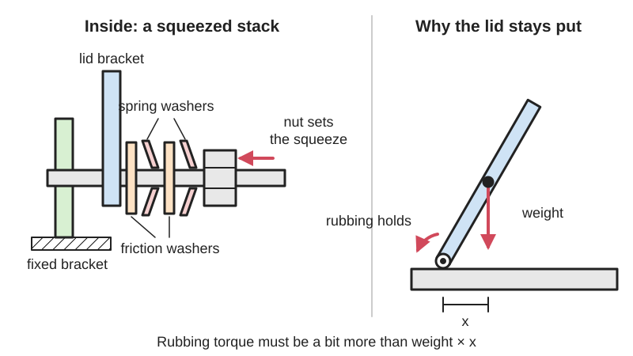

*Diagram drawn for the encyclopaedia from the research notes. ⚑ Needs confirming: a drawing can simplify or get details wrong; a real photo or a better diagram is welcome.*

A hinge with a built-in, controlled amount of rubbing (friction) inside it, so that it holds a lid, screen or door at any angle against its own weight but still turns smoothly when you push it.

**In plain words:** A stiff hinge that stays at whatever angle you leave it, like a laptop screen that doesn't flop back or fall shut. **Proper term:** Friction hinge (constant [torque](../glossary.md#torque) hinge, torque hinge).

**Also called:** torque hinge; constant torque hinge (resistance is the same all the way round; Southco's and Design World's term); position control hinge / positioning hinge; free-stop hinge (Reell); adjustable friction hinge / hinge with adjustable friction (Elesa CFU series; the squeeze is set with a screw); one-way torque hinge (friction in one direction only, e.g. Sugatsune HG-TQA (brand)); laptop hinge / display hinge / monitor tilt hinge; clip friction hinge (Reell's patented design with C-shaped clips on a shaft); friction stay (for windows; a sliding version, see 'Lid and flap stays'); stay-open hinge or stiff hinge (maker wording); hollow-shaft friction hinge or hollow torque insert (a friction hinge with an open centre, so wires, cables, tubing and connectors pass through the pivot; Reell HTH60 and HTI360 (brand)).

## How it works

Something springy squeezes the hinge's turning surfaces together, so they rub (friction) whenever the hinge turns. The squeeze is set so that the rubbing resists a bit more turning force (torque) than the lid's weight creates, so the lid stays put, but less than a hand can easily apply, so you can still move it. Because rubbing friction hardly changes with angle, the resistance is roughly the same all the way round (constant torque), with no clicks and no spring-back. The squeeze comes from spring washers on the shaft, clips or a curled spring sheet that are slightly too small for the shaft (an [interference fit](../glossary.md#interference-fit)), or an adjusting screw; in Reell's clip design, adding clips adds torque in equal steps (USRE37712E1).

## Parts

A small assembly that acts as one unit: two leaves or brackets, a shaft (pin), and a friction pack that squeezes the shaft. Common friction packs: a stack of friction washers and dished spring washers clamped by a nut or rivet (laptop type; Canon patent US5652694, Restarters wiki); several stamped metal clips gripping the shaft with an interference fit (Reell clip hinge, USRE37712E1); a curled spring sheet wrapped round the shaft (curl type); or a shaft press-fitted into a tube (pipe type) (Sugatsune; Mansfield). Adjustable versions add a tensioning screw (Elesa CFU). Printed versions: printed knuckles, a metal bolt as the pin, a nylon-insert lock nut and rubber [O-rings](../glossary.md#o-ring) or a TPU (flexible) core.

## Everyday examples

- A laptop screen that stays at any angle (Design World; aboutmechanics.com)
- Computer monitors and tablet or display stands that tilt and stay (Reell: 'monitors, laptop lids or automotive mirrors')
- Car centre-console lids and infotainment screens (Design World)
- Casement windows on friction stays, which hold the sash open against wind (Thang, 2700 Animated Mechanical Mechanisms, Part 3, p. 149)
- Medical equipment arms and covers, and aircraft seat headrests (Design World)

## When to use it

Use a friction hinge when a lid, screen, flap, visor or light should stay at any angle you leave it, without a separate stay, catch or knob to tighten: laptop-style lids, display and tablet stands, folding phone stands, instrument covers, camera or lamp arms that tilt, and printer-enclosure doors that shouldn't swing shut. It gives a smooth, quality feel with no clicks and stops lids from slamming. Use a one-way torque hinge when a lid should open easily but close slowly under its own weight. When wires must cross the hinge, choose a hollow-shaft friction hinge: it has an open centre that 'allows wires, cables, tubing, and connectors to pass directly through the pivot point center', so the wiring is hidden inside the joint; Reell sells them with 5 mm and 18 mm bores (internal diameters), 360° rotation and up to 11.5 N·m (Reell, hollow shaft hinges page). Reell lists medical equipment arms and monitors, vehicle displays, adjustable lighting or camera systems and robots with internal wiring as uses.

## When not to use it

Avoid it for heavy or long doors and hoods, where the needed torque is too high or the hinge would be hard to move (use a counterbalance hinge, [torsion](../glossary.md#torsion) spring or gas strut; Machine Design, Design World); when you need exact, repeatable angles (use a [detent](../glossary.md#detent) hinge or an indexing plunger); when the position must not move if bumped or loaded (use a locking stay, a clevis with a thumbscrew or a Hirth joint); when the panel's weight changes a lot (use an adjustable friction hinge; Design World); and in hot or oily places where friction changes (choose a sealed, stainless or high-temperature type).

## Details

- **What it does (jobs):**
  - let it move (turn, slide or bend): it is a hinge that swings
  - slow it, stop it or keep its speed steady: the friction holds a lid, screen or door at any angle and stops it falling or swinging shut (one-way types add friction only in the closing direction)
- **Movement:** rotate; range depends on the hinge, e.g. up to 275° for Elesa CFU adjustable friction hinges (-95° to +180°), about 180° for most leaf-type hinges
- **Directions it can move (degrees of freedom):** 1: rotation about the hinge pin; the friction pack only resists that rotation, it does not add any other movement
- **Special behaviour:**
  - torque-limiting (slips or clicks at a set force/torque): it is really a slip joint; it holds until you push with more than its set turning force (torque), then it slips smoothly
  - one-way (moves freely one way, locks the other): only in one-way torque hinges, which have friction in one direction and turn freely in the other (Sugatsune; Design World); they do not lock, they just resist
  - none of the others: it has no clicks (indexing), no lock and no spring-back (the panel stays where it is put)
- **How it holds:**
  - friction or clamping ([force-fit](../glossary.md#form-fit--force-fit--material-bond)): surfaces squeezed together rub and resist turning
  - spring force (a spring or springy part presses it in place): spring washers, clips, a curled spring sheet or a rubber O-ring/TPU core keeps the squeeze on as parts wear
- **Input and output:** not applicable
- **Power:** passive (no power needed)
- **Load:** light to medium: holding turning force (torque) per hinge runs from tenths of a newton-metre to about 20 N·m (Design World); e.g. 1.4 N·m and 4 N·m for the two Elesa CFU sizes and up to 11.3 N·m per hinge (22.6 N·m per pair) for Reell's largest. Like any hinge it is strong against the panel's weight hanging on the pin ([shear](../glossary.md#peel-vs-shear)); the limit is how much turning force it can resist before it slips. Heavy panels (roughly 15 to 500 lb) are better served by counterbalance hinges (Machine Design).
- **Play and precision:** small: no clicks and no spring-back, and it stays wherever it is left, but the holding torque of a hinge varies, e.g. hinges sold with a ±20% torque [tolerance](../glossary.md#tolerance) (Sugatsune torque calculation page). It does not locate a repeatable angle (use a detent hinge for that). Needs the leaves mounted in line like any hinge; [misalignment](../glossary.md#misalignment) makes it feel uneven ⚑ [uncertain].
- **Taking it apart:** removable: screwed or bolted on like an ordinary hinge (e.g. Elesa CFU: pass-through holes for cylindrical head screws); riveted laptop and appliance hinges are semi-permanent
- **How often it can be reused:** many times: can be unscrewed and refitted; commercial hinges are rated for tens of thousands of opening cycles, e.g. 20,000 to 50,000 cycles within torque tolerance (Mansfield), up to 50,000 (Reell) and more than 60,000 with unchanged torque (Elesa CFU)
- **Sealing:** none
- **Adjustable:** Depends on type. Constant torque hinges: no, the torque is set in the factory (Design World; Mansfield). Adjustable torque hinges: yes, turn a screw clockwise to increase friction and anticlockwise to reduce it (Elesa CFU), or tighten the retaining nut on a laptop-style washer hinge (Restarters wiki). Printed hinges: tighten the bolt and lock nut that squeeze the knuckles, or print a tighter or looser part.
- **Access needed:** one side only (blind) when the leaves screw into tapped holes or thick parts; both sides when bolted through thin panels with nuts
- **Materials:** Commercial: zinc, stainless steel, aluminium or glass-filled nylon bodies (Reell); acetal (POM) technopolymer body with a polycarbonate pin and stainless-steel screw (Elesa CFU); mostly stainless steel (Sugatsune). Friction parts: stamped metal clips (Reell patent), compressible friction washers (Canon patent), metal-on-metal or metal-on-polymer surfaces (Mansfield). Printed: PLA or PETG knuckles with a steel bolt, nylon lock nut and rubber O-rings or a TPU core.
- **Heat, cold, water and wear:** Standard friction hinges are rated about -20 °C to 65 °C, with special high-temperature types for ovens (Mansfield). Heat, humidity, chemicals and dirt change friction, and metal-on-polymer friction degrades under heat and chemicals (Mansfield); stainless steel and sealed mechanisms resist corrosion (Design World; Sugatsune). Printed hinges: PLA starts to give way at about 60 °C and PETG at about 80 °C under load (CNC Kitchen), and squeezed plastic relaxes over time, faster when warm, so the hinge slowly loosens (DuPont, p. 72; thrinter). Oil or grease on the friction surfaces lowers the holding torque ⚑ [uncertain].

## Making it

- **Ways to make or get it:**
  - off-the-shelf part: constant torque, adjustable friction and one-way torque hinges, torque inserts (Reell), laptop hinges
  - 3D print (FDM): printed knuckles squeezed by a bolt and lock nut with O-rings or a TPU core, or a printed screw-and-slider friction mechanism
  - woodwork: fitting bought friction hinges to lids, flaps and cabinets
  - sheet metal: stamped brackets and clips in commercial hinges (Reell patent) ⚑ [uncertain]
  - CNC: machined shafts and bodies for heavy-duty torque hinges ⚑ [uncertain]
- **Printing it in one piece (print in place):** partly: [print-in-place](../glossary.md#print-in-place) hinges can be given friction by adding a bolt and nut to squeeze the knuckles (e.g. 'Print-in-place Adjustable Torque Hinges' on Thingiverse, which uses an M3 x 8 mm bolt and nut ⚑ [uncertain], search summary only); KatDelgado's 'Friction Hinge Mechanism' is printed as separate parts (threaded barrel, two caps, threaded slider) and screwed together.
- **Tools:** screwdriver or hex key to fit; a hex key or spanner to adjust the friction on adjustable types (Elesa CFU; laptop retaining nut per Restarters wiki); none to operate
- **Difficulty:** easy to moderate: easy to buy and screw on, or to print a hinge that is squeezed by a bolt, lock nut and O-rings; moderate to print one that keeps the same [holding force](../glossary.md#holding-force) for a long time, because squeezed plastic relaxes (DuPont design guide)

### 3D printing tips

1) Don't rely on a tight printed fit for the friction. Plastic that is held squeezed slowly loses its grip ([stress relaxation](../glossary.md#stress-relaxation)), so a press-fitted or tight hinge loosens, and heat speeds this up (DuPont design guide, pp. 23 and 72). DuPont's advice for plastic friction couplings: if a constant torque must be held for a long time, add a metal spring to keep the force constant (p. 48). PLA [creeps](../glossary.md#creep) most, PETG less (thrinter creep test). 2) Easiest reliable design: print ordinary knuckles with normal [clearance](../glossary.md#clearance) (at least 0.3 mm for moving parts, Prusa) and make the friction adjustable: a steel bolt as the pin, a nylon-insert lock nut, and rubber O-rings or a flexible TPU ring pressed between the knuckle faces. Designs like this: lfenske's 'Friction Hinge' (5 mm bolt, nylon lock nut, O-rings on each knuckle face) on Thingiverse and 'Friction Hinge (TPU core)' on MakerWorld (M3 bolt and nylon lock nut, TPU core printed in about 85A TPU, PLA+ frames) ⚑ [uncertain] (details from search summaries; pages not readable). The rubber keeps pressing as parts wear, like a spring washer. 3) For a hinge that needs no bolt, KatDelgado's printed 'Friction Hinge Mechanism' turns rotation into sliding: a threaded barrel drives a slider along a hex (later square) shaft, and the rub of the slider on the shaft gives the resistance. The published phone-stand settings were a 0.15 mm per face offset on the shaft and a 14 mm long slider, with threads offset 0.1 mm; the caps must be held so they can't be pushed apart; a square shaft printed lying flat worked more consistently because no [layer lines](../glossary.md#layer-lines) catch (Printables, CC BY). 4) In OpenSCAD, BOSL2's knuckle_hinge() can make the pin hole for a machine screw (pin_diam="M3"), with clearance holes through most knuckles and a self-tapping hole in the last one; its print-in-place option uses interlocking cones whose angle changes how tight the hinge is (BOSL2 hinges.scad). 5) Work out the torque you need before choosing sizes: lid weight times the sideways distance from the hinge pin to the lid's centre of gravity, worst when the lid is horizontal, plus a margin (see rules of thumb). A small printed friction hinge held up a phone in a case (KatDelgado); bigger lids need two hinges, a metal hinge or a stay. 6) Print knuckles so that bending doesn't split the layers: printed layers bond at only about half the in-plane strength (vertical PLA hooks failed at 55% and PETG at 46% of the flat-printed load, CNC Kitchen). 7) Material: PETG or ASA for anything warm; PLA started to give way at 60 °C and PETG at 80 °C in CNC Kitchen's hot-load test, and friction parts creep faster when warm. TPU or rubber O-rings give a smoother, longer-lasting friction feel than hard plastic rubbing on hard plastic ⚑ [uncertain].

### Buying one (off-the-shelf parts)

Search for: 'friction hinge', 'torque hinge', 'constant torque hinge', 'position control hinge', 'free-stop hinge', 'adjustable friction hinge', 'one-way torque hinge', 'torque insert' (Reell), 'laptop hinge' (replacement part by model number), 'friction stay' (windows). Parts for DIY friction: 'nylon-insert lock nut' (nyloc), 'spring washer', 'Belleville washer' or 'disc spring', 'wave washer', 'friction washer', 'O-ring', 'shoulder bolt'. Makers: Reell, Southco, Sugatsune, Elesa (brands). For wires through the pivot: 'hollow shaft hinge', 'hollow shaft friction hinge' or 'hollow torque insert' (Reell HTH60 with an 18 mm bore, HTI360 with a 5 mm bore).

## Rules of thumb

- Torque needed = weight x horizontal distance from the hinge axis to the centre of gravity (Reell; Sugatsune: M = X1 x m, e.g. a 0.8 kg door with its centre of gravity 0.2 m from the axis needs about 1.57 N·m, or 0.79 N·m per hinge when two hinges share it). It is greatest when the panel is horizontal; one guide writes it as weight x distance x cos(angle) (Mansfield).
- For a plain, even panel the centre of gravity is halfway across, so torque = (distance from hinge to door edge x weight) / 2 (Sugatsune 'The ABC's of Torque Hinges').
- Add a margin: Sugatsune adds about 20% (with ±20% torque tolerance, the door's moment should be 20% below the hinge's average torque); Design World and Mansfield suggest adding about 30%.
- Adding hinges shares the load: divide the total torque by the number of hinges (Sugatsune).
- Typical commercial holding torque: tenths of a N·m up to about 20 N·m per hinge (Design World); Reell's largest hold 11.3 N·m each (Reell). Reell's hollow-shaft hinge page gives 'up to 11.5 N-m of torque' for its hollow-shaft range, slightly more than the 11.3 N·m above (both Reell figures recorded side by side).
- Typical life: 20,000 to 50,000 cycles within torque tolerance (Mansfield); Elesa CFU tested to more than 60,000 cycles with unchanged torque.
- Standard friction hinges are usually rated about -20 °C to 65 °C; special oven hinges go higher (Mansfield).
- Plastic friction or spring parts lose force over time by stress relaxation; for a torque that must stay constant for a long time, add a metal spring (DuPont design guide, p. 48).
- Choose a friction (constant torque) hinge to hold any angle, a detent hinge for set angles with a click, and a counterbalance hinge or gas strut for heavy doors (Machine Design; Design World).

## Common failures

The friction fades as surfaces wear or the plastic squeeze relaxes, so the lid drifts down; fix by tightening an adjustable hinge, fitting a spring washer, or replacing the hinge (DuPont; Restarters). The mounting fails before the hinge: in laptops the plastic around the threaded brass bushes cracks and the bush pulls out, often from stiff hinges (Restarters wiki). The hinge becomes too stiff after liquid damage or corrosion (Restarters). The hinge was sized without the centre-of-gravity distance or a margin, so it can't hold (Sugatsune; Mansfield). Printed hinges: knuckles split along layer lines, or PLA creeps so the hinge loosens (thrinter; CNC Kitchen); prevent by using a bolt, lock nut and O-rings rather than a tight fit.

## Safety

A friction hinge only resists; it doesn't lock. If the torque is too low for the lid, or the lid gets heavier (added parts) or is bumped, it can drop and pinch fingers or hit a head; size the torque with a margin and use a stay for heavy lids. Hinges are pinch points at the knuckle. Adjustable hinges can be set below the holding threshold by mistake (Mansfield). Laptop hinge repairs involve spring-loaded washer stacks and cracked plastic mounts (Restarters wiki).

## Related

- Detent hinge (click hinge): holds only at set angles, with a click, instead of anywhere
- Lid and flap stays (friction stay): a sliding friction arm that holds a lid or window, rather than friction in the hinge itself
- Friction slip clutch: the same controlled-rubbing idea on a turning shaft, used to protect drives
- Self-closing hinge (spring hinge): a spring swings the door shut rather than holding it
- Counterbalance hinge / gas strut: cancels most of a heavy lid's weight instead of just resisting it
- Rotary damper (soft-close hinge): resists speed rather than position, so a lid closes slowly but doesn't stay open
- Ball-and-socket joint with friction: the same holding idea in every direction (Reell also makes friction spherical joints)
- Clevis joint with thumbscrew: holds any angle by clamping, which is firmer but needs a knob turned each time
- Ordinary butt hinge and print-in-place hinge: swing freely with no holding
- Cable through a hinge: how to carry wires across a pivot without pinching or breaking them; a hollow-shaft friction hinge is one way, passing them through its open centre (Reell)

## Make it yourself

- [Friction Hinge Mechanism (KatDelgado, Printables)](https://www.printables.com/model/658393-friction-hinge-mechanism): A small printed friction hinge (30 mm long, 16 mm diameter) in which a threaded barrel drives a slider along a hex or square shaft; resistance doesn't depend on angle; no supports; strong enough to hold a phone. Read through the Printables public API. *(licence: CC BY)*
- [Folding Pocket Phone Stand (Updated) (KatDelgado, Printables) (URL from Printables API, page not opened)](https://www.printables.com/model/658410-folding-pocket-phone-stand-updated): A folding phone stand that uses the friction hinge mechanism above to hold a phone at any angle; shows the mechanism in a real product. Read through the Printables public API. *(licence: CC BY-SA)*
- [Friction Hinge by lfenske (Thingiverse) (page is JavaScript-only; details from a search-engine summary)](https://www.thingiverse.com/thing:697522): An adjustable printed friction hinge using a 5 mm bolt, a nylon lock nut and rubber O-rings on the knuckle faces ⚑ [uncertain] *(licence: ⚑ [uncertain])*
- [Print-in-place Adjustable Torque Hinges 40mm x 35mm by Notxtwhiledrive (Thingiverse) (page is JavaScript-only; details from a search-engine summary)](https://www.thingiverse.com/thing:5457967): Print-in-place hinges whose friction is set by tightening an M3 x 8 mm bolt and nut ⚑ [uncertain] *(licence: ⚑ [uncertain])*
- [Friction Hinge (TPU core) (MakerWorld) (appeared in search results; page blocked automated access)](https://makerworld.com/en/models/1621388-friction-hinge-tpu-core): A small friction hinge using a printed TPU core as the spring, M3 countersunk mounting screws and an M3 bolt with nylon lock nut ⚑ [uncertain] *(licence: ⚑ [uncertain])*
- [BOSL2 hinges.scad (knuckle_hinge module, OpenSCAD library)](https://raw.githubusercontent.com/BelfrySCAD/BOSL2/master/hinges.scad): Parametric knuckle hinge generator; the pin hole can be sized for a machine screw (e.g. M3) so a bolt and lock nut can squeeze the knuckles, or made print-in-place with cones whose angle sets the tightness *(licence: BSD 2-Clause (BOSL2 LICENSE file))*

## Pictures, videos and models

- [Lenovo ThinkPad X220 LCD hinges (Siarhei V, Wikimedia Commons)](https://commons.wikimedia.org/wiki/File:Lenovo_ThinkPad_X220_LCD_hinges_Kashui_FRU_04W2185_vs_Foxconn_FRU_04W1406.jpg): Photos from several angles of two replacement laptop screen friction hinges side by side *(licence: CC BY-SA 4.0)*
- [USRE37712E1 Clip friction hinge (Reell Precision Manufacturing, Google Patents)](https://patents.google.com/patent/USRE37712E1/en): Patent drawings of a shaft carrying several stamped clips held from turning by a housing; the clips' grip on the shaft gives a nearly constant torque *(licence: link only (US patent drawings are generally public domain) ⚑ [uncertain])*
- [How to Calculate Torque (Sugatsune torque hinge resources)](https://www.sugatsune-intl.com/torque-hinges/torque-calculation/): Diagrams of a door's centre of gravity and the torque formula, a worked example, and a chart of torque tolerance *(licence: link only)*
- [CFU. Hinges with adjustable friction (Elesa)](https://www.elesa.com/en/elesab2bstoreuk/hinges-with-adjustable-friction-cfu): Product photos and drawings of plastic hinges whose friction is adjusted with a screw; 275° range *(licence: link only)*
- [HG-TQA One Way Torque Hinge by Sugatsune (YouTube, Sugatsune America)](https://www.youtube.com/watch?v=h_7l-gslYdo): Manufacturer video of a one-way torque hinge, which resists turning in one direction only (title confirmed via YouTube oEmbed; content not viewed) ⚑ [uncertain] *(licence: link only (standard YouTube licence))*

## Needs confirming

⚑ marks something nobody has confirmed yet: a fact the research could not confirm from a source, a finder value that is a best guess, or an open point from the research notes. Corrections are welcome (see `research/needs-confirming.md`).

- ⚑ 15 sentences on this page marked [uncertain].
- ⚑ Finder value `connects` = lid, door or cover (best guess): worked out from its name, but joining parts is not one of its two main jobs
- ⚑ Finder value `clicks` = silent (best guess): the text uses both clicking and silent words

## Sources

- <https://mansfieldec.com/feeds/blog/friction-hinge-design>
- <https://www.machinedesign.com/fastening-joining/article/21138788/how-much-torque-do-these-hinges-need>
- <https://reell.com/resources/constant-torque-hinges-position-control>
- <https://reell.com/resources/frequently-asked-questions>
- <https://reell.com/resources/friction-hinge-basics>
- <https://www.sugatsune.com/blog/the-abcs-of-torque-hinges/>
- <https://www.sugatsune-intl.com/torque-hinges/torque-calculation/>
- <https://www.designworldonline.com/what-is-a-friction-torque-hinge/>
- <https://www.elesa.com/en/elesab2bstoreuk/hinges-with-adjustable-friction-cfu>
- <https://patents.google.com/patent/USRE37712E1/en>
- <https://patents.google.com/patent/US5652694>
- <https://wiki.restarters.net/Fixing_Laptop_Hinges>
- <https://en.wikipedia.org/wiki/Hinge>
- <https://www.aboutmechanics.com/what-is-a-friction-hinge.htm>
- <https://commons.wikimedia.org/wiki/Category:Laptop_hinges>
- <https://commons.wikimedia.org/wiki/File:Lenovo_ThinkPad_X220_LCD_hinges_Kashui_FRU_04W2185_vs_Foxconn_FRU_04W1406.jpg>
- <https://www.youtube.com/watch?v=h_7l-gslYdo>
- <https://www.youtube.com/watch?v=p9Vf0iJaF1s>
- <https://api.printables.com/graphql/>
- <https://www.printables.com/model/658393-friction-hinge-mechanism>
- <https://raw.githubusercontent.com/BelfrySCAD/BOSL2/master/hinges.scad>
- <https://www.distrupol.com/General_Design_Principles_for_Engineering_Polymers.pdf>
- <http://thrinter.com/creep-abs-pla-petg-alloy-910/>
- <https://www.cnckitchen.com/blog/comparing-pla-petg-amp-asa-feat-prusament>
- <https://help.prusa3d.com/article/modeling-with-3d-printing-in-mind_164135>
- <https://raw.githubusercontent.com/BelfrySCAD/BOSL2/master/LICENSE>
- <https://reell.com/products/hollow-shaft-hinges>
