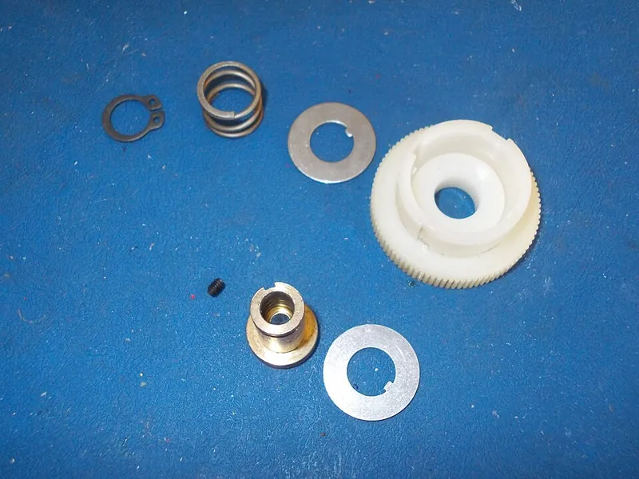
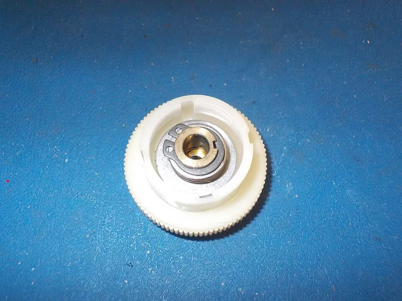

<figure class="eoc-pic eoc-pic-main"><picture><source media="(prefers-reduced-motion: reduce)" srcset="../media/drawn/friction-slip-clutch.svg"></picture><figcaption><strong>Animation.</strong> Diagram drawn for the encyclopaedia from the research notes. ⚑ Needs confirming: a drawing can simplify or get details wrong; a real photo or a better diagram is welcome.</figcaption></figure>
<figure class="eoc-pic"><figcaption><strong>How it works.</strong> <a href="https://commons.wikimedia.org/wiki/File:Slipping_Clutch_parts.jpg">Slipping Clutch parts</a> by tony_duell, <a href="https://creativecommons.org/licenses/by/2.0">CC BY 2.0</a>, from Wikimedia Commons.</figcaption></figure>
<figure class="eoc-pic"><figcaption><strong>Photo.</strong> <a href="https://commons.wikimedia.org/wiki/File:Slipping_Clutch_assembled.jpg">Slipping Clutch assembled</a> by tony_duell, <a href="https://creativecommons.org/licenses/by/2.0">CC BY 2.0</a>, from Wikimedia Commons.</figcaption></figure>

Two or more friction surfaces held together by an adjustable spring pass turning force like a solid joint until a set [torque](../glossary.md#torque), then slide smoothly and keep sliding for as long as the overload lasts, resetting by themselves afterwards.

**In plain words:** A spring squeezes rubbing plates together so the drive turns normally, but the plates slide over each other instead of breaking something when the load gets too heavy. **Proper term:** Friction slip clutch (friction torque limiter).

**Also called:** slip clutch; slip coupling; slipper clutch (RC cars: the spring-loaded pads on the spur gear); friction torque limiter; friction plate torque limiter; safety friction clutch; friction safety clutch; overload clutch (general name for all torque limiters); torque limiter (general name); drag (on fishing reels and filament spool holders); slipping clutch; clutch gear (LEGO Technic (brand) name for a gear that slips on its axle); Rutschkupplung (German); limiteur de couple (French, general term for torque limiter); Note: on motorcycles 'slipper clutch' means a back-torque limiter that slips when the rear wheel drives the engine, which is a different device.

## How it works

A spring pushes the friction faces together, and friction between them carries the turning force from one side to the other (plain friction clutch principle). The most torque it can carry is roughly spring force x friction coefficient x mean radius of the rubbing ring x number of rubbing face pairs. When the load asks for more than that, the faces start to slide: the input keeps turning, the output slows or stops, and the extra energy turns into heat. When the overload goes away the faces grip again, so nothing has to be reset or replaced; tightening the nut squeezes the spring harder and raises the slip torque.

## Parts

A small assembly that acts as one unit: hub (fixed to the shaft), friction discs or pads, the driven part (gear, sprocket, pulley or plate) sandwiched between them, a pressure plate, a spring (coil spring, wave washer or disc spring), and an adjusting nut; industrial versions add a plain bearing inside the driven part

## Everyday examples

- The drag on a fishing reel: a big hand nut sets how hard the line can pull before the spool slips (Wikipedia 'Torque limiter')
- The slipper clutch on a hobby RC car's spur gear, which slips on hard launches and landings to protect the gears (PetitRC)
- A filament spool holder with a built-in slip clutch that keeps gentle tension on the filament (Printables spool holder by Riskable)
- The friction clutch that lets you move a clock's hands to set the time without stopping the movement (Printables 'Friction Clutch for Clock'); also the LEGO Technic (brand) clutch gear used so a motor can keep running when steering hits its end stop (Sariel)

## When to use it

When a motor or gearbox could jam or hit an end stop and you want it to slip safely and carry on afterwards without replacing anything: robot arm joints and grippers (Slocum: a clutch keeps gear teeth from being sheared off when a driven part hits a rigid object), RC car drivetrains, conveyor and winch drives, window-blind and curtain drives, knobs that must not over-drive a mechanism at its end stops, clock hand-setting. Also when you want a steady, adjustable drag, such as a spool holder or fishing reel. Good when overloads may happen often, because it resets by itself

## When not to use it

Not when the load must be held against gravity or position must never be lost, because a slipping clutch lets the load move and the output loses its position (use a worm drive, brake or other [self-locking](../glossary.md#self-locking) drive, or a ball-detent limiter that snaps back to the same position). Not where it would slip for long periods at speed, since heat and wear build up (stop the motor using current sensing, or use a magnetic or [hysteresis](../glossary.md#hysteresis) coupling). Not where an exact trip torque is needed, since friction limiters vary by about +/-15% (use a ball-detent torque limiter). Not where you need the drive fully disconnected on overload (use a disconnect-type ball-detent limiter or a [shear](../glossary.md#peel-vs-shear) pin). Not in oily places unless it is sealed or oil-rated

## Details

- **What it does (jobs):**
  - slip or let go when overloaded: protects gears, motors and belts from jams, crashes and shock loads
  - slow it, stop it or keep its speed steady: used as a steady drag, e.g. a fishing-reel drag or a filament spool holder that keeps the filament under light tension
- **Movement:** rotate: passes continuous rotation 1:1 while gripping; the two halves rotate relative to each other (unlimited turns) while slipping
- **Directions it can move (degrees of freedom):** 0 while gripping (the two halves turn as one); 1 while slipping (rotation of one half relative to the other about the shaft)
- **Special behaviour:**
  - torque-limiting: slips smoothly at a set, adjustable torque instead of breaking gear teeth or stalling a motor, and keeps passing that torque while it slips (it does not disconnect completely)
  - Resets itself: grips again as soon as the overload ends; nothing to replace (unlike a shear pin)
- **How it holds:**
  - friction or clamping ([force-fit](../glossary.md#form-fit--force-fit--material-bond)): the drive is carried only by friction between the pressed faces
  - spring force (a spring or springy part presses it in place): a coil, wave or disc spring provides the clamping force and sets the slip torque
- **Input and output:** continuous rotation -> the same continuous rotation, ratio 1:1 while gripping; limited to the set slip torque when overloaded (the output then turns slower or stops while the input keeps turning). Efficiency close to 100% while gripping; while slipping, all the power passing through the slipping faces becomes heat. Shafts in line (as a shaft-to-shaft coupling) or a gear, sprocket or pulley mounted on a hub on one shaft (ComInTec style). Back-drivable: yes; it slips at about the same torque in either direction, so a load can drive it backwards once it exceeds the slip torque (for example an arm sagging under gravity)
- **Power:** passive (no power needed); the spring provides the clamping force. Electromagnetic and magnetic-particle clutches that do the same job are covered elsewhere
- **Load:** Light to heavy depending on size: hobby versions carry light loads (a few N·cm in a toy clutch gear to about 1 N·m in printed designs ⚑ [uncertain]); industrial friction torque limiters are sold from about 1 N·m up to 23,000 N·m (ComInTec range quoted in CDA). Strong in twist up to its set slip torque by design; it is not meant to carry large side loads or thrust on its own, so the shaft needs its own bearings
- **Play and precision:** No [backlash](../glossary.md#backlash) while gripping if the friction plate is mounted rigidly; if the plate slides on a [spline](../glossary.md#spline) to follow the spring, the spline adds backlash, and Slocum advises mounting the plate on a thin flexible disc (diaphragm) for precision work. [Repeatability](../glossary.md#repeatability--accuracy) of the slip torque is modest (industrial units about +/-15%). After any slip the output has lost its angular position relative to the input, so a robot joint needs re-homing if its position sensor is on the motor side. It does not tolerate much shaft [misalignment](../glossary.md#misalignment); use a flexible coupling as well if the shafts are not in line
- **Taking it apart:** removable: slides off the shaft after undoing the adjusting nut (or a [circlip](../glossary.md#circlip) on small ones)
- **How often it can be reused:** effectively unlimited: it can slip and re-grip over and over and can be taken apart many times, though the friction faces wear and the torque setting drifts, so it needs checking and occasional new pads
- **Sealing:** none: it is an open mechanism; oil, grease or water on the friction faces changes the slip torque, so it should be kept dry and clean or covered
- **Adjustable:** yes: turning the adjusting nut changes how hard the spring presses (industrial units: tighten until it no longer slips in normal running, then a further half turn; RC slipper clutches are adjusted in 1/8-turn steps). Changing the spring or adding friction discs changes the range
- **Access needed:** end of a tube or shaft: the parts slide onto a shaft end and are clamped by a nut or circlip on that end
- **Materials:** Industrial: steel hub and pressure plates, bonded friction rings (organic lining material ⚑ [uncertain]), steel disc springs, a bronze or plastic plain bearing inside the driven part. Maker versions: printed plates or gears (PETG is preferred over PLA because slipping makes heat and the parts must flex slightly), a metal compression spring or wave washer, a lock nut on a threaded rod or bolt, and optionally friction pads such as felt, cork, leather or rubber [O-rings](../glossary.md#o-ring) between printed faces ⚑ [uncertain]. Oil and grease must be kept off the friction faces
- **Heat, cold, water and wear:** Oil or grease on the faces causes a large torque drop and water a temporary one (CDA Magazine / ComInTec). Heat from slipping raises temperature; printed PLA parts soften and deform above about 60 °C (Prusa PLA guide), PETG is rated for use below about 80 °C (Prusa PETG guide). Plastic parts that are clamped lose force over time through [stress relaxation](../glossary.md#stress-relaxation) (DuPont design guide), so use a metal spring. Slip torque drifts as the faces wear, bed in, glaze or pick up dirt, so recheck the setting now and then; long periods without slipping can change the first slip torque ⚑ [uncertain]

## Making it

- **Ways to make or get it:**
  - 3D print (FDM): plates, gear with friction faces, pressure plate and spool hubs; add a metal spring and nut
  - 3D print (resin): possible for small clock or instrument clutches ⚑ [uncertain]
  - CNC or lathe: metal hubs and pressure plates
  - laser cut: flat friction discs from acrylic, plywood, cork or felt sheet ⚑ [uncertain]
  - off-the-shelf part: industrial friction torque limiters (hub type for sprockets and pulleys, or coupling type), RC slipper clutch assemblies and pads, toy-kit clutch gears
- **Printing it in one piece (print in place):** no: the plates, spring and nut are separate parts that are assembled, and the spring and nut are normally bought metal parts; this is what allows the torque to be adjusted
- **Tools:** A spanner (wrench) or screwdriver for the adjusting nut; circlip pliers for small units whose spring is held by a circlip (Commons photo notes the circlip is 'a little tricky to fit'); sometimes a hex key for the hub's [set screw](../glossary.md#set-screw)
- **Difficulty:** moderate: easy to print and assemble with a bolt, a spring and a lock nut, but getting a steady slip torque takes trial and error (spring choice, friction material, and printed parts that soften or [creep](../glossary.md#creep)); ready-made friction torque limiters and RC slipper clutches can be bought instead

### 3D printing tips

Print the rubbing plates flat on the bed so the friction faces are smooth top or bottom surfaces, not layer edges. Use PETG (or ASA, nylon) rather than PLA for parts that slip or flex: the RC slipping-gear designer on Printables says the clutch 'needs to flex and accept some heat - so PETG is better than PLA', and the Printables clock friction clutch 'does not work printed in PLA' and needs a tolerance-calibrated PETG profile. PLA softens and deforms above about 60 °C (Prusa), which slipping can reach. Let a metal coil spring, wave washer or disc spring provide the clamping force rather than squeezed plastic, because plastic springs and clamped plastic lose force over time (stress relaxation, DuPont). Key alternate discs to input and output the simple way shown in Thang's 'Safety clutch 4': square holes locking some discs to one shaft and round holes riding on a square rod for the others. Use a lock nut (nylon insert) on a threaded rod or bolt so the setting does not unwind; the Printables spool holder runs on an 8 mm or 5/16 in threaded rod. Expect the first hours of use to change the torque as the faces bed in, and test the slip torque with a drill on its lowest clutch setting, as the RC slipping-gear designer suggests. Keep all grease away from the friction faces, but lubricate any separate bearing surfaces

### Buying one (off-the-shelf parts)

Friction torque limiter (hub type, carries a sprocket, gear or pulley between two friction rings, with disc springs and an adjusting nut); torque limiter coupling; slip clutch; RC slipper clutch assembly, slipper pads and slipper spring; spur gear with slipper hub; disc springs (Belleville washers); wave washers; compression springs; nylon-insert lock nuts; threaded rod; plain bearings or 608 ball bearings for spool holders; toy-kit clutch gears (e.g. LEGO Technic (brand) 24-tooth clutch gear). Supplier category names: 'torque limiters', 'slip clutches', 'friction torque limiters'

## Rules of thumb

- Slip torque T = n x mu x W x R, where W is the spring's clamping force, mu the friction coefficient, R the mean radius of the rubbing ring and n the number of pairs of rubbing faces; for worn-in faces R = (outer radius + inner radius) / 2; with n1 discs on one shaft and n2 on the other, n = n1 + n2 - 1 (University of Mustansiriyah lecture 'Friction Clutches', eqs. 16-19 and General Notes). Worked examples there use mu = 0.25 to 0.33 for dry friction faces
- A cone (tapered) friction face multiplies the slip torque by 1 / sin(half-angle) for the same spring force, e.g. a 30° half-angle doubles it (same lecture, eqs. 10 and 15)
- Industrial friction torque limiters are not precision devices: the slip torque typically varies by about +/-15% (CDA Magazine / ComInTec)
- Setting: tighten the adjuster until it no longer slips in normal running, then add a further half turn (CDA Magazine / ComInTec); RC slipper clutches are adjusted in 1/8-turn steps (PetitRC; RCexplained)
- Mount it on the slow side of a gearbox (the output) if it may slip for long, because continuous slipping at speed causes heat and wear; stop the drive if it slips for long (CDA Magazine / ComInTec). Remember the trade-off: torque at the output = clutch slip torque x the [gear ratio](../glossary.md#gear-ratio) between the clutch and the output, which is why a clutch gear placed right after the driving gear takes more output torque before it slips (Sariel's gears tutorial)
- Keep oil and grease off the friction faces: they cause a dramatic drop in slip torque, and contaminated friction rings must be replaced; water gives a temporary drop (CDA Magazine / ComInTec)
- Use a spring with a flat force curve (e.g. a disc spring worked in its flat range) so the torque stays steady as the faces wear (German Wikipedia 'Rutschkupplung'; CDA Magazine)
- If the friction plate slides on a spline there will be backlash; for precision mount the plate on a diaphragm (Slocum, FUNdaMENTALs of Design, Topic 5, 'Wheels: Clutches & Differentials')

## Common failures

Set too tight: it never slips, and gears or motors break anyway; set too loose: it slips in normal use, overheats and wears or burns out the pads (RCexplained; PetitRC). Oil, grease or water on the faces makes it slip early (ComInTec). Printed parts soften, glaze or wear from heat when they slip for long; printed or clamped plastic springs relax so the torque falls over time (DuPont). The nut unwinds and changes the setting (use a lock nut). Wear on the faces lowers the spring force and the torque unless the spring has a flat force curve. Avoid these by using a metal spring and lock nut, keeping it clean and dry, sizing it so it only slips on real overloads, and checking the setting regularly

## Safety

It limits torque but does not make a machine finger-safe: the set torque can still pinch or crush, and the input side keeps turning while the output is stalled. On a lifting axis or robot arm, an overload can let the load drop or sag. Slipping parts can get hot. The spring is preloaded, so undo the nut carefully. Disconnect power (or remove the spark plug lead on engines) before adjusting

## Related

- Ball-detent torque limiter: spring-loaded balls pop out of dimples at the set torque; more precise and can re-engage at the same angle, but clicks and hammers while overloaded instead of slipping smoothly
- Ratchet-tooth torque limiter (clicking torque-limiting cap or knob): sloped teeth click over each other at a set torque; one-directional, noisy, cheap to mould or print
- Torque-limiting gear with flexing spring arms (compliant slip hub): the same slipping-by-friction idea, but the spring is built into a one-piece plastic gear or hub, so it has no separate parts and is not adjustable
- Shear-pin coupling (breakaway link): a weak pin breaks at the set load and disconnects completely; very predictable and cheap, but must be replaced after every overload
- Magnetic coupling: magnets pass torque without touching and slip with no wear, but the torque is lower and it has more springiness (backlash)
- [Tolerance](../glossary.md#tolerance) ring: a wavy steel band press fit that slips at a set torque; very compact but not adjustable
- Friction clutch (plate or cone clutch): the same parts, but made to be engaged and disengaged on purpose, as in a car
- Motorcycle slipper clutch (back-torque limiter): a main clutch with ramps that slips only when the wheel drives the engine; a different device despite the shared name

## Make it yourself

- [Parametric Hangable Any-Direction Continuous Slip Clutch with optional Auto-Rewind Universal Spool Holder (Riskable, Printables)](https://www.printables.com/model/24154-parametric-hangable-any-direction-continuous-slip-): Parametric OpenSCAD filament spool holder with an adjustable continuous slip clutch that keeps tension on the filament, on an 8 mm or 5/16 in threaded rod with skate bearings; video at https://www.youtube.com/watch?v=kHT3rltCInU (web page bot-blocked here; details read through the Printables API) *(licence: CC BY-NC)*
- [Friction Clutch for Clock (jattie, Printables)](https://www.printables.com/model/948932-friction-clutch-for-clock): Adjustable friction clutch for a printed pendulum clock so the hands can be set without disconnecting the drivetrain; Fusion 360 source included; needs a tolerance-calibrated PETG profile (details read through the Printables API) *(licence: GPL 3.0)*
- [Repbox Integrated Auto-Rewinder Spool Holder (w/ slip clutch) (mikedmor, Printables model id 548003)](https://api.printables.com/graphql/): Remixed auto-rewinding spool holder for a filament storage box with an integrated slip clutch, using two 608 bearings (read through the Printables public API; the model's web page could not be opened here) *(licence: CC BY)*

## Pictures, videos and models

- [Slipping Clutch parts (Wikimedia Commons photo by tony_duell)](https://commons.wikimedia.org/wiki/File:Slipping_Clutch_parts.jpg): Photo of the separate parts of a small real slipping clutch that sits between a gearbox and a chart roller *(licence: CC BY 2.0 (reuse with credit))*
- [Slipping Clutch assembled (Wikimedia Commons photo by tony_duell)](https://commons.wikimedia.org/wiki/File:Slipping_Clutch_assembled.jpg): The same slipping clutch assembled, with its spring retained by a circlip *(licence: CC BY 2.0 (reuse with credit))*
- [Safety clutch 4 (Nguyen Duc Thang, YouTube thang010146)](https://youtu.be/Rrpg253rWto): CAD animation: friction discs pressed together by an adjustable spring; square discs locked to one shaft and round discs to the other, slipping when overloaded *(licence: link only (YouTube, all rights reserved))*
- [Safety Friction Clutch (DMG-Lib, Artobolevsky mechanism collection no. 452)](https://www.dmg-lib.org/dmglib/handler?mcdsc=3847025): Drawing of a safety friction clutch from Artobolevsky's mechanism collection, with a permanent DMG-Lib link *(licence: link only (DMG-Lib conditions of use))*
- [Limiteur de couple (Wikimedia Commons diagram by Jean-Jacques Milan)](https://commons.wikimedia.org/wiki/File:Limiteur_de_couple.png): Simple diagram of a torque limiter pressed by disc springs (the file page does not state which type is drawn ⚑ [uncertain]) *(licence: GFDL 1.2+ or CC BY-SA 3.0 (reuse with credit))*

## Needs confirming

⚑ marks something nobody has confirmed yet: a fact the research could not confirm from a source, a finder value that is a best guess, or an open point from the research notes. Corrections are welcome (see `research/needs-confirming.md`).

- ⚑ 7 sentences on this page marked [uncertain].
- ⚑ Finder value `connects` = shaft (best guess): worked out from its name, but joining parts is not one of its two main jobs
- ⚑ Finder value `slows_by` = steady speed or level (best guess): carried over from the finder's old rule on entry names (R33), for "What do you need?" under "Control a movement > Slow it down, stop it, or keep its speed steady"
- ⚑ Research note: *Friction slip clutch*: a motorcycle "slipper clutch" is a back-torque limiter, not the same as the RC-car slipper clutch. The entry says so.

## Sources

- <https://en.wikipedia.org/wiki/Torque_limiter>
- <https://de.wikipedia.org/wiki/Rutschkupplung>
- <https://en.wikipedia.org/wiki/Slipper_clutch>
- <https://www.controlsdrivesautomation.com/page_562391.asp>
- <https://uomustansiriyah.edu.iq/media/lectures/5/5_2021_12_11!08_29_17_PM.pdf>
- <https://pergatory.mit.edu/resources/FUNdaMENTALs%20Book%20pdf/FUNdaMENTALs%20Topic%205.PDF>
- <https://www.distrupol.com/General_Design_Principles_for_Engineering_Polymers.pdf>
- <https://site.petitrc.com/setup/HowToSlipper/>
- <https://www.radiocontrolinfo.com/what-is-the-purpose-of-a-slipper-clutch-on-an-rc-car/>
- <https://sariel.pl/2009/09/gears-tutorial/>
- <https://help.prusa3d.com/article/pla_2062>
- <https://help.prusa3d.com/article/petg_2059>
- <https://commons.wikimedia.org/wiki/Category:Torque_limiters>
- <https://commons.wikimedia.org/wiki/File:Slipping_Clutch_parts.jpg>
- <https://commons.wikimedia.org/wiki/File:Slipping_Clutch_assembled.jpg>
- <https://commons.wikimedia.org/wiki/File:Limiteur_de_couple.png>
- <https://commons.wikimedia.org/wiki/File:Slip_clutch.svg>
- <https://www.dmg-lib.org/dmglib/handler?mcdsc=3847025>
- <https://cs448m.github.io/lectures/machines/doc/3.pdf>
- <https://youtu.be/Rrpg253rWto>
- <https://www.printables.com/model/490489-slipping-gear-clutch-gear-for-rc-cars>
- <https://www.printables.com/model/24154-parametric-hangable-any-direction-continuous-slip->
- <https://www.printables.com/model/948932-friction-clutch-for-clock>
- <https://www.youtube.com/watch?v=kHT3rltCInU>
- <https://api.printables.com/graphql/>
