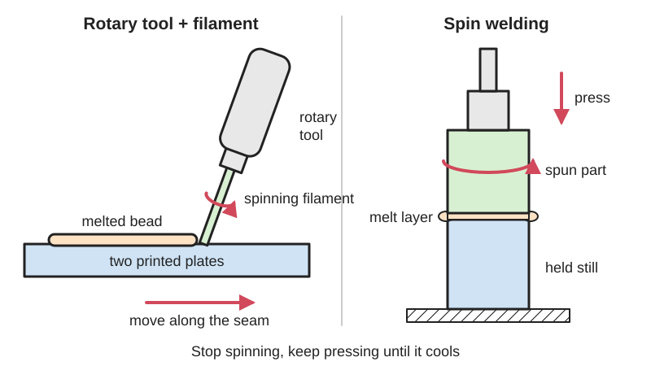

<figure class="eoc-pic eoc-pic-main"><figcaption>Diagram drawn for the encyclopaedia from the research notes. ⚑ Needs confirming: a drawing can simplify or get details wrong; a real photo or a better diagram is welcome.</figcaption></figure>

Friction welding melts plastic by rubbing instead of by heating: a short length of filament spun in a rotary tool is run along a seam like a melting filler rod, or one round part is spun against another on a drill press or lathe, until the contact melts and the parts fuse into a single piece.

**In plain words:** Spinning a stick of plastic, or a whole round plastic part, against another plastic part so fast that the rubbing melts both surfaces, so they fuse into one piece with no glue and no heater. **Proper term:** Friction welding of plastics (rotary-tool friction welding and spin welding).

**Also called:** friction welding with a rotary tool; 'Dremel (brand) friction welding'; filament friction welding (Scorchworks; Hackaday 2014); 'friction stir welding tips' as makers call printed rotary-tool tips (Printables 737519); true friction stir welding (FSW) uses a spinning tool that is not used up (Wikipedia 'Friction welding'; Hackaday 2014 reader comments); spin welding = rotary friction welding (RFW) of plastics; inertia (flywheel) spin welding; continuous-drive (direct-drive) spin welding (Wikipedia 'Spin welding of polymers'); Spinwelder (brand): a 1974 Mattel construction toy that spun a plastic rod against plastic parts (Toy Tales; Wikipedia); vibration welding of plastics: linear vibration welding, orbital friction welding, angular friction welding (Wikipedia 'Linear vibration welding', 'Friction welding'); metal friction welding: rotary, linear and inertia friction welding, friction stir welding (Wikipedia 'Friction welding'); flash (squeezed-out melt), flash trap, burn-off or upset (shortening during the weld).

## How it works

Pressing a fast-spinning plastic rod or part against another plastic surface makes frictional heat exactly where they touch, until both surfaces melt; the molten plastic mixes, and when the spinning stops and pressure is held, it freezes into a weld (Wikipedia 'Spin welding of polymers'). The rotary-tool method is 'similar to stick welding in that a consumable filler rod is added to the molten joint': the spinning filament wears away into the seam as you move along it (Hackaday 2014). Spin welding joins two round parts face to face: one is held still, the other is spun and pushed against it; once the faces are semi-molten the spin is stopped abruptly and the force is kept on until the joint cools (Wikipedia). Industrial versions rub the parts back and forth instead (vibration welding, about 100-300 Hz with 1-2 mm movement), or stir the joint with a spinning tool (friction stir welding); metal parts such as axles are friction-welded the same way on large machines (Wikipedia 'Plastic welding', 'Friction welding').

## Parts

Single piece once made. Rotary-tool method: a rotary tool (Dremel-type) with a short length of 1.75 mm or 3 mm filament, a plastic rod or a printed welding tip held in a [collet](../glossary.md#collet) or chuck (Scorchworks; Printables 692350, 737519). Spin welding: a drill press or lathe, a holder that spins one part and a fixture that holds the other still and in line (Popular Science used a bolt, a threaded rod coupling, two skate bearings and a wooden board).

## Everyday examples

- round plastic parts made by spin welding: toy and shopping-trolley wheels, recycling-bin wheels, fuel filters, [check valves](../glossary.md#check-valve), floats and aerosol cylinders (Wikipedia 'Spin welding of polymers', 'Plastic welding')
- spin-welded water-filter housings with end caps (Hackaday 2014 reader comment)
- Mattel's 1970s Spinwelder construction toys (Toy Tales; Wikipedia)
- car parts such as under-bonnet components and ports welded by vibration or spin welding (Wikipedia 'Plastic welding')

## When to use it

Rotary-tool welding: to join or repair PLA, ABS or styrene parts quickly without glue, especially to build structures bigger than the printer bed or to fix failed prints, using only a rotary tool and leftover filament (Scorchworks; Hackaday 2014). It needs no warm-up and no heater, and the joint stays one material. Spin welding: to join two round parts end to end with a sealed, strong joint, e.g. tubes, caps, bottle necks, wheels, capsules and round containers, using a drill press or lathe (Popular Science; Wikipedia). It is fast, repeatable once a jig is made, needs little surface preparation and adds no foreign material (Wikipedia).

## When not to use it

Joints that aren't round can't be spin welded; long straight seams on printed parts are easier with a soldering iron or hot-air plastic weld (Melted plastic weld). Awkward or inside corners where a rotary tool can't reach squarely (Hackaday 2018). Thin or delicate walls, which the spinning tip wears through (Printables 737519). Different plastics (except special pairs such as PET to polycarbonate), thermosets, resin prints, wood or metal at home. Parts that must come apart: use screws or snap fits. Large flat faces on ABS or acrylic: Solvent welding bonds the whole face. Industrial vibration, ultrasonic and metal friction welding need dedicated machines; for a maker, the closest alternatives are Melted plastic weld or bolting.

## Details

- **What it does (jobs):**
  - join and hold: permanently joins plastic parts, e.g. printed sections, or repairs a cracked print (Scorchworks)
  - glue or bond: a melted bond made without glue or a heater; Scorchworks notes it keeps the part 'a homogenous material'
  - seal it, or pass cables or fluid through: a spin-welded round joint makes a sealed container or cap (Branson; Popular Science)
- **Movement:** none
- **Directions it can move (degrees of freedom):** 0: the parts become one rigid piece.
- **Special behaviour:**
  - none: it is a plain permanent joint
- **How it holds:** [material bond](../glossary.md#form-fit--force-fit--material-bond) (glue, solvent or melting): the plastic of both parts (and the filler rod) is melted by friction and fuses
- **Input and output:** not applicable
- **Power:** passive (no power needed) once made; making it needs a powered rotary tool, drill press or lathe
- **Load:** Medium. Rotary-tool welds are 'shockingly strong, vastly superior to glued plastic for some joints' (Hackaday 2014); welded prints tend to break 'somewhere near the joint' rather than at it (Vaasa Hacklab 2016), and Fran's welded styrene seam survived 'a slew of violent whacks on the workbench' (Hackaday 2012). In a lab study, friction-stir welds between PLA+ prints reached 17.83 MPa at best, beating the 20%-infill body of the part (it broke outside the weld) but only about a third of a solid 100%-infill print (42-53 MPa) (Koçar et al., Polymers 2024). A bead run only along the outside of a seam joins less area than the whole contact face, so a reader suggests solvent welding may be stronger on broad flat joints and friction welding on small ones (Hackaday 2014 comment; opinion, untested). A spin weld should have a weld area greater than the part's wall section so the joint is not the weak point (Branson SW-1).
- **Play and precision:** No play once welded. Spin welding needs the two parts lined up on the same axis: Popular Science lowers the spindle with the power off to align the parts before clamping the jig, and suggests a centre guide rod to make it self-aligning; Branson's joints use lead-ins, self-centring angled faces or a tongue and groove with about 0.005-0.010 in (0.13-0.25 mm) [clearance](../glossary.md#clearance). Some plastic squeezes out as flash, so the joined part ends up slightly shorter than the two parts added together (Wikipedia 'Spin welding of polymers'). Rotary-tool welds are made by hand, so the parts must be held in place, and the bead adds a lump that may need sanding.
- **Taking it apart:** permanent: it can only be cut or ground apart
- **How often it can be reused:** once
- **Sealing:** airtight or pressure for a good spin weld: Branson says spin welding produces 'a strong hermetic seal', a Hackaday reader describes spin-welded water-filter housings giving 'a nice watertight weld in a few seconds', and Popular Science's spin-welded bottle-neck capsule is watertight. A hand-run rotary-tool bead is a structural repair and is not reliably watertight ⚑ [uncertain: no leak test found].
- **Adjustable:** no: fixed once cooled
- **Access needed:** one side only (blind) for a rotary-tool bead run along a seam; end of a tube or shaft for spin welding, where the round parts are held at their ends in a chuck and a fixture and pressed end to end
- **Materials:** Works on most thermoplastics, joined to the same plastic. Rotary-tool welding is proven on PLA and ABS prints (Scorchworks; Vaasa Hacklab) and styrene rod (Hackaday 2012); for two different plastics, the tip should be the higher-melting one and you bias the heat towards that part (Printables 737519). Spin welding: Branson rates relative ease (1 easiest to 5 hardest): ABS 1-2, polycarbonate 1-2, rigid PVC 1-2, polystyrene 1-2, nylon 1-2, acrylic 2, PP 2, PBT 2, acetal 2-3, PET 2-3, PEEK 3, PE 3, fluoropolymers 3-4 (Branson SW-1); Wikipedia lists polyurethane as 'poor to fair'. Popular Science welds PET bottle necks, and notes 'different plastics can't normally be welded to each other', with PET to polycarbonate as an exception. Printed PLA rods (including metal-filled PLA) have been spin welded on a lathe (Kuo et al., Polymers 2023). Glass-fibre fillers don't cross the joint, so filled plastics weld weaker (Wikipedia). Not for thermosets, resin prints, wood or (at home) metal; metal friction welding needs industrial machines (Wikipedia 'Friction welding').
- **Heat, cold, water and wear:** The weld has the same limits as the plastic: PLA softens at about 60-65 deg C (Hackaday 2018 citing the RepRap wiki), so friction-welded PLA parts can sag in a hot car. Filled plastics weld weaker because glass fibres don't cross the joint (Wikipedia 'Spin welding of polymers'). Temperature matters during welding too: in one study of spin-welded printed PLA rods, the bending strength of PLA/aluminium-filled-PLA welds rose by about 57.5% when the parts were at 45 deg C (Kuo et al. 2023) ⚑ [uncertain: the abstract does not make clear whether this is the temperature during welding or testing]. No figures found for UV, chemicals or [fatigue](../glossary.md#fatigue) of maker friction welds ⚑ [uncertain].

## Making it

- **Ways to make or get it:**
  - 3D print (FDM): joining printed parts into structures bigger than the printer, or repairing failed prints with filament as filler (Scorchworks); printing the welding tips themselves (Printables 692350, 737519)
  - off-the-shelf part: spin welding round bottle necks, caps, tubes and pipe ends (Popular Science); repairing styrene models (Hackaday 2012)
  - CNC: a lathe can spin-weld round parts (Kuo et al. 2023 used a conventional lathe); friction-stir welding of printed plates was done on a machine in a lab (Koçar et al. 2024), but Wikipedia notes that friction stir welding having been done on a CNC machine 'does not mean that it is safe and recommended for the milling machine'
- **Printing it in one piece (print in place):** no: it joins separately printed parts after printing (e.g. 20 printed hexagons welded into a ball, Scorchworks)
- **Tools:** Rotary-tool welding: a variable-speed rotary tool; a 1/16 in collet for 1.75 mm filament or a 1/8 in collet for 3 mm filament, or a keyless chuck; pliers to pull more filament out; or printed tips with a 1/8 in (3.175 mm) shank (Scorchworks; Printables 737519). Spin welding: a drill press (or lathe), a drill-press vice or clamps, and a simple jig (Popular Science used a bolt and threaded coupling as the driver, skate bearings and a board as the spinner holder). Safety glasses or goggles; thin rubber gloves; ventilation for ABS (Popular Science; Printables 737519). Sandpaper or a file to clean up the bead or flash.
- **Difficulty:** easy: rotary-tool welding needs only a rotary tool and spare filament, though it takes practice ('use LOW speed on the dremel, dont get discouraged, its not as easy as you might think it is', Hackaday 2014 reader comment); spin welding is moderate, since it needs a drill press or lathe and an aligned jig (though Popular Science rates its project 'easy', 45 minutes)

### 3D printing tips

Filler: use the same filament as the part; 3 mm filament fits a standard 1/8 in collet and 1.75 mm filament a 1/16 in collet, or use a chuck (Scorchworks). Printed tips: Printables 692350 (print in PLA at 100% [infill](../glossary.md#infill), 0.28 mm layers, flat with a brim; includes a weld test print) and 737519 (a 1/8 in shank with a 3 mm tip, designed to sit straight in a standard collet; printed at 100% infill). Speed: run the tool as slowly as it will go and only speed up if it jumps away from the part; thicker filament needs more speed; don't let much filament stick out, or it whips around and snaps (Scorchworks); a reader fits about 4 cm of 3 mm filament at a time (Hackaday 2014 comment). Technique: hold the tool square to the surface, start at one end and wait about a second for a melt before moving along the seam; for delicate areas start the melt nearby and move it in, so the spinning tip doesn't just wear the part away (Printables 737519). Design for welding: add bevels along the joint for a proper weld bead (Scorchworks), and print the parts solid (high infill) where they will be welded: in friction-stir tests on PLA+ prints, a 20%-infill weld zone gave badly flawed welds (1.66-3.32 MPa) for lack of material, while printing a 12 mm-wide band at 60% or 100% infill along the joint gave sound welds (Koçar et al. 2024). Spin-welded printed parts: give one part a circular joint face and the other a matching face, design a drive feature (rib, slot or flat) so the spinning part can be gripped, and allow a flash trap or groove for the squeezed-out melt (Branson SW-1; Wikipedia). Awkward joints: a 2018 Hackaday writer chose a PLA glue gun over friction welding because he 'doubted how maneuverable my rotary tool would be in awkward orientations'. Typical failures: the tool skipping over the surface without melting, filament whipping and snapping when too much sticks out (Scorchworks), and the tip wearing through thin features (Printables 737519).

### Buying one (off-the-shelf parts)

Search terms: 'rotary tool' (e.g. Dremel (brand)), 'collet set 1/16 1/8' or 'rotary tool keyless chuck', 'styrene rod' (craft and model shops, as used by Fran, Hackaday 2012), spare 1.75 mm or 3 mm 3D-printer filament, 'drill press vice', 'skate bearing 608' (for a Popular Science-style spin-welding jig), 'threaded rod coupling'. Industrial machines: 'spin welding machine', 'linear vibration welder', 'orbital welder' (link to makers' catalogues, e.g. Branson/Emerson, rather than copying specs).

## Rules of thumb

- Collets: 3 mm filament fits a 1/8 in collet; 1.75 mm filament fits a 1/16 in collet. Keep the rotary tool speed as low as possible, raising it only if the tool jumps; thicker filament needs more speed (Scorchworks, https://www.scorchworks.com/Blog/?p=442).
- Drill-press spin welding of PET bottle necks: about 1400 rpm; touch the parts together 'as gently as possible'; after a few seconds the plastic softens and the faces bind; then let go of the spinning part, switch off and let both spin down together (Popular Science, https://www.popsci.com/how-to-spin-weld-at-home/).
- Lathe spin welding of 20 mm-diameter printed PLA rods: about 950 rpm, about 17 N force, 30 s of friction, 20 s of welding and 10 s of cooling (Kuo et al., Polymers 2023, https://www.ebi.ac.uk/europepmc/webservices/rest/PMC10675412/fullTextXML).
- Industrial spin welding: 200-14,000 rpm (about 2,000 rpm typical); melting takes 0.5-2 s plus 1-2 s of holding while it cools; weld pressures 72.5-290 psi (0.5-2 MPa); at least one part must be round; required rpm = linear speed / (diameter x pi) (Wikipedia, https://en.wikipedia.org/wiki/Spin_welding_of_polymers).
- Spin-weld joint design (guidelines only): weld area greater than the wall section; tongue-and-groove weld surface about 2.5 x wall thickness, weld depth about 0.5-0.8 x wall thickness, clearance 0.005-0.010 in, flash traps where flash would show (Branson SW-1, https://www.emerson.com/documents/automation/brochure-joint-design-for-spin-welding-en-5183866.pdf).
- Printed parts for friction-stir welding: print the weld zone solid (60-100% infill, a 12 mm band in the study); a 20%-infill weld zone gives flawed welds; best result 17.83 MPa at 1750 rpm and 20 mm/min (Koçar et al., Polymers 2024, https://www.ebi.ac.uk/europepmc/webservices/rest/PMC11244055/fullTextXML).
- Industrial vibration welding: 1.0-1.8 mm movement at about 200 Hz, or 2-4 mm at about 100 Hz (Wikipedia, https://en.wikipedia.org/wiki/Linear_vibration_welding); generally 100-300 Hz and 1-2 mm (Wikipedia, https://en.wikipedia.org/wiki/Plastic_welding).
- Two different plastics (rotary tool): make the tip from the higher-melting plastic and bias the heat towards it (Printables 737519, via https://api.printables.com/graphql/).

## Common failures

(1) Speed or pressure wrong: too slow and the tool skips or jumps without melting; too fast and the filament whips and breaks or gouges the part (Scorchworks; Hackaday 2014 comment). (2) Filament worn too short to grip: stop and pull more out with pliers before it disappears into the collet (Scorchworks). (3) Moving before a melt forms gives a cold, unfused bead; wait about a second at the start (Printables 737519). (4) Wearing through thin walls or delicate features (Printables 737519). (5) Underpowered tool: Fran's cheap rotary tool only worked well once given a proper power supply, reaching 16,000 rpm (Hackaday 2012). (6) Low-infill prints: not enough plastic in the weld zone gives voids and weak welds (Koçar et al. 2024). (7) Spin welds: misaligned parts or a wobbling jig give an uneven, leaky joint; releasing pressure before the melt freezes weakens it; squeezed-out flash inside a tube can't be removed, so add a flash trap (Popular Science; Wikipedia; Branson SW-1). (8) Mismatched plastics don't bond (Popular Science).

## Safety

EYES: wear safety glasses or goggles; 'you're spinning a molten plastic melt, wear goggles' (Printables 737519); Popular Science's reason for safety glasses is 'to keep flying chips out of your eyes'. FRICTION BURNS AND ENTANGLEMENT: Popular Science advises thin rubber gloves against friction burns, and says 'Never wear heavy gloves around rotating equipment, as they may catch on spinning parts and pull your fingers in'; tie long hair back. Check the drill-press jig for wobble by pulsing the power first, and clamp the stationary fixture to the table (Popular Science). BURNS: the bead and the tip are hot right after welding. FUMES: weld ABS and other plastics that give off fumes in a well-ventilated area (Printables 737519). Molten plastic flung from the tip 'does not taste very nice, keep your mouth closed' (Printables 737519). Industrial spin welders use guards in the tooling to stop molten material or parts being thrown out (Wikipedia 'Spin welding of polymers').

## Related

- Melted plastic weld (plastic welding with a soldering iron, 3D pen or hot-air gun): heats the plastic from outside with a hot tool; better for long or awkward seams and for PE and PP sheet
- Ultrasonic weld (ultrasonic plastic welding, energy director): also melts by rubbing, but with tiny, very fast vibrations (15-40 kHz, Wikipedia); industrial, seconds per joint
- Heat-fused plastic pipe (socket fusion, butt fusion, electrofusion): heats pipe ends on a hot plate or with built-in wires instead of spinning them
- Solvent welding (solvent cement): dissolves the surfaces instead of melting them; bonds a whole flat face of ABS or acrylic
- Heat staking (melted plastic rivet): melts a post into a rivet head; Mattel's Spinwelder could also set plastic rivets (Toy Tales)
- Split-part joints for large prints (dovetail keys, puzzle joints, alignment pins): mechanical alignment for printed sections, which a friction weld can then lock
- Cyanoacrylate (superglue): quicker for small PLA and PETG joints, but weaker than a good weld (Hackaday 2014; Hackaday 2026)
- Welded metal joint (fusion welding): the metal family; metal friction welding (e.g. truck axles, Wikipedia) is an industrial process in the same family

## Make it yourself

- [Dremel Friction Welding Bits (Printables 692350; URL from Printables API, page not opened)](https://www.printables.com/model/692350-dremel-friction-welding-bits): Printable rotary-tool welding tips (angled, thin and thick) plus a welding test print, made from leftover filament *(licence: Creative Commons Attribution-ShareAlike)*
- [Friction stir welding tips for Dremel (Printables 737519; URL from Printables API, page not opened)](https://www.printables.com/model/737519-friction-stir-welding-tips-for-dremel): Printed tips with a 1/8 in shank and 3 mm tip that run straight in a standard collet, with technique and safety notes *(licence: Creative Commons Attribution-NoDerivatives)*
- [Plastic welding for dremel or mototool (Printables 1287251; URL from Printables API, page not opened)](https://www.printables.com/model/1287251-plastic-welding-for-dremel-or-mototool): Printable friction-welding pins for a rotary tool *(licence: Creative Commons Public Domain)*

## Pictures, videos and models

- [Makey Robot Friction Weld Repair (Scorch Works, YouTube; title confirmed via YouTube oEmbed; embedded in Scorchworks blog)](https://www.youtube.com/watch?v=tnnN2sBmPLg): Repairing a broken PLA print by friction welding with filament held in a rotary tool *(licence: link only)*
- [Friction Welded Truncated Icosahedron (Buckyball) (Scorch Works, YouTube; title confirmed via YouTube oEmbed)](https://www.youtube.com/watch?v=ryZeZ4qxEIw): Printed hexagons and pentagons friction-welded into a hollow ball bigger than their individual prints *(licence: link only)*
- [Ask Fran: Build Your Own Friction Welder! (Fran Blanche, YouTube; title confirmed via YouTube oEmbed; featured by Hackaday 2012)](https://www.youtube.com/watch?v=r0zpqhhcmp4): A cheap rotary tool spinning styrene rod to friction-weld a plastic seam, inspired by the 1970s Spinwelder toy *(licence: link only)*
- [How to spin weld at home (Popular Science, Sean Michael Ragan, 2019)](https://www.popsci.com/how-to-spin-weld-at-home/): Step-by-step photos of a drill-press spin-welding jig joining two PET bottle necks into a watertight capsule *(licence: link only)*
- [Rotary friction welding.jpg (Wikimedia Commons, by Xyz00030280)](https://commons.wikimedia.org/wiki/File:Rotary_friction_welding.jpg): Industrial rotary friction welding of metal parts, the big-machine cousin of spin welding *(licence: CC BY-SA 4.0 (reuse with credit))*

## Needs confirming

⚑ marks something nobody has confirmed yet: a fact the research could not confirm from a source, a finder value that is a best guess, or an open point from the research notes. Corrections are welcome (see `research/needs-confirming.md`).

- ⚑ 3 sentences on this page marked [uncertain].
- ⚑ Finder value `weld_material` = plastic or film (best guess): carried over from the finder's old rule on entry names (R33), for "What are the parts made of?" under "Hold two things together > Melt them together"
- ⚑ Research note: *Friction-welded plastic*: `scope-search-2026-10-03-heat-and-pipe.md` said friction-stir welds of PLA prints reached 106-124% of the base print's strength (Koçar et al., Polymers 2024). That compares the weld with a 20%-infill print; the best weld (17.83 MPa) is about a third of a solid PLA+ print (42-53 MPa). Both figures are in the entry, and the search file now carries a correction. Hackaday 2018's cut-through test showed the PLA glue-gun 'weld' fuses only on the surface; the entry uses it to explain cold welds.

## Sources

- <https://www.scorchworks.com/Blog/?p=442>
- <https://hackaday.com/2014/12/30/3d-printing-technique-friction-welding/>
- <https://hackaday.com/2012/12/31/make-your-own-plastic-friction-welder/>
- <https://vaasa.hacklab.fi/2016/06/15/friction-welding-3d-prints>
- <https://www.popsci.com/how-to-spin-weld-at-home/>
- <https://hackaday.com/2018/02/05/3d-printering-printing-sticks-for-a-pla-hot-glue-gun/>
- <https://hackaday.com/2026/03/07/diy-3d-pen-is-born-to-weld/>
- <https://en.wikipedia.org/wiki/Spin_welding_of_polymers>
- <https://en.wikipedia.org/wiki/Friction_welding>
- <https://en.wikipedia.org/wiki/Linear_vibration_welding>
- <https://en.wikipedia.org/wiki/Plastic_welding>
- <https://www.emerson.com/documents/automation/brochure-joint-design-for-spin-welding-en-5183866.pdf>
- <https://www.ebi.ac.uk/europepmc/webservices/rest/PMC11244055/fullTextXML>
- <https://www.ebi.ac.uk/europepmc/webservices/rest/PMC10675412/fullTextXML>
- <https://toytales.ca/spinwelder-from-mattel-1974/>
- <https://commons.wikimedia.org/wiki/File:Rotary_friction_welding.jpg>
- <https://www.youtube.com/watch?v=tnnN2sBmPLg>
- <https://www.youtube.com/watch?v=ryZeZ4qxEIw>
- <https://www.youtube.com/watch?v=r0zpqhhcmp4>
- <https://api.printables.com/graphql/ (models 692350, 737519, 1287251)>
