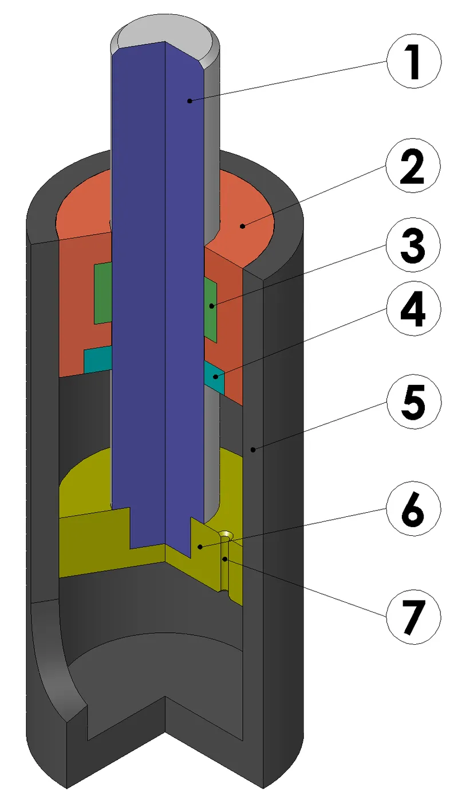
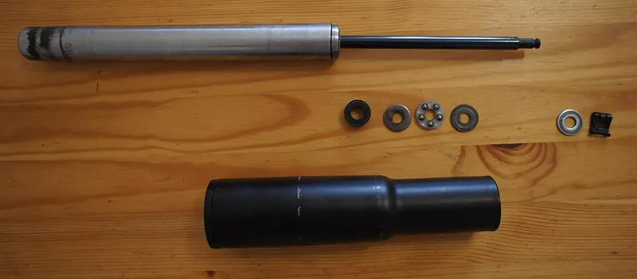
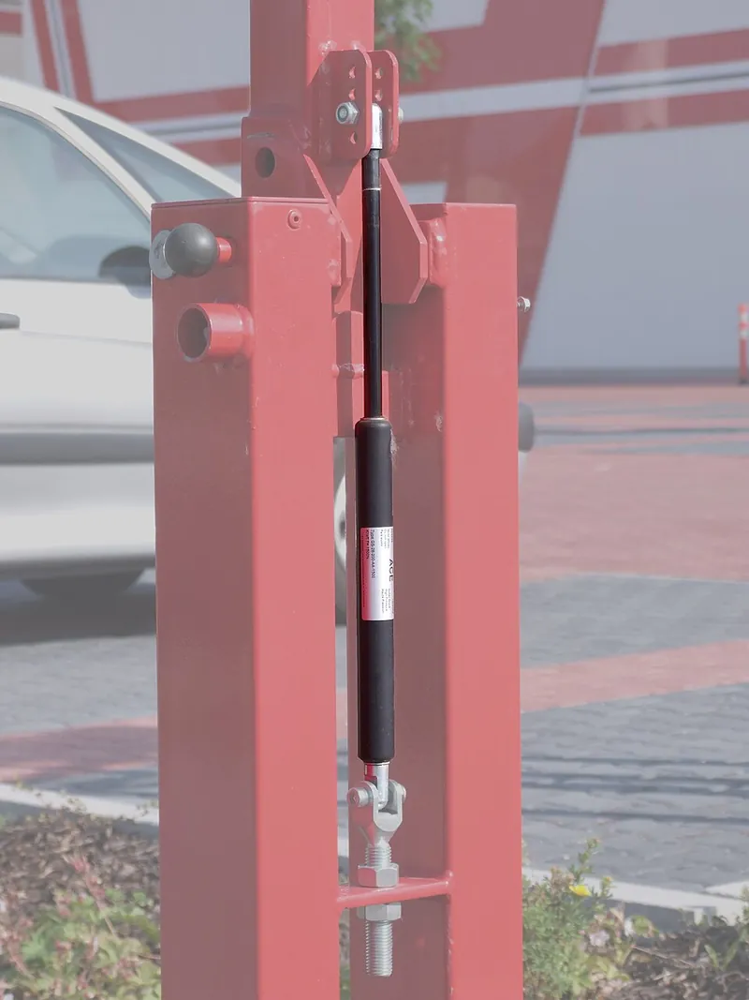

<figure class="eoc-pic eoc-pic-main"><figcaption><strong>Cross-section.</strong> <a href="https://commons.wikimedia.org/wiki/File:Gas-spring_simplified_numbered_120.png">Gas-spring simplified numbered 120</a> by Silberwolf, <a href="https://creativecommons.org/licenses/by-sa/2.5">CC BY-SA 2.5</a>, from Wikimedia Commons.</figcaption></figure>
<figure class="eoc-pic"><figcaption><strong>How it works.</strong> <a href="https://commons.wikimedia.org/wiki/File:Chair_gas_spring_disassembled.jpg">Chair gas spring disassembled</a> by ASDFS, <a href="https://creativecommons.org/licenses/by-sa/4.0">CC BY-SA 4.0</a>, from Wikimedia Commons.</figcaption></figure>
<figure class="eoc-pic"><figcaption><strong>Photo.</strong> <a href="https://commons.wikimedia.org/wiki/File:Gas_spring-2.jpg">Gas spring-2</a> by Silberwolf, <a href="https://creativecommons.org/licenses/by-sa/2.5">CC BY-SA 2.5</a>, from Wikimedia Commons.</figcaption></figure>

A sealed cylinder of pressurised nitrogen and a little oil whose rod pushes out with a fairly steady force and a controlled speed, used to lift and hold lids, hatches and seats; a lockable version has a valve that freezes the rod at any length until you press a release pin.

**In plain words:** A sealed metal tube with a shiny rod sticking out that always tries to push itself longer, so it holds a lid or hatch up for you and lowers it gently; a 'lockable' one can be stopped and held at any length by pressing a small button or lever. **Proper term:** Gas spring (gas strut); lockable gas spring (locking gas spring).

**Also called:** gas strut, gas damper (Wikipedia 'Gas spring'); gas lift, gas prop, lift support, hatch strut, bonnet or hood strut, tailgate strut (common trade and car-parts names; 'gas lift' also means an office-chair height column) ⚑ [uncertain]; industrial gas spring, push-type gas spring (ACE catalogue); traction gas spring, pull-type gas spring, pulling gas spring (versions that pull instead of push) (ACE catalogue; McMaster-Carr); adjustable-force gas spring (has a bleed valve so the force can be lowered once) (McMaster-Carr; ACE); locking gas spring, lockable gas spring, remote-release gas spring, adjustment element (Stabilus; Suspa; McMaster-Carr; Bansbach); elastic-locking (spring-locking) and rigid-locking gas springs (Suspa; Stabilus; Bansbach); office chair gas lift, gas cylinder, chair gas spring (a lockable gas spring used as a seat-height column) (Wikimedia Commons 'Chair gaslift.jpg'; Stabilus); BLOC-O-LIFT, KOMBI-LIFT, STAB-O-MAT (brands, Stabilus); easylift (brand, Bansbach) - lockable gas spring product ranges; nitrogen gas spring (die springs used in press tools; heavy-duty industrial relative) (Wikipedia 'Gas spring').

## How it works

The tube is filled with nitrogen at high pressure; the gas presses on both sides of the piston, but the rod takes up area on one side, so there is more force pushing the rod out than in, and the push equals the gas pressure times the rod's cross-section area (F = p x A) (ACE catalogue; explainthatstuff). Pushing the rod in makes the rod take up more room inside, so the gas is squeezed a bit more and the force rises by roughly 20-60 percent over the [stroke](../glossary.md#stroke) (called progression) (ACE catalogue). Gas has to squeeze through a small hole in the piston, and oil at the rod end cushions the last few millimetres, so the rod moves at a controlled speed and stops gently (end-position [damping](../glossary.md#damping)) when mounted rod-down (ACE catalogue). In a lockable gas spring, a valve in the piston separates the two chambers: press the release pin and the valve opens so the rod can move (with the gas helping to carry the load); let go and the valve shuts, trapping gas (elastic locking, slightly springy) or oil (rigid locking) so the rod holds its position (Stabilus BLOC-O-LIFT; Suspa).

## Parts

A small sealed assembly that acts as one unit (it cannot be opened): steel pressure tube, piston rod, piston with a tiny hole (orifice) or valve, rod seal and guide bushing, nitrogen gas, a little oil, and threaded ends that take swap-on end fittings (ball sockets, eyes, clevises) plus ball studs or brackets on the frame and lid (Wikipedia 'Gas spring'; ACE catalogue). A lockable gas spring adds a valve in the piston, a release pin sticking out of the rod end, and a release head, lever or Bowden cable to press it (Suspa; Stabilus).

## Everyday examples

- The struts that hold up a hatchback's tailgate or a car bonnet (Wikipedia 'Gas spring'; Wikimedia Commons 'Heckklappendämpfer.JPG')
- An office chair's height column (gas lift), which is a lockable gas spring released by the lever under the seat (Wikimedia Commons 'Chair gaslift.jpg'; Stabilus)
- Lift-up lids on toolboxes, storage chests, fold-away beds and machine guards (ACE application list)
- Hospital beds and height-adjustable tables that lock at any height (Stabilus; Lesjöfors)

## When to use it

Use a gas spring to lift, hold open or counterbalance a hinged lid, hatch, door, seat, screen or arm so it feels light and doesn't slam, especially where a coil spring would be too long or its force would change too much over the travel (ACE; explainthatstuff). The built-in damping gives a smooth opening speed and soft stop (ACE). Use a lockable gas spring when something must be adjusted and then stay put at any position, such as seat and backrest height, table height, bed sections, or a work surface angle (Stabilus; Suspa; Lesjöfors). Choose rigid locking where no movement is allowed when locked (operating tables, wheelchair recline) and elastic locking where a little give feels comfortable (chair backrests) (Stabilus; Lesjöfors). Popular with makers for 3D-printer enclosure lids (Printables).

## When not to use it

Avoid it where it would be loaded sideways or used as a structural brace, because side loads bend the rod and ruin the seal (ACE); for very cold places where the force drops, or near heat above its seal rating (ACE). Don't use it as the only thing holding up a heavy lid you work under; add a mechanical prop or stay ⚑ [uncertain]. For small, light lids a friction or [torque](../glossary.md#torque) hinge, a lid stay or a self-closing hinge is simpler. For a steady pull over a long distance in a small space use a constant-force spring; for a holding brake with no pressure vessel use a friction hinge or [ratchet](../glossary.md#ratchet) stay; if it must last millions of cycles or never leak, consider a gas-spring-style mechanical spring (McMaster-Carr 'no seals to fail or gas to leak'). A counterweight gives truly constant force but is heavy.

## Details

- **What it does (jobs):**
  - store energy: the compressed gas stores energy that lifts or counterbalances a lid, hatch, seat or arm
  - slow it, stop it or keep its speed steady: the piston orifice and oil give a controlled opening speed and a soft stop at the end (ACE catalogue)
  - lock, and release by hand: a lockable gas spring holds at any length until someone presses the release pin, lever or Bowden cable (Suspa; Stabilus)
  - let it move (turn, slide or bend): the rod slides in and out, and the end fittings let it swing as the lid pivots
- **Movement:** slide: the rod telescopes in and out of the tube (stroke typically about 10 mm up to several hundred mm; Bansbach lists 10-800 mm for lockable types), while pivoting end fittings let the whole strut swing as the lid turns on its hinge.
- **Directions it can move (degrees of freedom):** 1 that matters: the rod sliding in and out along the tube's axis (it can also spin about its own axis, which does nothing useful). Mounted between two ball joints or pivots it acts as a push-rod that can also swing, so it must not be asked to resist sideways or bending loads (ACE catalogue). A locked lockable gas spring has 0 (rigid type) or a little springy give (elastic type).
- **Special behaviour:**
  - hand-release only (locks under load, releases when a person operates it): a lockable gas spring holds its position until the release pin is pressed, directly, by a lever or via a Bowden cable; the Stabilus standard slide valve needs 2.5 mm of pin travel and a poppet valve only 1 mm (Stabilus BLOC-O-LIFT)
  - [self-locking](../glossary.md#self-locking) (holds under load, won't back-drive): a locked rigid-locking gas spring traps oil so it will not move when pushed or pulled; an elastic-locking one traps gas so it holds but gives slightly and rebounds, which is wanted in chair backrests (Suspa; Stabilus). Some 'locking gas springs' instead latch automatically when fully extended so a lid can't close until released (McMaster-Carr)
  - [over-centre](../glossary.md#over-centre) (snaps past a point and stays): not built in, but if the moving mount is placed so the strut's line passes the hinge when the lid is shut, the strut pulls the lid closed instead of popping it open (Camloc 'Gas strut mounting positions')
  - none of the other listed behaviours; its own trick is a nearly steady push over a long stroke, with built-in speed control and a soft end stop (ACE catalogue)
- **How it holds:**
  - spring force (a spring or springy part presses it in place): the gas pushes the rod out and holds the lid or hatch up
  - suction or air pressure: the force comes from compressed nitrogen; in a lockable type a closed valve traps gas or oil so the rod cannot move (Suspa; Stabilus)
- **Input and output:** Not a transmission, so mostly not applicable. For reference: it turns stored gas pressure into a straight push along the rod (F = p x A), which the mounting geometry turns into a turning force (moment) about the lid hinge. Push force rises from fully extended to fully compressed by the 'progression', about 20 to 95 percent depending on the model and stroke (ACE catalogue). Friction in the seals means the force when being pushed in is higher than when extending (ACE catalogue). Back-drivable: yes for a standard gas spring (you can push it in by hand); no for a locked rigid-locking type; slightly (springy) for a locked elastic type (Suspa).
- **Power:** passive (no power needed). A lockable gas spring is released by hand through a pin, lever or Bowden cable, so losing electrical power does not matter; hydraulic remote-release systems also exist (Bansbach).
- **Load:** Light to heavy: stock industrial gas springs range from about 10 N to 13,000 N of push, in body diameters from 8 mm to 70 mm (ACE catalogue); lockable types about 50-2,600 N (Bansbach) or 200-1,000 N (Suspa). Strong only along its own axis in push (or pull, for traction types); it must not take tilting, side or bending loads, which bend the rod and wear the seals (ACE catalogue). Long, thin, high-force struts are the least stable; ACE advises avoiding 'small diameter + long stroke + high force'.
- **Play and precision:** Small play, mostly in the ball-joint end fittings ⚑ [uncertain]. It does not locate parts precisely: installation length [tolerance](../glossary.md#tolerance) is about +/-2 mm and force tolerance +/-7 percent (ACE catalogue). Pivoting end fittings tolerate the angle changes of a swinging lid, but it must not be loaded sideways (ACE). A locked elastic lockable spring gives slightly and rebounds; a rigid one does not (Stabilus; Suspa).
- **Taking it apart:** removable: the end fittings clip or screw onto ball studs or bolt through eyes, so the strut can be swapped (ACE says fit it fully extended and support the lid while doing so). The strut itself is a sealed, permanent unit that must never be opened (ACE catalogue).
- **How often it can be reused:** many times: fitting and removing the strut can be repeated freely; the strut's own life is set by its seals. ACE gas springs are generally tested to 70,000 strokes (about 2-10 km of rod travel), and some applications reach 500,000 strokes or more (ACE catalogue).
- **Sealing:** none as a connection (it doesn't seal anything else). Inside, it is an airtight pressure vessel sealed by the rod seal and guide; up to 300 bar internal pressure (ACE catalogue).
- **Adjustable:** Partly. Force is fixed for a plain gas spring, but valve types let you bleed gas out to lower the force permanently (McMaster-Carr 'Adjustable-Force Gas Springs'; ACE 'The valve allows the force to be adjusted'); if too much is released it must be replaced (Wikipedia). The lifting feel can be tuned by moving the mounting points (Camloc; Engineer Live). A lockable gas spring can be set and locked at any length along its stroke (Bansbach).
- **Access needed:** not applicable: it is fitted between two mounting points (one on the frame, one on the lid or moving part) and you need to reach both ends; nothing has to be reached from behind unless the brackets are through-bolted.
- **Materials:** Steel pressure tube (usually painted or black coated), hardened chrome or stainless steel piston rod (ACE uses 303 stainless rods), nitrogen gas and oil inside; stainless steel versions (V4A/316) for boats and food machinery (ACE; Bansbach). End fittings are steel or plastic; brackets can be steel, aluminium or strong 3D-printed plastic. It suits wood, metal and plastic lids as long as the brackets are firmly anchored.
- **Heat, cold, water and wear:** Temperature changes the force: about 3.4 percent per 10 °C, so a lid that stays up in summer may sag in winter; standard seals -20 °C to +80 °C, special seals -45 °C to 200 °C; never put it over heat or in fire (ACE catalogue). High-temperature types rated to 392 °F (200 °C) exist (McMaster-Carr). Use stainless versions in damp, salty or food environments (ACE; Bansbach). Keep dirt, paint and scratches off the rod because rod damage destroys the seal and lets gas out (ACE). After long storage it may stick at first (breakaway 'stiction') but should not have lost pressure (ACE). With use, seals wear and gas slowly escapes, so force drops and lids begin to sag (Wikipedia lists leakage, failing to hold the load and sagging as signs of failure). Printed brackets in warm enclosures should not be PLA (Printables Prusa XL lid).

## Making it

- **Ways to make or get it:**
  - off-the-shelf part: the gas spring itself, end fittings, ball studs and mounting brackets
  - 3D print (FDM): mounting brackets, stand-offs and adapters (e.g. printer-enclosure lid struts on Printables)
  - sheet metal: bent steel brackets
  - woodwork: toy boxes, storage benches, cabinet lift-up doors and fold-down beds using bought struts ⚑ [uncertain]
  - CNC: machined brackets and ball studs
- **Printing it in one piece (print in place):** no: the gas spring must be bought; only its brackets and adapters are printed, as separate parts.
- **Tools:** screwdriver or spanner to fit the brackets and ball studs; for ball-socket ends, often a small flat screwdriver to lift the retaining clip ⚑ [uncertain]; someone or something to hold the lid while fitting (ACE says support the moving mass during assembly and disassembly). A lockable gas spring also needs its release head, lever or Bowden cable (Stabilus; Bansbach). A strap can help compress stiff struts during fitting (Printables 'Ratchet Strap Gas Strut Compression Aid').
- **Difficulty:** easy to fit, not something to make: buy the strut (it is a high-pressure vessel) and screw on bought or printed brackets. The hard part is choosing the force and mounting points, which a free online calculator can do (Gasspringsshop calculator).

### 3D printing tips

1) Print only the brackets, never anything that holds pressure. 2) Use a tough, heat-resistant plastic: one enclosure-lid design says 'Print with PETG, 3 walls and 20% [infill](../glossary.md#infill). PLA will soften in the enclosure' (Printables 'Gas Struts for Prusa XL Enclosure Lid'); another maker found the original light mounts bent under a heavy lid and redesigned them for ABS, ASA, PC-CF or PA-CF at 25 percent infill or more (Printables 'Gas struts Mount/Stabilizer'). 3) Let metal carry the load where you can: screw a steel ball stud into a [heat-set insert](../glossary.md#heat-set-insert) or through a nut, and bolt the bracket to the frame with several screws, rather than relying on printed threads (the Mount/Stabilizer design uses M6 heat inserts, drop-in nuts and nyloc nuts). 4) Orient the print so the strut's push squeezes or runs along the layers rather than peeling them apart, and make the part around the ball stud thick with generous [fillets](../glossary.md#chamfer--fillet) ⚑ [uncertain]. 5) Remember the bracket feels the full strut force (often 100-400 N) and the lid hinge feels more; a small move of the mount point changes the forces a lot, so test with the lid supported (Engineer Live; ACE). 6) Choose the strut force by test or calculation: in one enclosure design 30-40 N struts worked and 20 N was not strong enough (Printables Prusa XL lid). 7) Keep the strut rod-down when the lid is closed and leave about 10 mm of unused stroke so it doesn't bottom out (Camloc). 8) Never paint, sand or scratch the rod near printed parts (ACE).

### Buying one (off-the-shelf parts)

Search for: 'gas spring', 'gas strut', 'lift support', 'add-a-fitting gas spring' (threaded ends for swap-on fittings), 'pulling gas spring' or 'traction gas spring', 'adjustable-force gas spring' (bleed valve), 'high-temperature gas spring', 'corrosion-resistant' or 'stainless steel gas spring', 'locking gas spring' and 'remote-release gas spring' (McMaster-Carr catalogue names); 'lockable gas spring' with 'elastic' or 'rigid' locking, 'release head', 'release lever', 'Bowden cable release' (Stabilus BLOC-O-LIFT, Suspa, Bansbach easylift - brands); end fittings: 'ball socket', 'angle ball joint', 'swivel eye', 'eyelet', 'clevis', 'ball stud' (commonly a 10 mm ball with an M6 thread on small struts: Thingiverse 'Gas Strut End, Ball joint Cup 10mm, M6x1'); 'gas spring mounting bracket'. Related: 'gas-spring-style mechanical springs' (no seals to leak) (McMaster-Carr).

## Rules of thumb

- Push force F = p x A (gas pressure times rod area); force tolerance +/-7 percent; force rises about 3.4 percent for every 10 °C warmer (nominal force F1 is quoted at 20 °C); standard seals work from -20 °C to +80 °C, special seals from -45 °C to 200 °C (ACE Industrial Gas Springs catalogue, p. 2 and 5).
- Force 'progression' (rise from extended to compressed) is roughly 20-60 percent for most push types and up to 95 percent for some; installation length tolerance +/-2 mm; don't combine small diameter, long stroke and high force (ACE catalogue, p. 2 and 5).
- Mount rod-down (rod pointing down when the lid is closed) so the oil lubricates the main seal and damps the end of the stroke; Camloc prefers the 'push up' layout, where the moving mount is closer to the hinge than the fixed mount (Camloc 'Gas strut positioning'; ACE catalogue).
- Start with the moving mount about 1/3 of the lid length from the hinge; the crossover point (where the strut takes over lifting) is often 10-30° from fully closed; allow about 10 mm of unused stroke so it doesn't bottom out before the lid shuts; an over-centre mount position stops the lid springing open (Camloc 'Gas strut mounting positions').
- Force needed per strut: F1 = mass of lid x g x distance from hinge to centre of gravity / (distance from hinge to strut line x number of struts); aim for hand forces of 60 N or less to open and close (Camloc Motion Control in Engineer Live 'How to specify gas struts accurately').
- Life: generally tested to 70,000 strokes, equal to about 2-10 km of rod travel; 500,000 strokes or more in some applications (ACE catalogue, p. 2).
- Rigid-locking (oil-filled) lockable springs must be mounted roughly vertical: rod down to lock against extension, rod up to lock against compression; the standard slide-valve release needs 2.5 mm of pin travel, a poppet valve 1 mm (Stabilus BLOC-O-LIFT page).

## Common failures

Losing gas through worn or damaged seals, so the lid sags or won't stay open; caused by scratched, dirty or painted rods, side loads and mounting rod-up so the seal runs dry (ACE; Camloc). Bent rod from side or tilting loads; use ball joints or pivoting end fittings so it only sees straight push (ACE). Wrong force: too strong and the lid won't stay shut or flies open, too weak and it drops; use the moment calculation or a calculator and an over-centre closed position (Camloc; Engineer Live; Gasspringsshop). Bottoming out before the lid is closed, fixed by leaving about 10 mm of spare stroke (Camloc). Weak in the cold (ACE). Stiff first movement after storage (ACE). Printed or light brackets bending or cracking under the strut force; one maker's original mounts 'bent' and a strut 'ripped' (Printables 'Gas struts Mount/Stabilizer'). Lockable types: elastic ones [creep](../glossary.md#creep) or bounce under heavy external loads, so use rigid locking where no movement is allowed (Stabilus; Lesjöfors).

## Safety

It is a pressure vessel: internal pressure can be up to 300 bar (4,350 psi); do not open, cut, crush, puncture, heat or modify it (ACE; Camloc). To scrap one, it must first be depressurised by slowly drilling a 2-3 mm hole 15-20 mm from the closed end while wearing safety glasses, ear plugs and protective clothing, because oil and metal fragments can spray out; never cut or put it in a lathe before depressurising (Camloc disposal advice). A strut can push a lid or door open hard and fast, so support the lid while fitting or removing struts and fit them fully extended (ACE). A lid can drop if a strut fails, has lost gas or is cold, so keep hands and heads clear of the closing edge and hinge (pinch points) ⚑ [uncertain]. Wikipedia reports a cheaply made office-chair gas spring exploding and ejecting its rod; buy from reputable makers.

## Related

- Coil spring (compression): cheap and simple, but its force rises steeply as it is squashed and it has no built-in damping
- Constant-force spring: a coiled steel strip that pulls with nearly the same force over a long distance; pulls instead of pushes and has no damping
- Dampers (rotary and linear soft-close dampers): control speed like a gas spring but give no lifting force of their own
- Friction hinge (torque hinge) and lid stays: hold a lid at any angle by friction instead of pushing it up
- Spring balancer (gravity compensation): springs arranged to cancel a weight at every angle, as in an anglepoise lamp
- Over-centre [linkage](../glossary.md#linkage) (toggle): a mounting geometry that can make a gas-sprung lid pull itself shut
- Spring button lock and indexing plunger: lock a telescoping tube at set holes instead of at any length like a lockable gas spring
- Counterweight: gives a truly constant force with no seals, but is heavy and bulky

## Make it yourself

- [Gas spring calculator (Gasspringsshop)](https://www.gasspringsshop.com/gas-spring-calculator/): Free online calculator: enter the lid size, weight, angles, pivot position, temperature and hand force, and it suggests gas springs, mounting points, force graphs and a 3D simulation *(licence: link only (free web tool from a gas-spring seller))*
- [Gas Struts for Prusa XL Enclosure Lid (krayft, Printables) (URL from Printables API, page not opened)](https://www.printables.com/model/1042648-gas-struts-for-prusa-xl-enclosure-lid): Printed brackets for adding two 30-40 N gas struts to a 3D-printer enclosure lid, with two opening heights; printed in PETG. Read through the Printables public API. *(licence: CC BY-NC-SA (Creative Commons Attribution-NonCommercial-ShareAlike))*
- [Gas struts Mount/Stabilizer (RohDruck, Printables)](https://www.printables.com/model/254676-gas-struts-mountstabilizer): Stronger printed gas-strut mounts for an enclosure lid, redesigned after the original light mounts bent; uses M6 heat inserts, drop-in nuts and struts with M6 threads. Appeared in web search results; details read through the Printables public API. *(licence: CC BY-NC (Creative Commons Attribution-NonCommercial))*
- [Gas Strut End, Ball joint Cup 10mm, M6x1 (Balazs, Thingiverse)](https://www.thingiverse.com/thing:2381580): Printable replacement ball-socket end fitting for a gas strut with a 10 mm ball and M6x1 thread *(licence: ⚑ [uncertain] (not shown in the fetched page))*

## Pictures, videos and models

- [Gas-spring simplified numbered 120.png (Wikimedia Commons, by Silberwolf)](https://commons.wikimedia.org/wiki/File:Gas-spring_simplified_numbered_120.png): Simplified cutaway of a gas spring with numbered parts: piston rod, head cap, guide bushing, seal, cylinder, piston and flow-restriction orifice (used in Wikipedia's 'Gas spring' article) *(licence: CC BY-SA 2.5)*
- [Chair gas spring disassembled.jpg (Wikimedia Commons, by ASDFS)](https://commons.wikimedia.org/wiki/File:Chair_gas_spring_disassembled.jpg): Photo of an office-chair gas spring (a lockable gas spring) taken apart, showing its tubes and internal parts *(licence: CC BY-SA 4.0)*
- [How do gas springs work? (Explain that Stuff)](https://www.explainthatstuff.com/gassprings.html): Plain-English explanation with an animation of the piston moving, a force diagram, a gas-and-oil cutaway and a seal diagram *(licence: link only)*
- [busting open a gas spring and how they work. (YouTube, daveknowshow)](https://www.youtube.com/watch?v=zNp5qmd650M): Video of a gas spring being opened up and its parts explained (title and channel checked via YouTube oEmbed; not watched). Do not try this yourself: the spring must be depressurised first *(licence: link only (standard YouTube licence))*
- [Locking Gas Springs (YouTube, Easylift GasSprings)](https://www.youtube.com/watch?v=HojDjwwRZ04): Video of locking gas springs and the assembly of a Bowden-wire release system (title and channel checked via YouTube oEmbed; not watched) *(licence: link only (standard YouTube licence))*

## Needs confirming

⚑ marks something nobody has confirmed yet: a fact the research could not confirm from a source, a finder value that is a best guess, or an open point from the research notes. Corrections are welcome (see `research/needs-confirming.md`).

- ⚑ 8 sentences on this page marked [uncertain].
- ⚑ Finder value `tools` = hand tools (source uncertain): `tools_needed` is marked ⚑ [uncertain] here: "…ocket ends, often a small flat screwdriver to lift the retaining clip ⚑ [uncertain]; someone or something to hol…"

## Sources

- <https://en.wikipedia.org/wiki/Gas_spring>
- <https://www.ace-ace.com/media/acedownloads/ACE_Catalog_GasSprings_US_2012.pdf>
- <https://camloc.com/us/help-centre/installing-gas-struts/understanding-gas-strut-mounting-points/>
- <https://camloc.com/us/help-centre/installing-gas-struts/gas-strut-positioning/>
- <https://camloc.com/us/help-centre/which-standards-apply-to-gas-struts/gas-strut-disposal-advice/>
- <https://www.engineerlive.com/content/how-mount-gas-springs-effectively>
- <https://www.explainthatstuff.com/gassprings.html>
- <https://www.lesjofors.com/en/technology/insights/gas-spring-locking-mechanism/>
- <https://www.suspa.com/us/products/lockable-gas-springs/>
- <https://www.stabilus.com/products/lockable-gas-springs/bloc-o-lift-and-kombi-lift>
- <https://group.stabilus.com/technologies-and-innovations/mechanical-solutions/locking-gas-springs>
- <https://www.bansbach.com/en/products/gas-springs/lockable-gas-springs/>
- <https://www.mcmaster.com/products/gas-springs/>
- <https://www.gasspringsshop.com/gas-spring-calculator/>
- <https://commons.wikimedia.org/wiki/File:Gas-spring_simplified_numbered_120.png>
- <https://commons.wikimedia.org/wiki/File:Chair_gas_spring_disassembled.jpg>
- <https://commons.wikimedia.org/wiki/File:Chair_gaslift.jpg>
- <https://commons.wikimedia.org/wiki/File:Heckklappend%C3%A4mpfer.JPG>
- <https://api.printables.com/graphql/>
- <https://www.thingiverse.com/thing:2381580>
- <https://www.youtube.com/watch?v=zNp5qmd650M>
- <https://www.youtube.com/watch?v=HojDjwwRZ04>
