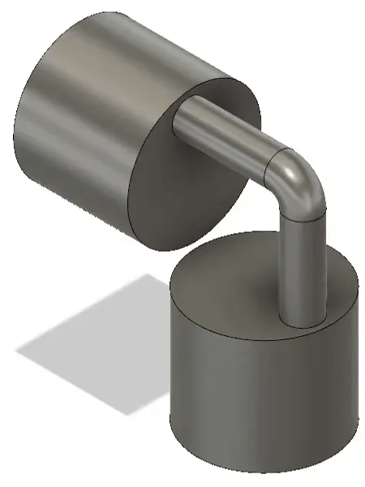

<figure class="eoc-pic eoc-pic-main"><picture><source media="(prefers-reduced-motion: reduce)" srcset="../media/gearless-right-angle-drive.still.webp"></picture><figcaption><strong>Animation.</strong> <a href="https://commons.wikimedia.org/wiki/File:ElbowEngine.gif">ElbowEngine</a> by WT79, Public domain, from Wikimedia Commons.</figcaption></figure>

A gearless coupling that carries rotation round a fixed corner, usually 90 degrees, at exactly the same speed: three or more rods, each bent to the corner angle, slide and turn in matching rings of holes in two hubs, which forces the hubs to turn together.

**In plain words:** A ring of L-shaped bent rods that slide in and out of holes in two drums set at an angle (usually a right angle), so turning one drum turns the other round the corner, with no gears at all. **Proper term:** Hobson's joint (Hobson's coupling, gearless right-angle drive).

**Also called:** Hobson's coupling / Hobson's coupler; stirrup joint (Hackaday); elbow mechanism / elbow drive; gearless angle drive / gearless right-angle socket adapter (Cal-Van, brand, makes 90-degree and 45-degree versions); angular transmission (90 degrees) (Nguyen Duc Thang's animations); coupling employing angled (connecting drive) rods (US5242327A); rotary-vee mechanism (NASA; when built as an engine); elbow engine (when the rods are used as pistons); Bricklin-Turner rotary vee engine (historic engine project).

## How it works

Each bent rod has one leg in a hole in each hub. As the hubs turn, the rods do not spin with them; NASA describes the rods keeping 'a fixed orientation in inertial space' while their centres travel round an oval path, so each leg slides in and out of its hole once per turn, going deepest when the rod passes the inside of the corner (NASA rotary-vee study; Dyne). Because every rod is caught in both hubs, the hubs are forced to turn together at exactly the same speed (a constant-velocity joint), and the turning force passes by 'side reactions' of the rods pushing on the walls of the holes (NASA). Using at least three rods (US5242327A; Dyne) keeps the drive smooth all the way round.

## Parts

A few parts: two identical hubs (drums) on shafts whose axes meet at the drive angle, each with a ring of three or more holes drilled parallel to its axis on the same radius and spacing; three or more rods bent to that angle; and bearings plus a bracket that holds both shafts at the right angle. Printed demonstrators add a jig for gluing each rod from two halves (Dyne, Printables 811174); R&DStudio's printed angle drive adds a centre rod.

## Everyday examples

- Gearless right-angle socket adapters that let a [ratchet](../glossary.md#ratchet) turn a socket round a corner in tight spaces (Cal-Van catalogue; Thang 'Gearless right-angle socket adapter')
- Elbow engines: hobby steam or compressed-air engines whose L-shaped pistons are the joint's rods (Wikipedia 'Elbow engine')
- 3D-printed and LEGO desk demonstrators with their hypnotic sliding rods (Printables; Thingiverse; 'Lego Hobson Coupling' video)
- Some shaft-driven bicycle designs ⚑ [uncertain: Wikipedia marks this 'citation needed']

## When to use it

Use it when you need to turn a drive through a fixed corner at exactly the same speed and would rather not use gears: a printed demonstrator or kinetic sculpture, a hand-tool adapter for reaching round an obstacle, or a light-duty right-angle drive where printing bevel gears is awkward (R&DStudio modelled theirs because 'it was really hard to print gears'). It runs at constant speed even at 90 degrees, where a single universal joint can't work, and both hubs are the same part, so it is easy to make. Its rods can also double as pistons for an engine or pump curiosity.

## When not to use it

For real power, continuous running or high speed, use bevel or mitre gears, which are more durable and can change speed as well; the Mechanical Library notes it 'is not widely used today because of improved bevel gear manufacturing', and its main flaws are 'too much binding friction and wear'. If the angle must change while running, use a universal joint or a CV joint (or Thang's hinged 'Universal Hobson's joint'). For a bendy or long path, use a flexible drive shaft. Avoid it where it can't be greased and kept aligned.

## Details

- **What it does (jobs):**
  - join and hold: connects two shafts that meet at a fixed angle (usually 90 degrees) so they turn together at the same speed, with no gears
  - change the kind of motion: in the elbow-engine version, steam or compressed air pushes the rods in and out like pistons and the cylinder blocks turn (Wikipedia 'Elbow engine')
- **Movement:** rotate: continuous rotation in either direction, passed round a fixed angle set by the rod bend; commonly 90 degrees, with Thang also animating 45-degree and 135-degree versions and Cal-Van selling 45-degree adapters. Inside, each rod leg slides in and out of its hole once per turn
- **Directions it can move (degrees of freedom):** 1: the two hubs turn together as one; the rods slide and turn in their holes but are not independently movable, and the ordinary joint's angle is fixed. Thang's 'Universal Hobson's joint', with a hinge in the middle of every rod, adds the ability to change the angle while running
- **Special behaviour:**
  - none of the listed behaviours: it simply passes rotation round a corner. Its notable property is constant velocity: the output turns at exactly the input speed at every moment ('a true constant velocity joint', Dyne; Wikipedia), even at 90 degrees, where a single universal joint can't work
  - motion conversion (e.g. rotary to linear): built as an elbow engine, the rods' back-and-forth sliding becomes rotation of the blocks (Wikipedia 'Elbow engine'; NASA)
- **How it holds:**
  - shape (the parts interlock; [form-fit](../glossary.md#form-fit--force-fit--material-bond)): the rods sit in holes in both hubs, and [torque](../glossary.md#torque) passes by the rods pressing sideways on the hole walls (NASA)
  - not a holding joint (it moves or passes on motion): it is a drive joint; each hub is fixed to its own shaft separately
- **Input and output:** Continuous rotation -> continuous rotation at exactly the same speed (1:1, constant velocity) between intersecting shafts at the fixed rod angle, usually 90 degrees ('rods bent 90° are able to transmit torque around a corner', Wikipedia). Efficiency: no reliable figure found ⚑ [uncertain]; the rods slide and twist in their holes with friction (NASA's engine analysis models friction from piston sliding and piston rotation). Hackaday says it has 'heard' the coupler is 'actually pretty efficient', a printed maker says it is 'not as efficient as the gears' because the parts flex (R&DStudio), and a Physics Forums contributor argues its efficiency drops as torque rises. Back-drivable: yes, the two hubs are alike, so either one can drive the other ⚑ [uncertain: inferred from the symmetry, not stated in a source].
- **Power:** passive (no power needed): it only passes on the rotation it is given; the elbow-engine version is driven by steam or compressed air
- **Load:** Light to medium. Cal-Van's gearless angle drives in 1/4-inch and 3/8-inch square drive are claimed to exceed the ANSI torque specification for universal socket adapters (Cal-Van catalogue 2021-2022, p. 47), i.e. hand-tool torques. Printed demonstrators are light duty and flex (R&DStudio). The torque is carried by the rods pressing sideways on the hole walls (NASA), so rod bending and wear of the holes set the limit; the joint carries no side load, so both shafts need their own bearings.
- **Play and precision:** Noticeable in printed versions: Dyne made the holes 11.5 mm for 10 mm rods so the joint never binds, accepting 'a fair amount of slop' and some rattling. Constant velocity means no speed ripple. It tolerates little [misalignment](../glossary.md#misalignment): 'Self-alignment of the connected shafts is essential for proper operation of the coupler. In case of mis-alignment excessive wear of the connecting rods and of the receiving holes can occur' (US5242327A); a Physics Forums contributor adds that past a critical misalignment (the arctangent of the friction coefficient) a rod sticks instead of sliding.
- **Taking it apart:** removable: the hubs sit on shafts in a bracket and the rods simply slide out of their holes; a socket adapter pushes on and off the ratchet and socket
- **How often it can be reused:** many times: it can be taken apart and reassembled repeatedly; the limit is wear of the rods and holes
- **Sealing:** none: it is an open mechanism (an elbow engine seals its cylinders with the pistons and a flat valve plate, but that is part of the engine, not the coupling)
- **Adjustable:** No: the angle is fixed by the rod bend, 'fixed at construction' (Dyne). Thang's 'Universal Hobson's joint' splits each rod with a hinge so the angle can change while running, but it has an unstable position when the shafts are in line
- **Access needed:** end of a tube or shaft: each hub fits on the end of a shaft; a socket adapter fits between the ratchet's square drive and the socket
- **Materials:** Steel rods in metal hubs for hand tools ⚑ [uncertain: Cal-Van's materials not stated in the pages opened]. The Mechanical Library display model uses 6 aluminium rods. Printed demonstrators use printed rods (Dyne; R&DStudio) or steel rods running in printed hubs with skate bearings (Robert Murray-Smith's design, Hackaday). Grease is needed ('PLEASE GREASE THE PARTS', R&DStudio). PLA softens above about 60 °C; PETG is better for warm or outdoor use below about 80 °C (Prusa).
- **Heat, cold, water and wear:** It needs [lubrication](../glossary.md#lubrication): running dry wears the rods and holes quickly (Physics Forums; R&DStudio), and elbow engines 'are also known to splatter oil when operating' (Wikipedia 'Elbow engine'), so expect mess. Grit in the holes speeds up wear ⚑ [uncertain]. Printed PLA softens above about 60 °C and degrades in UV; PETG is fine below about 80 °C and outdoors (Prusa).

## Making it

- **Ways to make or get it:**
  - 3D print (FDM): several printable models (Dyne's Hobson's Coupler, R&DStudio's 90/60/45/30-degree angle drive, nodar maisuradze's 90-degree gearless transmission)
  - CNC: drilled metal hubs and bent steel rods for tools and model elbow engines ⚑ [uncertain: manufacturing method of commercial adapters not verified]
  - woodwork: ⚑ [uncertain] hubs drilled from wooden dowel with bent steel-wire rods would work as a demonstrator
  - off-the-shelf part: gearless angle-drive socket adapters (Cal-Van, brand); a LEGO Technic (brand) version is shown in the 'Lego Hobson Coupling' video
- **Printing it in one piece (print in place):** no: all the printable versions found are printed as separate hubs and rods and then assembled (Dyne prints each rod in two halves and glues them in a jig; R&DStudio prints 2 hubs, 2 pin couples, 4 rotating shafts and a centre shaft); the rods have to slide freely in deep holes, which makes a [print-in-place](../glossary.md#print-in-place) version difficult ⚑ [uncertain]
- **Tools:** Hex keys or screwdrivers for the bracket and shaft fixings; glue (epoxy or superglue) and the supplied jig to make printed rods from two halves (Dyne); fine sandpaper or a file to smooth printed rods; none to use a socket adapter
- **Difficulty:** easy to moderate: a demonstrator prints easily (two hubs, three to six rods, two skate bearings), but smooth running needs rods bent to exactly the shaft angle, holes on exactly matching circles and grease; carrying real torque needs steel rods and accurate drilling

### 3D printing tips

1) Rods: print each rod as two flat halves and glue them in a jig, as Dyne does, so the rod prints with no supports and keeps its bend accurate; or use bent steel rod for strength (Robert Murray-Smith's design uses steel rods and bearings, Hackaday). 2) Holes: make them parallel to each hub's axis, all on the same radius and equally spaced in both hubs, and deep enough to support the rods (US5242327A). 3) [Clearance](../glossary.md#clearance): Dyne used 11.5 mm holes for 10 mm rods so the joint spins very freely even if parts print slightly out of square, at the cost of slop and noise; tighter holes run quieter but bind more easily, so test a pair first. 4) Use at least three rods (US5242327A); Dyne uses four, the Mechanical Library model six. 5) Sand the rods to remove raised lines from [elephant's foot](../glossary.md#elephants-foot) and layer seams (Dyne). 6) Grease the rods and holes (R&DStudio: 'PLEASE GREASE THE PARTS'). 7) Hold both shafts in one rigid bracket with ball bearings (Dyne uses two 608 skate bearings) so the axes stay at the rod angle and meet at a point; misalignment wears the rods and holes (US5242327A). Dyne notes friction alone holds the bearings on his printed posts, so they may need careful gluing. 8) Expect some springiness: R&DStudio says printed versions are less efficient than gears because the parts flex, and published a stiffer version with shorter hubs and shafts. 9) Print one rod in a contrasting colour so you can follow its motion (Dyne).

### Buying one (off-the-shelf parts)

Gearless angle-drive socket adapters (Cal-Van (brand) 482 and 483: 90 degrees in 1/4-inch and 3/8-inch square drive; 485: 45 degrees, 1/4-inch); 608 skate bearings or other ball bearings for printed hubs; straight steel rod (silver steel / drill rod) to bend into rods; grease. Search terms: 'Hobson's joint', 'Hobson's coupler', 'gearless angle drive', 'gearless right angle adapter'.

## Rules of thumb

- Use at least three rods: 'Each head has a plurality, but at least three receiving holes ... on identical [radial](../glossary.md#axial--radial) and angular arrangements' (US5242327A); Dyne also says 'three or more angled rods'.
- Drill the holes 'parallel to axis of rotation of the shafts' and 'on identical angular and radial distribution', 'deep enough for adequate bearing support for the connecting drive rods' (US5242327A).
- The shaft angle equals the rod bend: the rods 'can be bent into identical angles ranging between 0 and 90 degrees', and the shafts' axes intersect at that same angle (US5242327A).
- Keep the shafts aligned and meeting at one point: 'In case of mis-alignment excessive wear of the connecting rods and of the receiving holes can occur' (US5242327A). A forum contributor (Baluncore, Physics Forums, 2020) estimates a rod sticks once misalignment passes about the arctangent of the friction coefficient [forum opinion].
- Printed demonstrator clearance: 10 mm rods in 11.5 mm holes spin very freely but with slop and rattle (Dyne, Printables 811174).
- Lubricate: printed angle drives need grease (R&DStudio), and 'poor lubrication will result in [fatigue](../glossary.md#fatigue) of the sliding link elbows' (Baluncore, Physics Forums, 2020).
- As an engine, balance needs at least two identical pistons arranged symmetrically, 5 or 6 pistons make best use of the space, and an included vee angle of 135 degrees was judged a good compromise between friction, displacement and strength (NASA TM-101995, 1989).

## Common failures

1) Binding or sticking when the shafts are out of line or the hole circles don't match (US5242327A); Dyne deliberately loosened his [tolerances](../glossary.md#tolerance) to stop binding. 2) Fast wear of the rods and holes, because 'the rod force is always concentrated at the same two points' (Physics Forums), made worse by misalignment (US5242327A) or poor lubrication. 3) Rattle and slop from oversized holes (Dyne). 4) Springiness and lost efficiency in printed versions as hubs and rods flex (R&DStudio, who made a stiffer remix with shorter hubs). 5) Rods bent to slightly different angles or not quite straight cause tight spots once per turn ⚑ [uncertain]. 6) Bearings working loose on printed posts that rely on friction alone (Dyne).

## Safety

The rods slide in and out of the hubs and sweep round as it turns, so fingers can be pinched between a rod and a hub, especially at the inside of the corner where the rods go deepest ⚑ [uncertain]. Elbow engines run on steam or compressed air, which is stored pressure: never use printed parts to hold pressure, and expect oil spray (Wikipedia 'Elbow engine'). Cal-Van's torque claim is against the ANSI specification for hand-tool universal socket adapters, so don't assume it is meant for power or impact tools ⚑ [uncertain].

## Related

- Bevel and mitre gears: the usual way to turn a drive round a fixed corner; stronger and more efficient, and they can change speed, but need accurate teeth
- Universal joint (Hooke's or Cardan joint): lets the angle change while running, but its output speed wobbles twice per turn and it can't work at 90 degrees
- Constant-velocity (CV) joint: also keeps the speed constant, and lets the angle change while running, using balls in curved tracks; more complex and not made for a fixed 90-degree corner
- Universal Hobson's joint: Hobson's joint with a hinge in the middle of each rod, so the angle can vary while running; unstable when the shafts are in line (Thang)
- Hobson's joints between skew shafts: rods in [cranks](../glossary.md#crank) transmit rotation between shafts that don't meet (Thang 'Transmission between skew shafts by Hobson's joints')
- Flexible drive shaft (rotating cable): carries rotation round real bends, but twists under load
- Crown (face) gear with a spur pinion: another simple printable way to turn 90 degrees, for light loads
- Elbow engine (rotary-vee engine): the same mechanism with the rods used as pistons (Wikipedia; NASA)

## Make it yourself

- [Hobson's Coupler (Dyne, Printables)](https://www.printables.com/model/811174-hobsons-coupler): Printable 90-degree demonstrator: two cylinders, four rods printed in halves with a gluing jig, a mounting bracket and two 608 skate bearings; loose 11.5 mm holes for 10 mm rods so it never binds *(licence: CC BY-NC-SA (per Printables API))*
- [Gearless 90-60-45-30 Degree Torque Transfer Tool (Angle Drive) (R&DStudio, Printables) (URL from Printables API, page not opened)](https://www.printables.com/model/1655413-gearless-90-60-45-30-degree-torque-transfer-tool-a): Printable gearless angle drive with interchangeable rod sets for 90, 60, 45 and 30 degrees; the designer advises greasing the parts *(licence: CC BY-NC-ND (per Printables API))*
- [Stiffer Gearless 90-60-45-30 Degree Torque Transfer Tool (R&DStudio, Printables) (URL from Printables API, page not opened)](https://www.printables.com/model/1656067-stiffer-gearless-90-60-45-30-degree-torque-transfe): The same design with shorter hubs and shafts to reduce flex *(licence: CC BY-NC-ND (per Printables API))*
- [90 degree power transmission (Gearless) (nodar maisuradze, Printables) (URL from Printables API, page not opened)](https://www.printables.com/model/777614-90-degree-power-transmission-gearless): An 8-part printable gearless 90-degree transmission; the designer notes it 'might need sandpapering for better fit' *(licence: CC BY-SA (per Printables API))*
- [Hobson's Joint (ThinkingandTinkering / Robert Murray-Smith, Thingiverse)](https://www.thingiverse.com/thing:6158117): Printable Hobson's joint that uses steel rods and skate bearings, with a video that also shows a Cardan-joint variant (described by Hackaday; the Thingiverse page itself showed only its title) *(licence: not seen ⚑ [uncertain])*

## Pictures, videos and models

- [ElbowEngine.gif (Wikimedia Commons, by WT79)](https://commons.wikimedia.org/wiki/File:ElbowEngine.gif): Animation of Hobson's joint working as an elbow engine: L-shaped rods sliding in two cylinder blocks at right angles; used as the lead image of Wikipedia's 'Hobson's joint' article *(licence: Public domain (author grants use for any purpose))*
- [Elbow-Engine operation-mode.JPG (Wikimedia Commons, by Hans-Jürgen Wiese)](https://commons.wikimedia.org/wiki/File:Elbow-Engine_operation-mode.JPG): Diagram of a simplified two-piston elbow engine showing how the bent rods sit in the two blocks *(licence: CC BY 3.0)*
- [Angular transmission (Nguyen Duc Thang, YouTube thang010146)](https://www.youtube.com/watch?v=2TgoJXbncf0): CAD animation of the 90-degree bent-rod angular transmission, 'the simplest way to transmit rotation between perpendicular shafts' *(licence: link only (standard YouTube licence))*
- [Gearless right-angle socket adapter (Nguyen Duc Thang, YouTube thang010146)](https://www.youtube.com/watch?v=yKjTuCerWdQ): CAD animation of the socket-adapter application of Hobson's joint, 'used for working in tight quarter' *(licence: link only (standard YouTube licence))*
- [Mechanical Library: Hobson's Joint](https://mechanical-library.org/hobsons-joint): Videos and photos of a display model with 6 aluminium rods, plus 45-degree, 135-degree and LEGO variants and short notes on uses and flaws *(licence: not stated (link only) ⚑ [uncertain])*

## Needs confirming

⚑ marks something nobody has confirmed yet: a fact the research could not confirm from a source, a finder value that is a best guess, or an open point from the research notes. Corrections are welcome (see `research/needs-confirming.md`).

- ⚑ 13 sentences on this page marked [uncertain].

## Sources

- <https://en.wikipedia.org/wiki/Hobson%27s_joint>
- <https://en.wikipedia.org/wiki/Elbow_engine>
- <https://commons.wikimedia.org/wiki/File:ElbowEngine.gif>
- <https://commons.wikimedia.org/wiki/File:Elbow-Engine_operation-mode.JPG>
- <https://cs448m.github.io/lectures/machines/doc/1.pdf>
- <https://www.youtube.com/watch?v=2TgoJXbncf0>
- <https://www.youtube.com/watch?v=NdzSqc8pxVg>
- <https://www.youtube.com/watch?v=QEMpifDSqF0>
- <https://www.youtube.com/watch?v=8W6lziEuNzQ>
- <https://www.youtube.com/watch?v=0cU5oB8V_08>
- <https://www.youtube.com/watch?v=GlTuH0YEBWo>
- <https://www.youtube.com/watch?v=yKjTuCerWdQ>
- <https://www.youtube.com/watch?v=_6in9Q8DDoY>
- <https://www.youtube.com/watch?v=pVldn35XuXo>
- <https://www.youtube.com/watch?v=5ZRKNlY7enM>
- <https://www.youtube.com/watch?v=zVYB0DBbYok>
- <https://mechanical-library.org/hobsons-joint>
- <https://hackaday.com/2023/08/10/a-hobsons-coupler-leads-to-a-weird-engine/>
- <https://www.physicsforums.com/threads/what-is-the-efficiency-of-a-hobsons-joint.994495/>
- <https://patents.google.com/patent/US5242327A/en>
- <https://ntrs.nasa.gov/api/citations/19890016636/downloads/19890016636.pdf>
- <https://cal-vantools.com/products/90-degree-gearless-angle-drive-3-8/>
- <https://cal-vantools.com/wp-content/uploads/2021/05/2021-2022-CV-Catalog-Final-Print-Version.pdf>
- <https://usatoolsinc.com/90-gearless-angle-adapters-3-8-drive/>
- <https://api.printables.com/graphql/>
- <https://www.printables.com/model/811174-hobsons-coupler>
- <https://www.thingiverse.com/thing:6158117>
- <https://help.prusa3d.com/article/pla_2062>
- <https://help.prusa3d.com/article/petg_2059>
