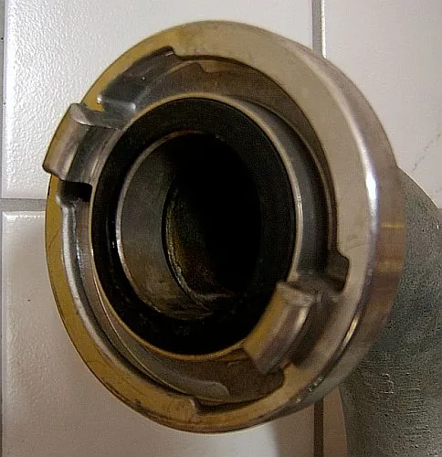
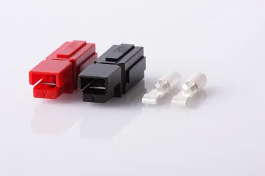
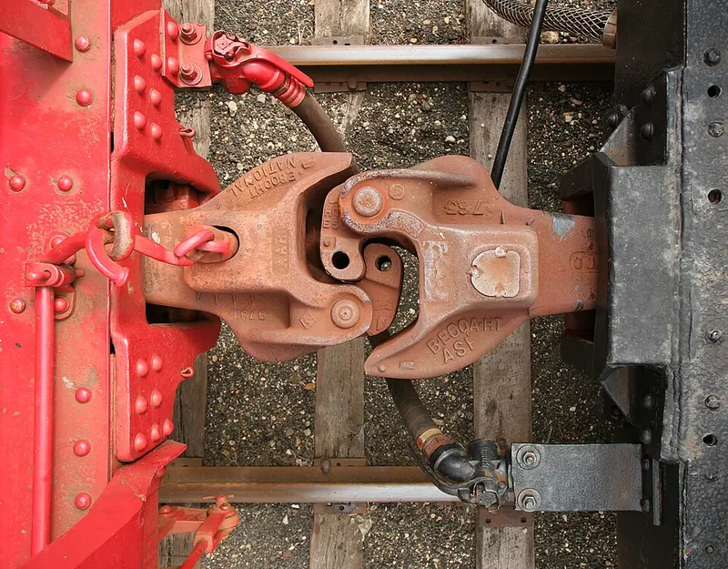

<figure class="eoc-pic eoc-pic-main"><figcaption><strong>Photo.</strong> <a href="https://commons.wikimedia.org/wiki/File:Festkupplung.jpg">Festkupplung</a> by Karl Gruber at German Wikipedia, <a href="http://creativecommons.org/licenses/by-sa/3.0/">CC BY-SA 3.0</a>, from Wikimedia Commons.</figcaption></figure>
<figure class="eoc-pic"><figcaption><strong>Photo.</strong> <a href="https://commons.wikimedia.org/wiki/File:Pp01.jpg">Pp01</a> by Cqdx, <a href="http://creativecommons.org/publicdomain/zero/1.0/deed.en">CC0</a>, from Wikimedia Commons.</figcaption></figure>
<figure class="eoc-pic"><figcaption><strong>How it works.</strong> <a href="https://commons.wikimedia.org/wiki/File:Train_coupling.jpg">Train coupling</a> by Daniel Schwen, <a href="https://creativecommons.org/licenses/by-sa/4.0">CC BY-SA 4.0</a>, from Wikimedia Commons.</figcaption></figure>

A connector or coupling made of two identical halves, each carrying both the 'male' and the 'female' features, so that any two of the same size and type can be joined, usually by turning one copy round to face the other so that its hooks meet the other's slots.

**In plain words:** A connector where both halves are exactly the same, so any piece plugs into any other piece: there is no 'plug' and 'socket', and nothing can be the wrong way round. **Proper term:** Genderless connector (hermaphroditic or androgynous coupling).

**Also called:** hermaphroditic connector / hermaphrodite coupling; androgynous connector (used for spacecraft docking systems); sexless coupling; ungendered connector (modular robotics); self-mating connector; two-way, two-in-one or combination connector (ambiguous; Wikipedia says these should be defined in context); Storz coupling (fire-hose coupling); Guillemin coupling (French fire-hose and pellet-delivery coupling; similar but not completely symmetric); gladhand coupler (truck and railway air-brake hoses); SAE connector (2-pin DC lead) and Anderson Powerpole (brand); GR connector / GR-874 (General Radio hermaphroditic RF connector); Dual Lock (brand): mushroom-head reclosable fastener that mates with itself; 'print-twice' part / two identical halves (3D printing).

## How it works

Each half carries both kinds of feature (a hook and a slot, a pin and a hole, or a north and a south magnet) laid out symmetrically, so that a copy turned round to face it presents the opposite feature at every point. Amphenol's hermaphroditic coupler 'will always appear identical when rotated 180 degrees' (US5118303A), and GN's genderless connector mates with an identical one 'rotated 180 degrees about a transversal axis' (US20150079829A1). On a Storz coupling the two faces are pressed together so each hook enters the slots in the other's flange, then turned in opposite directions, usually about a quarter turn, until the gaskets are squeezed into a watertight seal; turning back releases it (Wikipedia 'Storz'; QRFS).

## Parts

Usually a few parts, but every half is the same part. Storz hose coupling: a body with hooked lugs and a slotted flange, plus a rubber gasket, on each hose end. Gladhand: a coupler body with a lug, a slot and a rubber seal (grommet). Anderson Powerpole: a plastic housing and a metal contact, housings clipping side by side. Modular-robot docking port: a face with pins and holes, hooks or a ring of magnets, often with a motor or electro-permanent magnets to latch. Printed version: one part printed twice (e.g. a snap-together hinge leaf, a twist-lock spool half or a box half).

## Everyday examples

- Fire hoses with Storz couplings: any hose end fits any other of the same size (Wikipedia 'Storz')
- The air-brake hose couplings (gladhands) between a lorry and its trailer (Wikipedia 'Gladhand connector')
- The 2-pin SAE lead on a motorcycle battery charger or small solar panel, and Anderson Powerpole leads on ham radios and FIRST competition robots (Wikipedia)
- Railway knuckle couplers, which let a wagon join a train at either end without turning it round (Wikipedia 'Gender of connectors and fasteners')

## When to use it

Use it when many identical pieces must join in any order or either way round: hoses, cables or extension leads chained together, so you never have to drag a long hose round because its end is the wrong gender (Wikipedia); modular robots and construction kits where any module face should dock with any other (SMORES-EP; Liang et al.); battery and power distribution where a battery can be a source or a load (Wikipedia, Powerpole); and in 3D printing, whenever one file printed twice can replace two different parts, which halves the design work and means a spare always fits (LockSpool V3; DeGroof's hinge).

## When not to use it

Avoid it when joining the wrong two things would be dangerous or damaging: where only certain pairs should connect, use [keying](../glossary.md#keying) (poka-yoke) or colour-keyed variants (Anderson's SB multipole connectors are keyed by colour so only like colours mate). For mains or high-voltage power, use gendered connectors that keep the live contacts shrouded on the supply side ⚑ [uncertain]. When the largest possible self-alignment matters, a gendered cone-and-funnel (probe-and-drogue) dock aligns better unless the genderless face is specially shaped (Eckenstein and Yim). When one side must be very simple or cheap, such as a socket built into a product, a gendered plug and socket keeps the complexity on the plug ⚑ [uncertain]. For a permanent joint, use a fixed fitting instead.

## Details

- **What it does (jobs):**
  - join and hold: holds two hoses, cables, modules or parts together
  - lock, and release by hand: most lock with a push and a quarter turn (Storz) or a push and a click, and come apart again by hand
  - seal it, or pass cables or fluid through: hose versions seal water or air with rubber gaskets (Storz, gladhands); electrical versions carry power (Anderson Powerpole, SAE connector)
  - let it move (turn, slide or bend): a printed hermaphroditic hinge is two identical leaves snapped together that then pivot
- **Movement:** none: once joined the halves are fixed together; coupling usually takes a push plus about a quarter turn (Storz) or a straight push (Powerpole, Dual Lock). The printed hermaphroditic hinge is the exception: rotate, within swing limits set in the model (DeGroof's parametric hinge)
- **Directions it can move (degrees of freedom):** 0 when coupled (the two halves are locked solid); 1 for the hinge version, which turns about its pivot
- **Special behaviour:**
  - quick-release: most join and part by hand in seconds; a Storz hose locks 'with a quarter-turn' where threaded couplings take 'several turns' (Wikipedia 'Storz')
  - self-aligning or self-centring: modular-robot docking faces such as the 3D X-Face are shaped so two faces slide into line when brought together slightly off target (Eckenstein and Yim, ICRA 2014)
  - none of the other listed behaviours: its special feature is having no gender, so any two match and no 'gender changer' adapter is ever needed (Wikipedia 'Gender of connectors and fasteners')
- **How it holds:**
  - shape (the parts interlock; [form-fit](../glossary.md#form-fit--force-fit--material-bond)): hooks in slots, lugs behind flanges or pins in holes (Storz, gladhands, robot pin-and-hole faces)
  - friction or clamping (force-fit): the quarter turn draws the faces together and squeezes the gaskets (Storz)
  - magnetic: some robot docking faces and printed boxes use rings of magnets with alternating poles (SMORES-EP; Printables 1811372)
  - powered hold: active robot docking ports latch with motors or electro-permanent magnets (SMORES-EP)
- **Input and output:** not applicable: it joins things rather than passing motion on
- **Power:** Mostly passive (no power needed): hose couplings, Powerpoles, Dual Lock and printed parts. Many modular-robot docking ports are powered: SMORES-EP's electro-permanent magnets 'can be switched on or off with pulses of current', unlike electromagnets that need a steady current, so they keep their last state (docked or undocked) without power
- **Load:** Light to heavy. Printed parts and Dual Lock are light duty; a pair of SMORES-EP docking faces holds up to 90 N; Storz couplings carry pressurised fire-hose water in sizes up to 125 mm and more (Wikipedia 'Storz'); gladhands carry truck brake air, and genderless knuckle couplers join whole trains (Wikipedia). Hook-and-slot types are strong in pull once locked; they resist turning back only by friction and any locking [detent](../glossary.md#detent) (ca-fire.com).
- **Play and precision:** Small to noticeable. Hose couplings rely on gaskets rather than precise location. Robot docking faces are judged by their 'area of acceptance', the range of [misalignment](../glossary.md#misalignment) they can correct while mating; ungendered faces have historically corrected much less than gendered cone-and-funnel (probe-and-drogue) designs, e.g. a score of 0.353 for the best ungendered DRAGON connector against 1.57 for a probe and drogue, until the 3D X-Face reached 2.0 (Eckenstein and Yim, ICRA 2014). SMORES-EP's magnets pull modules together across a 4 mm gap, or 7 mm sideways. Printed snap hinges have whatever [clearance](../glossary.md#clearance) you set (DeGroof's parametric hinge).
- **Taking it apart:** tool-free quick release for most types; large or stuck fire-hose Storz couplings can be turned with special Storz spanners (Wikipedia 'Storz')
- **How often it can be reused:** many times: Anderson Powerpole contacts are rated for 100,000 no-load insertions and 250 hot-plugs at full load (Wikipedia, marked 'citation needed'); Dual Lock tape can be opened and closed up to about 1,000 times (iTapestore vendor guide); hose couplings last for years with gasket replacement (ca-fire.com)
- **Sealing:** Depends on the type: watertight for Storz fire-hose couplings ('a watertight connection between the internal packing gaskets', Wikipedia 'Storz'); airtight or pressure for gladhands ('mated rubber grommets provide a positive seal', Wikipedia 'Gladhand connector'); none for electrical connectors, Dual Lock and printed hinges
- **Adjustable:** No: the halves are identical and fixed. You can chain as many as you like, and Powerpole housings clip side by side and stack to make multi-way connectors (Wikipedia 'Anderson Powerpole')
- **Access needed:** end of a tube or shaft: each hose or cable end carries a half; face-mounted docking ports and Dual Lock pads just press together from one side
- **Materials:** Storz: brass or aluminium, cast for general and low-pressure use and forged for firefighting, with rubber gaskets (Wikipedia 'Storz'). Gladhands: metal bodies with rubber grommets ⚑ [uncertain: body metal not stated in the opened source]. Powerpole: plastic housings with metal contacts sized for 15, 30 or 45 A (Wikipedia). Dual Lock: plastic mushroom-head stems on tape. Printed versions: PLA, PETG or ABS; PETG suits parts used outdoors or below about 80 °C, PLA softens above about 60 °C (Prusa).
- **Heat, cold, water and wear:** Hose couplings depend on rubber gaskets, which compress, harden and crack over time; ca-fire.com says '99% of Storz coupling leaks are gasket problems'. Storz bodies are brass or aluminium (Wikipedia). Dual Lock is sold as working 'in heat, cold, and moisture' (iTapestore vendor guide). Printed PLA parts soften above about 60 °C and degrade in UV light, while PETG suits most outdoor use below about 80 °C (Prusa). Vibration and movement can turn quarter-turn couplings loose unless they have a locking detent (ca-fire.com).

## Making it

- **Ways to make or get it:**
  - 3D print (FDM): one part printed twice; printable hermaphroditic hinges, twist-lock spool halves, boxes and connectors exist
  - 3D print (resin): ⚑ [uncertain] suits small, precise genderless clips
  - CNC: metal couplings are cast or forged (Wikipedia 'Storz') and then finished by machining ⚑ [uncertain: machining step not verified]
  - off-the-shelf part: Storz and gladhand couplings, Anderson Powerpole and SAE connectors, Dual Lock tape
  - laser cut: ⚑ [uncertain] identical slotted flat pieces that interlock (as in some construction toys) are genderless
- **Printing it in one piece (print in place):** no: genderless parts are printed as separate identical copies and then joined; the whole point is that one file printed twice is enough (DeGroof's hinge, LockSpool V3, Brožek's dodecahedron box)
- **Tools:** None for most; a Storz coupling spanner for large or tight fire-hose couplings; a crimp tool (or soldering iron) to fit Powerpole contacts to wire ⚑ [uncertain]
- **Difficulty:** easy to moderate: buying genderless parts (Powerpoles, SAE leads, Storz fittings, Dual Lock) is easy; designing your own is moderate, because the mating face must fit a turned-round copy of itself exactly, so the symmetry has to be built into the CAD model and printed hooks need clearance testing

### 3D printing tips

1) Design for a turned-round copy, not a mirror image: the second half is the same part rotated, so every hook must face a slot and every pin a hole when the part is turned 180 degrees about an axis lying in the joint face (US5118303A; US20150079829A1). Brožek's box stresses that its two halves are 'congruent, not mirrored' (Printables 1811372). A quick CAD check: copy the part, rotate the copy into the mating position and look for clashes. 2) Magnets: in identical halves, half the magnets must face north outwards and half south, placed symmetrically so the rotated copy shows opposite poles; SMORES-EP arranges its magnets in a ring 'with south poles counterclockwise of north', and Brožek's box marks which magnet pockets get 'dot up' and which 'dot down', with the same rule on both halves (Printables 1811372). 3) Put clearance in as a parameter: DeGroof's parametric hermaphroditic hinge has a 'clearance' setting (less for [stiffness](../glossary.md#stiffness), more for free movement) and swing-limit angles (Printables 220355); Prusa suggests 'at least 0.3 mm' for movable parts as a starting point. 4) Both halves are printed the same way up, so after one is turned over any print error (a squashed first layer, called [elephant's foot](../glossary.md#elephants-foot), or sagging [overhangs](../glossary.md#overhang--bridging)) ends up facing a different feature on the other half; use elephant's foot compensation (Prusa) and test-print a pair ⚑ [uncertain: general advice]. 5) For twist-lock genderless joints, add a snap or detent so the quarter turn can't work loose: LockSpool V3 joins two identical halves 'with a quick twist, with a snap-lock to hold it in place' (Printables 129989), and Storz couplings add a locking detent (ca-fire.com). 6) Print hooks and snap arms so they lie along the layers; 'FFF prints are stronger in one direction than another' (Prusa). 7) Print the two copies in different colours, as both Brožek (Printables 1811372) and Peder (Printables 1816212) suggest; it also makes the orientation easy to see. 8) Never print a coupling meant to hold water or air under pressure; buy a proper metal or rated plastic fitting.

### Buying one (off-the-shelf parts)

Storz couplings (sized by nominal size, e.g. Storz 25, 38, 65, 75, 100, 125, each with its own lug diameter; Wikipedia 'Storz'), Storz spanners and replacement gaskets; GEKA-type garden-hose couplings (brand), which Wikipedia also lists as hermaphroditic; gladhand couplers and their rubber seals; Anderson Powerpole (brand) PP15/30/45 housings and contacts, and the larger keyed SB multipole connectors; 2-pin SAE DC leads; 3M Dual Lock (brand) reclosable fastener in Type 170, 250 and 400; electro-permanent magnets for robot docking. Search terms: 'hermaphroditic connector', 'genderless connector', 'sexless coupling', 'Storz adapter'.

## Rules of thumb

- Make the mating face look the same after a half turn: Amphenol's coupler 'will always appear identical when rotated 180 degrees' (US5118303A), and GN's connector mates with an identical connector 'rotated 180 degrees about a transversal axis' (US20150079829A1).
- Identical fittings 'can freely mate with any other, without regard for gender (provided that the size and type are already matched)' (Wikipedia 'Gender of connectors and fasteners'): keep one size and one type across a whole system.
- Physically genderless is not the same as electrically genderless: the SAE connector is 'physically hermaphroditic' but 'NOT electrically hermaphroditic', and on vehicles the exposed terminal goes to the battery's negative so it can't short the battery if it touches the chassis (Wikipedia 'DC connector', SAE section). Anderson Powerpoles use 'cis' connectivity, pin 1 to pin 1, while bullet connectors arranged hermaphroditically 'can be electrically incompatible (reverse polarity damages equipment)' (Wikipedia 'Anderson Powerpole').
- Hook-and-flange couplings lock in about a quarter turn instead of the several turns of a thread (Wikipedia 'Storz'); add a locking detent so movement can't turn them loose (ca-fire.com).
- Genderless magnetic faces need alternating poles: SMORES-EP's ring of electro-permanent magnets has 'south poles counterclockwise of north'; a pair of faces holds up to 90 N and pulls together across a 4 mm gap (Liu et al., SMORES-EP).
- Genderless docking faces usually self-align less than gendered cone-and-funnel ones unless shaped for it: best ungendered DRAGON 0.353 versus probe-and-drogue 1.57, improved to 2.0 by the 3D X-Face (Eckenstein and Yim, ICRA 2014).
- Genderless connectors let modules join in any order (an undirected graph), while gendered ones impose a direction (a directed graph), which matters when planning modular robot shapes (Liang et al., 2023 survey of modular reconfigurable robots).
- Dual Lock: Type 250 mated with itself gives a 'secure, balanced hold'; 170 with 250 opens more easily; up to about 1,000 openings (iTapestore vendor guide).

## Common failures

1) Reverse polarity from leads assembled the wrong way round in genderless housings (Wikipedia 'Anderson Powerpole'; SAE section of 'DC connector'): follow one standard orientation and check with a meter. 2) Leaking hose couplings from nicked, hardened or cracked gaskets (ca-fire.com). 3) Quarter-turn couplings working loose under movement: use the locking detent (ca-fire.com). 4) Printed halves that won't mate because the second half was modelled as a mirror image instead of a rotated copy, or because magnets were fitted with the same pole outwards on both halves (Printables 1811372). 5) Docking fails because the faces were further out of line than the connector's area of acceptance (Eckenstein and Yim). 6) Mixing nearly-compatible variants, e.g. the Guillemin coupling is similar to Storz but not completely symmetric (Wikipedia 'Storz').

## Safety

Pressurised hoses: a quarter-turn coupling that is not fully engaged can come apart under pressure and the hose can whip; make sure the locking detent or pin has engaged at the fully connected position (ca-fire.com) and release the pressure before uncoupling; never hold water or air pressure in a 3D-printed coupling. Electrical: physically genderless leads are not always electrically genderless, and a lead wired the wrong way round can reverse polarity or short a battery, which 'could result in a fire or explosion' with a vehicle lead-acid battery (Wikipedia 'DC connector', SAE section). Small magnets in printed parts can be swallowed by children; seal them inside the print as in Printables 1811372 ⚑ [uncertain]. Powered robot docking faces are pinch points ⚑ [uncertain].

## Related

- Quick couplers for tubes and hoses (push-to-connect, sleeve lock): gendered plug and socket; quick and one-handed, but a plug only fits a socket
- Bayonet mount (push-and-twist lock): the same push-and-turn locking that Storz uses, but with a male and a female half
- Keying (one-way-only fit, poka-yoke): the opposite goal, making sure only the right pair can fit
- Hook-and-loop fastener: two different tapes (hooks and loops); mushroom-head Dual Lock is the self-mating version
- Snap fits and [print-in-place](../glossary.md#print-in-place) hinges: usually two different parts; a hermaphroditic hinge uses one part twice
- Gender changer adapter: the other way to join two connectors of the same gender (Wikipedia)
- Stackable connectors (Arduino shields, stackable banana plugs): male on one face and female on the other, 'often described' as hermaphroditic but not in the strict sense (Wikipedia)
- Mixed-gender connectors: contain both pins and sockets but still need a matching opposite connector, so they are not truly genderless (Wikipedia)
- High-current battery plug: gendered XT60-type, Deans-type and bullet plugs for battery packs; the genderless Anderson Powerpole and SAE leads stay in this entry

## Make it yourself

- [Parametric, Hermaphroditic, Snap-together Hinge (Steve DeGroof, Printables) (URL from Printables API, page not opened)](https://www.printables.com/model/220355-parametric-hermaphroditic-snap-together-hinge): Two identical parts snap together to form a working hinge; parameters for number of tabs, thickness, length, leaf width, clearance, swing limits and pivot bump height; can also join flat faces into polyhedra *(licence: Creative Commons Public Domain (per Printables API))*
- [LockSpool V3: Parametric, reusable (1 part printed twice) (Anachronist, Printables) (URL from Printables API, page not opened)](https://www.printables.com/model/129989-lockspool-v3-parametric-reusable-1-part-printed-tw): Filament spool made from one part printed twice, joined with a quick twist and held by a snap-lock; parametric OpenSCAD file included *(licence: CC BY (per Printables API))*
- [Rhombic Dodecahedron Box: one part printed twice, magnets sealed inside (Miloslav Brožek, Printables) (URL from Printables API, page not opened)](https://www.printables.com/model/1811372-rhombic-dodecahedron-box-one-part-printed-twice-ma): A box whose two congruent (not mirrored) halves snap shut on magnets sealed in during the print, with a clear rule for which magnets face which way *(licence: CC BY (per Printables API))*
- [Commander Deck Box: Identical Top and Bottom Lid (Peder, Printables) (URL from Printables API, page not opened)](https://www.printables.com/model/1816212-commander-deck-box-identical-top-and-bottom-lid): Card deck box whose top and bottom lids are the same part: 'Print twice and combine' *(licence: CC BY (per Printables API))*
- [Hermaphroditic connector (The 69 Connector) (atanasovgoran, Thingiverse)](https://www.thingiverse.com/thing:954434): A printable connector meant to be printed twice so the same part joins both sides; page opened but only its title was readable, details from a search-result summary ⚑ [uncertain] *(licence: not seen ⚑ [uncertain])*

## Pictures, videos and models

- [Festkupplung.jpg (Wikimedia Commons, by Karl Gruber)](https://commons.wikimedia.org/wiki/File:Festkupplung.jpg): Photo of a Storz hose coupling face, showing the hooked lugs and flange slots that mate with an identical coupling *(licence: CC BY-SA 3.0 / GFDL 1.2+)*
- [Pp01.jpg (Wikimedia Commons, by Cqdx)](https://commons.wikimedia.org/wiki/File:Pp01.jpg): Front view of Anderson Powerpole 15/30/45 A genderless housings and contacts *(licence: CC0 1.0 (public domain dedication))*
- [Train coupling.jpg (Wikimedia Commons, by Daniel Schwen)](https://commons.wikimedia.org/wiki/File:Train_coupling.jpg): Two identical knuckle (Janney/AAR) railway couplers locked together, seen from above *(licence: CC BY-SA 4.0)*
- [APAS-75 image cropped and rotated.jpg (Wikimedia Commons, NASA)](https://commons.wikimedia.org/wiki/File:APAS-75_image_cropped_and_rotated.jpg): Androgynous Apollo-Soyuz docking mechanisms under test in 1974: two identical docking rings with petal-shaped guides *(licence: Public domain (NASA))*

## Needs confirming

⚑ marks something nobody has confirmed yet: a fact the research could not confirm from a source, a finder value that is a best guess, or an open point from the research notes. Corrections are welcome (see `research/needs-confirming.md`).

- ⚑ 12 sentences on this page marked [uncertain].
- ⚑ Finder value `electrical_band` = not applicable (best guess): tagged electrical, but `load` does not start with the fixed electrical lead-in
- ⚑ Finder value `tools` = none, soldering iron, crimper, hand tools (source uncertain): `tools_needed` is marked ⚑ [uncertain] here: "…s; a crimp tool (or soldering iron) to fit Powerpole contacts to wire ⚑ [uncertain]…"
- ⚑ Research note: **For a later pass:** *Slip ring and rotary union* (135) and *Genderless connector* (286) are tagged with the electrical family, but their `load` doesn't start with the fixed electrical lead-in. *Anti-twister mechanism* (291) still lists `materials` in `uncertain` without a marker (noted earlier). The underwriter's knot in *Cable gland and strain relief* (134) is described without tying steps, under the mains rule.

## Sources

- <https://en.wikipedia.org/wiki/Gender_of_connectors_and_fasteners>
- <https://en.wikipedia.org/wiki/Storz>
- <https://en.wikipedia.org/wiki/Anderson_Powerpole>
- <https://en.wikipedia.org/wiki/SAE_connector>
- <https://en.wikipedia.org/wiki/DC_connector>
- <https://en.wikipedia.org/wiki/Gladhand_connector>
- <https://commons.wikimedia.org/wiki/File:Festkupplung.jpg>
- <https://commons.wikimedia.org/wiki/File:Pp01.jpg>
- <https://commons.wikimedia.org/wiki/File:Train_coupling.jpg>
- <https://commons.wikimedia.org/wiki/File:APAS-75_image_cropped_and_rotated.jpg>
- <https://arxiv.org/pdf/2104.00800>
- <https://arxiv.org/pdf/2310.09743>
- <https://www.modlabupenn.org/wp-content/uploads/xface_3d_overlay.pdf>
- <https://patents.google.com/patent/US5118303>
- <https://patents.google.com/patent/US20150079829>
- <https://blog.qrfs.com/16-what-is-a-storz-connection-and-how-does-it-work/>
- <https://ca-fire.com/nfpa-1963-storz-couplings/>
- <https://www.itapestore.com/3m-dual-lock-introduction-buying-guide/>
- <https://api.printables.com/graphql/>
- <https://www.thingiverse.com/thing:954434>
- <https://help.prusa3d.com/article/pla_2062>
- <https://help.prusa3d.com/article/petg_2059>
- <https://help.prusa3d.com/article/modeling-with-3d-printing-in-mind_164135>
