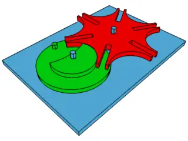

<figure class="eoc-pic eoc-pic-main"><picture><source media="(prefers-reduced-motion: reduce)" srcset="../media/geneva-drive.still.webp"></picture><figcaption><strong>Animation.</strong> <a href="https://commons.wikimedia.org/wiki/File:Geneva_mechanism_6spoke_animation.gif">Geneva mechanism 6spoke animation</a> by Mike1024, Public domain, from Wikimedia Commons.</figcaption></figure>

A continuously turning drive wheel carries a pin that enters a slot in a driven wheel and turns it by a fixed step (360 degrees divided by the number of slots), then a raised locking disc on the drive wheel holds the driven wheel still until the next step.

**In plain words:** A wheel with a pin that turns round and round, and once per turn the pin dips into a slot in a star-shaped wheel and flicks it round one notch; the rest of the time a round disc holds the star wheel still. **Proper term:** Geneva drive (Geneva mechanism, Maltese cross mechanism).

**Also called:** Geneva mechanism; Geneva wheel / Geneva gear; Maltese cross (mechanism) / Maltese cross drive; Geneva stop (the version with one slot blocked, used to stop a watch or clock spring being over-wound); external Geneva / internal Geneva / spherical Geneva (the three layouts); star wheel (loosely; strictly a star wheel is a related mechanism with gear teeth); Malteserkreuzgetriebe (German); croix de Malte (French); 槽轮机构 (Chinese, 'slotted-wheel mechanism'); ゼネバ歯車 (Japanese).

## How it works

The drive wheel turns steadily. Once per turn its pin slides into one of the driven wheel's slots, pushes the wheel round by one slot (90 degrees for a 4-slot wheel, 60 for a 6-slot) and slides out again. While the pin is away, the curved edge of the locking disc sits in a matching curved notch of the driven wheel, so the driven wheel cannot turn at all; a cut-away in the locking disc lets the driven wheel swing only while the pin is driving it. In a well-designed Geneva the pin enters and leaves each slot straight along the slot's centre line, so the driven wheel starts and stops smoothly from zero speed, though not with zero jolt.

## Parts

A few parts: a drive wheel ([crank](../glossary.md#crank)) carrying a pin, often with a small roller on it, and a raised locking disc with a cut-away; a driven wheel with n straight slots and curved notches between them (the 'Maltese cross'); two shafts with bearings held at an exact distance apart.

## Everyday examples

- Old cinema film projectors, which pull the film down one frame at a time and hold it still in front of the lens (Wikipedia; Filmmuseum Berlin video)
- The 'Geneva stop' inside some mechanical watches and clocks that stops the spring being wound too far
- Tool changers and turret heads on machines, pen changers on plotters, and rotary indexing tables
- Printed desk toys, flip counters and 'wandering hour' clocks on model sites such as Printables

## When to use it

Use it when a motor or crank turns steadily but you need something to move one step, stop for a while, and move again, always the same amount and the same way: advancing a turntable or carousel between stations, a film or tape frame by frame, a counter or scoreboard digit, a rotating display, a sample tray, a tool or filter wheel, or a clock hand that jumps. It is simple, cheap, holds the output firmly during each pause without a separate brake, and starts and stops each step more gently than an intermittent (part-toothed) gear.

## When not to use it

Avoid it at high speed or with heavy, fast-moving loads, where its jolt at each start and stop causes vibration and wear; use a cam indexer, which can be shaped for smoother motion. Avoid it when you need only one or two stops per turn, a long move with a short pause, or unequal steps: use an intermittent (part-toothed) gear or a star wheel. When you need to change the step size, go backwards on command or stop anywhere, use a stepper motor or a servo instead. For stepping driven by a back-and-forth lever, use a [ratchet](../glossary.md#ratchet) and [pawl](../glossary.md#pawl).

## Details

- **What it does (jobs):**
  - change the kind of motion: turns steady rotation into stop-go steps
  - click into set positions: it moves the output to one of n fixed positions and holds it there during each pause
  - change speed or turning force: on average the output turns n times slower than the input (one step of 360/n degrees per input turn)
- **Movement:** rotate: continuous rotation in; stepped rotation out, 360 degrees / n per input turn (for example 90 degrees per step with 4 slots), always in the same direction, with unlimited total rotation (except the Geneva stop version, which is limited to a set number of turns)
- **Directions it can move (degrees of freedom):** 1: the output's position is fully set by the input crank's angle, either being driven by the pin or held by the locking disc
- **Special behaviour:**
  - motion conversion (e.g. rotary to linear): continuous rotation becomes intermittent rotation, with a smooth start and stop of each step
  - indexing (clicks into set positions): the output stops at n equally spaced positions per turn
  - [self-locking](../glossary.md#self-locking) (holds under load, won't back-drive): during each pause the locking disc blocks the output, so a load on the output cannot turn it and cannot drive the input; RoyMech notes the driven wheel is always under the driver's control, so it can't overrun
  - Geneva stop variant: with one slot closed, the drive wheel can only make a set number of turns, which was used to stop watch springs being over-wound or fully unwound (Wikipedia; 507 Mechanical Movements no. 212)
- **How it holds:**
  - not a holding joint (it moves or passes on motion): it converts and passes on rotation
  - shape (the parts interlock; [form-fit](../glossary.md#form-fit--force-fit--material-bond)): during each pause the round locking disc sits in the driven wheel's curved notch, which physically blocks it from turning
- **Input and output:** Continuous rotation -> stepped (intermittent) rotation in the same plane. Step = 360 degrees / n, n = 3 to 18 slots in practice, 4 to 8 most common. Timing is fixed by n: an external Geneva moves for 1/2 - 1/n of each input turn (4 slots: moves 25%, rests 75%; 6 slots: moves 33%, rests 67%), an internal Geneva moves for more than half, a spherical one for exactly half. Peak output speed = input speed / (1/sin(180 degrees/n) - 1): about 2.4 times the input speed for 4 slots and equal to it for 6 slots. Efficiency: no reliable figure found ⚑ [uncertain]; losses come from the pin (or roller) sliding in the slot and the locking disc rubbing in its notch during the pause. Shafts: parallel for external and internal types; intersecting at right angles for the rare spherical type. Back-drivable: no during the pause (the locking disc blocks the output); during a step the pin is in control, so the output cannot run ahead.
- **Power:** passive (no power needed); it is usually driven by a motor or hand crank, and if power is lost the output simply stays locked where it was during a pause
- **Load:** Light to heavy depending on size: Bickford notes Genevas range from instrument sizes to machine-tool drives indexing spindle carriers weighing several tons, and quotes an 18-inch Geneva lasting 20 years indexing a one-ton carrier every few seconds. The weak points are the pin and the slot walls, which take a jolt each time the pin enters, and the locking disc during the pause. External Genevas can be smaller and take higher stresses than internal ones (Wikipedia). Printed plastic versions are for light loads and demonstrations.
- **Play and precision:** The output is held during each pause by the locking disc sitting in its notch, so play comes from the [clearance](../glossary.md#clearance) between those curved surfaces and between the pin and the slot; Wikipedia notes the locking disc keeps the image steady in film projectors. Centre distance must be held accurately so the locking disc works without jamming (cramping) and the pin meets the slots correctly, and a pin that is loose in its slot can chatter from side to side at speed (Bickford). Heavy machine tools add a separate locating and locking mechanism for exact final position (Bickford, fig. 9-14). It tolerates little [misalignment](../glossary.md#misalignment) between the shafts.
- **Taking it apart:** removable: the two wheels sit on shafts or axles in a frame and can be taken apart (screws, retaining rings or push-fit axles)
- **How often it can be reused:** many times: it can be dismantled and reassembled repeatedly; the limit is wear of the pin, slots and locking surfaces, not the assembly
- **Sealing:** none: it is an open mechanism; it does not seal anything
- **Adjustable:** No: the step angle and the move-to-pause timing are fixed by the number of slots once it is designed; only the starting position (phase) is set when assembling
- **Access needed:** not applicable: it is two wheels on shafts in a frame, reached wherever the frame opens
- **Materials:** Metal in machine tools, watches and projectors (heavy-duty machine-tool Genevas use replaceable wear shoes and drive rollers, per Bickford) ⚑ [uncertain: specific alloys not found]. 3D-printed plastics work for light duty: a Bucharest study printed Genevas in PLA, ABS, PLA with copper, PLA with bronze and acrylic (plexiglass), and found ABS and copper-filled PLA ran with much less noise and vibration (3DPrint.com on Rizescu et al.); osamutake recommends well-dried PETG for [accuracy](../glossary.md#repeatability--accuracy).
- **Heat, cold, water and wear:** Printed PLA softens above about 60 °C (Prusa), so keep PLA models away from heat; dust or grit in the slots and on the locking surfaces speeds wear ⚑ [uncertain]; running dry makes it noisy, and a little lubricant quiets it (TazaParts). Vibration: it causes its own vibration at speed because of the jolt at each step (Wikipedia).

## Making it

- **Ways to make or get it:**
  - 3D print (FDM): many printable demos, counters, clocks and toys, including [print-in-place](../glossary.md#print-in-place) versions
  - laser cut: ⚑ [uncertain] the parts are flat profiles that a laser could cut from acrylic or plywood, no tested example found
  - CNC: the traditional way to make metal ones; slots and locking arcs are milled
  - off-the-shelf part: Bickford (1972) notes Genevas were sold ready-made by several makers; for hobby builds buy the shafts, bearings, pins and retaining rings
- **Printing it in one piece (print in place):** yes: TazaParts' LEGO-compatible Geneva drive prints already assembled without supports, using 0.2-0.3 mm clearances on the moving parts; most printable Genevas are printed as separate flat parts and pushed onto axles
- **Tools:** A screwdriver or hex key for the frame and shaft fixings, or none for push-fit and LEGO-axle printed models; optionally a little lubricant for the pin, slots and axles
- **Difficulty:** easy to moderate: free generators calculate the geometry and the parts print flat without supports (some even print already assembled), but the shafts must be held at the right distance and the pin must run smoothly in the slots

### 3D printing tips

1) Get the geometry from a generator: Ben Brandt's online Geneva Drive Generator takes the crank radius, number of positions, pin diameter and clearance and gives the centre distance, slot length and width and locking-arc sizes, with an animation; tllilleh's OpenSCAD library (needs BOSL2) builds the parts. 2) Print the wheels flat on the bed; they need no supports. 3) Surface finish matters because the pin slides along the slots: osamutake uses 0.1 or 0.08 mm layers and a random seam position so the seams wear in instead of catching, and Shmoee recommends 0.12 mm layers for the Geneva wheel because Z-seams make it rough; sand or file any seam blobs if it sticks. 4) Clearances: 0.2-0.3 mm for print-in-place parts (TazaParts), about 0.15 mm [radial](../glossary.md#axial--radial) clearance for gears on printed shafts (osamutake); PETG usually needs a little more clearance than PLA ⚑ [uncertain]. 5) [Elephant's foot](../glossary.md#elephants-foot) (a squashed first layer) and stringing make holes too tight: file the hole or sand the shaft (osamutake). 6) Use well-dried PETG for accuracy (osamutake); ABS and copper-filled PLA were quieter in the Bucharest study. 7) Smooth axles: flanged ball bearings (Joel uses F6901Z) or metal screws as axles (whlpr uses M3 x 14 screws); a drop of lubricant such as bike chain lube quiets it (TazaParts). 8) Make the pin round and smooth, and consider a metal pin or a small bearing as a roller for longer life ⚑ [uncertain]. 9) Keep the centre distance exact: mount both shafts in one rigid printed frame rather than two separate parts.

### Buying one (off-the-shelf parts)

Shafts or axles (steel rod, LEGO Technic axles (brand)); flanged ball bearings (e.g. F6901Z); machine screws and nuts as axles (M3); retaining rings ([circlips](../glossary.md#circlip)) or e-clips to hold wheels on shafts; a dowel pin or shoulder screw for the drive pin, optionally with a small ball bearing or track roller on it to reduce friction ⚑ [uncertain]; a gear motor or hand crank to drive it. Industrial alternatives are sold as cam indexers and rotary index tables (search 'indexing drive', 'rotary indexer').

## Rules of thumb

- Step angle = 360 degrees / n per turn of the drive wheel; n is from 3 to 18 in practice (Wikipedia 'Geneva drive'; Bickford: 'no less than three, and usually no more than 18'); 4, 6 and 8 are common.
- Centre distance c = a / sin(180 degrees / n), where a is the crank (pin) radius; driven wheel radius b = square root of (c squared - a squared) = a / tan(180 degrees / n) (Ben Brandt's Geneva Drive Generator source code; MechSimulator; French Wikipedia 'Croix de Malte (mecanisme)'). Example: a 20 mm crank with 4 slots needs 28.3 mm between shafts and a 20 mm wheel radius.
- Slot length along its centre line s = a + b - c; slot width = pin diameter + clearance; locking (stop) arc radius = a - 1.5 x pin diameter, and the locking disc is that minus the clearance (Ben Brandt's Geneva Drive Generator).
- An external Geneva moves for 1/2 - 1/n of each input turn and rests for the rest (French Wikipedia): the pause is always longer than the move, and longer than half a turn of the input (Bickford). An internal Geneva moves for more than half the turn; a spherical one exactly half (Bickford).
- Peak output speed = input speed / (1/sin(180 degrees/n) - 1) (French Wikipedia): about 2.4 times input speed with 4 slots, equal to input speed with 6 slots. More slots mean lower peak speed and acceleration of the output (Bickford).
- The pin must enter and leave each slot exactly along the slot's centre line (the pin's path tangent to the slot); an error of as little as 5 degrees introduces an impact (Bickford, fig. 9-7 to 9-9). Shape the pin so it picks up the wheel as gently as possible (RoyMech).
- Hold the centre distance accurately so the locking disc works without jamming, and make the pin a good running fit in the slots so it does not chatter (Bickford).
- Even a perfect Geneva jolts the output at the start and end of each step (infinite jerk), which causes vibration at high speed or with heavy loads; fine at low speed and low inertia (Wikipedia; French Wikipedia).

## Common failures

1) Knocking or clacking at each step because the pin enters the slot at an angle rather than along its centre line, or the centre distance is wrong (Bickford): use a generator and a rigid frame. 2) Jamming or binding during the pause because the locking disc is too tight in its notch or the centre distance is off (Bickford): add clearance. 3) Wobble of the output during the pause from too much clearance or wear: reduce clearance, replace worn parts. 4) Pin chatter from a loose pin in the slot, causing a series of impacts (Bickford). 5) Vibration and wear when run too fast (Wikipedia). 6) Printed parts sticking because of Z-seams, stringing or elephant's foot (Shmoee; osamutake): use fine layers, a random seam and file or sand the fits.

## Safety

In motor-driven builds, the pin, slots and wheels form pinch and [shear](../glossary.md#peel-vs-shear) points that can trap fingers ⚑ [uncertain]; guard them. Because the locking disc holds the output firmly, forcing the output by hand can break the pin or locking surfaces ⚑ [uncertain]. At speed the sudden steps can throw loose items off a carousel.

## Related

- Intermittent gear (mutilated or part-toothed gear): also gives stop-go motion with locking arcs, and can do one or two stops per turn or long moves with short pauses, but it starts and stops abruptly (Bickford; osamutake)
- Star wheel: combines a Geneva-style smooth start and stop with gear teeth for the middle of the move, giving more design freedom (Bickford; RoyMech)
- Cam indexer (barrel or globoid cam): shaped cams give fully controlled, smooth steps at high speed, at higher cost; in textile machines and projectors, Genevas and star wheels have been almost entirely replaced by such cam drives or by electric motors (German Wikipedia 'Schrittgetriebe')
- Ratchet and pawl: steps a wheel one tooth at a time from a back-and-forth input, and can be made to hold against reverse
- Escapement: lets a wound spring or weight release one step at a time, controlled by a pendulum or balance
- Stepper motor: electronic stepping whose size, speed and direction can be changed in software

## Make it yourself

- [Geneva Drive Generator (Ben Brandt, web app)](https://benbrandt22.github.io/genevaGen/): Enter crank radius or wheel radius, number of positions, pin diameter and clearance; it calculates centre distance, slot length and width and locking-arc sizes, draws the parts and animates them *(licence: not stated ⚑ [uncertain])*
- [openscad-geneva-drive (tllilleh, OpenSCAD library), README](https://raw.githubusercontent.com/tllilleh/openscad-geneva-drive/master/README.md): OpenSCAD library that generates Geneva drive parts; needs the BOSL2 library *(licence: not stated in the README ⚑ [uncertain])*
- [Lego compatible Geneva drive (print-in-place) (TazaParts, Printables)](https://www.printables.com/model/1092473-lego-compatible-geneva-drive-print-in-place): Geneva drive that prints already assembled with no supports, 0.2-0.3 mm clearances, LEGO Technic compatible; video at youtu.be/cG9SiGAxTPY *(licence: CC BY)*
- [Educational Gear Examples 2 (osamutake, Printables)](https://www.printables.com/model/1427427-educational-gear-examples-2): Set of small demonstration gear pairs on 80 mm base plates, including an external Geneva drive and a two-layer intermittent gear to compare side by side, with printing advice *(licence: CC BY)*
- [Single Thumbwheel Counter (00 to 99) using a Geneva Drive (Shmoee, Printables)](https://www.printables.com/model/520907-single-thumbwheel-counter-00-to-99-using-a-geneva-): A practical 00-99 counter where a Geneva drive carries the tens digit *(licence: CC BY-NC)*
- [Geneva Mechanism simulator (MechSimulator)](https://mechsimulator.com/tools/geneva-mechanism/): Interactive animation for 3 to 8 slots with live graphs of output speed and acceleration *(licence: link only ⚑ [uncertain])*

## Pictures, videos and models

- [Geneva mechanism 6spoke animation.gif (Wikimedia Commons, by Mike1024)](https://commons.wikimedia.org/wiki/File:Geneva_mechanism_6spoke_animation.gif): Animated six-slot external Geneva drive stepping round, with the locking disc visible *(licence: Public domain)*
- [Internal Geneva wheel ani.gif (Wikimedia Commons, by Coolhandscot)](https://commons.wikimedia.org/wiki/File:Internal_Geneva_wheel_ani.gif): Animated internal Geneva drive, where the drive wheel sits inside the slotted wheel *(licence: Public domain)*
- [Filmmuseum Berlin - Oskar Messter Maltese Cross in function.webm (Wikimedia Commons, by SunOfErat)](https://commons.wikimedia.org/wiki/File:Filmmuseum_Berlin_-_Oskar_Messter_Maltese_Cross_in_function.webm): Video of a real Maltese cross mechanism from an early film projector working in a museum display *(licence: CC BY-SA 4.0)*
- [507 Mechanical Movements, No. 212: the Geneva-stop](https://507movements.com/mm_212.html): 1868 drawing (with an animated version) of the Geneva stop used in Swiss watches to limit winding *(licence: Book public domain; website animation link only)*
- [Geneva mechanism 15 (Nguyen Duc Thang, YouTube thang010146)](https://www.youtube.com/watch?v=TYRks3vmAlI): CAD animation of a Geneva mechanism *(licence: link only (standard YouTube licence))*

## Needs confirming

⚑ marks something nobody has confirmed yet: a fact the research could not confirm from a source, a finder value that is a best guess, or an open point from the research notes. Corrections are welcome (see `research/needs-confirming.md`).

- ⚑ 12 sentences on this page marked [uncertain].
- ⚑ Finder value `clicks` = clicks (best guess): the text uses both clicking and silent words

## Sources

- <https://en.wikipedia.org/wiki/Geneva_drive>
- <https://fr.wikipedia.org/wiki/Croix_de_Malte_(m%C3%A9canisme)>
- <https://de.wikipedia.org/wiki/Schrittgetriebe>
- <https://en.wikipedia.org/wiki/Intermittent_mechanism>
- <https://commons.wikimedia.org/wiki/Category:Geneva_drives>
- <https://commons.wikimedia.org/wiki/File:Geneva_mechanism_6spoke_animation.gif>
- <https://commons.wikimedia.org/wiki/File:Internal_Geneva_wheel_ani.gif>
- <https://commons.wikimedia.org/wiki/File:Filmmuseum_Berlin_-_Oskar_Messter_Maltese_Cross_in_function.webm>
- <https://roymech.org/Useful_Tables/Cams_Springs/Indexing.html>
- <https://www.engineersedge.com/mechanics_machines/geneva_mechanism_design_equations__14919.htm>
- <https://ecommons.cornell.edu/handle/1813/57662>
- <https://ecommons.cornell.edu/server/api/core/bitstreams/4686812a-7d97-47e4-8f46-1fb663eb41fd/content>
- <https://ecommons.cornell.edu/server/api/core/bitstreams/3c2c62ea-1cc9-438a-991f-92b0ad210e0e/content>
- <https://507movements.com/mm_212.html>
- <https://507movements.com/toc.html>
- <https://benbrandt22.github.io/genevaGen/>
- <https://benbrandt22.github.io/genevaGen/genevaController.js>
- <https://raw.githubusercontent.com/tllilleh/openscad-geneva-drive/master/README.md>
- <https://mechsimulator.com/mechanisms/>
- <https://mechsimulator.com/tools/geneva-mechanism/>
- <https://huangyan920.github.io/Mechanical/>
- <https://karakurist.jp/?p=21>
- <https://3dprint.com/252811/researchers-study-3d-printed-geneva-mechanisms/>
- <https://api.printables.com/graphql/>
- <https://www.printables.com/model/1092473-lego-compatible-geneva-drive-print-in-place>
- <https://www.printables.com/model/520907-single-thumbwheel-counter-00-to-99-using-a-geneva->
- <https://www.printables.com/model/1024053-geneva-mechanism-with-f6901z-bearings>
- <https://www.printables.com/model/107461-geneva-drive>
- <https://www.printables.com/model/1427427-educational-gear-examples-2>
- <https://www.printables.com/model/1504642-educational-gear-examples-5-intermittent>
- <https://www.youtube.com/watch?v=TYRks3vmAlI>
- <https://www.youtube.com/watch?v=cG9SiGAxTPY>
- <https://help.prusa3d.com/article/pla_2062>
