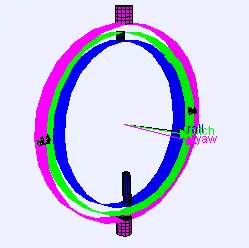

*Picture: [Gimbal 3 axes rotation.gif](https://commons.wikimedia.org/wiki/File:Gimbal_3_axes_rotation.gif) by Lookang many thanks to Fu-Kwun Hwang and author of Easy Java Simulation = Francisco Esquembre, [CC BY-SA 3.0](https://creativecommons.org/licenses/by-sa/3.0), from Wikimedia Commons.*

A set of two or three nested pivots at right angles to each other, so the object in the middle can tilt freely about each axis, or stay level while whatever holds it rocks.

**In plain words:** Rings inside rings, each on a pair of pivots set at right angles to the next, so the thing in the middle can tilt any way, or stay level while its holder rocks about. **Proper term:** Gimbal (Cardan suspension).

**Also called:** Cardan suspension, gimbal suspension (named after Gerolamo Cardano; Wikipedia 'Gimbal'); gimbal mount, gimbal ring, gimbaled mount; two-axis gimbal / three-axis gimbal (by number of rings or motor axes; Wikipedia; Appropedia); handheld stabiliser, camera gimbal, 3-axis gimbal stabiliser, brushless gimbal (motorised camera versions; Wikipedia; Hackaday; Oscar Liang); gimbal head (a single-axis telephoto lens mount that swings the lens about its centre of gravity; Wikipedia); pan-tilt mount (two stacked pivots for aiming a camera or light) ⚑ [uncertain as a strict synonym]; Steadicam (brand; a mechanical camera stabiliser that pivots at a gimbal; Wikipedia); joystick gimbal, stick gimbal (the two-axis pivot under a joystick or radio-control transmitter stick; Printables 'The Gimbalotl') ⚑ [uncertain].

## How it works

Each ring can only turn about one axis on its pair of pivots, and each ring's axis is at right angles to the next one's, so the rotations stack up: two rings let the middle tilt in two directions ([pitch](../glossary.md#pitch) and roll), and a third ring adds turning (yaw) (Wikipedia 'Gimbal'). With free pivots, a bottom-heavy object hangs level whatever the holder does, which is why ships' compasses, stoves and drink holders are gimbaled (Wikipedia). A motorised stabiliser instead balances the camera on the pivot axes and uses a motor on each axis, driven by a motion sensor, to hold the camera steady while the operator moves (Wikipedia; Hackaday 2015). If two of the three axes swing into line, the gimbal loses one direction of movement for that moment ('gimbal lock'), although nothing is actually locked (Wikipedia).

## Parts

A small assembly that acts as one unit: an outer frame or ring fixed to the holder, one or two inner rings, the object (payload) in the middle, and a pair of pivots between each ring and the next (pins, cone points in dimples, or ball bearings on shafts). Motorised camera gimbals add a motor on each axis, a motion sensor (IMU) and a controller board.

## Everyday examples

- A handheld phone or camera stabiliser, and the camera under a drone (Wikipedia 'Gimbal')
- A ship's compass, stove or drink holder that stays level while the boat rolls (Wikipedia 'Gimbal')
- A gyroscope toy, or a [print-in-place](../glossary.md#print-in-place) gyroscope fidget made of nested rings (Printables)
- The sticks on a game controller or radio-control transmitter, which sit on small two-axis gimbals ⚑ [uncertain]

## When to use it

Use a gimbal when something must tilt freely in two or three directions about one fixed point, or stay level or pointing the same way while its support moves: cup holders on bikes, prams, cars and boats, compasses and spirit-level instruments, lamps and cameras you want to aim, sensor or test mounts, joysticks, and motorised camera stabilisers. It is also good when the tilting part must stay open in the middle (a cup or camera sits inside the rings).

## When not to use it

If you need to pass turning motion from one shaft to another at an angle, use a universal (Hooke's) joint instead. If you only need something to tilt and lock in place, a ball-and-socket joint or lockable ball head is more compact. If only one tilt direction is needed, a single hinge or trunnion is simpler. Avoid a three-ring gimbal where two axes may line up (gimbal lock). For stiff, precise aiming under load, a pan-tilt mount with motors and gearing is better than free rings ⚑ [uncertain].

## Details

- **What it does (jobs):**
  - let it move (turn, slide or bend): lets an object tilt freely about two or three crossing axes
  - line parts up exactly: keeps an object level or pointing one way while its support rocks (Wikipedia 'Gimbal')
  - hold or release using power: motorised stabilisers use a motor on each axis to hold a camera steady (Wikipedia; Hackaday)
- **Movement:** rotate: about two or three axes at right angles; a free ring can usually turn all the way round, but in practice the range is limited by the payload hitting a ring or by cables ⚑ [uncertain]
- **Directions it can move (degrees of freedom):** 2 or 3: each ring adds one rotation, so two rings give two (pitch and roll) and three give three (pitch, roll and yaw) (Wikipedia 'Gimbal'); with three rings, one direction is lost whenever two axes line up (gimbal lock; Wikipedia)
- **Special behaviour:**
  - self-aligning or self-centring: an object whose weight sits below the pivots hangs level by itself however its support tilts, as with ships' compasses, stoves and drink holders; the Steadicam stays upright by making its bottom slightly heavier than its top (Wikipedia 'Gimbal')
  - none of the locking or clicking behaviours: plain gimbals turn freely. Friction can be added so it stays where it is set, e.g. printed bumpers on a lamp gimbal (Pinshape '2 Axis Gimbal for Directional Lighting')
- **How it holds:**
  - not a holding joint (it moves or passes on motion): the pivots guide rotation rather than hold it
  - friction or clamping ([force-fit](../glossary.md#form-fit--force-fit--material-bond)): only in versions meant to stay where they are set, e.g. rubbing bumpers or tightened pivots (Pinshape)
  - powered hold: motorised stabilisers hold the camera angle with motors (Wikipedia)
- **Input and output:** not applicable: a gimbal lets the middle tilt but does not pass motion on from one shaft to another (that is the job of the universal joint, which uses the same crossed pivots). In motorised stabilisers each axis is turned directly by its own brushless motor (Wikipedia); a balanced payload can be moved by hand when the power is off (DroneTrest), so it is back-drivable.
- **Power:** passive (no power needed) for ordinary gimbals. Powered camera stabilisers use three brushless motors with an IMU and control algorithms (Wikipedia 'Gimbal'). If power is lost, the motors stop holding and the camera swings freely: a well-balanced camera stays roughly where it was, while an unbalanced one flops over (DroneTrest balancing guide).
- **Load:** light to medium for maker builds: loads go through the small pivot pins in [shear](../glossary.md#peel-vs-shear) and bending, so the pivots and the rings' [stiffness](../glossary.md#stiffness) set the limit. Printed passive gimbals comfortably carry drink cups and coffee cups (Printables models), and a printed stepper-driven dual-axis gimbal carried optical samples (Appropedia). Industrial gimbals carry heavy loads such as rocket engines, which are mounted on a pair of gimbals to steer their thrust (Wikipedia). Weakest against sideways knocks that bend the rings or lever on the pivots ⚑ [uncertain].
- **Play and precision:** small to noticeable, depending on the pivots: bearings or tight pins have little play, while print-in-place pivots need a gap of at least about 0.3 mm (Prusa), which gives some wobble. A 3D-printed stepper-driven two-axis gimbal measured 2.827 degrees accuracy, 1.585 degrees [repeatability](../glossary.md#repeatability--accuracy) and 1.237 degrees [backlash](../glossary.md#backlash) (Appropedia '3D printed dual axis gimbal system'). For smooth stabilisation, the camera lens must sit on the roll and pitch motor axes (Oscar Liang; Hackaday 2015).
- **Taking it apart:** removable: gimbals with pins, bolts or bearings at the pivots can be taken apart and re-assembled; print-in-place gimbals are one captive piece and can't be separated without breaking them
- **How often it can be reused:** many times for gimbals with bolted or pinned pivots; once for print-in-place gimbals, which are never taken apart
- **Sealing:** none: open rings and pivots; motorised versions need their own weather protection ⚑ [uncertain]
- **Adjustable:** Yes, in several ways: the payload can usually be slid on its mount to balance it on the pivot axes (Oscar Liang; DroneTrest); friction can be added or sanded away so the angle stays set (Pinshape); motorised gimbals are tuned in software (PID settings; Hackaday 2015).
- **Access needed:** not applicable
- **Materials:** Rings and frames: metal or plastic; 3D-printed PLA or PETG for passive and light motorised gimbals (the Gimbalotl joystick gimbal used PETG with 4 [perimeters](../glossary.md#perimeters) and 20% [infill](../glossary.md#infill); Printables); plywood and styrene sheet with metal brackets for a hand-built camera gimbal (Oscar Liang). Pivots: printed cone-and-dimple pivots (DesignMakeTeach), metal pins or shafts, or ball bearings ⚑ [uncertain for bearings in the sources opened].
- **Heat, cold, water and wear:** Printed PLA gimbals soften from about 60 degrees C (CNC Kitchen), so a PLA cup holder left in a hot car may sag; PETG and ASA last longer. Pivots collect dirt and grit and can stiffen or wear ⚑ [uncertain]. Motorised gimbals contain electronics and motors that need protecting from rain ⚑ [uncertain]. Vibration passes through the pivots unless the mount is damped ⚑ [uncertain].

## Making it

- **Ways to make or get it:**
  - 3D print (FDM): print-in-place gimbals (cup holders, lamp mounts, toys) or printed rings and arms bolted together with motors (Printables; Pinshape; Hackaday 2019)
  - woodwork: plywood frames with metal brackets (Oscar Liang's hand-held camera gimbal)
  - CNC or laser cut: flat rings and arms ⚑ [uncertain]
  - off-the-shelf part: complete handheld stabilisers and drone gimbals, gimbal heads for long lenses, gimbal motors and controller boards (Wikipedia; Hackaday)
- **Printing it in one piece (print in place):** yes for passive gimbals: print-in-place gimbals print already assembled with captive rings, e.g. drink holders and desk toys (Printables; DesignMakeTeach); no for motorised camera gimbals, which are printed as separate arms and bolted to the motors (Hackaday 2019)
- **Tools:** none for a print-in-place gimbal (just work the joints loose; Printables 'Universal Travel Coffee Gimbal'); a screwdriver, hex keys or spanner for gimbals assembled with bolts or pins; for motorised camera gimbals also a soldering iron and a computer to set up and tune the controller (Oscar Liang; Hackaday 2019)
- **Difficulty:** easy for a passive print-in-place gimbal such as a cup holder or desk toy (prints in one piece); moderate for a bolted gimbal with bearings; hard for a motorised camera stabiliser, which needs careful balancing, electronics and PID tuning

### 3D printing tips

1) Print-in-place layout: print the rings nested and lying flat, with the pivots on the rings' horizontal axes. A common pivot is a small cone on the inner ring sitting in a dimple in the next ring, with a gap so the parts don't touch; the inner ring is trapped but free to spin (DesignMakeTeach, describing Bluebie's 'Parametric Gimbal'). Prusa suggests starting with a gap of at least 0.3 mm between parts that must move. 2) Supports: avoid supports inside the gimbal rings, which would glue the joints; the 'Universal Travel Coffee Gimbal' says not to use supports on the gimbal section and to work it back and forth until the joints click loose, and recommends 4 perimeters. The 'Drink Gimbal' prints with its top flat on the bed and only a little support, placed with support enforcers, under the base of the can holder (Printables). A lamp gimbal avoids supports by printing bridges that are snipped off afterwards (Pinshape). 3) Friction: if the gimbal should stay where it is set, add small bumpers that rub, and sand them to tune the friction (Pinshape). 4) Balance: design the payload holder so the object can slide to find its balance point, because weight is hard to predict (Oscar Liang). For a self-levelling holder (cups, compasses), keep the weight below the pivot axes; for a camera gimbal, put the camera's centre of gravity on the axes and the lens in line with the roll and pitch motor shafts (Wikipedia; Oscar Liang; DroneTrest). 5) Stiffness: rings flex under load; thicker rings and more perimeters help, e.g. PETG, 4 perimeters and 20% infill survived rough use in the Gimbalotl joystick gimbal (Printables). 6) Heat: PLA starts to give at about 60 degrees C (CNC Kitchen), so a PLA cup gimbal in a hot car or holding hot drinks may sag; PETG or ASA is safer ⚑ [uncertain for hot drinks]. 7) Never scale a print-in-place gimbal without re-checking the gap, since the gap scales too ⚑ [uncertain for this model type].

### Buying one (off-the-shelf parts)

Pivots: shoulder bolts or pins, flanged ball bearings, bushings ⚑ [uncertain]. Motorised camera gimbals: brushless gimbal motors (low-kV, e.g. 2206 140 kV; Oscar Liang), a brushless gimbal controller (BGC) such as STorM32 (brand) boards (Hackaday 2019) or Quanum (brand) controllers (Oscar Liang), and an IMU board mounted with the camera (Hackaday 2015). Complete products: handheld 3-axis stabilisers for phones and cameras, drone camera gimbals, gimbal heads for telephoto lenses, and pan-tilt heads. Stepper-driven gimbals: stepper motors and an Arduino-type controller (Appropedia).

## Rules of thumb

- The pivot axes of successive rings must be at right angles (orthogonal); three rings are needed to isolate an object in all three rotations (Wikipedia 'Gimbal').
- Avoid running a three-ring gimbal where two axes line up: at that point it loses one degree of freedom (gimbal lock; Wikipedia 'Gimbal').
- Self-levelling: make the payload slightly bottom-heavy below the pivots, as a Steadicam does, so its centre of gravity stays under the gimbal (Wikipedia 'Gimbal').
- Motorised camera gimbal: balance before powering on or tuning; a balanced camera stays wherever you point it with the power off (DroneTrest), and should face forward, level and upright at rest (Oscar Liang).
- Put the camera lens in line with the roll and pitch motor shafts for stable video (Oscar Liang; Hackaday 2015).
- Rebalance whenever the camera's centre of gravity changes, e.g. a zoom lens; fit the battery and memory card before balancing; 14-35 mm lenses suit gimbals (DroneTrest).
- Start with at least 0.3 mm [clearance](../glossary.md#clearance) between moving printed parts (Prusa knowledge base 'Modeling with 3D printing in mind').
- What to expect from a printed stepper gimbal: about 2.8 degrees accuracy, 1.6 degrees repeatability and 1.2 degrees backlash (Appropedia '3D printed dual axis gimbal system', Bihari et al. 2018).

## Common failures

1) Print-in-place pivots fused solid: the gap was too small or supports got inside the joint; use at least about 0.3 mm gap, no supports in the gimbal section, and work the joints loose (Prusa; Printables 'Universal Travel Coffee Gimbal'). 2) The payload won't stay level: its weight is not below (passive) or on (motorised) the pivot axes; slide it to balance (Oscar Liang; DroneTrest). 3) A motorised gimbal jitters or drifts: unbalanced camera or poor PID tuning; balance first, then tune (Oscar Liang; Hackaday 2015). 4) The angle won't stay set: add friction bumpers or tighten the pivots (Pinshape). 5) Sudden loss of control when two axes line up: gimbal lock; keep the working range away from that position (Wikipedia). 6) Thin printed rings bend or pivots snap under knocks: thicker rings, more perimeters or a tougher material such as PETG (Printables 'The Gimbalotl') ⚑ [uncertain as a general fix]. 7) Cables to a motorised camera wind up or pull on the payload: route them through the pivots or leave slack loops ⚑ [uncertain].

## Safety

Motorised gimbals can move suddenly when powered up or tuned, and fingers can be pinched between arms and motors ⚑ [uncertain]. A cup gimbal holding a hot drink can tip it if the cup is top-heavy or the pivots stick ⚑ [uncertain]. Otherwise, none known.

## Related

- Universal joint (Hooke's joint, Cardan joint): the same two crossed pivots, but used to pass rotation between two shafts at an angle
- Ball-and-socket joint (lockable ball head): tilts in all directions in one compact joint, but relies on friction and has a limited angle
- Trunnion and clevis pivots: a single pivot axis; one ring of a gimbal is essentially a trunnion mount
- Pan-tilt mount: two stacked motorised pivots used to aim cameras or lights; a gimbal without the rings
- [Flexure](../glossary.md#flexure) hinge (notch, leaf-spring and cross-axis pivots): can make a small gimbal with no rubbing pivots, e.g. for precise instruments ⚑ [uncertain]
- Slip ring and rotary union: passes power or signals through a joint that turns all the way round
- Canfield joint: a parallel-link joint for pointing things, listed by Wikipedia alongside the gimbal

## Make it yourself

- [Drink Gimbal - no spill can holder - print in place (Caleb Kraft, Printables) (URL from Printables API, page not opened)](https://www.printables.com/model/48659-drink-gimbal-no-spill-can-holder-print-in-place): Print-in-place gimbal can holder; print with the top flat on the bed and a little support under the base. Read through the Printables public API. *(licence: CC BY-NC (Creative Commons Attribution-NonCommercial))*
- [Universal Travel Coffee Gimbal (mobiobi, Printables) (URL from Printables API, page not opened)](https://www.printables.com/model/129329-universal-travel-coffee-gimbal): Fully printed gimbaled to-go cup holder that clamps to a 20-30 mm bar; no supports on the gimbal section, work the joints loose; STEP and Fusion 360 files included for editing. Read through the Printables public API. *(licence: CC BY-NC (Creative Commons Attribution-NonCommercial))*
- [2 Axis Gimbal for Directional Lighting (Barry Maxwell, Pinshape)](https://pinshape.com/items/54386-3d-printed-2-axis-gimbal-for-directional-lighting): Print-in-place two-axis lamp gimbal with sandable friction bumpers; one version prints without supports using snip-off bridges *(licence: CC BY)*
- [3D Design: Personalize a Gimbal (DesignMakeTeach, Tinkercad tutorial)](http://designmaketeach.com/2014/05/06/3d-design-personalize-a-gimbal/): Beginner tutorial for customising Bluebie's print-in-place 'Parametric Gimbal' in Tinkercad, with a cut-away view of the cone-and-dimple pivots; the resulting 'MOM Gimbal' is on Printables (model 294480, CC BY-SA) *(licence: link only (tutorial); model CC BY-SA)*
- [3D printed dual axis gimbal system (Appropedia; Bihari, Dash, Dhankani and Pearce 2018)](https://www.appropedia.org/3D_printed_dual_axis_gimbal_system): Open-source, 3D-printable two-axis gimbal driven by two stepper motors and an Arduino-based controller, for optical measurements; links to the STL files, CAD and source code *(licence: CC BY-SA 3.0)*

## Pictures, videos and models

- [Gimbal 3 axes rotation.gif (Wikimedia Commons, by Lookang)](https://commons.wikimedia.org/wiki/File:Gimbal_3_axes_rotation.gif): Animation of three nested gimbal rings turning about pitch, roll and yaw axes while the centre stays fixed *(licence: CC BY-SA 3.0)*
- [Gimbal Lock Plane.gif (Wikimedia Commons, by Drummyfish)](https://commons.wikimedia.org/wiki/File:Gimbal_Lock_Plane.gif): Animation of an aircraft in colour-coded roll, pitch and yaw gimbal rings, showing two axes lining up (gimbal lock) *(licence: CC0 1.0 (public domain))*
- [Gimbal (Wikipedia)](https://en.wikipedia.org/wiki/Gimbal): Definition, history (Philo of Byzantium, Ding Huan's incense burner, Villard de Honnecourt's sketch) and uses, with the animations above and photos of a smartphone gimbal and camera stabiliser *(licence: CC BY-SA 4.0 (text); images per file)*
- [DIY Brushless Camera Gimbal - Handheld & Mini Quadcopter (Oscar Liang)](https://oscarliang.com/build-brushless-camera-gimbal-handheld-quadcopter/): Photos and video of a hand-made two-axis brushless camera gimbal in plywood, with notes on aligning the lens with the motor axes and balancing *(licence: link only)*
- [2 Axis Gimbal for Directional Lighting (Pinshape, by Barry Maxwell)](https://pinshape.com/items/54386-3d-printed-2-axis-gimbal-for-directional-lighting): Printable two-axis gimbal with print-in-place joints and friction bumpers, holding a GU10 lamp socket *(licence: CC BY)*

## Needs confirming

⚑ marks something nobody has confirmed yet: a fact the research could not confirm from a source, a finder value that is a best guess, or an open point from the research notes. Corrections are welcome (see `research/needs-confirming.md`).

- ⚑ 20 sentences on this page marked [uncertain].

## Sources

- <https://en.wikipedia.org/wiki/Gimbal>
- <https://commons.wikimedia.org/wiki/File:Gimbal_3_axes_rotation.gif>
- <https://commons.wikimedia.org/wiki/File:Gimbal_Lock_Plane.gif>
- <https://oscarliang.com/build-brushless-camera-gimbal-handheld-quadcopter/>
- <https://www.dronetrest.com/t/balancing-your-brushless-gimbal/55>
- <https://hackaday.com/2015/03/28/resourceful-diy-brushless-hand-held-camera-gimbal/>
- <https://hackaday.com/2019/08/19/diy-gimbal-for-the-raspberry-pi-camera/>
- <https://www.appropedia.org/3D_printed_dual_axis_gimbal_system>
- <https://pinshape.com/items/54386-3d-printed-2-axis-gimbal-for-directional-lighting>
- <http://designmaketeach.com/2014/05/06/3d-design-personalize-a-gimbal/>
- <https://help.prusa3d.com/article/modeling-with-3d-printing-in-mind_164135>
- <https://www.cnckitchen.com/blog/comparing-pla-petg-amp-asa-feat-prusament>
- <https://api.printables.com/graphql/>
