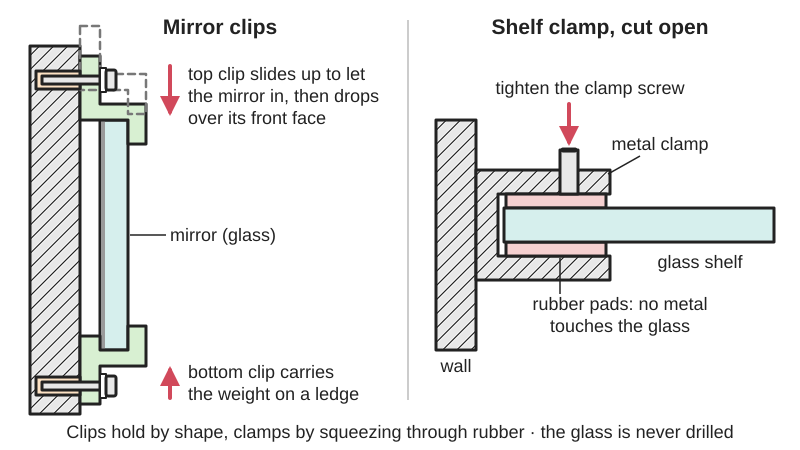
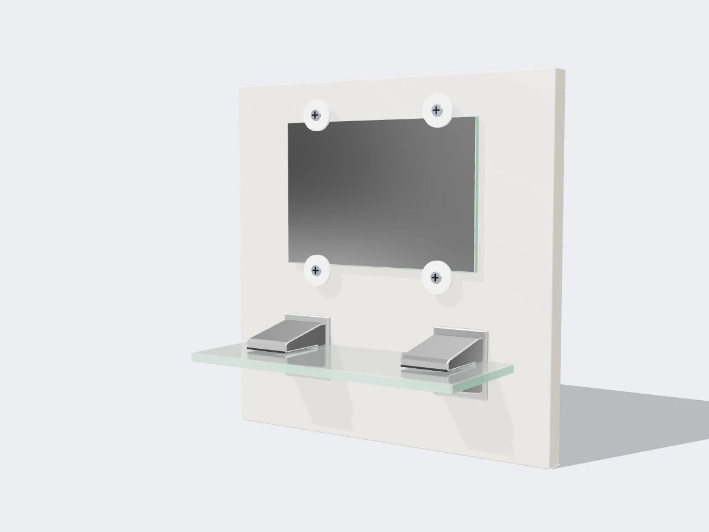

<figure class="eoc-pic eoc-pic-main"><figcaption>Diagram drawn for the encyclopaedia from the research notes. ⚑ Needs confirming: a drawing can simplify or get details wrong; a real photo or a better diagram is welcome.</figcaption></figure>
<figure class="eoc-pic"><figcaption><strong>Render.</strong> A 3D model made for the encyclopaedia, not a photo: a stand-in until a good real photo is found. ⚑ Needs confirming: a model can simplify or get details wrong; a real photo is welcome.</figcaption></figure>

Brackets fixed to a wall, cabinet or printer bed that hold a sheet of glass, mirror or acrylic by its edge, either by a lip the sheet sits behind (mirror clips, J-channel) or by a screw that squeezes the sheet between rubber or plastic pads (glass clamps, shelf brackets, display connectors, bed clips), so the sheet is held without drilling it.

**In plain words:** Small brackets screwed to a wall or frame that hold a sheet of glass, mirror or acrylic by its edges, either with a hooked lip the sheet sits behind or with a little screw clamp lined with rubber, so you never have to drill the sheet itself. **Proper term:** Glass and mirror edge clips and clamps (mirror clips; glass clamps; glass shelf brackets; glass bed clips).

**Also called:** mirror clips, mirror holders, mirror brackets; fixed mirror clips (bottom) and sliding, spring or spring-loaded mirror clips (top) (Reflect Window & Door; RealHomes); offset mirror clips, plastic mirror clips, mirror clip set; J-channel, J-bar, J-mold or mirror mounting channel (a continuous bottom and top channel for big gym and dance-studio mirrors; Reflect Window & Door; 4specs forum); glass clamp, shower glass clamp, cubicle glass clamp, wall-mount glass clamp, glass-to-wall clamp, glass-to-glass clamp (Rainco; S3i); glass shelf bracket, glass shelf clamp, glass shelf support, shelf bracket for glass, pelican clamp ⚑ [uncertain: trade nickname seen only in shop listings]; glass connector, display connector, display-cube connector, two-way / three-way / four-way 90-degree glass connector (Reflect Window & Door); glass bed clip, glass bed clamp, build plate clamp, bed clip, print surface clip (3D printers; UltiMaker; filament2print; Printables); binder clip or foldback clip used on a 3D-printer glass bed; acrylic panel clip, panel clip (printer enclosures, e.g. Voron panel clips on Printables); cabinet glass clip, glass retainer clip, glass/mirror clip.

## How it works

Lip-type clips hold the sheet by shape: the bottom clips carry its weight on a ledge and the top clips reach over the front face so it can't tip forward; spring or sliding top clips are pushed up to slip the mirror in and then drop down to trap it (Reflect; RealHomes). Clamp-type fittings hold by friction: a screw squeezes the glass between two pads, and the rubber or plastic lining spreads the force, grips the smooth surface and keeps metal from touching the glass (Rainco: 'Ensure there is no direct metal-to-glass contact'). Some heavy shower clamps add a pin through a hole drilled in the [toughened glass](../glossary.md#toughened-glass) at the factory, so they are not truly drill-free (S3i). On a 3D printer, clips at the edges press the glass plate down onto the heated bed; on some printers two fixed clips at the back act as a lip and two front clips open (UltiMaker).

## Parts

A few parts. Lip type: two fixed bottom clips and two sliding or spring top clips, each with a screw, a wall plug or anchor and often a plastic washer or snap-on cover (Reflect; RealHomes); or a length of aluminium J-channel at the bottom and top. Clamp type: a metal body, a rubber or plastic gasket or pad that lines the jaws, one or two clamping screws (grub screws, often nylon-tipped) and wall screws (Rainco exploded view: clamp body, protective glass gasket, two wall screws, two clamp screws).

## Everyday examples

- A frameless bathroom mirror held by four small chrome or clear plastic clips (Reflect; RealHomes)
- A glass shelf over a bathroom basin, held in two clamp brackets with rubber strips (S3i)
- Glass display cubes in shops joined at the corners by plastic or aluminium connectors (Reflect)
- A 3D printer's glass build plate held down by binder clips or bed clips (UltiMaker; Hubs forum)

## When to use it

Use edge clips when you want to hang or hold a sheet of glass, mirror or acrylic without drilling it: hanging a frameless mirror, putting up a glass shelf or splashback, holding a glass or acrylic panel in a cabinet or printer enclosure, building display cubes, or fixing a glass plate to a 3D-printer bed. They are cheap, quick, easy to undo, and let a broken sheet be replaced. Toughened glass can't be drilled after toughening (Wikipedia 'Tempered glass'), so edge clamps are often the only option for an existing toughened panel.

## When not to use it

Avoid clips that can't be fixed to something solid: a heavy mirror on plasterboard with only plastic plugs (use toggle anchors, studs, a bottom J-channel or a French cleat on a framed mirror; see Hang-on mounts). Don't rely on clamp friction alone for heavy or tall panels where people could be hurt (shower screens need the maker's full system and a stabilising bar; S3i). For sheets that must not show any hardware, use mirror adhesive with mirror tape (see Silicone and MS-polymer adhesive sealants), or a drilled sheet with standoffs (see Panel standoff). On a 3D printer, consider a magnetic flexible sheet instead, since clips take up print area and can be hit by the nozzle ⚑ [uncertain]. Don't use edge clips on glass with chipped edges: replace the sheet.

## Details

- **What it does (jobs):**
  - join and hold: holds a mirror, glass shelf, glass panel, display-cube wall or printer bed plate in place
  - lock, and release by hand: sliding or spring top mirror clips, front bed clips and binder clips let the sheet be lifted out and put back without tools (Reflect; UltiMaker)
  - line parts up exactly: a bed clip or corner clamp keeps the glass plate in the same place on the heated bed so it doesn't shift during a print (filament2print; Hubs forum)
- **Movement:** none: the sheet is meant to stay still; sliding top mirror clips slide up a few millimetres in their screw slot only while fitting or removing the mirror (RealHomes)
- **Directions it can move (degrees of freedom):** 0 once fitted: the ledge and lips (or the clamp pads) stop the sheet moving in every direction; with lip-type clips the sheet can usually still slide sideways a little until the side clips or friction stop it
- **Special behaviour:**
  - quick-release: spring-loaded top mirror clips let you push the mirror up and swing its bottom out without unscrewing anything (Reflect); UltiMaker's front glass-plate clamps open so the plate can slide out of the fixed back clamps (UltiMaker)
  - none, for screw clamps and shelf brackets, which simply hold
- **How it holds:**
  - shape (the parts interlock; [form-fit](../glossary.md#form-fit--force-fit--material-bond)): lip-type mirror clips, J-channel and the fixed back clamps of a printer bed hold the sheet behind a lip and on a ledge
  - friction or clamping (force-fit): screw glass clamps, shelf brackets and display connectors squeeze the glass between rubber pads or nylon-tipped [set screws](../glossary.md#set-screw) (Rainco; S3i; Reflect GC-106CH)
  - spring force (a spring or springy part presses it in place): spring-loaded top mirror clips, sprung bed clips and binder clips (Reflect; Spring clip clamp entry)
- **Input and output:** not applicable
- **Power:** passive (no power needed)
- **Load:** light to medium, set by the wall fixing more than by the clip: Reflect says 'Plastic wall anchors will hold a mirror up to 20 lbs' (about 9 kg) and heavier mirrors need toggle bolts with at least one set of clips on a stud. Strong when the sheet's weight sits down on a bottom clip or channel; clamp-only fittings rely on friction and can let the glass slip if under-tightened or if the pads are greasy ⚑ [uncertain]. Shower glass clamps are made for 8-12 mm toughened glass and S3i says to 'always combine glass clamps with a Stabilising Bar'. Weak against prying the sheet forward from one corner, and glass itself is weakest at its edges (Wikipedia 'Tempered glass').
- **Play and precision:** small: lip clips leave a little play by design (Reflect: not 'so loose that the mirror can rattle'); screw clamps have none once tight; bed clips locate a plate well but it can [creep](../glossary.md#creep) if too few are used (Hubs forum: adding two more binder clips stopped the plate moving)
- **Taking it apart:** removable: lip clips with spring tops and bed clips come off by hand; screw clamps and fixed clips need a screwdriver or hex key; the wall fixings stay
- **How often it can be reused:** many times for bed clips, spring mirror clips and screw clamps (UltiMaker warns its back clamps 'could break off' if forced); the wall plugs and gaskets may need replacing when the fitting is moved ⚑ [uncertain]
- **Sealing:** none: clips only hold the sheet; a mirror fixed with clips leaves an air gap behind it
- **Adjustable:** yes, a little: sliding top mirror clips move up and down in a slot (RealHomes); clamp screws set the grip; some bed clamps can be 'tightened over time' (Printables 501068); otherwise positions are set by the screw holes
- **Access needed:** one side only (blind): everything is fixed from the front face of the wall, cabinet or bed, and the sheet is fitted from the front
- **Materials:** Clips are made of chrome-plated or stainless steel, aluminium (J-channel, display connectors), zinc alloy, or clear and white plastic; clamp pads are rubber, silicone or plastic gaskets and set screws have nylon tips (Rainco; S3i; Reflect). They suit any flat, rigid sheet with smooth edges: float-glass mirrors, toughened (tempered) glass shelves and shower panels, glass build plates, and acrylic (PMMA), polycarbonate and other plastic panels; Reflect's display connectors also take wood or metal [infill](../glossary.md#infill) panels. Not suited to flexible or very thin sheets that bow out of the clips, to tiles or sheets with chipped edges, or to toughened glass needing a hole for a pinned clamp unless the hole was made before toughening (S3i; Wikipedia 'Tempered glass').
- **Heat, cold, water and wear:** Bathrooms: steam and water rust plain steel clips and screws, so use stainless or plastic ⚑ [uncertain]. Heat: printed clips in PLA soften near a heated bed; ArtieH's PETG/PLA clamps failed after about a dozen hour-long prints at 100 °C (Printables 242020). Glass and metal brackets expand by different amounts with temperature, so clamps should grip through rubber, not metal (Wikipedia 'Tempered glass': nicks plus expansion and contraction can grow into breaks). Plastic clips and rubber pads can creep or harden over years, loosening the grip; check clamp screws now and then ⚑ [uncertain]. Rubber pads lose grip if oily.

## Making it

- **Ways to make or get it:**
  - off-the-shelf part: mirror clips, J-channel, glass clamps, shelf brackets and display connectors are cheap hardware-shop items
  - 3D print (FDM): mirror clips, cabinet glass clips, bed clips and corner clamps print well in PETG or ABS (Printables 8907, 711145, 501068)
  - 3D print (resin): possible for small cabinet clips ⚑ [uncertain]
  - CNC or laser cut: acrylic or wooden clips and bed corners ⚑ [uncertain]
  - sheet metal: bent spring-steel bed and panel clips ⚑ [uncertain]
- **Printing it in one piece (print in place):** no: clips print as single parts and are screwed on; clamp-style bed clips need an added screw and nut (Printables 242020: M3 and M4 screws and nuts)
- **Tools:** drill and bits, screwdriver, wall plugs or hollow-wall toggle anchors, spirit level, pipe-cable-and-stud detector (RealHomes); hex key for grub-screw clamps; none for binder clips and many printed bed clips
- **Difficulty:** easy: buy or print the clips and screw them to the wall; the hard parts are finding a stud or using the right anchor, and matching the clip to the sheet thickness

### 3D printing tips

1) Set the slot height to the measured sheet thickness plus a small gap: the Printables mirror clip 8907 is a customiser where you choose mirror thickness and [overhang](../glossary.md#overhang--bridging) (default 6 mm mirror, 8 mm overhang) in 0.5 mm steps, and Reflect warns that too tight won't fit and too loose rattles. Measure the actual sheet with calipers, as mirrors and glass vary. 2) Print lip clips on their side so the lip is made of continuous [perimeters](../glossary.md#perimeters) rather than stacked layers that can split off; the Printables offset mirror clip 1881558 'prints on its side with no supports, which also makes the lip strongest' ⚑ [uncertain: designer's claim]. 3) Use PETG or ABS rather than PLA near heat and in steamy bathrooms: designer Spas Makes wouldn't recommend PLA for his bed corner clamp (Printables 501068), and ArtieH's printed bed clamps held for about a dozen hour-long prints at 100 °C bed temperature and then failed, so he does not recommend them for 100 °C beds (Printables 242020). 4) Add a [countersink](../glossary.md#counterbore--countersink) for the screw so the head sits flush and can't touch the glass (8907 has an optional countersink for a #6 drywall screw); 2 shells and 20% infill worked for 8907, 10-15% infill for the flat cabinet clip 711145. 5) For bed clips, keep the clip as low and small as possible and keep the nozzle, probe and fan duct clear of it (Printables 242020; filament2print). 6) Don't overtighten printed clamps on glass: plastic creeps, but too much pressure can crack the glass, and too little lets the clamp 'fly away' when scraping prints (Printables 501068; Snapmaker forum).

### Buying one (off-the-shelf parts)

Search for: 'mirror clips' (fixed and 'spring mirror clips' or 'sliding mirror clips'), 'offset mirror clip', 'mirror screws with domed caps' (for drilled mirrors, see Panel standoff), 'mirror J-channel' or 'J-bar' (bottom and top), 'mirror mastic' (only together with mechanical support), 'glass shelf bracket' or 'glass shelf clamp' (state glass thickness, e.g. 6-10 mm), 'glass clamp' or 'shower glass clamp' (wall-to-glass, glass-to-glass, 90 or 180 degree), 'glass connector' or 'display cube connector' (2-, 3- and 4-way, e.g. for 5-6 mm glass), 'glass bed clip' or 'build plate clip', 'binder clip' (foldback clip), 'hollow-wall anchor' or 'toggle bolt'. Catalogue examples: Reflect Window & Door mirror clips and connectors https://www.reflectwindow.com/collections/showcase-plastic-glass-connectors-shelf-supports; S3i glass clamps https://s3i.co.uk/cubicle-glass-clamp-wall-mount-square-stainless-steel-4115.php

## Rules of thumb

- Mirror clips come in sets of four, two fixed clips at the bottom and two (often spring-loaded) at the top; a large mirror gets extra clips top and bottom or on the sides (Reflect Window & Door FAQ). RealHomes: 'For a large frameless mirror, use three at the top and bottom.'
- Position: RealHomes puts the clips 'About 50mm in from the corners'; Reflect says 'an inch or two in from the side edges' (about 25-50 mm), depending on size. The two figures overlap.
- Fit the bottom clips with plastic washers on the screw heads, and fix the top sliding clips with the screw at the base of the slot so they can slide down onto the mirror (RealHomes).
- Match the clip to the sheet thickness: too tight and the mirror won't fit, too loose and it rattles (Reflect).
- Wall fixings: plastic wall anchors hold a mirror up to about 20 lb (9 kg); heavier mirrors need toggle bolts and at least one set of clips on a stud; on brick or stone, drill the grout, not the brick (Reflect). Weigh the mirror (bathroom scales) and use a helper for heavy ones (RealHomes).
- Glass clamps: put the gasket inside the clamp, make sure there is no metal-to-glass contact, tighten both screws evenly and don't overtighten (Rainco shower glass clamp sheet, for 8-12 mm toughened glass, 13 mm opening).
- Shower and cubicle glass clamps: 8-12 mm glass, combined with a stabilising bar; some need 'a 16mm hole drilling at manufacture stage' (S3i).
- Display-cube connectors with nylon-tipped set screws suit 3/16-1/4 in (5-6 mm) glass without drilling (Reflect GC-106CH).
- Wall mirrors over a few kilograms: the bottom edge should sit on a mechanical support (bottom J-channel or clips); mirror mastic is not relied on alone (4specs forum, quoting MasterSpec: the National Glass Association recommends mechanical devices as well as mastic).
- 3D-printer beds: use four clips placed evenly and symmetrically, and check the clip opening (8 mm on filament2print's clip) fits the bed plus glass together (filament2print).

## Common failures

Mirror falls because the wall fixing pulls out (plastic plugs overloaded, no stud) (Reflect). Mirror rattles or won't fit because the clips are the wrong thickness (Reflect). Glass cracks at a clamp because it was overtightened, unevenly tightened, or touched bare metal (Rainco). Glass shelf slides out of brackets because the pads are worn or not tight enough ⚑ [uncertain]. Toughened panels break later from edge chips made during fitting (Wikipedia 'Tempered glass'). On printers: the plate shifts mid-print with too few clips (Hubs forum), the head crashes into a clip ⚑ [uncertain], printed clips soften and lose grip at high bed temperatures (Printables 242020), or the fixed back clamps snap if the plate is lifted or prints are pried off with the plate still in the printer (UltiMaker). Fixes: weigh the sheet and pick the fixing to suit, match the clip to the thickness, use pads and even, moderate tightening, and take the plate out to remove prints.

## Safety

Glass is heavy and its edges are sharp: wear gloves, and get a helper for big mirrors (RealHomes). Check the wall with a pipe, cable and stud detector before drilling (RealHomes). Use fixings rated for the weight: plastic plugs only up to about 20 lb (9 kg), toggles or studs above that (Reflect). Never let metal touch the glass, and tighten clamp screws evenly and not too hard: a point load, nick or chip at the edge can make glass crack later, and toughened glass then shatters completely, often long after fitting (Rainco; Wikipedia 'Tempered glass'). Nickel sulfide inclusions can make toughened glass break without warning years later (Wikipedia 'Tempered glass'). Shower screens are safety glazing: follow the maker's instructions and local rules (Rainco lists AS/NZS standards and says plumber required). On a 3D printer, a nozzle hitting a binder clip can crack the glass plate or damage the nozzle ⚑ [uncertain: reported in forum posts seen only in search results], and binder clips can score a heater plate (Snapmaker forum); let the bed cool before taking the plate out (UltiMaker).

## Related

- Panel standoff (sign standoff, glass standoff): goes through a drilled hole and clamps the sheet with a cap, instead of holding its edge
- Glass door hinge (clamp-on glass hinge): the same padded clamp idea, turned into a hinge for a glass door
- Glazing in a rebated frame (glazier's points, putty, turn buttons): holds the sheet inside a frame instead of clipping it to a wall
- Shelf pins and shelf supports: pegs in holes that a glass shelf rests on, often with a rubber ring to stop slipping
- Spring clip clamp (incl. binder clip): the spring clip that many makers use on glass printer beds
- Silicone and MS-polymer adhesive sealants: mirror adhesive and mirror tape bond a mirror to the wall with no visible clips
- Double-sided foam tape: light mirrors and panels stuck on with tape
- Hang-on mounts (keyhole slot, French cleat): for framed or heavy mirrors
- Wall plug and Hollow-wall anchors (toggle, molly): the wall fixings that decide how much a mirror clip can carry
- Clamp-on accessory mount (desk clamp, U-bolt): screw clamps for bars and edges in general
- Suction cup: holds a light item on glass without any fixings at all
- Push-on edge trim (U-channel edging): a rubber or plastic U strip that protects or grips a sheet edge

## Make it yourself

- [Mirror clip (Startrekfan2, Printables) (URL from Printables API, page not opened)](https://www.printables.com/model/8907-mirror-clip): Customisable mirror clip: choose mirror thickness and overhang in 0.5 mm steps, optional countersink for a #6 drywall screw; based on Matt Stultz's parametric mirror clip *(licence: CC BY-NC (Printables listing))*
- [Glass/Mirror clip (Patrik Kokinda, Printables) (URL from Printables API, page not opened)](https://www.printables.com/model/711145-glassmirror-clip): Flat screw-on clip that holds glass or a mirror in a cabinet or wardrobe; prints flat without supports, PETG preferred, PLA tested *(licence: CC BY-NC (Printables listing))*
- [Glass bed corner clamp (Spas Makes, Printables) (URL from Printables API, page not opened)](https://www.printables.com/model/501068-glass-bed-corner-clamp): Corner clamp with a tightening screw that holds a glass bed under 8 mm thick on an Ender 5 Pro while leaving more print area than clips *(licence: CC BY (Printables listing))*
- [Glass Bed Clamp (ArtieH, Printables) (URL from Printables API, page not opened)](https://www.printables.com/model/242020-glass-bed-clamp): Screw-and-knob bed clamp in 12, 15 and 18 mm jaw sizes; the designer reports failures at 100 °C bed temperature *(licence: CC BY (Printables listing))*
- [Mirror Clips - Offset Wall Clips for Frameless Mirrors, Glass and Panels (OpenSCAD, Printables) (URL from Printables API, page not opened)](https://www.printables.com/model/1881558-mirror-clips-offset-wall-clips-for-frameless-mirro): OpenSCAD set of eight offset clips, glass thickness 2-12 mm set in the Customizer, printed on their side with no supports *(licence: CC BY-NC-SA (Printables listing))*

## Pictures, videos and models

- [Shower Glass Clamp product and installation sheet (Rainco)](https://rainco.com.au/cdn/shop/files/Shower_Glass_Clamp_-_Antique_Brass.pdf): Exploded view of a glass clamp (body, protective gasket, wall screws, clamp screws), dimensioned front and side views and four installation steps *(licence: link only (manufacturer document))*
- [FAQ - Choosing and Using Mirror Clips (Reflect Window & Door)](https://www.reflectwindow.com/blogs/news/faq-choosing-and-using-mirror-clips): Fixed bottom and spring top mirror clips, where to put them, wall anchors and a step-by-step fitting and removal method *(licence: link only)*
- [Two-Way 90° Glass Connector for 3/16-1/4 in glass (Reflect Window & Door)](https://www.reflectwindow.com/products/anodized-aluminum-two-way-90-degree-glass-connector): Photo of a display-cube corner connector with nylon-tipped set screws *(licence: link only (product page))*
- [How to Hang a Mirror with Mirror Clips (YouTube, How to Hacks; title checked through YouTube oEmbed)](https://www.youtube.com/watch?v=dmuHNFfNVzk): Video of fitting a frameless mirror with clips *(licence: link only (standard YouTube licence))*
- [UltiMaker 3 - Replace the build plate clamps (UltiMaker support)](https://support.ultimaker.com/articles/Knowledge/1667417606244): Photos of the fixed back and opening front clamps that hold a printer's glass build plate *(licence: link only)*

## Needs confirming

⚑ marks something nobody has confirmed yet: a fact the research could not confirm from a source, a finder value that is a best guess, or an open point from the research notes. Corrections are welcome (see `research/needs-confirming.md`).

- ⚑ 13 sentences on this page marked [uncertain].
- ⚑ Research note: *Glass and mirror edge clips and clamps* (440): clips about 50 mm from the corners (RealHomes) versus an inch or two (Reflect).

## Sources

- <https://www.reflectwindow.com/blogs/news/faq-choosing-and-using-mirror-clips>
- <https://www.realhomes.com/advice/how-to-hang-a-mirror>
- <https://rainco.com.au/cdn/shop/files/Shower_Glass_Clamp_-_Antique_Brass.pdf>
- <https://s3i.co.uk/cubicle-glass-clamp-wall-mount-square-stainless-steel-4115.php>
- <https://www.s3i.co.uk/shelf-support-for-glass-rectangular.php>
- <https://www.reflectwindow.com/products/anodized-aluminum-two-way-90-degree-glass-connector>
- <https://www.reflectwindow.com/collections/showcase-plastic-glass-connectors-shelf-supports>
- <https://www.reflectwindow.com/products/satin-aluminum-mirror-mounting-j-bottom-channel-12-length>
- <https://www.reflectwindow.com/products/brushed-nickel-aluminum-mirror-mounting-j-top-channel-12-length>
- <https://forum.4specs.com/t/frameless-mirror-with-mastic-installation/3780>
- <https://en.wikipedia.org/wiki/Tempered_glass>
- <https://support.ultimaker.com/articles/Knowledge/1667411295939>
- <https://support.ultimaker.com/articles/Knowledge/1667417606244>
- <https://hubs.com/talk/t/raise3d-n2-plus-glass-bed-not-secure/10981>
- <https://forum.snapmaker.com/t/glass-bed-for-snapmaker/2471>
- <https://filament2print.com/gb/maintenance/941-clip-3d-printer-bed.html>
- <https://api.printables.com/graphql/ (models 8907, 711145, 501068, 242020, 1881558, 926695)>
- <https://www.youtube.com/watch?v=dmuHNFfNVzk>
