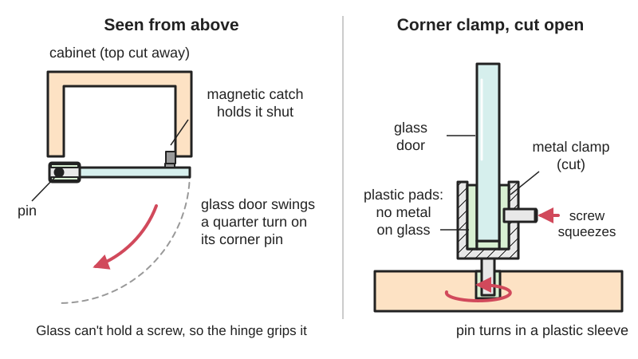

<figure class="eoc-pic eoc-pic-main"><picture><source media="(prefers-reduced-motion: reduce)" srcset="../media/drawn/glass-door-hinge.svg"></picture><figcaption><strong>Animation.</strong> Diagram drawn for the encyclopaedia from the research notes. ⚑ Needs confirming: a drawing can simplify or get details wrong; a real photo or a better diagram is welcome.</figcaption></figure>

A glass door hinge carries a glass or acrylic door on a cabinet without screwing into the door: it grips the sheet with a padded clamp, holds it with a cap bolted through a 26 mm hole drilled in the glass, or clamps the top and bottom corners onto pins that turn in the cabinet.

**In plain words:** A hinge for a glass or clear plastic cupboard door, which grips the glass with a screw and soft pads, bolts through a round hole in the glass, or lets the door turn on two pins at its top and bottom corners, because you can't drive wood screws into glass. **Proper term:** Glass door hinge (clamp-on glass hinge, drilled glass-door cup hinge with cover cap, and pivot hinge for glass doors).

**Also called:** glass door hinge, glass cabinet door hinge, glass cabinet hinge, showcase hinge, display cabinet hinge (Hettich ET 150; HardwareSource); clamp-on glass hinge, no-drill glass hinge, glass door clamp, clamping glass hinge, 'no drillings necessary in the glass' (Hettich ET 150; vxb kit); European glass door hinge, 26 mm glass hinge, concealed glass door hinge, glass door cup hinge, drilled glass hinge; inset, overlay and twin overlay versions (HardwareSource; Salice Series 200 sheet); cover cap, cover plate, glass hinge cap: the round or D-shaped plate that clamps the glass to the hinge cup (HardwareSource); glass door pivot hinge, no-bore glass door pivot hinge, top and bottom pivot clamp, corner pivot hinge (Sawdustzone forum; vxb kit); glass door hinge and magnetic catch kit, glass door catch, strike plate (vxb kit; Sawdustzone forum); acrylic door hinge, Plexiglas or perspex door hinge, enclosure door hinge, printer enclosure hinge (Printables 41109, 820251, 209584, 563324); Brands a beginner may search for: Blum, Hettich, Salice (brands) (HardwareSource; Hettich; Salice).

## How it works

Glass can't hold a screw, so the hinge holds the sheet by squeezing it instead. A clamp-on hinge has a U-shaped jaw that slides over the edge of the glass, and a clamping screw presses a pre-fitted anti-slip pad against it, so no hole is needed (Hettich ET 150). A drilled glass hinge works like a small kitchen cup hinge (Clip-on concealed hinge): its cup passes through a 26 mm hole in the glass and a cover cap is screwed to it from the other face, sandwiching the glass between plastic parts, while the arm clips to a mounting plate on the cabinet (HardwareSource; Salice Series 200 sheet). A pivot hinge clamps the top and bottom corners of the door, and each clamp has a pin that turns in a hole or sleeve in the cabinet top and base, so the door spins about a line through its corners; it has no spring, so a magnetic catch holds it shut (Sawdustzone forum; vxb kit).

## Parts

A few parts. Clamp-on: a hinge body with a clamping screw and a pre-fitted anti-slip pad, plus a cabinet-side plate (Hettich ET 150). Drilled cup type: the hinge, a cover cap that clamps the glass, a mounting plate and wood screws (HardwareSource). Pivot type: a top and a bottom glass clamp with a pin, a sleeve (grommet) or plate in the cabinet, plus a separate magnetic catch and strike plate, because the door swings freely (vxb kit; Sawdustzone forum).

## Everyday examples

- A glass-fronted display cabinet, curio cabinet or bookcase with no frame round the glass (vxb kit; Sawdustzone forum)
- A kitchen wall cupboard with a plain glass door on concealed hinges (HardwareSource)
- An acrylic door on a 3D-printer enclosure (Printables 41109, 820251)
- A glass door on a wine cabinet or TV cabinet (vxb kit)

## When to use it

Use a glass door hinge when the door is a plain sheet of glass or acrylic with no wooden frame: a display cabinet, a glass-fronted bookcase or wine cabinet, a printer enclosure. Choose a clamp-on or pivot hinge when you can't or don't want to drill the glass, for example with a ready-made pane (Hettich ET 150; vxb kit; Sawdustzone forum). Choose a 26 mm drilled cup hinge when you can order the glass with holes and want a tidy, adjustable kitchen-style hinge with overlay options and a cover cap (HardwareSource; Salice Series 200 sheet). Printed hinges suit acrylic enclosure doors, where light weight and printed parts make sense (Printables 41109, 820251).

## When not to use it

Don't use them for heavy or tall doors beyond the hinge's weight-per-pair figure; add a third hinge only if the maker allows it, or put the glass in a wooden frame and use ordinary hinges (Clip-on concealed hinge, Knuckle hinge) instead ⚑ [uncertain: third-hinge advice not found on an opened page]. Don't try to drill [toughened glass](../glossary.md#toughened-glass) yourself, because it shatters; order it drilled (Wikipedia 'Tempered glass'). For shower doors and full-height room doors use plumbing or building hardware rated for them, not cabinet hinges ⚑ [uncertain]. For sliding glass cabinet doors use a double track instead (Tongue-and-groove joint, sliding-lid grooves). For a door that must stay open at an angle use a friction hinge or a lid stay.

## Details

- **What it does (jobs):**
  - let it move (turn, slide or bend): the door swings open, about 94-105° for cup and clamp types (Salice Series 200 sheet; Hettich ET 150)
  - join and hold: carries the weight of a glass or acrylic door on the cabinet without drilling the glass (clamp and pivot types) or through one drilled hole per hinge (cup type) (Hettich ET 150; HardwareSource)
- **Movement:** rotate: about 105° for the Hettich ET 150 clamp-on hinge and 94° for the Salice Series 200 drilled glass hinge; pivot hinges turn about the top and bottom corner pins (Hettich ET 150; Salice Series 200 sheet; Sawdustzone forum).
- **Directions it can move (degrees of freedom):** 1: the door only turns about the hinge axis. Cup types can be adjusted sideways, in and out, and up and down on their mounting plates while fitting, but are locked during use (Salice Series 200 sheet gives the plate-height formulas) ⚑ [uncertain: adjustment directions not listed on the opened glass-hinge pages].
- **Special behaviour:**
  - none: most glass door hinges simply let the door swing; the Hettich ET 150 is listed 'without stay close function' and pivot hinges are 'free swinging' (Hettich ET 150; Sawdustzone forum)
  - self-closing (sprung) on some cup types: the Salice Series 200 glass hinge is a 'CA sprung hinge', and soft-close glass hinges are sold (Salice Series 200 sheet) ⚑ [uncertain: soft-close versions seen only in search results]
- **How it holds:**
  - friction or clamping ([force-fit](../glossary.md#form-fit--force-fit--material-bond)): the clamp-on and pivot types grip the glass between pads tightened by a screw (Hettich ET 150; vxb kit; Sawdustzone forum)
  - shape (the parts interlock; form-fit): the drilled type passes through a hole in the glass and is held by a cover cap on the other face (HardwareSource)
  - magnetic: the pivot kits and some clamp hinges use a separate magnetic catch to keep the door shut (vxb kit; Hettich ET 150)
- **Input and output:** not applicable
- **Power:** passive (no power needed)
- **Load:** Light. Weight limits per pair are low and vary by model: about 4 kg (8.8 lb) per pair for one Blum overlay glass hinge for 4-6 mm glass (HardwareSource), and 5-8 kg per pair for a no-drill pivot clamp kit rated for doors up to 150 x 40 cm (vxb kit). The glass is weakest at its edges and at drilled holes, so twisting the door or an uneven clamp is the main risk (Wikipedia 'Tempered glass'; Sawdustzone forum).
- **Play and precision:** Small play once tightened. Pivot hinges need the top and bottom holes exactly in line, because 'stresses from improper alignment can crack the glass'; racking of the cabinet after installation can need a final adjustment (Sawdustzone forum). The drilled hole has a fixed position from the door edge: 5.5-6.5 mm for the Salice Series 200 glass hinge (Salice Series 200 sheet).
- **Taking it apart:** removable: the clamp or cover cap can be unscrewed and the glass taken out, and cup-type arms unclip from their mounting plates (HardwareSource; Hettich ET 150) ⚑ [uncertain: clip-off on Blum glass hinges inferred from Blum cup hinges in general].
- **How often it can be reused:** many times: the hinge parts are screwed, not glued, so the door can be taken off and refitted; the anti-slip pads may need replacing once flattened ⚑ [uncertain].
- **Sealing:** none
- **Adjustable:** yes, slightly: clamp and pivot types let you slide the glass in the clamp before tightening to line it up with the cabinet or the next door; cup types adjust on their mounting plate, and the plate height and arm [crank](../glossary.md#crank) are chosen with the maker's formulas (Sawdustzone forum; Salice Series 200 sheet).
- **Access needed:** both sides: the clamp screw or cover cap is reached from the inside face of the door, and the cover cap goes on the opposite face to the hinge cup; pivot sleeves are drilled into the cabinet top and base, best before the cabinet is assembled (HardwareSource; Sawdustzone forum).
- **Materials:** Hinges: die-cast zinc, nickel-plated (Hettich ET 150), stainless steel (vxb kit) or brass and chrome finishes, with plastic parts where they touch the glass: 'All parts of the glass cabinet door hinge and cover cap that touch the glass are a plastic material' (HardwareSource). Doors: float or toughened glass about 4-7 mm thick (4-6 mm Salice; 4.5-7 mm Blum; 5-6 mm vxb kit; Hettich lists 5.2 mm) and acrylic sheet 3-6 mm for printed enclosure hinges (Printables 820251, 209584, 563324, 41109). Cabinet: wood, plywood or MDF for the wood-screw plates; aluminium extrusion for printed enclosure hinges (Printables 820251). Not suited to doors thicker or thinner than the hinge's stated range, or to heavy full-height doors.
- **Heat, cold, water and wear:** Indoor use: Hettich states its glass hinge is 'Only suitable for indoor use and the usual climatic conditions there' (Hettich ET 150). Acrylic expands and contracts with heat and moisture, which is why its bolt holes must be oversized (ACRYLITE knowledge base). Printed PETG or PLA hinges soften in a hot enclosure or car, and PLA [creeps](../glossary.md#creep) under steady load ⚑ [uncertain: no temperature figure checked for these designs].

## Making it

- **Ways to make or get it:**
  - off-the-shelf part: clamp-on glass hinges, 26 mm drilled glass hinges with cover caps and mounting plates, pivot hinge and magnetic catch kits (Hettich; HardwareSource; vxb)
  - 3D print (FDM): hinges for acrylic enclosure doors, in PETG (Printables 41109, 820251, 209584, 563324)
  - woodwork: drilling the cabinet for pivot sleeves and mounting plates (Sawdustzone forum)
  - glass shop: cutting, edge polishing and drilling the glass, done before toughening for toughened glass (Wikipedia 'Tempered glass')
- **Printing it in one piece (print in place):** partly: one enclosure hinge for 3 mm acrylic and 4040 extrusion prints in place with no supports inside the hinge, but needs bolts to fix it (Printables 820251); most printed acrylic-door hinges print as separate parts joined by a screw or pin as the axle (Printables 41109, 209584).
- **Tools:** Screwdriver for the clamping screws, cover-cap screws and the wood screws of the mounting plates. A drill for the cabinet side (a hole for the pivot sleeve, or [pilot holes](../glossary.md#pilot-hole) for plates). The 26 mm hole in the glass is ordered from a glass supplier, who must make it before toughening for toughened glass (HardwareSource; Sawdustzone forum; Wikipedia 'Tempered glass').
- **Difficulty:** easy to moderate: clamp-on and pivot kits fit with a screwdriver and need no hole in the glass; drilled cup hinges need the glass ordered with holes in the right place, and pivot hinges need two holes drilled exactly in line (Hettich ET 150; HardwareSource; Sawdustzone forum).

### 3D printing tips

1) Use PETG: all four popular acrylic-door hinge designs recommend it, though PLA also works for one (Printables 41109, 820251, 563324). 2) [Print-in-place](../glossary.md#print-in-place) hinge for 3 mm (1/8 in) acrylic on 4040 extrusion: support only the hinge face raised about 3 mm off the bed for the door, no supports inside the hinge, then work a plastic-safe grease such as petroleum jelly into the hinge holes to smooth it; fix with 5 mm (1/4 in) bolts through the door and 5/16 in bolts with 8 mm T-slot nuts into the extrusion (Printables 820251, CC BY). 3) Hinge for a 5 mm acrylic door on a 10 mm wood panel, inset by 5 mm: two M5 x 60 screws as the hinge axles, three M5 x 10 screws through the acrylic, three [perimeters](../glossary.md#perimeters), no supports; a spacer block sets the inset and the Fusion 360 file is parametric for other sizes; the designer reports two years of use (Printables 41109, public domain). 4) Screwless lift-off hinge for 3 mm acrylic (6 mm version too): the parts are friction-fitted, so results depend on printer [accuracy](../glossary.md#repeatability--accuracy); if the top hinges are loose the door drops and breaks the bottom post, so screw through the post to strengthen it (Printables 209584, CC BY-NC). 5) Printed screw hinges for 4 mm acrylic: don't overtighten the printed screws (Printables 563324). 6) Drill acrylic with [clearance](../glossary.md#clearance): make bolt holes at least twice the bolt diameter, keep the hole centre at least 1.5 hole diameters from the edge, and use a rubber grommet to stop cracks starting at the hole (ACRYLITE knowledge base); a maker also warns that tapped screw holes 'have the propensity to crack the acrylic' (Sawdustzone forum). 7) A replacement plastic plate for an old glass-door hinge is better in ABS or nylon with at least 4 walls (Printables 1573379). 8) Don't print hinges that clamp real glass in PLA for warm places; PLA creeps under steady clamping load ⚑ [uncertain: no opened source tests printed glass clamps].

### Buying one (off-the-shelf parts)

Search terms: 'glass door hinge' (inset, overlay, twin overlay or half overlay), '26 mm glass door hinge', 'glass hinge cover cap' (round or D-shaped, black or chrome), 'mounting plate' (0 mm, 3 mm, face-frame), 'clamp-on glass hinge' or 'no-drill glass hinge', 'glass door pivot hinge' with 'pivot sleeve' or 'grommet', 'glass door magnetic catch' and 'strike plate', 'magnetic touch latch' (push-to-open), 'adhesive glass door knob' (HardwareSource; Hettich ET 150; vxb kit; Sawdustzone forum). Catalogue examples: Hettich ET 150 glass door hinge (https://shop.hettich.com/hn_EN/Hinges/Special-hinges/Glass-door-hinges/Glass-door-hinge-ET-150%2C-nickel-plated%2C-matt/p/20870), Blum glass door hinges (https://www.hardwaresource.com/products/blum-glass-door-hinge), Salice Series 200 glass hinges (https://www.salice.com/downloads/2414/3495/Salice-Self-Closing-Hinges-Series-200-94-standard-for-glass-doors-ENG.pdf). Some inset glass hinges use a much smaller 7 mm hole in the glass instead of 26 mm (HardwareSource listing).

## Rules of thumb

- Drilled glass hinges need a 26 mm hole for each hinge and take glass about 4-7 mm thick: 4-6 mm (Salice Series 200 sheet), 4.5-7 mm (Blum, HardwareSource).
- Hole position: the Salice Series 200 glass hinge allows a drilling distance from the door edge (K) of 5.5-6.5 mm; the maker's formulas then give the hinge arm and mounting-plate height for the overlay you want (Salice Series 200 sheet).
- Weight per pair is small and model-specific: about 4 kg (8.8 lb) per pair for one Blum overlay glass hinge (HardwareSource); 5-8 kg per pair, doors up to 150 x 40 cm, for 5-6 mm glass in a no-drill pivot clamp kit (vxb kit). Use the maker's figure for your hinge.
- Clamp-on inset hinge sizing (Hettich ET 150, 105°): door height = inside cabinet height - 6 mm, door width = inside cabinet width - 5.6 mm (Hettich ET 150).
- Toughened (tempered) glass: 'Any cutting or grinding must be done prior to tempering', and 'drilling holes in the glass is carried out before the tempering process starts'; work after toughening shatters it (Wikipedia 'Tempered glass').
- No metal against glass: on the Blum system all parts that touch the glass are plastic, and the cover cap is what holds the glass (HardwareSource).
- Pivot hinges: drill the top and bottom sleeve holes exactly in line and before the cabinet is assembled; keep the pivot no more than about 1/8 in from the cabinet side, or the hinge rubs; then tighten the clamp screws slowly from the inside (Sawdustzone forum, a cabinetmaker's post).
- Acrylic doors: bolt hole at least 2 x the bolt diameter, hole centre at least 1.5 x the hole diameter from the edge, and use a rubber grommet (ACRYLITE knowledge base).

## Common failures

Glass cracks at a clamp or hole, from overtightening, metal touching glass, or misaligned pivots: use the plastic or rubber pads, tighten slowly and evenly, and line the holes up (HardwareSource; Sawdustzone forum). Door slips down in a clamp: clean the glass and pads and retighten; check the glass is within the clamp's thickness range (Hettich ET 150; vxb kit). Door won't stay shut on free pivots: add a magnetic catch or touch latch (Sawdustzone forum). Hinge rubs the cabinet side: the pivot was set too close to the edge (Sawdustzone forum). Acrylic cracks round screw holes: make holes oversize with grommets and keep them away from the edge (ACRYLITE knowledge base). Printed lift-off hinge breaks its bottom post when the top hinges slip (Printables 209584). Plastic hinge plates in old furniture break with age; a printed ABS or nylon copy can replace one (Printables 1573379).

## Safety

Glass can break: an uneven or overtightened clamp, or top and bottom pivots out of line, can crack the glass (Sawdustzone forum). Toughened glass can't be cut, ground or drilled after toughening; it shatters, so order holes and polished edges from the glass supplier first (Wikipedia 'Tempered glass'). Keep plastic between glass and metal (HardwareSource). Glass doors are heavy: a door on free-swinging pivots can swing open by itself if the cabinet leans forward, so fit a magnetic catch (Sawdustzone forum). Chipped edges are where toughened glass is most likely to fail later, so protect edges when fitting (Wikipedia 'Tempered glass'). Hettich's safety notes say 'Keep away from children' and warn that fittings may fall out of the packaging if it is opened carelessly (Hettich ET 150).

## Related

- Clip-on concealed hinge (cup hinge): the wood-door version with a 35 mm cup; the drilled glass hinge is its 26 mm cousin with a cover cap instead of screws into the door
- Glass and mirror edge clips and clamps: hold a sheet still by its edge with padded clamps; the clamp-on glass hinge adds a pivot
- Panel standoff: also bolts through a drilled glass or acrylic sheet with plastic washers, but holds it still
- Plain pivot and rolling bearing: a pivot hinge is a pin turning in a hole at the door's corners
- Magnet joint (embedded magnets, magnetic catch): the catch that holds free-swinging glass doors shut
- Push-push latch (push-to-open): a magnetic touch latch lets a handle-less glass door open with a push
- Print-in-place hinge: printed hinges for acrylic enclosure doors
- Knuckle hinge (butt hinge) and Self-closing hinges: for glass doors set in a wooden frame
- Tongue-and-groove joint (sliding-lid grooves): sliding glass doors in a double track instead of hinged ones

## Make it yourself

- [Two hinges to attach an acrylic glass door to a wooden frame (Metikumi, Printables) (URL from Printables API, page not opened)](https://www.printables.com/model/41109-two-hinges-to-attach-an-acrylic-glass-door-to-a-wo): Printed hinge pair for a 5 mm acrylic door on a 10 mm wood frame, from a 3D-printer enclosure build, with a parametric Fusion 360 file *(licence: Creative Commons Public Domain)*
- [Print-in-Place Hinge for 1/8" Acrylic Doors for 4040 Extrusion Enclosure (Jerrod H, Printables) (URL from Printables API, page not opened)](https://www.printables.com/model/820251-print-in-place-hinge-for-18-acrylic-doors-for-4040): Print-in-place hinge for 3 mm acrylic doors on 4040 aluminium extrusion *(licence: Creative Commons Attribution)*
- [Lift off Acrylic Door Hinge (Gruthius, Printables) (URL from Printables API, page not opened)](https://www.printables.com/model/209584-lift-off-acrylic-door-hinge): Screwless lift-off hinge that holds a 3 mm (or 6 mm) acrylic door by friction fit *(licence: Creative Commons Attribution-NonCommercial)*
- [Door hinges for 4mm acrylic/plexiglass panels (midego, Printables) (URL from Printables API, page not opened)](https://www.printables.com/model/563324-door-hinges-for-4mm-acrylicplexiglass-panels): Left and right printed hinges with printed screws for 4 mm acrylic printer-box doors *(licence: Standard Digital File License)*
- [Glass Door hinge clip (Marius, Printables) (URL from Printables API, page not opened)](https://www.printables.com/model/1573379-glass-door-hinge-clip): Printed replacement hinge plate for an old flat-pack glass-door cabinet *(licence: Creative Commons Attribution-ShareAlike)*

## Pictures, videos and models

- [Glass door hinge ET 150, nickel plated, matt (Hettich eShop)](https://shop.hettich.com/hn_EN/Hinges/Special-hinges/Glass-door-hinges/Glass-door-hinge-ET-150%2C-nickel-plated%2C-matt/p/20870): Photos and CAD data of a clamp-on inset glass door hinge with clamping screw and anti-slip pad, 105° opening *(licence: all rights reserved (link only))*
- [Blum Glass Door Hinge (HardwareSource)](https://www.hardwaresource.com/products/blum-glass-door-hinge): Photos of the drilled 26 mm glass hinge, its round and D-shaped cover caps and mounting plate, with inset and overlay versions *(licence: all rights reserved (link only))*
- [Glass Door Magnetic Catch And Pivot Hinge Kit White (VXB)](https://vxb.com/products/glass-door-magnetic-catch-and-pivot-hinge-kit-whit): Photos of a no-drill kit: four corner pivot clamps, a magnetic catch and strike plates for inset glass doors *(licence: all rights reserved (link only))*
- [Series 200 - Hinges for glass doors, technical information (Salice, PDF)](https://www.salice.com/downloads/2414/3495/Salice-Self-Closing-Hinges-Series-200-94-standard-for-glass-doors-ENG.pdf): Drawings of a 26 mm drilled glass hinge with cover, drilling distance K and mounting-plate formulas for different arm cranks *(licence: all rights reserved (link only))*
- [No Bore Glass Door Pivot Hinge (The SawdustZone forum, 2012)](https://www.sawdustzone.org/forum/discussions/project-related-discussions/57326-no-bore-glass-door-pivot-hinge): A cabinetmaker's illustrated walk-through of fitting no-drill pivot hinges, sleeves and magnetic catches to a glass door, plus a reader's acrylic doors *(licence: all rights reserved (link only))*

## Needs confirming

⚑ marks something nobody has confirmed yet: a fact the research could not confirm from a source, a finder value that is a best guess, or an open point from the research notes. Corrections are welcome (see `research/needs-confirming.md`).

- ⚑ 8 sentences on this page marked [uncertain].
- ⚑ Research note: *Glass door hinge* (443): weight per pair varies by model (one Blum hinge 4 kg per pair, the vxb pivot kit 5-8 kg); follow the hinge maker's figure.

## Sources

- <https://shop.hettich.com/hn_EN/Hinges/Special-hinges/Glass-door-hinges/Glass-door-hinge-ET-150%2C-nickel-plated%2C-matt/p/20870>
- <https://www.hardwaresource.com/products/blum-glass-door-hinge>
- <https://vxb.com/products/glass-door-magnetic-catch-and-pivot-hinge-kit-whit>
- <https://www.salice.com/downloads/2414/3495/Salice-Self-Closing-Hinges-Series-200-94-standard-for-glass-doors-ENG.pdf>
- <https://www.sawdustzone.org/forum/discussions/project-related-discussions/57326-no-bore-glass-door-pivot-hinge>
- <https://en.wikipedia.org/wiki/Tempered_glass>
- <https://www.acrylite.co/resources/knowledge-base/article/how-far-in-should-I-drill-a-hole-from-the-edge-of-acrylic-sheet>
- <https://api.printables.com/graphql/ (models 41109, 587197, 820251, 209584, 563324, 1573379; no Printables pages opened)>
