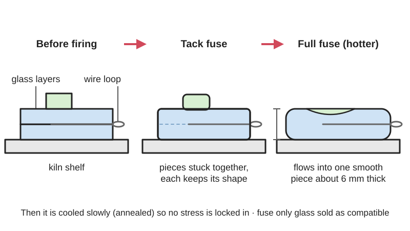

<figure class="eoc-pic eoc-pic-main"><figcaption>Diagram drawn for the encyclopaedia from the research notes. ⚑ Needs confirming: a drawing can simplify or get details wrong; a real photo or a better diagram is welcome.</figcaption></figure>

Glass fusing joins pieces of glass that are rated to work together by heating them in a kiln to roughly 690-820 °C, so that they stick together (tack fuse) or flow into one smooth piece (full fuse), and then cools them slowly through an [annealing](../glossary.md#annealing) hold so that the finished piece has no built-in stress.

**In plain words:** Stacking pieces of glass that are made to go together and baking them in a very hot oven (a kiln) until they stick to each other or melt into one smooth piece, then letting them cool very slowly so they don't crack. **Proper term:** Glass fusing (kiln fusing; tack fusing and full fusing; kilnformed glass).

**Also called:** kiln fusing, kilnforming, kilnformed glass, warm glass (Bullseye; Wikipedia 'Glass fusing'); tack fuse, tack fusing: a lower-temperature firing where the pieces stick but keep their own shape and texture; at the low end 'sintering' or 'fuse-to-stick', at the high end 'contour fuse' (Bullseye 'Tips for Tack Fusing'); full fuse, full fusing: the pieces 'merge smoothly into one another' (Wikipedia 'Glass fusing'); slumping, slumped glass: a second firing that sags a flat fused piece into or over a mould to make a dish or bowl (Wikipedia 'Glass fusing'; Bullseye); fusible glass, 'tested compatible' glass, 'COE 90' and 'COE 96' glass: the way fusing glass is sold; Bullseye itself does not rate its glass with COE numbers (Bullseye FAQ); microwave kiln, microwave glass fusing: a small ceramic-fibre box fired inside a microwave oven for small jewellery pieces (Ceramic Industry); fused glass jewellery, fused glass pendants, dichro (dichroic) pendants (Frit-Happens forum); Bullseye (brand), ThinFire (brand) shelf paper: brand names a beginner may meet in instructions (Bullseye FAQ).

## How it works

Glass has no single melting point: as it is heated it softens gradually, so at a tack-fuse temperature the touching surfaces soften and stick while each piece keeps its shape, and a little hotter the pieces slump and flow into one another (Wikipedia 'Glass fusing'; Bullseye). Because hot glass behaves like a very thick liquid with surface tension, most fusing glass pulls itself to about 6 mm thick at full fuse unless dams or moulds hold it in (Bullseye FAQ '6-millimeter rule'). On the way down the piece is held at an annealing temperature so the inside and the surface reach the same temperature, then cooled slowly so no stress is frozen in (Wikipedia; Bullseye 'Writing Firing Schedules'). The pieces only stay joined if their glasses shrink by the same amount while cooling and behave alike when hot, which is why only glasses tested as compatible with each other can be fused; the stress from a mismatch can be seen between two polarising filters (Wikipedia; Bullseye FAQ).

## Parts

Single piece once made: the glass pieces become one piece of glass, sometimes with things trapped inside (inclusions) such as a fine silver wire loop, mica or decals. Making it needs a small set of equipment: a kiln with a programmable controller (or a microwave kiln for tiny pieces), a kiln shelf with shelf [primer](../glossary.md#primer) (kiln wash) or shelf paper, fusible glass sheet, frit, stringer or other accessory glass that is all tested compatible, a glass cutter and running or grozing pliers, and moulds for slumping.

## Everyday examples

- fused glass pendants and earrings with a wire loop fused in at the top (Frit-Happens forum)
- fused glass coasters, tiles and suncatchers sold at craft fairs
- slumped glass dishes, bowls and plates (Wikipedia 'Glass fusing'; Wikimedia Commons 'Pratos de vidro')

## When to use it

When you want to join pieces of glass to each other with no glue, no metal frame and nothing visible at the joint: jewellery, coasters, tiles, dishes, panels and glass art made from layered sheet, frit and stringer. Tack fusing keeps texture and raised pieces; full fusing gives a smooth, flat piece; slumping then turns a flat fused piece into a dish or bowl (Wikipedia; Bullseye). It is also the way to trap things inside glass, such as a fine silver wire loop for hanging a pendant, which is more secure than a glued-on bail (a glued bail 'pinged off' after six weeks, Frit-Happens forum). A microwave kiln is a cheap way to try small pieces (Ceramic Industry).

## When not to use it

When the glasses are not known to be compatible: test first or use a cold method (UV-curing adhesive, copper foil and solder, or lead came) instead. To repair a broken window, drinking glass or toughened (tempered) glass: fusing reshapes the glass and [toughened glass](../glossary.md#toughened-glass) loses its temper ⚑ [uncertain]; use glass glue or replace it. To join glass to wood, metal or plastic: use glazing in a rebated frame, glass edge clips or clamps, or an adhesive. For anything that bears a load or must not break if dropped. When you have no kiln with a controller: annealing by guesswork leads to cracks; book kiln time at a studio instead. For food use, check the glass maker's food-safety notes: some coloured glasses contain more than 1.0% lead or 0.5% cadmium and Bullseye recommends capping them with clear glass for food-bearing pieces (Bullseye FAQ).

## Details

- **What it does (jobs):**
  - glue or bond: glass is joined to glass by melting the surfaces together, with no glue
  - join and hold: layers, small pieces, frit and wire or mica inclusions become one solid piece, e.g. a pendant with a fused-in wire loop
- **Movement:** none
- **Directions it can move (degrees of freedom):** 0: the pieces become one rigid piece of glass.
- **Special behaviour:**
  - none: a plain permanent joint. (A second, cooler firing can reshape the fused piece: slumping sags it into a mould to make a dish, Wikipedia 'Glass fusing'.)
- **How it holds:** [material bond](../glossary.md#form-fit--force-fit--material-bond) (glue, solvent or melting): the glass pieces soften and flow together into one continuous piece (Wikipedia 'Glass fusing')
- **Input and output:** not applicable
- **Power:** passive (no power needed) once made; making it needs an electric kiln (or a microwave kiln inside a microwave oven)
- **Load:** Light to medium: the joint is as strong as the glass itself only if the glasses are compatible and the piece is properly annealed; glass is [brittle](../glossary.md#brittle--ductile) and fails by cracking under impact, bending or sudden temperature change, not by the joint pulling apart. Incompatible glass leaves stress that can 'develop stress and fracture over time' (Wikipedia 'Glass fusing'). Fused pieces suit pendants, coasters, tiles, dishes and panels, not anything that carries a load or must survive being dropped. No published strength figure for fused joints was found ⚑ [uncertain].
- **Play and precision:** No play. The shape changes during firing: at full fuse glass tends to pull in or spread to about 6 mm thick, so a thin base shrinks inwards and thick stacks spread (Bullseye FAQ), and pieces can slide out of place when the glue holding them burns off (Frit-Happens forum). Plan for the edges to round over and sizes to change slightly; cut, grind or 'cold work' the piece afterwards if exact edges are needed.
- **Taking it apart:** permanent: the pieces become one piece of glass and can't be separated
- **How often it can be reused:** once
- **Sealing:** watertight: a fully fused piece is one continuous piece of glass with no gap; a tack-fused piece is joined only where the pieces touched, so gaps between pieces can remain ⚑ [uncertain]
- **Adjustable:** no: once fired the shape is fixed; a further firing can add layers or slump the piece, but each refire needs care (Bullseye recommends a slow first heating segment when refiring pieces of uneven thickness)
- **Access needed:** not applicable
- **Materials:** Joins glass to glass only, and only glasses that are tested compatible with each other, usually from one maker's fusible range (e.g. Bullseye glasses are factory tested with each other and not with other makers' glass; Bullseye FAQ). Matching COE (coefficient of expansion) numbers alone do not make glasses compatible (Wikipedia; Bullseye FAQ). Mixing glass from different makers, ordinary window (float) glass or bottle glass with art glass needs your own compatibility test first ⚑ [uncertain]. Small inclusions can be trapped between layers: fine (99.9%) silver wire of 0.7 or 1.0 mm for loops and bails, mica flakes and powder, decals, enamels and glass paints (Warm Glass UK 'Using Inclusions'; Frit-Happens forum). Silver reacts with some glasses, especially sulphur-bearing ones, and can give a golden halo (Warm Glass UK). Can't join glass to plastic, wood or most metals (the metal is only trapped, not bonded), and is not a repair method for broken drinking glasses or windows.
- **Heat, cold, water and wear:** Glass itself is not harmed by water, sunlight or most chemicals, and takes ordinary household heat, but a fused piece cracks from sudden temperature changes (thermal shock), especially if poorly annealed: 'Properly annealed works are less prone to thermal shock in subsequent firings than ones that that were poorly annealed' (Bullseye). Incompatible or badly annealed pieces carry hidden stress that can crack them days or weeks later with no warning, since the stress areas 'will develop stress and fracture over time' (Wikipedia). Silver inclusions can tarnish and stain the glass, and sterling silver can turn black in the kiln (Warm Glass UK; Frit-Happens forum). Do not use fused pieces as hotplates or put them in ovens unless the maker says they are rated for it ⚑ [uncertain].

## Making it

- **Ways to make or get it:**
  - off-the-shelf part: fusible sheet glass, frit, stringer and moulds; fired in a home glass kiln, a microwave kiln (small jewellery pieces only), or at a studio that offers kiln time and classes (Bullseye runs open studios and classes)
  - 3D print (FDM): only for patterns and accessories away from the kiln, e.g. a printed master used to cast a plaster mould for microwave fusing (Printables 1830468)
- **Printing it in one piece (print in place):** no: fusing happens at about 690-820 °C, far beyond what any printed plastic survives
- **Tools:** A kiln with a programmable controller (Bullseye notes that top-fired fibre kilns may need even gentler schedules), or a microwave kiln and a microwave oven for small jewellery pieces (Ceramic Industry); a kiln shelf with shelf primer or shelf paper as a separator (Bullseye FAQ); glass cutter and pliers; optionally a glass grinder, moulds for slumping and dams; two sheets of polarising film to check for stress (Wikipedia). Protective kit: safety glasses with ANSI shade 1.7 lenses for looking into a hot kiln, heat-resistant gloves (non-asbestos Zetex or Kevlar), and a NIOSH-approved respirator when working with glass powder or fibre (Bullseye 'Safety in the Kiln-Glass Studio').
- **Difficulty:** moderate: small tack- and full-fused pieces are easy to make in a class or with a small kiln, but you need a kiln with a controller, glass that is all tested compatible, and a properly written annealing schedule; thick or uneven pieces and slumping need more care (Bullseye)

### 3D printing tips

not applicable: printed plastic can't go anywhere near a kiln. Printed parts are useful only at room temperature: masters for casting plaster moulds (e.g. Printables 1830468 'Designs for silicone mold making used in microwave glass fusing', which casts plaster moulds for microwave-fusing rings from bottle necks), cutting templates, display stands, and a holder for two polarising films for checking stress. Never put a printed part, or a mould that still contains plastic, into the kiln.

### Buying one (off-the-shelf parts)

Search terms: 'fusible glass' or 'tested compatible fusing glass' (buy all glass for one piece from one compatible range, e.g. Bullseye, or a 'COE 96' range from a single maker), 'frit', 'stringer', 'confetti', 'dichroic glass', 'glass fusing kiln' or 'jewellery kiln' with 'digital controller', 'microwave kiln', 'kiln shelf', 'shelf primer' or 'kiln wash', 'kiln shelf paper' (ThinFire, brand), 'fibre paper' and 'fibre blanket', 'slumping mould' (ceramic or stainless steel), 'kiln posts' and 'kiln dams', 'glass cutter', 'running pliers', 'grozing pliers', 'glass grinder', 'fine silver wire 0.7 mm' or '1.0 mm' (99.9% silver), 'mica powder' and 'inclusion pens', 'fusing glue', 'polarising film' or 'polariscope' for stress checks, 'ANSI shade 1.7 safety glasses', 'Zetex gloves' or 'Kevlar kiln gloves'.

## Rules of thumb

- Fusing temperatures: fusing is 'usually done roughly between 700 °C (1,292 °F) and 820 °C (1,510 °F)' (Wikipedia, https://en.wikipedia.org/wiki/Glass_fusing); tack fusing is 'approximately 1275-1450 °F / 690-788 °C' (Bullseye, https://www.bullseyeglass.com/wp-content/uploads/Tips_for_Tack_Fusing.pdf); Bullseye's example full-fuse schedule for 6 mm (2 x 3 mm) of sheet glass goes to 1490 °F / 810 °C with a 10-minute hold (Bullseye, https://www.bullseyeglass.com/wp-content/uploads/writing-firing-schedules-for-fusing-and-slumping.pdf). The figures differ because glass types differ: always use the glass maker's schedule.
- The 6 mm rule: at full-fuse temperature most Bullseye sheets 'naturally assume a thickness of about 6 millimeters unless constrained by dams or molds', so plates and tiles start with a base of two 3 mm layers; a thinner base shrinks or draws in (Bullseye FAQ, https://www.bullseyeglass.com/faq).
- Heating rates (Bullseye, https://www.bullseyeglass.com/wp-content/uploads/writing-firing-schedules-for-fusing-and-slumping.pdf): for projects under 11 mm thick, heat to 538-677 °C at 167-222 °C (300-400 °F) per hour for even, unfired layers, or 56-111 °C (100-200 °F) per hour for uneven thickness or reflective or insulating parts such as silver or fibre paper; once above 538 °C (1000 °F) the glass 'is no longer at risk of thermal shock' and about 333 °C (600 °F) per hour is fine. If roof elements are closer than 12.7 cm (5 in) to the work, reduce the first heating rates by 25%.
- Bubble squeeze: a hold at about 621-677 °C (1150-1250 °F) before the rapid heat lets air escape from between layers (Bullseye, https://www.bullseyeglass.com/wp-content/uploads/writing-firing-schedules-for-fusing-and-slumping.pdf).
- Annealing (Bullseye glass): cool as fast as possible from process temperature to 482 °C (900 °F), hold there, then cool slowly. For 6 mm: hold 1 hour, cool 150 °F (83 °C) per hour to 800 °F (427 °C), 270 °F (150 °C) per hour to 700 °F (371 °C), then 900 °F per hour to room temperature, about 3 hours in all; 12 mm takes about 5 hours and 25 mm about 14 hours (Bullseye 'Annealing Thick Slabs' chart in https://www.bullseyeglass.com/wp-content/uploads/writing-firing-schedules-for-fusing-and-slumping.pdf). Wikipedia gives a different general schedule: a soak at 516 °C (961 °F), then down to 371 °C and 260 °C, 10-12 hours in all (https://en.wikipedia.org/wiki/Glass_fusing).
- Uneven (tack-fused) pieces: add up the layers to find the thickest area, then anneal for at least twice that thickness (e.g. follow the 30 mm schedule for a 15 mm piece); top-fired fibre kilns may need 3 times; cool with the door and vents closed; 'Over-annealing is not harmful' (Bullseye, https://www.bullseyeglass.com/wp-content/uploads/Tips_for_Tack_Fusing.pdf and https://www.bullseyeglass.com/wp-content/uploads/writing-firing-schedules-for-fusing-and-slumping.pdf).
- Compatibility: 'Matching COEs does not ensure compatibility between glasses'; Bullseye tests each batch by firing to 1500 °F (816 °C) with a 15-minute anneal and checking for stress in polarised light, and tests only against its own glasses; 'the ONLY way' to know another maker's glass is compatible is your own test (Bullseye FAQ, https://www.bullseyeglass.com/faq). Stress shows up when the piece is placed 'between two polarizing filters' (Wikipedia, https://en.wikipedia.org/wiki/Glass_fusing).
- Slumping: a second, cooler firing; with Bullseye glass start watching the slump once the kiln is above 1100 °F / 593 °C, and only open the door for a few seconds (Bullseye, https://bullseyeglass.com/suggested-slumping-schedules).
- Microwave kilns: reach 1,650 °F (899 °C) in 5-10 minutes; keep the glass no larger than 1 x 1.5 in (25 x 38 mm) and no thicker than two layers of 1/8 in (3 mm) glass; let it cool at least 45 minutes without lifting the lid; fire only fusing-compatible glass (Ceramic Industry, https://ceramicindustry.com/articles/89661-ppp-glass-fusing-in-a-microwave-oven).
- Fused-in wire loops: fine (99.9%) silver wire of 0.7 or 1.0 mm both work between layers; fine silver tarnishes less than sterling (Warm Glass UK, https://www.warm-glass.co.uk/blogs/knowledge-base/inclusions). Sterling can turn black, and both become soft and can be brittle after firing (Frit-Happens forum, https://www.frit-happens.co.uk/forum/index.php?msg=290413).

## Common failures

(1) Cracks a day or weeks later: glasses not compatible (often mixing makers, or trusting a matching COE number alone) or too short an annealing; check between two polarisers and use one tested-compatible range (Wikipedia; Bullseye FAQ). (2) Cracks during heating (thermal shock): heated too fast, especially thick, uneven or refired pieces, or elements close to the glass; use the slower first-segment rates (Bullseye). (3) Trapped bubbles between layers: add a bubble squeeze hold; mica flakes trap many bubbles, so use them sparingly (Bullseye; Warm Glass UK). (4) Piece shrank, thickened at the edges or spread unexpectedly: the 6 mm rule; use a two-layer base or dams (Bullseye FAQ). (5) Top pieces slid off during firing once the glue burned off (Frit-Happens forum). (6) Wire loop turned black, brittle or drooped, or the glass round silver went yellow or muddy: use fine silver, clean it with vinegar first, and avoid silver-reactive glasses (Warm Glass UK; Frit-Happens forum). (7) Glass stuck to the shelf: no separator or worn shelf primer (Bullseye FAQ mentions shelf separators). (8) Pre-programmed kiln schedules that don't suit the piece (Bullseye). (9) Microwave pieces cracking when the lid is lifted too soon (Ceramic Industry). (10) A greasy fingerprint can make glass break apart during the first heating in a microwave kiln (Ceramic Industry).

## Safety

BURNS AND KILN HEAT: kilns run at about 700-820 °C; wear protective clothing and heat-resistant gloves whenever opening a hot kiln, and always turn the power off before reaching into a hot kiln (Bullseye 'Safety in the Kiln-Glass Studio'). Hot glass looks the same as cold glass, so let it cool fully before touching it. Microwave kilns: wear heat-protective gloves to lift the kiln out, stay at arm's length when checking the glass, wear safety glasses, and keep the hot kiln away from children and pets (Ceramic Industry). EYES: looking into a hot kiln for long periods exposes the eyes to infrared light, and excessive exposure can cause cataracts; wear ANSI shade 1.7 lenses; didymium flameworking glasses do not protect against infrared (Bullseye). FUMES: full-fuse firings of glass on primed shelves give off no fumes, but firings with fibre paper, enamels, glazes and other materials can, so run the kiln in a ventilated area (Bullseye). DUST: airborne glass powder (frit, powder and grinding dust) is the 'more immediate safety concern': ventilate, wear a NIOSH-approved respirator and use a HEPA vacuum; cotton gloves protect skin from irritating dusts and fibres (Bullseye 'Product Use & Safety' and 'Safety in the Kiln-Glass Studio'). CUTS: 'Cuts are almost inevitable when handling glass', so keep a first-aid kit (Bullseye). DELAYED CRACKING: incompatible or badly annealed glass can crack or break apart long after firing (Wikipedia), so check pieces between polarising filters before selling or giving them, especially jewellery. FOOD SAFETY: some coloured glasses contain lead or cadmium; follow the glass maker's food-safety advice and have food-bearing pieces you sell tested (Bullseye FAQ).

## Related

- Copper-foil joint (Tiffany method): joins glass pieces cold with copper tape and solder; works with any glass, no kiln, but leaves visible metal lines
- Lead came joint (leaded glass): pieces held in H-shaped lead, zinc or brass channels soldered at the joints; for windows and panels
- UV-curing adhesive: glues glass to glass cold and clear; no compatibility problem, but it is a glue line, not one piece of glass
- Melted plastic weld and Welded metal joint: the plastic and metal versions of joining by melting the parts themselves
- Brazed joint and Soldered metal joint: heat joints that use a filler metal and don't melt the parts
- Glazing in a rebated frame, and Glass and mirror edge clips and clamps: hold a sheet of glass mechanically instead of joining it
- Baked-in findings (embedded hardware in clay): the polymer-clay equivalent of fusing a wire loop into a pendant

## Make it yourself

- [Designs for silicone mold making used in microwave glass fusing (Printables 1830468; URL from Printables API, page not opened)](https://www.printables.com/model/1830468-designs-for-silicone-mold-making-used-in-microwave): Printable master patterns for casting plaster moulds used to fuse rings from recycled bottle necks in a microwave kiln; the printed parts never go in the kiln *(licence: Creative Commons Public Domain)*

## Pictures, videos and models

- [Glassfusing.jpg (Wikimedia Commons, by Tad Boniecki)](https://commons.wikimedia.org/wiki/File:Glassfusing.jpg): A fused glass plate made from many coloured pieces fused into one flat piece *(licence: Public domain (released by the author))*
- [Pratos de vidro.jpg (Wikimedia Commons, by Luis nunes alberto)](https://commons.wikimedia.org/wiki/File:Pratos_de_vidro.jpg): Fused and slumped glass plates, showing the second (slumping) firing into a dish shape *(licence: CC BY-SA 3.0 or GFDL 1.2 (reuse with credit))*
- [Fused Glass Sculpture.jpg (Wikimedia Commons, by studio g+h)](https://commons.wikimedia.org/wiki/File:Fused_Glass_Sculpture.jpg): A fused and kiln-formed glass sculpture; the lead image of the Wikipedia 'Glass fusing' article *(licence: CC BY-SA 4.0 (also 3.0, 2.5, 2.0, 1.0) or GFDL 1.2 (reuse with credit))*
- [Plastic Protractor Polarized 05375.jpg (Wikimedia Commons, by Nevit Dilmen)](https://commons.wikimedia.org/wiki/File:Plastic_Protractor_Polarized_05375.jpg): Coloured stress lines in a clear plastic protractor seen between crossed polarisers: the same check used to spot stress from incompatible glass or poor annealing in a fused piece *(licence: CC BY-SA 3.0 or GFDL 1.2 (reuse with credit))*
- [Writing Firing Schedules for Fusing & Slumping (Bullseye Glass Co., PDF)](https://www.bullseyeglass.com/wp-content/uploads/writing-firing-schedules-for-fusing-and-slumping.pdf): Illustrated flowchart and tables for writing an 8-stage fusing schedule, with the Annealing Thick Slabs chart *(licence: link only (copyright Bullseye Glass Co.))*

## Needs confirming

⚑ marks something nobody has confirmed yet: a fact the research could not confirm from a source, a finder value that is a best guess, or an open point from the research notes. Corrections are welcome (see `research/needs-confirming.md`).

- ⚑ 5 sentences on this page marked [uncertain].
- ⚑ Research note: *Glass fusing* (446): annealing differs: a 482 °C hold with about 3 h of cooling for 6 mm and 14 h for 25 mm (Bullseye, for its own glass) versus a 516 °C soak and 10-12 h in all (Wikipedia); fusing 700-820 °C (Wikipedia) versus tack fusing 690-788 °C (Bullseye). The gap search's ⚑ on microwave kilns is cleared (Ceramic Industry gives figures).

## Sources

- <https://en.wikipedia.org/wiki/Glass_fusing>
- <https://en.wikipedia.org/wiki/Photoelasticity>
- <https://www.bullseyeglass.com/wp-content/uploads/Tips_for_Tack_Fusing.pdf>
- <https://www.bullseyeglass.com/wp-content/uploads/writing-firing-schedules-for-fusing-and-slumping.pdf>
- <https://www.bullseyeglass.com/faq>
- <https://bullseyeglass.com/suggested-slumping-schedules>
- <https://www.bullseyeglass.com/safety-in-the-kiln-glass-studio/>
- <https://www.bullseyeglass.com/product-use-safety/>
- <https://ceramicindustry.com/articles/89661-ppp-glass-fusing-in-a-microwave-oven>
- <https://www.warm-glass.co.uk/blogs/knowledge-base/inclusions>
- <https://www.frit-happens.co.uk/forum/index.php?msg=290413>
- <https://commons.wikimedia.org/wiki/File:Glassfusing.jpg>
- <https://commons.wikimedia.org/wiki/File:Pratos_de_vidro.jpg>
- <https://commons.wikimedia.org/wiki/File:Fused_Glass_Sculpture.jpg>
- <https://commons.wikimedia.org/wiki/File:Plastic_Protractor_Polarized_05375.jpg>
- <https://commons.wikimedia.org/wiki/Category:Fused_glass>
- <https://api.printables.com/graphql/>
