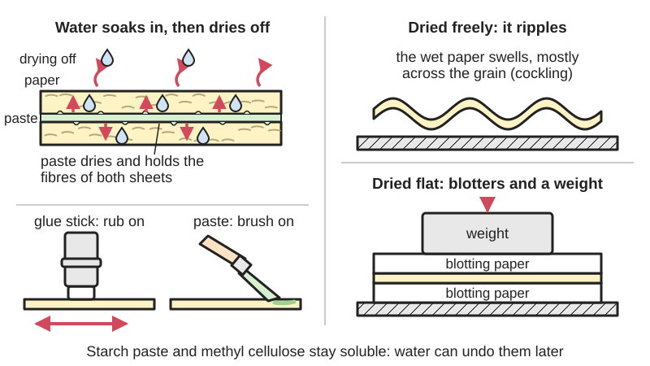
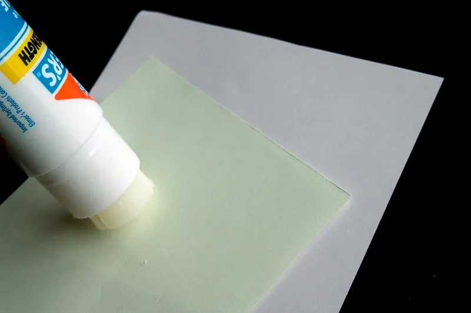
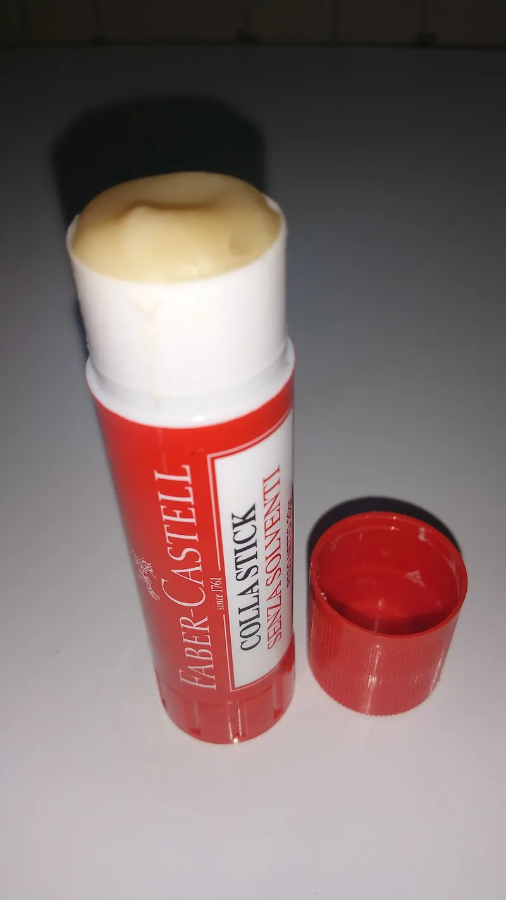

<figure class="eoc-pic eoc-pic-main"><figcaption>Diagram drawn for the encyclopaedia from the research notes. ⚑ Needs confirming: a drawing can simplify or get details wrong; a real photo or a better diagram is welcome.</figcaption></figure>
<figure class="eoc-pic"><figcaption><strong>How it works.</strong> <a href="https://commons.wikimedia.org/wiki/File:Elmer%27s_Office_Glue_Stick_in_action.JPG">Elmer&#x27;s Office Glue Stick in action</a> by Mk2010, <a href="https://creativecommons.org/licenses/by-sa/3.0">CC BY-SA 3.0</a>, from Wikimedia Commons.</figcaption></figure>
<figure class="eoc-pic"><figcaption><strong>Photo.</strong> <a href="https://commons.wikimedia.org/wiki/File:FABER-CASTELL_glue_stick.jpg">FABER-CASTELL glue stick</a> by Nalinc3, <a href="https://creativecommons.org/licenses/by-sa/4.0">CC BY-SA 4.0</a>, from Wikimedia Commons.</figcaption></figure>

Mild water-based glues for paper and card, either a solid stick rubbed on from a twist-up tube or a cooked starch, flour or cellulose paste brushed on, which soak into the paper fibres and harden as the water leaves, giving clean, non-toxic paper joints that are often reversible with water.

**In plain words:** Gentle, water-based glues for paper and card: either a solid glue in a twist-up tube that you rub on like a lipstick, or a smooth paste cooked from flour or starch (or mixed from a powder) and brushed on, which soak into the paper fibres and can often be softened again with water. **Proper term:** Paper glue stick and starch or cellulose paste (wheat-starch paste, flour paste, methyl cellulose, wallpaper paste).

**Also called:** glue stick; solid glue stick; stick glue; school glue stick (Wikipedia 'Glue stick'; Canon Creative Park); brand names beginners search for (brands): Pritt Stick, often used in the UK for any glue stick; UHU stic; Elmer's; Scotch; Bostik (Wikipedia 'Glue stick'); permanent, washable, acid-free and coloured ('disappearing purple', 'goes on purple dries clear') glue sticks (Wikipedia 'Glue stick'; Elmer's Disappearing Purple listing at Wegmans); wheatpaste; flour and water paste; flour paste; paste (Wikipedia 'Wheatpaste'); wheat starch paste; starch paste; rice starch paste: the refined, reversible paste used in book and paper conservation (Wikipedia 'Wheatpaste'; CCI Notes 11/4; Indiana University Libraries Book Repair Manual); methyl cellulose; methylcellulose; MC paste (Wikipedia 'Methyl cellulose'; Conservation Resources); PVA mixture: a 50/50 mix of PVA and methyl cellulose used by bookbinders (Indiana University Libraries Book Repair Manual); wallpaper paste; wallpaper adhesive (Wikipedia 'Wallpaper paste'); papier-mache paste (Wikipedia 'Papier-mache'; Make:); not the hot-melt 'glue sticks' that go in a glue gun (see Hot-melt adhesive) (Wikipedia 'Glue stick').

## How it works

Both kinds are mostly water with a sticky natural or synthetic polymer dissolved or dispersed in it: Pritt Stick is 'Starch ether, polysaccharides, soap and water' (Henkel Pritt Stick TDS), other sticks use PVA, PVP or acrylic polymer (Wikipedia 'Glue stick'), and pastes use cooked starch or methyl cellulose (Wikipedia 'Wheatpaste'; 'Methyl cellulose'). Spread on paper, the wet glue soaks into the fibres; as the water soaks away and evaporates, the polymer dries into a film that locks the fibres of both sheets together ⚑ [uncertain: general adhesive science, stated in our words]. Because the dried film is still water-soluble or water-swellable, starch paste and methyl cellulose can later be softened and undone with water, which is why conservators use them (University of Virginia Library: 'the adhesion is reversible'; Conservation Resources: methyl cellulose 'is fully reversible with water'). The water also makes the paper fibres swell, mostly across the grain, so wet-glued paper can ripple (cockle) or warp unless it is kept flat while it dries (OAB '[grain direction](../glossary.md#grain-direction)'; Brighton 'Grain Direction').

## Parts

Single piece: a one-part glue. A glue stick is a solid soap-thickened glue in a twist-up or push-up tube (Wikipedia 'Glue stick'). A paste is made from a powder (wheat starch, flour, cornstarch or methyl cellulose, or wallpaper-paste flakes) and water, cooked or soaked, then applied with a brush (CCI Notes 11/4; Wikipedia 'Wallpaper paste').

## Everyday examples

- A school glue stick for sticking worksheets into exercise books and making cards (Wikipedia 'Glue stick')
- Papier-mache masks, bowls and pinatas made with flour or starch paste (Wikipedia 'Papier-mache'; 'Wheatpaste')
- Wallpaper hung with paste mixed from flakes (Wikipedia 'Wallpaper paste')
- Street posters pasted onto walls with wheatpaste, and the starch glue inside every corrugated cardboard box (Wikipedia 'Wheatpaste'; 'Corrugated fiberboard')

## When to use it

For paper and card crafts, papercraft models and scrapbooks, where you want a clean, non-toxic glue that grips quickly and is safe for children (glue stick: Henkel TDS conforms to EN 71 toy safety; Elmer's conforms to ASTM D 4236). For gluing large flat areas of paper, where a glue stick puts on less water than liquid glue ⚑ [uncertain] (Canon Creative Park recommends glue sticks for large areas). For bookbinding, paper mending and mounting where the joint should be reversible later: wheat starch paste and methyl cellulose (Indiana University; University of Virginia Library). For papier-mache, including covering cardboard joints with pasted paper strips to strengthen them (Make: 'A cooked starch-based papier-mache ... can add strength'). For wallpaper.

## When not to use it

For anything that carries load, gets wet or lives outdoors: use PVA, hot glue, or a waterproof glue instead. For plastics, metal, glass, rubber and 3D prints, which these glues don't soak into (use a glue matched to the material). For small, quick structural card joints such as glued tabs on models, where white (PVA) glue grips better (Canon Creative Park). For thin papers you don't want to ripple, where a wet paste can cockle the sheet: use a glue stick, spray adhesive or double-sided tissue tape instead ⚑ [uncertain]. For permanent bookbinding joints between boards, bookbinders use PVA rather than paste (Indiana University: 'PVA is used for all such joints').

## Details

- **What it does (jobs):**
  - glue or bond: joins paper to paper, paper to card and card to card in crafts, papercraft models, scrapbooks, bookbinding, paper repair, papier-mache and wallpapering (Wikipedia 'Glue stick'; 'Wheatpaste'; 'Wallpaper paste'; Canon Creative Park)
- **Movement:** none
- **Directions it can move (degrees of freedom):** 0: the glued sheets are fixed together once dry
- **Special behaviour:**
  - none: none of the listed behaviours. Its own useful traits: starch paste and methyl cellulose stay reversible with water for many years, which is why they are used in conservation (University of Virginia Library; Conservation Resources); some glue sticks go on coloured and dry clear so you can see where you have glued (Wegmans/Elmer's); and wet paste or a fresh glue stick bond can be slid into line before it sets (Henkel Pritt Stick TDS; Wikipedia 'Wallpaper paste')
- **How it holds:**
  - [material bond](../glossary.md#form-fit--force-fit--material-bond) (glue, solvent or melting): the dried glue film grips the fibres of both surfaces
- **Input and output:** not applicable
- **Power:** passive (no power needed): it sets at room temperature as the water leaves. Starch pastes must be cooked first (CCI Notes 11/4), but that is preparation, not curing
- **Load:** light: strong enough that a good paper-to-paper joint usually holds better than the paper itself, but nothing structural ⚑ [uncertain: no strength tests found]. CCI says cooked wheat starch paste gives 'a strong, reliable bond' for paper; Indiana University calls methyl cellulose on its own 'a weak adhesive'; Wikipedia says glue sticks 'are not as strong as some liquid-based variants'. Weak in [peel](../glossary.md#peel-vs-shear) and under damp conditions; best used over large flat areas in shear ⚑ [uncertain].
- **Play and precision:** not applicable (nothing moves). Wet paste lets paper stretch, so parts that were lined up while wet can shrink out of line as they dry, especially if their grain directions differ (Brighton 'Grain Direction': layers that stretch and shrink 'in opposite directions' warp).
- **Taking it apart:** Depends on the glue. Wheat starch paste and methyl cellulose: semi-permanent (can be undone but may damage parts); they are made to be undone later with water, 'even after a long period of time, without damage to the original library item' (University of Virginia Library). Flour paste: harder to undo, because 'Over time the gluten in a flour paste cross-links, making it very difficult to release' (Wikipedia 'Wheatpaste'). Glue stick: permanent in practice once dry; parts can be moved only 'within a short period of time after bonding' (Henkel Pritt Stick TDS), and peeling a dried joint usually tears the paper ⚑ [uncertain]. Washable glue sticks wash out of clothes and off hands (Henkel: 'Washable at 20 C'; Wegmans/Elmer's).
- **How often it can be reused:** once: the glue is used up in the joint; to redo it, soften (paste) or tear (glue stick) the joint and apply fresh glue
- **Sealing:** none: the glues are water-soluble and do not seal; methyl cellulose paste is 'not waterproof' (Wikipedia 'Papier-mache')
- **Adjustable:** Only while wet. Pritt Stick has an [open time](../glossary.md#open-time) of up to 210 seconds and sets in 60-90 seconds, and 'Correction of the bonding parts is possible within a short period of time after bonding' (Henkel Pritt Stick TDS). Wallpaper paste is made to bond slowly, which 'gives the wallpaper hanger time to line up the wallpaper' (Wikipedia 'Wallpaper paste'). Methyl cellulose 'dries fairly quickly', so bookbinders add a little PVA when they need more time (Conservation Resources), and the 50/50 PVA mixture 'sets a bit more slowly than PVA, allowing for an extended [working time](../glossary.md#pot-life--working-time)' (Indiana University).
- **Access needed:** not applicable: glue is spread on the surfaces before they are pressed together
- **Materials:** Bonds well: paper, card, cardboard and paperboard, photos, felt, cork and 'lightweight craft materials' (Henkel Pritt Stick TDS); paper, fabric and artwork (Wegmans/Elmer's); paper-to-paper repairs, Japanese tissue and book cloth in bookbinding (Indiana University); fabric or paper sizing with methyl cellulose (Conservation Resources). Corrugated cardboard is itself made by joining the fluted layer to the liners 'with a starch based adhesive' (Wikipedia 'Corrugated fiberboard'). Wheatpaste posters stick well to 'concrete and metal' walls but it 'does not adhere well to wood or plastic' (Wikipedia 'Wheatpaste'). Ordinary glue sticks are made for paper and card; a special 'PowerPritt' stick was sold for wood, glass and some plastics (Wikipedia 'Glue stick'). Poor choice for 3D prints (PLA, PETG, ABS), metal, glass, rubber, foam and other non-absorbent materials, since the glue needs to soak into fibres ⚑ [uncertain: inferred from the makers' material lists]. On 3D-printer beds a glue stick is used the other way round, as a release layer that stops PETG sticking too hard (Prusa).
- **Heat, cold, water and wear:** Water and damp undo or weaken the bond, since the glues stay water-soluble (Wikipedia 'Methyl cellulose': 'a mild glue which can be washed away with water'; 'Papier-mache': methyl cellulose 'is not waterproof'). Damp also lets starch and flour paste go mouldy; methyl cellulose is 'not subject to deterioration from microbes or enzymes' (Conservation Resources). Paper itself cockles as humidity changes (Interior Angle 'Paper Cockling'). Flour paste becomes harder to release with age as its gluten cross-links (Wikipedia 'Wheatpaste'). Store glue sticks between 5 and 50 C with the cap on; shelf life 36 months (Henkel Pritt Stick TDS). Once set, methyl cellulose 'is unaffected by temperature extremes' (Conservation Resources). Glue-stick joints may lift at the edges with age or heat ⚑ [uncertain].

## Making it

- **Ways to make or get it:**
  - off-the-shelf part: glue sticks, wallpaper-paste flakes, ready-mixed paste, wheat-starch and methyl-cellulose powders (Wikipedia 'Glue stick'; 'Wallpaper paste'; Conservation Resources)
  - home-made: cook wheat starch, cornstarch or flour with water (CCI Notes 11/4; Make: 'Working with Cardboard')
  - paper, card and cardboard work: papercraft models, card making, scrapbooking, bookbinding, papier-mache, wallpapering (Canon Creative Park; Wikipedia 'Wheatpaste'; 'Papier-mache')
  - laser cut: for gluing laser- or plotter-cut card parts ⚑ [uncertain: no page opened]
  - 3D print (FDM): not for joining prints; only as a thin release or adhesion layer on the print bed (Prusa)
- **Printing it in one piece (print in place):** no: it is a glue, not a printed part
- **Tools:** Glue stick: none; slip a scrap of paper under the edges so the glue doesn't get on the table (Canon Creative Park). Paste: a pan or double boiler or a microwave to cook it, a spoon or whisk, a sieve to remove lumps, a clean lidded jar, and a brush (CCI Notes 11/4; Indiana University Libraries Book Repair Manual). To dry work flat: blotting paper or felt, a non-stick polyester web such as Reemay or Hollytex, and boards with weights or a press (AIC Conservation Wiki 'BPG Drying and Flattening'; Indiana University Libraries Book Repair Manual).
- **Difficulty:** easy: glue sticks are used by children at school and need no tools; paste needs only a few minutes of cooking and a sieve (CCI Notes 11/4). The skills are using little enough water to stop cockling and drying the work flat.

### 3D printing tips

Not used to join 3D-printed parts; use a glue made for plastics (see related). Its 3D-printing use is on the print bed: Prusa recommends 'adding PVA glue as a separation layer' on a smooth PEI sheet when printing PETG, because PETG can bond so strongly to clean smooth PEI that removing the print damages the sheet. 'PVA (paper) glue' is usually sold as sticks; 'only a thin layer of glue is enough', spread only under the print, and applied to a cold sheet because 'the PVA glue melts at relatively low temperatures'; marks left in the glue layer 'disappear with the glue after washing' (Prusa 'Print surface preparation'). Some glue sticks are not PVA (Pritt is starch ether, Henkel TDS), so results vary by brand ⚑ [uncertain]. Glue sticks are also handy for sticking paper templates onto parts as cutting or drilling guides ⚑ [uncertain].

### Buying one (off-the-shelf parts)

Glue sticks in permanent, washable, acid-free and colour-change types and in sizes from about 8 g to 43 g (Wikipedia 'Glue stick'; Henkel Pritt Stick TDS https://datasheets.tdx.henkel.com/PRITT-Glue-Stick-en_GB.pdf). Wheat starch and methyl cellulose powders from conservation and bookbinding suppliers (Conservation Resources methyl cellulose: https://www.conservationresources.com/?p=4022). Wallpaper paste as flakes 'based on modified starch, methylcellulose, or clay' to mix with water, or ready-mixed in tubs (Wikipedia 'Wallpaper paste'); some contain a fungicide (Solvite listing at Dunelm). Ready-made 'PVA mixture' or reversible PVA for bookbinding.

## Rules of thumb

- Wheat starch paste for paper (CCI Notes 11/4): 30 g of wheat starch to 300 mL of distilled water; mix the starch with 50 mL of the water, add it to the other 250 mL once boiling in a double boiler, then 'continue heating and stirring for another five to ten minutes'. Thin with water and force through a sieve to remove lumps.
- Keep paste only a few days: at least 3 days at room temperature or at least 7 days in a fridge, and throw it away 'as soon as it separates or sours' (CCI Notes 11/4); 'a few days without refrigeration, or up to about a week in the fridge', and covering it with water helps (Indiana University Libraries Book Repair Manual).
- Methyl cellulose for papier-mache: 'one part powder to 16 parts hot water'; it is 'naturally mold free' but 'not waterproof' (Wikipedia 'Papier-mache').
- Cornstarch papier-mache paste for cardboard: dissolve 1 cup of cornstarch in 2 cups of cold water, stir it slowly into half a gallon of boiling water, then stir while it cools, about 45 minutes, until cloudy and milky (Make: 'Working with Cardboard', Bread & Puppet recipe). Flour paste for papier-mache is mixed 'to the consistency of heavy cream' (Wikipedia 'Papier-mache').
- Glue stick: rub it on 'two or three times', join the parts, and keep the cap on so it doesn't dry out (Henkel Pritt Stick TDS). Use a glue stick for large areas and a little white (wood) glue on a toothpick for small parts, and put the glue on the place where the tab goes rather than on the tab (Canon Creative Park).
- To stop cockling and [warping](../glossary.md#warping--shrinkage), line up the grain of every layer the same way (in a book, parallel to the spine) so they expand and shrink together (OAB 'grain direction'; Brighton 'Grain Direction'), use as little water as you can ⚑ [uncertain], and dry flat between blotters with a non-stick polyester web, 'placed in a press or under weights', changing the damp blotters for dry ones (AIC Conservation Wiki 'BPG Drying and Flattening').
- Wallpaper paste: paste the paper and let it soak so it expands before hanging; for non-woven papers that don't expand, paste the wall instead (Wikipedia 'Wallpaper paste').
- Let papier-mache dry right through before painting, or 'mold will form and the product will rot from the inside out' (Wikipedia 'Papier-mache').

## Common failures

Paper ripples or the work curls as it dries (cockling, warping): use less water, match grain directions, and dry flat between blotters under weight (OAB; Brighton; AIC Conservation Wiki). Edges lift because too little glue was used or the glue stick had dried out: apply two or three [strokes](../glossary.md#stroke) right to the edges and keep the cap on (Henkel Pritt Stick TDS). Lumpy paste: sieve it (CCI Notes 11/4). Paste or papier-mache goes mouldy or smells: make it fresh, add a preservative such as oil of cloves or salt, or use methyl cellulose, and let work dry fully before painting (Wikipedia 'Papier-mache'; CCI). A flour-paste repair can't be undone later: use refined wheat starch paste instead (Wikipedia 'Wheatpaste'). Wheatpaste won't stick to wood or plastic (Wikipedia 'Wheatpaste'). Joints fail when wet.

## Safety

Nothing special for glue sticks and starch pastes: glue sticks for children are tested to toy safety rules (Henkel Pritt Stick TDS: 'UKCA/CE conformance according to EN 71 Safety of Toys') or labelled non-toxic to ASTM D 4236 (Wegmans/Elmer's), and methyl cellulose is 'non-toxic, and not an allergen' (Wikipedia). Cooked paste goes off: make small batches fresh, keep them cool and covered, and throw paste away 'as soon as it separates or sours' (CCI Notes 11/4). Some wallpaper pastes contain a fungicide and say 'Keep away from children and animals' and 'Wash hands thoroughly after use' (Solvite listing at Dunelm), so use flour, starch or plain methyl cellulose paste for children's papier-mache. Take care with boiling water and hot paste when cooking it (Make: recipe uses boiling water).

## Related

- PVA wood glue (white and yellow glue): white school glue is stronger and more water-resistant for paper, card and wood, but wetter, so it cockles thin paper more; mixed 50/50 with methyl cellulose by bookbinders
- Hide glue (animal glue): the traditional hot glue for wood and bookbinding, also reversible with heat and water
- Contact adhesive (contact cement): includes rubber cement and spray adhesive for mounting paper without water, so no cockling
- Hot-melt adhesive (glue gun): fast, thick and gap-filling for cardboard, but lumpy on paper and a burn risk; its 'glue sticks' are a different thing
- Adhesive tape joint and tape hinge: double-sided tissue tape and transfer tape join paper with no water at all
- Glued tab joint: the papercraft joint these glues are most often used for
- Glued joint design: why paper joints should be overlapped in shear rather than pulled apart in peel
- Double-sided foam tape: thick sticky pads for lifting card layers (3D card toppers)

## Make it yourself

- [Wheat Starch Paste - Canadian Conservation Institute (CCI) Notes 11/4](https://www.canada.ca/en/conservation-institute/services/conservation-preservation-publications/canadian-conservation-institute-notes/wheat-starch-paste.html): Step-by-step recipe for conservation-grade wheat starch paste (30 g starch to 300 mL distilled water, cooked in a double boiler), with storage and thinning advice *(licence: Government of Canada (link only))*
- [Working with Cardboard: Tips to Cut, Fold, Mold, and Papier-Mache (Make:)](https://makezine.com/article/craft/working-with-cardboard-tips-cut-fold-mold-papier-mache/): A cooked cornstarch papier-mache paste recipe for strengthening cardboard builds with pasted cardboard scraps *(licence: link only)*

## Pictures, videos and models

- [Pritt Sticks.JPG (Wikimedia Commons, by Elarkon)](https://commons.wikimedia.org/wiki/File:Pritt_Sticks.JPG): A selection of twist-up glue sticks (Pritt Stick international and UK versions and Power Pritt) *(licence: CC BY-SA 3.0 (also GFDL 1.2 or later))*
- [Wallpaper paste flakes.JPG (Wikimedia Commons, by Sealman)](https://commons.wikimedia.org/wiki/File:Wallpaper_paste_flakes.JPG): Modified-starch wallpaper-paste flakes that are mixed with water to make paste *(licence: CC BY-SA 3.0)*
- [Papier mache.jpg (Wikimedia Commons, by Larry D. Moore)](https://commons.wikimedia.org/wiki/File:Papier_mache.jpg): A papier-mache pig in progress, made with pasted paper strips over a form *(licence: CC BY 4.0)*
- [The Tools of Preservation Services: Adhesives (University of Virginia Library exhibit)](https://explore.lib.virginia.edu/exhibits/show/preservation-services/adhesives): Photo of wheat starch paste being applied by hand to Japanese tissue to repair a torn book page, with an explanation of reversible conservation adhesives *(licence: link only)*
- [Grain Direction (University of Brighton Visual Communication Technical Resource)](https://blogs.brighton.ac.uk/viscommtech/bookarts/worksheets-for-bookbinders/grain-direction): Photos of the roll test and hang-over test for finding paper grain, and why wet glue makes layers warp *(licence: link only)*

## Needs confirming

⚑ marks something nobody has confirmed yet: a fact the research could not confirm from a source, a finder value that is a best guess, or an open point from the research notes. Corrections are welcome (see `research/needs-confirming.md`).

- ⚑ 12 sentences on this page marked [uncertain].
- ⚑ Finder value `glue_traits` =  (best guess): no glue traits found
- ⚑ Finder value `bonds_well` = paper or card, metal, fabric or leather, stone or concrete (source uncertain): `materials` is marked ⚑ [uncertain] here: "…her non-absorbent materials, since the glue needs to soak into fibres ⚑ [uncertain: inferred from the makers' ma…"
- ⚑ Finder value `bonds_poorly` = PLA, PETG, ABS or ASA, wood, glass or ceramic, rubber, foam (source uncertain): `materials` is marked ⚑ [uncertain] here: "…her non-absorbent materials, since the glue needs to soak into fibres ⚑ [uncertain: inferred from the makers' ma…"

## Sources

- <https://en.wikipedia.org/wiki/Glue_stick>
- <https://en.wikipedia.org/wiki/Wheatpaste>
- <https://en.wikipedia.org/wiki/Methyl_cellulose>
- <https://en.wikipedia.org/wiki/Wallpaper_paste>
- <https://en.wikipedia.org/wiki/Papier-m%C3%A2ch%C3%A9>
- <https://en.wikipedia.org/wiki/Corrugated_fiberboard>
- <https://datasheets.tdx.henkel.com/PRITT-Glue-Stick-en_GB.pdf>
- <https://www.wegmans.com/shop/product/656417-School-Glue-Sticks-Disappearing-Purple-Washable>
- <https://www.canada.ca/en/conservation-institute/services/conservation-preservation-publications/canadian-conservation-institute-notes/wheat-starch-paste.html>
- <https://iu.pressbooks.pub/iulibrariesbookrepairmanual/?p=55>
- <https://www.conservationresources.com/?p=4022>
- <https://explore.lib.virginia.edu/exhibits/show/preservation-services/adhesives>
- <https://blogs.brighton.ac.uk/viscommtech/bookarts/worksheets-for-bookbinders/grain-direction>
- <https://oab.lib.utah.edu/?p=1774>
- <https://www.conservation-wiki.com/wiki/BPG_Drying_and_Flattening>
- <https://interiorangle.co.uk/paper-cockling/>
- <https://creativepark.canon/event/howtomake/en/index.html>
- <https://makezine.com/article/craft/working-with-cardboard-tips-cut-fold-mold-papier-mache/>
- <https://help.prusa3d.com/article/print-surface-preparation_686951>
- <https://www.dunelm.com/product/solvite-paste-the-wall-wallpaper-paste-1000249386>
- <https://commons.wikimedia.org/wiki/File:Pritt_Sticks.JPG>
- <https://commons.wikimedia.org/wiki/File:Wallpaper_paste_flakes.JPG>
- <https://commons.wikimedia.org/wiki/File:Papier_mache.jpg>
