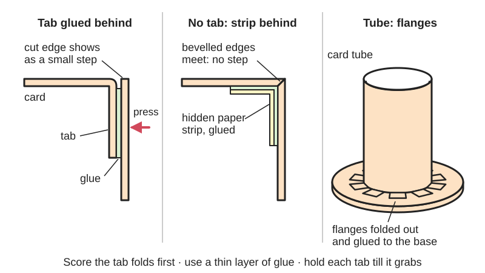
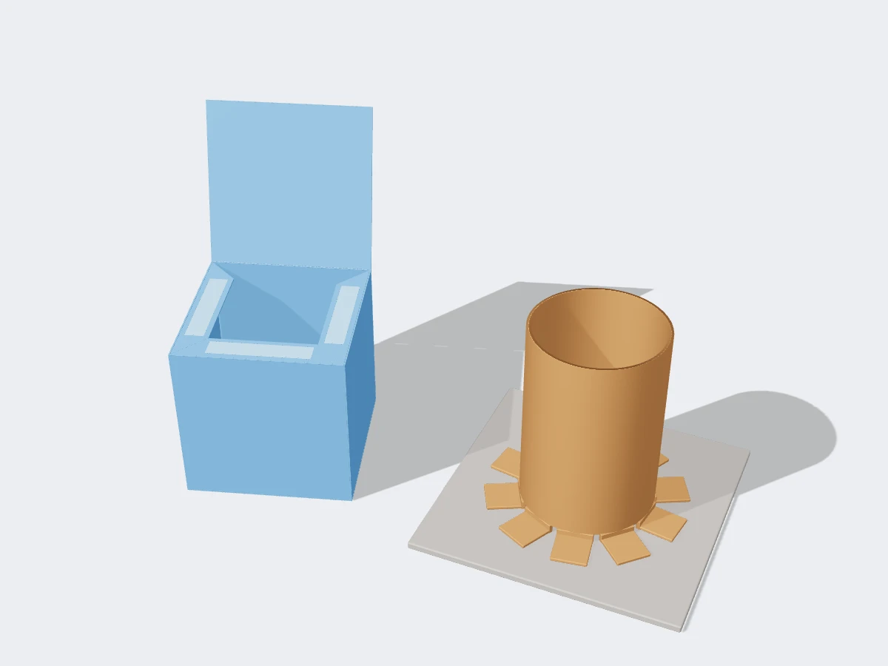

<figure class="eoc-pic eoc-pic-main"><figcaption>Diagram drawn for the encyclopaedia from the research notes. ⚑ Needs confirming: a drawing can simplify or get details wrong; a real photo or a better diagram is welcome.</figcaption></figure>
<figure class="eoc-pic"><figcaption><strong>Render.</strong> A 3D model made for the encyclopaedia, not a photo: a stand-in until a good real photo is found. ⚑ Needs confirming: a model can simplify or get details wrong; a real photo is welcome.</figcaption></figure>

A strip of extra paper or card left on one part's edge is folded on a scored line and glued under or behind the matching edge of the next part, making a small glued overlap (lap joint) that holds papercraft, card boxes and cardboard tubes together.

**In plain words:** A narrow flap left along the edge of a paper or card part that is folded over and glued behind the next part, which is how paper models, card boxes and cardboard tubes are stuck together. **Proper term:** Glued tab joint (glue tab, glue flap).

**Also called:** glue tab, tab (papercraft; Tabgen Inkscape extension README; Gedelgo, DeviantArt); glue flap, flap (the word used by Pepakura users and by the PolyZamboni Blender add-on, which places 'glue flaps' on cut edges); construction tab (Wikipedia 'Paper model', describing tabs added by unfolding software); sticking tab (Export Paper Model add-on for Blender documentation); manufacturer's joint (the glued flap that closes the side seam of a corrugated box; Wikipedia 'Corrugated box design'); edge gluing, butt-gluing or tabless gluing with an internal strip or backing strip (Zealot Models forum 'Tabs or no tabs?'); internal tab, separate tab (a strip glued behind both edges instead of a tab on one part; Zealot Models forum); flange, flange method (tabs cut around the end of a cardboard tube and folded out; Makedo 'Connections and joints'); glue margin ⚑ [uncertain: term used in some kit instructions, no source opened].

## How it works

The tab overlaps the back of the next part, so the glue film sits between two flat faces; loads along the seam slide those faces past each other (shear), which glue resists well over the whole tab, whereas a seam that springs open [peels](../glossary.md#peel-vs-shear) the tab off from one end, which glue resists badly (see Glued joint design). The tab is folded on a scored line so it sits at the right angle and the two outer faces meet edge to edge. Water-based glues such as PVA or tacky glue soak into the paper fibres and grab within seconds when the parts are pressed together (PlanetJune; Wikipedia 'Paper model'). In the tabless method the two outer edges are butted together and a hidden strip glued behind both of them carries the joint, avoiding the visible step a tab makes (Zealot Models forum). For tubes and round parts, a ring of short tabs (flanges) is cut around the end, folded outwards and glued or fixed to the flat panel (Makedo).

## Parts

A few parts: the two paper or card parts (the tab is part of one of them), the glue (or double-sided tape), and a scored fold line at the base of the tab. The tabless version replaces the tab with a separate backing strip glued behind both edges.

## Everyday examples

- Printable paper models and papercraft kits, such as Canon Creative Park models (Canon Creative Park; Wikipedia 'Paper model')
- Cereal and other folding-carton boxes, which are printed, cut, folded and glued along a flap (Wikipedia 'Folding carton')
- Corrugated shipping boxes, whose side seam (the manufacturer's joint) is usually a glued flap (Wikipedia 'Corrugated box design')
- Cardboard tube towers and pillars in cardboard building kits, joined to panels with folded flanges (Makedo)

## When to use it

Use glue tabs to join paper and card parts that must stay together permanently: papercraft and card models, architectural and game-terrain models, gift and storage boxes, costume and cosplay parts made with unfolding software, and cardboard prototypes. Tabs make assembly easy for beginners because they show where each part goes. Use flange tabs to join cardboard tubes and round parts to flat panels. Use the tabless backing-strip method when a smooth, step-free surface matters more than speed.

## When not to use it

Avoid glue tabs when the joint must come apart again (use tab-and-slot joints, folding box closures, split-pin paper fasteners or cardboard screws instead), when the model must survive water or outdoor use, or when a hinge is needed (use a score-and-fold or tape hinge). For heavy cardboard furniture, glued tabs alone are weak; add folded brackets, ribs or mechanical fasteners (Makedo). Do not use tabs on 3D prints, wood or plastics; use a proper lap joint.

## Details

- **What it does (jobs):**
  - join and hold: joins paper and card parts into boxes, models and tubes
  - glue or bond: the tab is the gluing surface
  - line parts up exactly: numbered tabs and printed positioning lines show where each part goes (PlanetJune; Canon Creative Park)
- **Movement:** none
- **Directions it can move (degrees of freedom):** 0: once the glue has set, the two parts cannot move relative to each other.
- **Special behaviour:**
  - none: it simply holds. (It does help locate parts: the tab and its numbered mark show where the next part goes, but it does not self-align on its own.)
- **How it holds:**
  - [material bond](../glossary.md#form-fit--force-fit--material-bond) (glue, solvent or melting): glue between the tab and the next part; double-sided tape works the same way with a pressure-sensitive adhesive
- **Input and output:** not applicable
- **Power:** passive (no power needed)
- **Load:** Light. The joint is strongest when loaded along the seam (shear) and weakest when the seam is pried open so the tab peels from one end (see Glued joint design). In practice the paper or card itself usually fails first ⚑ [uncertain]. Heavier cardboard joints use folded flanges, brackets and ribs, often across the [flutes](../glossary.md#flute), for strength (Makedo).
- **Play and precision:** No play once set. [Accuracy](../glossary.md#repeatability--accuracy) depends on careful cutting and scoring, and small errors add up across many parts ([tolerance](../glossary.md#tolerance) stack-up), so build outwards from the middle (Gedelgo, DeviantArt). A tab leaves a small visible step the thickness of the paper at the seam; a tabless butt joint is flush but can leave a gap if the edges do not quite meet (Zealot Models forum).
- **Taking it apart:** permanent: once glued, the paper usually tears before the tab comes away ⚑ [uncertain: no test found]. Cardboard flanges fixed with plastic cardboard screws instead of glue can be undone (Makedo).
- **How often it can be reused:** once
- **Sealing:** none: paper seams are not sealed against water or air.
- **Adjustable:** No, once the glue has set. Slow white glues give a few seconds to slide a part into place before they grab (PlanetJune: hold for a few seconds until the glue 'grabs'); misplaced creases can be nudged with a fingernail during assembly (Gedelgo, DeviantArt).
- **Access needed:** both sides: you press the tab against the back of the next part from inside and outside; the last tab of a closed model must be pressed from one side only (blind), which is why papercrafters plan the final seam where it is hidden or leave the model open (Gedelgo, DeviantArt)
- **Materials:** Made in and suits: paper, card stock and paperboard (Wikipedia 'Paper model'; Canon), and corrugated cardboard and cardboard tubes (Makedo; Adafruit). Glues that suit tabs: white PVA craft glue and tacky glue (Wikipedia 'Paper model'; PlanetJune; Gedelgo), wood glue for small parts and glue stick for large flat areas (Canon Creative Park; but PlanetJune finds glue stick too weak for tabs), double-sided tape for flat surfaces (Zealot Models; Fold 'N Fly), and hot glue or white glue for cardboard (Adafruit). Not suited: ordinary superglue on foam board (it melts the foam; Fold 'N Fly). Not used for wood, metal, plastics or 3D prints, which use lap joints and other glued joint shapes instead.
- **Heat, cold, water and wear:** Water-based glues (PVA, tacky glue, glue stick) and paper soften in damp; paper models are sometimes sealed with varnish to last longer (Wikipedia 'Paper model'). Hot glue on cardboard softens again with heat (see Hot-melt adhesive). Paper glued with too much water-based glue cockles and buckles as it dries (Gedelgo, DeviantArt). Long-term ageing figures for craft glues in paper were not found ⚑ [uncertain].

## Making it

- **Ways to make or get it:**
  - hand cut with scissors or a craft knife from printed or drawn patterns (Canon Creative Park; PlanetJune)
  - cutting plotter or laser cutter: tab outlines and dashed score lines can be generated automatically (Tabgen Inkscape extension README)
  - unfolding software that turns a 3D model into flat printable parts with tabs: Pepakura Designer (commercial), Export Paper Model for Blender, PolyZamboni for Blender (Wikipedia 'Paper model'; Blender Extensions pages)
  - industrial: folding cartons and corrugated boxes are die-cut, scored, folded and glued on a glued side flap (Wikipedia 'Folding carton'; 'Corrugated box design')
  - 3D print (FDM) and resin: not applicable; printed parts use lap joints and other glued joint shapes
- **Printing it in one piece (print in place):** no: a paper and card joint; it is not 3D printed.
- **Tools:** Scissors or a craft knife and cutting mat to cut the parts (Canon Creative Park), a ruler and blunt point to score the tab's fold line (Canon), glue (PVA, tacky glue, wood glue or a glue stick) or double-sided tape, a toothpick or needle to spread small amounts of glue, tweezers to press small tabs, and paper scraps under the part to keep glue off the table (Canon Creative Park; Gedelgo, DeviantArt). Hot-glue gun for cardboard (Adafruit).
- **Difficulty:** easy: the tabs are drawn on the printed or drawn pattern; the skill is in neat cutting, scoring and using little glue. Tabless edge gluing is harder and suits experienced modellers (Zealot Models forum).

### 3D printing tips

not applicable: glue tabs are a paper and card joint. For gluing 3D-printed parts see Glued joint design (lap and [scarf joints](../glossary.md#scarf-joint)) and the split-part joints for large prints.

### Buying one (off-the-shelf parts)

White PVA craft glue and tacky glue, e.g. Aleene's Original Tacky Glue (brand; used by PlanetJune and Gedelgo), wood glue, glue sticks, double-sided tape and double-sided tissue tape, glue pens or a fine needle or toothpick for spreading, tweezers, cutting mat and craft knife. Software: Pepakura Designer (Tama Software, commercial), Export Paper Model add-on (included with Blender, GPL-3.0-or-later), PolyZamboni add-on for Blender (GPL-3.0-or-later), Tabgen extension for Inkscape. For cardboard flanges, plastic cardboard screws such as Makedo Scru (brand) can replace glue (Makedo).

## Rules of thumb

- Put the glue on the place where the tab will land, not on the tab itself, for better sticking and a cleaner finish (Canon Creative Park 'How to Make Paper Crafts'). Others spread glue thinly on the tab instead (Gedelgo, DeviantArt; PlanetJune); both work if the glue is thin.
- Use very little glue: too much moisture makes the paper buckle, slows drying and lets parts slip out of place (Gedelgo, DeviantArt); apply white glue 'sparingly to each tab' (PlanetJune).
- Choose the glue by the size of the area: glue stick for large areas, wood glue spread thinly with a toothpick for small parts, then pinch with tweezers (Canon Creative Park). PlanetJune warns that a glue stick does not grab tabs tightly enough and recommends tacky white glue instead.
- Glue tabs one at a time in their numbered order, holding each for a few seconds until the glue grabs (PlanetJune).
- Point tabs away from the main viewing direction: the edge over a tab shows as a step, more visible with thicker card (Gedelgo, DeviantArt; Zealot Models forum figure 'a').
- Build from the most important part outwards, starting near the middle so errors split both ways, and plan the last seam where it is hidden; never finish on a pointed or intricate part (Gedelgo, DeviantArt).
- Score the tab fold before folding; a folded tab at a corner otherwise leaves a gap because the card curves at the fold (Zealot Models forum; Canon Creative Park).
- Tabless practice piece: make a tube from a 2 cm wide strip by gluing its ends edge to edge with a strip over the seam inside, glue tiny strips about 1 cm long and 2 mm wide around the inside of the rim with half of each sticking out, bend them inwards and glue on a 5 cm end disc (Zealot Models forum, member 'Rhaven'). For flush corners, sand both edges to 45 degrees and glue edge to edge (Zealot Models forum).
- Flange method for tubes and round parts: cut flanges around the end, fold them out and test whether 2, 3 or 4 fixings work best; fold across the flutes where possible for strength (Makedo 'Connections and joints').
- A tab is a small lap joint: keep it loaded along the seam (shear) and avoid shapes that pry it open from one end (peel); a longer tab along the edge helps more than a deeper one (see Glued joint design, which cites the Henkel LOCTITE design guide).
- Tab size: tab-generator software lets you set the tab angle at its ends and the tab height (how far it sticks out) (Tabgen README). A forum answer says Pepakura's default flap width is 5 mm ⚑ [uncertain: forum page blocked, not read]. Angle the tab ends so tabs meeting at a corner do not overlap ⚑ [uncertain: common practice, no source opened].

## Common failures

Tabs popping up or seams opening: too little or too weak glue (a glue stick on a tab may not grab; PlanetJune), or glue not held long enough to grab; use tacky white glue and hold each tab for a few seconds. Buckled, cockled paper and parts sliding out of place: too much wet glue (Gedelgo, DeviantArt). Visible steps and coloured gaps at seams: tabs on the viewed side, or tabless edges that did not quite meet; colour the white edges with a pen and point tab steps away from view (Zealot Models forum; Canon Creative Park). Gaps at folded corners: unscored tab folds (Zealot). Misfits that grow across the model: tolerance stack-up; build from the middle out (Gedelgo). The final tab cannot be pressed shut: plan the last seam in a hidden, flat area (Gedelgo).

## Safety

Craft knives: cut on a mat against a metal ruler, keep your fingers out of the blade's path and cut away from yourself (Adafruit; Canon: 'Avoid cutting your fingers'). Solvent glues and especially spray adhesives give off harmful fumes, so use them only with good ventilation and read the label (Fold 'N Fly). Hot-glue guns burn (Fold 'N Fly). Keep small parts and glue away from young children ⚑ [uncertain: general advice].

## Related

- Glued joint design (butt, lap and scarf joints; peel vs shear): a tab is a small lap joint, so the same rules apply
- Score-and-fold hinge: every tab is folded on a scored line first
- Glue stick and starch paste: the mild paper glues often used on tabs
- PVA wood glue and Hot-melt adhesive: white glue for papercraft and hot glue for cardboard
- Adhesive tape joint and tape hinge: double-sided tape or tissue tape can replace glue on tabs and seams, and single-sided tape is the quick no-drying alternative
- Tab-and-slot joint: a tab pushed through a slot that holds without glue and can be taken apart
- Folding box closures: tuck flaps and lock bottoms that hold boxes shut without glue
- Cardboard screws and rivets: hold cardboard flanges and overlaps with removable plastic fasteners instead of glue
- Bent or twisted tab through a slot: the sheet-metal relative, held by bending rather than glue

## Make it yourself

- [Export Paper Model (Blender add-on by Adam Dominec)](https://extensions.blender.org/add-ons/export-paper-model/): Exports a flat printable net of a 3D mesh as PDF or SVG, with markers showing which parts stick together and labelled sticking tabs; it ships with Blender *(licence: GNU GPL v3.0 or later)*
- [PolyZamboni (Blender add-on)](https://extensions.blender.org/add-ons/polyzamboni/): Interactive paper-model unfolding in Blender: mark cuts, then 'Recompute Flaps' places glue flaps on every cut edge while trying to avoid overlaps; flaps can be added, removed or flipped by hand *(licence: GNU GPL v3.0 or later)*
- [Tabgen 3D Papercraft Extension for Inkscape (README)](https://inkscape.org/fr/gallery/item/27672/readme.txt): An Inkscape extension that adds tabs with dashed score lines to any straight-sided outline, with settings for tab angle, tab height and placement inside or outside *(licence: ⚑ [uncertain: licence not stated in the README])*
- [Parametric Cardboard Box Template Maker (basquepunk, Printables) (URL from Printables API, page not opened)](https://www.printables.com/model/1233463-parametric-cardboard-box-template-maker): An OpenSCAD box-template generator exporting SVG or DXF outlines with bending lines, with a choice of 'simple' or 'no-glue' box. Read through the Printables public API. *(licence: CC BY-NC (Creative Commons Attribution-NonCommercial))*

## Pictures, videos and models

- [Tutorial: Cut & Fold Paper Models (PlanetJune)](https://www.planetjune.com/blog/paper-models/): Photos of cutting, scoring, mountain and valley folding and gluing numbered tabs on printable animal paper models, with a legend of the line markings *(licence: link only)*
- [Tabs or no tabs? (Zealot Models forum)](https://www.zealotmodels.com/threads/tabs-or-no-tabs.173794/): Forum discussion of tabbed versus tabless (edge-glued) seams, with a member's diagram of tab steps, internal tabs and corner joints, and a step-by-step tabless tube exercise *(licence: link only)*
- [Connections and Joints: How to use Flanges, Tabs and Patches (Makedo Resource Hub)](https://hub.make.do/at-home/maker-tips/connections-and-joints-how-to-use-flanges-tabs-patches): Photos of tabs added to cardboard designs and the flange method for joining cardboard tubes and circles to panels *(licence: link only (copyright Makedo))*
- [Blank RSC.svg (Wikimedia Commons, by Life of Riley)](https://commons.wikimedia.org/wiki/File:Blank_RSC.svg): Flat blank of a regular slotted cardboard box with score lines, slots and the manufacturer's joint flap that is glued to close the side seam *(licence: Public domain)*
- [Paper VALMETRO.JPG (Wikimedia Commons, by Haridas Mederos Ocando)](https://commons.wikimedia.org/wiki/File:Paper_VALMETRO.JPG): A printable sheet of unfolded parts for a paper model of a Valencia (Venezuela) metro train, used on Wikipedia 'Paper model' ⚑ [uncertain: glue tabs not checked at full size] *(licence: CC BY-SA 2.5)*

## Needs confirming

⚑ marks something nobody has confirmed yet: a fact the research could not confirm from a source, a finder value that is a best guess, or an open point from the research notes. Corrections are welcome (see `research/needs-confirming.md`).

- ⚑ 9 sentences on this page marked [uncertain].
- ⚑ Finder value `glue_traits` = fast (best guess): not on the glue lists in the finder tree; traits read from the text
- ⚑ Finder value `removability` = permanent (source uncertain): `removability` is marked ⚑ [uncertain] here: "…manent: once glued, the paper usually tears before the tab comes away ⚑ [uncertain: no test found].…"

## Sources

- <https://en.wikipedia.org/wiki/Paper_model>
- <https://en.wikipedia.org/wiki/Folding_carton>
- <https://en.wikipedia.org/wiki/Corrugated_box_design>
- <https://creativepark.canon/event/howtomake/en/index.html>
- <https://www.zealotmodels.com/threads/tabs-or-no-tabs.173794/>
- <https://hub.make.do/at-home/maker-tips/connections-and-joints-how-to-use-flanges-tabs-patches>
- <https://www.planetjune.com/blog/paper-models/>
- <https://www.deviantart.com/gedelgo/journal/Stuff-You-Might-Want-to-Know-About-Papercraft-528533435>
- <https://inkscape.org/fr/gallery/item/27672/readme.txt>
- <https://extensions.blender.org/add-ons/export-paper-model/>
- <https://extensions.blender.org/add-ons/polyzamboni/>
- <https://raw.githubusercontent.com/addam/export-paper-model-from-blender/master/README.md>
- <http://addam.github.io/Export-Paper-Model-from-Blender>
- <https://tamasoft.co.jp/pepakura-en>
- <https://learn.adafruit.com/cardboard-fundamentals?view=all>
- <https://www.foldnfly.com/lounge/foam-core-tools-techniques.php>
- <https://commons.wikimedia.org/wiki/File:Blank_RSC.svg>
- <https://commons.wikimedia.org/wiki/File:Paper_VALMETRO.JPG>
- <https://api.printables.com/graphql/>
