<figure class="eoc-pic eoc-pic-main"><picture><source media="(prefers-reduced-motion: reduce)" srcset="../media/drawn/granular-jamming-gripper.svg"></picture><figcaption><strong>Animation.</strong> Diagram drawn for the encyclopaedia from the research notes. ⚑ Needs confirming: a drawing can simplify or get details wrong; a real photo or a better diagram is welcome.</figcaption></figure>

A soft rubber bag filled with grains such as ground coffee that flows around an object when pressed onto it, then locks rigid and grips it when a pump sucks the air out, and softens and lets go when air is let back in.

**In plain words:** A balloon full of ground coffee that you press onto an object so it squishes around it, then suck the air out so it goes rock-hard and grabs the object; let the air back in and it lets go. **Proper term:** Granular jamming gripper (universal jamming gripper).

**Also called:** coffee-balloon gripper or coffee gripper; universal gripper or universal robotic gripper; jamming gripper or vacuum jamming gripper; bean-bag gripper or bag gripper; positive-pressure jamming gripper (a version that also blows air in to reset and release); granular gripper or granular-jamming soft gripper; VERSABALL (Empire Robotics, brand).

## How it works

Loose grains in a bag behave almost like a liquid, so when the soft bag is pressed onto an object it flows around it and takes its shape. When the air is pumped out, the outside air pressure squeezes the bag and the grains lock against each other (a 'jamming transition'), so the bag goes solid; a volume change of under 0.5 % is enough (Brown et al. 2010). The hardened bag then holds the object in three ways: friction from the bag pinching around it, suction where the rubber seals onto a smooth surface, and interlocking where it has wrapped around bumps or more than half-way round the object (Brown et al. 2010). Letting air back in unjams the grains so the bag softens and lets go, and a short puff of compressed air resets it faster, or even shoots the object away (Amend et al. 2012; Make:). A flat cousin, layer jamming, uses a stack of thin sheets instead of grains: 'a stack of paper inside an airtight plastic envelope' bends easily, but under vacuum the outside air presses the layers together and the friction 'couples the layers into a coherent beam with a far greater bending [stiffness](../glossary.md#stiffness)', so a bendy strip or [flexure](../glossary.md#flexure) hinge can be locked stiff on demand (Aktaş and Howe 2019).

## Parts

A small assembly that acts as one unit: a stretchy airtight bag (often a latex party balloon), loose grains inside it (ground coffee is the usual choice), a filter so grains aren't sucked out, a rigid base or funnel with a hose connection, and a vacuum source (pump, [venturi](../glossary.md#venturi) or even a large syringe) with a valve; better versions add a rigid collar round the bag and a compressed-air port to reset it (Brown et al. 2010; Amend et al. 2012: 12 components including five screws).

## Everyday examples

- A vacuum-packed brick of coffee, which is rock-hard until the pack is opened and then pours like a liquid (Cornell Chronicle; Make:)
- A bean bag, which moulds to whatever presses on it (the gripper is often called a 'bean bag' gripper) (Hackaday)
- Factory robot grippers sold as VERSABALL (brand) (New Atlas)

## When to use it

Use it when a robot must pick up many different, unfamiliar or oddly shaped rigid objects without sensors, grasp planning or precise positioning; for fragile things such as raw eggs; to pick up several objects at once while keeping their spacing; or when you want a cheap, soft, easily built gripper for a hobby robot arm (Brown et al. 2010; Amend et al. 2012). Its sealed construction also suits wet or messy work and is easy to clean (Amend et al. 2012). For a flat strip, hinge or pad that must switch between floppy and stiff, use layer jamming (a stack of paper or film in a vacuum envelope) instead of grains (Aktaş and Howe 2019).

## When not to use it

Avoid it for thin flat objects lying flat, very soft objects such as cotton balls, and objects too big for the bag to wrap round (Brown et al. 2010); for small or thin parts such as screws, nuts or micro SD cards, which a simple gripper may fail to grip (Schertz); and for heavier smooth objects with no edges to grip (Hackaday, James Bruton's build). Use a vacuum gripper for flat smooth parts, mechanical jaws for precise placement or heavy loads, and fin-ray fingers when you need a soft grip without a pump. It is also slower than a suction cup, taking about a second to jam (Amend et al. 2012).

## Details

- **What it does (jobs):**
  - hold or release using power: it holds only while the bag is under vacuum and lets go when air is let back in (Brown et al. 2010)
  - join and hold: picks up, carries and places objects of almost any shape, including several at once without changing their spacing (Brown et al. 2010; Amend et al. 2012)
- **Movement:** flex: the soft bag squashes and flows around the object before it is jammed; once the vacuum is on there is no motion (Brown et al. 2010)
- **Directions it can move (degrees of freedom):** 0 while jammed: the object is held rigidly. Before jamming, the researchers describe the bag as like a robot hand with an unlimited number of joints, which are set passively by touching the object and all locked by a single active part, the pump (Brown et al. 2010)
- **Special behaviour:**
  - self-aligning or self-centring (shape-adapting): the bag moulds itself to the object without sensors or planning, and still grips objects up to about 30 mm off-centre for a 25 mm radius hemisphere (Amend et al. 2012)
  - quick-release: letting air back in softens the bag and drops the object; a 0.1 s puff of compressed air resets the bag and can throw small objects about 0.6 m (Amend et al. 2012; Make:)
- **How it holds:**
  - jamming (grains lock up under load): pumping the air out lets outside air pressure squeeze the grains until they can't slide (Brown et al. 2010)
  - friction or clamping ([force-fit](../glossary.md#form-fit--force-fit--material-bond)): the slightly shrinking bag pinches the object like an [O-ring](../glossary.md#o-ring) (Brown et al. 2010)
  - suction or air pressure: where the rubber seals on a smooth surface, a vacuum forms as the object is pulled, giving about 10 times the [holding force](../glossary.md#holding-force) of a non-sealing object (Brown et al. 2010)
  - shape (the parts interlock; form-fit): when the bag wraps more than half-way round an object or around its bumps (Brown et al. 2010)
  - powered hold: the vacuum must be kept on (Brown et al. 2010)
- **Input and output:** not applicable
- **Power:** powered: needs a vacuum pump, a venturi aspirator on compressed air, or a hand-worked syringe (Brown et al. 2010; Schertz); a positive-pressure version also needs compressed air to reset (Amend et al. 2012). If the vacuum is lost the grains unjam, the bag softens and the object is released (Brown et al. 2010)
- **Load:** light to medium: holding forces are many times the weight of hand-sized objects (Brown et al. 2010); holding force grows roughly with vacuum level and with gripper size squared, and objects that seal against the bag are held about 10 times harder (Brown et al. 2010). A commercial version (VERSABALL, brand) was rated for objects up to 9 kg (New Atlas). Resists sideways forces and twisting as well as pull, mainly by friction (Brown et al. 2010). Weak on thin flat objects, very soft objects and objects too large for the bag to wrap round (Brown et al. 2010; Amend et al. 2012)
- **Play and precision:** Play: once jammed, the object is held firmly, but position is set by where the bag happened to mould. In tests on a robot arm, a positive-pressure jamming gripper placed an 18 mm radius hemisphere within about 1 mm on average (±1.00 mm, 95 % confidence) and turned it by about 7.5° on average (Amend et al. 2012). [Misalignment](../glossary.md#misalignment): very tolerant, gripping hemispheres up to about 30 mm off-centre (Amend et al. 2012); it doesn't need to be positioned precisely (Brown et al. 2010)
- **Taking it apart:** tool-free quick release: the object drops as soon as air is let back into the bag (Brown et al. 2010; Make:)
- **How often it can be reused:** many times: in several hundred research tests the latex bag never failed and showed no visible wear, though the researchers name the durability of a single latex skin as a concern (Amend et al. 2012)
- **Sealing:** airtight or pressure: the bag and its connections must be airtight so the vacuum holds; the balloon is pinched between a printed base and collar, or taped and sealed (Amend et al. 2012; Hackaday.io, Team Automata; Make:)
- **Adjustable:** yes: grip strength rises with the vacuum level, because the jammed grains get stiffer (Brown et al. 2010); the amount of fill, the grain type and the bag material also change how well it conforms and holds (Brown et al. 2010; Howard et al. 2021)
- **Access needed:** one side only (blind): it is pressed onto the object from one side, but the bag must reach far enough round the sides (a contact angle of more than about 45°) to get a grip (Brown et al. 2010)
- **Materials:** Bag: a thin latex party balloon (0.3-0.33 mm thick in the research grippers) or silicone skins (Brown et al. 2010; Amend et al. 2012; Machines 2024 study). Grains: ground coffee (light and jams well; the usual choice), glass beads 0.1-1 mm, rice, couscous, ground-up tyres, BBs (small shooting pellets), and custom 3D-printed grains; sand jams better but is too heavy (Cornell Chronicle; Brown et al. 2010; Howard et al. 2021; Hackaday). Housing, base and collar: 3D-printed plastic or a cut-down kitchen funnel (Amend et al. 2012; Make:). Grips rigid objects of almost any shape: springs, raw eggs, coins, batteries, pens, LEDs, foam ear plugs (Brown et al. 2010; Amend et al. 2012; Schertz)
- **Heat, cold, water and wear:** Jamming itself doesn't depend on temperature, so the bag material sets the limits (Amend et al. 2012): a natural-rubber (latex) bag is rated roughly -25 to +80 °C long-term and has poor ozone and oil resistance, while silicone rubber manages roughly -30 to +180 °C (Schmalz material overview, for rubber suction cups). The airtight bag suits wet or dirty environments (Amend et al. 2012). Latex ages and can split with use and sunlight ⚑ [uncertain]; damp coffee grounds may clump or go mouldy, so keep the fill dry ⚑ [uncertain].

## Making it

- **Ways to make or get it:**
  - off-the-shelf part: balloon, ground coffee, funnel, filter cloth, syringe, air pump and valves (Make:; Schertz); commercial grippers were also sold (VERSABALL, brand) (New Atlas)
  - 3D print (FDM): base, collar, housing and tubing adapter (Amend et al. 2012; Hackaday.io, Team Automata)
  - 3D print (resin): custom-shaped grains printed on a PolyJet printer in research (Howard et al. 2021)
- **Printing it in one piece (print in place):** partly: the rigid base, collar or housing prints in one piece, but the balloon, grains, filter, tubing and vacuum source are added (Amend et al. 2012; Hackaday.io, Team Automata)
- **Tools:** none to operate; to build: scissors or a knife, a funnel, duct tape and a hose (Make:), or a 3D printer, screws, PTFE tape and silicone sealant for a printed housing (Hackaday.io, Team Automata)
- **Difficulty:** easy: a balloon, ground coffee, a funnel, cloth or a coffee filter and a syringe or reversible air pump make a working gripper in 1-3 hours (Make: rates it 'Easy'; Schertz spent about $12); a robot-ready version with a printed housing, pump and valve is moderate (Hackaday.io, Team Automata)

### 3D printing tips

1) Housing: print a base and a separate collar that pinch the balloon's rim between them to make an airtight seal; the collar also guides the bag round the sides of objects, which increases grip (Amend et al. 2012). Make the housing airtight: use at least 3-4 [perimeters](../glossary.md#perimeters), a slightly higher temperature and 5-10 % more flow (Prusa 'Watertight prints'). 2) Seal the hose nozzle: wrap it in PTFE (Teflon) tape, clamp it, and seal round it with silicone caulk before fitting it (Hackaday.io, Team Automata). 3) Filter: put a coffee filter, breathable cloth or a 1/4 in barbed inline filter between the grains and the hose so grains aren't sucked into the pump; a breathable filter lets air move quickly (Make:; Schertz; Hackaday.io, Team Automata; Amend et al. 2012). 4) Filling: stretch the balloon over a short tube, spoon in a tablespoon of coffee, blow into the tube (or use compressed air) so the coffee drops into the balloon, pinch and let the air out slowly, and repeat (Make:; Hackaday.io, Team Automata). Fill it almost completely but don't stretch it, so the grains stay loose; the research gripper used 350 cm³ of coffee in a bag about 43 mm in radius (Amend et al. 2012; Brown et al. 2010). 5) Grains: small grains mould to fine detail better, but very fine powders stick, flow poorly and take longer to pump out; coffee is a good light compromise (Brown et al. 2010; Cornell Chronicle). 6) Mounting: printed housings can include a T-slot mount for aluminium extrusion (Hackaday.io, Team Automata).

### Buying one (off-the-shelf parts)

Latex balloons (about 12 in party balloons), ground coffee, coffee filter or thin breathable cloth, 3 in kitchen funnel, 100 mL syringe (Make:; Schertz); 1/4 in barbed inline air filter, 1/4 in and 3/32 in tubing, 12 V air pump with a servo-switched direction control valve (Hackaday.io, Team Automata); reversible air pump (Make:); [solenoid](../glossary.md#solenoid) valves and a venturi aspirator on compressed air, or a laboratory vacuum pump (Brown et al. 2010; Amend et al. 2012). Commercial grippers: VERSABALL (Empire Robotics, brand) (New Atlas).

## Rules of thumb

- Fill the bag almost completely but without stretching it, so the grains stay loose and the bag is soft when not under vacuum; e.g. 350 cm³ of ground coffee in a 0.33 mm latex bag about 43 mm in radius (Amend et al., IEEE Transactions on Robotics 2012; Brown et al., PNAS 2010)
- A vacuum of about 75-85 kPa below atmospheric works well: Brown et al. used about 75 kPa (roughly a quarter of an atmosphere left in the bag, 'easily reachable with a small vacuum pump'); Amend et al. counted the grip complete at -85 kPa, reached in 1.1 s. Holding force is roughly proportional to the vacuum level (Brown et al. 2010; Amend et al. 2012)
- The bag must reach round the object: gripping starts only when the bag touches the object at more than about 45° (contact angle above π/4, set by rubber's friction coefficient of about 1), and holding force rises sharply above that; wrapping past half-way (90°) adds interlocking (Brown et al. 2010)
- Size limit: without a positive-pressure reset, success falls off sharply once the object's radius reaches about 65 % of the gripper's radius (Amend et al. 2012); hemispheres larger than about half the gripper and thin disks lying flat couldn't be picked up (Brown et al. 2010)
- Smooth, airtight object surfaces are held about 10 times harder than porous or powdered ones, because the rubber seals and adds suction (Brown et al. 2010, Fig. 2)
- Reset between grips: without kneading the bag back to an even shape or blowing air in, the grip on the next object gets worse quickly; a 0.1 s burst of compressed air resets it and improved reliability by up to 85 % and position-error [tolerance](../glossary.md#tolerance) by up to 25 % (Amend et al. 2012)
- Grain choice: finer grains conform better, but very fine powders stick and flow poorly, and pumping time rises because air flow through the grains scales with grain diameter squared (Brown et al. 2010); coffee is light but jams well, while sand jams better but is too heavy (Cornell Chronicle 2010). Grain shape and size strongly affect grip and there is no single best shape (Howard et al. 2021)
- Layer jamming: two stacks of 50 strips of 0.1 mm printer paper in a stretchy plastic (TPE) envelope gave a 63-fold change in stiffness between vented and under vacuum (Aktaş and Howe, IROS 2019); stiffness rises with the vacuum and with the number of sheets (Mitsuda and Tanaka 2023).
- A layer-jamming stack bends like a notebook, in one direction only: paper and other non-stretchy sheets wrinkle if forced over a curved (dome-shaped) surface, stretchy rubber sheets fit but give a lower stiffness, and woven fabric (mesh) sheets fit curved surfaces without wrinkling because they can stretch diagonally (Mitsuda and Tanaka 2023, preprint).

## Common failures

Grains sucked into the pump: fit a filter at the bag outlet (Make:; Amend et al. 2012). Leaks at the balloon neck or hose: pinch the balloon between a base and collar, or seal with tape, PTFE tape and silicone (Amend et al. 2012; Hackaday.io, Team Automata; Schertz). Weak grip after a few picks: the bag isn't reset, so knead it or blow air in between grips (Amend et al. 2012). Weak grip because the bag was not pressed far enough round the object: press harder or partly inflate the bag first so the grains flow (Make:; Amend et al. 2012). Small, thin or smooth heavy objects slip out (Schertz; Hackaday). Bag overfilled and stretched, so it can't mould round objects (Brown et al. 2010). Punctured or worn latex skin (Amend et al. 2012 name durability as a concern); keep sharp objects away ⚑ [uncertain].

## Safety

Latex balloons can trigger allergic reactions in people with latex allergy (Wikipedia 'Latex allergy'); use a silicone skin instead. A positive-pressure blast can shoot objects across the room (Make:), about 0.6 m in tests (Amend et al. 2012), so aim it safely. Treat compressed-air lines with care. Otherwise it is gentle: its soft state between grips may make it safer near people than hard grippers (Amend et al. 2012).

## Related

- Vacuum (suction) gripper: a rubber cup that holds smooth, flat objects by suction; faster, but needs a surface it can seal on
- Fin-ray gripper: soft printed fingers that curl round objects without any pump
- Pin-array (bed-of-nails) gripper: many sliding pins that passively conform to an object's shape (Amend et al. 2012)
- Underactuated finger grippers: jointed fingers driven by few motors that also wrap round objects (Amend et al. 2012)
- Suction cup (passive): holds smooth surfaces without power but can't grip odd shapes
- Posable segmented arm (gooseneck): also stays in any shape, but by friction in its joints rather than by vacuum jamming

## Make it yourself

- [Universal Robot Gripper (Make:)](https://makezine.com/projects/universal-robot-gripper/): Beginner build (rated Easy, 1-3 hours) using a balloon, ground coffee, a cut-down funnel, cloth filter, tape and a reversible air pump *(licence: ⚑ [uncertain] (not shown))*
- [Modular Universal Jamming Gripper instructions (Hackaday.io)](https://hackaday.io/project/158551/instructions): Seven-step instructions for a printed, T-slot-mountable jamming gripper with an Arduino-controlled 12 V pump and servo-switched valve; STL files and code are in the linked GitHub repository *(licence: ⚑ [uncertain] (not stated on the pages read))*
- [Modular-Universal-Jamming-Gripper README (Team Automata, GitHub)](https://raw.githubusercontent.com/Team-Automata/Modular-Universal-Jamming-Gripper/master/README.md): Repository with the CAD, STL files and Arduino code for the Hackaday.io gripper *(licence: ⚑ [uncertain] (not stated in the README))*
- [Jamming Gripper (Josh Schertz)](https://joshschertz.com/2017/09/01/Jamming-Gripper/): Hand-operated prototype from a 100 mL syringe, 12 in balloon, funnel, coffee filter and coffee (about $12), with test results on small parts *(licence: ⚑ [uncertain] (not stated))*

## Pictures, videos and models

- [Robotic grippers based on granular jamming (CornellCCSL, YouTube)](https://www.youtube.com/watch?v=ZKOI_lVDPpw): Video introducing the coffee-balloon gripper picking up a range of objects (title and channel confirmed via YouTube oEmbed; video not watched) *(licence: link only)*
- [Universal Gripper: Grabbing, Drawing, & Pouring (The University of Chicago, YouTube)](https://www.youtube.com/watch?v=0d4f8fEysf8): Video of the jamming gripper holding a pen to draw and pouring water from a glass (title and channel confirmed via YouTube oEmbed; video not watched) *(licence: link only)*
- [Universal Robot Gripper (Jason Poel Smith, Make:)](https://makezine.com/projects/universal-robot-gripper/): Step-by-step photos of building a balloon, coffee and funnel gripper and using it *(licence: link only (not shown))*
- [Universal Robotic Gripper based on the Jamming of Granular Material (Brown et al., arXiv version of the PNAS 2010 paper)](https://arxiv.org/pdf/1009.4444): Photos of the gripper on a robot arm, a schematic of the gripping sequence, and graphs of holding force against contact angle and vacuum *(licence: link only (arXiv))*
- [Modular Universal Jamming Gripper (Arizona Makers Collective, Hackaday.io)](https://hackaday.io/project/158551-modular-universal-jamming-gripper): Photo gallery, parts list and build logs of a 3D-printed jamming gripper with a pump-and-valve control box *(licence: link only)*

## Needs confirming

⚑ marks something nobody has confirmed yet: a fact the research could not confirm from a source, a finder value that is a best guess, or an open point from the research notes. Corrections are welcome (see `research/needs-confirming.md`).

- ⚑ 7 sentences on this page marked [uncertain].
- ⚑ Finder value `power_loss` = not applicable (best guess): uses power, but `power` does not say what happens when it is lost
- ⚑ Finder value `gripped_by` = machine (best guess): carried over from the finder's old rule on entry names (R33), for "Who does the gripping?" under "Hold two things together > Something that has to be gripped or clamped"
- ⚑ Finder value `powered_does` = grip or lift (best guess): set by Claude from the entry's name and power text (R33), for "What should it do?" under "Hold or let go using power"

## Sources

- <https://arxiv.org/pdf/1009.4444>
- <https://jfi.uchicago.edu/~jaeger/group/Soft_Robotics/Details/Entries/2012/2/18_Universal_Jamming_Gripper_-_Gen_II.html>
- <https://jfi.uchicago.edu/~jaeger/group/JaegerGroupPapers/granular/TRO2171093.pdf>
- <https://api.semanticscholar.org/graph/v1/paper/DOI:10.1109/TRO.2011.2171093?fields=title,abstract,authors,year,venue,openAccessPdf>
- <https://www.creativemachineslab.com/jamming-gripper.html>
- <https://news.cornell.edu/stories/2010/10/researchers-develop-universal-robotic-gripper>
- <https://makezine.com/projects/universal-robot-gripper/>
- <https://hackaday.com/2012/06/15/jamming-gripper-thats-super-easy-to-build/>
- <https://hackaday.com/2021/05/04/robotic-gripper-from-a-squishy-ball/>
- <https://hackaday.io/project/158551-modular-universal-jamming-gripper>
- <https://hackaday.io/project/158551/instructions>
- <https://raw.githubusercontent.com/Team-Automata/Modular-Universal-Jamming-Gripper/master/README.md>
- <https://joshschertz.com/2017/09/01/Jamming-Gripper/>
- <https://newatlas.com/versaball-robotic-gripper/30442/>
- <https://arxiv.org/pdf/2104.04171>
- <https://api.crossref.org/works?query.bibliographic=Universal+Jamming+Gripper+Experimental+Analysis+on+Envelope+and+Granular+Materials&rows=2>
- <https://en.wikipedia.org/wiki/Jamming_(physics)>
- <https://en.wikipedia.org/wiki/Latex_allergy>
- <https://media.schmalz.com/MAM_Library/Dokumente/Auswahlhilfen/VA/272fbdc64cc1_Document_Selection_Guidelines_Material_Suction_Cup_EN_2025.pdf>
- <https://help.prusa3d.com/article/watertight-prints_112324>
- <https://www.youtube.com/watch?v=ZKOI_lVDPpw>
- <https://www.youtube.com/watch?v=0d4f8fEysf8>
- <https://par.nsf.gov//servlets/purl/10126137>
- <https://br.ci.ritsumei.ac.jp/AdvEngMatr2023preprint.pdf>
