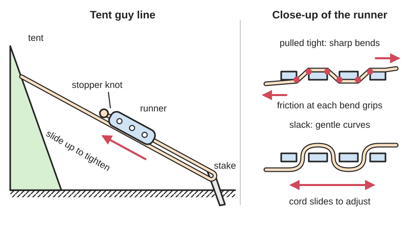

<figure class="eoc-pic eoc-pic-main"><figcaption>Diagram drawn for the encyclopaedia from the research notes. ⚑ Needs confirming: a drawing can simplify or get details wrong; a real photo or a better diagram is welcome.</figcaption></figure>

A small plate or block with holes (or a toothed groove) that a cord zig-zags through, so sliding it along the cord shortens or lengthens a loop, and the pull of the tight line makes it grip the cord by friction so the tension holds without a knot.

**In plain words:** A little plastic or metal tab with two or three holes that a tent cord is threaded through: slide it along to tighten the line, and once the line pulls tight it grips the cord and stays put. **Proper term:** Guy-line runner (line tensioner, guyline adjuster).

**Also called:** guy line tensioner / guyline tensioner; guy rope runner / tent runner / line runner; guyline adjuster / cord adjuster / rope adjuster; line tightener / tent rope tightener; cord runner / rope slide / guy slide; three-hole (3-hole) tensioner; bar tensioner (the two-hole type); Leinenspanner (German) and linsträckare (Swedish), the names Hilleberg uses; Line-Lok (Clamcleat brand), LineLoc 3 and Lineloc V (Nexus/Zpacks brand), Bar Tensioner (Lawson Equipment brand), Line Runner (Hilleberg brand).

## How it works

One end of the cord is tied to the tent; the other end goes round a stake (or through a loop), back up through the runner's holes, and is stopped with a knot (Hilleberg recommends an overhand knot; Lawson says thread one hole, then back through the other 'making a U. Tie a knot.'). Sliding the runner up the line makes the loop round the stake shorter, which tightens the line. When the line is loaded, the cord is bent sharply round the edges of the holes and pressed against the runner, and friction at each bend multiplies the grip (the capstan effect: resistance to slip grows exponentially with the angle of wrap and the friction coefficient, Wikipedia 'Capstan equation'), so the pull cannot drag the cord back through; a 1950 three-hole rope fastener patent puts it as 'the tighter the pull ... the greater will be the compression' (US 2,506,274). To loosen, you take the bends out by hand: Hilleberg says to 'pull the line from the Line Runner body', Litesmith's Line-Lok instructions say to 'pull the lines apart to release', and Lawson to 'twist the tensioner in the opposite direction'; the cord then slides freely. Toothed-groove versions add 'micro teeth' that bite the cord (Litesmith on the Line-Lok). ⚑ [uncertain: exactly how the plate tilts to lock varies by design, and no maker publishes a mechanism description]

## Parts

Single piece: one moulded, cut or drilled plate or bar with two or three holes, or a small body with a toothed V-groove (Line-Lok, LineLoc). Works together with the cord, a stopper knot in the cord's end, and the stake or loop the cord goes round. No springs or moving parts.

## Everyday examples

- Tent guy lines: 'Most shelters, including tarps, come with tensioning hardware already' (Andrew Skurka's page); Hilleberg sells Line Runners sized for its 2 mm and 3 mm guy lines
- Tarp and hammock ridgelines and tie-outs (Hammock Forums; Zpacks LineLocs)
- Caravan awnings, gazebos, sports nets and radio-mast guys (Clamcleat Line-Lok uses, per Premium Ropes)
- Flag and washing lines tensioned with a three-hole runner ⚑ [uncertain]

## When to use it

When a light line needs its length or tension adjusted often, quickly and without knots: tent and tarp guy lines, awnings, nets and small aerial masts. It is faster than retying a taut-line or adjustable grip hitch, works with gloves or mittens (Hilleberg, Litesmith), and lets you re-tension lines as fabric stretches or the weather changes. It is also a good first project to print or make, because it is one flat part.

## When not to use it

Avoid it for heavy or safety-critical loads, or anything that must not slip under shock: it grips only by friction. Avoid it with cord that is thinner or slicker than it was made for, which slips (Backpacking Light; Hammock Forums). Where you want no hardware to lose, freeze or break, use knots such as the taut-line hitch, trucker's hitch or McCarthy hitch (Andrew Skurka dropped plastic tensioners because they 'froze up' in wet-and-freezing conditions, added weight and needed a specific cord width). For flat webbing use a ladder-lock buckle; for a quick one-handed grip on thicker rope use a cam cleat or clam cleat; for steel wire or rods use a turnbuckle.

## Details

- **What it does (jobs):**
  - tighten and hold tension: shortens a guy line and keeps it tight
  - stop it moving back (one-way): once loaded, the line cannot pull back through, though you can push the runner further to tighten
  - lock, and release by hand: pull the two strands apart or twist the runner to let the cord slide
- **Movement:** slide: the runner slides along the cord (or the cord through the runner) with no fixed steps; nothing moves once it is loaded
- **Directions it can move (degrees of freedom):** 1 while slack (the runner slides along the cord); effectively 0 once the line is loaded and the cord is jammed round the hole edges.
- **Special behaviour:**
  - tensioning (takes up slack and holds): sliding it shortens the loop and it holds wherever you stop, with no knot to retie (Hilleberg; Litesmith on the Line-Lok)
  - [self-locking](../glossary.md#self-locking) (holds under load, won't back-drive): the load itself presses the cord into the bends so it can't [creep](../glossary.md#creep) back (US 2,506,274)
  - hand-release only (locks under load, releases when a person operates it): you straighten or twist the runner, or pull the two strands apart, to let it slide (Hilleberg; Litesmith on the Line-Lok; Lawson)
  - one-way (moves freely one way, locks the other): only loosely; pushing it up the line tightens, while the line's pull only locks it harder
- **How it holds:**
  - friction or clamping ([force-fit](../glossary.md#form-fit--force-fit--material-bond)): the cord is bent round the hole edges and pinched against the plate; friction at each bend adds up (capstan effect); toothed versions also bite the cord with small teeth
- **Input and output:** not applicable: it holds a cord rather than passing motion on (back-drivable: no while loaded; yes once you take the bends out by hand)
- **Power:** passive (no power needed)
- **Load:** Light: guy lines, tarp and awning lines. The cord usually sets the limit; Hilleberg's 2 mm guy line breaks at 60 kg (132 lb) and its 3 mm line at 85 kg (187 lb). The runner's own slipping load is not published and depends on the cord ⚑ [uncertain]. Strong only as a pull along the cord; it slips under jerks or with thin or slick cord (Backpacking Light, Hammock Forums), much as the adjustable grip hitch it copies will 'slip when shock loaded until tension is relieved' (Wikipedia).
- **Play and precision:** No fixed positions (stepless), so there is no play as such, but it can creep a little under gusts or with slick or undersized cord (Backpacking Light; Hammock Forums). It tolerates any angle of pull, because the cord is flexible. ⚑ [uncertain: no source measures creep]
- **Taking it apart:** tool-free quick release: loosen it by hand and slide it; it comes off the cord completely once the stopper knot is untied
- **How often it can be reused:** effectively unlimited: the runner has no parts to wear out; the cord wears first, and some users find new, slick cord slips until its coating wears off (Hammock Forums)
- **Sealing:** none: nothing makes it seal
- **Adjustable:** yes: stepless; slide it up the line to tighten, or free the cord by hand and slide it back to slacken, any time the line is up
- **Access needed:** not applicable: it is threaded onto the free end of a cord; you only need to reach the line itself
- **Materials:** Runners: nylon (Clamcleat Line-Lok, per Trotac), other moulded plastics, and aluminium (Lawson's bar tensioners are 6061-T6 aluminium 'tumbled until they are silky smooth'; many three-hole runners are aluminium, e.g. Ace Camp); wooden runners are still sold for canvas tents ⚑ [uncertain: seen only in retail search results]. Cord: suits braided cord of the right diameter (the mini Line-Lok sold by Litesmith 1.0-2.5 mm; Clamcleat CL260 2-5 mm; Zpacks Lineloc V 1-2 mm); slick cords such as Zing-It (Dyneema) slip in LineLoc 3s (Hammock Forums), and one user found '2mm line slips easily under tension' in a small tensioner advertised for thin line (Backpacking Light). Suits nylon or polyester tent fabric attachment points and any stake or tree.
- **Heat, cold, water and wear:** Cold and ice: plastic runners can freeze up in wet-and-freezing weather (Andrew Skurka); Clamcleat says its nylon Line-Lok is made from 'a material that improves its performance the colder it gets' and was tested in winter in Greenland and summer in the Australian desert (Premium Ropes, Trotac). Heat and sunlight for printed runners: PLA softens above about 60 °C and degrades in UV; PETG is fine outdoors below about 80 °C; ASA resists UV up to 93 °C (Prusa). Cord effects matter more than the runner: new slick cord slips until its coating wears (Hammock Forums), and cord that stretches when wet loosens the line, so low-stretch cord helps (Hilleberg's guy line claims 'near zero stretch, minimal water absorption'). Vibration: constant flapping in wind can walk a loose runner along slick cord ⚑ [uncertain].

## Making it

- **Ways to make or get it:**
  - off-the-shelf part: supplied with most tents and sold in packs (plastic, nylon, aluminium)
  - 3D print (FDM): prints flat in one piece in about 10 minutes (Vorpal's Printables model)
  - 3D print (resin): possible for small runners ⚑ [uncertain: no tested example found]
  - laser cut: from acrylic or plywood sheet ⚑ [uncertain: no tested example found]
  - CNC / sheet metal: drill or mill holes in aluminium plate or bar (Lawson's are machined 6061-T6 aluminium bar)
  - woodwork: traditional wooden runners for canvas tents ⚑ [uncertain: seen only in retail search results]
- **Printing it in one piece (print in place):** yes: it is a single solid part with nothing to assemble (e.g. Owen Grubb's CC BY Printables tensioner: 'No support needed')
- **Tools:** none to use; a knife and a lighter to cut and seal the cord end before threading (Lawson: 'Cut and burn end of cord so it is not mushroomed')
- **Difficulty:** easy: it is one small flat part with holes; print, laser-cut or drill one, then smooth the hole edges so they don't chafe the cord

### 3D printing tips

Print it lying flat, with the holes vertical, so the pull of the cord runs along the layers rather than trying to split them (FFF prints are 'stronger in one direction than another', Prusa). Size the holes to the cord: Lawson's machined runners use 3.2 mm (0.125 in) holes for 2-2.5 mm cord and 4.0 mm (0.156 in) holes for 3 mm cord, i.e. roughly 1.3-1.6 times the cord diameter; make a parametric model or print a few sizes and test on your actual cord (Vorpal's parametric FreeCAD model tested fine on ~4 mm 550 paracord and ~2 mm guyline). Smooth every edge the cord touches: Vorpal wet-sanded the outside with 180, 400 and 800 grit and ran a knife round the inside [chamfer](../glossary.md#chamfer--fillet) corners so the cord would not be damaged; chamfer the hole mouths rather than leaving sharp corners (Prusa notes chamfers print better than fillets on bed-facing edges). Use 100% [infill](../glossary.md#infill) for such a small, loaded part (Vorpal). Material: PETG or ASA for outdoor use; PLA 'gets soft and deforms at temperatures over 60 °C' and 'degrades under UV light', PETG suits outdoor use below 80 °C, and ASA resists UV and heat up to 93 °C (Prusa material pages). Typical failures: holes too big (cord slips under load), holes too small or edges too rough (cord won't slide, or frays), and a thin bridge between holes cracking in the cold ⚑ [uncertain].

### Buying one (off-the-shelf parts)

Search for 'guyline tensioner', 'guy line runner', 'line runner', 'cord adjuster 3 hole', 'bar tensioner' (Lawson Equipment, 2 mm and 3 mm sizes), 'Line-Lok' (Clamcleat CL260 for 2-5 mm and a mini version for 1-2.5 mm; the CL266, CL271 and CL276 sizes appear in Clamcleat's search listings) ⚑ [uncertain: clamcleat.com blocked automated access], 'Lineloc 3' and 'Lineloc V' (Nexus/Zpacks; the V needs sewing on, or buy the 'with Loop' version), and 'Hilleberg Line Runners' (2 mm and 3 mm). Pair them with low-stretch guy cord of the matching size: e.g. Hilleberg's 2 mm and 3 mm Vectran/polyester guy line or reflective 3 mm cord. Related hardware sold alongside: stake loops, tarp ridgeline tensioners and elastic shock-cord tensioners.

## Rules of thumb

- Match the runner to the cord diameter: the mini Clamcleat Line-Lok sold by Litesmith takes 1.0-2.5 mm guylines; the CL260 Line-Lok takes 2-5 mm (Trotac, Premium Ropes); Zpacks Lineloc V 1-2 mm; Lawson 2 mm bar tensioner 'works best with 2-2.5mm cords', 3 mm version for 2-3 mm+ cords (maker and retailer pages).
- Hole size about 1.3-1.6 times the cord diameter: Lawson's runners use 0.125 in (3.2 mm) holes for 2-2.5 mm cord and 0.156 in (4.0 mm) holes for 3 mm cord (derived from Lawson Equipment's figures).
- Always finish the cord's end with a stopper knot so it cannot pull out of the runner: Hilleberg recommends an overhand knot; Lawson says 'Tie a knot.'
- Thin or slick cord slips: one user found '2mm line slips easily under tension' even in a tensioner advertised for thin line (Mole J, Backpacking Light, 2018); several users had Zing-It and 1.8 mm Reflect-It slip in LineLoc 3s while Lawson Glowire and 2 mm Zpacks Z-Line held, though others had no trouble (Hammock Forums, 2020-2022). Fix: use the runner's rated cord, or add 'a half hitch or slipped half hitch after adjusting' (Hammock Forums).
- More wrap means more grip but harder adjustment: holding power rises exponentially with the total angle the cord is wrapped through and the friction coefficient (Wikipedia, 'Capstan equation'), which is why the 1994 line-tensioner patent says earlier tighteners were 'rather difficult to adjust because of the frictional action of the rope in passing through the device' (US 5,351,367).
- Smooth all cord-contact edges: sand and deburr printed runners so they don't chafe the cord (Vorpal, Printables model 197700); Lawson tumbles its aluminium runners smooth.

## Common failures

Slipping: cord too thin or slick for the runner, or a brand-new coated cord (Backpacking Light; Hammock Forums); use the rated cord size, let new cord wear in, or add a half hitch. Cord pulls out: no stopper knot in the end (Hilleberg, Lawson); tie an overhand knot. Won't slide: cord too thick or fuzzy, or a burred hole; match sizes and smooth edges. Frayed cord: sharp hole edges (Vorpal); sand, chamfer or tumble them. Frozen or stuck in winter (Andrew Skurka); switch to knots or thaw it. Line goes slack in rain: cord stretch, not the runner ⚑ [uncertain]; use low-stretch cord and re-tension. Lost runner: without it you must fall back on knots.

## Safety

Few hazards. A runner that slips lets a tent or tarp sag or flap in wind, so don't use one where a slipping line could drop something on people. Guy lines are hard to see at night and easy to trip over, which is why reflective guy cords are sold (e.g. Hilleberg's reflective cord) ⚑ [uncertain: trip hazard not stated by the source]. Sharp-edged runners, especially cheap metal ones or unsanded prints, can fray cord until it breaks (Vorpal).

## Related

- Tensioning and adjustable hitches: the taut-line and adjustable grip hitches do the same job as a runner, sliding when slack and holding when loaded, with no hardware to lose, but they are slower to adjust and hard to make hold in slick modern fibres (Wikipedia); the trucker's and McCarthy hitches add a built-in pulley effect ([mechanical advantage](../glossary.md#mechanical-advantage)) for pulling a line much tighter, then are tied off with a slipped half hitch, but use more cord (Andrew Skurka)
- Cord lock (spring toggle): a spring-loaded plunger pinches the cord; for drawstrings rather than tensioned lines
- Clam cleat and cam cleat (including the Line-Lok's toothed groove): grooves or spring cams that grip rope harder under load, for thicker rope and frequent one-handed release
- Ladder-lock buckle and tri-glide: the same slide-and-friction idea for flat webbing straps
- Binding-plate lock (tilting friction plate): a plate with a hole that tilts and bites on a rigid rod instead of a cord
- Turnbuckle: a threaded tensioner for wire and rods; stronger and finer, but slower
- Shock-cord (elastic) guy tensioner: stretches to keep lines tight as fabric moves, instead of holding a fixed length

## Make it yourself

- [Tent guyline/paracord tensioner by Vorpal, Printables (URL from Printables API, page not opened)](https://www.printables.com/model/197700-tent-guylineparacord-tensioner): A parametric FreeCAD runner whose hole sizes can be changed; tested on ~4 mm 550 paracord and ~2 mm guyline, printed in PETG at 100% infill in about 10 minutes, with advice on sanding edges smooth *(licence: CC BY-SA (Creative Commons Attribution-ShareAlike))*
- [Guyline Tensioner by Owen Grubb, Printables (URL from Printables API, page not opened)](https://www.printables.com/model/570465-guyline-tensioner): A simple one-piece tensioner for tents, tarps and ridgelines, 'Scalable to any diameter line you need', printed without supports *(licence: CC BY (Creative Commons Attribution))*
- [Camping Tent Rope Fastener Guyline Tensioner Lock 3 Holes by Soloo, Printables (URL from Printables API, page not opened)](https://www.printables.com/model/275972-camping-tent-rope-fastener-guyline-tensioner-lock-): A printable copy of the classic three-hole rope tensioner *(licence: CC BY-NC (Creative Commons Attribution-NonCommercial))*
- [Guyline cord tensioner hook by SaddamCZ, Printables](https://www.printables.com/model/39883-guyline-cord-tensioner-hook): A wrap-and-jam variant: the cord is hooked through, pulled tight, wrapped over the curved top and forced into a toothed slot; ideal for 3-4 mm cord at 100% scale (scaled to 75% for 2 mm), printed flat at 100% infill. Details read through the Printables public API; the URL appeared in search results. *(licence: CC BY-SA (Creative Commons Attribution-ShareAlike))*
- [Paracord Tensioner - 6 Designs, 2 Sizes by guppyk, Thingiverse](https://www.thingiverse.com/thing:5669290): Six tensioner designs in two sizes (about 2 mm and 4 mm cord) ⚑ [uncertain: description taken from search-result summaries; the page needs JavaScript and could not be read] *(licence: ⚑ [uncertain: not visible])*

## Pictures, videos and models

- [Hilleberg FAQ: How do I attach a line runner? / How do I use a line runner?](https://hilleberg.com/eng/resources/faqs/attach-linerunner): Six step photos of threading a triangular Line Runner (through the bottom hole, round the attachment point, through the top hole, overhand knot), plus two photos showing how to loosen it and lock the line into its channel *(licence: © Hilleberg the Tentmaker; link only)*
- [Clamcleat Line-Lok Guy-Line Runners Product Information (Clamcleats Ltd, YouTube)](https://www.youtube.com/watch?v=OI2Mg5BQ_mo): The maker demonstrating how its toothed-groove Line-Lok runners are rigged, tensioned and released ⚑ [uncertain: title and channel confirmed through YouTube's oEmbed data; the video itself was not watched] *(licence: YouTube standard licence; link only)*
- [Guy-Lines Part 2 (Slips Slides and Runners) (Corporals Corner, YouTube)](https://www.youtube.com/watch?v=-tUnrz53Srg): Bushcraft video on slides and runners for guy lines, including traditional types ⚑ [uncertain: title and channel confirmed through YouTube's oEmbed data; the video itself was not watched] *(licence: YouTube standard licence; link only)*
- [US 5,351,367: Line tensioner (Kennedy and Breeden, 1994), USPTO PDF](https://image-ppubs.uspto.gov/dirsearch-public/print/downloadPdf/5351367): Drawings of a one-piece tensioner body with four bores that a line is looped through, and a background section on earlier line tighteners for guy ropes, tent ropes and sailing lines *(licence: US patent document; public domain in the US)*
- [US 2,506,274: Rope fastening device (Maxwell and Buchholtz, 1950), USPTO PDF](https://image-ppubs.uspto.gov/dirsearch-public/print/downloadPdf/2506274): Drawings of a three-hole plate with ribs where a loop of rope pinches the other rope harder the harder it is pulled *(licence: US patent document; public domain in the US)*

## Needs confirming

⚑ marks something nobody has confirmed yet: a fact the research could not confirm from a source, a finder value that is a best guess, or an open point from the research notes. Corrections are welcome (see `research/needs-confirming.md`).

- ⚑ 17 sentences on this page marked [uncertain].
- ⚑ Finder value `connects` = strap, cord or fabric (best guess): worked out from its name, but joining parts is not one of its two main jobs
- ⚑ Finder value `usual_process` = off-the-shelf part (best guess): first-listed process is off-the-shelf, but `print_in_place` is yes

## Sources

- <https://hilleberg.com/eng/resources/faqs/attach-linerunner>
- <https://hilleberg.com/eng/products/accessories/guy-line>
- <https://www.lawsonequipment.com/products/bartensioners>
- <https://zpacks.com/products/lineloc-v-guy-line-adjuster>
- <https://www.litesmith.com/line-lok-guyline-adjusters/>
- <https://trotac.ca/clamcleat-cl260-line-lok/>
- <https://www.premiumropes.com/clam-cleat-260-clamcleat-line-lok-2-5mm-black-8st>
- <https://www.acecamp.com/3-hole-aluminum-guyline-adjusters/>
- <https://backpackinglight.com/forums/topic/guy-line-tensioner/>
- <https://www.hammockforums.net/forum/archive/index.php/t-160364.html>
- <https://andrewskurka.com/guyline-tension-system-backpacking-tents-tarps-hammocks/>
- <https://bushcraftuk.com/community/threads/guyline-tensioner-puzzle.160343/>
- <https://en.wikipedia.org/wiki/Capstan_equation>
- <https://en.wikipedia.org/wiki/Adjustable_grip_hitch>
- <https://en.wikipedia.org/wiki/Taut-line_hitch>
- <https://image-ppubs.uspto.gov/dirsearch-public/print/downloadPdf/5351367>
- <https://image-ppubs.uspto.gov/dirsearch-public/print/downloadPdf/2506274>
- <https://help.prusa3d.com/article/modeling-with-3d-printing-in-mind_164135>
- <https://help.prusa3d.com/article/pla_2062>
- <https://help.prusa3d.com/article/petg_2059>
- <https://help.prusa3d.com/article/asa_1809>
- <https://api.printables.com/graphql/>
- <https://www.printables.com/model/39883-guyline-cord-tensioner-hook>
- <https://www.thingiverse.com/thing:5669290>
- <https://www.youtube.com/watch?v=OI2Mg5BQ_mo>
- <https://www.youtube.com/watch?v=-tUnrz53Srg>
- <https://www.youtube.com/oembed?url=https://www.youtube.com/watch?v=OI2Mg5BQ_mo&format=json>
