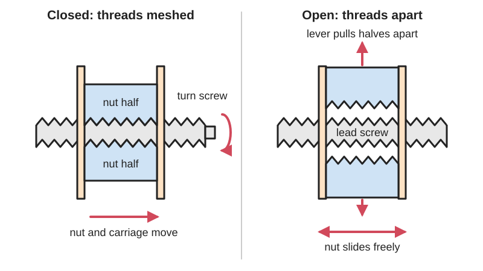
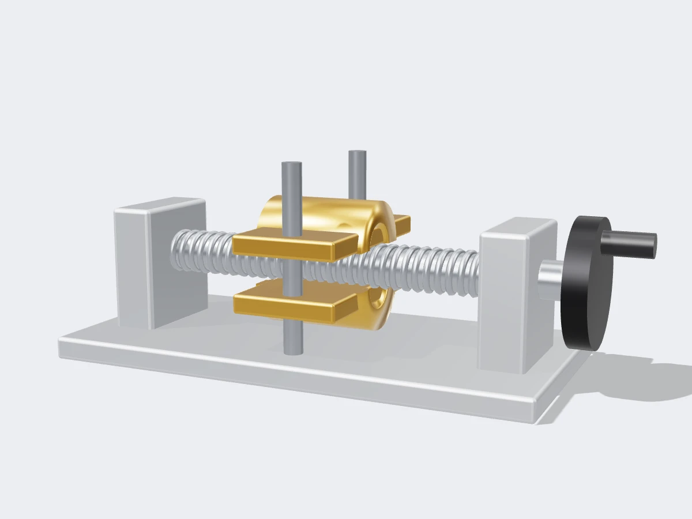

<figure class="eoc-pic eoc-pic-main"><picture><source media="(prefers-reduced-motion: reduce)" srcset="../media/drawn/half-nut.svg"></picture><figcaption><strong>Animation.</strong> Diagram drawn for the encyclopaedia from the research notes. ⚑ Needs confirming: a drawing can simplify or get details wrong; a real photo or a better diagram is welcome.</figcaption></figure>
<figure class="eoc-pic"><figcaption><strong>Render.</strong> A 3D model made for the encyclopaedia, not a photo: a stand-in until a good real photo is found. ⚑ Needs confirming: a model can simplify or get details wrong; a real photo is welcome.</figcaption></figure>

A nut split lengthwise into two halves that can be opened away from a lead screw so a carriage or vice jaw slides freely to a new position, then closed again so the screw drives or clamps it, as in quick-release vices, lathe carriages and syringe pumps.

**In plain words:** A nut cut in half lengthwise that can be lifted off a threaded rod so the part slides freely along it, then clamped back on so turning the rod drives the part again. **Proper term:** Half nut (split nut).

**Also called:** split nut; half-nuts (plural, on lathes: 'engage the half-nuts'); half-nut lever (the lathe control that closes them); quick-release nut / quick-action nut; quick-release vice (vise) / quick-action vice mechanism; pivoting nut (a single half nut that swings on and off the screw, as in some bench vices); push-button quick-release nut / push-button easy-adjust nut (McMaster-Carr); slip-on twist-close split nut (McMaster-Carr); quick release screw or knob with retracting thread segments (e.g. GN 6336 by JW Winco (brand)).

## How it works

Each half carries part of an internal thread. When the halves are pressed onto the screw they act as an ordinary nut, so turning the screw moves the nut and whatever it is fixed to. When a lever, cam or trigger pulls them apart, the threads no longer touch, so the part can slide along the screw without the screw turning. Closing them again drops the threads into the nearest groove, and the ends of the halves are chamfered (bevelled) so they find the groove easily. Sloping thread faces push the halves apart under load, so the closing mechanism must hold them shut firmly, or the thread's loaded face must be nearly square (buttress thread) so there is little opening force.

## Parts

A small assembly that acts as one unit: the lead screw, two nut halves (or a single half nut pressed against the screw from one side), a slide or pivot that lets the halves move only towards and away from the screw, and something to open and close them (a lever with a cam, a trigger with a spring and bar, or a part-turn of the handle helped by gravity or a spring).

## Everyday examples

- A quick-release woodworking bench vice: squeeze the trigger or give the handle a half-turn, slide the jaw open, then tighten
- The half-nut lever on a metal lathe, which locks the carriage to the lead screw for cutting threads
- Syringe pumps for medicine: the plunger pusher is freed from the lead screw to load a new syringe, then clamped back on
- Push-button 'quick nuts' that slide straight along a threaded rod and then tighten with less than a turn

## When to use it

Use a half nut when a screw-driven part must travel a long way quickly and then be driven or clamped precisely: vice jaws, clamps, camera or tool slides, syringe-pump plungers, lathe carriages, adjustable fixtures on threaded rod. It keeps the strong, self-holding clamp of a screw but removes the tedious winding.

## When not to use it

Avoid it where the load must never be released by accident (lifting, holding people), unless the closing mechanism is positively latched. Avoid it where you need zero [backlash](../glossary.md#backlash) or exact positions (the halves' guides add play), and in very dirty places where swarf or sawdust stops the halves closing. If you only need quick, light clamping, a [ratchet](../glossary.md#ratchet) bar clamp, cam clamp or toggle clamp is simpler. For motor-driven motion that never needs free sliding, use a plain or anti-backlash lead screw nut.

## Details

- **What it does (jobs):**
  - lock, and release by hand: engage or free the drive in a moment with a lever, trigger or part-turn
  - change the kind of motion: when closed, the screw's rotation drives a straight-line motion
  - let it move (turn, slide or bend): when open, the part slides freely for quick, coarse positioning
- **Movement:** multiple: the halves move a few millimetres sideways to open and close; when open, the carriage or jaw slides freely along the screw; when closed, the screw's rotation moves it in a straight line
- **Directions it can move (degrees of freedom):** Closed: 1 (the screw's rotation, which sets the travel). Open: 2 (the carriage slides and the screw turns independently). The halves add one small open-and-close motion of their own.
- **Special behaviour:**
  - quick-release: frees a screw-driven part in a moment so it can be slid to a new position instead of wound there
  - hand-release only (locks under load, releases when a person operates it): once closed, the vice jaw or carriage stays driven by the screw until someone works the lever, trigger or handle
  - motion conversion (rotary to linear): while closed it works as a lead screw nut
  - [self-locking](../glossary.md#self-locking) (holds under load, won't back-drive): when closed on a fine-lead screw, the clamping force can't push the jaw back
- **How it holds:**
  - shape ([form-fit](../glossary.md#form-fit--force-fit--material-bond)): the nut halves' threads interlock with the screw's threads
  - spring force: many designs use a spring to hold the halves closed (or open); some rely on gravity or an [over-centre](../glossary.md#over-centre) cam instead
  - friction or clamping (force-fit): thread friction keeps a fine-lead screw from being back-driven while clamped
- **Input and output:** Engaged: screw rotation -> straight-line travel of the nut, carriage or vice jaw, at one lead per turn, with the same sliding-thread efficiency as a plain lead screw nut (see the lead screw entry); shafts in line; back-drivable only if the lead screw itself is. Disengaged: no drive, so the part slides freely by hand.
- **Power:** passive (no power needed): operated by hand, even when the screw itself is motor-driven (lathes, syringe pumps)
- **Load:** Medium to heavy along the screw when properly closed: quick-release vices clamp hard, and lathe half-nuts drive the carriage while it cuts threads. The weak point is the force that pushes the halves apart: with V or trapezoid threads the load tries to wedge the nut open, so a worn or loose closing mechanism lets it slip. Buttress threads, with a nearly square loaded face, create little opening force.
- **Play and precision:** Noticeable: it has the backlash of any lead screw nut, plus any looseness in the halves' guides. Re-engaging lands the thread in the nearest groove, so positions come in whole-thread steps; lathes use a threading dial to show when to close the half-nuts so the tool follows the same groove on every pass. It tolerates little [misalignment](../glossary.md#misalignment): if the halves don't close fully they ride on the edge of the thread and slip under load.
- **Taking it apart:** tool-free quick release: the drive is engaged and released by hand in a moment, many times over; the assembly itself is fitted and removed with ordinary tools
- **How often it can be reused:** many times: it is designed to open and close constantly; wear on the thread edges, bent actuating parts and trapped dirt slowly reduce its grip
- **Sealing:** none: it is an open thread; dirt or metal shavings in the halves stop them closing fully
- **Adjustable:** yes: the part can be set anywhere along the screw, coarsely by sliding it while open and finely by turning the screw while closed. In some vices the depth of engagement can also be adjusted by moving the actuating bar or lever; in the wobblycogs repair, moving the bar one position changed it from slipping to too stiff to release.
- **Access needed:** not applicable: it is operated from one side by a lever, trigger or handle; because the halves close around the screw from the side, a split nut can even be fitted anywhere along a rod without reaching its end (McMaster-Carr's slip-on twist-close split nuts)
- **Materials:** Lathe half-nuts are bronze or steel parts running on the lathe's lead screw (Canadian Hobby Metal Workers forum). Bench vices use cast iron or steel. Commercial quick nuts are black-oxide or zinc-plated steel or 18-8 stainless steel (McMaster-Carr). DIY wooden vices use a steel nut cut in half, set into hard maple (ibuildit.ca). Fully printed vices use PLA (LoboCNC; Doschen).
- **Heat, cold, water and wear:** Dirt and metal shavings in the half nut stop it seating properly (wobblycogs found one full of metal shavings from manufacture). Gravity-release designs only work the right way up; spring or cam-and-follower designs also work upside down (Sawmill Creek forum). Keep the threads oiled to reduce wear (Wikipedia 'Split nut'). Printed PLA versions soften above about 60 °C (Prusa).

## Making it

- **Ways to make or get it:**
  - 3D print (FDM): complete quick-adjust vices with printed screw and half nut
  - woodwork: wooden vice jaws holding a steel nut cut in half, on a steel threaded rod
  - CNC: bronze or brass half-nut pairs machined for lathes
  - off-the-shelf part: quick-release vices and vice screws, push-button and twist-close quick nuts, replacement lathe half-nuts
- **Printing it in one piece (print in place):** no: the printed half-nut vices (LoboCNC; Doschen) are printed as separate parts and snapped or slid together without fasteners
- **Tools:** None to operate. Spanners or screwdrivers to install. For a home-made wooden vice, an angle grinder with a cut-off disc to split a steel nut in half, plus woodworking tools (ibuildit.ca build). For a printed vice, none (LoboCNC's design uses no fasteners).
- **Difficulty:** moderate: fully printed half-nut vices exist and print without supports (LoboCNC), and a steel nut can be cut in half for a wooden vice, but the halves need a precise guide and a firm closing mechanism, and the ibuildit.ca builder calls fitting the nut the trickiest, most precise step

### 3D printing tips

1) Use an asymmetric thread whose loaded face pulls the screw into the half nut rather than pushing it out: LoboCNC calls this 'the secret' of his Quick-Adjust Half-Nut Vise, which lets you lift the screw out of the half nut, slide the jaw and drop it back in. A buttress-style profile (flat load face, sloping back face) does this; Wikipedia notes the square face of a buttress thread creates minimal disengagement force. 2) A 45-degree back face prints without supports when the screw stands upright with the flat faces pointing up (Miloslav Brozek's parametric screw jack, Printables model 1724067, read via the Printables API). 3) LoboCNC printed all parts in PLA at 0.2 mm layers and 0.4 mm line width, without supports, in the supplied orientations; the updated version uses 4 [perimeters](../glossary.md#perimeters) and 35% [infill](../glossary.md#infill) for a rigid body. 4) Get the first layer right when printing the screw: [elephant's foot](../glossary.md#elephants-foot), or poor bed adhesion, stops it working smoothly (LoboCNC). 5) Doschen's lever-release vice uses 0.15 mm layers and 20% infill, with a brim strongly recommended on the main screw. 6) [Chamfer](../glossary.md#chamfer--fillet) the ends of the half nut (Wikipedia gives 60 degrees to the axis for metal split nuts) so the threads find their groove as it closes. 7) Make the closing latch or wedge stiff; a flexible printed lever lets the halves ride up and slip. 8) Generate the matching screw and nut threads with BOSL2's buttress_threaded_rod() and buttress_threaded_nut(), using $slop for [clearance](../glossary.md#clearance), then cut the nut in half in CAD. 9) PLA softens above about 60 °C (Prusa), so don't leave a printed vice in a hot car.

### Buying one (off-the-shelf parts)

Quick-release woodworking vices (front vice and end vice), e.g. Rockler's steel quick-release vices with a pivoting nut that engages or releases with a 1/4 turn of the handle; quick-release vice screws and vice hardware kits for DIY benches; McMaster-Carr 'Push-Button Easy-Adjust Nuts' (hex, flanged-hex and knurled round, 1/4-20 to 5/8-11) and 'Slip-On Twist-Close Split Nuts' (zinc-plated steel, M6 to M16, and 18-8 stainless); quick-release star knobs and screws with retracting thread segments (JW Winco GN 6336 series (brand), M8-M12); ⚑ [uncertain] replacement half-nut sets for specific lathe models; Acme or trapezoidal lead screws to run them on.

## Rules of thumb

- Split nuts work best with trapezoidal threads (Wikipedia 'Split nut', citing Bhandari, Introduction to Machine Design, p. 619).
- Chamfer the two halves' ends at 60 degrees to the axis to help the threads find engagement, and keep them oiled to limit wear (Wikipedia 'Split nut').
- For one-way loads such as vices, a buttress thread's load face is square or up to about 7 degrees, and the trailing face is often 45 degrees; the square face gives minimal disengagement force (Wikipedia 'Buttress thread').
- Quick-release woodworking vices engage or release with a half-turn of the handle (Wikipedia 'Vise'), or a quarter-turn on some designs (Rockler).
- On lathes, interlock the half-nut lever and the power feed so both can't be engaged at once (lathe.com, 6500 lathe carriage page).
- Lathe threading dial: for even-numbered threads per inch you may engage the half-nuts at any mark; for odd numbers (7, 11, 13 TPI) only at marks 1 or 2; for half-numbered threads always at the same mark (lathe.com).
- ⚑ [uncertain] Wikipedia says split nuts may not engage and disengage with multi-start threads because of the overlapping leads; this statement is uncited there, so check it with a test print.

## Common failures

1) Half nut catching only the edge of the thread and slipping free under load (wobblycogs): check that it closes fully, and adjust or replace the actuating bar. 2) Bent actuating bar or [linkage](../glossary.md#linkage), making it slip or so stiff it won't release (wobblycogs). 3) Dirt or swarf in the threads: clean and oil it. 4) ⚑ [uncertain] Worn thread crests on the nut halves or screw, so it jumps out under load: replace the half nuts. 5) Gravity-drop designs failing to release when mounted at an angle or upside down (Sawmill Creek). 6) Printed versions: elephant's foot or poor bed adhesion on the printed screw makes it stick (LoboCNC).

## Safety

A half nut that is only partly engaged can slip suddenly under load, so the jaw or carriage jumps and the workpiece drops (wobblycogs). On a lathe, the half-nuts and power feed are interlocked so they can't both drive the carriage at once (lathe.com). In syringe pumps, a badly engaged half nut means dosing errors, so patented designs make it impossible to close the pump door unless the nut is properly engaged (US5954697A). ⚑ [uncertain] When the nut is open, the jaw or carriage slides freely and can trap fingers.

## Related

- Lead screw and nut: the same screw drive without the ability to open, so you wind the full distance
- Anti-backlash nut: also split into two parts, but the parts are pushed along the screw by a spring to remove play, not opened away from it
- Quick-release screw or knob with retracting thread segments: the male version, where thread segments pull into a pin when a button is pressed
- Interrupted-thread (breech-lock) screw: threads with gaps that engage in a part-turn instead of opening sideways; buttress threads are used in screw-type breechblocks (Wikipedia)
- Dog clutch or other engage-disengage clutch: also connects and disconnects a drive, but between two rotating shafts
- Ratchet bar clamp (one-handed quick clamp): quick sliding plus one-way grip, with no screw
- Rack and [pawl](../glossary.md#pawl) or indexing pin: quick coarse positioning in fixed steps without a screw

## Make it yourself

- [Quick-Adjust Half-Nut Vise (LoboCNC, Printables)](https://www.printables.com/model/195692-quick-adjust-half-nut-vise): A fully printed hobby vice with no fasteners: lift the screw out of the half nut, slide the jaw and drop it back in; the asymmetric thread pulls the screw into the nut under load. An updated version with a desk clamp also exists *(licence: CC BY-SA)*
- [Quick release vise on balljoint (Doschen, Printables)](https://www.printables.com/model/845717-quick-release-vise-on-balljoint-100-3d-printed-no): A fully printed quick-release vice: a half-turn and a flip of the latch lever frees the jaw to slide, then you push it closed and tighten. ⚑ [uncertain] It uses a latch and latch nut, which may not be a classic two-part half nut *(licence: CC BY)*
- [BOSL2 threading.scad: buttress_threaded_rod() and buttress_threaded_nut() (OpenSCAD library)](https://github.com/BelfrySCAD/BOSL2/wiki/threading.scad): Parametric buttress and trapezoidal threads with a $slop clearance setting, for designing your own screw and cutting the nut in half *(licence: BSD 2-Clause)*

## Pictures, videos and models

- [Half nuts for lathes 1 (Nguyen Duc Thang, YouTube thang010146)](https://www.youtube.com/watch?v=yqYd2-52R5U): CAD animation of lathe half-nuts opened and closed on the lead screw by a slotted face cam *(licence: link only (standard YouTube licence))*
- [Richards Wilcox Wood Vise Restoration - How the Half Nut Quick Release System Works (thesergeant, YouTube)](https://www.youtube.com/watch?v=kC4tG0uVEoM): A real quick-release bench vice taken apart to show its half-nut mechanism *(licence: link only (standard YouTube licence))*
- [Converting a Quick Release Vice into a Regular Vice (Wobblycogs Workshop)](https://www.wobblycogs.co.uk/repairs/2016/07/20/converting-a-quick-release-vice-into-a-regular-vice/): Photos of a trigger-operated quick-release vice: trigger, spring, bar and half nut, and why it slipped *(licence: link only)*
- [Homemade Quick Release Vise (ibuildit.ca)](https://ibuildit.ca/projects/homemade-quick-release-vise/): Step-by-step photos of a wooden vice built around a steel nut cut in half, with a lever-operated release *(licence: link only)*
- [Split nut (Wikipedia)](https://en.wikipedia.org/wiki/Split_nut): Short definition, the chamfered-end detail and lathe use (text only, no images) *(licence: CC BY-SA 4.0 (text))*

## Needs confirming

⚑ marks something nobody has confirmed yet: a fact the research could not confirm from a source, a finder value that is a best guess, or an open point from the research notes. Corrections are welcome (see `research/needs-confirming.md`).

- ⚑ 5 sentences on this page marked [uncertain].

## Sources

- <https://en.wikipedia.org/wiki/Split_nut>
- <https://en.wikipedia.org/w/index.php?title=Split_nut&action=raw>
- <https://en.wikipedia.org/wiki/Nut_(hardware)>
- <https://en.wikipedia.org/wiki/Vise>
- <https://en.wikipedia.org/wiki/Woodworking_vise>
- <https://en.wikipedia.org/wiki/Buttress_thread>
- <https://en.wikipedia.org/wiki/Trapezoidal_thread_form>
- <https://en.wikipedia.org/wiki/Leadscrew>
- <https://www.lathe.com/6500_carriage.htm>
- <https://canadianhobbymetalworkers.com/threads/half-nut-engagement.9747/>
- <https://www.wobblycogs.co.uk/repairs/2016/07/20/converting-a-quick-release-vice-into-a-regular-vice/>
- <https://sawmillcreek.org/threads/silly-question-about-quick-release-vices.162472/>
- <https://gallivantingcraftsman.com/what-is-a-quick-release-feature-in-a-vise/>
- <https://ibuildit.ca/projects/homemade-quick-release-vise/>
- <https://www.rockler.com/heavy-duty-quick-release-front-vise>
- <https://www.mcmaster.com/products/quick-release-nuts/>
- <https://fastenerjournal.com/secure-parts-in-seconds-without-tools-with-quick-release-solutions/>
- <https://patents.google.com/patent/US4424720A/en>
- <https://patents.google.com/patent/US5954697A/en>
- <https://www.youtube.com/watch?v=yqYd2-52R5U>
- <https://www.youtube.com/watch?v=rLwTm9gmMWI>
- <https://www.youtube.com/watch?v=kC4tG0uVEoM>
- <https://www.printables.com/model/195692-quick-adjust-half-nut-vise>
- <https://www.printables.com/model/845717-quick-release-vise-on-balljoint-100-3d-printed-no>
- <https://api.printables.com/graphql/>
- <https://github.com/BelfrySCAD/BOSL2/wiki/threading.scad>
- <https://help.prusa3d.com/article/pla_2062>
