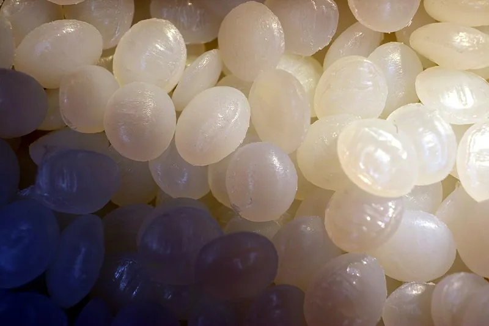
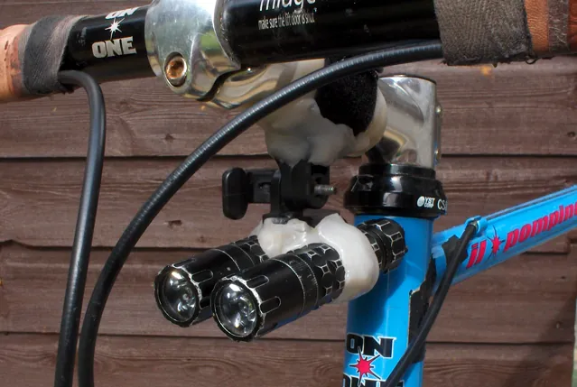

<figure class="eoc-pic eoc-pic-main"><figcaption><strong>Photo.</strong> <a href="https://commons.wikimedia.org/wiki/File:PCL_beads.jpg">PCL beads</a> by Prosthetic Head, <a href="https://creativecommons.org/licenses/by-sa/4.0">CC BY-SA 4.0</a>, from Wikimedia Commons.</figcaption></figure>
<figure class="eoc-pic"><figcaption><strong>How it works.</strong> <a href="https://commons.wikimedia.org/wiki/File:Shapelock_bike_light.png">Shapelock bike light</a> by Catsmeat, Public domain, from Wikimedia Commons.</figcaption></figure>

A tough plastic (polycaprolactone) that softens in hot water at about 60 °C, so you can shape it by hand into grips, brackets, clips, moulds and repairs that lock round other parts as they cool, then reheat it later to adjust or reuse it.

**In plain words:** Plastic beads you drop into hot water until they turn clear and go soft like warm putty, then squash together and shape by hand into a grip, bracket, clip or repair around the parts you want to hold; as it cools it sets hard and tough, and dropping it back into hot water softens it again so you can reshape or reuse it. **Proper term:** Hand-mouldable low-temperature thermoplastic (polycaprolactone, PCL).

**Also called:** polycaprolactone, PCL, caprolactone polymer (Wikipedia; Perstorp Capa data sheets; Preproom); mouldable or moldable plastic, hand-moldable plastic, low-temperature thermoplastic beads or pellets, thermoplastic beads (Adafruit; Polly Plastics; Easy Composites); 'smart plastic' or 'smart polymer', as it is often called in UK school design and technology (Preproom; Kitronik); Polymorph (brand), InstaMorph (brand), ShapeLock (brand), Friendly Plastic (brand), Plastimake (brand); Wikipedia also lists Re-Form, Polydoh, NiftyFix, Protoplastic, ReMoldables, Plastdude and TechTack (brands); Mouldphorm (brand; Easy Composites), Polly Plastics moldable plastic (brand), Thermoworx (brand of colour pigments for it; Kitronik); Capa 6500 and Capa 6800 (brands; industrial PCL grades from Perstorp, now Ingevity, sold as about 3 mm pellets; Adafruit links the Capa 6800 data sheet for its hand-moldable plastic); PCL filament or 3D-pen filament (the same plastic as filament; Printables 'PCL (Polycaprolactone) Material Profile').

## How it works

Polycaprolactone is a semi-crystalline plastic whose crystals melt at about 58-62 °C (Perstorp Capa data sheets; Wikipedia). In water hotter than that, the white pellets turn clear and stick to each other, forming a putty-like lump that can be handled because its specific heat and thermal conductivity are low (Wikipedia; Easy Composites). As it cools, the crystals form again (around 25-27 °C in Perstorp's DSC test) and it turns opaque white, hard and tough, keeping whatever shape it was pressed into (Perstorp Capa properties sheet; Easy Composites). It holds parts mainly by its shape, moulded round, through or into them, and while hot it also sticks like a hot-melt glue to itself and to some plastics such as ABS, acrylic, PVC and polycarbonate (Polly Plastics FAQ; Wikipedia). Nothing [cures](../glossary.md#cure) chemically, so reheating softens it again for adjusting, removing or reusing (Kitronik; Easy Composites).

## Parts

Single piece: one material, usually sold as pellets about 3-3.5 mm across (Perstorp Capa 6800 data sheet; Wikimedia Commons 'PCL beads'), and also as sheets, strips, colour pellets and filament (Polly Plastics FAQ; Printables). Helpers: a bowl or pan of hot water (or a heat gun or hair dryer), tongs or a spoon, parchment paper or glass to work on, scissors to trim it while warm (Polly Plastics instructions; Adafruit Learn edge-guard guide).

## Everyday examples

- A home-made bicycle light mount moulded to fit the handlebar (Wikimedia Commons 'Shapelock bike light')
- A thick, finger-shaped grip moulded onto a spoon for someone who finds thin handles hard to hold, made by occupational therapists (TechACCESS of Rhode Island)
- Snug edge guards for chisels and other sharp tools (Adafruit Learn)
- Radiotherapy masks, pressed to fit a patient's face while warm, are commonly made of PCL (Scientific Reports, 2021)

## When to use it

Use it when you need a one-off part shaped to fit something awkward, quickly and without CAD: a handle or grip moulded to your hand, a bracket or clip moulded round a tube, cable or gadget, a cradle that matches an odd shape, a missing knob, a tool guard, or a quick robot part (Hackaday; Adafruit; Preproom: 'ergonomic products such as hand tools and component mountings'). It also suits temporary moulds for casting PU, polyester or epoxy resin, because most resins release from it without wax (Easy Composites), and prototypes you may want to change later, because you can reheat and reshape it (Kitronik). It is safe enough for school use and craft work at its low working temperature (Preproom).

## When not to use it

Avoid it anywhere that gets warmer than about 45 °C, such as a car in summer, near motors, lamps or hot drinks, or in a dishwasher. It softens and loses its shape there (Easy Composites; Polly Plastics), so use a heat-resistant print (PETG, ASA), epoxy putty or metal instead. It is too soft for stiff, heavily loaded or precision parts (modulus only about 0.5 GPa; Perstorp), so use a 3D print, a metal bracket or a proper fastener. Don't use it as a waterproof seal; use silicone or MS-polymer sealant or epoxy putty. It won't stick to wood, nylon, polypropylene, silicone or PTFE (Polly Plastics FAQ), so for those use mechanical fixing, superglue or epoxy. Avoid it where fine surface detail matters (air bubbles; Easy Composites), and don't use it for food-contact or medical-internal uses, since it is non-toxic but not FDA-approved for those (Polly Plastics FAQ).

## Details

- **What it does (jobs):**
  - join and hold: moulded round or into parts to make custom brackets, mounts, clips, handles and repairs (Hackaday 'Polymorph In Practice'; Wikimedia Commons bike-light mount; Easy Composites)
  - glue or bond: while hot it sticks to itself and to some plastics like a hot-melt glue, so pieces can be fused together or built up (Polly Plastics FAQ; Wikipedia)
  - line parts up exactly: pressed against the real part or into a rail, it takes an exact negative shape, used for custom-fit seats, tool guards and temporary moulds (Hackaday wall-storage brackets; Adafruit Learn; Easy Composites)
- **Movement:** none: a rigid but tough, slightly flexible solid once cool; it can only be changed by reheating it
- **Directions it can move (degrees of freedom):** 0 once set: the parts it was moulded round or into are locked in place by its shape (and by its stickiness where it bonded)
- **Special behaviour:**
  - none of the listed behaviours. Its own trick: it is reversible. Warming it back above about 60 °C softens it, so a fixing can be reshaped, removed or reused many times (Kitronik; Easy Composites; Preproom)
- **How it holds:**
  - shape (the parts interlock; [form-fit](../glossary.md#form-fit--force-fit--material-bond)): the plastic is moulded round, through or into parts and locks them in by its shape; a screw twisted into the soft plastic and backed out leaves a thread when it sets (Polly Plastics blog 'What Does Moldable Plastic Stick To?')
  - material bond (glue, solvent or melting): when hot it sticks to itself and to ABS, acrylic, polycarbonate, polyester, PVC and vinyl, but not to wood, nylon, polypropylene, silicone or PTFE (Polly Plastics FAQ)
  - friction or clamping (force-fit): a sleeve or clip moulded tightly round a tube or tool grips it as it cools and springs back slightly ⚑ [uncertain]
- **Input and output:** not applicable
- **Power:** passive (no power needed) once shaped. Heat is needed to shape it or undo it: water above about 62-65 °C, a heat gun or a hair dryer (Kitronik; Adafruit Learn; Polly Plastics FAQ).
- **Load:** Light to medium. Cool PCL is tough and stretchy rather than stiff: Perstorp gives a yield stress of about 14-17.5 MPa, a tensile modulus of about 430-500 MPa, Shore D hardness 50-51 and a strain at break of over 700% (Capa 6500) to 920% (Capa 6800) (Perstorp Capa properties sheet). A school-supplier data sheet gives a tensile strength of 580 kg/cm² (about 57 MPa) (Preproom). Wikipedia describes it as 'a very tough, nylon-like plastic', and Adafruit says it has 'the feel and durability of polyethelene [sic]'. It is strongest where it wraps round and locks onto a part by shape, and weakest where it is only stuck to a surface ([peel](../glossary.md#peel-vs-shear)) or where it gets warm, because it softens well below its 60 °C melting point (maximum service temperature 45 °C; Easy Composites).
- **Play and precision:** It takes the shape of whatever it is pressed against, so it can give a snug, play-free seat, for example an edge guard formed on the actual chisel (Adafruit Learn). But hand shaping is imprecise, and it can trap small air bubbles, so fine surface detail is unreliable (Easy Composites). In one project a bracket moulded separately wiggled in its dovetail rail, so the maker moulded the rail part directly in the box's rail for 'a much higher degree of [accuracy](../glossary.md#repeatability--accuracy)' (Hackaday 'Direct, Wall-Mounted Storage With Lasers And Polymorph').
- **Taking it apart:** removable: warm it again and it softens, so it can be peeled off and the plastic reused. If it has stuck to something by mistake, 're-heating it with a blow dryer or a heat gun and peeling it off' may remove it (Polly Plastics blog). Where it has fused onto ABS, PVC or acrylic, or onto paint or nail polish, removal can mark or lift the surface, so treat that as semi-permanent ⚑ [uncertain].
- **How often it can be reused:** many times: it 'can therefore be re-heated and thermoformed many times without deterioration' (Preproom) and 'can be melted and re-used indefinitely' (Easy Composites). Avoid overheating: Perstorp's safety data sheet warns of possible decomposition and release of monomer above 200 °C.
- **Sealing:** loose: no sealing data were found. It is a water-resistant solid that can fill a gap, but hand-pressed PCL can trap small air bubbles and leave voids (Easy Composites), and PCL film lets water vapour through much more readily than it does oxygen (Perstorp Capa properties sheet). Don't rely on it as a sealant ⚑ [uncertain].
- **Adjustable:** yes, by reheating: dip it back in hot water, or warm one area with a heat gun or hair dryer, and reshape it. After it comes out of the water you have 'several minutes' to shape it, and it hardens in about 10 minutes depending on size (Polly Plastics FAQ).
- **Access needed:** one side only (blind) for most jobs: the soft plastic is pressed into a hole, slot or rail, or onto a surface, from the side you can reach. Wrapping it right round a tube, handle or edge needs access all the way round (Wikimedia Commons bike-light mount; TechACCESS utensil guide).
- **Materials:** Made of polycaprolactone (PCL), a biodegradable polyester (Wikipedia; Polly Plastics FAQ). When hot it sticks to itself and to ABS (LEGO), acrylic, polycarbonate, polyester, PVC and vinyl (Polly Plastics FAQ), and also to PET, polystyrene, fabrics, metal and nail polish (Polly Plastics blog). It won't attach to wood, nylon, polypropylene, silicone or Teflon (PTFE), and doesn't stick to parchment paper, cling film or glass (Polly Plastics FAQ and blog). Most PU, polyester and epoxy resins release from it, so it makes temporary moulds for resin casting (Easy Composites). For 3D prints: ABS and ASA, and PETG (a polyester), should take a hot bond, but no tests on PLA or PETG prints were found, and nylon and PP prints won't bond ⚑ [uncertain]. To fix cooled PCL to materials it doesn't stick to, use superglue (cyanoacrylate) or epoxy, or drill it and use screws (Polly Plastics FAQ).
- **Heat, cold, water and wear:** Heat: it melts at about 58-62 °C and has a maximum service temperature of 45 °C (Easy Composites), so it can soften in a hot car (Polly Plastics). Cold: its glass transition is about -60 °C (Perstorp), so it should stay tough rather than [brittle](../glossary.md#brittle--ductile) in normal freezing weather ⚑ [uncertain]. Water: it is handled in water and doesn't dissolve, but it is biodegradable; bacteria and fungi break it down in soil and compost (Wikipedia; Preproom: 'Biodegradable in soil'), and it hydrolyses slowly, more slowly than polylactide (Wikipedia). Chemicals: it dissolves in several common solvents (Capa 6800 data sheet; Wikipedia mentions chloroform), and Perstorp's safety data sheet says to avoid contact with acids and bases. UV: no data were found ⚑ [uncertain]. [Creep](../glossary.md#creep): it is soft and only about 35-40 °C below its melting point at room temperature, so it may slowly deform under a constant load; no creep data were found ⚑ [uncertain]. Shelf life: Kitronik says it 'has no shelf-life'.

## Making it

- **Ways to make or get it:**
  - off-the-shelf part: pellets, sheets, strips and colour pellets (Polly Plastics; Kitronik; Easy Composites)
  - hand moulding: shaped by hand, pressed into moulds, or formed onto the parts it will hold or onto a body part with a release film (Polly Plastics; Easy Composites)
  - laser cut: laser-cut plywood or acrylic moulds to press it into, as in Hackaday's wall-storage brackets
  - 3D print (FDM): PCL filament itself prints at about 112-115 °C (Printables 'PCL (Polycaprolactone) Material Profile'), and moulded PCL grips, pads and mounts can be added to printed parts ⚑ [uncertain]
  - woodwork and CNC: once cool it can be sanded, drilled and machined like other soft thermoplastics, but only slowly or with cooling, because friction heat softens it (Polly Plastics; Easy Composites)
- **Printing it in one piece (print in place):** no: it is a separate material shaped by hand after printing. PCL filament can itself be 3D printed (Printables PCL material profile), but nothing about this connection prints in place.
- **Tools:** Hot water in a bowl or pan (heated with a kettle, stove or microwave; a thermometer helps), tongs, a spoon or a fork to lift it out, and parchment paper or glass as a non-stick work surface. Optional: heat-resistant gloves, a heat gun or hair dryer for local reheating, scissors to trim it while warm, and cold water or a freezer to set it quickly. Afterwards it can be sanded, drilled, varnished or painted (Polly Plastics instructions; Preproom; Adafruit Learn).
- **Difficulty:** easy: you need no special tools beyond hot water and tongs. The main skills are letting every pellet turn fully clear, squeezing out trapped water, and shaping it before it cools (Polly Plastics instructions; Adafruit Learn; Easy Composites).

### 3D printing tips

1) Use it alongside prints for the jobs a printer is bad at: custom-fitted handles and grips, cradles that must match an odd-shaped object, quick repairs, and one-off brackets. Design the printed part with holes, slots or [undercuts](../glossary.md#undercut) for the PCL to flow into, so it locks in by shape rather than relying on stickiness ⚑ [uncertain]. 2) Heat it in water above about 62 °C (Kitronik), e.g. about 65 °C or 150 °F (Adafruit Learn). Boiling water isn't needed and is a scald risk (Preproom). Wait until every pellet is clear; a big batch can cool small amounts of water below 62 °C, so add or change the water (Easy Composites). 3) Lift it out with tongs, knead it into one lump and squeeze out the water: pockets of hot water trapped between pellets can burn (Hackaday reader comment) and leftover water rusts steel tools (Adafruit Learn). 4) Keep thin PLA prints out of very hot water and put only warm (60-65 °C) PCL onto them, because Prusa lists 'low UV and temperature resistance' as a PLA weakness ⚑ [uncertain]. 5) Bonding to prints: hot PCL sticks to ABS, acrylic, polycarbonate and polyester plastics but not to nylon or polypropylene (Polly Plastics FAQ). It hasn't been tested on PLA or PETG prints, so add superglue or epoxy, or shape it to lock mechanically ⚑ [uncertain]. 6) Printed moulds: press the soft plastic in (it is too thick to pour; Easy Composites) and coat the mould lightly with vegetable spray so the part releases (Polly Plastics FAQ). 7) Threads and screw holes: twist a screw into the soft plastic and back it out to leave a thread (Polly Plastics blog), or drill slowly once it is cool, since power tools can heat it until it softens (Easy Composites). 8) Printing PCL filament: one maker's working settings were nozzle 112-115 °C, bed 57 °C, PVA glue stick, cooling 60-100%, minimum layer time about 40 s and minimum speed 10 mm/s, with the slicer material type set to 'FLEX'. The profile uses special start and end G-code to allow 'cold extrusion'. [Bridging](../glossary.md#overhang--bridging) is very poor and edges tend to warp (Printables 'PCL (Polycaprolactone) Material Profile', CC BY-SA). 9) Keep finished assemblies below about 45 °C (Easy Composites) and out of hot cars (Polly Plastics).

### Buying one (off-the-shelf parts)

Search for 'polymorph pellets', 'mouldable (moldable) plastic pellets', 'low temperature thermoplastic beads' or 'polycaprolactone (PCL) pellets/granules'; brands include Polymorph, InstaMorph, ShapeLock, Friendly Plastic, Plastimake and Mouldphorm (Wikipedia; Easy Composites; Adafruit). Also 'moldable plastic sheets' and 'strips' (e.g. Polly Plastics sheets 8 x 12 x 1/16 in, brand), colour or pigment pellets (Thermoworx, Polly Plastics, InstaMorph Pigment Pack, brands), 'PCL filament' or '3D pen PCL filament', and the industrial grades Capa 6500 and Capa 6800 (brands) (Polly Plastics FAQ; Kitronik; Printables; Perstorp data sheets).

## Rules of thumb

- Melting range 58-62 °C: Capa 6800 data sheet 58-60 °C, Perstorp properties sheet 60-62 °C, Easy Composites and Kitronik 62 °C, Wikipedia about 60 °C. Use water a little above this, about 65 °C or 150 °F (Adafruit Learn; Polly Plastics); boiling water is not needed (Preproom).
- It is ready when fully clear: the pellets change from white to transparent and stick together; if they don't melt, add hotter water (Easy Composites; Adafruit Learn).
- [Working time](../glossary.md#pot-life--working-time): several minutes after it comes out of the water; it hardens in about 10 minutes depending on size, faster in cold water or a freezer (Polly Plastics FAQ and instructions).
- For a thin wrap-round shell such as a tool edge guard, stretch it to about 3 mm (1/8 in) thick (Adafruit Learn).
- Keep finished parts below about 45 °C (Easy Composites, maximum service temperature) and away from very hot places such as a car interior on a hot day (Polly Plastics).
- Never heat it above about 200 °C: decomposition temperature 200 °C and flash point 275 °C (Perstorp Capa 6800 MSDS; Easy Composites SDS: decomposition >200 °C).
- Typical properties (Perstorp Capa 6500/6800, ASTM D412): yield stress 14-17.5 MPa, modulus 430-500 MPa, strain at break >700-920%, Shore D 50-51, crystallinity 56%, glass transition about -60 °C (Perstorp Capa properties sheet).
- Density about 1.1-1.145 g/cm³, so it sinks in water (Perstorp MSDS; Easy Composites; Preproom). As a guide to quantity, 250 g fills a regular coffee mug (Kitronik).

## Common failures

Lumpy, grainy or weak parts because some pellets never went fully clear: wait until all are transparent, and add hotter water if a big batch cooled it (Easy Composites; Adafruit Learn). Trapped water, which makes hot pockets, voids and rust on steel tools: knead with tongs first, squeeze the water out, and dry and oil tools before fitting a guard (Hackaday reader comment; Adafruit Learn). Plastic sticking to the work surface, bowl, utensils or nail polish: work on parchment paper, cling film or glass (Polly Plastics). Parts that won't stay on wood, nylon, PP or silicone: lock them on by shape, or use superglue, epoxy or screws (Polly Plastics FAQ). A bracket that wobbles: mould it directly against the real part or rail instead of separately (Hackaday wall-storage brackets). Sagging or losing its shape in heat above about 45 °C (Easy Composites; Polly Plastics). Melting or smearing when drilled or sanded with power tools: go slowly and keep it cool (Easy Composites). Surface voids from trapped air: rough-mould it, then refine (Easy Composites). It is too hot and sticky to work when the water is far above 65 °C (Preproom).

## Safety

Scalds and burns are the main hazard. Don't put your hands into hot water; lift the plastic out with tongs (Easy Composites; Adafruit Learn), and use monitored water at about 60-65 °C rather than boiling water (Preproom). If the plastic is 'much above 62°C', let it cool slightly before handling (Easy Composites). Overheated PCL becomes 'a sticky treacle-like mass' that can burn (Preproom), and hot water trapped inside a lump of pellets can leak out and burn your hand (Hackaday reader comment). Preproom (a school science-technician site) says it should never be moulded round parts of the body in school because of the risk of it hardening in place, while Easy Composites sells it for moulding body parts with cling film over the skin to stop it sticking to hairs. Treat skin moulding as an adult, supervised job ⚑ [uncertain]. The pellets are a choking hazard for children under 3, and children under 7 should be supervised (Polly Plastics). Preproom advises against heating it in a microwave; Adafruit and Polly Plastics use the microwave only to heat the water. Overheating above 200 °C can release caprolactone monomer, and burning gives off carbon monoxide (Perstorp Capa 6800 MSDS). It is sold as non-toxic, but Polly Plastics has 'not sought FDA approval for food contact or internal use' (Polly Plastics FAQ).

## Related

- Hot-melt adhesive (glue gun): also a thermoplastic that bonds by melting (PCL grades such as Capa 6800 are used in adhesives), but it is applied from a gun as a bead of glue, not shaped by hand into a solid part
- Epoxy putty (kneadable two-part putty): kneaded and shaped by hand too, but it cures permanently by chemical reaction, is harder and more heat-resistant, and can't be reshaped
- Silicone and MS-polymer adhesive sealants, including mouldable silicone glue such as Sugru (brand): flexible, waterproof and cure in air, permanently; Adafruit describes hand-moldable plastic as 'lying somewhere between 3D Filament and Sugru'
- Polymer clay: shaped by hand like PCL but set once by baking (listed under 'See also' on Wikipedia's PCL page)
- 3D-printed custom mounts and brackets: more precise and more heat-resistant (PETG, ASA), but need CAD and a printer; PCL is quicker for a one-off shape that fits by hand
- Heat staking (melted plastic rivet): also uses softened plastic to lock parts by shape, but melts a post on the part itself

## Make it yourself

- [Making Edge Guards for Hand Tools Using Hand-Moldable Plastic (Adafruit Learning System)](https://learn.adafruit.com/hand-moldable-edge-guards): A beginner project: mould a snug protective guard over a chisel edge from a handful of pellets, a microwave-safe bowl, tongs and scissors *(licence: link only)*
- [How To: Make Your Own Built-Up Utensil Using Instamorph (TechACCESS of Rhode Island)](https://www.techaccess-ri.org/how-to-make-your-own-built-up-utensil-using-instamorph/): Photo guide from assistive-technology therapists for moulding a thick, finger-printed grip onto a spoon handle, with optional colour pellets *(licence: link only)*
- [Direct, Wall-Mounted Storage With Lasers And Polymorph (Hackaday, 2013)](https://hackaday.com/2013/12/24/direct-wall-mounted-storage-with-lasers-and-polymorph/): Write-up of a maker pressing polymorph into laser-cut moulds and directly into a storage box's dovetail rail to make wall brackets; shows why moulding against the real part gives a better fit *(licence: link only)*
- [PCL (Polycaprolactone) Material Profile (Sterling, Printables) (URL from Printables API, page not opened)](https://www.printables.com/model/68622-pcl-polycaprolactone-material-profile): A maker's slicer profile and test prints for printing PCL filament at 112-115 °C, with notes on cooling, bed adhesion and the custom 'cold-extrusion' G-code; scraps can be remelted in warm water. Read through the Printables public API. *(licence: CC BY-SA (Creative Commons Attribution-ShareAlike))*

## Pictures, videos and models

- [PCL beads.jpg (Wikimedia Commons, by Prosthetic Head / Crispin Cooper, 2019)](https://commons.wikimedia.org/wiki/File:PCL_beads.jpg): Close-up photo of polycaprolactone plastic beads about 3.5 mm across, as sold for industrial or hobby use *(licence: CC BY-SA 4.0)*
- [Shapelock bike light.png (Wikimedia Commons, by Catsmeat, 2009)](https://commons.wikimedia.org/wiki/File:Shapelock_bike_light.png): A home-made front bicycle light mount moulded from polycaprolactone (ShapeLock) to fit the handlebar *(licence: Public domain)*
- [Making Edge Guards for Hand Tools Using Hand-Moldable Plastic: Forming the Guard (Adafruit Learning System, Todd Treece, 2015)](https://learn.adafruit.com/hand-moldable-edge-guards/forming-the-guard): Step-by-step photos and short videos of heating the pellets until clear, stretching the lump into a 3 mm sheet, folding it over a chisel and trimming it *(licence: link only)*
- [Working with Polymorph (YouTube, Daniel Wood)](https://www.youtube.com/watch?v=aW5kZTQP7v4): Video on using polymorph (title and channel checked via YouTube oEmbed; not watched) *(licence: link only (standard YouTube licence))*
- [Working with Moldable Plastic - Heating (Polymorph, Instamorph) (YouTube, Cosplay Apprentice)](https://www.youtube.com/watch?v=s1OqZSYmStU): Video tip on heating moldable plastic for shaping (title and channel checked via YouTube oEmbed; not watched) *(licence: link only (standard YouTube licence))*

## Needs confirming

⚑ marks something nobody has confirmed yet: a fact the research could not confirm from a source, a finder value that is a best guess, or an open point from the research notes. Corrections are welcome (see `research/needs-confirming.md`).

- ⚑ 12 sentences on this page marked [uncertain].
- ⚑ Finder value `bonds_well` = PETG, ABS or ASA, acrylic or polycarbonate, PVC, metal, fabric or leather, foam (source uncertain): `materials` is marked ⚑ [uncertain] here: "…on PLA or PETG prints were found, and nylon and PP prints won't bond ⚑ [uncertain]. To fix cooled PCL to materi…"
- ⚑ Finder value `bonds_poorly` = PLA, nylon, slippery plastics (PE or PP), silicone, wood, paper or card, glass or ceramic (source uncertain): `materials` is marked ⚑ [uncertain] here: "…on PLA or PETG prints were found, and nylon and PP prints won't bond ⚑ [uncertain]. To fix cooled PCL to materi…"
- ⚑ Finder value `made_of` = 3D prints, plastic sheet, tube or moulded parts, wood, metal, foam, fabric, leather or cord (best guess): proposed from the words in the research text (R37); not yet checked
- ⚑ Research note: *Hand-mouldable thermoplastic*: moulding it on the body (Preproom: never in schools; Easy Composites sells it for that, with cling film over the skin). Both are in `safety_notes`.

## Sources

- <https://en.wikipedia.org/wiki/Polycaprolactone>
- <https://cdn-shop.adafruit.com/product-files/2504/Perstorp_CAPA_6800_PDS.pdf>
- <https://cdn-shop.adafruit.com/product-files/2504/Perstorp_Capa_6800_MSDS.pdf>
- <http://www.rapstrap.com/TDS-CAPA6500.pdf>
- <https://www.easycomposites.eu/mouldphorm-pcl-thermoplastic-granules>
- <https://media.easycomposites.eu/datasheets/EC-SDS-Mouldphorm.pdf>
- <https://www.preproom.org/equipment/printer-friendly.aspx?eqID=5105>
- <https://kitronik.co.uk/products/smart-materials-range-polymorph>
- <https://pollyplastics.com/pages/moldable-plastic-faq>
- <https://pollyplastics.com/pages/moldable-plastic-instructions>
- <https://pollyplastics.com/blogs/news/what-does-moldable-plastic-stick>
- <https://www.adafruit.com/product/2504>
- <https://learn.adafruit.com/hand-moldable-edge-guards>
- <https://learn.adafruit.com/hand-moldable-edge-guards/forming-the-guard>
- <https://www.techaccess-ri.org/how-to-make-your-own-built-up-utensil-using-instamorph/>
- <https://hackaday.com/2010/01/19/polymorph-in-practice/>
- <https://hackaday.com/tag/polymorph/>
- <https://hackaday.com/2013/12/24/direct-wall-mounted-storage-with-lasers-and-polymorph/>
- <https://pmc.ncbi.nlm.nih.gov/articles/PMC8516973/>
- <https://help.prusa3d.com/article/pla_2062>
- <https://commons.wikimedia.org/wiki/File:PCL_beads.jpg>
- <https://commons.wikimedia.org/wiki/File:Shapelock_bike_light.png>
- <https://www.youtube.com/watch?v=aW5kZTQP7v4>
- <https://www.youtube.com/watch?v=s1OqZSYmStU>
- <https://api.printables.com/graphql/>
