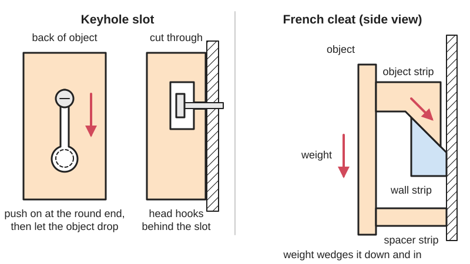
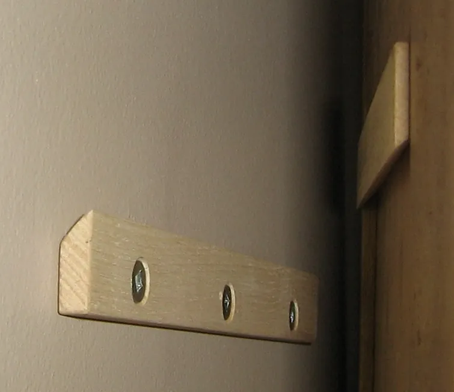

<figure class="eoc-pic eoc-pic-main"><figcaption>Diagram drawn for the encyclopaedia from the research notes. ⚑ Needs confirming: a drawing can simplify or get details wrong; a real photo or a better diagram is welcome.</figcaption></figure>
<figure class="eoc-pic"><figcaption><strong>Photo.</strong> <a href="https://commons.wikimedia.org/wiki/File:French_cleat.jpg">French cleat</a> by Tenbergen, <a href="https://creativecommons.org/licenses/by-sa/3.0">CC BY-SA 3.0</a>, from Wikimedia Commons.</figcaption></figure>

Two gravity-held wall mounts that let an object be lifted on and off without tools: a keyhole slot in the object drops over a screw head in the wall, and a French cleat is a pair of bevelled strips, one on the wall and one on the object, that hook together under the object's weight.

**In plain words:** Ways to hang something on a wall so it just lifts on and off: a keyhole-shaped hole on the back that drops over a screw head, or two strips with sloping edges that hook over each other. **Proper term:** Keyhole slot (keyhole hanger) and French cleat (interlocking bevelled cleat).

**Also called:** keyhole slot, keyhole hanger, keyhole hanging slot; keyhole mounting plate / keyhole plate / keyhole escutcheon (a metal insert with the slot already made); T-slot keyhole (the [undercut](../glossary.md#undercut) slot cut by a keyhole router bit); keyhole negative / keyhole modifier (3D-printing term for a keyhole cut into a model in the slicer); French cleat, interlocking cleat, bevelled (beveled) cleat, hanging cleat; cleat wall / French cleat tool wall / cleat rail; Z-clip, Z-bar, panel clip, interlocking hanging clip (extruded aluminium version of the French cleat); aluminium French cleat / hanging rail / wall mounting bracket; VESA mount / VESA hole pattern (Flat Display Mounting Interface, FDMI): the standard square of four screw holes on the back of monitors and TVs, which a wall bracket or a French-cleat plate screws to.

## How it works

Keyhole slot: the round end of the slot is big enough for the screw head to pass through, and the narrow part only lets the screw's shank through; behind the narrow part there is a hollow pocket for the head. You push the object onto the screw head at the round end, then let it drop, so the head slides behind the narrow part and the object's weight keeps it there. To remove it, lift it up and pull it off. French cleat: the wall strip's bevel faces up and towards the wall, and the object's strip has the opposite bevel facing down. When the object is lowered on, the two slopes hook together, and the weight wedges the object down and in against the wall, so it can't move down or pull outwards ('The bevel stops that from happening', The Honest Carpenter). A plain strip of the same thickness at the bottom keeps the object upright (Stumpy Nubs). To remove it, lift it up and off. Aluminium Z-clips 'wedge together to lock panels in place. Simply lift and remove' (Rockler). Screens use a standard screw pattern instead of a keyhole: the VESA mount (Flat Display Mounting Interface) is four threaded holes 'arranged in a square' on the back of the screen, and a stand, wall bracket or printed French-cleat plate is screwed to them (Wikipedia 'VESA mount').

## Parts

A few parts. Keyhole slot: a slot with a round entry hole and a narrower undercut channel, cut into the back of the object or provided by a metal keyhole plate, plus a round- or pan-headed screw (or nail) left sticking out of the wall. French cleat: two strips with matching bevelled edges (one screwed to the wall, one to the object), usually plus a plain spacer strip at the bottom of the object; the aluminium Z-clip is the same idea as two small extrusions.

## Everyday examples

- Picture frames and plaques with keyhole slots cut into the back
- Wi-Fi routers and other gadgets with keyhole slots on the underside for hanging on two screws (stl.parts mentions Asus routers)
- Kitchen and workshop wall cabinets hung on French cleats
- Workshop tool walls where tool holders hook onto rows of bevelled cleats, and acoustic panels or signs hung on aluminium Z-clips

## When to use it

Use a keyhole slot for light-to-medium items that should sit flush against a wall with hidden hardware: picture frames, signs, small shelves, routers, printed organisers. Use a French cleat for heavier items and for anything you want to move around or take down often: wall cabinets, shelves, mirrors, tool holders on a cleat wall. The wall side can be screwed into studs wherever they are, and the object is simply lifted on, with no fine manoeuvring and no need to hold its full weight while fixing it (Wikipedia).

## When not to use it

Avoid gravity-held mounts where the object could be bumped upwards or shaken off (children's rooms, vehicles, boats, earthquake zones, vibrating machines) unless you add a lock screw, cleat lock or bottom fixing (Wikipedia; cyberbobcity). Don't use them where the load pulls the object away from the wall or upwards (a pull-up bar, a hanging hoist); through-bolt instead. Avoid them on ceilings or under shelves. Keyholes in thin or [brittle](../glossary.md#brittle--ductile) material are poor for heavy items; use a French cleat. For many small items that you reposition constantly, a pegboard or grid system gives more positions. When the item must go back in exactly the same place, use locating pins or a dovetail clamp.

## Details

- **What it does (jobs):**
  - join and hold: hangs an object on a wall, panel or board
  - lock, and release by hand: lift it up to take it off, then drop it back on; no tools
- **Movement:** none once hung; the object is lifted up and off to remove it, and on a French cleat it can be slid sideways along the rail before it settles
- **Directions it can move (degrees of freedom):** Keyhole on one screw: 1 (the object can swing around the screw); two keyholes: 0 in normal use. French cleat: 1 (it can slide sideways along the cleat, held only by friction) unless it is stopped or screwed. In every case lifting the object frees it, because only gravity holds it down.
- **Special behaviour:**
  - quick-release: lift up and off, and drop it back on
  - self-aligning or self-centring: gravity pulls the screw head to the top of the keyhole slot, or wedges the 45° bevels together and pulls the object in against the wall, so no fine manoeuvring is needed (Wikipedia 'French cleat')
- **How it holds:**
  - shape ([form-fit](../glossary.md#form-fit--force-fit--material-bond)): the screw head is trapped behind the narrow slot, or the bevelled strips hook over each other; the object's own weight (gravity) keeps them engaged
  - friction or clamping (force-fit): only in a small way: the weight pressing the bevels together gives some friction that resists sliding sideways
- **Input and output:** not applicable
- **Power:** passive (no power needed)
- **Load:** Keyhole slot: light to medium; a steel keyhole mounting plate is rated 'up to 30 lbs (13.6 kg) when properly mounted' (Craftparts). It is limited by the screw's hold in the wall and by the thin lip of material around the slot, and weak against a pull straight away from the wall. French cleat: heavy, suitable for wall cabinets and tool walls; strong downwards (the screws into studs carry the weight in [shear](../glossary.md#peel-vs-shear)) and against tipping outwards (the bevel), but weak against a push upwards, which simply lifts it off. On a Sawmill Creek forum, one woodworker estimated that #10 screws driven 2 in into sound studs hold 'at least 200 pounds ... and maybe as much as 1000 lb' (forum opinion, not a test).
- **Play and precision:** Small to noticeable: position is only roughly repeatable. A keyhole leaves a gap around the screw head, so the object can rattle or shift if the head is not set to the right depth. A French cleat sits tight under the object's weight but can slide sideways and lift. Aluminium Z-clips need a 1/4 to 3/4 in 'lift-off' gap above to be removed (0 in for a special zero-lift design) (Monarch Metal). It tolerates wavy walls well, and a cleat tolerates sideways misplacement of the wall screws.
- **Taking it apart:** tool-free quick release: the object lifts off by hand; the wall-side screw or cleat is fitted with tools and stays in place
- **How often it can be reused:** many times: made to be lifted on and off, and cleat walls are meant to be rearranged often (Wikipedia 'French cleat'); printed slots with thin lips and soft wall anchors wear or crack sooner
- **Sealing:** none
- **Adjustable:** yes: a French cleat wall strip slightly shorter than the cabinet lets the cabinet slide left and right after hanging (Wikipedia 'French cleat'), and cleat walls let holders be moved anywhere along the rails. For keyholes, how far the screw head sticks out sets how tightly the object sits against the wall (Fine Woodworking), and one long horizontal slot allows side-to-side levelling (Fine Woodworking reader comment).
- **Access needed:** one side only (blind): the wall part is fixed first, then the object is hung from the front; the back of the object never has to be reached once it is hung
- **Materials:** French cleats: 3/4 in (19 mm) plywood is recommended; solid wood can split along the grain under heavy load (Stumpy Nubs; The Honest Carpenter). Z-clips: extruded aluminium or stainless steel (Monarch Metal; Rockler). Keyhole plates: zinc-plated steel (Craftparts). Printed versions: PLA or PETG. Screws: strong screws such as deck screws into studs, not brittle drywall screws (The Honest Carpenter); #6 or #8 pan- or round-head screws for printed keyhole slots (Brainanator).
- **Heat, cold, water and wear:** PLA softens above about 60 °C and degrades in UV light, and PETG is suitable to about 80 °C (Prusa), so printed hooks and keyhole lips in hot garages or sunny windows should be PETG. Printed parts under constant load can sag ([creep](../glossary.md#creep)) over time, although one PLA cleat mount carrying a 6.27 kg monitor showed no noticeable sag after six months (Morris Lazootin). Vibration can walk an object up and off a gravity mount; Z-clips were recommended over keyholes for their vibration resistance (Carbide 3D forum). ⚑ [uncertain] Wooden cleats can swell and bind in damp places; plywood is more stable than solid wood.

## Making it

- **Ways to make or get it:**
  - woodwork: French cleats ripped at 45° on a table saw; keyhole slots routed with a keyhole bit
  - CNC: keyhole slots cut with a keyhole bit (pre-clear with a small end mill); cleats and holders cut from sheet
  - 3D print (FDM): keyhole slots cut into prints with a negative volume, French-cleat hooks, holders and brackets, cleat locks
  - off-the-shelf part: keyhole mounting plates, aluminium Z-clips and hanging rails, keyhole router bits
- **Printing it in one piece (print in place):** yes: the object's half (a keyhole cavity, or a cleat hook or strip) prints as one solid piece with no assembly; the wall screw, or the wall cleat, is separate
- **Tools:** None to hang or remove. To install: a drill-driver, spirit level, stud finder or suitable wall anchors. Keyhole slots are cut with a router and a keyhole router bit (or a CNC router), fitted as a metal keyhole plate with #6 flat-head screws, or printed into a 3D-printed part. French cleats are ripped on a table saw, or with a circular saw guided by a straight edge, with the blade at 45°.
- **Difficulty:** easy: a French cleat is two 45° saw cuts; a keyhole slot is one router-bit cut, a bought metal plate, or a cavity added to a 3D print in the slicer; the only critical part is fixing the wall side securely

### 3D printing tips

1) Keyhole slots: add a ready-made keyhole shape as a negative volume or modifier in the slicer. Brainanator's version is 8 mm across the hole, 4 mm across the slot and 8 mm long, with about 3 mm of room for the screw head; it suits #6 screws, #8 screws are tight unless scaled up, and a 10-minute test slug checks the fit. Layer.works' version has an 8.8 mm hole, a 4.4 mm slot, a 1 mm lip and 1 mm of space behind for a nail head; it cuts 2 mm deep, so the part must be thicker than 2 mm, and heavier objects need a thicker part. 2) Print the keyhole with its opening face down, without supports: the roof over the head pocket bridges fine in PETG, and supports inside the cavity are very hard to remove (TheWebMachine). Stringy materials such as TPU may droop inside the keyhole. 3) The lip that holds the screw head is the weak point: thicken it (and add [perimeters](../glossary.md#perimeters) around it) for anything heavier than a light frame. 4) French-cleat holders: Morris Lazootin prints his cleat mount 'vertically, with one side of the cleat flat' on the bed so the perimeters, not the layer bonds, take the load; he recommends at least 5 perimeters with a 0.4 mm nozzle, uses only 45° angles so no supports are needed, and adds a 20 mm spacer at the bottom to keep the monitor vertical. His PLA mount held a 6.27 kg monitor with 'no noticeable sag' after six months and was still up two years later, though he suggests PETG for heat. 5) Match the cleat size of your wall, e.g. holders designed for 3/4 in cleats (FVP1992) or 3.5 in by 3/4 in strips (3DDIY); many holders print upside down with no supports. 6) Brackets that carry shelves need strong settings: randybell used 6 walls and 25% [infill](../glossary.md#infill). 7) Add a cleat lock so holders can't be knocked up and off: cyberbobcity's swiveling lock is printed in PLA at 0.2 mm and 20% infill and fixed with a #6 flat-head screw. 8) A fully printed cleat system can bolt holders on with M4 screws and nuts (amprint); holes on [overhangs](../glossary.md#overhang--bridging) may not come out perfect but work. 9) PLA softens above about 60 °C (Prusa), so use PETG (about 80 °C) in hot garages, sheds or sunny windows.

### Buying one (off-the-shelf parts)

Keyhole slot router bits (e.g. 3/8 in and 1/2 in cutting diameter, 1/4 in shank; Rockler); keyhole mounting plates / keyhole hangers (steel, fixed with #6 flat-head screws, e.g. 1-3/4 in plate rated to 30 lb); aluminium Z-clips (e.g. 2 in clip sets with 0.20 in holes) and Z-clip rail kits with a stated lift-off [clearance](../glossary.md#clearance); aluminium French-cleat hanging rails; pan-head, round-head and washer-head screws; deck or structural screws; wall anchors rated for the load.

## Rules of thumb

- French cleat bevel: usually 45°, but it can be as low as 30° (The Honest Carpenter; Wikipedia 'French cleat' gives 45°).
- Make cleats from 3/4 in (19 mm) plywood (Stumpy Nubs; The Honest Carpenter), at least 3 in wide so there is enough flat surface against the wall (Stumpy Nubs). Popular Woodworking rips a 5 in wide piece of 3/4 in plywood in half at 45° to make a matching pair.
- Always screw the wall cleat into studs (Stumpy Nubs). Use strong screws such as deck screws, not drywall screws, which 'are very brittle and will snap under loads' (The Honest Carpenter). If studs aren't possible, use drywall anchors (Popular Woodworking).
- Add a non-bevelled spacer strip of the same thickness near the bottom of the object, or it will tip forward (Stumpy Nubs).
- For heavy loads, double the cleats (The Honest Carpenter).
- Printed keyhole for a #6 screw: 4 mm slot, 8 mm hole, 8 mm long, about 3 mm head depth (Brainanator, Printables model 146312).
- A steel keyhole mounting plate with #6 flat-head screws is rated up to 30 lb (13.6 kg) when properly mounted (Craftparts).
- Leave enough space above a Z-clip-hung panel to lift it off: 1/4 to 3/4 in depending on the clip (Monarch Metal).
- Two vertical keyholes are the simplest and most secure layout (Carbide 3D community forum).
- FDM overhangs up to about 45° print without supports, so 45° cleats print cleanly (Hubs).
- VESA screen mounts: four screw holes in a square; the original pattern is 100 x 100 mm and 75 x 75 mm was added for smaller displays; the smaller patterns use 'standard M4 machine screws', while 200 x 200 mm and larger use M6 or M8; if the screen maker supplies screws, use those rather than the bracket's. The standard also sets a maximum screen weight and screw length for each pattern, so check its tables (Wikipedia 'VESA mount').

## Common failures

1) Holders knocked up and off a cleat wall (cyberbobcity): add a cleat lock or screw. 2) Cabinet tipping forward because there is no bottom spacer (Stumpy Nubs). 3) Solid-wood cleat splitting along the grain (Stumpy Nubs): use plywood. 4) Drywall screws snapping (The Honest Carpenter): use deck or structural screws into studs. 5) Keyhole screw head set too far out (the object rattles) or not far enough (it won't engage): adjust the screw depth (Fine Woodworking). 6) With two keyholes, one screw engages first and the object levers on it and scratches the wall (Carbide 3D forum): space the screws with a template and use vertical slots. 7) A thin printed lip cracking and letting the screw head pull through (layer.works uses a 1 mm lip; thicken it for heavier items). 8) Chatter and poor slots when routing keyholes: pre-clear with a smaller end mill and cut slowly (Carbide 3D forum).

## Safety

A heavy object falling is the main hazard: fix the wall side into studs or into anchors rated for the load (Stumpy Nubs; Popular Woodworking), and don't use brittle drywall screws (The Honest Carpenter). Anything hung this way can be knocked upwards and off, so fix the bottom of heavy cabinets to the wall (Wikipedia) or add a cleat lock. Add a bottom spacer so the object can't tip forward (Stumpy Nubs). Drill [pilot holes](../glossary.md#pilot-hole) and lubricate screws so they aren't weakened when driven into studs (Sawmill Creek forum). ⚑ [uncertain] Check for hidden pipes and cables before drilling into walls. For screens, use the screws the screen maker supplies and a VESA pattern rated for the screen's weight; a heavier screen needs the next larger pattern (Wikipedia 'VESA mount').

## Related

- Modular grid mounting systems (pegboard, Gridfinity-style grids): many hang-on positions on a grid instead of one rail or screw
- Quick-release plate (camera plate, dovetail clamp): the same bevelled hook shape, but clamped tight instead of held by gravity
- Sliding dovetail (woodworking): a permanent or knock-down joint with the same wedge shape
- Bayonet mount (push-and-twist lock): a keyhole slot is like a straight-line bayonet; a bayonet locks by twisting instead of dropping
- Aluminium-extrusion connectors (T-slot nuts and brackets): clamp anywhere on a rail, with tools
- Double-sided foam tape and stretch-release adhesive strips: glue-on hanging with no holes, but weaker and not easily repositioned; can be combined with cleats (Carbide 3D forum)
- Magnet joint (embedded magnets, magnetic catch): tool-free for light items on steel surfaces
- Basic latches (spring latch, slide bolt, hook and eye): hooks and eyes are the simplest hang-on joint
- DIN-rail clip (top-hat rail snap mount): hooks over a standard rail and snaps on, so it can't be lifted off by accident
- Tripod and stand screw mount: the other common standard screw interface (a 1/4-20 or 3/8-16 socket), for screwing a device onto a stand or arm rather than hanging it on a wall

## Make it yourself

- [Keyhole Slot for Wall Hanging (Brainanator, Printables)](https://www.printables.com/model/146312-keyhole-slot-for-wall-hanging): A keyhole shape to add as a negative volume in the slicer (4 mm slot, 8 mm hole, for #6 screws; scale up for #8) *(licence: CC BY-NC-SA)*
- [Keyhole Hanger - Negative Volume (layer.works, Printables) (URL from Printables API, page not opened)](https://www.printables.com/model/314932-keyhole-hanger-negative-volume): OpenSCAD-made keyhole negative (8.8 mm hole, 4.4 mm slot, 1 mm lip) to subtract from any model in PrusaSlicer or OpenSCAD *(licence: CC BY-NC)*
- [Keyhole Hanger Modifier (TheWebMachine, Printables) (URL from Printables API, page not opened)](https://www.printables.com/model/197340-keyhole-hanger-modifier): An 8x16x2 mm keyhole modifier for the PrusaSlicer gallery, printed opening-face-down without supports *(licence: Creative Commons Public Domain (as labelled on Printables))*
- [Keyhole Wall Mount (Customizable) (Andreas Riedmüller, stl.parts)](https://stl.parts/shape/keyhole-wall-mount/): Browser-based parametric generator for wall plates with headed pins that fit keyhole slots (base size, pin stem and head diameters, pin spacing) *(licence: ⚑ [uncertain] not stated on the page)*
- [VESA 100x100 Low Profile French Cleat Wall Mount (Morris Lazootin, Printables) (URL from Printables API, page not opened)](https://www.printables.com/model/447758-vesa-100x100-low-profile-french-cleat-wall-mount): A printed 20 mm, 45° French cleat and wall rail for a monitor, with print-orientation advice and a bottom spacer *(licence: CC BY-NC)*
- [french cleat system (massively extensible) (amprint, Printables) (URL from Printables API, page not opened)](https://www.printables.com/model/51352-french-cleat-system-massively-extensible): A fully printable cleat, hooks and wedges that bolt to your own holders with M4 screws and nuts; DXF of mounting distances included *(licence: CC BY-NC-SA)*
- [Swiveling French Cleat Lock (cyberbobcity, Printables) (URL from Printables API, page not opened)](https://www.printables.com/model/161421-swiveling-french-cleat-lock): A small swivelling catch, screwed to a holder, that stops it being knocked up and off a cleat wall *(licence: CC BY-NC)*

## Pictures, videos and models

- [French cleat (Wikimedia Commons, by Tenbergen)](https://commons.wikimedia.org/wiki/File:French_cleat.jpg): Photo of a French cleat on a wall (left) and the matching cleat on a shelf to be hung (right) *(licence: CC BY-SA 3.0 or GFDL 1.2+ (dual licensed))*
- [French cleat (Wikipedia)](https://en.wikipedia.org/wiki/French_cleat): Short explanation with photos of a cleat and of shelves hung on cleats *(licence: text CC BY-SA 4.0)*
- [How to Make French Cleats | Tricks of the Trade (Popular Woodworking, YouTube)](https://www.youtube.com/watch?v=xFvced0deZ8): Making a pair of cleats with a 45° rip and hanging a cabinet on them *(licence: link only (standard YouTube licence))*
- [Cutting Keyhole Slots for Hanging Pictures and Plaques (WoodworkersJournal, YouTube)](https://www.youtube.com/watch?v=t5TXVzlAuzw): Routing keyhole slots with a keyhole bit *(licence: link only (standard YouTube licence))*
- [Using a Keyhole Router Bit (Fine Woodworking)](https://www.finewoodworking.com/2015/08/18/using-a-keyhole-router-bit): Photos of drilling a starter hole and routing a keyhole slot in the back of a frame with a trim router and edge guide *(licence: link only)*

## Needs confirming

⚑ marks something nobody has confirmed yet: a fact the research could not confirm from a source, a finder value that is a best guess, or an open point from the research notes. Corrections are welcome (see `research/needs-confirming.md`).

- ⚑ 3 sentences on this page marked [uncertain].

## Sources

- <https://en.wikipedia.org/wiki/French_cleat>
- <https://en.wikipedia.org/w/index.php?title=French_cleat&action=raw>
- <https://commons.wikimedia.org/wiki/File:French_cleat.jpg>
- <https://www.popularwoodworking.com/techniques/french-cleat/>
- <https://www.stumpynubs.com/shop-vlog/french-cleats>
- <https://www.thehonestcarpenter.com/blog/french-cleats-explained>
- <https://www.monarchmetal.com/monarch-z-clips-and-hanging-systems/>
- <https://www.rockler.com/2-z-clips>
- <https://www.rockler.com/hanging-slot-router-bits-router-bits>
- <https://www.craftparts.com/products/1-3-4-keyhole-mounting-plate>
- <https://www.finewoodworking.com/2015/08/18/using-a-keyhole-router-bit>
- <https://toolstoday.com/learn/using-a-keyhole-router-bit>
- <https://benchnotes.com/Keyhole%20Slot%20Guide/Keyhole_Slot_Guide.html>
- <https://community.carbide3d.com/t/hanging-with-key-hole-slots/36734>
- <https://sawmillcreek.org/threads/keyhole-slots.268118/>
- <https://stl.parts/shape/keyhole-wall-mount/>
- <https://www.woodworkersjournal.com/video-cutting-keyhole-slots/>
- <https://www.hubs.com/knowledge-base/how-design-parts-fdm-3d-printing/>
- <https://help.prusa3d.com/article/pla_2062>
- <https://help.prusa3d.com/article/petg_2059>
- <https://api.printables.com/graphql/>
- <https://www.youtube.com/oembed?url=https://www.youtube.com/watch?v=xFvced0deZ8&format=json>
- <https://www.youtube.com/oembed?url=https://www.youtube.com/watch?v=t5TXVzlAuzw&format=json>
- <https://en.wikipedia.org/wiki/VESA_mount>
