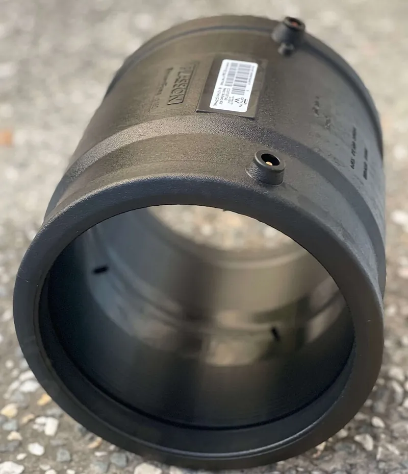

<figure class="eoc-pic eoc-pic-main"><figcaption><strong>Photo.</strong> <a href="https://commons.wikimedia.org/wiki/File:Electrofusion_coupler(1).jpg">Electrofusion coupler(1)</a> by BildHQ, <a href="https://creativecommons.org/licenses/by-sa/4.0">CC BY-SA 4.0</a>, from Wikimedia Commons.</figcaption></figure>

Heat fusion joins polyethylene (PE) and polypropylene (PP-R) pipes and fittings by melting their mating surfaces, on a hot tool or with a heating wire built into the fitting, and pressing them together so they cool into one leak-proof piece as strong as the pipe, which is the standard way to join plastics that glue and solvent cement can't.

**In plain words:** Joining plastic water or gas pipes by melting the pipe end and the fitting on a hot tool (or with a fitting that has a heating wire inside) and pushing them together, so the melted plastic flows together and sets as one piece. **Proper term:** Heat-fused plastic pipe (heat fusion of PE and PP-R pipe: socket fusion, butt fusion and electrofusion).

**Also called:** heat fusion, fusion welding of plastic pipe, thermal fusion (PPI Handbook ch. 9; Wikipedia 'Hot plate welding'); socket fusion, socket welding (pipe and socket both heated on male and female heater faces) (PPI; Wikipedia); butt fusion, butt welding, hot plate welding, heated tool welding, heating-element butt welding (Wikipedia 'Hot plate welding'; TEPPFA); saddle fusion, sidewall fusion (a branch fitting fused onto the side of a pipe) (PPI; Wikipedia); electrofusion (EF): electrofusion coupler, tee, tapping tee or saddle; EF welder or control box (Wikipedia 'Electrofusion'; PPI; PIPA); PP-R pipe welding, PPR welding machine, PP-R welding iron (names used by makers, e.g. Printables model titles); polyethylene pipe: PE, HDPE, MDPE, PE80, PE100, 'poly pipe' (Wikipedia 'Electrofusion'; TEPPFA; PIPA); polypropylene random copolymer pipe: PP-R, PPR, PP-RCT (Wikipedia 'Polypropylene'); cold ring, depth gauge, melt bead, fusion indicator pins, witness marks (PPI; CPChem; PIPA); Aquatherm (brand): a PP-R piping system whose installer manual is the basis of the NIBCO/Webstone instructions.

## How it works

The principle is to heat both surfaces to a set temperature and then push them together with enough force that 'the melted materials flow and mix', so the joint is fused (PPI). In socket fusion the outside of the pipe end and the inside of the fitting socket are heated at the same time on male and female heater faces, pulled off, and the pipe is pushed straight in to a marked depth without twisting and held still while it cools (PPI; NIBCO). In butt fusion the two pipe ends are clamped in line, faced flat, pressed against a heater plate until melted, then pressed together under a controlled force, which squeezes out a rolled bead on each side, and held until cool (PPI; Wikipedia 'Hot plate welding'). In electrofusion the pipe is scraped clean and pushed into a fitting with heating wires buried in its bore; a control box sends current (typically 40 V) for a time set by the fitting's barcode, the plastic melts and expands in the cavity between 'cold zones' so the melt pressure fuses pipe and fitting, and the joint is left clamped to cool (Wikipedia 'Electrofusion'; PIPA POP001). PE and PP pipe can't be solvent welded because, at room temperature, crystalline PE does not dissolve and PP resists 'almost all organic solvents' (Wikipedia 'Polyethylene', 'Polypropylene'), while solvent welding needs a solvent that 'can temporarily dissolve the polymer at room temperature' (Wikipedia 'Plastic welding'); heat is the way to melt them together instead.

## Parts

Single piece once made: pipe and fitting become one. Making it needs equipment: for socket fusion, a thermostatic heating iron with matched male and female heater faces (bushings), a pipe cutter, a [chamfer](../glossary.md#chamfer--fillet) tool and a depth gauge or cold ring; for butt fusion, a machine that clamps, aligns and faces the pipe ends, a heater plate and a way to apply a set force; for electrofusion, a fitting with a built-in heating coil, a control box (EF welder) and power supply, a peeling tool and alignment clamps (PPI Handbook ch. 9; Wikipedia; PIPA POP001).

## Everyday examples

- underground plastic water and gas mains made of polyethylene (PPI; TEPPFA; Wikipedia 'Electrofusion')
- PP-R hot and cold water plumbing pipe with fused sockets (Wikipedia 'Polypropylene'; NIBCO)
- an HDPE ring main joined with an electrofusion tee (Wikimedia Commons photo)
- long plastic pipelines laid without digging trenches, e.g. by directional drilling (TEPPFA)

## When to use it

When joining PE or PP-R pipe that must be permanent and leak-proof under pressure: water supply lines, irrigation mains, plumbing in PP-R, pond and aquaponics pipework in PE or PP-R, and (only by qualified people) gas lines. Choose socket fusion for small PP-R and PE pipe with a hand iron; butt fusion for larger pipes of equal wall thickness, where a machine is available, since it needs no extra fittings to join straight pipes (TEPPFA); and electrofusion where space is tight, for repairs, for joining different wall thicknesses or PE grades, or for branch saddles on a pipe already in service (TEPPFA). Fusion is the right answer to 'why won't my glue hold this PE or PP pipe?': PE and PP resist solvents and glues, but fuse readily with heat (Wikipedia 'Polyethylene').

## When not to use it

For PVC, CPVC or ABS pipe (use Solvent welding). For PEX, which is cross-linked and can't be melted together (use PEX expansion or other mechanical PEX fittings; Wikipedia 'Polyethylene'). Where the joint must come apart or you need to work in wet conditions or without electricity: mechanical compression fittings can be installed in the wet, need no power and can be dismantled (TEPPFA). For a one-off small repair on garden or irrigation pipe, where a compression fitting, push-fit coupler or hose barb with a clamp is simpler. Not for joining to a different plastic unless the pipe maker says the two are compatible, and not to metal (use transition fittings or flange adapters; PPI). Don't do fusion work on gas pipes unless trained and qualified as local law requires (Wikipedia 'Electrofusion'; PPI). Don't improvise with a clothes iron or heat gun on pressure pipe: use the matched tools and published times (PPI; NIBCO).

## Details

- **What it does (jobs):**
  - join and hold: permanently joins plastic pipes, fittings, tees and branch saddles
  - seal it, or pass cables or fluid through: makes a leak-proof pressure joint for water, gas and other fluids
- **Movement:** none
- **Directions it can move (degrees of freedom):** 0: pipe and fitting become one piece.
- **Special behaviour:**
  - none: a plain permanent fused joint
- **How it holds:** [material bond](../glossary.md#form-fit--force-fit--material-bond) (glue, solvent or melting): the plastic of pipe and fitting is melted together and sets as one piece
- **Input and output:** not applicable
- **Power:** passive (no power needed) once made; making it needs a mains- or generator-powered heating iron, butt fusion machine or electrofusion control box
- **Load:** Heavy for a plastic pipe joint: fused 'according to the pipe and/or fitting manufacturers' procedures, the joint area becomes as strong as, or stronger than, the pipe itself in both tensile and pressure properties' (PPI Handbook ch. 9). Strong in pull, pressure, bending and twist. Weak only when badly made: cold, contaminated or misaligned fusions can fail in a [brittle](../glossary.md#brittle--ductile) way (Wikipedia 'Hot plate welding'; PIPA POP001).
- **Play and precision:** No play. Alignment matters while it is being made: the pipe must go in straight and square, not twisted or at an angle, or voids form (CPChem); butt fusion machines align the pipe ends and re-round them (PPI; TEPPFA); electrofusion needs clamps to keep pipe and fitting still and stress-free until cool, and out-of-round (oval) pipe leaves an uneven gap that weakens the weld (PIPA POP001).
- **Taking it apart:** permanent: a fused joint can only be cut out; repairs are made by cutting out a section and fitting new pipe, often with slide-over electrofusion couplers made for repairs (TEPPFA)
- **How often it can be reused:** once
- **Sealing:** watertight and airtight or pressure: the fused plastic is continuous with the pipe wall; 'properly fused joints are absolutely leak proof' (PPI Handbook ch. 9), and they are the standard joints for PE water and gas mains (PPI; TEPPFA)
- **Adjustable:** no: NIBCO allows only 5 to 15 seconds to correct alignment after the rings meet, without twisting; after that the joint is fixed (NIBCO)
- **Access needed:** end of a tube or shaft: socket, butt and electrofusion couplers all need cut pipe ends; electrofusion saddles and tapping tees fit on the side of an existing pipe, even while it is in service under pressure (TEPPFA; PPI)
- **Materials:** Joins polyethylene (PE: HDPE, MDPE; PE80 and PE100) pipe and fittings, and polypropylene random copolymer (PP-R and PP-RCT) plumbing pipe (Wikipedia 'Electrofusion', 'Polypropylene'; TEPPFA; NIBCO). Pipe and fitting must be the same or a compatible material: PE made from unlike resins can be fused following PPI TN 13 (PPI), and electrofusion can join different wall thicknesses and PE types, while butt fusion normally needs the same wall thickness (SDR) (TEPPFA; PPI). Can't join: PVC, CPVC and ABS pipe (use solvent cement); cross-linked PEX, which is turned from a thermoplastic into a thermoset and is joined by expanding it over a fitting instead (Wikipedia 'Polyethylene'); metal pipe (use transition fittings or flange adapters, PPI). Why not glue: PE can't be solvent welded because it is non-polar and very solvent-resistant, and 'cannot be imprinted or bonded with adhesives without pretreatment', whereas 'high-strength joints are readily achieved with plastic welding' (Wikipedia 'Polyethylene'); PP at room temperature resists 'almost all organic solvents' (Wikipedia 'Polypropylene').
- **Heat, cold, water and wear:** A finished fused joint takes whatever the pipe takes (PPI). While fusing: cold weather needs longer heating (NIBCO: below 40 °F / 4 °C), and cold or gaps cause brittle 'cold welds' (Wikipedia 'Hot plate welding'); hot weather and sun can heat pipe surfaces to as much as 70 °C and electrofusion machines work only from -10 °C to 45 °C (PIPA POP001); rain, moisture and wind-blown dust spoil the weld, so shelter the joint (PIPA; TEPPFA; Wikipedia). Sunlight (UV) oxidises the pipe surface, which must be peeled before electrofusion (PIPA). Polyethylene yellows as it ages (Wikipedia 'Polyethylene').

## Making it

- **Ways to make or get it:**
  - off-the-shelf part (fusion pipe, fittings and electrofusion couplers from one pipe system)
  - 3D print (FDM): only for marking templates, depth gauges and tool stands, never for the pressure joint
- **Printing it in one piece (print in place):** no: the joint is made by melting pipe and fitting together; it can't be printed
- **Tools:** Socket fusion: fusion iron with the right-size heater faces, held steady by a helper or clamped in place (NIBCO); pipe cutter or [shears](../glossary.md#peel-vs-shear) that keep the pipe round; chamfer and deburring tool; depth gauge and cold ring (PE) or a felt-tip pen and marking template (PP-R); surface thermometer (pyrometer) to check the heater (PPI; CPChem). Butt fusion: butt fusion machine with clamps, facer (planer) and heater plate, plus a bead removal tool if required (PPI). Electrofusion: electrofusion control box with barcode reader, a stable generator or mains supply, a mechanical peeling tool, alignment and re-rounding clamps, ovality gauge, alcohol wipes and gloves, and a non-petroleum marker (PIPA POP001; PPI). All: clean lint-free cloths and isopropyl alcohol cleaner (NIBCO; PPI), heat-resistant gloves.
- **Difficulty:** moderate for small PP-R and PE socket fusion: irons are affordable and the steps are simple, but timing, depth and cleanliness must be right; hard for butt fusion and electrofusion, which need costly machines, and for gas lines, where trained, qualified operators are required (PPI; Wikipedia 'Electrofusion')

### 3D printing tips

Not applicable to the joint itself: printed PLA, PETG or ABS can't be fused to PE or PP pipe, and printed fittings shouldn't be used on pressurised water or gas lines. Printed helpers are useful: a collar that marks the weld depth on 20, 25 and 32 mm PP-R pipe and carries the heating and cooling times on its face (Printables 1747916); a marking gauge for 20 and 25 mm PP-R pipe (Printables 1240598); a stand for a PP-R welding iron (Printables 1509771); and a chamfering tool for HDPE pipe (Printables 1285647). Print helpers in a heat-resistant material and keep them clear of the 260 °C (500 °F) heater faces (NIBCO). Check any printed depth gauge against your pipe maker's table, because published depths differ (see rules_of_thumb).

### Buying one (off-the-shelf parts)

Search terms: 'PP-R pipe welding machine' or 'socket fusion iron' with 'heater bushings' or 'welding dies' for each pipe size; 'PP-R pipe cutter' or 'pipe shears'; 'pipe chamfer tool' or 'deburring tool'; 'socket fusion depth gauge' and 'cold ring clamp' (CPChem; PPI); 'butt fusion machine', 'pipe facer', 'heater plate'; 'electrofusion coupler', 'electrofusion tee', 'electrofusion tapping tee' or 'service saddle', 'electrofusion control box' or 'electrofusion welder', 'rotary pipe peeler' or 'pipe scraper', 'alignment clamp', 're-rounding clamp', 'ovality gauge' (PIPA POP001; PPI); 'flange adapter' or 'stub flange' and 'transition fitting' for joining to metal (PPI). Buy pipe, fittings and fusion tools for the same system, because socket tools have not always been standardised: don't mix heating tools or depth gauges from different makers unless they are marked ASTM F1056 (PPI).

## Rules of thumb

- PP-R socket fusion (NIBCO/Webstone sheet based on the Aquatherm installer manual, https://res.cloudinary.com/dzhpkjoqj/Nibco/PP-R-Pro-IOM-Manual.pdf): iron at 'around 500° F' (260 °C); 20 mm pipe: insert 9/16 in, heat 5 s (8 s below 40 °F / 4 °C), 4 s to join, hold still 30 s, cool 1.5 min; 32 mm: 11/16 in, 8 s (12 s), 6 s, 60 s, 3 min; 63 mm: heat 24 s (36 s), 8 s, 90 s, 4.5 min. Over 100 °F (38 °C) heat slightly less, but at least 80% of the table time.
- Insertion depths published for the same pipe differ: NIBCO gives 9/16 in (about 14 mm) for 20 mm and 5/8 in (about 16 mm) for 25 mm pipe, while a maker's printed marking gauge uses 15 mm and 18 mm (Printables 1240598). Use the depth table or gauge supplied for your own pipe system.
- PE socket fusion (Performance Pipe PP 750-TN-07, aligned with ASTM F2620, https://www.cpchem.com/sites/default/files/2020-04/PP750-TN-07SocketFusionJoiningProcedures.pdf): heater faces 490-510 °F (254-266 °C) at every point that touches the pipe; heat the fitting first, then the pipe; join 'within 3 seconds' without twisting; hold for the table time (e.g. 6-10 s heating and 30 s cooling for 1/2 in CTS PE4710), then add 5 more minutes before stressing the joint.
- PE butt fusion, generic PPI TR-33 procedure: heater 400-450 °F (204-232 °C) at an interfacial pressure of 60-90 psi (target 425 °F and 75 psi), and hold under pressure for 30-90 seconds per inch of pipe diameter; ASTM F2620-11 instead uses 11 minutes per inch of wall thickness (PPI 2019 comparison, https://conduitcalc.plasticpipe.org/energy/pdf/epsd-comparison-procedures-astm-fm2620-ppi-tr-33.pdf).
- PTFE-coated hot plates must stay below 270 °C, because overheated PTFE gives off fumes that cause polymer fume fever (TWI, https://www.twi-global.com/technical-knowledge/faqs/faq-are-there-any-health-and-safety-implications-of-cutting-and-welding-plastics; Wikipedia 'Hot plate welding').
- Electrofusion (PIPA POP001 Issue 9, https://pipa.com.au/wp-content/uploads/2024/11/PIPA-POP001-Electrofusion-Jointing-of-PE-Pipes-and-Fittings-for-Pressure-Applications-Issue-9.pdf): peel at least 0.2 mm off the pipe surface with a mechanical peeler, not a hand scraper, to remove the oxidised skin; wipe with alcohol and don't touch the cleaned surface; keep clamps on through heating and cooling; never cool the joint with water; indicator pins show melt pressure but 'are not a confirmation of a successful weld'.
- Size ranges: butt fusion is generally used on PE pipe of 40 mm to 1,600 mm and needs the same wall thickness (SDR); electrofusion from 20 mm to 2,000 mm (TEPPFA, https://www.teppfa.eu/wp-content/uploads/JointingGuideV3.pdf). Wikipedia gives socket fusion as typical for 40-125 mm, though PP-R plumbing tables start at 20 mm (Wikipedia 'Hot plate welding'; NIBCO).
- Cut pipe square and keep it round; chamfer PE pipe of 1 1/4 in and larger (PPI Handbook ch. 9, https://conduitcalc.plasticpipe.org/pdf/chapter09.pdf), or all sizes (CPChem); 'Do not twist the pipe or fitting during or after the insertion' (PPI).

## Common failures

Socket fusion (CPChem troubleshooting table; NIBCO): (1) no cold-ring impression in the bead: depth gauge not used or heating too short; (2) gaps or voids at the socket edge: pipe pushed in or pulled out at an angle, or twisted; (3) wrinkled or collapsed pipe end and voids: heating the pipe before the fitting, so it heats too long; (4) unbonded pipe end or melt beyond the pipe end: cold ring set too deep or too shallow; (5) rough, bubbly or pock-marked bead: oil or hydrocarbon contamination; (6) leaks from cracked or oval pipe, dirty surfaces, pushing the pipe too far into the iron, letting parts cool before joining, or stressing the joint before it sets (NIBCO). Butt fusion: (7) cold welds from low temperature or a gap, contamination in dry, windy places, and under-penetration from loose clamps (Wikipedia 'Hot plate welding'); (8) unequal wall thicknesses (TEPPFA). Electrofusion (PIPA POP001): (9) brittle welds when the oxidised surface layer isn't fully peeled; (10) contamination from hands, sweat, sunscreen or soap; (11) oval pipe or a pipe not inserted to full depth; (12) movement before cooling because clamps were removed early; (13) the generator cutting out mid-weld; (14) trusting indicator pins as proof of a good weld.

## Safety

BURNS: socket fusion heater faces run at about 260 °C (500 °F) (NIBCO; CPChem), butt fusion heater plates run at about 204-232 °C (400-450 °F) (PPI TR-33 comparison), and freshly fused joints and melt beads stay hot; wear heat-resistant gloves, keep the iron in its stand or clamped, and have a helper hold it steady (NIBCO). SPURTING MOLTEN PLASTIC: in electrofusion 'molten polyethylene spurts out of the edge of a mis-aligned weld, causing skin burns', and there have been cases of major harm and death (Wikipedia 'Electrofusion'); a pipe not pushed fully into the fitting can also let the melt escape and 'there is also a risk of molten PE igniting' (PIPA POP001). Use alignment clamps and full insertion. GAS: a wrongly installed tapping saddle on a gas line killed two welders in a trench by gas inhalation (Wikipedia); PE gas-pipe joiners must be trained and qualified (in the US under DOT pipeline safety rules) (PPI; Wikipedia), and in the UK gas work in homes is for Gas Safe registered engineers only (HSE, for gas fittings). FUMES: TWI says fumes from hot gas welding of polypropylene and similar plastics are 'not normally likely to give cause for concern' except in confined spaces with poor ventilation, but overheated PTFE coatings on heater plates cause polymer fume fever, so keep them below 270 °C; and TWI notes that PE and PP give off benzene, a carcinogen, when laser cut (TWI). Ventilate, and don't scorch the plastic. ELECTRICITY: irons, fusion machines and electrofusion boxes run on mains or generators outdoors; use equipment with its safety devices working and keep it out of rain (PIPA POP001). PRESSURE: don't pressurise or stress the joint until it has fully cooled, then pressure test it (NIBCO; PIPA).

## Related

- Solvent welding (solvent cement): the cold chemical way to join PVC, CPVC and ABS pipe; doesn't work on PE or PP
- Melted plastic weld (plastic welding with a soldering iron, 3D pen or hot-air gun): freehand welding with a filler rod, for tanks, sheets and repairs rather than pressure pipe
- Compression fitting (ferrule fitting): mechanical fitting with a grip ring and seal, used on PE water pipe; can be undone, needs no power and works in the wet (TEPPFA)
- Quick couplers for tubes and hoses (push-to-connect, sleeve lock): push-fit fittings for small plastic pipe; quick, reusable, lower pressure
- Hose barb (barbed tube fitting) and Hose clamp (worm-drive clamp, ear clamp, spring hose clamp): for flexible hose and low-pressure irrigation tube
- Gasket (flat, cord-in-groove or cast-in-place): PE pipe joins to valves and metal pipe through a fused flange adapter with a gasket and bolted backing ring (TEPPFA; PPI)
- Friction-welded plastic (rotary-tool friction welding, spin welding): heat made by rubbing, for small round plastic parts
- Heat-sealed seam (heat-sealed plastic film and coated fabric): the same heat-and-press idea for thin film
- Welded metal joint (fusion welding; stick, MIG, TIG and gas welding): the metal-pipe equivalent

## Make it yourself

- [Template for welding PPR water pipes (Printables 1747916; URL from Printables API, page not opened)](https://www.printables.com/model/1747916-template-for-welding-ppr-water-pipes-sablona-pro-s): A collar for 20, 25 and 32 mm PP-R pipe that marks the weld depth and shows recommended heating and cooling times *(licence: CC BY-NC (Creative Commons Attribution-NonCommercial))*
- [Marking PPL pipes for welding (Printables 1240598; URL from Printables API, page not opened)](https://www.printables.com/model/1240598-marking-ppl-pipes-for-welding): A marking gauge for 20 and 25 mm polypropylene pipe: push the pipe in to the stop and mark the insertion depth *(licence: CC BY-NC (Creative Commons Attribution-NonCommercial))*
- [stand for PP-R pipe welding machine (Printables 1509771; URL from Printables API, page not opened)](https://www.printables.com/model/1509771-stand-for-pp-r-pipe-welding-machine): A printed stand to hold a PP-R socket fusion iron *(licence: Public domain (Creative Commons Public Domain))*
- [PE pipe deburring sharpener tool for beveler (Printables 1285647; URL from Printables API, page not opened)](https://www.printables.com/model/1285647-pe-pipe-deburring-sharpener-tool-for-beveler): A printed chamfering tool body for HDPE pipe ends, using a 52-53 mm blade *(licence: CC BY-NC (Creative Commons Attribution-NonCommercial))*

## Pictures, videos and models

- [PE Pipe Joining Procedures, Chapter 9 of the PPI Handbook of PE Pipe (Plastics Pipe Institute)](https://conduitcalc.plasticpipe.org/pdf/chapter09.pdf): Drawings and photos of butt fusion, saddle fusion, socket fusion and electrofusion joints, a butt fusion machine and an electrofusion control box *(licence: link only)*
- [Guide to the Selection of Jointing Methods for Polyethylene Pressure Pipes (TEPPFA AGU/2017/1)](https://www.teppfa.eu/wp-content/uploads/JointingGuideV3.pdf): Sketches and sections of butt fusion and electrofusion joints, a butt fusion machine and an electrofusion indicator *(licence: link only)*
- [Electrofusion coupler(1).jpg (Wikimedia Commons, by BildHQ)](https://commons.wikimedia.org/wiki/File:Electrofusion_coupler(1).jpg): An electrofusion coupler with the two terminals where the control box leads plug in to heat the coils inside *(licence: CC BY-SA 4.0 (reuse with credit))*
- [Tapping tee on PE pipe, saddle mount, clamped and elektrofusion welded.jpg (Wikimedia Commons, by PalmölCroissant299)](https://commons.wikimedia.org/wiki/File:Tapping_tee_on_PE_pipe,_saddle_mount,_clamped_and_elektrofusion_welded.jpg): An electrofusion tapping tee clamped and welded onto the side of a PE gas main *(licence: CC0 (public domain dedication))*
- [Hot plate welding pressure history.svg (Wikimedia Commons, by Missstarsineyes)](https://commons.wikimedia.org/wiki/File:Hot_plate_welding_pressure_history.svg): Graph of pressure against time through the matching, heating, change-over and joining phases of hot plate (butt) welding *(licence: CC BY-SA 4.0 (reuse with credit))*

## Needs confirming

⚑ marks something nobody has confirmed yet: a fact the research could not confirm from a source, a finder value that is a best guess, or an open point from the research notes. Corrections are welcome (see `research/needs-confirming.md`).

- ⚑ Finder value `weld_material` = plastic or film (best guess): carried over from the finder's old rule on entry names (R33), for "What are the parts made of?" under "Hold two things together > Melt them together"
- ⚑ Finder value `seal_use` = join hoses or pipes (best guess): carried over from the finder's old rule on entry names (R33), for "What do you need?" under "Seal it, or pass cables, air or liquid through"
- ⚑ Finder value `hose_join` = fused or brazed (best guess): carried over from the finder's old rule on entry names (R33), for "How is it joined?" under "Seal it, or pass cables, air or liquid through > Join hoses, pipes or tubes"
- ⚑ Research note: *Heat-fused plastic pipe*: recorded side by side: insertion depth for 20 and 25 mm pipe (NIBCO 9/16 and 5/8 in, about 14 and 16 mm; a Printables gauge 15 and 18 mm), butt-fusion cooling (PPI TR-33 30-90 s per inch of diameter; ASTM F2620 11 min per inch of wall), and socket-fusion sizes (Wikipedia typically 40-125 mm; PP-R tables start at 20 mm).

## Sources

- <https://conduitcalc.plasticpipe.org/pdf/chapter09.pdf>
- <https://conduitcalc.plasticpipe.org/energy/pdf/epsd-comparison-procedures-astm-fm2620-ppi-tr-33.pdf>
- <https://res.cloudinary.com/dzhpkjoqj/Nibco/PP-R-Pro-IOM-Manual.pdf>
- <https://www.cpchem.com/sites/default/files/2020-04/PP750-TN-07SocketFusionJoiningProcedures.pdf>
- <https://pipa.com.au/wp-content/uploads/2024/11/PIPA-POP001-Electrofusion-Jointing-of-PE-Pipes-and-Fittings-for-Pressure-Applications-Issue-9.pdf>
- <https://www.teppfa.eu/wp-content/uploads/JointingGuideV3.pdf>
- <https://www.twi-global.com/technical-knowledge/faqs/faq-are-there-any-health-and-safety-implications-of-cutting-and-welding-plastics>
- <https://en.wikipedia.org/wiki/Electrofusion>
- <https://en.wikipedia.org/wiki/Hot_plate_welding>
- <https://en.wikipedia.org/wiki/Polyethylene>
- <https://en.wikipedia.org/wiki/Polypropylene>
- <https://en.wikipedia.org/wiki/Plastic_welding>
- <https://www.hse.gov.uk/gas/employers.htm>
- <https://commons.wikimedia.org/wiki/File:Electrofusion_coupler(1).jpg>
- <https://commons.wikimedia.org/wiki/File:Electrofusion_Welding_of_HDPE_Pipe.jpg>
- <https://commons.wikimedia.org/wiki/File:Tapping_tee_on_PE_pipe,_saddle_mount,_clamped_and_elektrofusion_welded.jpg>
- <https://commons.wikimedia.org/wiki/File:Hot_plate_welding_pressure_history.svg>
- <https://api.printables.com/graphql/>
