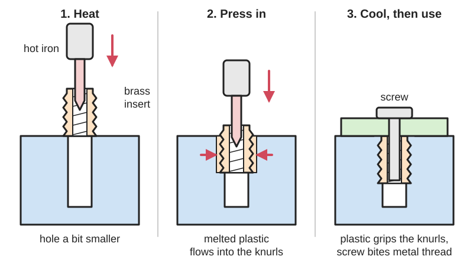
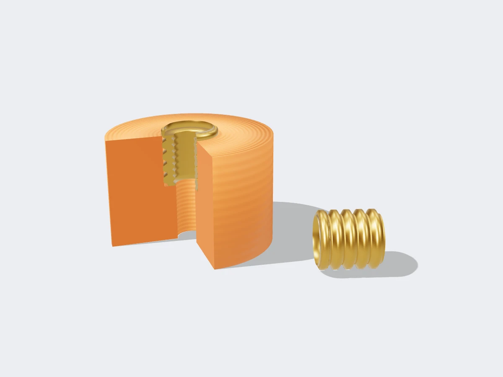
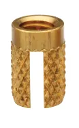

<figure class="eoc-pic eoc-pic-main"><figcaption>Diagram drawn for the encyclopaedia from the research notes. ⚑ Needs confirming: a drawing can simplify or get details wrong; a real photo or a better diagram is welcome.</figcaption></figure>
<figure class="eoc-pic"><figcaption><strong>Cut-away render.</strong> A 3D model made for the encyclopaedia, not a photo: a stand-in until a good real photo is found. ⚑ Needs confirming: a model can simplify or get details wrong; a real photo is welcome.</figcaption></figure>
<figure class="eoc-pic"><figcaption><strong>Photo.</strong> <a href="https://commons.wikimedia.org/wiki/File:Press-in_Insert.png">Press-in Insert</a> by Dhruvvasoya91, <a href="https://creativecommons.org/licenses/by-sa/4.0">CC BY-SA 4.0</a>, from Wikimedia Commons.</figcaption></figure>

A knurled metal nut-like sleeve pressed into a plain hole with a hot soldering iron, so the melted plastic grips it and the part gets strong, reusable metal threads.

**In plain words:** A small ridged brass sleeve with a screw thread inside that you melt into a hole in a 3D print with a hot soldering iron, so the plastic part gets proper metal threads that screws can go in and out of many times. **Proper term:** Heat-set threaded insert (heat-staking insert).

**Also called:** [heat-set insert](../glossary.md#heat-set-insert), heat insert (common maker names; Hubs, CNC Kitchen); heatfit insert (name used in the NopSCADlib OpenSCAD library); heat-staking insert (PEM and Protolabs); ultrasonic insert (the same kind of insert installed by ultrasonic vibration instead of a hot tip; PEM 'Ultrasonic/Heat-Set Inserts'); threaded insert, insert nut or threaded bushing (the general term; Wikipedia 'Threaded insert'); brass knurled insert or knurled nut ⚑ [uncertain]; tapered heat-set insert, straight heat-set insert, any-orientation (symmetrical) heat-set insert, male heat-set insert (catalogue variants; McMaster-Carr, PEM); Ruthex (brand), CNC Kitchen (brand) inserts, 'Voron-spec M3x5x4' inserts (a common size named after the Voron printer) ⚑ [uncertain].

## How it works

The hole is printed slightly smaller than the outside of the insert. A hot soldering iron heats the insert, which melts a thin layer of the plastic it touches as it is pushed down into the hole (Wikipedia 'Threaded insert'; Hubs). The softened plastic flows into the knurls and grooves on the outside of the insert, and when it cools it hardens around them, locking the insert against both turning and pulling out; many inserts use left- and right-hand knurls on different bands to resist both (PEM). Screws then go into the insert's metal thread instead of into plastic, so they can be tightened harder and removed many times without wearing the thread out (CNC Kitchen; Hubs).

## Parts

A few parts: the insert (a short brass sleeve, knurled or ridged outside and threaded inside), the printed part with a plain hole sized for it, and the screw or bolt that later goes into it. Installing it needs a soldering iron, ideally with a matching insert tip.

## Everyday examples

- Brass threaded inserts inside plastic cases of electronics and appliances, where the case screws go in (installed by heat-staking or ultrasonic machines; PEM) ⚑ [uncertain]
- Hobby 3D printers built from printed parts, such as Voron printers, which use many M3 heat-set inserts ⚑ [uncertain]
- Screw-down lids on 3D-printed electronics boxes and camera or tool mounts shared on model sites ⚑ [uncertain]

## When to use it

Use heat-set inserts when a printed part will be screwed together and taken apart more than a few times, when a screw must be tightened firmly without stripping, or when you need a small metric thread (M2-M5) that would be too fine to print or would wear out if screwed straight into plastic: electronics enclosures, printer parts, jigs, mounts and anything serviced regularly. They need only one side of the part to be reachable.

## When not to use it

Skip them for parts screwed together only once or twice, where a self-tapping screw into a plain hole is simpler; for resin (SLA) prints and other thermosets, where you should glue inserts in or use a nut trap; for very thin walls with no room for the insert (use a nut trap, a through-bolt and nut, or a press-fit insert); and for large coarse threads such as jar lids, which can be printed directly (see 'Printed screw thread'). If you have no soldering iron, a [captive nut](../glossary.md#captive-nut) pocket (nut trap) gives metal threads with no tools. For resin, SPIROL recommends cold press-in inserts, or self-tapping inserts, which hold less against backing out; expansion-style inserts are the weakest (SPIROL white paper 'How to Select a Threaded Insert for Your 3D Printed Assembly', 2026, p. 2; see 'Press-fit and expanding inserts' and 'Screw-in threaded insert').

## Details

- **What it does (jobs):**
  - join and hold: gives a printed or plastic part a strong, reusable metal screw thread so another part can be bolted on and taken off again
- **Movement:** none
- **Directions it can move (degrees of freedom):** 0: once set, the insert cannot move, and the screw clamps the parts together rigidly
- **Special behaviour:**
  - none: it simply provides a strong thread; it does not lock, click or limit force (add a thread-locking compound or a locking screw if vibration is a worry) ⚑ [uncertain]
- **How it holds:**
  - shape (the parts interlock; [form-fit](../glossary.md#form-fit--force-fit--material-bond)): melted plastic sets around the knurls and grooves of the insert, so it can't turn or pull out (PEM; Wikipedia 'Threaded insert')
  - friction or clamping (force-fit): the screw that goes into it clamps the two parts together
- **Input and output:** not applicable
- **Power:** passive (no power needed). A soldering iron is needed only to install it.
- **Load:** medium: much stronger than screwing straight into plastic when twisted, and at least as strong when pulled. CNC Kitchen's tests of M3 inserts: in PLA, good inserts held 157-181 kg before pulling out (screwing directly into the plastic held 142 kg, and a cheap insert with straight knurls only 39 kg), and they survived 3-4 Nm of twisting until the screw head sheared, against about 1 Nm for a screw in plastic ('Threaded Inserts for 3D Prints - Cheap VS Expensive', 2019). In PETG an insert held 119 kg pull and 3 Nm twist, against 118 kg and 1 Nm for direct screwing ('Helicoils, Threaded Insets and Embedded Nuts in 3D Prints', 2020). Pull-out strength depends mostly on the plastic around the insert, so thin walls or few [perimeters](../glossary.md#perimeters) make it weaker. SPIROL's M6 tests found heat-installed inserts stronger than press-in inserts in every printed thermoplastic it tried, as in moulded plastics (SPIROL white paper 'How to Select a Threaded Insert for Your 3D Printed Assembly', 2026, p. 3).
- **Play and precision:** small: the metal thread fits screws like any metal nut. The main precision issue is getting the insert in straight and flush; a tilted insert makes the screw go in at an angle and the mating part may not sit flat (CNC Kitchen 'Tips & Tricks for Heat-Set Inserts').
- **Taking it apart:** removable: the screw can be taken out and put back many times. The insert itself is semi-permanent: it can be heated and pulled back out with a screw and a hot extractor tool (CNC Kitchen 'How to use our Threaded-Insert Removal Tool'), but it is meant to stay in.
- **How often it can be reused:** many times: metal threads allow repeated assembly and disassembly (Hubs 'How to assemble 3D printed parts with threaded fasteners'); CNC Kitchen calls heat-set inserts 'the king for durable connection that you want to use over and over'. A removed insert can often be reused in prototypes, but not moved from a PLA part into a PETG part because of the old plastic stuck to it (CNC Kitchen removal-tool article).
- **Sealing:** none: it doesn't seal; water or air can pass along the screw thread
- **Adjustable:** no: it is a fixed threaded anchor; any adjustment comes from the screw or the parts being joined
- **Access needed:** one side only (blind): the insert goes into a hole from its open face, and the screw goes in from the same side, so the back of the part never needs to be reached
- **Materials:** Inserts are usually brass; stainless steel and aluminium versions also exist (McMaster-Carr 'Heat-Set Inserts'). They suit thermoplastics that melt and re-harden: PLA, PETG, ABS and ASA prints (CNC Kitchen) and powder-bed nylon (SLS and MJF; Protolabs). Amorphous plastics are the most forgiving; semi-crystalline plastics need more energy; thermosets cannot take them at all (PEM). Resin prints (SLA) are heat-sensitive thermosets, so inserts are glued in with thick superglue or two-part epoxy instead (CNC Kitchen tips), or screw-to-expand inserts are set in epoxy (Protolabs).
- **Heat, cold, water and wear:** The insert holds only as well as the plastic around it. PLA started to give at 60 °C and failed at about 65 °C in an oven test, PETG at 80 °C and ASA at 110 °C (CNC Kitchen 'Comparing PLA, PETG & ASA'), so an insert in a PLA part near a motor, heater or in a hot car can loosen, tilt or pull out. PLA also [creeps](../glossary.md#creep) (slowly deforms) under constant load more than PETG or ABS (thrinter creep test), so screws clamping PLA may lose tightness over time ⚑ [uncertain for inserts specifically]. Brass itself is unaffected by the temperatures a printed part can survive.

## Making it

- **Ways to make or get it:**
  - 3D print (FDM): the most common use; print a plain hole and melt the insert in afterwards
  - 3D print (SLS or MJF nylon): tapered heat-staking inserts pressed in with a soldering iron (Protolabs)
  - 3D print (resin): not melted in; glue inserts in with thick superglue or epoxy (CNC Kitchen), or use screw-to-expand inserts set in epoxy (Protolabs); SPIROL rates cold press-in inserts the most effective in SLA resin (a thermoset that decomposes rather than melts), self-tapping inserts a viable alternative that holds less against backing out, and expansion-style inserts the weakest (SPIROL white paper 'How to Select a Threaded Insert for Your 3D Printed Assembly', 2026, p. 2)
  - injection-moulded and machined thermoplastic parts: installed in industry by heat-staking or ultrasonic machines (PEM; Wikipedia)
  - off-the-shelf part: the insert itself is always bought
- **Printing it in one piece (print in place):** partly: the part prints with a plain hole ready for the insert, and the bought metal insert is melted in after printing. (Inserts can also be dropped into a pocket mid-print; see the entry 'Mid-print embedding'.)
- **Tools:** soldering iron, ideally temperature-controlled, with a matching insert tip or a conical tip; something flat (a screwdriver, tweezers or a flat plate) to press the insert flush; optionally a heat-set press or a drill-press-style jig to keep it straight. Afterwards a screwdriver or hex key for the screws.
- **Difficulty:** easy: needs only a soldering iron, though getting inserts straight, flush and without a plastic burr underneath takes a few practice pieces and the right hole size

### 3D printing tips

1) Hole size: follow the insert maker's size, but remember printed holes come out small. CNC Kitchen measured printed holes about 0.25 mm smaller than drawn and recommends drawing the hole 0.2-0.3 mm larger than the nominal size, e.g. 4.2 mm in CAD for an M3 insert whose drilled-hole size is 4.0 mm; the insert should just pre-seat with a bit of resistance ('Are Our Heat-Set Insert Datasheets Wrong?', 2026). Print a hole-size test block first (CNC Kitchen 'Hole Size Test for Heat-Set Inserts'). 2) Hole shape: straight, not tapered, and normally with no [chamfer](../glossary.md#chamfer--fillet) at the top (CNC Kitchen tips), unless you use tapered inserts, which are easier to line up in the hole (McMaster-Carr). 3) Hole depth: make blind holes about 1 mm deeper than the insert so melted plastic has somewhere to go; through-holes should be no longer than the insert (CNC Kitchen tips). 4) Walls: give the insert plenty of plastic around it; print with at least 3-4 perimeters around the hole (CNC Kitchen hole-test instructions). Hubs' general rule is a wall at least as thick as the screw diameter (e.g. 5 mm around an M5 thread), and Protolabs suggests about 6.35 mm (0.25 in) of space around an insert that is surrounded on all sides. 5) Temperature: set the iron 10-20 °C above the printing temperature: about 225 °C for PLA, 245 °C for PETG and 265 °C for ABS (CNC Kitchen tips); others use lower settings, e.g. 200 °C with a conical bit (NopSCADlib) or 210 °C (CNC Kitchen's 2019 test). 6) Technique: sit the insert on the hole, put the tip in it and push gently; melt it in only about 90% of the way, then press the last bit flush with a flat tool (a screwdriver, tweezers or a flat-faced 'insert straightener') and hold it for a few seconds until the plastic sets, because inserts tend to creep back up (CNC Kitchen tips). Use as little force as possible; if the hole is too tight, enlarge it in 0.1 mm steps (CNC Kitchen tips). 7) Keep it straight: a proper insert tip has a centring pin that fits the insert's bore so it goes in square rather than at an angle, and a flat shoulder that pushes on the insert, not the plastic (CNC Kitchen tips); a press or drill-press-style jig also helps. Large inserts (M5, 1/4 in camera thread) need a thick tip and a slightly higher temperature because they soak up a lot of heat (CNC Kitchen tips). 8) If the screw is hard to turn after installing, a burr of melted plastic has formed under the insert: make the next hole slightly larger (CNC Kitchen tips). 9) Choose good inserts: inserts with knurls in two directions and a chamfered lead-in installed more easily and held about four times better than cheap ones with only straight knurls (CNC Kitchen 'Cheap VS Expensive'). 10) Print hole-size tests in each orientation you use, because holes printed on their side come out a different size from holes printed upright (CNC Kitchen tips mention testing 'in various printing orientations'). 11) Inserts that are too long can be shortened by cutting between two knurl bands with a hacksaw (CNC Kitchen tips). 12) Heat-set inserts suit 'virtually all thermoplastics', i.e. everything normally printed on an FDM printer (CNC Kitchen tips). 13) SPIROL's white paper on inserts for 3D prints adds: give the insert a solid [boss](../glossary.md#boss) of at least 1.5 times its knurl diameter, and 2 times for its full strength, which in FDM means at least as many wall loops (perimeters) as the insert's metric size (6 loops at a 0.4 mm nozzle for an M6 insert); use more than 50% [infill](../glossary.md#infill), because insert strength rises in step with infill; and print layers of about 0.16-0.2 mm. It also warns that desktop printers hold hole sizes only to about ±0.3-0.5 mm, much looser than the +0.08 mm its catalogue hole sizes allow; drilling the hole reduces the variation but can cut into the reinforcing outer walls of an FDM print, so the alternative is to test hole sizes until one works (SPIROL white paper 'How to Select a Threaded Insert for Your 3D Printed Assembly', 2026, pp. 2-5).

### Buying one (off-the-shelf parts)

Search supplier catalogues for 'heat-set inserts for plastic', 'heat-staking inserts', 'ultrasonic inserts' or 'threaded inserts for 3D printing'. Variants: tapered, straight, 'any-orientation' (symmetrical, install either way up), flanged, and male (threaded stud) heat-set inserts (McMaster-Carr; PEM tapered IUA/IUB/IUC, straight piloted IUTA/IUTB/IUTC and symmetrical ISA/ISB/ISC families). Sizes run from about M1.4 to M8 and 0-80 to 3/8-16 (Protolabs). Common maker sizes: M3 inserts about 3-5.8 mm long and 4.6 mm across the top for a 4.0 mm hole, M4 for a 5.6 mm hole and M5 for a 6.4 mm hole (NopSCADlib inserts.scad). Tools: 'heat-set insert tips' for soldering irons and heat-set presses (McMaster-Carr 'Heat-Set Tools' family) ⚑ [uncertain]; a threaded-insert removal tool (CNC Kitchen). Screws: ordinary machine screws (e.g. M3 socket-head cap screws).

## Rules of thumb

- Draw the hole 0.2-0.3 mm larger than the insert's nominal hole size, because printed holes come out about 0.25 mm small; for M3 inserts 4.2 mm in CAD kept about 90% of the maximum strength with no burr (CNC Kitchen 'Are Our Heat-Set Insert Datasheets Wrong?', 2026).
- M3 insert pull-out strength reached about 1400 N (roughly 150 kg) in tight holes and fell sharply once the hole was too big (CNC Kitchen 'Are Our Heat-Set Insert Datasheets Wrong?').
- Soldering iron 10-20 °C above printing temperature: about 225 °C PLA, 245 °C PETG, 265 °C ABS; melt in 90% of the way, then press flush and hold (CNC Kitchen 'Tips & Tricks for Heat-Set Inserts', 2021).
- Blind holes about 1 mm deeper than the insert; straight, untapered holes; normally no chamfer (CNC Kitchen tips).
- Minimum wall around a threaded hole equal to the screw diameter, e.g. 5 mm for M5 (Hubs 'How to assemble 3D printed parts with threaded fasteners').
- About 6.35 mm (0.25 in) of space around an insert that is surrounded by features on all sides (Protolabs 'Threading and Inserts for 3D Printing').
- Industrial heat-staking sets the tool about 20 °C (50 °F) above the plastic's melting temperature; thermosets cannot take heat-set or ultrasonic inserts (PEM 'Ultrasonic/Heat-Set Inserts').
- In M3 tests inserts took 3-4 Nm of twisting before the screw head sheared, against about 1 Nm for screws straight into PLA or PETG (CNC Kitchen 2019 and 2020 tests); even 1 Nm on an M3 screw gives more than 1500 N of clamping force, which is plenty for most printed assemblies (CNC Kitchen 2020).
- Hole sizes used by the NopSCADlib library: 3.2 mm for M2, 4.0 mm for M2.5 and M3, 5.6 mm for M4 and 6.4 mm for M5 inserts (NopSCADlib vitamins/inserts.scad).
- Boss around the insert: at least 1.5 times the insert's knurl diameter for optimal performance and 2 times for maximum performance; in FDM prints, at least as many wall loops as the insert's metric size, more than 50% infill and 0.16-0.2 mm layers (SPIROL white paper 'How to Select a Threaded Insert for Your 3D Printed Assembly', 2026, pp. 2-5).
- As much as 70% of an insert's performance comes from the quality of installation (straightness, temperature, pressure and time); push down steadily with the iron and use a tip that engages the insert as fully as possible (SPIROL white paper 'How to Select a Threaded Insert for Your 3D Printed Assembly', 2026, p. 5).
- Iron temperature, figures that disagree: SPIROL calls 343-399 °C (650-750 °F) 'a good operating temperature' for a soldering iron, and also gives a rule of thumb of the plastic's heat [deflection](../glossary.md#deflection) temperature plus 65 °C (150 °F), which comes out far lower; CNC Kitchen sets 225-265 °C for PLA, PETG and ABS. Recorded side by side; test on a scrap print (SPIROL white paper 'How to Select a Threaded Insert for Your 3D Printed Assembly', 2026, p. 5; CNC Kitchen 'Tips & Tricks for Heat-Set Inserts').
- With high infill and thick walls, inserts in FDM prints carried about 70-80% of their performance in the same moulded plastic, and in SLS nylon prints about 50-70%, because of the prints' tiny pores (SPIROL white paper 'How to Select a Threaded Insert for Your 3D Printed Assembly', 2026, p. 5).

## Common failures

1) Insert goes in crooked: use an insert tip with a centring pin, or a press or jig, and finish with a flat-faced tool that presses it square and flush (CNC Kitchen tips) ⚑ [uncertain whether a tilted insert can always be rescued by reheating]. 2) Insert not flush or springs back up: finish the last 10% with a flat tool and hold until it cools (CNC Kitchen tips). 3) Plastic burr under the insert makes the screw stiff or blocks it: the hole was too small; enlarge it slightly next time (CNC Kitchen tips). 4) Insert spins or pulls out: hole too large, too little wall or too few perimeters, too much heat that melted the surrounding plastic, or a cheap insert with only straight knurls, which rotated in softer ASA (CNC Kitchen 'Cheap VS Expensive'; 'Are Our Heat-Set Insert Datasheets Wrong?'). 5) A bulge of plastic around the insert: the hole was undersized; a flat-faced tool flattens it, and the next hole should be larger (CNC Kitchen tips). Too much heat or holding the iron in too long can also soften and distort the part around the insert ⚑ [uncertain]. 6) Molten plastic pushed into the thread: hole too small or too shallow; blind holes need about 1 mm extra depth (CNC Kitchen tips).

## Safety

The soldering iron tip (about 200-265 °C) and the freshly set insert are hot enough to burn; hold inserts with tweezers, not fingers. Overheating the plastic gives off fumes, so don't use more heat than needed and work in a ventilated space (CNC Kitchen removal-tool article warns that too much heat 'risks generating harmful fumes').

## Related

- Captive nut pocket (nut trap): a hex pocket that holds an ordinary nut; needs no soldering iron and is strong when the nut is pulled against solid plastic, but needs a pocket bigger than the screw and access to insert the nut
- Press-fit and expanding inserts (tap-in insert): pushed or tapped in cold and held by barbs or expansion; no heat needed, usually weaker in plastic
- Self-tapping screw into plastic (thread-forming screw): screws straight into a plain hole; simplest, but in CNC Kitchen's tests only about 1 Nm of twisting before the plastic thread stripped and it wears out after a few uses
- Mid-print embedding (captive nuts, magnets and bearings): pause the print and drop a nut or insert in, then print over it so it is trapped for good
- Printed screw thread: threads printed straight into the part; fine for large coarse threads, but Hubs advises avoiding FDM threads smaller than M5
- Screw-in threaded insert: a wire thread coil such as Helicoil (brand), or a self-tapping insert, screwed in cold; in CNC Kitchen's PETG tests a wire coil was no stronger than screwing straight into the plastic, but self-tapping inserts are a cold option for resin prints, where heat-set inserts can't be used (SPIROL)
- Heat staking (melted plastic rivet): uses the same soldering-iron heat to melt a plastic post into a rivet head, instead of setting a metal insert
- Ordinary screw joint (bolt and nut): the baseline; the insert turns a plastic hole into the 'nut'
- Melted plastic weld: uses the same soldering iron (with a tip kept for plastic) to melt printed parts together instead of setting a metal insert

## Make it yourself

- [Hole Size Test for Heat-Set Inserts (CNC Kitchen, Printables)](https://www.printables.com/model/1648510-hole-size-test-for-heat-set-inserts): Test blocks with a range of hole sizes to find the right CAD diameter for your printer; print with 3-4 perimeters and choose the hole the insert's pilot just slips into. Made for CNC Kitchen inserts. URL from search results; details read through the Printables public API. *(licence: CC BY-NC-ND (Creative Commons Attribution-NonCommercial-NoDerivatives))*
- [Heat-Set Insert Test Block with Graduated Hole Sizes (Vladimir Gamalyan, Printables) (URL from Printables API, page not opened)](https://www.printables.com/model/1444127-heat-set-insert-test-block-with-graduated-hole-siz): Parametric OpenSCAD block with a row of holes stepping up in 0.1 mm increments and guide tubes to keep the insert straight; recommends PETG or ABS for heat-set tests. Read through the Printables public API. *(licence: Creative Commons Public Domain)*
- [NopSCADlib insert.scad and inserts.scad (OpenSCAD library by nophead)](https://raw.githubusercontent.com/nophead/NopSCADlib/master/vitamins/insert.scad): OpenSCAD modules that draw heat-fit inserts and cut the matching holes, with a table of insert lengths, diameters and hole sizes for M2-M5 inserts (including CNC Kitchen sizes); notes they can be pushed in with a conical soldering bit at 200 °C *(licence: GPL-3.0 or later)*

## Pictures, videos and models

- [Tips & Tricks for Heat-Set Inserts used in 3D printing (CNC Kitchen, 2021)](https://www.cnckitchen.com/blog/tips-and-tricks-for-heat-set-inserts): Illustrated installation guide: iron temperatures, pressing flush, hole depth, straightening and burr problems; CNC Kitchen also sells inserts (vendor) *(licence: link only)*
- [Threaded Inserts for 3D Prints - Cheap VS Expensive (YouTube, CNC Kitchen)](https://www.youtube.com/watch?v=G-UF4tv3Hvc): Video installing and pull-testing and torque-testing three kinds of M3 insert against a screw straight into PLA; title and channel confirmed via YouTube oEmbed, video not watched *(licence: link only (standard YouTube licence))*
- [Are Our Heat-Set Insert Datasheets Wrong? (YouTube, CNC Kitchen)](https://www.youtube.com/watch?v=B5g7R53hcH4): Video testing how hole size changes insert strength and burr formation; embedded in the CNC Kitchen article of the same name; title and channel confirmed via YouTube oEmbed, video not watched *(licence: link only (standard YouTube licence))*
- [Press-in Insert (Wikimedia Commons, by Dhruvvasoya91)](https://commons.wikimedia.org/wiki/File:Press-in_Insert.png): Photo of a knurled threaded insert machined from free-cutting brass, the same general shape as a heat-set insert (the file is labelled press-in, not heat-set) *(licence: CC BY-SA 4.0)*
- [A better way to add threads to your 3D prints (YouTube, Made with Layers (Thomas Sanladerer))](https://www.youtube.com/watch?v=HgEEtk85rAY): Video comparing heat-set inserts with self-tapping screws, printed threads, thread repair inserts, embedded and slotted nuts and self-forming threads (as described by Hackaday, 'Comparing Ways To Add Threads To Your 3D Prints', January 2025); title confirmed via YouTube oEmbed, video not watched *(licence: link only (standard YouTube licence))*

## Needs confirming

⚑ marks something nobody has confirmed yet: a fact the research could not confirm from a source, a finder value that is a best guess, or an open point from the research notes. Corrections are welcome (see `research/needs-confirming.md`).

- ⚑ 10 sentences on this page marked [uncertain].
- ⚑ Research note: *Heat-set threaded insert* (56): soldering-iron temperature differs (SPIROL: 343-399 °C as 'a good operating temperature', though SPIROL's own rule of heat-deflection temperature + 65 °C gives far less; CNC Kitchen: 225-265 °C), recorded side by side.

## Sources

- <https://www.cnckitchen.com/blog/tips-and-tricks-for-heat-set-inserts>
- <https://www.cnckitchen.com/blog/are-our-heat-set-insert-datasheets-wrong>
- <https://www.cnckitchen.com/blog/threaded-inserts-for-3d-prints-cheap-vs-expensive>
- <https://www.cnckitchen.com/blog/helicoils-threaded-insets-and-embedded-nuts-in-3d-prints-strength-amp-strength-assessment>
- <https://www.cnckitchen.com/blog/how-to-use-our-threaded-insert-removal-tool>
- <https://www.cnckitchen.com/blog/comparing-pla-petg-amp-asa-feat-prusament>
- <https://www.hubs.com/knowledge-base/how-assemble-3d-printed-parts-threaded-fasteners/>
- <https://www.protolabs.com/resources/blog/threading-and-inserts-for-3d-printing/>
- <https://www.pemnet.com/products-overview/products-threaded-inserts/threaded-inserts-ultrasonic-heat-staking-inserts/>
- <https://www.mcmaster.com/products/heat-set-inserts/>
- <https://en.wikipedia.org/wiki/Threaded_insert>
- <https://commons.wikimedia.org/wiki/Category:Threaded_inserts>
- <https://commons.wikimedia.org/wiki/File:Press-in_Insert.png>
- <https://hackaday.com/2025/01/11/comparing-ways-to-add-threads-to-your-3d-prints/>
- <https://www.youtube.com/watch?v=G-UF4tv3Hvc>
- <https://www.youtube.com/watch?v=B5g7R53hcH4>
- <https://www.youtube.com/watch?v=HgEEtk85rAY>
- <https://raw.githubusercontent.com/nophead/NopSCADlib/master/vitamins/insert.scad>
- <https://raw.githubusercontent.com/nophead/NopSCADlib/master/vitamins/inserts.scad>
- <https://api.printables.com/graphql/>
- <http://thrinter.com/creep-abs-pla-petg-alloy-910/>
- <https://www.spirol.com/assets/files/inserts-for-3d-printed-assemblies-us.pdf>
