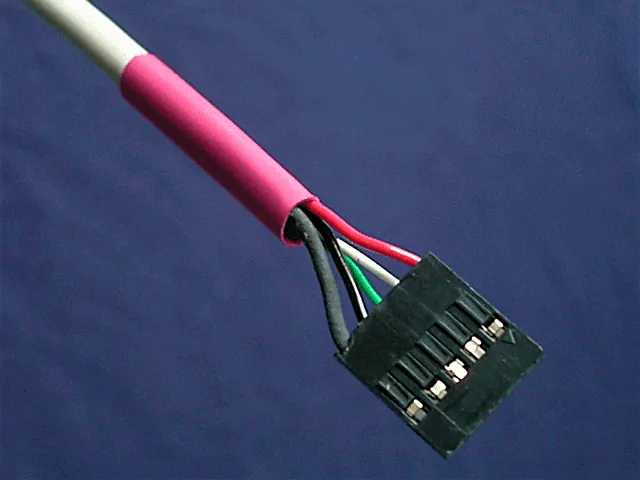
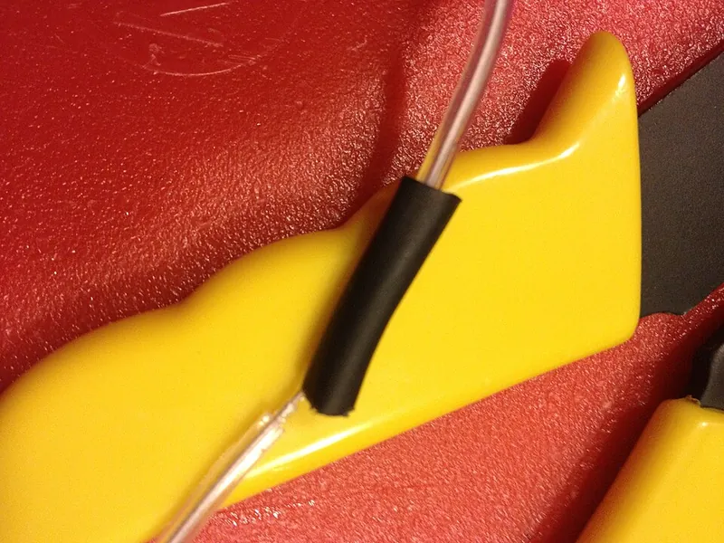
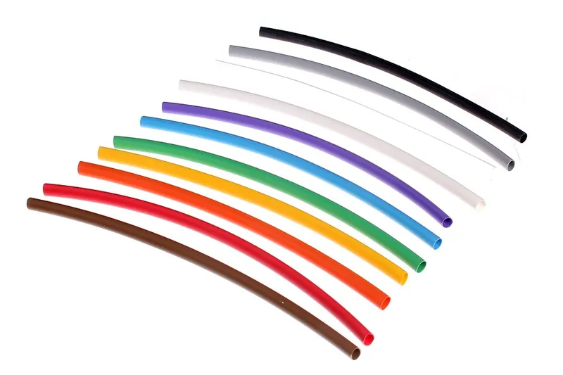

<figure class="eoc-pic eoc-pic-main"><picture><source media="(prefers-reduced-motion: reduce)" srcset="../media/heat-shrink-tubing.still.webp"></picture><figcaption><strong>Animation.</strong> <a href="https://commons.wikimedia.org/wiki/File:Schrumpfschlauch_animated_modified.gif">Schrumpfschlauch animated modified</a> by User Smial on de.wikipedia, <a href="https://creativecommons.org/licenses/by-sa/2.0/de/deed.en">CC BY-SA 2.0 de</a>, from Wikimedia Commons.</figcaption></figure>
<figure class="eoc-pic"><figcaption><strong>How it works.</strong> <a href="https://commons.wikimedia.org/wiki/File:Heat_shrink_covering.JPG">Heat shrink covering</a> by Steven1108, <a href="https://creativecommons.org/licenses/by-sa/3.0">CC BY-SA 3.0</a>, from Wikimedia Commons.</figcaption></figure>
<figure class="eoc-pic"><figcaption><strong>Photo.</strong> <a href="https://commons.wikimedia.org/wiki/File:Heat-shrink_tubing.jpg">Heat-shrink tubing</a> by oomlout, <a href="https://creativecommons.org/licenses/by-sa/2.0">CC BY-SA 2.0</a>, from Wikimedia Commons.</figcaption></figure>

A tube of specially treated plastic is slid over a wire or joint and heated with a hot-air gun, so it shrinks to between a half and a sixth of its diameter and grips tightly, insulating the joint and protecting it from rubbing, while glue-lined versions also melt their inner glue to seal out water.

**In plain words:** A plastic tube you slide over a wire joint before you make it, then warm with a hot-air gun so it shrinks tight round the joint, covering the bare metal; some have glue inside that melts and seals out water. **Proper term:** Heat-shrink tubing (heat-shrinkable insulation sleeving).

**Also called:** heat shrink, heatshrink, shrink tube, shrink tubing, shrink sleeve (Wikipedia 'Heat-shrink tubing'); heat-shrinkable sleeving, insulation sleeving (NASA-STD-8739.4A); adhesive-lined heat-shrink, dual-wall heat-shrink, glue-lined heat-shrink: an outer polyolefin tube with a meltable glue lining that seals (AutomationDirect); heat-shrink end cap: a closed-end tube for insulating cut wire ends (Wikipedia); shrinkable parts and boots: moulded heat-shrink shapes such as connector backshell boots (NASA-STD-8739.4A §9.11); heat-shrink cable repair sleeve: a wrap-around sleeve for mending a cable without cutting it (Commons 'Heat shrink cable repair tubing (HSRS-N).jpg'); heat-shrinkable sleeve: a large wrap-around or tubular glue-lined sleeve used as a corrosion coating on pipeline joints, a bigger cousin (Wikipedia 'Heat-shrinkable sleeve'); solder sleeve: heat-shrink with a solder ring inside (separate entry, Solder sleeve); cold-shrink tubing: a pre-stretched rubber tube on a removable core that shrinks with no heat (Wikipedia 'Cold shrink tubing'; covered here as an alternative); electrical tape, insulating tape, vinyl tape; self-amalgamating (self-fusing, self-vulcanising) tape: wrap-on alternatives covered here; Schrumpfschlauch (German); Raychem (brand; invented heat-shrink tubing in 1962, Wikipedia).

## How it works

The tube is made by extruding plastic, cross-linking it (usually with radiation) so it 'remembers' its size, then heating it, stretching it wider and cooling it fast so it stays stretched; when you heat it again above the plastic's crystalline melting point, it shrinks back towards its original size (Wikipedia 'Heat-shrink tubing'). It shrinks mainly in diameter, typically 2:1 or 3:1 for polyolefin, and only about 6% in length, so it closes tightly round wires, crimps and solder joints of awkward shape and stays in place by its tight grip (Wikipedia). In adhesive-lined tubing the inner glue melts as the tube shrinks and flows into the gaps, making 'a water-tight, air-tight, secure bond' when it cools (AutomationDirect). Cold-shrink does the same without heat: a rubber tube is held stretched on a plastic core, and when you unwind the core it collapses onto the joint (Wikipedia 'Cold shrink tubing').

## Parts

Single piece: one length of tubing, usually polyolefin plastic; adhesive-lined types have a second inner layer of hot-melt glue (Wikipedia 'Heat-shrink tubing'; AutomationDirect). It needs a heat source to fit, usually a hot-air gun.

## Everyday examples

- The coloured sleeve over a soldered wire splice or a resistor added to a wire (SparkFun 'Working with Wire')
- Sleeves on the heater-cartridge wires and other larger wires in a 3D printer (Voron 'Electrical Wiring')
- Rubbery glue-lined grips shrunk onto clamp handles (Fine Woodworking 2021)
- Colour bands for coding wires, and the plastic coat on fibreglass CB radio aerials (Wikipedia 'Heat-shrink tubing')

## When to use it

Use it to insulate and protect almost any wire joint: soldered splices, crimps, solder cups on plugs, bullet connectors, resistor and LED legs. It is neat, tough and slim, and won't unwind like tape (Wikipedia; SparkFun). Use it to repair damaged insulation, bundle wires, colour-code them and add strain relief where a wire leaves a connector (Wikipedia). Use adhesive-lined tubing outdoors, in vehicles and anywhere damp, because its glue seals the ends (AutomationDirect). Use it beyond electronics too: glue-lined tubing makes thick, grippy handles (Fine Woodworking). Choose cold-shrink where heat isn't allowed or practical, electrical tape for a quick wrap where no wire end is free, and self-amalgamating tape for a removable waterproof wrap or an emergency hose patch (Wikipedia).

## When not to use it

It is not a joint: never use it to hold wires together that aren't already soldered, crimped or clamped. Don't use plain tubing where water must be kept out: use adhesive-lined tubing, a solder sleeve or self-amalgamating tape. It can't go on if no end of the wire is free (use a wrap-around sleeve or tape). Don't shrink it next to heat-sensitive parts, sensors, optics or printed plastic that can't be shielded (NASA-STD-8739.4A §7.2.41; Prusa 'PLA'). Long lengths make a cable stiff, so avoid sleeving cables that must flex a lot (NASA-STD-8739.4A §9.10). Avoid PVC tubing near a soldering iron (Wikipedia). For mains wiring, use only the methods the wiring rules and the equipment maker allow.

## Details

- **What it does (jobs):**
  - seal it, or pass cables or fluid through: insulates and covers bare joints, and glue-lined tubing seals them against water (Wikipedia; AutomationDirect)
  - join and hold: holds a bundle of wires together, adds strain relief at a joint or connector, and grips small parts (Wikipedia 'Heat-shrink tubing')
  - glue or bond: adhesive-lined tubing glues itself to what it covers, e.g. as a non-slip grip on tool handles (Fine Woodworking)
- **Movement:** none: it is a fixed covering. Short lengths stay flexible, but long lengths over a cable make it 'extremely difficult to bend and coil without damage' (NASA-STD-8739.4A §9.10).
- **Directions it can move (degrees of freedom):** 0: once shrunk it grips the part and doesn't move.
- **Special behaviour:**
  - none: it is a covering. (Its shrink-to-fit shape memory, which makes it grip irregular shapes, is not one of the listed behaviours; the same effect is used in Self-folding print.)
- **How it holds:**
  - friction or clamping ([force-fit](../glossary.md#form-fit--force-fit--material-bond)): the shrunk tube squeezes the part and is 'mechanically held in place ... by its tight fit' (Wikipedia 'Heat-shrink tubing')
  - material bond (glue, solvent or melting): adhesive-lined tubing's glue bonds to the part (AutomationDirect); plain tubing heated very near its melting point may fuse to the material below (Wikipedia)
- **Input and output:** not applicable
- **Power:** passive (no power needed): heat is needed only to shrink it; cold-shrink needs no heat at all.
- **Load:** Electrical: above about 30 A (it carries no current: it insulates joints of any current, and is chosen by diameter, not amps); rated for mains (common tubing is rated 600 V, e.g. AutomationDirect's adhesive-lined tubing, and UL 224 is a listed standard (Wikipedia)), but this entry gives no mains wiring steps. Mechanical: light: it adds some strain relief and protection from rubbing (Wikipedia), but it is not a structural joint and must not be relied on to hold wires together; the joint underneath must already be mechanically sound. Thin tubing can be cut by sharp edges and wire ends (TE 114-120022: strands poking through).
- **Play and precision:** not applicable
- **Taking it apart:** permanent: it must be slit along its length with a knife and peeled off, and can't be reused. Self-amalgamating tape is the easiest wrap-on cover to remove: 'quick, clean, and easy' (Wikipedia 'Self-amalgamating tape').
- **How often it can be reused:** once.
- **Sealing:** dust-resistant for plain tubing: it protects 'from dust, solvents and other foreign materials' but has no glue to stop water creeping along the wire (Wikipedia 'Heat-shrink tubing'). Watertight for adhesive-lined (dual-wall) tubing, whose melted glue lining seals the ends (AutomationDirect 'water-tight, air-tight'; Wikipedia). Self-amalgamating tape also gives a 'seamless, rubbery, waterproof' layer (Wikipedia 'Self-amalgamating tape').
- **Adjustable:** no: it can be slid along before heating, but once shrunk it stays put.
- **Access needed:** end of a tube or shaft: the tube has to be slid on over a free end, so it must go onto one wire before a joint is made or a plug is fitted (SparkFun 'Working with Wire'). Where no end is free, use a wrap-around repair sleeve (Commons 'Heat shrink cable repair tubing (HSRS-N)') or tape.
- **Materials:** Tubing materials (Wikipedia 'Heat-shrink tubing'): polyolefin, the most common, −55 to 135 °C, shrinks at about 143 °C, usually 2:1 (3:1 available), many colours including clear, and can survive a brief touch of a soldering iron; PVC, cheap and very colourful, but 'tends to burn if touched with a soldering iron'; silicone rubber, −50 to 200 °C, flexible and scrape-resistant; fluoropolymers: FEP, PVDF, PTFE (−55 to 175 °C) and Viton (−55 to 200 °C) for heat and chemicals; woven fabric for abrasion. Adhesive-lined: flame-retardant polyolefin outside with a meltable glue lining, shrinking at 110 °C (AutomationDirect). It covers copper wire, solder joints, crimps, connector bodies, cable jackets and also non-electrical parts such as wooden clamp handles (Fine Woodworking). Tapes: PVC (vinyl) electrical tape (Wikipedia 'Electrical tape'); silicone, EPR and PIB self-amalgamating tapes (Wikipedia 'Self-amalgamating tape').
- **Heat, cold, water and wear:** Heat: polyolefin −55 to 135 °C, silicone −50 to 200 °C, PTFE −55 to 175 °C, Viton −55 to 200 °C (Wikipedia 'Heat-shrink tubing'); vinyl tape up to 105 °C (3M). Sunlight: coloured polyolefin resists UV poorly, so use black outdoors; PVC tubing needs a UV stabiliser for outdoor use (Wikipedia). Water: only adhesive-lined tubing and self-amalgamating tape seal (AutomationDirect; Wikipedia). Rubbing and cold flow: NASA requires sleeving over splices to be 'protected from cold flow and abrasion' (NASA-STD-8739.4A §7.2.33); silicone self-amalgamating tape is soft and tears from small nicks (Wikipedia). Vinyl tape's end can lift over time if the last wrap is stretched (3M). Storage: cold-shrink must be kept below 43 °C before use (Wikipedia).

## Making it

- **Ways to make or get it:**
  - off-the-shelf part: tubing, end caps, cold-shrink tubes and tapes are bought
  - 3D print (FDM): only accessories such as tube cutters and spool holders (see make_it_yourself)
- **Printing it in one piece (print in place):** no: it is bought tubing shrunk with heat; only cutters and holders are printed.
- **Tools:** A hot-air gun or hot-air rework station, or an oven for batches (Wikipedia; NASA-STD-8739.4A §9.9.1); a sharp knife or scissors for a clean, burr-free cut, because a ragged end can split (TE 114-120022); heat-resistant gloves and good ventilation (TE 114-120022). Suppliers don't recommend lighters or holding a soldering iron near the tube, which heat unevenly (Wikipedia). Cold-shrink and tapes need no tools.
- **Difficulty:** easy: cut a length, slide it on before making the joint, and heat it evenly; the main thing to remember is to slide it onto the wire before making the joint (SparkFun 'Working with Wire').

### 3D printing tips

1) Keep the heat off printed parts: PLA 'gets soft and deforms at temperatures over 60 °C' (Prusa 'PLA'), while tubing shrinks at about 110-143 °C (AutomationDirect; Wikipedia) and a heat gun blows air at 100-550 °C (Wikipedia 'Heat gun'), so shrink the tubing before the wire goes into a printed housing, or shield the print; NASA likewise says nearby temperature-sensitive parts 'should be protected from exposure to direct heat' (NASA-STD-8739.4A §9.9.2). 2) Shrinking glue-lined tubing over a printed handle or knob as a grip risks [warping](../glossary.md#warping--shrinkage) the print; try it on a test piece first, or use a more heat-resistant filament such as PETG, ABS or ASA ⚑ [uncertain]. 3) Leave room in printed cable channels and enclosures for sleeved splices, which are fatter than the wire, and stagger several splices so a bundle stays slim (NASA-STD-8739.4A §7.2.35). 4) In 3D printers, heat-shrink is useful on larger wires such as heater-cartridge leads (Voron 'Electrical Wiring'). 5) Printed tube cutters with length stops and spool holders make it easy to cut clean, square lengths (Printables 94283, 579937); TE stresses a clean cut, because a ragged end can split as it shrinks (TE 114-120022).

### Buying one (off-the-shelf parts)

Thin-wall polyolefin heat-shrink, 2:1 and 3:1, in assortment boxes and on reels (Wikipedia); adhesive-lined (dual-wall) heat-shrink, 2:1 and 3:1, sold in 4 ft sticks (AutomationDirect); clear tubing, which turns clear as it shrinks (TE 114-120022); heat-shrink end caps (Wikipedia); solder sleeves (Wikipedia); conductive-lined tubing for unsoldered joints (Wikipedia); moulded shrinkable boots for connectors (NASA-STD-8739.4A §9.11); wrap-around cable repair sleeves (Commons HSRS-N photo); fluoropolymer and silicone tubing for high temperatures (Wikipedia); cold-shrink tubes on removable cores (Wikipedia 'Cold shrink tubing'); PVC electrical tape, e.g. 3M Scotch Super 33+ (7 mil, UL 510 listed; 3M data sheet); silicone self-amalgamating tape (A-A-59163 / MIL-I-46852 for aviation, marine and military use) and EPR and PIB rubber self-amalgamating tapes (Wikipedia); hot-air guns and rework stations. Brand names are given only as catalogue search terms.

## Rules of thumb

- Choose a size whose expanded (supplied) inside diameter slides over the biggest part, and whose fully shrunk (recovered) inside diameter is smaller than the part, so that after shrinking it still grips tightly (NASA-STD-8739.4A §9.8.3a, with a sizing table, Table 9-3).
- TE's sizing rule: the tube should shrink by at least 20% of its supplied size, but not all the way to its fully recovered size; leave at least 10% 'unresolved recovery'. Choose the biggest size that will still fit snugly, for the thickest finished wall (TE 'How to select correct size tubing'; TE 114-120022 §3.1).
- Polyolefin usually shrinks 2:1 in diameter (3:1 available); heat-shrink in general shrinks to between a half and a sixth of its diameter, and about 6% in length (Wikipedia 'Heat-shrink tubing'). Cut it longer than needed: 'Do not cut the tube length to be the final installed length required' (TE).
- Make insulation tubing reach past the end of the wire insulation, or cable jacket, by at least 2 x the diameter of the larger of the two, on both sides of a splice (NASA-STD-8739.4A §9.8.5 and §19.2.6).
- Shrink from one end to the other, rotating the work or the gun, so no air is trapped; keep the gun's nozzle off the tube; stop at once if it blisters, chars, or turns unusually glossy or matt; finished tubing should be smooth, with no cold spots or wrinkles (TE 114-120022 §3.2). For boots, shrink the end that grips the connector first (NASA-STD-8739.4A §9.11.2).
- Large metal parts soak up heat, so they need longer heating than plastic ones (TE 114-120022).
- Outdoors use black: coloured polyolefin resists ultraviolet less well, and 'only black is recommended for outdoor applications' (Wikipedia 'Heat-shrink tubing').
- Vinyl electrical tape: wrap at least two half-lapped layers, stretched to about 5/8 of the tape's width, wrapping from the smaller diameter to the larger, with no tension on the last wrap so the end doesn't lift ('flag'); Super 33+ is rated 105 °C (80 °C under UL 510) and 600 V (3M Scotch Super 33+ data sheet).
- Store cold-shrink tubing below 43 °C (Wikipedia 'Cold shrink tubing').

## Common failures

Forgetting to slide the tube on before making the joint, which SparkFun's splicing steps tell you to do first (SparkFun 'Working with Wire'). Tube too big, so it stays loose; tube too small, so it won't fit or splits (TE 114-120022 troubleshooting; NASA §9.8.3). Not fully shrunk, leaving loose or partly shrunk areas: too little heat, too little time, or a big metal part soaking up heat (TE; NASA §9.8.3b). Overheated: scorched, blistered, split or charred tubing, or melted wire insulation at the tube's edge (TE troubleshooting; NASA §9.8.3c). Air trapped inside from heating the middle first (TE). Stray wire strands or sharp ends poking through (TE troubleshooting). Tube too short, because it shrank in length or wasn't cut long enough, leaving bare metal at the ends (TE; NASA §9.8.5). Sliding sleeves: NASA requires tubing to be secured so it can't slide along a bundle (NASA §9.8.4). Plain tubing used outdoors, letting water wick along the wire; use glue-lined tubing (AutomationDirect). Coloured tubing cracking in sunlight (Wikipedia). Tape unwinding ('flagging') because the last turn was stretched (3M).

## Safety

Heat-gun burns: a heat gun blows air at about 100-550 °C, much hotter than a hair dryer, and can easily scald skin or set hair alight (Wikipedia 'Heat gun'); wear heat-resistant gloves when handling hot tubing (TE 114-120022), and park the gun on its stand pointing away from things that can burn. Fire and fumes: overheated tubing 'can melt, scorch or catch fire like any other plastic', and suppliers don't recommend lighters (Wikipedia 'Heat-shrink tubing'); stop heating if it blisters or chars, avoid breathing the fumes and ventilate before carrying on (TE 114-120022); burning PVC gives off hydrogen chloride fumes (Wikipedia 'Polyvinyl chloride'). Hidden faults: heat-shrink covers a joint, so a bad solder joint or crimp underneath can't be seen; check the joint before covering it, or use clear tubing so it stays visible. Not a substitute for proper insulation in mains work; this entry gives no mains wiring steps, and mains work must follow local law (e.g. Approved Document P in England).

## Related

- Solder sleeve (solder-seal splice): heat-shrink with a solder ring and glue rings inside, which solders, insulates and seals in one step
- Soldered wire joint: the joint heat-shrink most often covers
- Crimped butt splice: often sold inside its own glue-lined heat-shrink sleeve
- Hot-melt adhesive: the same kind of glue lines adhesive-lined tubing; a blob of hot glue is a quick, rougher insulator
- Cable [gland](../glossary.md#gland) and strain relief: seals and grips a cable where it passes through a wall; heat-shrink only covers and lightly supports
- Wire-end ferrule: finishes a stranded wire for a terminal, while heat-shrink insulates a joint
- Self-folding print (4D printing): uses the same shape memory, plastic that shrinks back when heated
- Silicone and MS-polymer adhesive sealants: for sealing gaps and potting, where a tube can't be slid on
- Linear [ratchet](../glossary.md#ratchet) (cable-tie ratchet): cable ties bundle wires and can be removed; heat-shrink bundles more neatly but permanently
- Rope-end finishing (whipping, heat-sealing, aglet): heat-shrink can also cap a cord end

## Make it yourself

- [Heat-shrink tube cutter (multi material) (ripper, Printables) (URL from Printables API, page not opened)](https://www.printables.com/model/94283-heat-shrink-tube-cutter-multi-material): Spring-loaded cutter with a length stop for cutting heat-shrink to clean, square lengths; needs a blade, two springs and M3/M4 screws; printed in PETG *(licence: Creative Commons Attribution-ShareAlike)*
- [HSW Organizer/Winder For Heat Shrink (Ben Carlisle, Printables) (URL from Printables API, page not opened)](https://www.printables.com/model/579937-hsw-organizerwinder-for-heat-shrink): Snap-together spool that holds up to about 4 m of heat-shrink so you can pull out and snip a length; mounts with one M3 screw *(licence: Creative Commons Attribution-NonCommercial)*
- [Heat-shrink tube organizer IKEA Skådis (Hoemp Made, Printables) (URL from Printables API, page not opened)](https://www.printables.com/model/751236-heat-shrink-tube-organizer-ikea-skadis): Pegboard organiser for sticks of heat-shrink tubing sorted by size *(licence: Creative Commons Attribution)*

## Pictures, videos and models

- [Schrumpfschlauch animated modified.gif (Wikimedia Commons, Smial)](https://commons.wikimedia.org/wiki/File:Schrumpfschlauch_animated_modified.gif): Animation of heat-shrink tubing shrinking round a wire as heat is applied *(licence: CC BY-SA 2.0 DE)*
- [Video of Heat shrink tube before and after.ogv (Wikimedia Commons, Andrewlord)](https://commons.wikimedia.org/wiki/File:Video_of_Heat_shrink_tube_before_and_after.ogv): Video of adhesive-lined, cross-linked polyolefin heat-shrink being shrunk with a 2000 W hot-air gun *(licence: CC BY-SA 3.0)*
- [Heat shrink covering.JPG (Wikimedia Commons, Steven1108)](https://commons.wikimedia.org/wiki/File:Heat_shrink_covering.JPG): Small sleeves on individual joints with a larger heat-shrink tube covering them all *(licence: CC BY-SA 3.0)*
- [Heat-shrink tubing.jpg (Wikimedia Commons, oomlout)](https://commons.wikimedia.org/wiki/File:Heat-shrink_tubing.jpg): Ten colours of 3 mm heat-shrink tubing, as used for colour coding *(licence: CC BY-SA 2.0)*
- [TE Connectivity 114-120022, Size Selection & Installation of Single Wall Heat Shrink Tubing (2023)](https://mm.digikey.com/Volume0/opasdata/d220001/medias/docus/6166/Microsoft%20Word%20-%20Application%20Spec_General%20Purpose%20Single%20wall_%20114-120022.pdf): Figures of shrinking a tube from one end with a heat gun while rotating the work, the finished result, and a troubleshooting table *(licence: link only (manufacturer document))*

## Needs confirming

⚑ marks something nobody has confirmed yet: a fact the research could not confirm from a source, a finder value that is a best guess, or an open point from the research notes. Corrections are welcome (see `research/needs-confirming.md`).

- ⚑ 1 sentence on this page marked [uncertain].
- ⚑ Finder value `load_max` = light (best guess): electrical entry whose mechanical load has no light/medium/heavy band; set to light

## Sources

- <https://en.wikipedia.org/wiki/Heat-shrink_tubing>
- <https://en.wikipedia.org/wiki/Cold_shrink_tubing>
- <https://en.wikipedia.org/wiki/Electrical_tape>
- <https://en.wikipedia.org/wiki/Self-amalgamating_tape>
- <https://en.wikipedia.org/wiki/Heat_gun>
- <https://en.wikipedia.org/wiki/Polyvinyl_chloride>
- <https://en.wikipedia.org/wiki/Heat-shrinkable_sleeve>
- <https://nepp.nasa.gov/files/27631/nstd87394a.pdf>
- <https://www.te.com/en/products/heat-shrink-tubing/intersection/how-to-select-correct-size-tubing.html>
- <https://mm.digikey.com/Volume0/opasdata/d220001/medias/docus/6166/Microsoft%20Word%20-%20Application%20Spec_General%20Purpose%20Single%20wall_%20114-120022.pdf>
- <https://www.automationdirect.com/adc/overview/catalog/wire_-a-_cable_management/heat_shrink_tubing/adhesive_lined>
- <https://multimedia.3m.com/mws/media/993011O/scotch-super-33-vinyl-electrical-tape.pdf>
- <https://learn.sparkfun.com/tutorials/working-with-wire/all>
- <https://www.finewoodworking.com/2021/01/28/workshop-tip-heat-shrink-tubing-makes-clamp-handles-easy-to-grip>
- <https://docs.vorondesign.com/build/electrical/>
- <https://help.prusa3d.com/article/pla_2062>
- <https://assets.publishing.service.gov.uk/government/uploads/system/uploads/attachment_data/file/441872/BR_PDF_AD_P_2013.pdf>
- <https://commons.wikimedia.org/wiki/File:Schrumpfschlauch_animated_modified.gif>
- <https://commons.wikimedia.org/wiki/File:Video_of_Heat_shrink_tube_before_and_after.ogv>
- <https://commons.wikimedia.org/wiki/File:Heat_shrink_covering.JPG>
- <https://commons.wikimedia.org/wiki/File:Heat-shrink_tubing.jpg>
- <https://commons.wikimedia.org/wiki/File:Heat_shrink_cable_repair_tubing_(HSRS-N).jpg>
- <https://api.printables.com/graphql/>
