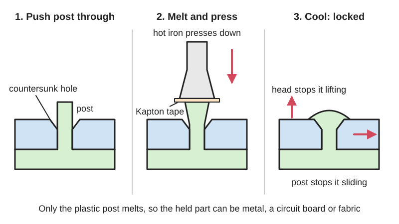
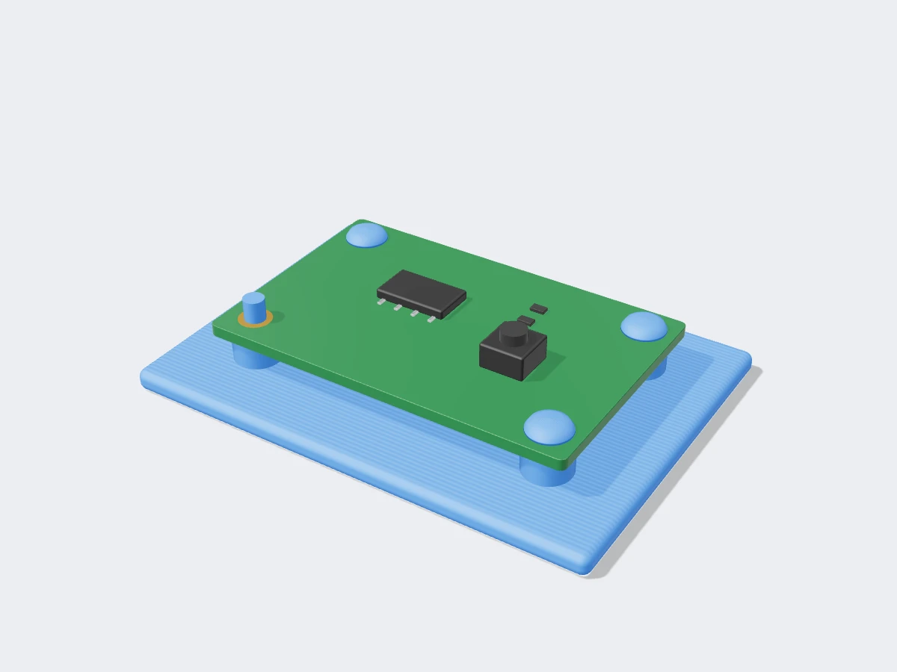
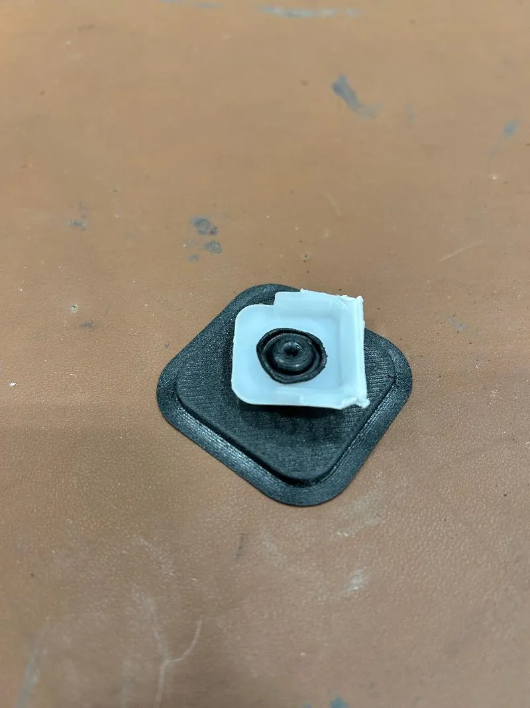

<figure class="eoc-pic eoc-pic-main"><figcaption>Diagram drawn for the encyclopaedia from the research notes. ⚑ Needs confirming: a drawing can simplify or get details wrong; a real photo or a better diagram is welcome.</figcaption></figure>
<figure class="eoc-pic"><figcaption><strong>Render.</strong> A 3D model made for the encyclopaedia, not a photo: a real one is shown below. ⚑ Needs confirming: a model can simplify or get details wrong.</figcaption></figure>
<figure class="eoc-pic"><figcaption><strong>How it works.</strong> <a href="https://www.printables.com/model/833859-heat-stake-and-ultrasonic-welding-test">heat stake and ultrasonic welding test</a> by winchcable22, <a href="https://creativecommons.org/publicdomain/zero/1.0/">CC0 1.0</a>, from Printables.</figcaption></figure>

A post on one plastic part is pushed through a hole in another part and its end is melted and pressed into a head, locking the parts together for good with no screw, rivet or glue.

**In plain words:** A plastic peg on one part pokes through a hole in the other part, and you melt its tip flat with a hot tool so it spreads into a mushroom-shaped head, like a rivet made of the part's own plastic, and the parts can no longer pull apart. **Proper term:** Heat staking (thermal staking, thermoplastic staking).

**Also called:** thermal staking (name used in Branson's 'Thermal Staking Design Guidelines'); thermoplastic staking (Wikipedia 'Staking (manufacturing)', which says it is also called heat staking); hot punch staking or thermal punch staking (Wikipedia lists 'thermal punch (hot punch)' as one staking technology); hot air cold staking or hot-air cold upset (the post is softened with hot air and shaped with a cold tool; Wikipedia, Extol, ASSEMBLY magazine); ultrasonic staking or ultrasonic riveting (the post is melted by vibration instead of a hot tip; Dukane 'Ultrasonic Staking Configurations'); infrared staking and impulse staking (other ways of heating the post; Wikipedia, Extol, ASSEMBLY magazine); plastic riveting, melted plastic rivet (plain descriptions; Dukane calls the stud a 'plastic rivet'); heat-staked mortise and tenon, heat-staked pins or fins (maker names for the 3D-printed version; Hackaday, Richard Sewell's GitHub notes); stake, [boss](../glossary.md#boss), stud or post (names for the peg before it is melted) and dome, rosette, hollow, knurled or flush stake (names for the head shapes; Branson, Dukane, Extol); cold staking or cold forming (a related method that squashes the post without heating it; Wikipedia, ASSEMBLY magazine).

## How it works

The post is made a little longer than the stack it passes through, so its tip sticks out beyond the part it has to hold. A hot tip presses on the end of the post; the plastic softens and, under steady pressure, flows to fill the shaped cavity in the tip (or a [countersink](../glossary.md#counterbore--countersink) in the hole), forming a head wider than the hole (Branson 'Thermal Staking Design Guidelines'). When it cools and hardens, the head cannot pull back through the hole, so the parts are held by shape, much like a metal rivet, and the post itself stops the parts sliding sideways (Wikipedia 'Staking (manufacturing)'; Hackaday). Because only the plastic post melts, the held part can be metal, a circuit board, fabric or a different plastic (Wikipedia; Branson).

## Parts

A few parts, but no separate fastener: (1) the plastic part with one or more posts (studs or bosses) moulded or printed on it, (2) the part to be held, with a hole for each post, often with a countersink or [chamfer](../glossary.md#chamfer--fillet) to receive the melted plastic, and (3) a heated tool (a soldering iron at home, or a shaped hot tip, hot air, infrared or ultrasonic horn in a factory) that forms the head (Branson; Wikipedia; Richard Sewell's heat-staking notes).

## Everyday examples

- Circuit boards and switch parts held inside plastic cases by little melted posts instead of screws (Jeff Epler, inspired by tactile switches; Fictiv lists housings, circuit boards and buttons)
- Car interior parts: door panels, instrument panels, cup holders and fog-lamp housings (ASSEMBLY magazine; Fictiv)
- Household appliance parts and medical device casings (ASSEMBLY magazine; Fictiv)

## When to use it

Use heat staking when you want a small, neat, permanent joint between a plastic part and something else, with no screws, nuts or glue to buy: fixing a circuit board, metal bracket, fabric, flexible TPU part or second plastic part to a printed or moulded part. It is useful for 3D prints when splitting a design into separately printed pieces lets each piece be printed in its strongest orientation or without supports, and for joining different materials, such as soft TPU to rigid ASA (Richard Sewell). It is quick and cheap, needs access from one side only, and many posts can hold a part evenly.

## When not to use it

Don't use it when the parts must come apart for servicing (use screws into [heat-set inserts](../glossary.md#heat-set-insert), a snap fit or a push-in plastic rivet instead), when the part carrying the post isn't a thermoplastic (thermoset resin prints, wood, metal), when the joint must carry big loads or stay tight when hot (use metal screws or rivets), or when you need a watertight joint (use gaskets, solvent welding or glue). Very thin pins (about 2 mm or less) printed on an FDM printer fit poorly and are weak (Richard Sewell). Avoid it right next to heat-sensitive electronics unless the heat is well controlled (ASSEMBLY magazine).

## Details

- **What it does (jobs):**
  - join and hold: permanently fixes a plastic part to another part (plastic, metal, circuit board, fabric)
  - line parts up exactly: the posts pass through holes, so they also locate the parts before and after melting (Richard Sewell's notes say separate staked parts can be more accurate than one complex print)
- **Movement:** none: the joint is rigid once the head is formed
- **Directions it can move (degrees of freedom):** 0: the post stops sideways sliding and turning (with two or more posts, or a square or finned post), and the melted head stops the parts pulling apart
- **Special behaviour:**
  - none: it is a plain permanent fixing. (A hollow post can later be drilled out and replaced by a self-tapping screw for repair, but that is a repair trick, not a behaviour of the joint; Branson; Dukane)
- **How it holds:**
  - shape (the parts interlock; [form-fit](../glossary.md#form-fit--force-fit--material-bond)): the melted head is wider than the hole, like a rivet head, and the post fills the hole so the parts can't slide (Branson; Wikipedia)
- **Input and output:** not applicable
- **Power:** passive (no power needed): heat is only needed while making the joint; the finished joint needs no power
- **Load:** Light to medium. Strong in [shear](../glossary.md#peel-vs-shear) (sideways sliding) because the post fills the hole; pull-out strength depends on the size of the head, which should overlap the hole all round, and on the post not snapping at its base ⚑ [uncertain]. Twisting is resisted by using two or more posts, square or rectangular posts, fins, or knurled or ribbed posts (Fictiv; Extol; Richard Sewell). Published strength data for 3D-printed heat-staked joints are scarce: Richard Sewell notes he has done no strength comparison tests.
- **Play and precision:** small: the hole is made slightly bigger than the post so the parts go together (Richard Sewell adds 0.1 mm all round for prints; Extol advises holes 10-25% larger than the boss; Fictiv gives +0.05-0.15 mm), and melting then presses the head down onto the part. The post locates the parts about as accurately as the hole [clearance](../glossary.md#clearance) allows ⚑ [uncertain]; with a single round post the held part could still turn, so use two posts or a non-round post.
- **Taking it apart:** permanent: the head has to be cut, drilled or melted off to separate the parts, which usually destroys the post (Fictiv calls it nearly irreversible; Jeff Epler notes you can't remove a staked circuit board without destroying the print). Exception: hollow stakes can be drilled out and the part re-fixed with a self-tapping screw (Branson; Dukane).
- **How often it can be reused:** once
- **Sealing:** none: the head holds the parts together but does not seal the hole or the joint line
- **Adjustable:** no: position and clamping are fixed when the head is formed
- **Access needed:** one side only (blind): the hot tool only needs to reach the tip of the post on the far side of the held part; nothing is needed on the other side once the parts are pushed together (Fictiv notes it works in restricted-access areas)
- **Materials:** The post must be a thermoplastic (a plastic that softens when heated): e.g. ABS, polycarbonate, polypropylene, polyethylene and nylon (polyamide) (ASSEMBLY magazine; Fictiv). Filled plastics work: Branson recommends dome stakes for crystalline plastics such as 33% glass-filled grades and for abrasive fillers, and rosette stakes for low-density unfilled plastics; Dukane says pointed studs work best with plastics that soften gradually such as ABS, and rosette studs with plastics that melt sharply such as nylon. The held part can be almost anything that doesn't melt at the staking temperature: metal, circuit boards, other plastics, fabric (Wikipedia; Branson; Richard Sewell). 3D printing: ASA and TPU (Richard Sewell), PETG (Jeff Epler); other FDM plastics are expected to work (Richard Sewell). Thermoset resin prints and other plastics that don't melt can't be staked ⚑ [uncertain].
- **Heat, cold, water and wear:** The head is made of the part's own plastic, so the joint is only as heat-resistant as that plastic: in CNC Kitchen's oven test, PLA started to give at about 60 °C, PETG at about 80 °C and ASA at about 110 °C. Heads formed without enough heat (cold-formed posts) tend to spring back and can show fine surface cracking (crazing) and chemical attack; hot-formed heads have lower built-in stress (ASSEMBLY magazine). Plastic under constant load can [creep](../glossary.md#creep), so a head carrying a steady pull may slowly relax ⚑ [uncertain].

## Making it

- **Ways to make or get it:**
  - 3D print (FDM): print the posts or fins on one part and the holes in the other, then stake with a soldering iron (Richard Sewell; Jeff Epler; Hackaday)
  - injection moulding: the usual industrial route, with posts moulded on and heads formed by staking machines (Branson; Fictiv; ASSEMBLY magazine)
  - laser cut, CNC or sheet metal for the held part: a laser-cut sheet, fabric, metal bracket or circuit board with holes can be staked onto a plastic part (Wikipedia; Richard Sewell)
  - 3D print (resin): not suitable for the post if the resin is a thermoset that won't melt ⚑ [uncertain]
- **Printing it in one piece (print in place):** no: the parts are printed separately, assembled and then staked. The posts are printed as part of one piece, so no extra fastener is printed or bought.
- **Tools:** At home: a soldering iron, ideally with a broad flat tip (Jeff Epler used heat-set insert tips) or using the side of the barrel, plus a piece of Kapton (polyimide) tape so the plastic doesn't stick to the iron (Hackaday; Jeff Epler; Richard Sewell). Helpful: a vice to hold the parts tightly, side cutters to trim over-long pins and a needle file to clean holes (Richard Sewell). In industry: heat-staking machines with shaped heated tips, hot-air, infrared or ultrasonic staking machines, or a hand-held heat-staking 'pencil' for small batches (Wikipedia; Extol; Plastic Assembly Systems video).
- **Difficulty:** easy: needs only a soldering iron and Kapton tape, and the posts and countersunk holes are simple to add in CAD; getting a neat, strong head takes a few practice pieces

### 3D printing tips

1) Post size and shape: round or square pegs 3-4 mm across, or fins 2 mm wide and at least 10 mm long; 5 mm pegs in 5 mm plates were very easy, but 2 mm pins did not work because printing inaccuracies made the fit too poor (Richard Sewell's heat-staking notes). Hubs also advises FDM pins of at least 5 mm diameter, or off-the-shelf pins for anything smaller. 2) Print the post lying flat, not standing up: 'vertical 3mm pins are ridiculously weak' because the layers run across the pin; if a pin must be vertical, print it as a separate piece lying down (Richard Sewell). Square pegs are easiest to print horizontally (Richard Sewell; Hackaday). 3) Give the melt somewhere to go: a 1 mm chamfer or countersink around the hole on the staking side, and let the post stick out 1-1.5 mm through the hole so there is enough plastic to fill it; the finished head then sits flush (Richard Sewell). For a fat 5 mm pin, a counterbore in the end of the pin means you only melt a 1 mm ring (Richard Sewell). Jeff Epler's rule: a post sticking up 1.6 x the hole diameter flattens to a head about 2 x the hole diameter and 0.5 x the hole diameter high. 4) Clearance: make holes 0.1 mm bigger all round than the post (0.2 mm on the width), and add a 0.5 mm countersink on the assembly side of the hole to clear the small fillet the printer leaves at the base of the post (Richard Sewell). 5) Add a shoulder of 1-2 mm, on at least two sides, so the part can't slide down the post (Richard Sewell). 6) Staking: clamp the parts together tightly (a vice helps), cover the pin end with Kapton tape, press with the side of the iron and roll it slightly as the plastic melts into the countersink; little force is needed; peel off the tape once it has set, and reuse it (Richard Sewell, iron at 300 °C for ASA; Jeff Epler, lowest iron setting of '280 C' for PETG). Hackaday suggests the iron's barrel, or a broad chisel tip for small joints, to spread the heat and force. 7) Use it to combine materials: flexible TPU parts can be staked onto rigid ASA plates to make hinges, belts and [flexures](../glossary.md#flexure) (Richard Sewell). 8) Expect some CAD work and slightly rough-looking heads; dovetail-shaped and square tenons worked best in Richard Sewell's tests.

### Buying one (off-the-shelf parts)

None needed for the joint itself. Supplies: Kapton (polyimide) tape; a temperature-controlled soldering iron with a broad flat or heat-set-insert tip (Jeff Epler). For production or larger batches, search for a 'heat staking tip' or 'heat staking tool', a 'hand-held heat staking pencil' (Plastic Assembly Systems video) or 'heat staking machine', 'hot air staking' or 'ultrasonic staking' equipment (Extol; Dukane; Sonitek).

## Rules of thumb

- Dome stake, high profile: finished head about 2 x the post diameter across and 0.75 x the post diameter high; total post height = thickness of the held part + 1.75 x the post diameter. Low profile: head 1.5 x the post diameter across, 0.375 x high, post height = held thickness + 0.45 x diameter. Dome stakes suit posts up to about 0.25 in (6.35 mm) diameter (Branson 'Thermal Staking Design Guidelines', pages 1-2).
- Rosette stakes suit posts from 0.063 in (1.6 mm) diameter up, with head 2 x the post diameter; hollow posts are best from 0.156 in (4 mm) outside diameter, with the bore half the outside diameter, a head 2 x the outside diameter and post height = held thickness + 1.5 x diameter; a hollow stake can later be re-fixed with a self-tapping screw (Branson, page 3).
- Flush stake: the held part needs a 45° countersink about 0.38 x the post diameter deep, and the post sticks out 0.5 x its diameter above the held part (Branson, page 4).
- Ultrasonic stakes: for a post of diameter 2r the head is typically 4r across (twice the post diameter) and r high (half the post diameter), with the post sticking out between about 1.2r and 3.1r depending on head shape; match the post volume to the head volume to fill the head without excess flash (Dukane 'Ultrasonic Staking Configurations').
- Make the hole 10-25% larger than the post diameter; a mating surface square to the post is ideal (Extol 'How to design for plastic staking').
- Posts at least 2 mm diameter and 1.5-2 x as tall as they are wide; hole 0.05-0.15 mm larger than the post; 0.5-1° draft on moulded posts (Fictiv).
- Posts can sit as close as 1 mm from a wall; for cold forming keep the post no longer than twice its diameter or it may buckle (ASSEMBLY magazine 'Staking for Plastic Parts Assembly').
- Home 3D-printed version: 3-4 mm pegs or 2 mm x 10 mm fins, 1 mm countersink, 1-1.5 mm stick-out, 0.1 mm clearance all round, iron around 300 °C with Kapton tape (Richard Sewell's heat-staking notes); post 1.6 x the hole diameter tall forms a head 2 x the hole diameter across (Jeff Epler).

## Common failures

Head too small or incomplete because the post was too short to supply enough plastic, so it pulls through the hole; or too much plastic, leaving flash: match post volume to head volume (Branson; Dukane). Post snaps at its base because it was printed standing up with layers across it; print pins lying flat or as separate horizontal pieces (Richard Sewell). Poor fit with tiny pins or rough holes; use 3 mm or bigger pegs, 0.1 mm clearance and a file to clean the holes (Richard Sewell). Melted plastic sticks to the iron and leaves a rough head; use Kapton tape (Hackaday; Jeff Epler). Overheating degrades or warps the plastic and gives weak stakes (Fictiv). Joint left loose because the head sprang back before it cooled under pressure; hold the tool until the plastic sets (ASSEMBLY magazine). Long posts buckle under the tool (ASSEMBLY magazine).

## Safety

The soldering iron or staking tip is hot enough to burn skin. Melting plastic gives off fumes (Jeff Epler notes melting PETG releases 'nasty fumes'), so work in a well-ventilated place. Heat can damage nearby electronic parts on a board being staked (ASSEMBLY magazine).

## Related

- Heat-set threaded insert: uses the same soldering iron, but melts a brass insert into the plastic to give reusable screw threads instead of a permanent head
- Push-in plastic rivet (fir-tree clip, push rivet): a separate plastic rivet that pushes in and can often be removed, instead of melting part of the part itself
- Blind rivet (pop rivet): a metal rivet set from one side; stronger, but a separate part
- [Cantilever](../glossary.md#cantilever) snap fit: a moulded or printed hook that clicks in and can be undone, instead of a permanent melted head
- Solvent welding: fuses two plastic surfaces with a solvent (material bond) instead of forming a mechanical head
- Ultrasonic weld: melts and fuses two plastic surfaces by high-frequency vibration (material bond) instead of forming a mechanical head; ultrasonic staking uses the same vibration to melt a post into a head (Dukane)
- Hot-melt adhesive (glue gun): also melted plastic, but used as a separate glue rather than reshaping the part
- Mid-print embedding: traps a nut, magnet or bearing inside the print instead of fixing it on afterwards
- Clinching and bent tabs through slots: the sheet-metal cousins that deform the material cold to lock parts together
- Split-part joints for large prints: heat staking is one of the ways to fix split pieces together
- Melted plastic weld: uses the same soldering iron, but melts the faces of two parts, often with extra plastic from a rod or filament, into one continuous seam instead of forming a rivet head

## Make it yourself

- [makevember-23-heat-staking (Richard Sewell, GitHub)](https://github.com/jarkman/makevember-23-heat-staking): STL and 3MF test pieces (round, square, triangular and dovetail tenons, fins, TPU-to-ASA flexures, hinges, a bag and a pencil case) and Fusion 360 source files for trying heat-staked joints *(licence: CC0 1.0 (public domain dedication))*
- [heat stake and ultrasonic welding test (winchcable22, Printables) (URL from Printables API, page not opened)](https://www.printables.com/model/833859-heat-stake-and-ultrasonic-welding-test): A printed test stake for pull-testing heat-staked or ultrasonically welded printed posts; the author reports ASA, ABS and PA6-CF passing a JIS K 7161 pull test when welded to moulded polypropylene. Read through the Printables public API. *(licence: Creative Commons Public Domain)*
- [Heat-staking in 3D prints (Jeff Epler's blog)](https://emergent.unpythonic.net/01612362040): Short how-to for holding a circuit board in a printed part with heat-staked bosses, with a sizing rule and tool tips *(licence: link only (copyright Jeff Epler))*

## Pictures, videos and models

- [Heat-staked joints for assembling 3D prints (Richard Sewell, 'jarkman', GitHub, November 2023)](https://github.com/jarkman/makevember-23-heat-staking): Step-by-step photos of printed pins pushed through holes, Kapton tape and a soldering iron, and the finished flush staked joints, plus design rules and STL/3MF/Fusion 360 test pieces *(licence: CC0 1.0 (public domain dedication))*
- [Tricky 3D Printed Joinery Problem? Give Heat Staking A Try (Hackaday, February 2024)](https://hackaday.com/2024/02/03/tricky-3d-printed-joinery-problem-give-heat-staking-a-try/): Photo of a heat-staked 3D-printed mortise-and-tenon joint and a plain explanation of the soldering-iron method *(licence: link only)*
- [Thermal Staking Design Guidelines (Branson / Emerson technical information sheet)](https://www.branson.emerson.com/is/content/emerson/en/corporate/branson/documents/thermal-staking-design-guide-pgs.pdf): Dimensioned cross-section drawings of dome (high and low), rosette (high and low), hollow, knurled and flush stakes before and after forming *(licence: link only)*
- [Heat staking close up example - Sonitek (YouTube, SonitekCorp)](https://www.youtube.com/watch?v=r5LH1H1qd7s): Close-up video of a heated tip forming a plastic post into a head (title checked via YouTube oEmbed) *(licence: link only (standard YouTube licence))*
- [Heat Staking - Hand Held Heat Staking Pencil by Plastic Assembly Systems (YouTube)](https://www.youtube.com/watch?v=BIE6XcfOs_Y): A hand-held heat-staking tool used for low-volume staking (title checked via YouTube oEmbed) *(licence: link only (standard YouTube licence))*

## Needs confirming

⚑ marks something nobody has confirmed yet: a fact the research could not confirm from a source, a finder value that is a best guess, or an open point from the research notes. Corrections are welcome (see `research/needs-confirming.md`).

- ⚑ 5 sentences on this page marked [uncertain].

## Sources

- <https://en.wikipedia.org/wiki/Heat_staking>
- <https://en.wikipedia.org/wiki/Staking_(manufacturing)>
- <https://www.branson.emerson.com/is/content/emerson/en/corporate/branson/documents/thermal-staking-design-guide-pgs.pdf>
- <https://www.ultrasonic-resonators.org/misc/references/articles/Dukane__'Ultrasonic_Staking_Configurations'.pdf>
- <https://www.dukane.com/resources/blog/item/thermal-heat-vs-ultrasonic-staking>
- <https://blog.extolinc.com/how-to-design-for-plastic-staking>
- <https://blog.extolinc.com/comparing-plastic-staking-technologies>
- <https://www.fictiv.com/articles/heat-staking-for-productdevelopment>
- <https://www.assemblymag.com/articles/94465-staking-for-plastic-parts-assembly>
- <https://www.sonitek.com/design-guides-for-heatstaking-ultrasonic-welding/>
- <https://hackaday.com/2024/02/03/tricky-3d-printed-joinery-problem-give-heat-staking-a-try/>
- <https://github.com/jarkman/makevember-23-heat-staking>
- <https://raw.githubusercontent.com/jarkman/makevember-23-heat-staking/main/README.md>
- <https://raw.githubusercontent.com/jarkman/makevember-23-heat-staking/main/LICENSE>
- <https://emergent.unpythonic.net/01612362040>
- <https://www.hubs.com/knowledge-base/how-design-parts-fdm-3d-printing/>
- <https://www.cnckitchen.com/blog/comparing-pla-petg-amp-asa-feat-prusament>
- <https://api.printables.com/graphql/>
- <https://www.youtube.com/watch?v=r5LH1H1qd7s>
- <https://www.youtube.com/watch?v=BIE6XcfOs_Y>
