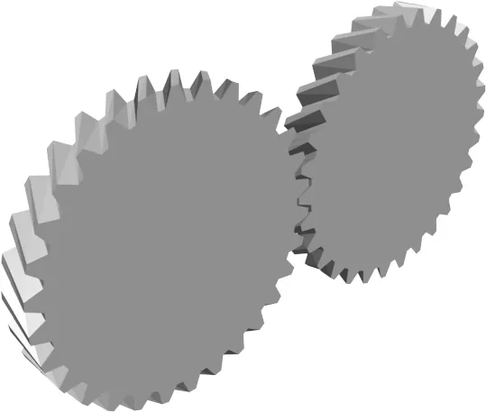

*Picture: [Anim engrenages helicoidaux.gif](https://commons.wikimedia.org/wiki/File:Anim_engrenages_helicoidaux.gif) by user:Sador, [CC BY-SA 3.0](http://creativecommons.org/licenses/by-sa/3.0/), from Wikimedia Commons.*

Cylindrical gears whose teeth are twisted at an angle (the helix angle) so each tooth engages gradually, making them quieter and stronger than straight spur gears; herringbone gears put a left-hand and a right-hand twist side by side so their sideways pushes cancel, and they are easy to 3D print.

**In plain words:** Gears whose teeth run across them at a slant (helical) or in a V or arrow pattern (herringbone), so they mesh gradually and run smoother and quieter than straight-toothed gears. **Proper term:** Helical gears and herringbone (double helical) gears.

**Also called:** helical gear / helical cylindrical gear; left-hand and right-hand helical gears (a parallel pair is always one of each); double helical gear (two opposite-hand helical halves, often with a groove between them); herringbone gear (double helical with the halves meeting in a continuous V); chevron gear; Wuest-type herringbone gear (halves staggered so tooth tip meets tooth gap); crossed helical gears / screw gears / skew gears (helical gears on shafts that cross without meeting); helical rack (straight toothed bar with slanted teeth); 'dry fixed' gear (old name given in Wikipedia 'Gear'); gear bearing / planetary herringbone gear bearing (the classic [print-in-place](../glossary.md#print-in-place) herringbone toy); Schraegstirnrad / Pfeilverzahnung (German for helical gear / herringbone toothing) ⚑ [uncertain].

## How it works

On a straight (spur) gear each new tooth slams into contact across its whole width at once. On a helical gear the teeth are slanted, so contact starts at a point on one edge and sweeps across the tooth; several teeth share the load at once, which makes the drive smoother, quieter and stronger. The slant also turns part of the driving force into a sideways push along the shaft ([axial](../glossary.md#axial--radial) thrust), which grows with the helix angle and must be held by thrust bearings. A herringbone (double helical) gear is two helical halves of opposite hand side by side, so their sideways pushes cancel, and the V-shaped teeth also pull the two gears into line with each other (self-centring and self-retaining). Helical gears can also mesh on shafts that cross without meeting (crossed helical or screw gears), where the angle between the shafts equals the sum of the two helix angles.

## Parts

A few parts: a pair of gears (on parallel shafts they have the same helix angle but opposite hands, one left-hand and one right-hand; herringbone partners are mirror images), their shafts and bearings. Plain helical gears also need thrust bearings, shoulders or collars to take the sideways push along the shaft. With herringbone gears one gear is usually left free to slide a little along its shaft so the pair can centre itself. A printed 'gear bearing' is a small assembly of a herringbone sun gear, several planet gears and a ring gear printed already meshed.

## Everyday examples

- Car gearboxes: the forward gears are helical and quiet, while reverse often uses cheaper straight spur gears, which is why reversing makes a louder whine (tec-science)
- 3D-printer extruders: herringbone gear sets on Greg's Wade's geared extruder (RepRap wiki)
- The Citroen car logo, two chevrons that represent herringbone gears (Wikipedia 'Herringbone gear')
- Printed fidget toys: herringbone planetary 'gear bearings' and helical gear fidgets

## When to use it

Use helical gears instead of spur gears when you want a quieter, smoother drive or more load capacity in the same space, especially at higher speeds, and you can fit bearings that take a sideways push. Use herringbone gears for 3D-printed gear trains in general (HowToMechatronics recommends them whenever possible): they are strong, quiet, have no net sideways push, centre themselves and print without supports. They are also the basis of self-contained print-in-place gear bearings and planetary toys. Use crossed helical (screw) gears to connect two shafts that cross without meeting, for light loads.

## When not to use it

Avoid plain helical gears if you can't carry the sideways push (no thrust bearings, gear held only by friction on a smooth shaft); use herringbone or spur gears instead. Avoid herringbone gears where gears must slide along their shafts into and out of mesh, as in sliding-gear gearboxes, or where the frame can't let one gear float to centre itself; use spur gears. For the cheapest, simplest drive, or where efficiency matters most in a printed gearbox, spur gears used slightly less power in HowToMechatronics' test. For shafts that meet at an angle use bevel gears; for a big reduction at right angles use a worm drive; crossed helical gears are only for light loads (KHK).

## Details

- **What it does (jobs):**
  - change speed or turning force: the same ratios as spur gears, but smoother, quieter and able to carry more load for their size
  - let it move (turn, slide or bend): a printed herringbone planetary 'gear bearing' works as a bearing that prints already assembled and holds itself together
- **Movement:** rotate: continuous rotation in and out on parallel shafts (or on crossed shafts for screw gears); unlimited range, either direction (a plain helical gear's sideways push reverses when the drive reverses)
- **Directions it can move (degrees of freedom):** 1: once meshed, turning one gear fixes the other through the [gear ratio](../glossary.md#gear-ratio); a herringbone pair also stops the two gears sliding sideways relative to each other, so it constrains the along-the-shaft direction too
- **Special behaviour:**
  - self-aligning or self-centring: herringbone (double helical) gears push each other into line along the shaft, so a gear left free to float centres itself on its partner (BOSL2 docs; Wikipedia 'Gear'; RepRap Herringbone Extruder Driver); in a printed planetary gear bearing this also holds the parts together (self-retaining, per EngineerDog)
  - none for plain helical gears: they simply pass rotation more smoothly and quietly than spur gears
- **How it holds:**
  - not a holding joint (it moves or passes on motion): the teeth pass rotation between shafts
  - shape (the parts interlock; [form-fit](../glossary.md#form-fit--force-fit--material-bond)): only in herringbone gear bearings and self-retaining herringbone sets, where the V-shaped teeth also keep the parts from sliding apart
- **Input and output:** Continuous rotation -> continuous rotation. Ratio = teeth on driven gear / teeth on driving gear, as for spur gears (RoyMech gives 1:1 to 1:6 per spur pair; ⚑ [uncertain] assumed similar for helical pairs). Efficiency: 98.0-99.5% for parallel-axis gears including helical (KHK technical reference; KHK's helical gear page says 90-99.5%); crossed helical (screw) gears only 70-95% because the teeth slide (KHK). HowToMechatronics measured slightly more motor power for printed helical and herringbone pairs than for spur (spur 5.36-5.61 W, helical 5.61-5.85 W, herringbone 5.61-6.1 W in one test). Shafts: parallel (opposite hands), or crossed at an angle equal to the sum of the helix angles for same-hand screw gears (Wikipedia 'Gear'; RoyMech). Back-drivable: yes, like spur gears. Axial thrust: a single helical gear pushes along its shaft, more with a larger helix angle (KHK); herringbone halves cancel it.
- **Power:** passive (no power needed)
- **Load:** Medium to heavy for their size: helical gears 'can bear more load than spur gears' (KHK) because several teeth share it, and herringbone gears carry high [torques](../glossary.md#torque) without net thrust, so they are used in heavy machinery and marine and turbine gearboxes (Wikipedia 'Herringbone gear'; tec-science). In HowToMechatronics' printed test (module 2, 12 mm wide) the herringbone failed at 120 N, spur at 116 N and helical at 112 N. Weakness of plain helical: the axial [thrust loads](../glossary.md#thrust-load) the bearings, so bearing wear is greater than with spur gears (tec-science).
- **Play and precision:** Small [backlash](../glossary.md#backlash); in one printed single-mesh test HowToMechatronics measured about 1.5 mm (helical) and 1.8 mm (herringbone) of play at 10 cm radius against 2.5 mm for spur, although in a two-stage 16:1 printed reducer spur was lowest (151 arc-minutes vs 168 herringbone and 175 helical). The RepRap Herringbone Extruder Driver used herringbone gears because they substantially reduce backlash and run quieter. They need the correct centre distance (KHK recommends H7 or H8 [tolerance](../glossary.md#tolerance)) and, for herringbone, the two halves in phase; a phasing error gives alternating sideways thrust and vibration (KHK). Herringbone gears with both shafts fixed and slightly misaligned fight each other and can be damaged (RepRap).
- **Taking it apart:** removable: gears are fixed to shafts with [set screws](../glossary.md#set-screw), keys, clamps or press fits and can be taken apart; print-in-place herringbone gear bearings are one permanent piece
- **How often it can be reused:** many times: the limit is tooth wear (a printed gear bearing is not meant to be taken apart)
- **Sealing:** none: the gears seal nothing; gearboxes use a housing and oil seals
- **Adjustable:** No: the centre distance and mesh are fixed by the frame. At the design stage the helix angle changes the [pitch](../glossary.md#pitch) diameter (a helical gear is larger than a spur gear with the same teeth by 1/cos of the helix angle), which lets a designer hit an awkward centre distance without changing tooth counts (BOSL2 docs). A herringbone gear is left free to float along its shaft so it centres itself.
- **Access needed:** not applicable: the gears sit on shafts inside a frame or housing
- **Materials:** Steel (KHK stock helical gears in S45C and induction-hardened SCM440), cast iron (large old double helical gears, e.g. the Commons photo from Musee Stella Matutina), bronze and plastics. 3D-printed: PLA, ASA, PLA-CF, ABS, PETG and nylon; in HowToMechatronics' spur gear test ASA (120.9 N) and PLA (116.9 N) beat PLA-CF (111 N), ABS (about 90 N) and PETG (87.2 N), while EngineerDog ranks nylon > PLA > ABS > PETG for printed gears overall (nylon for low friction and heat). Boundless 3D printed a print-in-place herringbone set in PETG-CF.
- **Heat, cold, water and wear:** Helical teeth slide more than spur teeth, so they need good [lubrication](../glossary.md#lubrication) (lubricant additives in industry, per Wikipedia 'Gear') and can run warmer. PLA gears soften above about 60 C (Prusa). Plain helical gears wear their bearings faster than spur gears because of the axial load (tec-science). HowToMechatronics found filament age, moisture and colour changed breaking strength noticeably, so test your own material. ⚑ [uncertain] Vibration can loosen set screws that also have to resist the axial push.

## Making it

- **Ways to make or get it:**
  - 3D print (FDM): 'by far the easiest way' to make herringbone gears (EngineerDog); also helical gears and print-in-place gear bearings
  - off-the-shelf part: helical gears (parallel pairs and crossed screw gears) and helical racks; double helical gears mostly for industry
  - CNC: helical gears are hobbed or milled; herringbone gears need special shapers (Sykes type) or a central groove for tool run-out (double helical) (Wikipedia 'Herringbone gear')
- **Printing it in one piece (print in place):** yes for herringbone planetary gear bearings (Emmett Lalish's 'Gear Bearing', Thingiverse thing 53451, and many remixes such as Henry's 'Fully Parametric Planetary Herringbone Gear Bearing' with 0.25 mm backlash) and simple herringbone pairs in a frame (Boundless 3D's print-in-place example with 0.2 mm or 0.5 mm gaps); helical gear pairs on separate shafts are normally printed separately and assembled
- **Tools:** Hex key or screwdriver for set screws; thrust washers or bearings for plain helical gears; grease. Herringbone gears must be brought into mesh sideways, not slid in along the shaft; RepRap advice is to leave one gear's grub screw loose, turn the drive a few times so the gears centre themselves, then tighten it.
- **Difficulty:** easy for printed herringbone and helical gears (free generators make them and they print flat without supports); plain helical gears need thrust bearings; precise metal herringbone gears are hard to machine (they can't be cut on a normal gear hobbing machine), so print them or buy grooved double helical gears

### 3D printing tips

1) Generate, don't draw: BOSL2 spur_gear() takes helical= (positive = left-hand, negative = right-hand) and herringbone=true; the FreeCAD Gears workbench makes helical and double helical gears; bd_warehouse has HelicalGear; Lucas's Printables collection gives ready herringbone STEP files (module 1, 15-degree helix, 14.5-degree pressure angle, prime tooth counts 7-97). 2) Pair hands correctly: on parallel shafts one gear is left-hand and the other right-hand with the same helix angle (KHK; tec-science); a herringbone partner is the mirror image. 3) Use the right centre distance: a helical gear's pitch circle is larger than a spur gear's by 1/cos(helix angle), so use BOSL2 gear_dist() or a = (z1 + z2) x normal module / (2 cos helix angle) (RoyMech) rather than the spur formula. 4) Helix angle: industry uses about 6-20 degrees for single helical and 25-40 degrees for herringbone (RoyMech); HowToMechatronics quotes 15-25 degrees. Printed flat, the tooth faces lean at roughly the helix angle, and Prusa printers manage 45-60 degree [overhangs](../glossary.md#overhang--bridging), so angles up to about 45 degrees print without supports ⚑ [uncertain] (reasoning, supported by k's '90-degree Helical Gear Fidget', whose 45-degree gears print fine and are offered with chamfered edges). 5) Print gears flat with the shaft vertical so every layer traces the full tooth outline; the herringbone V needs no support in either half. 6) Fight [elephant's foot](../glossary.md#elephants-foot) (a squashed, wider first layer that makes gears bind): HowToMechatronics used a 0.1 mm bed offset and -0.15 mm horizontal expansion; chamfering the bottom edge also helps. 7) [Clearance](../glossary.md#clearance): 0.2 mm between print-in-place parts on a well-tuned printer, 0.5 mm on a less tuned one (Boundless 3D); Prusa suggests starting at 0.3 mm for moving parts. 8) Strength: 5 or more walls and at least 35% [infill](../glossary.md#infill) (HowToMechatronics); 'use herringbone gears whenever possible, and ball bearings that can accept axial forces when using helical gears' (HowToMechatronics). 9) Tooth counts with no common factor spread wear evenly (EngineerDog: 15 and 31 rather than 15 and 30). 10) Assembly: herringbone gears can't be slid into mesh along their shafts, so design the frame so one gear drops in sideways, and let one gear float axially so the pair self-centres (RepRap; EngineerDog notes the self-retaining shape makes installation more work). 11) Gear bearings: Gamma4D's 'Perfect Gear Bearing' is sliced with 0% infill and 'Ensure vertical shell thickness' unticked; free the parts carefully after printing. 12) Grease lightly (white lithium, PTFE or silicone, per EngineerDog); PLA softens above about 60 C (Prusa).

### Buying one (off-the-shelf parts)

Helical gears for parallel shafts, sold as left-hand and right-hand pairs (McMaster-Carr: 21.5-degree helix, module 1, 20, 30 or 44 teeth; KHK KHG ground helical gears with 21 degree 30 minute helix and SH helical gears); crossed helical gears / screw gears (McMaster-Carr: 45-degree helix; same hand for 90-degree shafts); helical racks; ground helical racks; thrust bearings, angular-contact ball bearings and thrust washers to take the axial load; double helical gears are mainly industrial made-to-order parts ⚑ [uncertain]. 3D-printer extruder kits have used printed herringbone gear sets (Greg's Wade's geared extruder, RepRap).

## Rules of thumb

- Helix angle: usually chosen from 6, 8, 10, 12, 15 or 20 degrees for single helical; 25-40 degrees is fine for double helical because the thrusts cancel (RoyMech). HowToMechatronics quotes 15-25 degrees; tec-science 20-45 degrees depending on the application; KHK stock helical gears use 21 degrees 30 minutes.
- Axial thrust grows with the helix angle; spur gears have none (KHK 'Helix angle of gears'); fit thrust bearings for single helical gears (KHK helical gears page).
- A parallel helical pair has the same helix angle and opposite hands (KHK; tec-science).
- Crossed (screw) gears: shaft angle = helix angle 1 + helix angle 2 for the same hand; they must share pressure angle and normal pitch; contact is little more than a point (RoyMech; Wikipedia 'Gear'); efficiency 70-95%, light loads only (KHK).
- Speed: spur gears generally run below 10 m/s at the pitch line, helical gears over 50 m/s when accurately made and balanced (RoyMech); Wikipedia counts over 25 m/s as high speed, where helical gears are preferred.
- Efficiency of parallel helical pairs: 98.0-99.5% (KHK technical reference).
- Centre distance a = (z1 + z2) x normal module / (2 cos helix angle) (RoyMech).
- Herringbone halves must be in phase, or they create alternating axial thrust and vibration (KHK helical gears page).
- Printed gears: 5 or more walls, at least 35% infill, prefer herringbone (HowToMechatronics); print-in-place herringbone gaps of 0.2 mm (tuned printer) to 0.5 mm (loose) (Boundless 3D, Printables).

## Common failures

1) Single helical gears walk along their shafts or push the motor shaft, causing wear or noise: add thrust bearings or shaft collars, or switch to herringbone (KHK; HowToMechatronics). 2) Gears don't mesh because both have the same hand on parallel shafts: pair a left-hand with a right-hand gear (KHK). 3) Wrong centre distance because spur formulas were used: helical pitch circles are larger by 1/cos(helix angle) (BOSL2; RoyMech). 4) Herringbone pairs fixed on both shafts and slightly out of line bind and get damaged: let one float and tighten it after it centres (RepRap). 5) Vibration from herringbone halves out of phase (KHK). 6) Printed gears bind because of elephant's foot or too little clearance: [chamfer](../glossary.md#chamfer--fillet) edges, compensate the first layer, and use 0.2-0.5 mm gaps (HowToMechatronics; Boundless 3D). 7) Print-in-place gear bearings fused solid: increase clearance or tune the printer (Henry's design specifies 0.25 mm backlash and 'decently tuned tolerances').

## Safety

The in-running nip where teeth meet can trap fingers, hair or clothing; guard powered gears and switch off before touching them (KHK safety precautions). ⚑ [uncertain] A plain helical gear held only by a set screw can be pushed along its shaft by the axial thrust and come off or jam.

## Related

- Spur gears: straight teeth, no axial thrust and cheapest, but noisier and with more backlash in printed tests
- Crossed helical (screw) gears: helical gears on crossing shafts; quiet but light-duty and 70-95% efficient (KHK)
- Worm drive: an extreme helical gear (a helix angle close to 90 degrees) giving a large, often [self-locking](../glossary.md#self-locking) reduction
- Spiral bevel gears: the bevel-gear version of slanted teeth, for shafts that meet at an angle
- Planetary gear set and herringbone gear bearing: herringbone teeth are often used in printed planetary sets so they hold together
- Rack and pinion: a helical rack with a helical pinion gives smoother straight-line motion

## Make it yourself

- [BOSL2 gears.scad: spur_gear() with helical= and herringbone=true, gear_dist() (OpenSCAD library)](https://github.com/BelfrySCAD/BOSL2/wiki/gears.scad): Parametric OpenSCAD generator for helical, herringbone and crossed (skew) helical gears, with correct centre distances and backlash *(licence: BSD 2-Clause)*
- [FreeCAD Gears workbench (freecad.gears / FCGear), README](https://raw.githubusercontent.com/looooo/freecad.gears/master/README.md): FreeCAD add-on making involute and cycloid gears with helical and double helical (herringbone) teeth *(licence: GPL-3.0)*
- [bd_warehouse gears (build123d Python library): HelicalGear, RackGear](https://bd-warehouse.readthedocs.io/en/latest/gear.html): Python/build123d classes that generate helical gears and helical racks as STEP or STL *(licence: Apache-2.0)*
- [Herringbone Gear, Print in place example by Boundless 3D (Printables)](https://www.printables.com/model/932245-herringbone-gear-print-in-place-example): Print-in-place herringbone gear set in two versions: 0.2 mm gaps for well-tuned printers and 0.5 mm for less tuned ones *(licence: Creative Commons Public Domain)*
- [Gear Bearing by emmett, re-upload by dmacnulty (Printables; original at https://www.thingiverse.com/thing:53451)](https://www.printables.com/model/524763-gear-bearing-by-emmett): Emmett Lalish's classic print-in-place herringbone planetary gear bearing *(licence: CC BY-SA (as listed on the Printables re-upload))*
- [Fully Parametric Planetary Herringbone Gear Bearing by Henry (URL from Printables API, page not opened)](https://www.printables.com/model/395841-fully-parametric-planetary-herringbone-gear-bearin): Parametric Onshape version of the herringbone gear bearing with 0.25 mm backlash and a chamfered lip; STEP included *(licence: CC BY)*
- [Herringbone Gear Collection with STEP files by Lucas (URL from Printables API, page not opened)](https://www.printables.com/model/866460-herringbone-gear-collection-with-step-files): Ready herringbone gears, module 1, 15-degree helix, prime tooth counts from 7 to 97, with and without NEMA 17 motor bores *(licence: Creative Commons Public Domain)*
- [90-degree Helical Gear Fidget by k (URL from Printables API, page not opened)](https://www.printables.com/model/1624236-90-degree-helical-gear-fidget): Crossed helical gear toy: 40-tooth, 45-degree helix gears turning a corner, printable without supports *(licence: CC BY-NC)*
- [HUANGYAN920 Mechanical: interactive mechanism animations (entries 'HELICAL-GEAR', 'HERINGBONE-GEAR', 'CROSSED-HELICAL')](https://huangyan920.github.io/Mechanical/): Browser animations of helical, herringbone and crossed helical gear drives; its quick notes give herringbone efficiency as 95-97%, lower than KHK's 98-99.5%, so treat its numbers as rough *(licence: MIT)*

## Pictures, videos and models

- [Anim engrenages helicoidaux.gif (Wikimedia Commons, by Sador)](https://commons.wikimedia.org/wiki/File:Anim_engrenages_helicoidaux.gif): 3D animation of a pair of helical gears meshing *(licence: GFDL 1.2+ / CC BY-SA 3.0)*
- [Double-helical gear.jpg (Wikimedia Commons, by Parchaco)](https://commons.wikimedia.org/wiki/File:Double-helical_gear.jpg): Photo of a cast-iron double helical (herringbone) gear, likely from the Musee Stella Matutina *(licence: CC0 1.0 (public domain dedication))*
- [Double-helical bevel gear Citroen.jpg (Wikimedia Commons, photo by FDominec)](https://commons.wikimedia.org/wiki/File:Double-helical_bevel_gear_Citroen.jpg): About 2 m herringbone bevel gear made by Citroen around 1927 for the Mirejovice hydropower plant; it ran until 2011 *(licence: CC BY-SA 3.0)*
- [Herringbone gears / Double helical gears (Chris Maj, YouTube)](https://www.youtube.com/watch?v=U38sXLB7_vk): Video about herringbone and double helical gears (title and channel confirmed via oEmbed; not watched) *(licence: link only (standard YouTube licence))*
- [The CORRECT Way to Make Herringbone/Helical Gears in Fusion 360 (Christopher's Factory, YouTube)](https://www.youtube.com/watch?v=LTe67iSftPg): CAD tutorial on modelling helical and herringbone gears (title and channel confirmed via oEmbed; not watched) *(licence: link only (standard YouTube licence))*

## Needs confirming

⚑ marks something nobody has confirmed yet: a fact the research could not confirm from a source, a finder value that is a best guess, or an open point from the research notes. Corrections are welcome (see `research/needs-confirming.md`).

- ⚑ 6 sentences on this page marked [uncertain].

## Sources

- <https://en.wikipedia.org/wiki/Herringbone_gear>
- <https://en.wikipedia.org/w/index.php?title=Herringbone_gear&action=raw>
- <https://en.wikipedia.org/wiki/Gear>
- <https://en.wikipedia.org/w/index.php?title=Gear&action=raw>
- <https://khkgears.net/new/helical_gears.html>
- <https://khkgears.net/pdf/2023/helical-gears.pdf>
- <https://khkgears.net/new/gear_knowledge/gear-nomenclature/helix-angle-of-gears.html>
- <https://khkgears.net/new/gear_knowledge/gear-nomenclature/thrust-forces-acting-on-gears.html>
- <https://khkgears.net/new/gear_knowledge/gear_technical_reference/gear_types_terminology.html>
- <https://khkgears.net/new/gear_knowledge/abcs_of_gears-b/gear_types_and_characteristics.html>
- <https://khkgears.net/new/gear_knowledge/gear_technical_reference/gear_forces.html>
- <https://roymech.org/Useful_Tables/Drive/Helical_Gears.html>
- <https://roymech.org/Useful_Tables/Drive/Gears.html>
- <https://www.tec-science.com/mechanical-power-transmission/gear-types/helical-gears/>
- <https://www.tec-science.com/mechanical-power-transmission/gear-types/herringbone-gears-and-double-helical-gears/>
- <https://www.mcmaster.com/products/helical-gears/>
- <https://engineerdog.com/2017/01/07/a-practical-guide-to-fdm-3d-printing-gears/>
- <https://howtomechatronics.com/how-it-works/how-to-3d-print-gears-the-ultimate-guide/>
- <https://hackaday.com/2024/06/12/studying-the-finer-points-of-3d-printed-gears/>
- <https://reprap.org/wiki/Herringbone_Extruder_Driver>
- <https://help.prusa3d.com/article/modeling-with-3d-printing-in-mind_164135>
- <https://help.prusa3d.com/article/pla_2062>
- <https://commons.wikimedia.org/wiki/Category:Helical_gears>
- <https://commons.wikimedia.org/wiki/Category:Animations_of_gears_and_gearboxes>
- <https://commons.wikimedia.org/wiki/File:Anim_engrenages_helicoidaux.gif>
- <https://commons.wikimedia.org/wiki/File:Double-helical_gear.jpg>
- <https://commons.wikimedia.org/wiki/File:Double-helical_bevel_gear_Citroen.jpg>
- <https://www.youtube.com/watch?v=U38sXLB7_vk>
- <https://www.youtube.com/watch?v=LTe67iSftPg>
- <https://github.com/BelfrySCAD/BOSL2/wiki/gears.scad>
- <https://raw.githubusercontent.com/BelfrySCAD/BOSL2/master/gears.scad>
- <https://raw.githubusercontent.com/BelfrySCAD/BOSL2/master/LICENSE>
- <https://raw.githubusercontent.com/looooo/freecad.gears/master/README.md>
- <https://bd-warehouse.readthedocs.io/en/latest/gear.html>
- <https://raw.githubusercontent.com/gumyr/bd_warehouse/main/LICENSE>
- <https://huangyan920.github.io/Mechanical/>
- <https://api.printables.com/graphql/>
- <https://www.thingiverse.com/thing:53451>
