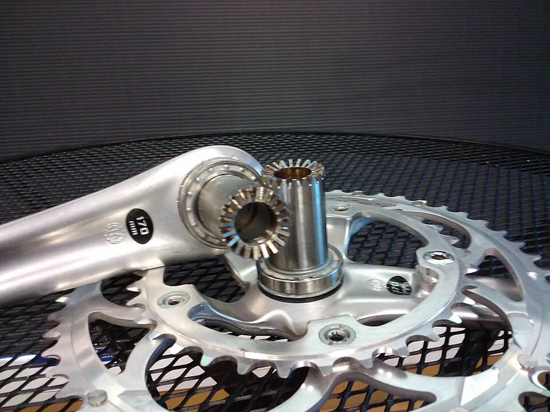
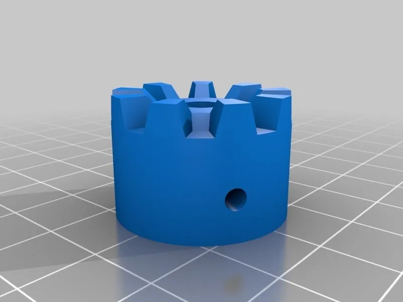

<figure class="eoc-pic eoc-pic-main"><picture><source media="(prefers-reduced-motion: reduce)" srcset="../media/drawn/hirth-joint.svg"></picture><figcaption><strong>Animation.</strong> Diagram drawn for the encyclopaedia from the research notes. ⚑ Needs confirming: a drawing can simplify or get details wrong; a real photo or a better diagram is welcome.</figcaption></figure>
<figure class="eoc-pic"><figcaption><strong>Photo.</strong> <a href="https://commons.wikimedia.org/wiki/File:Hirth_joint.jpg">Hirth joint</a> by AndrewDressel (talk), <a href="https://creativecommons.org/licenses/by-sa/3.0">CC BY-SA 3.0</a>, from Wikimedia Commons.</figcaption></figure>
<figure class="eoc-pic"><figcaption><strong>Photo.</strong> <a href="https://www.thingiverse.com/thing:397553">Customizable Hirth Joint (CSG version) (library)</a> by Lukas S., <a href="https://creativecommons.org/publicdomain/zero/1.0/">CC0</a>, from Thingiverse via Openverse.</figcaption></figure>

Two parts with matching rings of V-shaped teeth on their end faces are clamped together by a central screw, so they lock at any of a fixed set of angles with no play, and can be loosened, turned by a tooth or more, and locked again.

**In plain words:** Two discs with a ring of pointed teeth on their faces that mesh together; loosen the middle screw, turn to the next tooth, tighten, and it locks solid at that angle. **Proper term:** Hirth joint (Hirth coupling, Hirth serration; a type of face [spline](../glossary.md#spline)).

**Also called:** Hirth coupling; Hirth serration / Hirth serration ring; Hirth ring; face spline (the name used by the BOSL2 OpenSCAD library); face-tooth coupling / frontal-teeth coupling; rosette (film, camera and lighting trade name for the toothed disc); ARRI rosette (ARRI (brand) standard: 31.8 mm, 60 teeth, M6 screw); Manfrotto rosette (Manfrotto (brand) tripod and light-stand version); serrated discs (the toothed knuckle of a C-stand grip head or gobo head); angle adjustment discs (maker term); Curvic coupling (close relative with curved teeth); Hirth-Verzahnung / Hirth-Gelenk (German).

## How it works

Each face carries a ring of straight, V-shaped teeth that all point at the centre, like the spokes of a wheel. When a screw pulls the two faces together, the sloping sides of the teeth (tapered flanks) wedge into each other, which removes all play (zero [backlash](../glossary.md#backlash)) and pulls the two parts onto the same centre (self-centring). Because the flanks slope, any turning force also tries to push the halves apart, so the clamping force of the screw is what keeps the teeth seated. To change the angle, you loosen the screw until the teeth clear each other, turn to the next tooth (each tooth is 360 degrees divided by the number of teeth), and tighten again.

## Parts

A few parts: two toothed discs or rings (on the ends of the two parts being joined; for the common symmetric tooth shape the two halves are identical), one central clamping screw or bolt (a thumbscrew, knob, T-handle or ordinary bolt) and a threaded hole, nut or threaded insert for it. Camera and lighting versions often add a spring and a push button so the halves pop apart for adjusting.

## Everyday examples

- Film and video camera handles and extension arms that lock onto an ARRI rosette, a toothed disc with a thumbscrew in the middle
- The toothed knuckle (grip head) on top of a C-stand light stand, locked with a T-handle
- Tilting yokes on studio lights, which use a rosette (Hirth) joint to hold the lamp's angle
- Some bicycle cranksets, whose parts are joined by a Hirth joint (Campagnolo Ultra-Torque (brand); Specialized S-Works (brand) mountain-bike [cranks](../glossary.md#crank))

## When to use it

Use it for any adjustable arm, bracket or mount that must hold its angle firmly under load, where set steps are fine and you want to find the same setting again: camera and phone mounts, light and monitor arms, sensor or webcam brackets, tripod and tool attachments, folding stands, or rotating fixtures on a workbench. It is also a strong, play-free way to join two shaft pieces or a hub to a shaft that must come apart for servicing, and to make a rotating table lock precisely at fixed positions.

## When not to use it

Avoid it when you need any angle, not steps (use a friction clamp, a lockable ball head or a clamping hub), when the joint must move freely while in use (use a hinge or bearing), or when you need quick snap-to-position clicks without a screw (use a ball [detent](../glossary.md#detent) or detent hinge). Don't rely on it where a person can't retighten it and it could loosen through vibration without a locking method; add a thread-locking screw or spring. For a one-way [ratchet](../glossary.md#ratchet) feel use a face ratchet, and for drive that engages and disengages while running use a dog clutch.

## Details

- **What it does (jobs):**
  - click into set positions: it locks at any of n fixed angles (for example 60 positions, 6 degrees apart, on an ARRI rosette)
  - lock, and release by hand: tighten the screw or knob to lock, loosen it to adjust
  - join and hold: industrial Hirth rings join shafts, discs, rotors and crankshaft sections so they turn as one
  - line parts up exactly: the tapered teeth centre the two parts on each other and return to the same position every time
- **Movement:** rotate (for adjusting only): when loosened, one half can be turned through a full 360 degrees in steps of 360 degrees divided by the number of teeth; once tightened there is no motion at all
- **Directions it can move (degrees of freedom):** 0 when clamped (the teeth and screw lock every direction); when loosened and lifted apart it has 1 useful freedom, turning about the screw, but only in whole-tooth steps
- **Special behaviour:**
  - indexing (clicks into set positions): it can only lock at whole-tooth angles, so a setting is easy to find again and cannot slowly [creep](../glossary.md#creep) round under load the way a plain friction clamp can
  - self-aligning or self-centring: the tapered teeth pull the two parts onto the same centre, which is why turbine and machine-tool makers use it (Wikipedia; Voith)
  - hand-release only (locks under load, releases when a person operates it): it holds any load its teeth and screw can take until someone loosens the screw or presses the release button
  - quick-release: camera 'push-button rosettes' replace the thumbscrew with a button, so you press, turn the grip and let go, one-handed (CineD on Wooden Camera (brand))
- **How it holds:**
  - shape (the parts interlock; [form-fit](../glossary.md#form-fit--force-fit--material-bond)): the teeth interlock, so turning force is carried by tooth contact, not by friction
  - friction or clamping (force-fit): the screw's clamping force keeps the teeth pressed into mesh; without it the sloping teeth would ramp apart under [torque](../glossary.md#torque)
- **Input and output:** When used as a shaft coupling: rotation in -> the same rotation out (1:1, rigid, shafts in line), with no play (zero backlash). Nothing slides once it is clamped, so it wastes essentially no power. Back-drivable: yes, it is a rigid connection that passes turning force both ways. When used as an adjustable joint on an arm or mount it does not pass motion on at all; it just holds an angle.
- **Power:** passive (no power needed): held by the screw's clamping force; nothing changes if any powered equipment on it loses power
- **Load:** Heavy for its size in twisting (torque), because every tooth around the ring shares the load and capacity grows with diameter; Voith's standard rings are rated up to 15,000 kNm. Also stiff against bending and side loads. It is weak in pull-apart ([axial](../glossary.md#axial--radial)) direction: only the screw holds the halves together, and torque itself pushes them apart, so an under-tightened joint slips. 3D-printed versions are light to medium duty, limited by the plastic teeth and how much the screw can clamp without crushing or creeping the plastic.
- **Play and precision:** No play once clamped (zero backlash), because the tapered teeth wedge together (Wikipedia). Very repeatable: precision industrial rings index to 1-2 seconds of arc with repeat [accuracy](../glossary.md#repeatability--accuracy) under 0.001 mm (Voith). It tolerates almost no [misalignment](../glossary.md#misalignment) by design: the teeth force the two parts onto one centre and one angle. Friction matters: Croccolo et al. traced a machine tool that lost its positioning accuracy to friction between the teeth, and showed that if friction rises too high (wear, rust) the joint stops centring itself. A printed joint with slightly wrong tooth geometry rocks instead of seating flat (lendres, Printables).
- **Taking it apart:** removable: loosen the screw and the halves separate; camera and lighting versions with thumbscrews, knobs or push buttons are adjusted and removed without tools (tool-free), while industrial couplings use bolts
- **How often it can be reused:** many times: Voith describes Hirth serrations as easily detachable and wear-free; grip heads on rental film equipment use deep serrations so they keep gripping after years of re-tightening (Matthews Studio Equipment). Plastic (3D-printed) teeth wear and round over sooner.
- **Sealing:** none: the teeth leave open gaps between them; it does not seal anything
- **Adjustable:** Yes, in fixed steps: loosen, turn by one or more teeth, retighten. Step size = 360 degrees / number of teeth (60 teeth gives 6 degrees; Joe Federer's 31-ridge printed disc gives about 11.6 degrees). More teeth give finer steps but smaller, weaker teeth.
- **Access needed:** one side only (blind): a thumbscrew or bolt through one half screws into a threaded hole or insert in the other (ARRI rosettes have an M6 female thread), so after the threaded half is mounted you only need to reach the screw side
- **Materials:** Industrial rings: alloyed steels (Cr-Ni and Cr-Mo) or carbon steel, often case-hardened and ground (Croccolo et al.); camera rosettes: stainless steel and aluminium (Kupo; Wooden Camera). Printed: PETG or PLA for indoor mounts (Joe Federer prints in PETG and says PLA is fine); a heat-resistant material such as carbon-fibre nylon for hot studio lights (diystrument). Works between any two rigid parts that can carry a toothed face and a clamping screw.
- **Heat, cold, water and wear:** Heat: PLA softens and deforms above about 60 °C (Prusa), so use PETG, ASA or nylon near lamps and in cars; diystrument recommends a heat [deflection](../glossary.md#deflection) temperature of at least 70 °C for studio lights. Plastic under a constant clamping force slowly creeps and loses some clamp (in Thrinter's test none of the printed clips fully recovered their shape after a day under stress), so printed joints may need retightening. Rust, dirt and wear raise the friction between the teeth, which stops them centring properly (Croccolo et al.). Vibration: if the clamp is loose the teeth can rub and wear ([fretting](../glossary.md#galling--fretting)); Wikipedia notes tightness can be restored by retightening. Water, UV and chemicals: no limits beyond those of the material used.

## Making it

- **Ways to make or get it:**
  - 3D print (FDM): very common for maker mounts, arms and camera or light brackets
  - 3D print (resin): ⚑ [uncertain] suits small, fine-toothed discs, no specific example found
  - CNC: industrial teeth are milled and then ground in matched pairs (KAPP NILES grinding video); a hobby CNC can mill them
  - off-the-shelf part: ARRI-standard rosettes, rosette handles and arms, C-stand grip heads, Voith Hirth serration rings
- **Printing it in one piece (print in place):** no: the two toothed halves are printed as separate parts and joined by a screw; they have to be able to lift apart to re-index, so printing them already meshed defeats the purpose
- **Tools:** None for thumbscrew, knob or push-button versions (camera rosettes, grip heads); a hex key or spanner for bolted versions. For 3D-printed versions, a screw or bolt with a nut or heat-set threaded insert.
- **Difficulty:** easy to moderate: free generators (BOSL2 hirth(), mechadense's OpenSCAD library, lendres's Fusion 360/SolidWorks files) make the tricky tooth geometry for you and it prints without supports teeth-up, but the teeth must be geometrically correct and the screw needs a strong thread (nut or insert) to clamp hard enough

### 3D printing tips

1) Generate the teeth, don't draw them by eye: BOSL2 hirth(n, id, od, tooth_angle) makes identical mating halves (same tooth count needed; if you cone the teeth, use opposite cone angles on the two halves), and mechadense's OpenSCAD library and lendres's parametric Fusion 360/SolidWorks files do the same. lendres warns that many Hirth models online are geometrically wrong, so the mating faces are not parallel and the joint rocks; mechadense notes the trick is to build the teeth so they radiate from the centre (spherical rather than cylindrical coordinates). 2) [Chamfer](../glossary.md#chamfer--fillet) or round the tooth tips: BOSL2 chamfers the valleys by half as much as the tips so there is room for the parts to seat, which also hides small printing errors. 3) Orientation: print each disc with its teeth facing up, so the sloping tooth faces build as upward slopes needing no support ⚑ [uncertain: reasoning, not a tested rule]; if the teeth have to be on the bottom of a print, mechadense's tip is to cut off the lower half of every tooth to avoid supports, since cut teeth still mesh with full teeth (but not with other cut teeth). 4) Tooth count: more teeth give finer steps but smaller teeth; Joe Federer's 40 mm disc uses 31 ridges (about 11.6-degree steps), lendres's Manfrotto-compatible disc is 25 mm across with 25 teeth at a 60-degree tooth angle ⚑ [uncertain: fewer, larger teeth are sturdier in plastic]. 5) Clamping: use a metal bolt with a nut, [captive nut](../glossary.md#captive-nut) or [heat-set insert](../glossary.md#heat-set-insert), not a thread printed in plastic; diystrument's studio-light replacement swaps the original plastic pins, which fatigued and broke especially when over-tightened, for M5 countersunk screws, and warns that any screw head sticking out stops the joint seating. 6) Heat: PLA softens and deforms above about 60 °C (Prusa); diystrument recommends a filament with a heat deflection temperature of at least 70 °C near studio lights. 7) Plastic slowly gives under constant clamping force (creep), so a joint can loosen over weeks; re-tighten it, or add a spring washer to keep the clamp on ⚑ [uncertain]. 8) PETG works well (Joe Federer); PLA is fine for light indoor use.

### Buying one (off-the-shelf parts)

ARRI-standard rosette parts (ARRI (brand) standard: 31.8 mm diameter, 60 teeth, M6 female thread): bolt-on rosettes (e.g. with 3/8"-16 or M6 fixing and ARRI-standard locating pins), rosette handles, rosette extension arms, rosette brackets and push-button rosettes (sold by Kupo, SmallRig, Wooden Camera and others (brands)); Manfrotto (brand) rosette fittings; C-stand grip heads (gobo heads) with serrated discs and a T-handle; industrial Hirth serration rings, 24-720 teeth, 50-900 mm diameter (Voith (brand)); thumbscrews, wing knobs and T-handles in M6, 1/4"-20 or 3/8"-16; heat-set threaded inserts; spring washers.

## Rules of thumb

- Step angle = 360 degrees / number of teeth; the ARRI rosette has 60 teeth, so it locks every 6 degrees, on a 31.8 mm disc with an M6 thread (Kupo product page).
- Tooth profile angle is 60 or 90 degrees (Wikipedia 'Hirth joint'); Croccolo et al. (2018) treat it as fixed at 60 degrees for Hirth rings.
- Torque pushes the halves apart: with 60-degree teeth, the axial separating force is about tan 30 degrees = 0.58 times the tangential tooth force (Fa = Fu x tan(pi/6), friction ignored, where Fu = torque / mean tooth radius), so the bolt must clamp harder than that (Croccolo et al. 2018, [Actuators](../glossary.md#actuator) 7:79, CC BY 4.0).
- Put the teeth on a ring at the largest diameter available and leave the centre untoothed, because torque capacity grows with diameter (Wikipedia 'Hirth joint').
- Nominal bending stress allowed in steel teeth (Matzke, quoted by Croccolo et al.): 90 MPa for carbon steel with no shocks, 50 MPa with shocks, 35 MPa with shocks plus torsional vibration; tooth root radius over 0.3 mm.
- Both halves need the same tooth count; symmetric teeth are best for registration and loads in either direction, and coned teeth need opposite cone angles on the two halves (BOSL2 hirth() documentation).
- There is no ISO, DIN or AGMA standard for Hirth rings; they are designed and made as mating pairs (Croccolo et al. 2018; Wikipedia).
- Industrial reference points: 24-720 teeth, 50-900 mm diameter, indexing accuracy 1-2 seconds of arc, repeat accuracy under 0.001 mm (Voith Hirth serrations page).
- Hang the load so its weight tightens the clamp handle, not loosens it: 'handle on the right, load on the right' for a grip head (Matthews Studio Equipment). Wikipedia 'C-stand' gives the same rule: set the gear to one side of the grip head so its weight turns the locking knob clockwise ('righty tighty'), or the weight slowly loosens the head until the gear drops.

## Common failures

1) Slipping or jumping a tooth under load because the screw is too loose, the teeth are worn, or the thread is stripped (Matthews Studio Equipment): tighten fully, replace worn parts, use metal threads or inserts. 2) Rocking or not seating flat because the printed tooth geometry is wrong (lendres): generate teeth with a proper tool. 3) Teeth landing tip-on-tip so the joint seems tight but isn't engaged ⚑ [uncertain]: wiggle until they drop fully into mesh before tightening. 4) Printed pins or thin sections breaking from [fatigue](../glossary.md#fatigue), especially when over-tightened (diystrument): use metal fasteners and thicker walls. 5) Plastic creep or heat softening loosening the clamp: choose a heat-resistant material and retighten. 6) Loss of centring accuracy from high friction caused by wear or rust (Croccolo et al.). 7) Mismatched halves (different tooth counts or cone angles) that never mesh (BOSL2).

## Safety

A joint that is not fully tightened, or has worn teeth or a stripped thread, can let go suddenly and drop what it holds; film-set grip heads that slip can swing a flag onto an actor (Matthews Studio Equipment). Load it so the weight tightens the handle: on a C-stand grip head the gear must hang to the side that makes its weight turn the locking knob clockwise, or the weight slowly loosens the head and 'eventually' drops the gear (Wikipedia 'C-stand'). Also check the teeth are fully seated (not resting tip-on-tip) before letting go ⚑ [uncertain], and never rely on a worn joint over people. Fingers can be pinched between the toothed faces while adjusting ⚑ [uncertain].

## Related

- Face ratchet (star ratchet): also teeth on the end faces, but saw-shaped so it turns one way and clicks over the other; a Hirth joint's symmetric teeth lock both ways
- Dog clutch (claw clutch): a few chunky face teeth with gaps, meant to engage and disengage drive; it has play, while a clamped Hirth joint has none
- Curvic coupling: the same idea with curved teeth, used in high-speed turbines (Wikipedia)
- Spline shaft and servo spline hub: the teeth are on the side of a shaft instead of its end face, so parts can slide along it but there is usually a little [clearance](../glossary.md#clearance)
- Indexing plunger (pull-knob index pin): a single pin dropping into a ring of holes; fewer positions and some play, but no screw to undo
- Ball detent or detent hinge: clicks into positions but can be forced past them, so it does not lock
- Lockable ball head (ball-and-socket joint): holds any angle in several directions by friction, but can slip under heavy load
- [Kinematic coupling](../glossary.md#kinematic-coupling) (balls in V-grooves): also returns to exactly the same position when refitted, but uses only three contact points and is not for torque
- Tripod and stand screw mount: the single standard thread (1/4-20 or 3/8-16) or stand spigot that rosettes and grip heads are often fixed with; it uses anti-twist pins rather than teeth to stop the part turning

## Make it yourself

- [BOSL2 joiners.scad: hirth() module (OpenSCAD library)](https://raw.githubusercontent.com/BelfrySCAD/BOSL2/master/joiners.scad): Parametric Hirth face spline generator: tooth count, inner and outer diameter, tooth angle, cone angle, skew, chamfer or rounding, base and cropping; both halves are identical *(licence: BSD 2-Clause)*
- [scad-lib-hirthjoints (mechadense, OpenSCAD library), also on Printables as 'OpenSCAD Hirth Joints'](https://raw.githubusercontent.com/mechadense/scad-lib-hirthjoints/master/README.md): Minimal OpenSCAD library for geometrically correct flat or conical Hirth joints, with the half-tooth trick for printing teeth on the bottom without supports *(licence: LGPL-3.0 (per the Printables listing))*
- [Hirth Joint with Source Files and Documentation (lendres, Printables)](https://www.printables.com/model/114737-hirth-joint-with-source-files-and-documentation): Geometrically correct Hirth joint with editable Fusion 360 and SolidWorks source files, documentation, a Manfrotto-rosette-compatible STL (25 mm, 25 teeth, 60 degrees) and a large demonstration joint *(licence: CC BY)*
- [Hirth Disk - rotary lock (Joe Federer, Printables)](https://www.printables.com/model/1417161-hirth-disk-rotary-lock): 40 mm, 31-ridge printable locking disc with a 1/4-20 centre hole and screw holes for mounting; printed in PETG *(licence: CC BY)*
- [Godox SL150 Rosette Hirth Joint Replacement (diystrument, Printables)](https://www.printables.com/model/1600591-godox-sl150-rosette-hirth-joint-replacement-studio): Replacement rosette for a studio light's tilt joint, with notes on heat-resistant filament, supports and swapping plastic pins for M5 screws *(licence: CC BY-NC)*

## Pictures, videos and models

- [Hirth Verzahnungsringe.JPG (Wikimedia Commons, by Pfedelbacher)](https://commons.wikimedia.org/wiki/File:Hirth_Verzahnungsringe.JPG): Photo of a pair of Hirth coupling rings showing how the radial teeth mesh *(licence: Copyrighted free use (any use, including commercial, with no conditions))*
- [Hirth joint.jpg (Wikimedia Commons, by AndrewDressel)](https://commons.wikimedia.org/wiki/File:Hirth_joint.jpg): Photo of the Hirth joint in the middle of a taken-apart bicycle crankset (Campagnolo Ultra-Torque (brand)) *(licence: CC BY-SA 3.0 or GFDL 1.2+)*
- [Tete revolver ETR36 mecanisme 3d.svg (Wikimedia Commons, by Cdang)](https://commons.wikimedia.org/wiki/File:Tete_revolver_ETR36_mecanisme_3d.svg): Cutaway diagram of a CNC machine-tool turret head, which uses a Hirth coupling to lock each tool position *(licence: Public domain)*
- [How to design a perfectly-meshing Hirth joint/coupling (That can actually be manufactured!) (Project Hydra, YouTube)](https://www.youtube.com/watch?v=tbBrf8WJM5o): CAD walkthrough of correct Hirth tooth geometry, with the meshing teeth shown *(licence: link only (standard YouTube licence))*
- [ZE / ZP - grinding a Hirth coupling (EN) (KAPP NILES, YouTube)](https://www.youtube.com/watch?v=Ln_RCAz2qmY): Industrial grinding of Hirth coupling teeth, showing the real part up close *(licence: link only (standard YouTube licence))*

## Needs confirming

⚑ marks something nobody has confirmed yet: a fact the research could not confirm from a source, a finder value that is a best guess, or an open point from the research notes. Corrections are welcome (see `research/needs-confirming.md`).

- ⚑ 7 sentences on this page marked [uncertain].
- ⚑ Finder value `connects` = shaft (best guess): worked out from its name, but joining parts is not one of its two main jobs
- ⚑ Finder value `clicks` = clicks (best guess): the text uses both clicking and silent words
- ⚑ Finder value `clicks_do` = hold a set position (best guess): carried over from the finder's old rule on entry names (R33), for "What should the clicks do?" under "Control a movement > Click into set positions > Turns"

## Sources

- <https://en.wikipedia.org/wiki/Hirth_joint>
- <https://en.wikipedia.org/wiki/Curvic_coupling>
- <https://commons.wikimedia.org/wiki/Category:Hirth_joints>
- <https://commons.wikimedia.org/wiki/File:Hirth_Verzahnungsringe.JPG>
- <https://commons.wikimedia.org/wiki/File:Hirth_joint.jpg>
- <https://commons.wikimedia.org/wiki/File:Tete_revolver_ETR36_mecanisme_3d.svg>
- <https://www.voith.com/corp-en/products-services/connection-components-couplings/hirth-serrations.html>
- <https://pdfs.semanticscholar.org/0d6d/a308374fab7b707f9f2587c84987ca048b48.pdf>
- <https://kupogrip.com/kupo-arri-rossette-bolt-on-mount-m6/>
- <https://woodencamera.com/products/bolt-on-arri-rosette-3-8-16>
- <https://www.cined.com/wooden-camera-push-button-arri-rosette-thumbscrew-required/>
- <https://dslrvideoshooter.com/wooden-camera-rosette-gear-review/>
- <https://www.msegrip.com/blogs/learn/grip-head-explained>
- <https://raw.githubusercontent.com/BelfrySCAD/BOSL2/master/joiners.scad>
- <https://raw.githubusercontent.com/BelfrySCAD/BOSL2/master/LICENSE>
- <https://raw.githubusercontent.com/mechadense/scad-lib-hirthjoints/master/README.md>
- <https://api.printables.com/graphql/>
- <https://www.printables.com/model/114737-hirth-joint-with-source-files-and-documentation>
- <https://www.printables.com/model/430589-openscad-hirth-joints>
- <https://www.printables.com/model/1417161-hirth-disk-rotary-lock>
- <https://www.printables.com/model/1600591-godox-sl150-rosette-hirth-joint-replacement-studio>
- <https://www.printables.com/model/202276-hirth-joint-for-20x20-extrusions>
- <https://www.youtube.com/watch?v=tbBrf8WJM5o>
- <https://www.youtube.com/watch?v=Ln_RCAz2qmY>
- <https://www.youtube.com/watch?v=jiHUEhja9V0>
- <https://help.prusa3d.com/article/pla_2062>
- <http://thrinter.com/creep-abs-pla-petg-alloy-910/>
- <https://en.wikipedia.org/wiki/C-stand>
