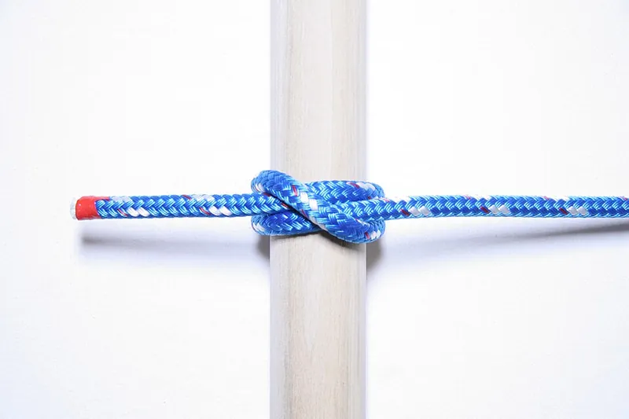
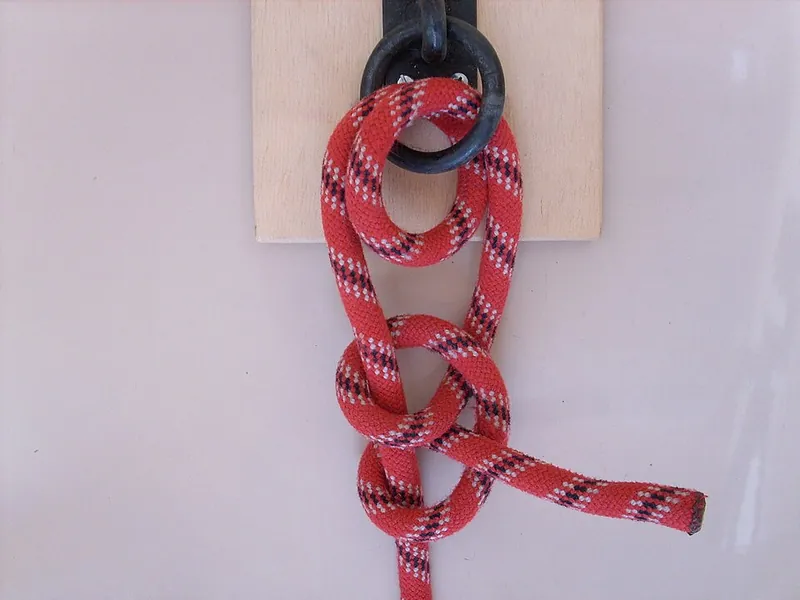

<figure class="eoc-pic eoc-pic-main"><figcaption><strong>Photo.</strong> <a href="https://commons.wikimedia.org/wiki/File:Clove_Hitch_-_ABoK_11_-_USCG.jpg">Clove Hitch - ABoK 11 - USCG</a> by USCG PTC Developer, <a href="http://creativecommons.org/publicdomain/zero/1.0/deed.en">CC0</a>, from Wikimedia Commons.</figcaption></figure>
<figure class="eoc-pic"><figcaption><strong>Photo.</strong> <a href="https://commons.wikimedia.org/wiki/File:Anderthalb_Rundt%C3%B6rn_mit_zwei_halben_Schl%C3%A4gen.jpg">Anderthalb Rundtörn mit zwei halben Schlägen</a> by Markus Bärlocher, Public domain, from Wikimedia Commons.</figcaption></figure>

A knot that ties a line directly to a post, rail, ring, bar, eye, log or a hole in a part, holding by the turns and tucks gripping the object and the rope itself, so it needs no hardware or tools and can be untied by hand; which hitch to use depends on what you tie to and whether you will adjust or release it.

**In plain words:** Ways of tying a rope, cord or string straight onto something solid, such as a post, rail, ring, bar, hook, eye or a hole in a part, with no hardware, so it holds while pulled and can be untied again by hand. **Proper term:** Hitch (hitch knot): clove hitch, round turn and two half hitches, cow hitch (lark's head), timber hitch, cleat hitch and Palomar knot.

**Also called:** hitch, hitch knot: a knot 'used to secure the end of a rope to a fixed object' (Wikipedia 'Round turn and two half-hitches'); clove hitch (ABOK #1245, p. 224, per Animated Knots; Wikipedia lists many related entries, e.g. #11, #1176-#1180, #1773-#1779); round turn and two half hitches (ABOK #1720, p. 296, per Animated Knots; Wikipedia also lists #1721, #1784, #1834-#1836, #1883, #1884, #1910); round turn and a half hitch, two round turns and two half hitches; with more turns, a pipe hitch (Wikipedia); two half hitches and buntline hitch: what you get by tying a clove hitch round the rope's own standing part after a turn round the object (Wikipedia 'Clove hitch'); cow hitch, lark's head, lark's foot, girth hitch, ring hitch, lanyard hitch, strap hitch, baggage tag loop, tag knot, strop bend (ABOK #1673 and #1802; lark's head #5) (Wikipedia 'Cow hitch'; Animated Knots 'Cow Hitch'); timber hitch, bowyer's knot, lumberman's knot, countryman's knot (ABOK #1665, p. 290; Wikipedia also lists #1668, #195, #479, #2161); with a half hitch added further along: timber hitch and half hitch, or killick hitch (Wikipedia 'Timber hitch'; Animated Knots 'Timber Hitch'); cleat hitch, cleat knot, cleat tie, on a horn cleat (ABOK #1615 per Wikipedia 'Cleat hitch'; Animated Knots cites #1594, p. 284, for the belaying-pin version); Palomar knot: a fishing knot for tying line to a hook, lure, swivel or small ring (Wikipedia 'Palomar knot', which gives no ABOK number; Animated Knots 'Palomar Knot'); anchor hitch, anchor bend, fisherman's bend (ABOK #1841, p. 309): a close alternative to the round turn and two half hitches on a ring (Animated Knots 'Anchor Hitch').

## How it works

A hitch takes the line round the object and then tucks it under itself, so that pulling on the loaded (standing) part pinches the tucked end against the object and holds it by friction. Extra turns round the object add friction, so the turns take most of the pull and the final hitches only have to hold what is left: the round turn 'should take the initial strain while you complete the knot' (Animated Knots), and on a small spar it 'makes a stronger knot and dissipates the wear' (Ashley, quoted by Wikipedia 'Round turn and two half-hitches'). The clove hitch is two single hitches made the same way round, and the cow hitch two made in opposite directions, which is why the cow hitch needs both legs pulled (Wikipedia 'Cow hitch'). The timber hitch grips only while it is pulled and 'practically falls apart when pull ceases' (Ashley, via Animated Knots). The Palomar doubles the line through the eye before tying a simple knot, which keeps 'almost all of the original line strength' (Wikipedia 'Palomar knot').

## Parts

Single piece: just the cord, plus the thing it is tied to (a post, rail, ring, eye bolt, hook, horn cleat, log or a hole in a part). Optional: a horn cleat to make tying off quick (Animated Knots 'Cleat Hitch'), or a washer that the cord is tied round so a printed hole doesn't take all the load (gm0 'Rigging').

## Everyday examples

- A boat fender tied to a rail with a clove hitch, and a mooring line made fast on a horn cleat (Animated Knots)
- A luggage tag or a phone or camera lanyard attached with a lark's head (cow hitch) loop, or a cord loop on a zip pull (Wikipedia 'Cow hitch')
- An animal's lead tied to a post or ring (Wikipedia 'Cow hitch'), or a line tied to a ring or dock post with a round turn and two half hitches (Animated Knots)
- Strings on a classical guitar or ukulele bridge, held by timber hitches (Wikipedia 'Timber hitch')

## When to use it

Use a hitch whenever a cord, string or rope has to be fixed to something solid and you have no hardware, or want to be able to untie it later: tying a line to a rail, post, ring or eye bolt; hanging things from a bar; fixing a lanyard loop to a ring or a printed eye; starting and finishing lashings round poles (the clove hitch 'is also commonly used in pioneering to start and finish a lashing', Wikipedia); lifting or dragging a log or a bundle of poles (timber hitch); tying off on a cleat; and tying fishing line, braid or thin string to a hook, ring or small eye (Palomar). In robots and printed mechanisms a hitch round a smooth post is a quick way to anchor a string, though clamping it under a bolt is easier to re-tension (gm0 'Rigging').

## When not to use it

Never for anything that holds a person (climbing, swings, rescue, lifting people): use rated equipment and trained methods. Not where the line must be pulled tight and adjusted: use Tensioning and adjustable hitches (trucker's hitch, taut-line hitch). Not where you need a fixed loop to drop over a hook or post: use Fixed loop knots (bowline, figure-eight loop). Not a clove hitch on its own for anything important, on a square post, or where the pull changes direction (Animated Knots; Wikipedia); back it up or use a round turn and two half hitches. Not a cow hitch with only one leg loaded (Wikipedia). Not to join two cords: use Bends for joining two cords. Not for steel wire rope: use Wire-rope terminations. Where the line must be released quickly under load or tied off often, a Cam cleat or Clam cleat is faster.

## Details

- **What it does (jobs):**
  - join and hold: ties a line to a post, rail, ring, bar, hook eye, eye bolt, log or a hole in a part
  - lock, and release by hand: all are tied and untied by hand with no tools; the timber hitch and a cleat hitch without a locking turn come off quickly, and a clove hitch can be loosened and slid to adjust the length (Wikipedia 'Clove hitch', 'Timber hitch'; Animated Knots 'Cleat Hitch')
- **Movement:** none once tied and loaded; a clove hitch can be rolled along a bar to move it, as when adjusting stage curtains (Animated Knots), and a cow hitch or round turn on a ring can slide round the ring.
- **Directions it can move (degrees of freedom):** 0 along the pull once tied and loaded; the line can still swing and twist about the object, and a ring can turn inside the hitch ⚑ [uncertain].
- **Special behaviour:**
  - quick-release: the timber hitch 'cannot jam and may be instantly loosened' (Ashley, quoted by Wikipedia 'Timber hitch'); a cleat hitch is often left without a locking half hitch where the line must be let go quickly under load (Animated Knots 'Cleat Hitch'); half hitches can be tied with a bight (a loop) instead of the end (Animated Knots 'Round Turn & Two Half Hitches')
- **How it holds:**
  - friction or clamping ([force-fit](../glossary.md#form-fit--force-fit--material-bond)): turns round the object and tucks under the standing part grip by friction; more turns give more grip (Wikipedia 'Round turn and two half-hitches' relates it to the capstan equation)
  - shape (the parts interlock; form-fit): a hitch closed round a ring, or through an eye or hole, cannot come off over the object; the Palomar's loop passes round the hook or ring (Wikipedia 'Palomar knot')
- **Input and output:** not applicable
- **Power:** passive (no power needed)
- **Load:** Light to medium, limited by the cord, which is weakest at the knot, and by how well the hitch grips the object. Strength figures differ, so here they are side by side: Animated Knots says to 'Assume that even brand new rope will perform at no more than 50% of its rated breaking strength'; a chart taken from Day's 'The Art of Knotting and Splicing' gives about 60% for the clove hitch, 65% for two half hitches and 70% for the timber hitch, but its compiler says it should 'only be used as a very rough guide' (IGKT Solent 'Knot Strength Chart'); SAIL Magazine's 2008 pull tests on 1/2 in rope at New England Ropes found a clove hitch with two half hitches lost 35% (nylon double braid), 36.6% (polyester double braid) and 61.44% (Spectra-cored braid) of the rope's strength, while a round turn and two half hitches 'rolled open in all three tests before the rope snapped', at 36-68% loss; for fishing line the Palomar 'retains almost all of the original line strength' (Wikipedia) and is 'one of the strongest and most reliable fishing knots' (Animated Knots). Strong only in a pull along the line: a cow hitch 'Can fail unless equal tension is applied to both of the standing parts', and a clove hitch 'Can spill if the standing part is pulled forcibly in the wrong direction' (Wikipedia). Never use a home-made knot to hold a person.
- **Play and precision:** not applicable: hitches don't locate parts; they settle and may slip a little when first loaded (a clove hitch in climbing rope 'will slip to a point, and then stop slipping', Wikipedia), so dress the knot, leave a tail and re-check it.
- **Taking it apart:** tool-free quick release: all are untied by hand. Some bind: a clove hitch in small cord 'may become difficult to untie' after heavy loading (Wikipedia 'Clove hitch'), while the cow hitch is 'less likely to bind and be hard to untie' (Animated Knots) and the timber hitch is 'easily untied even after heavy loading' (Wikipedia 'Timber hitch'). A Palomar in fine fishing line is usually cut off rather than untied ⚑ [uncertain].
- **How often it can be reused:** effectively unlimited: the knot can be retied again and again; the cord wears where it bends round the object, so inspect it ('inspect and test any knot you tie', Animated Knots 'Safety').
- **Sealing:** none
- **Adjustable:** Partly: with a clove hitch, 'feeding in rope from either direction will loosen the knot to be tightened at a new position' (Wikipedia 'Clove hitch'), and it can be rolled along a bar (Animated Knots); the other hitches are untied and retied to change length. To pull a line tight and adjust it, use the hitches in Tensioning and adjustable hitches.
- **Access needed:** not applicable as a fastener, but you must be able to reach round the post or rail, or pass the end through the ring, eye or hole. A cow hitch made with a closed loop 'can be tied without access to the ends of the fastening loop' (Wikipedia 'Cow hitch'); for a Palomar the hook or lure 'has to pass through the loop' (Animated Knots); a clove hitch made as stacked loops can be dropped over the end of a post (Animated Knots lists a loops method) ⚑ [uncertain].
- **Materials:** Any cord, rope, string or line: natural fibre, nylon, polyester and paracord; slippery high-modulus cords (Spectra, Dyneema) slip more and lost the most strength in SAIL Magazine's tests, and modern synthetic rope needs more timber-hitch turns (five or more instead of Ashley's three) (Wikipedia 'Timber hitch'); 'With certain types of cord, the clove hitch can slip when loaded' (Wikipedia); braided and monofilament fishing line (Palomar, recommended for braid by Animated Knots); abrasive Kevlar string (gm0). Tied to: wood, metal or printed posts, rails and pegs (round, not square: Wikipedia), rings and D-rings, eye bolts, horn cleats (PETG, ASA, ABS or nylon outdoors, not PLA: Printables 'Sun Sail Rope Cleat / Small Horn Cleat').
- **Heat, cold, water and wear:** Slippery modern fibres (Spectra, Dyneema, polypropylene) grip less: the Spectra-cored rope lost the most strength in SAIL Magazine's tests, 'With certain types of cord, the clove hitch can slip when loaded' (Wikipedia), and timber hitches in synthetic rope need five or more turns (Wikipedia). Repeated pulling and slackening (wind, waves, vibration) loosens knots: 'Many knots can loosen with prolonged intermittent strain' (Animated Knots 'Safety'), so back up hitches that will be left in place. Heavily loaded small cord can bind and become hard to untie (Wikipedia 'Clove hitch'). Printed posts and cleats: PLA 'is not ideal for sun, heat, or long-term outdoor tension'; use PETG, ASA, ABS or nylon outdoors (Printables 'Sun Sail Rope Cleat / Small Horn Cleat'). Wet natural-fibre rope swells and makes knots harder to untie ⚑ [uncertain].

## Making it

- **Ways to make or get it:**
  - off-the-shelf part: cord, rope and horn cleats; the hitch itself needs no making
  - 3D print (FDM): round posts, rails, eyes, slots and horn cleats to tie onto (Printables models in make_it_yourself)
  - woodwork: pegs, rails and cleats
  - laser cut or CNC: tie-off holes, slots and posts in sheet ⚑ [uncertain]
- **Printing it in one piece (print in place):** no: the post, eye or cleat is printed and the cord is tied on afterwards.
- **Tools:** None. Optional: a knife or scissors to trim the tail (the Palomar's to about 3 mm: Wikipedia 'Palomar knot'), a horn cleat, and a washer to tie abrasive string round in a printed part (gm0 'Rigging').
- **Difficulty:** easy: no parts and a few minutes' practice per knot with the Animated Knots animations; the design job is giving the part a round, smooth post, rail, eye or cleat to tie to.

### 3D printing tips

1) Make posts, pegs and rails round: the clove hitch 'is also unreliable when used on a square or rectangular post, rather than round' (Wikipedia 'Clove hitch'). 2) Give them a generous diameter and smooth edges: on a small spar a round turn 'makes a stronger knot and dissipates the wear' (Ashley via Wikipedia); round or [chamfer](../glossary.md#chamfer--fillet) the edges of holes and eyes, and for abrasive string such as Kevlar, 'tie the string around a washer to distribute the loads across the hole' instead of straight through a hole in a plastic part (gm0 'Rigging'). 3) If you need to re-tension the line, clamp it instead of tying it: 'Clamping a string with a bolt instead of tying it around something makes it much easier to quickly change the tension' (gm0). 4) Strength direction: a printed peg sticking out of a plate tends to snap along a layer line when a rope pulls it sideways, since 'FFF prints are stronger in one direction than another' (Prusa); print pegs lying down, or use a screw, bolt or metal pin as the post ⚑ [uncertain]. 5) Printed horn cleats: use PETG, ASA, ABS or nylon outdoors, because PLA 'is not ideal for sun, heat, or long-term outdoor tension'; add extra walls and [infill](../glossary.md#infill), mount with proper screws, and treat it as 'not certified marine, climbing, towing, or life-safety hardware' (Printables 'Sun Sail Rope Cleat / Small Horn Cleat'). 6) Make rings and eyes big enough: a round turn passes the cord through twice, and a Palomar's loop must pass over the whole object (Animated Knots) ⚑ [uncertain: no source gives a hole size]. 7) Typical failures: sharp hole edges cutting the cord, a square peg letting a clove hitch roll off, a thin printed eye splitting along its layers, and PLA cleats creeping in the sun.

### Buying one (off-the-shelf parts)

Horn cleats (nylon, aluminium or stainless), rope rings and D-rings, eye bolts and screw eyes, bollards and belaying pins for bigger lines; cords such as paracord, braided polyester or nylon cord, braided fishing line and monofilament; whipping twine or a hot knife to finish the tails (see Rope-end finishing). Search supplier catalogues by these names; the hitch itself needs no parts.

## Rules of thumb

- Choose by job (tying steps: Animated Knots pages in sources): clove hitch (ABOK #1245) to tie the middle of a line along posts or a rail, or for a quick hold you will adjust, but it 'should be deeply distrusted when used by itself'; round turn and two half hitches (ABOK #1720) to tie the end of a line to a ring, bar, pole or post, even while it is pulling; cow hitch or lark's head (ABOK #1673) to fix a loop, lanyard, tag or strap to a ring, bar or zip pull; timber hitch (ABOK #1665) to drag, lift or start a lashing round a log, pole or bundle; cleat hitch (ABOK #1615) on a horn cleat; Palomar knot for slippery fishing line or braid to a hook, swivel or small ring (Animated Knots; Wikipedia).
- Round turn first: the two passes of the round turn hold the strain while you tie, then add the half hitches, always 'in the same direction'; add one or two more turns for a heavy load (Animated Knots 'Round Turn & Two Half Hitches'). The anchor hitch (ABOK #1841) is so similar that it is 'doubtful if there is much benefit in using one knot over the other'; for anchors people add extra half hitches or seize the tail (Animated Knots 'Anchor Hitch').
- Back up a clove hitch: once adjusted, secure it with two half hitches round the standing part, as when tying a boat fender to a rail (Animated Knots 'Clove Hitch').
- Cow hitch: pull on both legs equally or it 'Can fail' (Wikipedia 'Cow hitch'); it is 'just as likely to slip as the Clove Hitch but less likely to bind' (Animated Knots).
- Timber hitch, sources differ: Ashley says 'three tucks or turns are ample', but later sources suggest five or more turns in modern synthetic rope; add a half hitch further along (killick hitch) when towing or lifting long items (Wikipedia 'Timber hitch').
- Cleat hitch: lead the line round the far horn first, then make figure-eight crossings; 'Two crossovers is the bare minimum'; don't take the first turn round under the first horn a second time or it may jam; leave off the locking half hitch on lines that may need releasing under load (Animated Knots 'Cleat Hitch').
- Palomar: moisten it before tightening and trim the tail to about 3 mm (Wikipedia 'Palomar knot'); make the loop big enough to pass over the hook or lure (Animated Knots).
- Rope strength with knots, side by side: no more than 50% of rated strength assumed (Animated Knots 'Safety'); about 60-70% for these hitches in a rough chart from Day (IGKT Solent); 35-68% lost in SAIL Magazine's 2008 tests. Design factor: 5:1 to 12:1 between breaking strength and working load, 12:1 for critical loads (Cordage Institute, quoted by Animated Knots 'Safety').
- Spread the load in printed parts: tie abrasive string round a washer rather than straight into a hole in plastic (gm0 'Rigging').

## Common failures

Clove hitch slips or rolls off: it 'slips and, paradoxically, can also bind' (Animated Knots); it spills if pulled hard in the wrong direction and is unreliable on square posts (Wikipedia); back it up with two half hitches or use a round turn and two half hitches. Round turn and two half hitches rolls open under very high load before the rope breaks (SAIL Magazine 2008): add extra half hitches or seize the tail (Animated Knots 'Anchor Hitch'). Half hitches tied in opposite directions: always tie them the same way round (Animated Knots). Cow hitch slides when only one leg is loaded (Wikipedia). Timber hitch lets go when the pull stops or with too few turns in synthetic rope: add turns and a half hitch (Wikipedia). Cleat hitch jams: the first turn went round the same horn twice (Animated Knots). Palomar fails: tail cut too short or knot tightened dry (Wikipedia). Cord frays or is cut at a sharp printed edge: round the edges or tie round a washer (gm0). Knot works loose over time under intermittent load (Animated Knots 'Safety').

## Safety

Never trust a home-made knot to hold a person: climbing, rescue, swings and lifting people need rated equipment and training. 'Handle rope with care, inspect and test any knot you tie, and respect any rope subject to a heavy load'; 'Never stand in a loop or a bight of a rope which may suddenly tighten, e.g. an anchor line or tow line'; and remember that angles, shock loads and moving loads can cut a rope's real strength far below its rating (Animated Knots 'Safety'). A loaded line that slips or breaks whips back, so keep faces and hands clear when testing ⚑ [uncertain]. Use a round turn so you can hold a pulling load while tying, and keep fingers out from between the rope and the post or cleat when the line is under strain ⚑ [uncertain]. A printed cleat or post is light-duty hardware, not certified for marine, towing or life-safety use (Printables 'Sun Sail Rope Cleat / Small Horn Cleat').

## Related

- Basic knots (overhand knot, half hitch, reef knot): the half hitch is the building block of these hitches
- Tensioning and adjustable hitches (trucker's hitch, taut-line hitch, Prusik): when the line must be pulled tight, adjusted or grip another rope
- Fixed loop knots (bowline, figure-eight loop, alpine butterfly): make a loop to drop over a post or clip to a ring instead of tying round it
- Bends for joining two cords (sheet bend, double fisherman's knot, water knot): join two lines instead of tying one to an object
- Pole lashings (square, diagonal, [shear](../glossary.md#peel-vs-shear) and tripod lashings): started and finished with clove hitches and timber hitches
- Stopper knots and cord-end anchors: stop a cord pulling back through a hole instead of tying round something
- Cam cleat and Clam cleat: hardware that holds a hauled line with no knot and releases with a flick
- Eye bolts, screw eyes and hooks: the rings and eyes these hitches are often tied to
- Spring-gate hook (carabiner, snap hook): clip on and off instead of tying
- Rope splices (eye splice, short splice, braided-rope splice): a permanent eye that keeps more strength than a knot

## Make it yourself

- [Sun Sail Rope Cleat / Small Horn Cleat (DirtFarmerIndustries, Printables) (URL from Printables API, page not opened)](https://www.printables.com/model/1780959-sun-sail-rope-cleat-small-horn-cleat): A small printed two-horn cleat for tying off light rope, cord and paracord with a figure-eight cleat hitch; PETG, ASA, ABS or nylon recommended outdoors; marked as not certified hardware *(licence: Standard Digital File License (Printables))*
- [Wrap Around Rope Cleat (Michael Hathaway, Printables) (URL from Printables API, page not opened)](https://www.printables.com/model/1207913-wrap-around-rope-cleat): A small scalable rope cleat for light loads, with a STEP file for editing *(licence: Creative Commons Attribution-ShareAlike)*
- [Rope Cleat (B3dprint, Printables) (URL from Printables API, page not opened)](https://www.printables.com/model/560128-rope-cleat): A simple printable rope cleat to practise cleat hitches on *(licence: Creative Commons Public Domain)*

## Pictures, videos and models

- [Hitch Knots (Animated Knots by Grog)](https://www.animatedknots.com/hitch-knots): Index of step-by-step animated hitches, including the clove hitch (three methods), cow hitch, round turn and two half hitches, cleat hitch and anchor hitch, each with ABOK references and notes *(licence: Animated Knots content; link only)*
- [Clove Hitch - ABoK 11 - USCG.jpg (Wikimedia Commons)](https://commons.wikimedia.org/wiki/File:Clove_Hitch_-_ABoK_11_-_USCG.jpg): A clove hitch round a rail, described as used 'to secure ropes running along a series of posts, belaying, starting lashings, weak binding' *(licence: CC0)*
- [Anderthalb Rundtörn mit zwei halben Schlägen.jpg (Wikimedia Commons, by Markus Bärlocher)](https://commons.wikimedia.org/wiki/File:Anderthalb_Rundt%C3%B6rn_mit_zwei_halben_Schl%C3%A4gen.jpg): A round turn and two half hitches on a ring, the main image on Wikipedia 'Round turn and two half-hitches' *(licence: Public domain)*
- [Tête d'alouette.jpg (Wikimedia Commons, by Malta)](https://commons.wikimedia.org/wiki/File:T%C3%AAte_d%27alouette.jpg): A cow hitch (lark's head), the main image on Wikipedia 'Cow hitch' *(licence: CC BY-SA 2.5)*
- [PalomarKnotSequence.jpg (Wikimedia Commons, by Vaughan Pratt)](https://commons.wikimedia.org/wiki/File:PalomarKnotSequence.jpg): Photo sequence of the steps in tying a Palomar knot *(licence: CC BY-SA 3.0)*

## Needs confirming

⚑ marks something nobody has confirmed yet: a fact the research could not confirm from a source, a finder value that is a best guess, or an open point from the research notes. Corrections are welcome (see `research/needs-confirming.md`).

- ⚑ 9 sentences on this page marked [uncertain].
- ⚑ Finder value `usual_process` = by hand (tied or wrapped) (best guess): first-listed process was "off-the-shelf part: cord, rope and horn "; knots family, so set to by hand (tied or wrapped)
- ⚑ Finder value `made_of` = 3D prints, plastic sheet, tube or moulded parts, wood, metal, carbon fibre or composites, fabric, leather or cord (best guess): proposed from the words in the research text (R37); not yet checked

## Sources

- <https://www.animatedknots.com/hitch-knots>
- <https://www.animatedknots.com/clove-hitch-knot-rope-end>
- <https://www.animatedknots.com/round-turn-two-half-hitches-knot>
- <https://www.animatedknots.com/cow-hitch-knot-end-method>
- <https://www.animatedknots.com/timber-hitch-knot>
- <https://www.animatedknots.com/cleat-hitch-knot-dock-line>
- <https://www.animatedknots.com/anchor-hitch-knot>
- <https://www.animatedknots.com/palomar>
- <https://www.animatedknots.com/safety>
- <https://en.wikipedia.org/wiki/Clove_hitch>
- <https://en.wikipedia.org/wiki/Round_turn_and_two_half-hitches>
- <https://en.wikipedia.org/wiki/Cow_hitch>
- <https://en.wikipedia.org/wiki/Timber_hitch>
- <https://en.wikipedia.org/wiki/Cleat_hitch>
- <https://en.wikipedia.org/wiki/Palomar_knot>
- <https://sailmagazine.com/diy/busted/>
- <https://igkt-solent.co.uk/knot-strength-chart/>
- <https://gm0.org/en/latest/docs/common-mechanisms/linear-motion-guide/rigging.html>
- <https://help.prusa3d.com/article/modeling-with-3d-printing-in-mind_164135>
- <https://commons.wikimedia.org/wiki/File:Clove_Hitch_-_ABoK_11_-_USCG.jpg>
- <https://commons.wikimedia.org/wiki/File:Anderthalb_Rundt%C3%B6rn_mit_zwei_halben_Schl%C3%A4gen.jpg>
- <https://commons.wikimedia.org/wiki/File:T%C3%AAte_d%27alouette.jpg>
- <https://commons.wikimedia.org/wiki/File:Timber_Hitch_(PSF).png>
- <https://commons.wikimedia.org/wiki/File:PalomarKnotSequence.jpg>
- <https://api.printables.com/graphql/>
