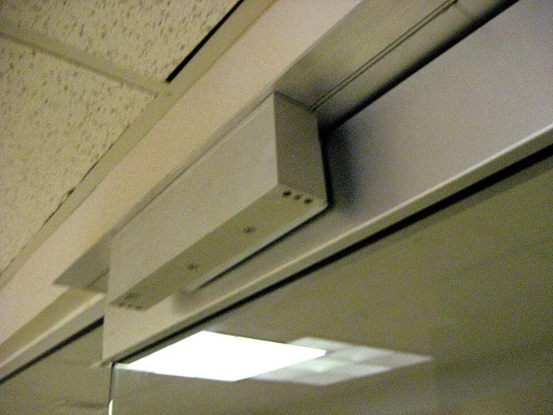

<figure class="eoc-pic eoc-pic-main"><figcaption><a href="https://commons.wikimedia.org/wiki/File:Magnetic_Lock.jpg">Magnetic Lock</a> by Mooinglemur, Public domain, from Wikimedia Commons.</figcaption></figure>

An electromagnet (a coil of wire around an iron core) that clamps onto a flat steel plate with great force while current flows and releases it as soon as the current stops, used to lock doors, hold fire doors open, and let robots and cranes pick up and drop steel parts.

**In plain words:** A flat electric magnet that grips a steel plate very hard while it is switched on and lets go the moment the power is cut, like the magnetic locks at the top of office and school doors. **Proper term:** Holding electromagnet (electro holding magnet); on doors: electromagnetic lock (maglock).

**Also called:** electromagnetic lock / electromagnet lock; maglock / mag lock / magnetic door lock; electro holding magnet / electromagnetic holding magnet; electromagnet and armature plate (strike plate); round or pot electromagnet module (hobby sizes sold by [holding force](../glossary.md#holding-force), e.g. 'P25/20' 5 kg); electromagnetic door holder / fire door holder / door hold-open magnet (a weak version that holds doors open); [shear](../glossary.md#peel-vs-shear) lock (a maglock variant with interlocking plates); lifting electromagnet / crane magnet / scrap magnet (large version); electromagnetic gripper / magnetic end effector (robots); electromagnetic chuck (machine-tool work holding).

## How it works

Current flowing through the coil turns the iron core into a strong magnet, and the magnetic field pulls the steel plate flat against the magnet's face (magnetic attraction across the pole faces). The pull is greatest when the plate touches the whole face with no gap; it falls off very fast with even a thin gap of paint, rust, dirt or plastic, and it is much weaker against sliding the plate sideways (shear) than against pulling it straight off. When the current is switched off the field collapses and the plate comes free; a small leftover (residual) magnetism is dealt with by a spring-loaded ejector pin, a rubber washer, a coating or a special release circuit. There are no moving parts inside.

## Parts

A few parts: the electromagnet (a copper coil wound in a soft-steel pot core or a stack of E-shaped steel plates, sealed with non-magnetic potting resin and machined flat), a flat soft-steel armature plate (strike plate) or the steel object itself, mounting brackets and screws (a door maglock's plate hangs on one centre bolt with a rubber washer between steel washers so it can tilt), and the electrics: a DC power supply, a switch, relay or transistor, and a diode across the coil. Door versions often add a bond sensor (checks the plate is fully held), a door sensor, a status LED, a relock timer and an exit button.

## Everyday examples

- the magnetic locks along the top of office, school and apartment entrance doors that open with a card, keypad or exit button
- fire-door holders on corridor walls that keep heavy doors open and let them swing shut when the fire alarm sounds
- the big round magnet on a scrapyard crane that picks up scrap steel and drops it when switched off
- escape-room doors and secret bookcase doors that pop open when a puzzle is solved

## When to use it

When you want something held firmly and released instantly by an electric signal, and it is fine (or even required) for it to let go if the power fails: doors controlled by a keypad or card reader, escape-room props and secret doors, fire-door hold-opens, robot grippers and tool holders that pick up and drop steel parts, and quick-change fixtures for steel tooling. It is simple, silent, has no moving parts to wear or jam, tolerates a bit of door [misalignment](../glossary.md#misalignment) when the plate can pivot, and is easy to drive from an Arduino through a relay or MOSFET.

## When not to use it

Not when a power cut must not release it (lifting over people, a safe, anything that must stay locked in an outage): use an electro-permanent magnet, a [fail-secure](../glossary.md#fail-safe--fail-secure) [solenoid](../glossary.md#solenoid) latch or electric strike, or a servo latch. Not for battery projects that must hold for hours (it draws current the whole time): use an electro-permanent magnet or a mechanical latch. Not for non-steel parts (aluminium, plastic, most stainless steel): add a steel plate or use a vacuum gripper. Not where the load slides sideways, peels or jerks: use a bolt-type latch or add a shelf, pins or a lip to take the shear. Not for real security on doors that can be pried at the gap, and not on exit doors without code-compliant release hardware.

## Details

- **What it does (jobs):**
  - hold or release using power: holds only while powered and lets go when switched off
  - join and hold: clamps a door, a held-open fire door, a robot's steel part or a crane's load firmly in place
- **Movement:** none: nothing moves inside; the armature plate on a door can tilt slightly on its centre bolt so it sits flat against the magnet
- **Directions it can move (degrees of freedom):** 0 while powered and clamped: the plate is held flat against the magnet (very strong against pulling straight off, much weaker against sliding). When the power is off the two parts are simply separate (6, completely free).
- **Special behaviour:**
  - quick-release: lets go within a fraction of a second when the power is cut, from a switch, keypad, card reader, fire-alarm panel or microcontroller
  - fail-safe or breakaway: it fails safe, i.e. unlocks whenever power is lost, which is why maglocks are used on exit doors and why fire-door holders let doors close in a power cut; a fire-door holder is also weak enough for anyone to pull the door off it by hand
  - self-aligning or self-centring: a door maglock's armature plate pivots on its centre bolt and rubber washer so it settles flat on the magnet face (the magnet does not locate parts precisely)
- **How it holds:** magnetic + powered hold: the magnetic pull exists only while current flows through the coil
- **Input and output:** not applicable
- **Power:** powered: needs a steady DC current the whole time it holds, e.g. about 0.5 A at 12 V or 0.25 A at 24 V (about 5-6 W) for a 600 lb door maglock, and about 0.3 A at 5 V for a 5 kg hobby module. If power is lost it releases (fail-safe). To stay locked through a power cut it needs a battery or UPS backup. (A 'holding magnet with electrical release', which holds with a permanent magnet and lets go while a reverse current flows, behaves the opposite way; see related types.)
- **Load:** light to heavy depending on size: hobby modules are rated 2.5-25 kg (about 25-250 N), industrial electro holding magnets about 150-2,100 N, and door maglocks about 275-2,000 lbf (1.2-8.9 kN). Very strong in a straight pull off the face; much weaker against sliding (shear), peeling up one edge or sudden jerks. The rating assumes thick, clean, flat soft steel in full contact, and a hobby electromagnet realistically lifts only about 1/5 to 1/10 of its rated holding force.
- **Play and precision:** Not a precise locator: the plate can land anywhere on the face as long as it covers it, and it holds wherever it lands. No play once clamped. It tolerates small misalignment only if the plate can tilt to sit flat (door plates pivot on their centre bolt); any gap or tilt that stops full face contact cuts the holding force sharply.
- **Taking it apart:** tool-free quick release: switching off the power releases it instantly; the magnet and plate themselves are screwed or bolted in place and removed with a screwdriver
- **How often it can be reused:** effectively unlimited: nothing wears except the contact faces, which must be kept clean and undamaged (BEA's 600 lb maglock is listed at UL 294 Endurance Level IV)
- **Sealing:** none: it holds but does not seal the joint (door maglocks are potted in resin, and weatherproof versions exist for gates)
- **Adjustable:** The position is mostly fixed when fitting (door armature plates self-adjust on their rubber washer; slotted brackets allow fine tuning). The holding force rises and falls with the current, so electromagnets allow adjustable force levels and some grippers regulate current to suit the load. Door maglock controllers often have adjustable relock timers (e.g. 1-90 s on BEA units).
- **Access needed:** one side only (blind): both the magnet and the plate go on the inside (secure) face and can be surface-mounted; door armature plates are often through-bolted, which does need both sides of the door
- **Materials:** Magnet: enamelled copper wire coil on a soft iron or mild-steel core (often laminated E-shaped plates), sealed in non-ferrous potting resin and plated against corrosion. Armature or target: soft magnetic (low-carbon) steel, about 1/8 in (3 mm) thick or more and at least as large as the magnet face. It only grips iron and steel: aluminium, brass, wood and plastic are not attracted, and 300-series (austenitic) stainless steel is nearly non-magnetic. Brackets can be steel, aluminium, wood or 3D-printed plastic (PETG, ASA or nylon rather than PLA, because the coil gets warm).
- **Heat, cold, water and wear:** Heat: the coil warms whenever it is on (hot ratings assume about 60 °C above ambient, Geeplus) and a hotter coil pulls a little less; printed housings near it should be PETG, ASA or nylon rather than PLA (PLA softens above about 60 °C, Prusa). BEA's standard 600 lb maglock is rated for 0-49 °C (32-120 °F), 0-85% humidity, indoor and dry only; weatherproof versions exist for gates. Rust, dirt, paint or ice on the faces acts like an air gap and weakens it, so the faces are plated and should be kept clean (Locksmith Ledger; Magnet-Schultz). Vibration and sudden jerks can pop the plate off even below the rated force (Magnet-Schultz). Residual magnetism can build up over time in older designs so the door drags when unpowered (Locksmith Ledger). The magnetism itself does not [creep](../glossary.md#creep) or fade while powered, but printed brackets may creep under constant load ⚑ [uncertain].

## Making it

- **Ways to make or get it:**
  - off-the-shelf part: door maglocks, electro holding magnets, hobby electromagnet modules, electromagnetic door holders
  - 3D print (FDM): brackets, housings with cooling slots, coil bobbins, robot gripper shells, and pockets that hold a steel armature plate flush with the surface
  - woodwork: fitting maglocks to cabinet doors, secret bookcase doors and escape-room props
  - sheet metal: steel armature plates and L, Z or U mounting brackets
- **Printing it in one piece (print in place):** no: the electromagnet and steel plate are bought parts; printed brackets, housings and bobbins are separate parts that the magnet is screwed or glued into
- **Tools:** To fit: drill and screwdriver (plus the maker's mounting template and thread-locking compound for door maglocks), wire strippers or a soldering iron, a regulated DC power supply, and a relay or logic-level MOSFET board with a flyback diode if a microcontroller switches it. To open once installed: nothing, just cut the power.
- **Difficulty:** easy: buy a ready-made maglock or hobby electromagnet module, screw it on, and switch it with a relay or MOSFET plus a diode; winding your own coil is possible but bought units are stronger for their size

### 3D printing tips

Keep plastic out of the magnetic path: leave the magnet's pole face and the steel plate bare and flush, because even a thin layer of paint, plastic or a printed skin acts as an air gap and cuts the pull sharply (Magnet-Schultz; Radial Magnets quotes a 30-50% drop at about 1 mm). Let the armature plate float: mount it on a single centre screw with a rubber washer between steel washers and don't over-tighten, so it can tilt and sit flat on the magnet (BEA maglock guide); a printed pocket that holds a steel plate should let it sit proud of the plastic. Use soft (mild) steel at least about 3 mm (1/8 in) thick and as large as the magnet face for the plate (Magnet-Schultz). Heat: the coil warms up whenever it is on. In a published 3D-printed robot gripper run at 24 V and 1 A, the winding reached about 72 °C after 20 minutes and about 114 °C after 2 hours, while the printed shell reached 45 °C; the authors printed the shell in Onyx (nylon with carbon fibre, 145 °C heat-softening point) and cut radial and [axial](../glossary.md#axial--radial) slots in it for cooling (Ruo et al. 2025). PLA softens above about 60 °C, PETG is suitable below about 80 °C and ASA up to about 93 °C (Prusa), so print housings that touch the coil in PETG, ASA or nylon, add vents, or leave room for a small fan (Printables 857827 has 20 x 20 mm fan cut-outs). Strength: a printed bracket has to carry the whole holding force. Hobby 2.5-25 kg modules are fine in printed mounts with thick walls, screws into [heat-set inserts](../glossary.md#heat-set-insert) and generous washers; a 600 lb (2.7 kN) door maglock needs its metal bracket or through-bolts, and printed parts are best used only as spacers or covers (Printables 175082 is a PETG/PLA mounting for a 180 kg gate magnet printed at 40% [infill](../glossary.md#infill)). Printed parts slowly creep under a load that never goes away, so check them for sagging over time ⚑ [uncertain: no creep figures opened for this use]. Coil bobbins can be printed and wound by hand for your own electromagnet (Printables 257865), though a bought pot-core module is far stronger for its size. The two half-shells of the published gripper were designed to print flat-side-down on the bed with no supports (Ruo et al. 2025).

### Buying one (off-the-shelf parts)

Electromagnetic lock / maglock (surface-mount, 12/24 VDC, sold by holding force such as 60 kg, 180 kg, 280 kg / 600 lb and 1,200 lb; options with bond sensor, door status sensor, LED and relock timer) with its armature plate and L, Z or U brackets (U brackets for frameless glass doors); shear lock; electromagnetic door holder (fire door holder, 12/24 VDC or 24 VAC/120 VAC) with swivel armature; electro holding magnet (round pot type, e.g. 150-2,100 N ranges) with matching armature plates; hobby electromagnet modules (5 V round 'P20/15', 'P25/20', 'P30/22', 'P40/20' sizes rated 2.5-25 kg); holding magnet with electrical release (permanent magnet, reverse-polarity release); regulated, power-limited DC power supply; relay module or logic-level N-channel MOSFET; flyback diode such as 1N4007; request-to-exit button or sensor for doors.

## Rules of thumb

- A hobby electromagnet's 'holding force' is not what it can lift: divide the holding force by 5-10 for a rough lifting capacity, e.g. a 5 kg module lifts about 1 kg; it depends on flatness, contact area and the steel (Adafruit, https://www.adafruit.com/product/3873).
- Rated forces are measured pulling the plate straight off along the centre axis with the whole face in flush contact; shear (sliding) holding force is much lower, partial air gaps and dirt 'significantly decrease' hold force, and loads should be applied gradually because a sudden jerk can separate them (Magnet-Schultz of America, https://magnet-schultzamerica.com/resources/blog/holding-electromagnet-usage-and-mounting-guide/). A magnet vendor's guide puts shear resistance at typically 15-25% of rated pull and pull at 30-50% less with about 1 mm of paint or plastic gap (Radial Magnets, https://radialmagnet.com/magnets-for-holding-and-latching/).
- Armature plates should be soft magnetic steel; 1/8 in (about 3 mm) is the standard thickness, and thinner plates carry less magnetic flux and hold less (Magnet-Schultz of America, https://magnet-schultzamerica.com/resources/blog/holding-electromagnet-usage-and-mounting-guide/).
- Upper limit: an iron core saturates at about 1.6-2 tesla, which gives a maximum magnetic pressure of about 1,000 kPa (145 psi) from F = B²A/2μ0, i.e. at most roughly 100 N per square centimetre of fully contacting pole face; real magnets hold less (Wikipedia, https://en.wikipedia.org/wiki/Electromagnet).
- Door maglock sizes: micro 275 lbf, mini 650 lbf, midi 800 lbf, standard 1,200 lbf, shear lock 2,000 lbf; they draw about 5-6 W, e.g. 0.5 A at 12 VDC or 0.25 A at 24 VDC (Wikipedia, https://en.wikipedia.org/wiki/Electromagnetic_lock; BEA 600 lb guide, https://us.beasensors.com/files/downloads/products/ul-listed-maglocks/user-guides/en/75.5366.10.EN-MAGLOCKS-600lb-20230828.pdf). Under UL 294 testing, BEA's '600 lb' model is rated at 500 lb static strength and 33 ft-lb dynamic strength (same BEA guide).
- Every switched coil needs a flyback (freewheeling) diode across it: when it is switched off the stored magnetic energy produces a large voltage spike that arcs across switch contacts or damages transistors (Wikipedia, https://en.wikipedia.org/wiki/Electromagnet; Adafruit requires a 'driver with kick-back protection', https://www.adafruit.com/product/3873).
- Switch the DC side: if the power switch is not wired between the DC supply and the magnet (e.g. mains is switched instead), the magnet takes longer to let go, which looks like residual magnetism (BEA, https://us.beasensors.com/files/downloads/products/ul-listed-maglocks/user-guides/en/75.5366.10.EN-MAGLOCKS-600lb-20230828.pdf).
- Coil temperature: catalogue 'hot' ratings assume the coil runs about 60 °C above ambient (about 80 °C at 20 °C ambient) (Geeplus, https://www.geeplus.com/electromagnets-general-technical-information/); copper's resistance rises about 0.4% per °C, so a hot coil draws less current and pulls a little less (Binder, https://www.binder-magnetic.com/en/content/31-technical-explanations-for-solenoids; observed in Ruo et al. 2025, https://iris.unimo.it/retrieve/9e272f86-73a2-4b1f-b8c7-359f661f1ca2/1-s2.0-S0957415825000832-main.pdf).

## Common failures

(1) Weak hold or the door can be pulled open: paint, rust, dirt, a printed skin or a warped plate leaves a gap; the plate is too thin or too small; the plate is bolted rigidly so it can't sit flat (BEA: don't over-tighten, the rubber washer lets it self-align); or the load is sliding rather than pulling straight off. Fix: clean, flat, thick soft steel in full contact, let the plate pivot, and take sideways loads with a stop. (2) Door sticks after the power goes off: residual magnetism; newer maglocks have a release circuit, and holding magnets can have a spring-loaded ejector pin (Locksmith Ledger; Geeplus). Also switch the DC side of the supply, not the mains side (BEA). (3) Microcontroller pin, transistor or relay contacts die: no flyback diode across the coil. (4) Printed housing sags, discolours or melts: coil heat; use PETG, ASA or nylon, add vents, and check the coil temperature after an hour. (5) Drops its load when the power flickers or a wire comes loose: this is how it is designed; use an electro-permanent magnet or a mechanical latch where that matters. (6) Supply too weak: the magnet is underpowered and holds less; size the supply for the rated current.

## Safety

Doors that people walk through: a maglock must release for exit; the Life Safety and building codes (NFPA 101, IBC, IFC) require extra hardware such as exit buttons or motion sensors and release on fire alarm, and electric locking must never stop panic hardware or an emergency exit from working (Schlage; BEA). Escape-room builders use fail-safe maglocks plus a kill switch so nobody can be trapped (Hackaday). Because it fails open, a power cut unlocks it: for security add battery or UPS backup (one Hackaday home build used a UPS giving 6+ hours). Anything held by an electromagnet drops instantly if the power fails, so never lift over people or hold an overhead load with one (Walmag). Switching off the coil makes a high-voltage spike: always fit a diode. Coils get hot. Use a regulated, power-limited supply and have mains wiring done properly (BEA). Keep fingers out of the gap between plate and magnet on strong locks ⚑ [uncertain: common-sense pinch hazard, not from an opened source].

## Related

- Electro-permanent magnet: also switched electrically, but uses only a short pulse to switch and then holds with no power; keeps holding if the power fails
- Switchable permanent magnet (rotary magnetic base): turned on and off by hand with a knob, no electricity at all
- Magnet joint (embedded permanent magnets, magnetic catch): always on; pulled apart by hand
- Holding magnet with electrical release (permanent electro holding magnet): a permanent magnet holds with no power and a reverse current cancels it to let go, so it stays locked in a power cut
- Solenoid latch and electric strike: a steel bolt blocks the door instead of magnetic pull; can be fail-secure, is not weakened by small gaps, but needs good alignment
- Electromagnetic brake and electromagnetic clutch: the same coil-and-armature-plate idea used to stop or drive a shaft
- Vacuum (suction) gripper: the robot alternative for picking up non-steel objects
- Servo or motorised latch: holds its position with no power and uses power only to move

## Make it yourself

- [A low-cost 3D printed electromagnetic gripper for robotic arms (Ruo et al., University of Modena and Reggio Emilia, Zenodo)](https://zenodo.org/records/11103762): Open-source robot-arm electromagnetic gripper: STEP and STL files of the printed shell, a building and setup guide, a cost analysis and test videos (300 g and 1,500 g samples) *(licence: CC BY 4.0)*
- [Attaching the electromagnet (180kg) to the gate by Marián (Printables 175082; URL from Printables API, page not opened; details read via the Printables public API)](https://www.printables.com/model/175082-attaching-the-electromagnet-180kg-to-the-gate): Printed mounting parts for a 180 kg electromagnetic lock on a gate (PETG/PLA, 40% infill, no supports) *(licence: CC BY-SA)*
- [Electromagnet Mounting bracket for mounting to 8020 railing by BillyBobPrintin (Printables 857827; URL from Printables API, page not opened; details read via the Printables public API)](https://www.printables.com/model/857827-electromagnet-mounting-bracket-for-mounting-to-802): Bracket that holds electromagnet coils on T-slot aluminium extrusion, with vents, a 20 x 20 mm fan cut-out and pockets for M2 heat-set inserts *(licence: CC BY-SA)*
- [Electromagnet - lets create your own electromagnet by GymRBK (Printables 257865; URL from Printables API, page not opened; details read via the Printables public API)](https://www.printables.com/model/257865-electromagnet-lets-create-your-own-electromagnet): Printable coil frames (bobbins) for winding your own electromagnet, from a school project *(licence: CC BY-NC-SA)*
- [Arduino - Electromagnetic Lock (ArduinoGetStarted tutorial)](https://arduinogetstarted.com/tutorials/arduino-electromagnetic-lock): Wiring diagram and example code for switching a 12 V maglock from an Arduino through a relay *(licence: link only)*

## Pictures, videos and models

- [Magnetic Lock.jpg (Wikimedia Commons, Mooinglemur, 2008)](https://commons.wikimedia.org/wiki/File:Magnetic_Lock.jpg): Close-up photo of an electronically controlled door maglock: the long magnet body and its steel armature plate *(licence: Public domain)*
- [Wooden fire door magnet.JPG (Wikimedia Commons, BrokenSphere, 2008)](https://commons.wikimedia.org/wiki/File:Wooden_fire_door_magnet.JPG): An electromagnetic fire-door holder on a wall holding a wooden fire door open; it releases when the fire alarm cuts the power *(licence: CC BY-SA 3.0 (also CC BY-SA 1.0/2.0/2.5 and GFDL 1.2+))*
- [Tuerhaftmagnet-ankerplatte.jpg (Wikimedia Commons, Lars Karlsson, 2006)](https://commons.wikimedia.org/wiki/File:Tuerhaftmagnet-ankerplatte.jpg): Close-up of an electromagnetic door holder and its swivelling armature plate, which tilts to sit flat on the magnet *(licence: Public domain)*
- [MAGLOCKS 600LB User's Guide (BEA, 2023, PDF)](https://us.beasensors.com/files/downloads/products/ul-listed-maglocks/user-guides/en/75.5366.10.EN-MAGLOCKS-600lb-20230828.pdf): Installation drawings of a door maglock: magnet on the frame, armature plate on the door, and the centre bolt with rubber and steel washers that lets the plate pivot; wiring diagrams *(licence: link only (manufacturer document))*
- [Understanding MAGLOCKS (Playful Technology, YouTube; title confirmed via YouTube oEmbed)](https://www.youtube.com/watch?v=7N87X-6VG84): Video about electromagnetic locks for escape-room builders *(licence: link only)*

## Needs confirming

⚑ marks something nobody has confirmed yet: a fact the research could not confirm from a source, a finder value that is a best guess, or an open point from the research notes. Corrections are welcome (see `research/needs-confirming.md`).

- ⚑ 3 sentences on this page marked [uncertain].
- ⚑ Finder value `connects` = any solid parts (best guess): joins parts, but no specific kind of part found; set to any solid parts
- ⚑ Finder value `power_loss` = lets go (best guess): versions differ: lets go, stays locked

## Sources

- <https://en.wikipedia.org/wiki/Electromagnetic_lock>
- <https://en.wikipedia.org/wiki/Electromagnet>
- <https://en.wikipedia.org/wiki/Electromagnetic_door_holder>
- <https://commercial.schlage.com/en/resources/training-education/schlage-101/electromagnetic-locks.html>
- <https://www.locksmithledger.com/electronics-access-control/article/10856574/guide-to-electromagnetic-locks>
- <https://us.beasensors.com/files/downloads/products/ul-listed-maglocks/user-guides/en/75.5366.10.EN-MAGLOCKS-600lb-20230828.pdf>
- <https://magnet-schultzamerica.com/resources/blog/holding-electromagnet-usage-and-mounting-guide/>
- <https://www.geeplus.com/electromagnets-general-technical-information/>
- <https://www.tds-pp.com/en/product/electromagnets/>
- <https://radialmagnet.com/magnets-for-holding-and-latching/>
- <https://www.binder-magnetic.com/en/content/31-technical-explanations-for-solenoids>
- <https://www.walmagmagnetics.com/blog/differences-between-permanent-magnets-electropermanent-magnets-and-electromagnets>
- <https://www.adafruit.com/product/3873>
- <https://arduinogetstarted.com/tutorials/arduino-electromagnetic-lock>
- <https://iris.unimo.it/retrieve/9e272f86-73a2-4b1f-b8c7-359f661f1ca2/1-s2.0-S0957415825000832-main.pdf>
- <https://zenodo.org/records/11103762>
- <https://hackaday.com/2022/08/03/a-classic-tv-trope-for-an-escape-room/>
- <https://hackaday.com/tag/magnetic-lock/>
- <https://help.prusa3d.com/article/pla_2062>
- <https://help.prusa3d.com/article/petg_2059>
- <https://help.prusa3d.com/article/asa_1809>
- <https://commons.wikimedia.org/wiki/File:Magnetic_Lock.jpg>
- <https://commons.wikimedia.org/wiki/Category:Magnetic_locks>
- <https://commons.wikimedia.org/wiki/File:Wooden_fire_door_magnet.JPG>
- <https://commons.wikimedia.org/wiki/File:Tuerhaftmagnet-ankerplatte.jpg>
- <https://www.youtube.com/watch?v=7N87X-6VG84 (verified via YouTube oEmbed)>
- <https://www.printables.com/model/175082-attaching-the-electromagnet-180kg-to-the-gate (read via https://api.printables.com/graphql/)>
- <https://www.printables.com/model/857827-electromagnet-mounting-bracket-for-mounting-to-802 (read via https://api.printables.com/graphql/)>
- <https://www.printables.com/model/257865-electromagnet-lets-create-your-own-electromagnet (read via https://api.printables.com/graphql/)>
- <https://api.printables.com/graphql/>
