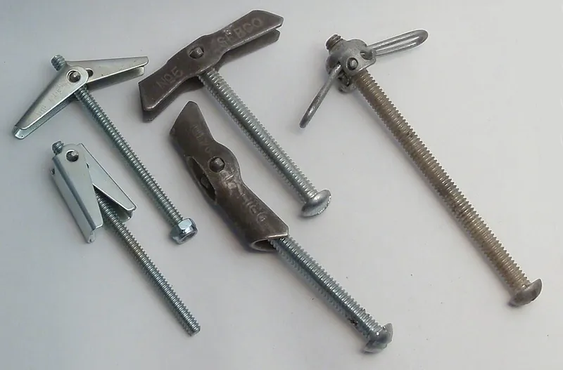

<figure class="eoc-pic eoc-pic-main"><figcaption><strong>Photo.</strong> <a href="https://commons.wikimedia.org/wiki/File:Toggle_bolts.JPG">Toggle bolts</a> by Tenbergen (talk), <a href="https://creativecommons.org/licenses/by-sa/3.0">CC BY-SA 3.0</a>, from Wikimedia Commons.</figcaption></figure>

A hollow-wall anchor gives a screw something to hold on to in plasterboard, hollow doors and panels, either by opening out behind the board (toggles, mollies, winged anchors) or by cutting a coarse thread into it (self-drilling anchors), because a plain screw or wall plug would pull straight out of the thin, soft board.

**In plain words:** A fixing for hollow walls such as plasterboard: you push it through a hole (or screw it straight into the board) and it opens out, spreads or digs in behind the thin board, so a screw can hold where on its own it would pull straight out. **Proper term:** Hollow-wall anchor (cavity fixing, drywall anchor): toggle bolt (spring, gravity and strap toggles), molly bolt (metal cavity anchor), self-drilling plasterboard anchor and winged plastic anchor.

**Also called:** drywall anchor (US); plasterboard fixing; cavity fixing; cavity anchor; hollow-wall anchor; hollow-door anchor (Wikipedia 'Molly (fastener)'; Eugene Fasteners); toggle bolt; butterfly anchor; spring toggle; wing toggle; spring-wing anchor (Wikipedia 'Toggle bolt'; Eugene Fasteners; fischer KD); gravity toggle: a toggle bar that swings into place by its own weight (fischer KM 10; Ramset GravityToggle (brand); Indexfix); strap toggle; snap toggle; channel toggle; SNAPTOGGLE and TOGGLER (brands) (TOGGLER data sheet; Eugene Fasteners); molly; molly bolt (often misspelt 'moly'); MOLLY was registered as a trademark in 1934 and is now used generically (Wikipedia 'Molly (fastener)'); metal cavity fixing; metal hollow wall plug; hollow wall anchor (fischer HM; Eugene Fasteners); self-drilling drywall anchor; threaded drywall anchor; screw-in plasterboard fixing; self-drill fixing; 'EZ anchors' or 'Zip-It anchors' (trade names) (Art of Manliness; fischer GK); SnapSkru (brand, TOGGLER); winged plastic anchor; plastic toggle; pop toggle; nylon toggle (Wikipedia 'Drywall anchor'; Art of Manliness; fischer DuoTec); plasterboard plug; 'Rigipsdübel' or 'Gipskartondübel' (German names, from a Wikimedia Commons file description).

## How it works

Plasterboard is only about 10-15 mm of soft gypsum between paper, so a screw thread or an ordinary plug crushes it and pulls out. Hollow-wall anchors avoid this by bearing on the back of the board over a wide area: a toggle's wings or bar are pushed through the hole folded and then spring, swing or are pulled open behind the board, and tightening the bolt clamps the board between the wings and the screw head (Wikipedia 'Toggle bolt'; Eugene Fasteners). A molly's sleeve is slit along its length; turning its screw pulls the far end towards you so the strips between the slits buckle outward into 'petals' that press on the back of the board, while spikes under the flange stop it turning (Wikipedia 'Molly (fastener)'; fischer HM). A self-drilling anchor is screwed straight into the board and its wide, deep thread spreads the load through more gypsum than a screw could (Art of Manliness; fischer GK).

## Parts

A few parts that act as one unit. Spring toggle: a machine screw and a pair of spring-loaded folding wings (Art of Manliness; Wikipedia 'Toggle bolt'). Gravity toggle: a single bar pivoting on a threaded rod (fischer KM 10; Indexfix). Strap toggle: a steel channel, two plastic straps with a [ratchet](../glossary.md#ratchet), a sliding plastic cap and a bolt (TOGGLER SNAPTOGGLE data sheet). Molly: a slotted metal sleeve with a front flange and anti-turn spikes, plus its machine screw (Wikipedia 'Molly (fastener)'; fischer HM). Self-drilling anchor: one nylon or zinc-alloy piece with a drill point, a coarse thread and a screw hole, used with your own screw (fischer GK; Art of Manliness). Winged plastic anchor: one moulded plastic piece whose legs fold out when the screw goes in (Wikipedia 'Drywall anchor').

## Everyday examples

- Towel rails, curtain rails and light fittings on plasterboard walls (fischer HM applications)
- Pictures, lamps and light shelves hung on stud walls with spring toggles (fischer KD applications)
- The plastic anchors that come in the box with a coat hook or towel rail (Art of Manliness)
- A large mirror, heavy shelf or TV bracket on a hollow wall held with toggle bolts (Art of Manliness; Eugene Fasteners)

## When to use it

Use a hollow-wall anchor when you must fix something to plasterboard, a hollow-core door or a thin panel where there is no stud or batten behind the spot you need (Wikipedia 'Molly (fastener)'). Self-drilling and plastic anchors are quick for light items such as pictures, coat hooks, towel rods and small shelves (Art of Manliness); mollies for medium loads and anything you may take down and refit, because the anchor stays and the screw can be removed (Wikipedia 'Molly (fastener)'; fischer HM); toggles, especially strap toggles, for the heaviest hollow-wall loads such as large mirrors, shelves and TV brackets, and for hollow concrete block (Art of Manliness; TOGGLER data sheet). For shallow cavities or unknown board thickness, short self-drilling anchors need little space behind (fischer GK).

## When not to use it

For heavy, tip-prone or safety-critical items (wall cabinets, TVs, bookcases, anything children could climb), screw into studs or noggins, or fit a timber batten across several studs, rather than relying on anchors in the board alone (Art of Manliness; Anchor It). Not for solid brick, block or concrete walls: use a wall plug or masonry anchor there. Avoid plastic and self-drilling anchors in ceilings and for loads that pull straight out; a printed anchor's designer warns that 'Installed in a ceiling where the force is directed straight away from the drywall the anchor will support even less weight' (Printables 730522), and Eugene Fasteners says capacity is reduced in ceilings. Avoid mollies for loads over about 100 lb or in drywall under 3/8 in (Eugene Fasteners). Don't use fischer's nylon GK in gypsum fibreboard or tiled plasterboard (fischer GK). Don't fix into wet or damaged board: 'Gypsum will soften with exposure to moisture' (Wikipedia 'Drywall'). If a stud is right behind the spot, a plain wood screw into the stud is stronger than any anchor (Wikipedia 'Wall stud').

## Details

- **What it does (jobs):**
  - join and hold: fixes pictures, shelves, rails, lights, TV brackets and cabinets to plasterboard walls and ceilings, hollow doors, panels and hollow block where there is no stud behind (Wikipedia 'Molly (fastener)'; fischer HM and KD; Art of Manliness)
- **Movement:** none: once tightened the anchor and fixture can't move
- **Directions it can move (degrees of freedom):** 0: the board is clamped between the anchor and the screw head. A loose or spinning anchor (hole too big, board crushed) is a failure, not a feature.
- **Special behaviour:**
  - none of the listed behaviours: it is a fixed anchor point
  - Its own tricks: it is fitted entirely from the front, opening out in a cavity you can't see; a molly or strap toggle keeps its anchor in the wall when the screw is removed, so a fixture can be taken down and refitted (Wikipedia 'Molly (fastener)': 'permit repeated withdrawals and reengagements of the associated bolt'; TOGGLER data sheet: 'Reusable in the same hole')
- **How it holds:**
  - shape (the parts interlock; [form-fit](../glossary.md#form-fit--force-fit--material-bond)): toggle wings, a toggle bar or channel, molly petals and the legs of winged plastic anchors open out behind the board and bear on its back face; the board is trapped between them and the screw head (Wikipedia 'Toggle bolt'; fischer HM: 'the expanding arms swing open and press onto the reverse side of the board'); a self-drilling anchor's thread gives 'a secure, positive fit fixing' in the gypsum (fischer GK)
  - friction or clamping (force-fit): plain plastic expansion anchors in plasterboard 'expand out when you drive a screw in them' and press on the sides of the hole (Art of Manliness); tightening any anchor also clamps the board
  - spring force (a spring or springy part presses it in place): spring toggles open by a spring; a gravity toggle drops open by its own weight (Art of Manliness; fischer KM 10)
- **Input and output:** not applicable
- **Power:** passive (no power needed)
- **Load:** Light to medium, limited by the board rather than the anchor. Maker's recommended loads (safety factors already applied) for one anchor in 12.5 mm plasterboard: about 0.08 kN (8 kg) for a nylon self-drilling anchor, 0.15-0.18 kN (15-18 kg) for steel spring toggles in pull-out, and 0.20 kN (20 kg) for a metal cavity anchor (molly) in any direction (fischer GK, KD and HM load tables); another maker gives 24-30 kg for M4-M8 spring and gravity toggles in 12.5 mm board (Indexfix). Published 'ultimate' figures are breaking loads and are much higher: e.g. 265 lb (120 kg) pull-out for a 1/4-20 strap toggle in 1/2 in drywall, with 'Failure measured as breakage of drywall portion'; 'Industry standards recommend 1/4 of ultimate test load' (TOGGLER data sheet). Beginner guides give rough holding figures of 10-30 lb for plastic expansion anchors, 10-80 lb for threaded (self-drilling) anchors, up to 100 lb for mollies, with toggles the strongest (Art of Manliness); Wikipedia's table gives typical pull-out values of 50-150 lb for toggle bolts and 25-50 lb for mollies (Wikipedia 'Drywall anchor') ⚑ [uncertain: these guide figures don't say whether they are safe or breaking loads, so trust the maker's rating]. Stronger against downward ([shear](../glossary.md#peel-vs-shear)) load than straight pull-out (Wikipedia 'Drywall anchor' table), and 'Capacity is reduced in thinner drywall (3/8" or 1/4") and in ceiling applications' (Eugene Fasteners).
- **Play and precision:** not applicable as a moving joint. Holding strength falls as the hole gets bigger: it 'varies... inversely with variations in hole diameter' (TOGGLER data sheet), so drill the exact size. Big toggle holes can be hidden by the fixture or a washer.
- **Taking it apart:** semi-permanent. Molly: the screw comes out and goes back in; the sleeve stays in the wall (Eugene Fasteners; fischer HM: 'Removal and installation of the attachment can be repeated without reducing load-carrying properties'). Spring (wing) toggle: 'when you remove the bolt, the wings drop into the wall cavity and are not retrievable' (Eugene Fasteners). Strap toggle: the bolt can be removed and the channel stays (TOGGLER data sheet). Self-drilling anchors unscrew; fischer's GK 'can also be screwed out like a screw' (fischer GK), and TOGGLER says ordinary self-drilling anchors 'tend to remove a chunk of drywall with them' (TOGGLER FAQ). Plastic toggles are removed by cutting off the flange and pushing the rest into the cavity, then filling the hole (TOGGLER FAQ).
- **How often it can be reused:** Depends on type: molly and strap toggle: many times for the screw, once for the anchor; spring toggle: once (the wings are lost when the screw comes out); self-drilling and plastic anchors: a few times, as the gypsum wears each time ⚑ [uncertain: no source gives a number of re-uses].
- **Sealing:** none: hollow-wall anchors don't seal, except that fischer's KM 10 gravity toggle has a rubber washer that 'seals the drill hole against moisture' (fischer KM 10).
- **Adjustable:** no for position. Strap toggles adjust to the wall thickness with a ratcheting cap ('smaller ratchet interval adjusts more precisely', TOGGLER data sheet) and toggles on long threaded rods suit a range of board and fixture thicknesses (fischer KD).
- **Access needed:** one side only (blind): fitted from the front, but there must be enough clear space behind the board for the anchor to open, e.g. at least 27 mm for fischer's smallest spring toggle and 1-7/8 in (48 mm) for a SNAPTOGGLE (fischer KD; TOGGLER data sheet). Short self-drilling anchors need 'only a small amount of space' behind the board (fischer GK).
- **Materials:** Anchors: zinc-plated steel (mollies, spring toggles, strap-toggle channels; stainless versions exist), zinc alloy or nylon (self-drilling anchors), nylon or glass-fibre-reinforced nylon (plastic toggles), high-impact polystyrene straps (Wikipedia 'Drywall anchor' table; TOGGLER data sheet; fischer DuoTec and GK). Boards they suit: gypsum plasterboard (9.5, 12.5, 15 mm and double layers), gypsum fibreboard, chipboard, OSB, plywood, hardboard, fibre-cement board, hollow-core doors, plaster, and hollow concrete block (fischer HM and KD; TOGGLER data sheet; Wikipedia 'Molly (fastener)'). fischer's nylon GK self-drilling anchor is 'Not suitable for gypsum fibreboard and tiled plasterboard' (fischer GK).
- **Heat, cold, water and wear:** Gypsum board weakens when damp: 'Gypsum will soften with exposure to moisture' (Wikipedia 'Drywall'); fischer's nylon GK loads are 'Valid for installation and use in dry base material for temperatures in the substrate up to +24 °C (resp. short term up to +40 °C)' (fischer GK load table). Strap-toggle makers note that 'The age, condition, and capacity of the substrate must be considered' (TOGGLER data sheet). Zinc-plated steel anchors can rust in wet rooms; stainless versions are sold (TOGGLER data sheet lists 304 stainless channels, and gives 350 hours to red rust in salt spray for its zinc plating). Plastic anchors may [creep](../glossary.md#creep) or loosen under a constant heavy load or vibration ⚑ [uncertain: no opened source gives data].

## Making it

- **Ways to make or get it:**
  - off-the-shelf part: hollow-wall anchors are bought; the maker's part is what is hung on them
  - 3D print (FDM): printable drywall anchors exist, such as a compliant ([flexure](../glossary.md#flexure)) anchor whose braces swing out behind the board, threaded self-drilling anchors and pegboard anchors, printed in PETG (Printables models by Ptarmigan, Tennessee Mats, marcvivet, DP design and JM3D, read through the Printables API)
  - woodwork: shelves, cleats and cabinets hung on stud walls, ideally screwed into the studs (Anchor It)
- **Printing it in one piece (print in place):** partly: a printed compliant anchor (Ptarmigan) or threaded anchor (Tennessee Mats) prints as a single working piece but needs a metal screw or bolt; steel toggles, mollies and springs can't be printed.
- **Tools:** A stud and cable/pipe detector first (Anchor It; Electrical Safety First). A drill and bit of the size printed on the pack: about the sleeve diameter for a molly, much bigger for toggles (Eugene Fasteners: 'typically 2-3x bolt diameter'), e.g. 12 mm for an M3 fischer spring toggle and 30 mm for a fischer KM 10 gravity toggle (fischer). Self-drilling anchors need only a screwdriver or a cordless driver with limited [torque](../glossary.md#torque) (fischer GK; Art of Manliness). A screwdriver; optional molly setting pliers (fischer HM-Z 1); a knife and filler to remove anchors and patch holes (TOGGLER FAQ).
- **Difficulty:** easy: self-drilling and plastic anchors go in with a screwdriver. Moderate for toggles and mollies: you need the right board-thickness size, a bigger hole, and a feel for when to stop tightening so the gypsum isn't crushed (fischer HM; Art of Manliness).

### 3D printing tips

1) Printable anchors: Ptarmigan's compliant drywall anchor uses 'crossing compliant hinges' that swing braces against the back of the board; print it in PETG ('PLA is too [brittle](../glossary.md#brittle--ductile) and will break during installation'), on its side with no supports, at 0.2 mm layers, with 'At least 3, but preferably 4 [perimeters](../glossary.md#perimeters)' ([infill](../glossary.md#infill) matters little because the stress is in the perimeters). It is made for 1/2 in (12.7 mm) drywall, needs a 1/2 in (13 mm) hole and a bolt that goes 3/4 in (19 mm) into the anchor (Printables 730522, via API). Tennessee Mats' threaded anchor needs a 1/4 in hole and takes an 8-32 bolt; JM3D suggests PETG, at least 3 walls and 0.16 mm layers for a SnapSkru-style self-drilling anchor (Printables API). 2) Printed anchors are not rated: Ptarmigan's held 'over 75 pounds (34 kg)' in a vertical wall in his test but he 'would not recommend putting anywhere near that amount of weight on a single drywall anchor', and 'Installed in a ceiling... the anchor will support even less weight' (Printables 730522). Use them only for light things that can't hurt anyone if they fall. 3) For printed items hung on hollow walls, design the mounting hole for the anchor's machine screw (8-32, M4, M5 or similar), leave room for the molly flange or toggle-bolt head, and use a washer; fischer's HM needs the fixture (or a plate up to 6 mm thick) as a 'turning stop' while the anchor is expanded (fischer HM). 4) Spread heavy loads: a printed French cleat or rail screwed to several anchors or into studs is stronger than one bracket on one anchor ⚑ [uncertain: general advice; see 'Hang-on mounts']. 5) Pegboard and modular grids: parametric OpenSCAD anchors (DP design) let you match the hole and board thickness exactly.

### Buying one (off-the-shelf parts)

Search for: 'spring toggle' / 'toggle bolt' / 'butterfly anchor' / 'wing toggle' (with machine screw, hook or eye), 'gravity toggle', 'strap toggle' / 'snap toggle' / 'channel toggle' / SNAPTOGGLE or TOGGLER (brands), 'molly bolt' / 'hollow wall anchor' / 'metal cavity fixing' (sized by board thickness, e.g. fischer HM in several lengths) and 'molly setting tool' or 'setting pliers', 'self-drilling plasterboard fixing' / 'self-drill drywall anchor' in nylon or zinc ('speed plug' is a UK trade name) ⚑ [uncertain: 'speed plug' not checked on an opened page], 'plastic toggle' / 'nylon toggle' / 'winged plastic anchor', 'plasterboard plug' and 'universal plug' (fischer DuoPower also folds or knots in plasterboard), 'hollow door anchor', and a 'stud finder' (with live-wire detection). Link to a maker's load table rather than copying it: e.g. fischer's HM, KD and GK load tables and TOGGLER's technical flyers.

## Rules of thumb

- Find a stud first for heavy or tip-prone items: 'For really heavy items, you want the added security of fastening them with a screw to the wooden studs behind the wall' (Art of Manliness); 'In modern homes, studs are spaced 16 or 24 inches apart' (Anchor It); in Norway and much of Europe studs are typically at 600 mm (or 450 mm) centres (Wikipedia 'Wall stud').
- Go by the maker's rating for your board type and thickness: fischer's recommended loads per metal cavity anchor (HM) are 0.15 kN in 9.5 mm board, 0.20 kN in 12.5 mm, 0.25 kN in 2 x 9.5 mm and 0.30 kN in 2 x 12.5 mm ('Required safety factors are considered'; valid for 'tensile load, shear load and oblique load under any angle') (fischer HM load table).
- If a maker lists 'ultimate' (breaking) loads, divide by four: 'Industry safety standards recommend 1/4 of that ultimate load as a reasonably safe working load for each installed anchor' (TOGGLER FAQ); 'Apply a 4:1 safety factor for design loads' (Eugene Fasteners).
- Load held away from the wall counts for more: 'Moving objects away from the wall (e.g., the far end of a shelf or using a TV mount that swings away from the wall) significantly increases the effective weight of that object, greatly reducing the allowable load of that anchor' (TOGGLER FAQ).
- Figures side by side for toggles in about 12.5 mm (1/2 in) plasterboard: fischer KD spring toggle 0.15-0.18 kN recommended ([axial](../glossary.md#axial--radial) pull); Indexfix spring and gravity toggles 23.7-30.2 kg maximum recommended pull-out; SNAPTOGGLE 1/4-20 265 lb ultimate pull-out (about 66 lb, 30 kg, at the 1/4 rule); Wikipedia 'typical' toggle bolt 50-150 lb pull-out; Eugene Fasteners wing toggle about 80 lb for 1/4 in (fischer KD load table; Indexfix FT BASC; TOGGLER data sheet; Wikipedia 'Drywall anchor'; Eugene Fasteners).
- Thin board and ceilings hold less: 'Capacity is reduced in thinner drywall (3/8" or 1/4") and in ceiling applications' (Eugene Fasteners); avoid mollies in drywall thinner than 3/8 in (Eugene Fasteners); fischer's GK nylon self-drilling anchor drops from 0.08 kN in 12.5 mm to 0.07 kN in 9.5 mm board (fischer GK load table).
- Keep anchors apart and away from board edges: Rawlplug's spring toggle needs at least 100 mm spacing and 100 mm edge distance (Rawlplug SPO).
- Hole size: a molly's hole matches its sleeve; a wing toggle's hole must clear the folded wings, 'typically 2-3x bolt diameter' (Eugene Fasteners); a 1/4 in wing toggle needs a 3/4 in hole against 1/2 in for a 1/4 in strap toggle (TOGGLER data sheet).
- Bolt length for toggles: at least wall thickness + fixture thickness + 1/2 in (TOGGLER data sheet); check the minimum cavity depth behind the board (e.g. 27 mm for fischer KD 3; fischer KD).
- Choose a molly for the board thickness: 'The fixing should be selected based on the thickness of the board building material, to allow the very best expansion in the cavity' (fischer HM).
- Self-drilling anchors: don't over-tighten ('the installation torque should be limited when using a battery operated screwdriver'); pre-drill with the setting tool in boards thicker than 15 mm (fischer GK).
- Spring toggles: 'While tightening the screw, pull the fixture out from the wall or ceiling to prevent the 'wings' spinning freely' (Rawlplug SPO).

## Common failures

1) Plastic anchor spins or pulls out: hole too big, board crumbly, or anchor overloaded; use a toggle or molly, or a stud. 2) Over-tightening crushes the gypsum or strips the anchor: 'Keep turning until you feel resistance, but don't overtighten — you don't want to strip it or break the drywall' (Art of Manliness); limit driver torque on self-drilling anchors (fischer GK). 3) Spring toggle wings spin instead of tightening: pull the fixture outward while turning the screw (Rawlplug SPO). 4) Toggle wings lost in the wall: with a wing toggle, 'when you remove the bolt, the wings drop into the wall cavity and are not retrievable' (Eugene Fasteners), so the bolt has to pass through the item before the wings go into the hole ⚑ [uncertain: inferred from how it works]; strap toggles avoid this because they 'Pre-installs without the bolt' (TOGGLER data sheet), and mollies keep their sleeve in the wall. 5) Molly won't expand or the flange spins: wrong length for the board thickness, or no turning stop; choose by board thickness and use the setting pliers or the fixture as a stop (fischer HM). 6) Anchor won't open: cavity too shallow, or it hits a stud, pipe or insulation behind (fischer KD minimum cavity depth). 7) Self-drilling anchor jams on a stud or metal channel behind the board: screw into the stud instead ⚑ [uncertain: general advice]. 8) Whole patch of board pulls out: load too high or held too far from the wall; SNAPTOGGLE test failures were 'breakage of drywall' (TOGGLER data sheet; TOGGLER FAQ).

## Safety

Check for hidden cables and pipes before drilling: 'A common error is accidentally drilling, nailing, or screwing into cables hidden inside your walls. A quality cable detector can help track buried cables before you start work', and buried cables must run 'either horizontally or vertically from electrical accessories like socket-outlets or switches' (Electrical Safety First, UK); a damaged gas pipe 'can result in a gas leak, fire or explosion' (Cadent Gas). Ratings fall sharply in thin or damp board and in ceilings: 'Capacity is reduced in thinner drywall (3/8" or 1/4") and in ceiling applications' (Eugene Fasteners); use only anchors the maker lists for overhead use (e.g. Rawlplug's spring toggle is 'Suitable for overhead applications', Rawlplug SPO), since a ceiling failure drops the load on whoever is below. Go by the maker's rating for your wall type and thickness, and remember a published 'ultimate' load is the breaking load, not the safe load (TOGGLER FAQ). Anchor tip-prone furniture and TVs, ideally into studs (US CPSC, Anchor It). A strong anchor can tear a large piece out of the board when it fails ⚑ [uncertain: general observation; SNAPTOGGLE failures were measured as breakage of the drywall].

## Related

- Wall plug (expansion anchor for solid walls): for brick, block and concrete; universal plugs also fold or knot in plasterboard
- Wood screw: screwing into a timber stud or batten behind the board is stronger than any hollow-wall anchor
- Blind threaded fixings (rivet nut, well nut): the same blind-fixing idea for thin sheet and tube; Wikipedia compares the well nut to a molly bolt
- Hang-on mounts (keyhole slot, French cleat): a cleat spreads one heavy item over several anchors or studs
- Modular grid mounting systems (pegboard, Gridfinity-style grids): wall boards often fixed with hollow-wall anchors or into studs
- Metal brackets and plates (incl. furniture anti-tip ties): brackets and anti-tip ties fixed to studs or anchors
- Eye bolts, screw eyes and hooks: toggles are sold with hooks and eyes for ceiling hooks and lamps
- Stretch-release adhesive strips and double-sided foam tape: no-hole alternatives for light items
- [Compliant mechanisms](../glossary.md#compliant-mechanism) & flexures: printed anchors such as Ptarmigan's use flexure hinges to open behind the board

## Make it yourself

- [Drywall Anchor (Ptarmigan, Printables) (URL from Printables API, page not opened)](https://www.printables.com/model/730522-drywall-anchor): A printable compliant anchor whose crossing flexure hinges swing braces against the back of 1/2 in drywall; PETG, 3-4 perimeters, 1/2 in hole, 8-32 or M4 bolt; tested to over 75 lb in a wall by the designer, who warns against loading it anywhere near that. Read through the Printables public API. *(licence: CC BY-SA (Creative Commons Attribution-ShareAlike))*
- [Threaded Drywall Anchor (Tennessee Mats, Printables) (URL from Printables API, page not opened)](https://www.printables.com/model/139109-threaded-drywall-anchor): A printed screw-in anchor turned into a 1/4 in hole with a Phillips screwdriver, with an internal thread for an 8-32 bolt. Read through the Printables public API. *(licence: Creative Commons Public Domain)*
- [Plasterboard Wall Plug (marcvivet, Printables) (URL from Printables API, page not opened)](https://www.printables.com/model/61117-plasterboard-wall-plug): A self-drilling plasterboard anchor that prints without supports in about 23 minutes, in two sizes for small and bigger screws. Read through the Printables public API. *(licence: GNU General Public License v3.0)*
- [Parametric pegboard or drywall anchor (DP design, Printables) (URL from Printables API, page not opened)](https://www.printables.com/model/404072-parametric-pegboard-or-drywall-anchor): A fully parametric OpenSCAD model for small plastic pegboard or drywall anchors. Read through the Printables public API. *(licence: CC BY-SA (Creative Commons Attribution-ShareAlike))*

## Pictures, videos and models

- [Toggle bolts.JPG (Tenbergen, English Wikipedia, 2010)](https://commons.wikimedia.org/wiki/File:Toggle_bolts.JPG): Various types of toggle bolts, open and closed (used in Wikipedia 'Toggle bolt') *(licence: CC BY-SA 3.0 / GFDL (choice))*
- [Bolt molly.jpg (Nikolskoy Yury, Wikimedia Commons, 2006)](https://commons.wikimedia.org/wiki/File:Bolt_molly.jpg): Photo of a molly bolt (used in Wikipedia 'Molly (fastener)' and 'Drywall anchor') *(licence: Public domain)*
- [Metall-Hohlraumdübel, oben neu, unten benutzt.jpg (Kai Kemmann, Wikimedia Commons, 2025)](https://commons.wikimedia.org/wiki/File:Metall-Hohlraumdübel,_oben_neu,_unten_benutzt.jpg): Metal cavity anchors (mollies): a new one above and a used one below with its sleeve buckled into petals *(licence: CC BY-SA 4.0)*
- [Gipskartonduebel 01 (fcm).jpg (Frank C. Müller, Wikimedia Commons, 2015)](https://commons.wikimedia.org/wiki/File:Gipskartonduebel_01_(fcm).jpg): A self-drilling plasterboard anchor ('Rigipsdübel') *(licence: CC BY-SA 4.0)*
- [Which Drywall Anchor is Best? Let's find out! (Project Farm, YouTube)](https://www.youtube.com/watch?v=lHb-Tcvkn7M): Side-by-side pull tests of many drywall anchor types (title and channel checked via YouTube oEmbed; not watched) *(licence: link only (standard YouTube licence))*

## Needs confirming

⚑ marks something nobody has confirmed yet: a fact the research could not confirm from a source, a finder value that is a best guess, or an open point from the research notes. Corrections are welcome (see `research/needs-confirming.md`).

- ⚑ 8 sentences on this page marked [uncertain].
- ⚑ Research note: *Hollow-wall anchors*: makers' recommended loads (fischer, safety factor included: in 12.5 mm board about 0.08 kN self-drilling, 0.15-0.18 kN spring toggle, 0.20 kN molly) sit beside breaking loads (TOGGLER, which says use a quarter); Wikipedia's *Drywall anchor* load table cites no test source ([uncertain]). Where a gravity toggle belongs differs (Ramset: walls; Indexfix: ceilings).

## Sources

- <https://en.wikipedia.org/wiki/Toggle_bolt>
- <https://en.wikipedia.org/wiki/Molly_(fastener)>
- <https://en.wikipedia.org/wiki/Drywall_anchor>
- <https://en.wikipedia.org/wiki/Wall_stud>
- <https://en.wikipedia.org/wiki/Drywall>
- <https://en.wikipedia.org/wiki/Wall_plug>
- <https://fischer-international.com/en/products/cavity-fixings/toggle-plug-flip-plug/toggle-and-spring-fixing>
- <https://fiproductmedia.azureedge.net/media/Load%20Tables/Load%20Tables%20fischer/LT_KD_EN_T1.pdf>
- <https://fischer-international.com/en/products/cavity-fixings/board-fixing/metal-cavity-fixing-hm/519774-hm-5-x-52-s>
- <https://fiproductmedia.azureedge.net/media/Load%20Tables/Load%20Tables%20fischer/LT_HM_EN_T1.pdf>
- <https://fischer-international.com/en/products/cavity-fixings/board-fixing/plasterboard-fixing-gk>
- <https://fiproductmedia.azureedge.net/media/Load%20Tables/Load%20Tables%20fischer/LT_GK_EN_T1.pdf>
- <https://www.fischer-international.com/en/products/cavity-fixings/toggle-plug-flip-plug/gravity-toggle-km-10>
- <https://www.fischer-international.com/en/products/cavity-fixings/toggle-plug-flip-plug/nylon-toggle-fischer-duotec/537260-fischer-duotec-10>
- <https://www.fischer-international.com/en/products/standard-fixings/plastic-fixings/duopower/537650-duopower-6-x-50-k-nv>
- <https://rawlplug.co.uk/product/spo-spring-toggle-with-hook-bolt-for-use-in-plasterboard>
- <https://www.indexfix.com/wp-content/uploads/CMP6735/files/1/FT_BASC_en_rev3.pdf>
- <https://ramset.com.au/product/gravitytoggle/>
- <https://toggler.com/frequently-asked-questions/>
- <https://toggler.com/wp-content/uploads/2025/10/SNAPTOGGLE%C2%AE-Heavy-Duty-Toggle-Bolts-2024_compressed.pdf>
- <https://www.artofmanliness.com/skills/homeownership/lets-hang-the-essential-guide-to-drywall-anchors/>
- <https://www.eugenefast.com/home/page/resources/molly-bolt-vs-toggle-bolt>
- <https://www.electricalsafetyfirst.org.uk/guidance/advice-for-you/diyers/>
- <https://cadentgas.com/news-media/news/april-2020/diy-and-gardening-safety-advice>
- <https://www.anchorit.gov/how-to-anchor/how-to-install-a-kit/>
- <https://www.anchorit.gov/>
- <https://commons.wikimedia.org/wiki/Category:Toggle_bolts>
- <https://commons.wikimedia.org/wiki/Category:Molly_bolts>
- <https://commons.wikimedia.org/wiki/Category:Drywall_plugs>
- <https://commons.wikimedia.org/wiki/File:Toggle_bolts.JPG>
- <https://commons.wikimedia.org/wiki/File:Bolt_molly.jpg>
- <https://commons.wikimedia.org/wiki/File:Molly_bolt_patent.jpg>
- <https://commons.wikimedia.org/wiki/File:Metall-Hohlraumdübel,_oben_neu,_unten_benutzt.jpg>
- <https://commons.wikimedia.org/wiki/File:Gipskartonduebel_01_(fcm).jpg>
- <https://commons.wikimedia.org/wiki/File:Klappdübel_(3).JPG>
- <https://www.youtube.com/watch?v=lHb-Tcvkn7M>
- <https://api.printables.com/graphql/ (models 730522, 139109, 61117, 404072, 1216670)>
