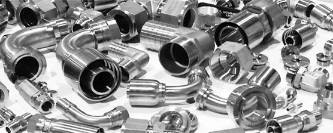

*Picture: [Stainless hose fittings different shapes and sizes.png](https://commons.wikimedia.org/wiki/File:Stainless_hose_fittings_different_shapes_and_sizes.png) by Candm503, [CC BY-SA 4.0](https://creativecommons.org/licenses/by-sa/4.0), from Wikimedia Commons.*

A ridged spigot (hose barb) that a soft tube is stretched over, so the tube's own elasticity grips the ridges and seals the joint for low-pressure air, water or other fluids, with an optional clamp or cable tie behind the barb for extra hold.

**In plain words:** A short pipe with sharp ridges round it that you push a soft tube over; the ridges bite into the inside of the tube so it seals and won't pull off, and a clip round the tube holds it on harder. **Proper term:** Hose barb (barbed fitting, barbed tube connector).

**Also called:** barbed fitting, barb fitting, barbed connector, barb connector, hose barb connector (ISM; Tameson); hose tail or hosetail (UK; a Printables model title uses 'Hose Barb Hosetail'); hose nipple, hose spigot ⚑ [uncertain] (hose nipple appears in Wikipedia's Hose clamp article); 'Christmas-tree' barb: the older style with several barbs of increasing size (Beswick); single-barb or 'line contact' barb (Beswick; Hydraulics & Pneumatics); hose splicer, hose coupler, hose mender, barb-to-barb reducer, barb tee, barb wye (names for fittings with a barb on each end; Printables model titles); slip-in fitting, barbed insert fitting (drip irrigation; DripWorks); airline connector (aquarium air tubing); PEX crimp fitting, PEX clamp (cinch) ring fitting, PEX plug: barbed insert fittings for PEX plumbing pipe, held by a metal ring squeezed on with a tool (Wikipedia 'Piping and plumbing fitting'; Wikipedia 'Cross-linked polyethylene').

## How it works

The tube is pushed up the slope of the barb, stretching it wider than its own inside diameter; once past the sharp edge it springs back and squeezes the plain stem behind it (ISM). That squeeze makes the seal, and the sharp edge makes a line of high contact pressure that grips the tube (Beswick). Pulling on the tube makes it get thinner and grip even tighter, but a pressure spike swells the tube and can loosen it, which is why a clamp is added for higher pressure (ISM; Qosina). A clamp placed just behind the barb also blocks the tube from sliding off, because the clamp would have to stretch over the barb (Wikipedia, Hose clamp). PEX plumbing pipe uses the same barb idea with a ring instead of a clamp: the fitting is pushed into the pipe and a metal crimp ring, or a stainless-steel clamp (cinch) ring, is squeezed round the outside with a crimping or cinching tool; a PEX plug, for example, is 'a short barbed fitting with a blank end' that is 'sealed watertight with a PEX crimp' (Wikipedia 'Piping and plumbing fitting'; Wikipedia 'Cross-linked polyethylene'; Wikimedia Commons PEX tools photo). Other PEX joints are made with an expander tool, or with compression or push-fit fittings (Wikipedia 'Cross-linked polyethylene').

## Parts

Single piece, plus the tube and an optional clamp. Parts: a hollow spigot with one or more ridges (barbs), each with a gentle slope and a sharp back edge; a plain cylindrical stem behind the barb for the tube to relax onto; and on the other end another barb, a thread, a flange or a tee (Tameson; ISM). Retention device if used: a worm-drive, spring, wire or ear clamp, or a cable tie (Wikipedia, Hose clamp; Qosina).

## Everyday examples

- Aquarium air-pump tubing and its little [check valves](../glossary.md#check-valve) and tees (standard 3/16 in, about 5 mm, airline tubing; FishLab)
- Garden drip-irrigation fittings pushed into polyethylene tubing (DripWorks; Printables 378315)
- PC water-cooling loops, with hoses clamped onto barb fittings (Wikipedia, Hose clamp; Wikimedia Commons photo)
- Car heater and coolant hoses held on with spring or screw clamps (Wikipedia, Hose clamp)
- The side arm of a lab vacuum flask or water aspirator (Wikipedia, Hose barb)

## When to use it

Use a hose barb to join soft, stretchy tubing (silicone, PVC, TPE, soft polyurethane) for low-pressure air, water, vacuum or other fluids when you want a cheap, compact joint that you set up once and leave: aquariums, garden watering, coolant loops, pumps, lab rigs, pneumatic toys and soft robots. It is small because it seals on the inside of the tube, it usually seals better than a push-in fitting on soft tube, and it costs less (Clippard; Beswick). It is also the easiest tube fitting to 3D print as one piece, e.g. to adapt one hose size or thread to another.

## When not to use it

Don't use it for high pressure (well above about 100 psi), for pressure spikes, or where a blow-off would be dangerous: use compression or crimped fittings (Beswick; Wikipedia, Hose clamp). Don't use it with hard tubing such as nylon, polyethylene, PTFE or metal: use push-to-connect or compression fittings (Beswick; Clippard). If you need to connect and disconnect often, use a push-to-connect fitting or a quick-disconnect coupling (Clippard; Beswick). Don't use printed barbs for fuel, hot coolant or high pressure (Printables 1436108; CNC Kitchen).

## Details

- **What it does (jobs):**
  - seal it, or pass cables or fluid through: joins a soft tube to a fitting or a device so air or liquid can pass without leaking
  - join and hold: holds the tube on against pulling and internal pressure
- **Movement:** none: the tube is fixed to the barb (the soft tube itself can still bend)
- **Directions it can move (degrees of freedom):** 0: once pushed on, the tube is held in place on the barb; it may be possible to twist the tube round the barb by hand, but it isn't meant to move
- **Special behaviour:**
  - one-way (moves freely one way, locks the other): only in the sense that the barb's slope lets the tube slide on easily while its sharp back edge resists pulling the tube off; pulling actually makes the tube grip tighter (ISM; Hydraulics & Pneumatics)
- **How it holds:**
  - friction or clamping ([force-fit](../glossary.md#form-fit--force-fit--material-bond)): the stretched tube squeezes the barb stem, and a clamp adds more squeeze
  - shape (the parts interlock; form-fit): the tube relaxes behind the sharp barb edge, which hooks it; a clamp behind the barb also blocks the tube from sliding off (Wikipedia, Hose clamp)
- **Input and output:** not applicable: it joins a tube and passes fluid, not motion
- **Power:** passive (no power needed)
- **Load:** light: holds a tube against pulling and low pressure. Strong against pull (the tube grips tighter; ISM), weaker against pressure spikes that swell the tube (ISM; Qosina). Metal and moulded barbs are strong in bending; printed barbs are weakest where the barb joins a flange or body and can snap there if the tube is levered sideways (Printables 1765791).
- **Play and precision:** not applicable
- **Taking it apart:** semi-permanent (can be undone but may damage parts): a well-matched barb is designed to be very hard to pull off (Beswick), so the tube end is often cut off; the fitting itself can usually be reused with a new tube (Tameson). Soft silicone tubing can often be worked off by hand ⚑ [uncertain]
- **How often it can be reused:** a few times: the barb can be reused many times, but each removal usually costs a cut or stretched tube end (Tameson)
- **Sealing:** airtight or pressure: the stretched tube squeezing the plain stem behind the barb makes the seal, good for low pressures (ISM: 125 psi or lower); a clamp adds sealing force and resists blow-off (Beswick). Printed barbs are only as tight as their walls (Prusa Knowledge Base)
- **Adjustable:** no: the grip is set by the barb size, the tube's hardness and the clamp; you can only tighten a screw clamp
- **Access needed:** end of a tube or shaft: you push the tube over the end of the barb, so you need the free end of the tube and room to push it on
- **Materials:** Fittings: brass, stainless steel, nylon and other plastics such as polypropylene and PVDF (Kynar) (Tameson; ISM; Beswick). Tubing that suits barbs: soft, elastic tubing such as silicone, TPE, PVC and softer polyurethane (Qosina; Beswick); Clippard recommends 85A polyurethane for barbs but 95A for push-in fittings. Stiff tubing (nylon, polyethylene, PTFE, PEEK) suits push-to-connect or compression fittings better (Beswick), although drip-irrigation fittings are barbed inserts for polyethylene tubing (DripWorks). Printed barbs: PETG is a common choice for water; PLA only for dry indoor use (Printables 1829891); PP, ASA and PA11 nylon are also used (Printables 1829891, 1810917).
- **Heat, cold, water and wear:** The tubing sets most limits: pressure spikes swell it and loosen the grip (ISM), and heat softens it, which is why clamps are recommended for heat (Beswick). Check chemical compatibility and exposure to cleaners and sunlight for both tube and fitting (ISM). Printed barbs: PLA starts to give at about 60 °C, PETG at about 80 °C and ASA at about 110 °C (CNC Kitchen); PLA only for dry indoor use (Printables 1829891). Plastic tubing may harden and take a set on the barb over years, which makes it leak or crack when disturbed ⚑ [uncertain].

## Making it

- **Ways to make or get it:**
  - off-the-shelf part: brass, stainless and plastic barbs, tees, wyes, reducers and barb-to-thread adapters
  - 3D print (FDM): single-piece barbs and adapters, often printed standing up
  - 3D print (resin) ⚑ [uncertain]: possible for small fittings, but no test found
  - CNC: turned metal barbs on a lathe ⚑ [uncertain]
- **Printing it in one piece (print in place):** yes: a barbed fitting is a single printed part with nothing to assemble; you just push the tube on (some multi-part designs, such as Printables 1436108, are printed in pieces and glued)
- **Tools:** None to push on (hot water or a hair dryer helps soften stiff tubing; Drip Depot). A knife or tube cutter for a square cut; pliers for spring clamps, a screwdriver or nut driver for worm-drive clamps, a special pincer tool for ear clamps (Wikipedia, Hose clamp); cable ties need only a cutter. PEX crimp and clamp-ring fittings need a crimping or cinching tool, and some PEX joints an expander tool (Wikipedia 'Cross-linked polyethylene'; Wikimedia Commons PEX tools photo).
- **Difficulty:** easy: buy one for pennies, or print one in a single piece (the barb profile is support-free if the ridges are 45° cones; Printables 1765791); getting a printed one watertight needs extra walls and good settings

### 3D printing tips

1) Orientation: most makers print barbs standing up, with the tube axis vertical, so each barb is a round ring of layers (Printables 1810917 printed this way in PLA and PA11 without supports; Printables 378315 printed a barb tee standing up with supports). Give the barbs a 45° slope on both sides so they print without supports (Printables 1765791 uses a '2x45° ridge profile'). 2) Leak-tight walls: use at least 3-4 [perimeters](../glossary.md#perimeters), raise the nozzle temperature 5-10 °C and the extrusion multiplier 5-10%, keep layer height at no more than 60-65% of the nozzle size (Prusa Knowledge Base, Watertight prints); one drip-irrigation tee needed 6 perimeters to be water-tight under pressure (Printables 378315). Some designers print at 100% [infill](../glossary.md#infill) (Printables 1436108) or with walls thick enough to be solid. 3) Seam: set the seam to random, or scrape the seam smooth with a knife, because an aligned seam is a leak path along the barb (Printables 455268; Printables 1436108). 4) Material: PETG for water and outdoors; PLA only for dry indoor use (Printables 1829891); PLA starts to give at about 60 °C and PETG at about 80 °C (CNC Kitchen), so avoid printed barbs on hot water or engine coolant. 5) Strength: add a [fillet](../glossary.md#chamfer--fillet) or internal reinforcement where the barb joins a flange or body, the usual snapping point (Printables 1765791). 6) Sizing: measure the tube's inside diameter and make the barb a little larger; commercial barbs range from about 10% to 100% larger than the nominal tube ID depending on style (Qosina); parametric generators let you set the barb lip, count and length (Printables 1829891, 1767584; Printables 69154). 7) Hold: leave room behind the barb for a clamp or cable tie (Printables 1436108). 8) Don't use printed barbs for high pressure or fuel (Printables 1436108).

### Buying one (off-the-shelf parts)

Search for: 'hose barb', 'barbed fitting', 'barb x NPT' or 'barb x BSP' adapters ('hose tail' in the UK), 'barb tee', 'barb wye', 'barbed reducer', 'hose mender' or 'hose splicer', 'single-barb fitting', 'Luer to barb' (medical and lab), 'aquarium airline connector' (3/16 in, about 5 mm tubing; FishLab), 'drip irrigation barbed fitting' (DripWorks). Retention: 'worm drive hose clamp' ('Jubilee Clip' (brand) in the UK), 'spring hose clamp', 'wire hose clamp', 'ear clamp' or 'stepless ear clamp' (Oetiker (brand)) (Wikipedia, Hose clamp; Qosina), 'cable tie'. Tubing: 'silicone tubing', 'PVC tubing', 'polyurethane tubing 85A'. The Hose clamp entry covers how to choose and fit each clamp type; they are listed here only as the retention summary. PEX plumbing: 'PEX crimp fitting' with copper 'crimp rings' or stainless 'cinch rings' (clamp rings), a 'PEX crimp tool' or 'cinch tool', 'PEX plug', and a 'PEX expander tool' (Wikipedia 'Cross-linked polyethylene'; Wikipedia 'Piping and plumbing fitting'; Wikimedia Commons PEX tools photo).

## Rules of thumb

- Barbed fittings are for low pressure: 'low-pressure (125 psi or lower) fluid, gas and air' (ISM, Barb Connectors in Depth); usually below 150 or 125 psi because the soft tubing is the limit (Beswick white paper).
- Add a clamp when pressure approaches 80 to 100+ psi (depending on tube ID, wall and durometer); clamps also help with pressure pulses and heat (Beswick white paper). For drip irrigation, DripWorks advises stainless hose clamps above 20 psi.
- Size a barb by the tube's inside diameter; push-in fittings are sized by the tube's outside diameter (Clippard).
- Make the barb bigger than the tube's ID: Qosina's barb styles are 10-25%, 18-34%, 12-57%, 40-60% and up to 50-100% 'oversized' compared with the nominal tube ID. There are no consensus standards for barb sizes, so test with your tubing (Qosina).
- Match barb and tube hardness: barbs suit soft tubing (Clippard recommends 85A polyurethane for barbs and 95A for push-in fittings; push-in fittings are typically used with 95 Shore A or harder tubing, Beswick). A barb for soft silicone needs a higher peak than one for stiff nylon (Hydraulics & Pneumatics).
- One sharp barb with no mould parting line and a plain stem behind it for the tube to relax onto usually beats several barbs; if you do use several, space them far enough apart that the tube can close down behind each one (Hydraulics & Pneumatics, 'Plastic fittings: How many barbs are best?', 2004; Beswick).
- Place the clamp or cable tie closely behind the barb (Qosina), so the tube can't slide off without the clamp stretching over the barb (Wikipedia, Hose clamp).
- Worm-drive (screw) clamps are normally used on hoses 1/2 in diameter and up; smaller hoses use other clamps (Wikipedia, Hose clamp).
- To fit stiff tubing, dip its end in hot (not boiling) water for about a count of 10 first (Drip Depot).
- Printed watertight parts: at least 3-4 perimeters, +5-10 °C nozzle temperature, +5-10% extrusion multiplier (Prusa Knowledge Base, Watertight prints).

## Common failures

Tube splits or cracks: barb too sharp or too big for the tube, or the tube over-stretched (Tameson; ISM). Leaks: barb too small for the tube's ID (Tameson), a mould parting line or printed seam running along the barb (Hydraulics & Pneumatics; Printables 1436108), porous printed walls (Prusa Knowledge Base), or a scratched barb (Wikipedia, Hose clamp). Tube blows off: pressure spikes or too-high pressure with no clamp (ISM; Beswick). Tube pulls off: a shallow, rounded barb with stiff tubing (Qosina), or barbs spaced too closely for the tube to relax between them (Hydraulics & Pneumatics). Printed barb snaps at its base when the tube is levered sideways (Printables 1765791). Removal advice conflicts: Tameson says cut the tube so it spreads off the barb; Wikipedia's Hose clamp article says never slit stuck hoses because the knife can scratch the fitting.

## Safety

A tube that blows off under pressure can spray hot or harmful fluid and whip about; clamp anything pressurised (Beswick) and don't use printed barbs for fuel or high pressure (Printables 1436108). In life-support or medical tubing a slipped-off tube can be dangerous (Hydraulics & Pneumatics). Take care when cutting stuck tubing off: Wikipedia warns that slitting a hose can scratch the barb and cause a leak, so cut away from yourself and from the barb ⚑ [uncertain] (see common_failures).

## Related

- Push-to-connect (push-in) fitting: a toothed [collet](../glossary.md#collet) grips the outside of stiffer tubing and an [O-ring](../glossary.md#o-ring) seals it; releases with a collar, so it is better for frequent reconnection (Clippard; Beswick)
- Compression fitting: a nut squeezes a ferrule onto the outside of hard or metal tubing, for higher pressures (Beswick; Wikipedia, Hose clamp)
- Quick-disconnect coupling: for many connect-disconnect cycles (Beswick)
- Hose clamp: the band clamp (worm-drive, ear, spring or wire) that holds a hose on a barb; its own entry covers the clamp types and how to fit them, so this entry keeps only a short summary (Wikipedia, Hose clamp)
- O-ring seal: seals a rigid spigot inside a bore instead of stretching a tube
- Cable [gland](../glossary.md#gland): the equivalent idea for sealing a cable (not a tube) through a wall

## Make it yourself

- [Pipe / Tube / Hose Connector Generator (Will, Printables; URL from search results, details read through the Printables API)](https://www.printables.com/model/69154-pipe-tube-hose-connector-generator): A customisable OpenSCAD barbed hose connector and manifold generator (straight, L, polygon or round manifolds, two tube sizes), based on papergeek's Thingiverse hose barb adapter *(licence: CC BY)*
- [Parametric Dual barbed-end hose connector (Dan Sabau, Printables) (URL from Printables API, page not opened)](https://www.printables.com/model/1767584-parametric-dual-barbed-end-hose-connector-pick-eac): OpenSCAD file with independent sizes for each end (1/2 in to 2 in) and settings for barb count, barb height, barb pitch, collar length and wall thickness *(licence: Open Community License v1.1)*
- [Parametric barbed hose connector - straight (condensate / drain hoses) (Snoopymad, Printables) (URL from Printables API, page not opened)](https://www.printables.com/model/1829891-parametric-barbed-hose-connector-straight-condensa): Parametric OpenSCAD inline coupler (hose ID, barb count, barb lip, insertion length) with print settings: PETG, 3-4 walls, no supports, and a clamp or zip tie for a permanent joint *(licence: CC BY-NC)*
- [Parametric Flanged Hose Barb (Reinforced) (tilmaen, Printables) (URL from Printables API, page not opened)](https://www.printables.com/model/1765791-parametric-flanged-hose-barb-reinforced): Parametric barb adapter with a support-free 2x45° ridge profile and internal reinforcement to stop it snapping at the flange *(licence: CC BY)*
- [5/16" Hose Barb Fitting - Splicer / Coupler (great_timing, Printables; URL from search results)](https://www.printables.com/model/1436101-516-hose-barb-fitting-splicer-coupler): One of a series of printable barb splicers, tees and wyes for 1/4 in to 5/8 in hose, with suggested settings (3 walls, 100% infill) and room for clamps *(licence: CC0 (Public Domain))*

## Pictures, videos and models

- [File:Stainless hose fittings different shapes and sizes.png (Wikimedia Commons)](https://commons.wikimedia.org/wiki/File:Stainless_hose_fittings_different_shapes_and_sizes.png): Stainless crimp and hose barb fittings in different shapes and sizes *(licence: CC BY-SA 4.0 (Candm503))*
- [File:PC watercooling T-Line-2009-12-03.jpg (Wikimedia Commons)](https://commons.wikimedia.org/wiki/File:PC_watercooling_T-Line-2009-12-03.jpg): A water-cooled PC whose hoses are held on hose barb fittings with screw (band) hose clamps *(licence: GFDL 1.2 / CC BY-SA 3.0 (Senater Cache; derivative work by Silverxxx))*
- [File:Two spring Hose Clamps - small.jpg (Wikimedia Commons)](https://commons.wikimedia.org/wiki/File:Two_spring_Hose_Clamps_-_small.jpg): A pair of spring-type hose clamps used to hold hoses on barbs *(licence: GFDL / CC BY-SA 3.0 (Bushytails at English Wikipedia))*
- [Barb Connectors in Depth - Design and Function (Industrial Specialties Mfg., updated 2023)](https://www.industrialspec.com/about-us/blog/detail/barb-connectors-in-depth-design-and-function): Cross-section of flexible tubing pushed over a barb, and a diagram of barb depth and tube expansion from diameter B to A *(licence: link only)*
- [Plastic fittings: How many barbs are best? (Power & Motion / Hydraulics & Pneumatics, 2004)](https://www.hydraulicspneumatics.com/technologies/fittings-couplings/article/21883519/plastic-fittings-how-many-barbs-are-best): Why a single sharp barb without a parting line often seals and holds better than several barbs *(licence: link only)*

## Needs confirming

⚑ marks something nobody has confirmed yet: a fact the research could not confirm from a source, a finder value that is a best guess, or an open point from the research notes. Corrections are welcome (see `research/needs-confirming.md`).

- ⚑ 6 sentences on this page marked [uncertain].
- ⚑ Finder value `clicks` = clicks (best guess): one-way or indexing, but neither clicking nor silent named; defaulted to clicks
- ⚑ Finder value `usual_process` = off-the-shelf part (best guess): first-listed process is off-the-shelf, but `print_in_place` is yes

## Sources

- <https://en.wikipedia.org/wiki/Hose_barb>
- <https://en.wikipedia.org/wiki/Hose_clamp>
- <https://www.industrialspec.com/about-us/blog/detail/barb-connectors-in-depth-design-and-function>
- <https://www.beswick.com/resources/what-they-didnt-teach-you-about-fittings-in-engineering-school/>
- <https://www.hydraulicspneumatics.com/technologies/fittings-couplings/article/21883519/plastic-fittings-how-many-barbs-are-best>
- <https://www.qosina.com/blog/how-to-select-the-correct-barbed-connector-for-your-single-use-system>
- <https://www.clippard.com/cms/wiki/barb-fittings-vs-push-quick-fittings>
- <https://tameson.com/pages/hose-barb-fittings>
- <https://www.dripworks.com/blog/what-is-a-barb-fitting-and-how-does-it-work>
- <https://help.dripdepot.com/support/solutions/articles/11000044403-fitting-installation-tips>
- <https://fishlab.com/air-check-valve/>
- <https://help.prusa3d.com/en/article/watertight-prints_112324>
- <https://www.cnckitchen.com/blog/comparing-pla-petg-amp-asa-feat-prusament>
- <https://commons.wikimedia.org/wiki/File:Stainless_hose_fittings_different_shapes_and_sizes.png>
- <https://commons.wikimedia.org/wiki/File:PC_watercooling_T-Line-2009-12-03.jpg>
- <https://commons.wikimedia.org/wiki/File:Two_spring_Hose_Clamps_-_small.jpg>
- <https://api.printables.com/graphql/>
- <https://en.wikipedia.org/wiki/Piping_and_plumbing_fitting>
- <https://en.wikipedia.org/wiki/Cross-linked_polyethylene>
- <https://commons.wikimedia.org/wiki/File:PEX_installation_tools_and_fittings.jpg>
