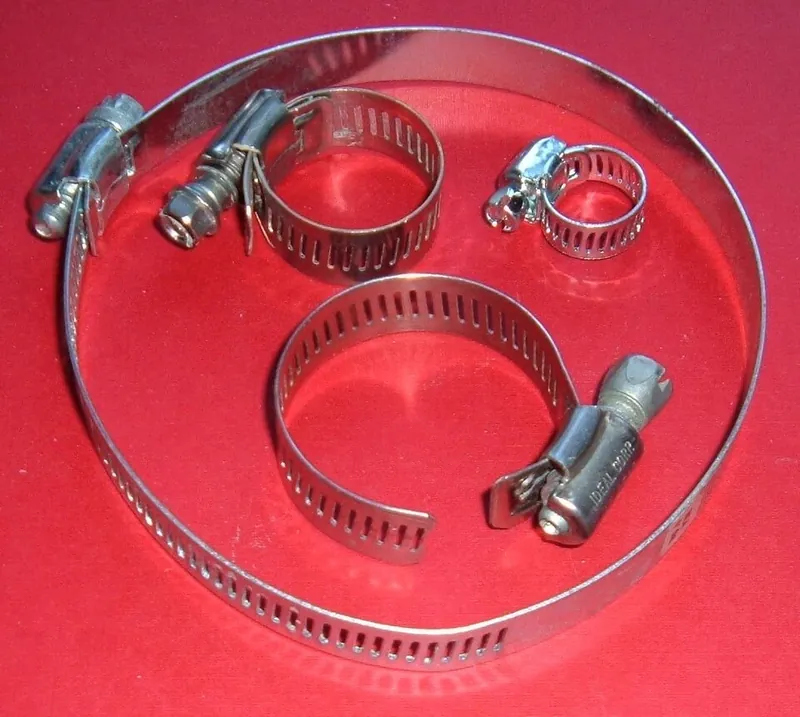

<figure class="eoc-pic eoc-pic-main"><figcaption><strong>Photo.</strong> <a href="https://commons.wikimedia.org/wiki/File:Hoseclamps.screw.agr.jpg">Hoseclamps.screw.agr</a> by ArnoldReinhold, <a href="https://creativecommons.org/licenses/by-sa/3.0">CC BY-SA 3.0</a>, from Wikimedia Commons.</figcaption></figure>

A hose clamp is a ring of metal band, wire or spring steel that is tightened round the end of a hose pushed over a spigot, barb or pipe, squeezing the hose so it seals and so it can't slide off; worm-drive types tighten with a screw and can be undone, ear clamps are crimped shut once, and spring clamps hold by their own springiness.

**In plain words:** A metal strap that goes round a hose and is tightened with a screw (or squeezed shut, or springs shut by itself) so the hose is squashed onto the pipe it is pushed over and can't leak or pull off; the screw kind is also handy for strapping things to poles and pipes. **Proper term:** Hose clamp (worm-drive clamp, ear clamp, spring hose clamp).

**Also called:** hose clamp, hose clip (Wikipedia 'Hose clamp'); worm-drive clamp, worm gear clamp, worm gear clip, screw/band clamp, band clamp; Jubilee Clip (brand, a genericized UK name; trademark of L. Robinson & Co) (Wikipedia 'Hose clamp'); Make-A-Clamp (brand): a roll of perforated band with separate worm-gear housings, to make clamps of any size (EFC International); constant-tension clamp, spring-loaded worm-drive clamp, 'radial-worm-drive' clamp with an inner spring (EFC International; Freightliner service bulletin); T-bolt clamp, T clamp (Wikipedia 'Hose clamp'; AMS Performance); spring clamp, spring band clamp, constant tension band; wire spring clamp (Wikipedia 'Hose clamp'; EFC International); wire clamp, double-wire clamp (Wikipedia 'Hose clamp'; EFC International); ear clamp, pinch clamp, crimp clamp, single- or multi-ear clamp (Wikipedia: 'one or more “ears”'), StepLess ear clamp; Oetiker clamp (brand) (Wikipedia 'Hose clamp'; Oetiker data sheet; YouTube video title 'How to remove and install pinch clamps, or oetiker clamps'); plastic [ratchet](../glossary.md#ratchet) clamp, interlocking plastic clamp, polymer hose clamp (nylon PA66, PA12 or polypropylene) (Wikipedia 'Hose clamp'); no-hub coupling, no-hub band, rubber-sleeve coupling, shielded coupling, hubless coupling (Wikipedia 'Hose clamp' and 'Piping and plumbing fitting'; Charlotte Pipe); clamp standards a beginner may meet in catalogues: SAE J1508 (32 hose clamp designs including screw, spring and T-bolt styles), NAS1922/NAS1924, and the US DoD CID A-A-52506 (Wikipedia 'Hose clamp').

## How it works

The clamp is slid over the hose, the hose is pushed onto its spigot or barb, and the clamp is moved to sit over the spigot just behind the barb or bead and tightened (Wikipedia 'Hose clamp'; Boshart). Tightening shrinks the ring: in a worm-drive clamp the screw 'acts as a worm drive pulling the threads of the band'; in an ear clamp a pincer tool squeezes the ear shut, permanently deforming it and pulling the band tight; a spring clamp is held open with pliers and simply let go (Wikipedia). The squeeze presses the soft hose against the spigot all round, which makes the seal, and because the clamp sits behind the barb or bead, the hose can't slide off without stretching the clamp over it (Wikipedia 'Hose clamp'). Spring and constant-tension clamps keep pushing as the hose shrinks or relaxes with heat and age, while a plain screw clamp can lose some of its grip (EFC International; Freightliner service bulletin).

## Parts

Single piece or a few parts. Worm-drive: a slotted or embossed steel band, a housing riveted to one end, and a captive screw whose thread engages the band like a worm gear (Wikipedia 'Hose clamp'); constant-tension versions add a spring or a stack of disc springs (EFC International; Freightliner service bulletin). T-bolt: a heavy band, a T-shaped bolt and a nut ⚑ [uncertain: construction from catalogue photos, not a text source]. Spring clamp: one piece of spring-steel strip with interleaving tabs, or a loop of spring wire (Wikipedia). Wire clamp: a loop of heavy wire with a captive screw and nut (Wikipedia). Ear clamp: one stainless band with one or two formed 'ears' and an interlock (Oetiker data sheet). No-hub coupling: a rubber (neoprene) sleeve, a corrugated stainless shield and two or four worm-drive bands (Charlotte Pipe).

## Everyday examples

- Car cooling-system hoses, held by spring clamps on many cars (e.g. most water-cooled Volkswagens) or by worm-drive clamps (Wikipedia 'Hose clamp')
- Washing-machine and dishwasher drain hoses, PC water-cooling loops on barb fittings, and workshop dust-extraction hoses (Wikipedia 'Hose clamp'; Printables 747926, 22483)
- Rubber 'no-hub' couplings joining cast-iron or plastic drain pipes under a floor (Wikipedia 'Piping and plumbing fitting', with photo)
- Jubilee clips used as an all-purpose strap: mounting signs and rooftop TV aerials, makeshift pipe hangers, and holding the bag on bagpipes while it is tied in (Wikipedia 'Hose clamp')

## When to use it

To hold and seal a soft hose on a barb, spigot or beaded tube carrying water, coolant, air or vacuum at moderate pressure, as in cars, homes, garden watering, aquariums and PC cooling (Wikipedia 'Hose clamp'). Pick the kind by the job: worm-drive for most hoses 1/2 in and up and for anything you may want to undo or re-tighten (Wikipedia); spring clamps in tight or awkward places such as engine bays and PC water-cooling, where a screwdriver can't reach (Wikipedia); constant-tension clamps where hot-cold cycling or hose [creep](../glossary.md#creep) would loosen a plain clamp (EFC International); ear clamps for small hoses where a neat, low, tamper-evident, permanent clamp is wanted (Wikipedia; Oetiker data sheet); T-bolt clamps for heavy hoses and higher clamping force, e.g. turbo and coolant hoses (Wikipedia), on strong pipe. Also as a quick, strong strap to fix things round poles, tubes and pipes, or chained end to end into a long clamp (Wikipedia 'Hose clamp').

## When not to use it

Not for high-pressure lines, hydraulics, fuel at pressure or anything where a blow-off is dangerous: 'For these high pressure applications, compression fittings, thick crimp fittings, or other designs are normally used' (Wikipedia 'Hose clamp'); see Compression fitting and Quick couplers for tubes and hoses. Not on hard tubing such as nylon or PTFE that a clamp can't squeeze; use push-to-connect or compression fittings (see Hose barb). Not a T-bolt clamp on thin aluminium pipe: its uneven, high force 'can oftentimes bend and distort the aluminum piping' (AMS Performance). Not a plain slotted-band worm clamp on soft silicone hose that the slot edges can cut; use an embossed band (FastFix / EFC International). Not for frequent connect-disconnect; use a quick coupler. As a structural strap, not for lifting or safety-critical loads: Boshart says to use a safety cable or rope as well when hanging a pump on clamped pipe. For a light-duty hose hold or a temporary fix, a cable tie or a constrictor knot can do (see Linear ratchet and Binding knots and seizings).

## Details

- **What it does (jobs):**
  - join and hold: holds a hose or rubber sleeve onto a spigot, barb or pipe end; the screw-band type is also a general strap for fixing things round poles and pipes (Wikipedia 'Hose clamp')
  - seal it, or pass cables or fluid through: squeezes the hose onto the fitting so liquid or air can't leak, at moderate pressures only (Wikipedia 'Hose clamp')
- **Movement:** none: the clamped joint is rigid; a rubber no-hub coupling allows a little flexing between pipes (Charlotte Pipe: maximum joint [deflection](../glossary.md#deflection) 5 degrees for its neoprene coupling).
- **Directions it can move (degrees of freedom):** 0 once tightened: the hose can't slide or turn on the spigot (a loose clamp lets it do both).
- **Special behaviour:**
  - tensioning (takes up slack and holds): spring clamps and constant-tension worm-drive clamps keep squeezing as the hose relaxes or the joint grows and shrinks with temperature, giving 'a continuously readjusting dynamic tightening effect' (EFC International); an ear clamp's ear and dimple give a little spring action to follow 'changes in diameter due to thermal expansion' (Oetiker data sheet)
  - none (plain worm-drive, T-bolt and wire clamps): they simply hold the tension the screw puts in; the ear clamp's only extra is that it is tamper-evident, because the crushed ear shows if it has been disturbed (Wikipedia 'Hose clamp')
- **How it holds:**
  - friction or clamping ([force-fit](../glossary.md#form-fit--force-fit--material-bond)): the band squeezes the hose onto the spigot; friction and the hose's grip on the barb hold it (Wikipedia 'Hose clamp')
  - shape (the parts interlock; form-fit): placed behind a barb or a raised bead on a tube, the clamp would have to stretch over the bump for the hose to slide off (Wikipedia 'Hose clamp')
  - spring force (a spring or springy part presses it in place): spring-steel band and wire clamps, and the springs in constant-tension clamps, provide the squeeze (Wikipedia 'Hose clamp'; EFC International)
- **Input and output:** not applicable (Wikipedia notes a short hose clamped between two shafts can pass small amounts of power as a makeshift flexible coupling for lab mock-ups, but that is the hose's job, not the clamp's)
- **Power:** passive (no power needed)
- **Load:** Medium. Pressure: 'Hose clamps are typically limited to moderate pressures, such as those found in automotive and home applications'; at high pressures compression or crimp fittings are used instead (Wikipedia 'Hose clamp'). Pull-off: strong when the clamp sits behind a barb or bead (Wikipedia); two clamps side by side ('double clamping') 'will greatly reduce the chance of a hose blowing off the fitting' (Boshart). [Holding force](../glossary.md#holding-force) comes from screw [torque](../glossary.md#torque): e.g. 35-45 in-lb (3.96-4.52 N m) for standard worm-drive clamps, with an ultimate (breaking) torque of at least 60 in-lb (6.8 N m) (Boshart). As a general strap round a pole it is strong in tension round the band but can slip along or round a smooth pole under a sideways or twisting load ⚑ [uncertain].
- **Play and precision:** not applicable (it doesn't locate parts; a rubber no-hub coupling tolerates slight [misalignment](../glossary.md#misalignment), up to 5 degrees of joint deflection for one maker's neoprene coupling, Charlotte Pipe; Wikipedia 'Piping and plumbing fitting')
- **Taking it apart:** removable for worm-drive, T-bolt, wire and spring clamps (loosen the screw or open the spring with pliers); semi-permanent for ear clamps, which are crimped once and are removed by cutting or by prising the ear open with pliers, which spoils them (Wikipedia 'Hose clamp'; Oetiker pincer data sheet: pincers are for 'pinching and removing ear clamps'). No-hub couplings can be taken apart, but 'it is often not customary to re-use the clamps and rubber sleeves' because they may not seal well after being deformed (Wikipedia 'Piping and plumbing fitting').
- **How often it can be reused:** many times for stainless worm-drive and spring clamps if the screw and band are undamaged ⚑ [uncertain: no maker's reuse figure opened]; once for ear clamps (single [stroke](../glossary.md#stroke), 'do not apply secondary crimping force', Oetiker data sheet); usually once for no-hub sleeves (Wikipedia 'Piping and plumbing fitting'). The hose end may need trimming after each removal, and a stuck hose 'should never be removed by slitting' it, which can scratch the fitting (Wikipedia 'Hose clamp').
- **Sealing:** airtight or pressure (moderate pressures only): the clamp presses the hose evenly onto a smooth spigot; even pressure with 'no gaps' is the design goal, which is why wire clamps overlap their ends and StepLess ear clamps have no step inside (Wikipedia 'Hose clamp'; Oetiker data sheet). The seal needs a fitting that is 'smooth and free of nicks, scratches, or contamination' (Wikipedia). No-hub drain couplings seal with a neoprene gasket squeezed by the bands (Charlotte Pipe).
- **Adjustable:** yes for worm-drive and T-bolt clamps: re-tighten the screw. To check a worm-drive clamp properly, loosen it completely and re-tighten to the stated torque, because torque on these clamps normally drops about 30% soon after tightening and can't be checked by simply turning the screw (Freightliner service bulletin). Spring and constant-tension clamps adjust themselves; ear clamps can't be adjusted after closing (Wikipedia 'Hose clamp'; EFC International).
- **Access needed:** end of a tube or shaft for closed-ring clamps: spring, wire and most ear clamps must be slid onto the hose before it is pushed onto the spigot (Wikipedia 'Hose clamp'), though some ear-clamp interlocks 'can be opened for [radial](../glossary.md#axial--radial) installation' (Oetiker data sheet). A worm-drive band can be unscrewed fully and wrapped round from the side (Wikipedia: the loose end is fed into the housing), so it needs only access to one side for the screwdriver; point the screw head where a driver can reach it (Boshart).
- **Materials:** Bands: stainless steel (grades 304, 316 or 430), zinc-plated steel, or plastics such as nylon 66, nylon 12 and polypropylene (Wikipedia 'Hose clamp'); Oetiker's StepLess ear clamps come in zinc-plated or galvanised steel or 1.4301 (304) stainless (Oetiker data sheet). No-hub couplings: type 301 stainless shield and bands, 305 stainless screws and a neoprene gasket to ASTM C564 (Charlotte Pipe). Bands are 'slotted' (perforated) or 'embossed' (non-perforated, 'European style'); embossed bands have no sharp slot edges to cut into the hose (FastFix / EFC International). Hoses and pipes clamped: rubber, silicone and PVC hose, polyethylene pipe on barbed inserts (heat the pipe first, Boshart), turbo silicone couplers on aluminium or steel pipe (AMS Performance), and cast-iron, copper and plastic drain pipe in no-hub couplings (Wikipedia 'Piping and plumbing fitting').
- **Heat, cold, water and wear:** Corrosion: choose band material for the place: in salt-spray tests Oetiker rates zinc-plated steel at 96 h or more, Galfan-coated steel at 144 h or more and 304 stainless at 1000 h or more (DIN EN ISO 9227, Oetiker data sheet); stainless screws matter outdoors and in drains (Wikipedia 'Piping and plumbing fitting': ideally all stainless 'to provide maximum service life'). Heat and cold: rubber and plastic hose relaxes and 'creeps' under the band, and temperature swings loosen plain clamps, which is what constant-tension clamps are for (EFC International); a spring-loaded worm clamp normally loses about 30% of its torque soon after tightening (Freightliner service bulletin). Neoprene no-hub gaskets are rated to 212 °F (100 °C) (Charlotte Pipe). Printed spigots or clamps: PLA softens above about 60 °C and PETG is fine below about 80 °C (Prusa knowledge base). Vibration: clamps hold well when tightened correctly and spring types follow movement (Oetiker data sheet: the dimple's spring effect), but check worm-drive clamps periodically (AMS Performance: 'periodic checks and appropriate maintenance are important').

## Making it

- **Ways to make or get it:**
  - off-the-shelf part: metal hose clamps are bought; a worm-drive clamp of any length can be made from a roll of perforated band and loose housings (EFC International Make-A-Clamp kit)
  - 3D print (FDM): plastic clamps for low-pressure duty such as dust-collection and ventilation hose, and the spigots, adapters and barbs that metal clamps go over (Printables models in make_it_yourself)
- **Printing it in one piece (print in place):** no: metal clamps are bought; printed plastic hose clamps are a different, weaker version, usually a one-piece ratchet or clasp strip or a two-piece clamp closed with a screw (Printables 485192, 1338893, 22483).
- **Tools:** Worm-drive: a flat screwdriver or a 1/4 in nut driver for mini clamps and a 5/16 in nut driver for standard clamps (Boshart); a torque-limiting 'T' nut driver with a 60 in-lb slip clutch stops over-tightening (Boshart); no-hub couplings need a torque wrench or preset torque driver, since standard ones are designed for 60 in-lb and heavy-duty ones are installed with a torque wrench (Charlotte Pipe). Spring clamps: pliers, or hose-clamp pliers (Wikipedia 'Hose clamp'). Ear clamps: ear-clamp pincers, which also remove them (Oetiker pincer data sheet). T-bolt: a spanner or socket ⚑ [uncertain]. Cable-tie stand-ins: a cutter.
- **Difficulty:** easy: buy a clamp of the right size and tighten it with a screwdriver; the skills are choosing the size, placing it behind the barb and not over-tightening. Ear clamps need the special pincers.

### 3D printing tips

1) Printed spigots under a metal clamp: a worm-drive clamp squeezes hard and plastics creep, so a printed spigot slowly shrinks away and the joint loosens, faster when warm. PLA 'gets soft and deforms at temperatures over 60 °C' and isn't for outdoor use; PETG suits indoor and outdoor parts 'with temperatures below 80 °C' (Prusa knowledge base 'PLA', 'PETG'). Re-check the clamp after a few days ⚑ [uncertain: creep rate not measured in an opened source]. 2) Give the spigot a raised bead or barb and put the clamp just behind it, so the hose can't slide off even if the squeeze relaxes (Wikipedia 'Hose clamp'). 3) Make the wall under the clamp thick and solid, and blend ([fillet](../glossary.md#chamfer--fillet)) the spigot into the body: one printed vacuum adapter broke 'along the [layer lines](../glossary.md#layer-lines) at the cross section where the snout joins the fitting' (Ed Nisley's blog, Softsolder). 4) Don't use metal-pipe torque values on printed spigots; tighten just until the hose stops turning ⚑ [uncertain: no printed-spigot torque figure found]. 5) For hose barbs and leak-tight printed fittings, see the Hose barb entry. 6) Printed clamps: Marius Hornberger's tool-free dust-hose clamp was printed in PETG at 0.2 mm layers and 20% [infill](../glossary.md#infill), with concentric top and bottom layers and 'the round section of the clamps should be solid'; it uses M5 hardware (Printables 22483). Print flat strap-style clamps lying down ('print horizontally (as generated) to keep good elasticity and strength'; Printables 244215). Hardware-free clasp clamps may be too loose at first; one remixer tightened the clasp so it 'won't disengage accidentally' (Printables 1338893). Small printed clamps may need scaling to about 105% to fit over a hose on a barb, and one designer 'wouldn't recommend' them 'for critical applications' (Printables 6758). 7) Keep printed clamps to low-pressure jobs such as dust collection, ventilation and holding tubes; use a metal clamp wherever fluid is under pressure (Wikipedia 'Hose clamp': moderate pressures only).

### Buying one (off-the-shelf parts)

Search catalogues for: 'worm drive hose clamp' or 'worm gear clamp' (SAE sizes, mini clamps for small hoses), 'Jubilee clip' (brand, UK), 'embossed band' or 'non-perforated' worm clamps for soft silicone hose (FastFix / EFC International), 'constant tension hose clamp' or 'spring-loaded worm clamp' (EFC International), 'T-bolt clamp', 'spring band clamp' or 'constant tension band', 'double wire clamp', 'ear clamp', 'stepless ear clamp' (Oetiker, brand), 'ear clamp pincers', 'hose clamp pliers', 'no-hub coupling' or 'shielded coupling' (CISPI 310 / ASTM C1277; heavy-duty to ASTM C1540) (Charlotte Pipe), 'Make-A-Clamp' band kits (EFC International), 'torque-limiting nut driver' (Boshart). For sizes, use a maker's size table rather than guessing, e.g. Oetiker's StepLess ear clamp data sheet or Charlotte Pipe's no-hub coupling article.

## Rules of thumb

- Choose the type by hose size: worm-drive clamps 'are normally used for hoses 1/2 inch diameter and up, with other clamps used for smaller hoses' (Wikipedia 'Hose clamp').
- Choose the size with the hose already on its spigot: measure the hose's outside diameter there; it should be 'slightly above the average value of the diameter range of the clamp' (Oetiker data sheet). For worm-drive clamps, 'ensure after the hose clamp is tight the tail of the hose clamp is not too long' (Home Depot 'Hose Clamp Installation Guide – Worm Gear Clamps').
- Position: leave at least 1/4 in (6 mm) of hose showing between the clamp and the hose end (Home Depot installation guide); on fully barbed inserts put the clamp 1/4 in from the end for fittings up to 1-1/4 in and 3/8 in for 1-1/2 in and larger, or centre it in the smooth groove behind the barbs (Boshart). Always behind the first barb or the bead, never on its crest (Wikipedia 'Hose clamp').
- Worm-drive tightening torque: 35 lbf-in (4 N m) 'for most applications', minimum destructive torque 60 lbf-in (6.8 N m) for a stainless screw (Home Depot installation guide); Boshart gives 35-45 in-lb (3.96-4.52 N m) for #6 and larger clamps (ultimate 60 in-lb min.) and 10-12 in-lb (1.1-1.4 N m) for #4 and #5 mini clamps (ultimate 15 in-lb); Freightliner's chart for its cooling-system clamps runs from 31 ± 2.5 in-lb (1.26 in clamp) to 40 ± 2.5 in-lb (3.03 in clamp). 'NEVER tighten clamps beyond the rated ultimate torque' (Boshart).
- Expect about 30% torque loss soon after tightening a spring-loaded worm-drive clamp; that is normal. To check one, loosen it completely and re-tighten to the stated torque; tightening an installed clamp further leads to over-tightening and leaks (Freightliner service bulletin).
- Double clamping for extra hold: two clamps on a long insert with about 3/4 in between the bands, recommended for high pressure and where the joint carries weight (Boshart).
- Ear clamps: close the ear in a single stroke of the pincers and never crimp twice; a clamp counts as properly closed only when the ear width has been reduced by at least 40% with the right closing force; the most it can shrink is ear width divided by π (Oetiker data sheet). Wikipedia: pick a size whose ears end up 'almost completely closed'.
- No-hub (shielded) drain couplings to CISPI 310 are 'designed for an installation torque of 60 inch-pounds'; medium- and heavy-duty couplings are installed with a torque wrench set between 80 and 120 in-lb, and 'Torque requirements may vary per manufacturer' (Charlotte Pipe).
- Trim long worm-drive tails and secure the cut end so it can't snag hands: for clamps with a kink in the band, Kitplanes cuts the tail 'just long enough to extend one or two slots past the kink' and safety-wires it to the pipe (Kitplanes).

## Common failures

Leaks from a clamp that is too loose, sitting on the barb crest instead of behind it, or on a scratched or dirty spigot (Wikipedia 'Hose clamp'). Hose cut or crushed by over-tightening, or by the slot edges and long tail of a slotted band (FastFix / EFC International; Boshart). Stripped screw or broken band from too much torque (Boshart). Loss of grip over time as the hose relaxes ('cold flow') or with temperature cycling; fit constant-tension clamps or re-tighten correctly by loosening first (EFC International; Freightliner service bulletin). A gap in the squeeze under a plain wire loop's screw, which is why good wire clamps overlap their ends (Wikipedia). Wrong size: worm tail far too long, or an ear clamp whose ear can't close enough (Oetiker data sheet: at least 40% closure). Ear clamp crimped twice or with the wrong tool (Oetiker data sheet: single stroke only). T-bolt clamp distorting thin aluminium pipe and causing a leak (AMS Performance). Rusted zinc-plated clamps outdoors (Oetiker salt-spray ratings). A fitting scratched by slitting a stuck hose off, which then leaks (Wikipedia). Re-used no-hub sleeves that no longer seal (Wikipedia 'Piping and plumbing fitting'). Printed spigots that creep, soften or crack at layer lines under the clamp (Prusa knowledge base; Softsolder).

## Safety

PRESSURE: hose clamps are for moderate pressures only (Wikipedia 'Hose clamp'); a hose that blows off can spray hot or harmful fluid and whip about (see Hose barb); double-clamp where pressure or weight is high (Boshart), and use proper pressure fittings for hydraulics or high-pressure air. SHARP BAND ENDS: cut tails of worm-drive bands are sharp: 'The trimmed “tail” often sticks out—ready to snag hands, fingers' (Kitplanes); one manufacturer's assembly workers 'were frequently cutting their hands' on slotted-band clamps (FastFix / EFC International). Trim tails short, deburr or cover them, and wear gloves. OVER-TIGHTENING: over-tightened clamps can cut or crush soft hose and cause leaks; never exceed the rated ultimate torque (Boshart; Freightliner service bulletin; FastFix). HOT SYSTEMS: let car cooling systems cool before undoing clamps, because the coolant is hot and under pressure ⚑ [uncertain: no source opened]. SPRING CLAMPS store energy and can spring out of the pliers ⚑ [uncertain]. SUPPORT: never let a clamped hose or pipe joint hold up a heavy load on its own; Boshart warns to 'always use safety cable or rope' when installing a submersible pump on clamped poly pipe.

## Related

- Hose barb (barbed tube fitting): the ridged spigot a hose is pushed onto; a clamp behind the barb is its usual add-on (that entry keeps only a short retention summary)
- Band flange clamp (V-band clamp, tri-clamp): a hinged band whose V-section wedges two flanges together, joining pipe ends rather than squeezing a hose
- Compression fitting (ferrule fitting): a nut squeezes a ferrule onto hard tubing; for higher pressures
- Quick couplers for tubes and hoses (push-to-connect, sleeve lock): for frequent connecting and disconnecting
- Linear ratchet (cable-tie ratchet): a cable tie is a light-duty, one-use stand-in for a hose clamp
- Binding knots and seizings (constrictor knot): a tied 'hose clamp made of string' for light jobs
- Clamp-on accessory mount for bars, poles and edges (handlebar clamp, U-bolt): the purpose-made way to fix things to poles, where a hose clamp is the quick improvised strap
- Clamp-on tube fittings (slip-on structural fittings): set-screw fittings for building frames from tube
- Parallel pipe thread with a sealing washer (garden-hose thread): a threaded hose connection that unscrews by hand
- Ratchet tie-down strap: a webbing strap tightened by a ratchet, for much larger loads and bundles
- Spring clip clamp (clothes-peg clip): the same 'held shut by its own spring' idea for light holding jobs

## Make it yourself

- [Hose clamp for dust collection hoses (Marius Hornberger, Printables) (URL from Printables API, page not opened)](https://www.printables.com/model/22483-hose-clamp-for-dust-collection-hoses): Printed clamp shaped to the spiral of dust-collection hose, assembled without tools using M5 hardware; several sizes and four connectors for left- or right-hand coils; PETG *(licence: CC BY)*
- [150mm (6") Ratcheting Hose Clamp (Pyrex, Printables) (URL from Printables API, page not opened)](https://www.printables.com/model/485192-150mm-6-ratcheting-hose-clamp): One-piece printed ratcheting clamp for 150 mm (6 in) exhaust and ventilation hose *(licence: CC BY-NC)*
- [100mm (4in) Hose Clamp (More Sizes Added) (Apok84, Printables) (URL from Printables API, page not opened)](https://www.printables.com/model/1338893-100mm-4in-hose-clamp-more-sizes-added): Hardware-free printed clamp with a tightened clasp, in 80-165 mm sizes *(licence: CC BY-NC-SA)*
- [Parametric hose clamp (yduf, Printables) (URL from Printables API, page not opened)](https://www.printables.com/model/244215-parametric-hose-clamp): Customisable printed screw-closed strap clamp for tubes (works on 20 mm tube in PLA), can tie several tubes together; print lying flat *(licence: CC BY)*
- [Hose Clamp (ppaukstelis, Printables) (URL from Printables API, page not opened)](https://www.printables.com/model/6758-hose-clamp): Small printed ratchet-tooth clamp for 3/4 in OD tubing; scale about 105% to fit over a hose on a barb; not for critical uses *(licence: CC BY)*

## Pictures, videos and models

- [Hoseclamps.screw.agr.jpg (Wikimedia Commons, by ArnoldReinhold)](https://commons.wikimedia.org/wiki/File:Hoseclamps.screw.agr.jpg): Assorted screw/band (worm-drive) hose clamps, showing the slotted band and screw housing *(licence: CC BY-SA 3.0 / GFDL 1.2+)*
- [Two spring Hose Clamps - small.jpg (Wikimedia Commons, by Bushytails)](https://commons.wikimedia.org/wiki/File:Two_spring_Hose_Clamps_-_small.jpg): A pair of spring-steel hose clamps of the kind used on car fuel and coolant lines, with the tabs you squeeze to open them *(licence: CC BY-SA 3.0 / GFDL 1.2+)*
- [StepLess Ear Clamps, Product Group 117 & 167, technical data sheet (Oetiker)](https://eu-assets.contentstack.com/v3/assets/bltbc4004bca00989b0/blt91a068ac67624fea/676043bcabb68b8dccc2851c/oet_tds_117-167_StepLess_Ear_Clamps_EN.pdf): Labelled drawings of a 1-ear clamp (narrow band, ear, dimple, tongue-in-groove interlock), the open and closed ear widths, and block closure *(licence: link only)*
- [How to remove and install pinch clamps, or oetiker clamps. It's easy (Best Dual Sport Bikes, YouTube; cited by Wikipedia 'Hose clamp')](https://www.youtube.com/watch?v=_m4_hwOkjsE): Video of closing ear (pinch) clamps with pincers and removing them by prising the ear *(licence: link only (YouTube))*
- [How to Install a Worm Gear Hose Clamp (Boshart Knowledge Base, 2023)](https://support.boshart.com/how-to-install-a-worm-gear-hose-clamp): Step-by-step worm-gear clamp fitting with figures for clamp position on barbed inserts, double clamping and a torque-limiting T-handle nut driver *(licence: link only)*

## Needs confirming

⚑ marks something nobody has confirmed yet: a fact the research could not confirm from a source, a finder value that is a best guess, or an open point from the research notes. Corrections are welcome (see `research/needs-confirming.md`).

- ⚑ 8 sentences on this page marked [uncertain].
- ⚑ Finder value `reuse_cycles` = many times (source uncertain): `reuse_cycles` is marked ⚑ [uncertain] here: "…less worm-drive and spring clamps if the screw and band are undamaged ⚑ [uncertain:…"
- ⚑ Finder value `tools` = press or vice, hand tools (source uncertain): `tools_needed` is marked ⚑ [uncertain] here: "…remove them (Oetiker pincer data sheet). T-bolt: a spanner or socket ⚑ [uncertain]. Cable-tie stand-ins: a cutt…"
- ⚑ Research note: *Hose clamp*: Wikipedia says T-bolt clamps suit high-pressure turbo hoses; AMS Performance says they distort thin aluminium pipe, where a worm clamp is better.

## Sources

- <https://en.wikipedia.org/wiki/Hose_clamp>
- <https://en.wikipedia.org/wiki/Piping_and_plumbing_fitting>
- <https://support.boshart.com/how-to-install-a-worm-gear-hose-clamp>
- <https://images.thdstatic.com/catalog/pdfImages/a2/a20703c2-78f5-47d4-8a02-9f0db5a2e29a.pdf ('Hose Clamp Installation Guide – Worm Gear Clamps', hosted by Home Depot; it points to Ideal-Tridon clamp pages for sizes)>
- <https://static.nhtsa.gov/odi/tsbs/2018/MC-10141687-9999.pdf (Freightliner Service Bulletin 20-46 'ABA Hose Clamp Torque Values', January 2004, hosted by NHTSA)>
- <https://eu-assets.contentstack.com/v3/assets/bltbc4004bca00989b0/blt91a068ac67624fea/676043bcabb68b8dccc2851c/oet_tds_117-167_StepLess_Ear_Clamps_EN.pdf>
- <https://eu-assets.contentstack.com/v3/assets/bltbc4004bca00989b0/bltba0ec9189d36ea59/69aee022d627ad00081edd6c/oet_tds_HIP_1000_396_426_446_Single_Action_Pincers_EN.pdf>
- <https://efc-intl.com/category/constant-tension-clamps>
- <https://fastfixtechnology.com/other-industries/hose-clamping-improvements>
- <https://www.amsperformance.com/wp-content/uploads/2016/08/Worm_Gear_Clamp.pdf>
- <https://www.charlottepipe.com/articles/cispi-310-a-guide-to-no-hub-cast-iron-connections>
- <https://www.kitplanes.com/tame-the-hose-clamp-tail-for-safer-maintenance/>
- <https://help.prusa3d.com/article/pla_2062>
- <https://help.prusa3d.com/article/petg_2059>
- <https://softsolder.com/2016/08/24/kenmore-progressive-vacuum-tool-adapters-first-failure>
- <https://www.youtube.com/watch?v=_m4_hwOkjsE>
- <https://commons.wikimedia.org/wiki/Category:Hose_clamps>
- <https://commons.wikimedia.org/wiki/File:Hoseclamps.screw.agr.jpg>
- <https://commons.wikimedia.org/wiki/File:Two_spring_Hose_Clamps_-_small.jpg>
- <https://api.printables.com/graphql/>
