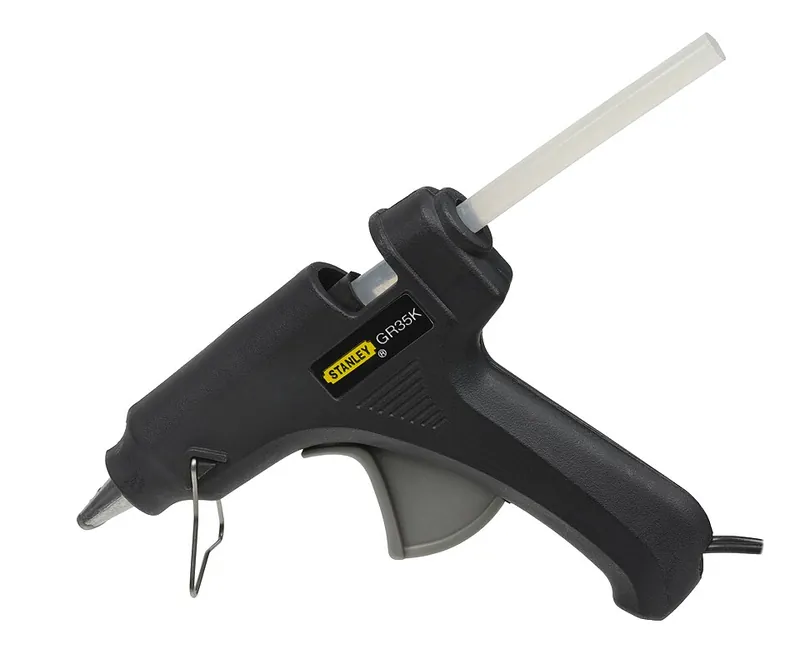
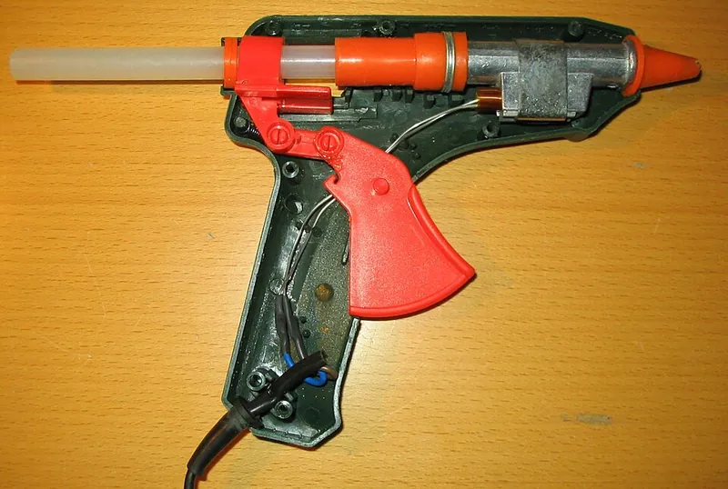
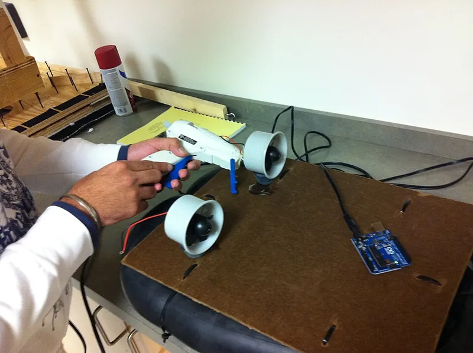

<figure class="eoc-pic eoc-pic-main"><figcaption><strong>Photo.</strong> <a href="https://commons.wikimedia.org/wiki/File:Stanley-Hot-Glue-Gun-GR35K.jpg">Stanley-Hot-Glue-Gun-GR35K</a> by Evan-Amos, Public domain, from Wikimedia Commons.</figcaption></figure>
<figure class="eoc-pic"><figcaption><strong>Cross-section.</strong> <a href="https://commons.wikimedia.org/wiki/File:1111-1_Hot_Glue_Gun_intern_-_Interna_einer_Hei%C3%9Fklebepstole.jpg">1111-1 Hot Glue Gun intern - Interna einer Heißklebepstole</a> by 1-1111, <a href="https://creativecommons.org/licenses/by-sa/3.0">CC BY-SA 3.0</a>, from Wikimedia Commons.</figcaption></figure>
<figure class="eoc-pic"><figcaption><strong>How it works.</strong> <a href="https://commons.wikimedia.org/wiki/File:Wikiversity_model_boat_project_-_Hot-melt_adhesive_does_it_better.jpg">Wikiversity model boat project - Hot-melt adhesive does it better</a> by Afayyaz6843, <a href="https://creativecommons.org/licenses/by-sa/3.0">CC BY-SA 3.0</a>, from Wikimedia Commons.</figcaption></figure>

A solid plastic glue stick is melted by an electrically heated glue gun and squeezed onto the parts; the molten plastic wets the surfaces and grips them as it cools and hardens, with no drying or curing step.

**In plain words:** A stick of plastic that a glue gun melts into a hot, runny glue; it grabs as it cools, sets within seconds to a minute and fills gaps, but it is fairly weak and goes soft again when it gets hot. **Proper term:** Hot-melt adhesive (hot glue, applied with a glue gun).

**Also called:** hot glue, hot-melt glue, HMA (Wikipedia 'Hot-melt adhesive'); hot adhesive, thermoplastic adhesive (Wikipedia 'Adhesive'; 'List of glues'); glue gun, hot glue gun, glue pistol; glue sticks: full-size (7/16 in, about 11 mm) and mini (5/16 in, about 7 mm) (Surebonder); high-temp, low-temp, dual-temp and 'cool shot' glue guns (Surebonder); EVA hot melt, polyamide hot melt, polyolefin hot melt (names by base plastic; Henkel LOCTITE guide p. 8; Wikipedia); reactive hot melt or PUR hot melt (applied like hot glue, then [cures](../glossary.md#cure) with moisture so it won't re-melt; Henkel p. 8; Wikipedia); hot-melt pressure-sensitive adhesive (HMPSA), a permanently tacky version used for tapes and labels (Wikipedia); hot-glue over-moulding, potting or strain relief (Hackaday); brand names a beginner may search for: Thermogrip (brand), Surebonder (brand), Glu-Stix (brand); PLA glue gun: a high-temperature glue gun fed with 3D-printed PLA 'glue sticks' to join PLA prints with PLA (Hackaday 2018).

## How it works

Hot-melt glue is a thermoplastic: it softens when heated and hardens when cooled, again and again (Wikipedia 'List of glues'). The gun melts the stick into a hot, sticky liquid that flows onto and into the surfaces; as it cools it solidifies in a few seconds to a minute and grips them (Wikipedia 'Hot-melt adhesive'). Because it doesn't shrink as it sets (solvent glues can lose 50-70% of their thickness as they dry), a blob of it fills gaps, and it can even hold a smooth part by wrapping around it, like the setting of a gemstone in a ring (Wikipedia; thisTOthat). The same property sets its limits: warm it up again and it softens, and even at room temperature a constant load can make it slowly [creep](../glossary.md#creep) (Wikipedia; Henkel p. 8).

## Parts

A few parts: (1) the glue stick, most often a blend of ethylene-vinyl acetate (EVA) plastic, a sticky tackifier resin and wax (Wikipedia); (2) the glue gun, a heated chamber and nozzle warmed by a continuous-duty heating element, with a trigger mechanism (or thumb pressure) that pushes the stick forward (Wikipedia; Wikimedia Commons photo of glue-gun internals); and (3) the two parts being joined.

## Everyday examples

- The flaps of cardboard boxes and cartons sealed on packaging lines (Wikipedia)
- The glued spines of paperback books (Wikipedia)
- Wires and components held in place inside electronic gadgets (Wikipedia)
- Craft projects, artificial flower arrangements and foam radio-controlled model aircraft (Wikipedia)

## When to use it

Use it for quick, cheap joints where speed matters more than strength: crafts, cardboard and foam models, prototypes, props and cosplay, tacking parts in place while other fixings go in, holding wires and small boards in enclosures, strain relief on cables, and filling gaps between rough or mismatched parts (Wikipedia; Surebonder; Raise3D). It sets in seconds with no mixing, joins many different materials, and can be undone with heat or isopropyl alcohol, which suits temporary fixtures (Make:; Raise3D). Cast into printed moulds, it makes simple waterproof over-moulds for wire joints (Hackaday). A small dab of hot glue also stops a wire working out of a screw terminal, 'without being too difficult to remove later' (SparkFun 'Connector Basics').

## When not to use it

Avoid it for load-bearing or structural joints (use epoxy, screws or a structural adhesive), for anything that gets warm, such as car interiors, sunny windows or near motors and lamps (use epoxy, polyamide or PUR hot melt), for parts under a constant load, where it creeps (Wikipedia; Raise3D), and in the cold, where it can let go (thisTOthat). It grips smooth metal and glass poorly unless they are preheated (Henkel p. 8; Glu-Stix; use epoxy or superglue instead), can melt thin plastic and foam (thisTOthat; use a low-temperature gun or another glue), and leaves thick, stringy joints that are hard to make neat (thisTOthat; Raise3D; for neat joints use superglue or solvent welding).

## Details

- **What it does (jobs):**
  - glue or bond: quick bonds between wood, card, paper, fabric, foam, plastics and many other materials
  - join and hold: holds light parts, wires and circuit boards in place, or tacks parts together temporarily while something else is fitted (Wikipedia; Raise3D)
  - seal it, or pass cables or fluid through: potting, strain relief and waterproof over-moulds on wire splices and connectors (Hackaday)
- **Movement:** none: rigid to slightly rubbery once cool
- **Directions it can move (degrees of freedom):** 0: holds the parts still, although the rubbery glue lets them flex slightly under load
- **Special behaviour:**
  - none of the listed behaviours. Its useful quirk is that it can be undone: heat softens it again and isopropyl alcohol run into the edge of the bond makes it let go (Make:; Raise3D), which makes it handy for temporary holds
- **How it holds:**
  - [material bond](../glossary.md#form-fit--force-fit--material-bond) (glue, solvent or melting): molten plastic wets the surfaces and grips them as it solidifies (Wikipedia; Henkel p. 8)
  - shape (the parts interlock; form-fit): a blob that wraps around a part, or flows into holes and grooves, also locks it in mechanically, e.g. a glass bead held onto wood (thisTOthat)
- **Input and output:** not applicable
- **Power:** passive (no power needed): the finished joint needs no power; the glue gun needs mains power or a battery to melt the glue
- **Load:** Light (medium at best with high-temperature or specialty sticks). Fine for crafts, card, foam, wires and light fittings; weak on smooth, cold or non-porous surfaces such as metal and glass, where it often pops off (Henkel p. 8 lists 'poor adhesion on metals'; Glu-Stix). Craft EVA sticks have low resistance to creep under a constant load (Wikipedia). It grips best where it can soak into or key into rough, porous surfaces such as wood, card and fabric (Wikipedia: the thick melt suits porous and permeable surfaces). Raise3D calls hot-glue bonds on resin prints 'relatively weak in [shear](../glossary.md#peel-vs-shear)'.
- **Play and precision:** not applicable: glue doesn't locate the parts, and you only have seconds to position them before it sets (Wikipedia; Raise3D says about 30-45 seconds before repositioning gets difficult), so precise alignment needs a jig or locating features. The rubbery glue allows a little flex even when set.
- **Taking it apart:** semi-permanent (can be undone but may damage parts): it can usually be peeled or cut off, softened with heat, or released by running isopropyl alcohol into the edge of the bond (Make:; Raise3D). On porous materials such as wood, card or fabric some glue stays in the surface.
- **How often it can be reused:** a few times: the parts can usually be separated and glued again with fresh glue, but the old glue itself is not reused
- **Sealing:** watertight: a continuous bead or over-mould keeps water out of wire splices and cable entries; a hot-glue over-mould made in a 3D-printed mould survived a saltwater bath without leaking (Hackaday 2024), and polyolefin hot melts are good moisture barriers (Wikipedia). It is not a pressure seal, and it can peel away from smooth surfaces.
- **Adjustable:** no: once cool it is fixed, though it can be softened with heat and repositioned or peeled off (Raise3D)
- **Access needed:** one side only (blind): glue is put on one face, or run as a [fillet](../glossary.md#chamfer--fillet) along the outside of the joint, from the front; nothing has to reach behind the parts
- **Materials:** Glue sticks are usually EVA (ethylene-vinyl acetate) blended with tackifier resin and wax; polyamide sticks resist heat and oil better; polyolefin types are made for polypropylene and polyethylene (Wikipedia; Henkel p. 8). Bonds well: porous or rough materials such as wood, card, paper, fabric and foam (Wikipedia; Surebonder), many plastics (Henkel p. 8), and rubber, ceramics, metal and glass to some degree (Wikipedia). 3D prints: fine for light and temporary joints on PLA, PETG, ABS and resin (Raise3D), and hot glue sticks very firmly to PETG unless a release agent is used (Hackaday 2024); but a hot gun can soften thin PLA, foam or thin plastic (thisTOthat: 'it can melt the material you are working with'; CNC Kitchen: PLA gives at about 60 °C). Weak: smooth metal and glass, which chill the glue before it can wet them, unless cleaned, roughened and preheated (Henkel p. 8; Glu-Stix); standard EVA sticks on polypropylene and polyethylene (use polyolefin hot melt; Wikipedia; Henkel p. 8); silicone rubber and PTFE are not expected to bond ⚑ [uncertain].
- **Heat, cold, water and wear:** Heat: craft EVA glue is limited to below about 60-80 °C and loses strength well before it melts, so hot glue softens in a hot car (Wikipedia; Raise3D). Polyamide sticks work up to about 70 °C under load, and cured reactive PUR hot melt to about 150 °C (Wikipedia). Cold: thisTOthat warns hot glue 'does not withstand cold temperatures'. Creep: EVA hot glue slowly gives way under a constant load (Wikipedia). Weather and chemicals: cheap craft sticks resist weathering and some chemicals less well than specialised hot melts (Wikipedia), and isopropyl alcohol loosens the bond (Make:). Polyamide sticks absorb moisture from the air, which can make them foam and form voids when melted (Wikipedia).

## Making it

- **Ways to make or get it:**
  - 3D print (FDM): tacking parts, holding wires and circuit boards in printed enclosures, and casting hot glue into printed moulds for strain relief and waterproof over-moulds (Hackaday; Printables models)
  - 3D print (resin): temporary or non-structural joints such as attaching models to bases or painting handles (Raise3D)
  - woodwork: quick bonds on wood and other porous materials; high-temperature guns give the strongest bonds on wood (Surebonder; Wikipedia)
  - laser cut: card, foam board and thin wood parts for models and prototypes; low-temperature guns suit foam and fabric (Surebonder)
  - off-the-shelf part: glue guns and sticks; in industry, hot melt closes cartons, binds book spines and fixes wires and parts in electronics (Wikipedia)
- **Printing it in one piece (print in place):** no: the glue is added after printing. Printed moulds for casting hot glue are separate parts that are opened afterwards.
- **Tools:** A glue gun of the right size and temperature (full-size 7/16 in / about 11 mm or mini 5/16 in / about 7 mm sticks; high, low or dual temperature) and matching sticks, since the sizes are not interchangeable (Surebonder); a silicone mat or scrap card to catch drips (Surebonder; thisTOthat); optionally a heat gun to preheat metal parts (Glu-Stix), a lolly (popsicle) stick to spread the glue while hot (thisTOthat), isopropyl alcohol and cotton swabs to remove it (Make:), and a bowl of cold water in case of burns (thisTOthat).
- **Difficulty:** easy: cheap tools, no mixing and no waiting; the main skills are working quickly before the glue skins over and avoiding burns

### 3D printing tips

1) Watch the heat: PLA starts to soften at about 60 °C (CNC Kitchen oven test) while a high-temperature glue gun runs at about 380 °F (193 °C) (Surebonder), so a big blob can warp thin PLA walls; use a low-temperature or dual-temperature gun, dab small amounts, or glue onto thicker areas (Raise3D recommends low-temperature guns for thin resin parts and testing a dot on scrap first). 2) Design for it: add holes, grooves, slots or [undercuts](../glossary.md#undercut) that the melted glue can flow into and lock around, and pockets that surround a part, since hot glue holds non-porous parts best by encasing them (thisTOthat). 3) Use it for wiring: tack wires and circuit boards inside printed enclosures and add strain relief where cables exit (Wikipedia notes electronics makers use hot melt to fix parts and wires). 4) Cast hot glue in printed moulds for strain relief and waterproof over-moulds on wire splices and connectors: print the mould in PETG so it survives the heat (Hackaday 2020), and coat it with a release agent (silicone oil, vegetable oil, Vaseline or silicone grease) or the glue will stick firmly (Hackaday 2020, 2024; Printables 1280166). A PLA mould works but wears out sooner (Printables 1280166). One mould maker suggests glue 'not too hot, about 170-180 °C' and waiting 5 minutes before opening (Printables 15081). 5) Work fast: glue skins over in seconds, so apply short beads or dots and press the parts together at once (Raise3D); let the gun preheat 3-5 minutes first, since stringy, thick glue means it isn't hot enough (Surebonder). 6) Removing it from prints: run isopropyl alcohol into the edge of the bond with a cotton swab and it releases cleanly (Make:); a Hackaday reader uses isopropyl alcohol to release glue from printed moulds. 7) Keep hot-glued prints out of hot cars and sunny windows: both the glue and PLA soften there (Raise3D; Wikipedia). 8) PLA instead of glue: Hackaday printed 11 mm PLA 'glue sticks' (an 11 x 150 mm cylinder at 75% [infill](../glossary.md#infill), with angled notches added so the gun's feed lever could grip the hard, smooth PLA) and fed them through an 80 W high-temperature glue gun rated up to 208 °C to join thin, curved PLA panels along their inside seams, with no clamping. A small hobby gun, expected to run at about 150 °C, only softened the PLA to a putty. The molten PLA fused to the parts only at the surface, so it is closer to a hard glue than a true weld, but pulling the seams apart broke the parts or the bead itself; the gun took 10-15 minutes to warm up (Hackaday 2018, '3D Printering: Printing Sticks For A PLA Hot Glue Gun').

### Buying one (off-the-shelf parts)

Search for: 'hot glue gun' (full size or mini; high, low or dual temperature; corded or cordless) and matching 'hot glue sticks 7/16 in' ('11 mm') or 'mini glue sticks 5/16 in' ('7 mm') (Surebonder); 'high temperature' or 'low temperature' glue sticks; 'polyamide hot melt' for heat and oil resistance, 'polyolefin hot melt' for polypropylene and polyethylene, and 'PUR hot melt' (reactive, cures after cooling) (Wikipedia; Henkel p. 8); a 'silicone glue mat' (Surebonder); 'adhesive-lined' or 'dual-wall heat shrink', whose inner wall is essentially hot-melt glue, for sealed wire joints (Hackaday 2024 reader comment).

## Rules of thumb

- Craft EVA glue sticks: strong enough from about 30-50 °C, limited to use below about 60-80 °C, low creep resistance under load, typical melting point about 130 °C (Wikipedia 'Hot-melt adhesive').
- Polyamide hot melts are applied at over 200 °C and generally bond well from -40 °C to 70 °C; reactive PUR hot melts cure with moisture over several hours to days and then serve from about -30 °C to 150 °C (Wikipedia 'Hot-melt adhesive'; Henkel p. 8).
- Hot melts are applied molten in the 65-180 °C range (Wikipedia 'Adhesive'); industrial dispensing is typically above 195 °C at 750-10,000 cP (Henkel 'LOCTITE Design Guide for Bonding Plastics', vol. 6, p. 8).
- Glue gun temperatures: high-temperature about 380 °F (193 °C), low-temperature about 300 °F (149 °C), extra-low 'cool shot' about 250 °F (121 °C) (Surebonder); low-temperature guns range from 170 °F to 250 °F (77-121 °C) (Glu-Stix).
- Stick sizes: mini 5/16 in (6.8 mm) and full-size 7/16 in (10.9 mm); they are not interchangeable (Surebonder 'How to Choose the Right Size Hot Glue Stick').
- Let the gun preheat 3-5 minutes before gluing (Surebonder 'Hot Glue Tips').
- Hot glue solidifies in a few seconds to one minute (Wikipedia 'Hot-melt adhesive'); Raise3D gives about 30-45 seconds before repositioning gets difficult.
- Metal: clean with alcohol or acetone, roughen the surface, preheat both metal parts, and allow at least 24 hours before testing the bond (Glu-Stix 'Bonding Metals With Hot Melt Glue').
- Moulds for casting hot glue: print them in PETG and coat them with a release agent (Hackaday 2020, 2024).
- PLA in a glue gun: PLA softens at about 60-65 °C and melts at about 180-220 °C (RepRap wiki figures quoted by Hackaday), so a hobby gun at about 150 °C only softens it, while a high-temperature gun rated up to 208 °C extruded it acceptably; the sticks need to match the gun's 11 mm stick size and have notches for the feed lever (Hackaday 2018).

## Common failures

The glue skins over before the parts meet, giving a weak joint: apply small amounts, press at once and use a fully heated gun (Raise3D; Surebonder; thisTOthat). It pops off smooth metal or glass because the cold surface chills it: clean, roughen and preheat the parts (Glu-Stix; Henkel p. 8). It melts or warps thin plastic, foam or PLA: use a low-temperature gun or less glue (thisTOthat; Surebonder). Stringy 'spider webs' and lumpy beads (thisTOthat). The joint sags or slides over time under a constant load, or lets go in heat or cold (Wikipedia; thisTOthat). The gun jams or the glue flows unevenly when the stick is the wrong diameter (Surebonder). Glue sticks firmly inside a printed mould when no release agent is used (Hackaday 2024).

## Safety

Burns: the glue coming out of the nozzle is hot enough to burn and even blister skin (Wikipedia), and a high-temperature gun at about 380 °F (193 °C) can cause severe burns, so keep children away or give them low-temperature guns (Glu-Stix). Keep a bowl of cold water handy for burns, keep the gun upright, and purge the drip that builds up at the nozzle onto scrap card before gluing (thisTOthat). Hot melts often give off no fumes unless they are overheated (Wikipedia 'List of glues'), so don't leave a gun heating for long periods. The hot nozzle can also scorch work surfaces; use a stand or silicone mat (Surebonder).

## Related

- Heat staking: also melted plastic, but melts a post on the part itself into a rivet head instead of adding glue
- Cyanoacrylate (superglue): much stronger and neater on tight-fitting parts, but [brittle](../glossary.md#brittle--ductile) and not gap-filling
- Two-part epoxy: strong, heat-resistant, gap-filling glue for load-bearing joints; takes minutes to hours to cure
- Reactive PUR hot melt: applied like hot glue but cures with moisture into a thermoset that won't re-melt, serving to about 150 °C (Wikipedia; Henkel p. 8)
- Double-sided foam tape: another no-wait way to mount light parts, with no heat and no mess
- Silicone and MS-polymer adhesive sealants: flexible, heat- and weather-resistant seals, but they take hours to cure
- Contact adhesive: better for bonding large flat sheets of foam, rubber, fabric or leather
- UV-curing adhesive: also sets on demand in seconds, but clear and neat; needs light to reach the glue
- Solvent welding: fuses same-plastic parts into one piece; stronger and neater, but only on plastics the solvent dissolves
- Melted plastic weld: melts the parts' own plastic, plus filler, into the seam with a soldering iron, 3D pen or hot-air gun; a glue gun fed with PLA sticks sits halfway between hot glue and plastic welding (Hackaday 2018)
- Heat-shrink tubing: adhesive-lined (dual-wall) heat-shrink has a layer of thermoplastic glue inside, so shrinking it over a wire joint seals it much like a hot-glue over-mould (Wikipedia 'Heat-shrink tubing')
- Screw terminal: a dab of hot glue on a screw terminal keeps its wire from working loose and can still be picked off later (SparkFun 'Connector Basics')

## Make it yourself

- [A form for injecting hot glue to hermetically seal the wire connection (Miki SP5ME, Printables)](https://www.printables.com/model/1280166-a-form-for-injecting-hot-glue-to-hermetically-seal): Printable two-part mould for sealing soldered or crimped wire joints (cables up to 3 or 6 mm) in hot glue; grease the halves with Vaseline or silicone grease first. Details read through the Printables public API; the URL appeared in search results. *(licence: CC BY-NC-ND (Creative Commons Attribution-NonCommercial-NoDerivatives))*
- [Hot glue Sleeve, shell mold for JST-XH connector (john3volts3, Printables; original design by Daniel Roibert)](https://www.printables.com/model/15081-hot-glue-sleeve-shell-mold-for-jst-xh-connector): Printable PETG moulds for casting hot-glue strain-relief sleeves on 2- to 8-pin JST-XH battery balance connectors, plus split parts for other widths. Details read through the Printables public API; the URL appeared in search results. *(licence: CC BY-NC-SA (Creative Commons Attribution-NonCommercial-ShareAlike))*
- [Glue strength test pieces (MethodicalMaker, Printables)](https://www.printables.com/model/236948-glue-strength-test-pieces): Printable shear, tension and torque test pieces for comparing hot glue with other adhesives using a hanging scale. Details read through the Printables public API; the URL appeared in search results. *(licence: CC BY (Creative Commons Attribution))*

## Pictures, videos and models

- [Stanley Hot Glue Gun GR35K (Wikimedia Commons, by Evan-Amos)](https://commons.wikimedia.org/wiki/File:Stanley-Hot-Glue-Gun-GR35K.jpg): Photo of an inexpensive hobby hot glue gun, the image used on Wikipedia's hot-melt adhesive article *(licence: Public domain)*
- [Hot Glue Gun intern (Wikimedia Commons, by 1-1111)](https://commons.wikimedia.org/wiki/File:1111-1_Hot_Glue_Gun_intern_-_Interna_einer_Heißklebepstole.jpg): Photo of the inside of a hot glue gun: heater, melt chamber, nozzle and trigger feed *(licence: CC BY-SA 3.0)*
- [Can You Inject Hot Glue Into 3D Printed Molds? | DIY Cable Repair & Protection (Print Practical, YouTube)](https://www.youtube.com/watch?v=-uNsyOG0eZY): Video of hot glue injected into a 3D-printed mould to over-mould and waterproof a wire splice, including the need for a release agent (title checked via YouTube oEmbed) *(licence: link only (standard YouTube licence))*
- [Sleeve with hot glue. Mold 3D printed / Manchon pour fiche JST. Moule imprimé en 3D (Daniel Roibert, YouTube)](https://www.youtube.com/watch?v=vetH_S9nsAE): Video of casting a hot-glue strain-relief sleeve around a JST connector in a printed mould (title checked via YouTube oEmbed) *(licence: link only (standard YouTube licence))*
- [Over-Molding Wires With Hot Glue And 3D Printed Molds (Hackaday, August 2024)](https://hackaday.com/2024/08/02/over-molding-wires-with-hot-glue-and-3d-printed-molds/): Photos and an embedded video of hot-glue over-moulds on wire splices, with the failed first attempt and the vegetable-oil release fix *(licence: link only)*

## Needs confirming

⚑ marks something nobody has confirmed yet: a fact the research could not confirm from a source, a finder value that is a best guess, or an open point from the research notes. Corrections are welcome (see `research/needs-confirming.md`).

- ⚑ 1 sentence on this page marked [uncertain].
- ⚑ Finder value `bonds_well` = PLA, PETG, ABS or ASA, nylon, slippery plastics (PE or PP), silicone, wood, paper or card, metal, glass or ceramic, rubber, fabric or leather, foam (source uncertain): `materials` is marked ⚑ [uncertain] here: "…edia; Henkel p. 8); silicone rubber and PTFE are not expected to bond ⚑ [uncertain].…"
- ⚑ Finder value `bonds_poorly` =  (source uncertain): `materials` is marked ⚑ [uncertain] here: "…edia; Henkel p. 8); silicone rubber and PTFE are not expected to bond ⚑ [uncertain].…"

## Sources

- <https://en.wikipedia.org/wiki/Hot-melt_adhesive>
- <https://en.wikipedia.org/wiki/Adhesive>
- <https://en.wikipedia.org/wiki/List_of_glues>
- <https://www.ellsworth.com/globalassets/literature-library/manufacturer/henkel-loctite/henkel-loctite-design-guide-plastic-bonding.pdf>
- <https://thistothat.com/glue/hotglue.shtml>
- <https://surebonder.com/blogs/surebonder-blog/glue-gun-wattage-explained-how-to-pick-the-right-hot-glue-gun-for-your-project>
- <https://surebonder.com/blogs/surebonder-blog/how-to-choose-the-right-size-hot-glue-stick>
- <https://surebonder.com/blogs/surebonder-blog/tips-for-better-bonding>
- <https://glu-stix-online.com/blogs/news/the-difference-between-high-temperature-and-low-temperature-glue-guns>
- <https://glu-stix-online.com/blogs/news/bonding-metals-with-hot-melt-glue>
- <https://makezine.com/article/technology/simple-solution-to-removing-hot-glu/>
- <https://hackaday.com/2020/02/11/cheap-strain-relief-by-casting-hot-glue-in-a-3d-print/>
- <https://hackaday.com/2024/08/02/over-molding-wires-with-hot-glue-and-3d-printed-molds/>
- <https://www.raise3d.com/blog/best-resin-prints-glue/>
- <https://www.cnckitchen.com/blog/comparing-pla-petg-amp-asa-feat-prusament>
- <https://blog.prusa3d.com/the-great-guide-to-gluing-and-assembling-3d-prints_44908/>
- <https://commons.wikimedia.org/wiki/File:Stanley-Hot-Glue-Gun-GR35K.jpg>
- <https://commons.wikimedia.org/wiki/File:1111-1_Hot_Glue_Gun_intern_-_Interna_einer_Heißklebepstole.jpg>
- <https://commons.wikimedia.org/wiki/Category:Glue_guns>
- <https://www.youtube.com/watch?v=-uNsyOG0eZY>
- <https://www.youtube.com/watch?v=vetH_S9nsAE>
- <https://api.printables.com/graphql/>
- <https://hackaday.com/2018/02/05/3d-printering-printing-sticks-for-a-pla-hot-glue-gun/>
- <https://learn.sparkfun.com/tutorials/connector-basics/all>
- <https://en.wikipedia.org/wiki/Heat-shrink_tubing>
