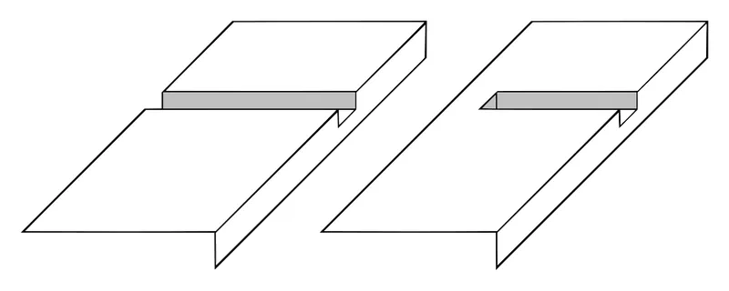

*Picture: [Woodworking-joint-dado.svg](https://commons.wikimedia.org/wiki/File:Woodworking-joint-dado.svg) by Woodworking-joint-dado.gif: SilentC derivative work: Zerodamage, [CC BY-SA 3.0](https://creativecommons.org/licenses/by-sa/3.0), from Wikimedia Commons.*

A housing (dado) is a three-sided channel cut across a board, and a rebate (rabbet) is a two-sided step along an edge or end. Another board's end or edge sits in it, which lines the parts up and gives a ledge to carry load; glue, nails or screws usually stop it pulling out.

**In plain words:** A shallow channel cut across one board (a housing or dado), or a step cut along its edge or end (a rebate or rabbet), that the end or edge of another board drops into. Shelves sit on the ledge, and back panels and glass sit flush in the recess. **Proper term:** Housing (dado) and rebate (rabbet) joints.

**Also called:** housing, housing joint, trench (UK and Europe); dado, dado joint (US and Canada) (Wikipedia 'Dado (joinery)'; DT Online 'Housing Joint'); through housing or through dado (open at both ends); stopped housing, stopped dado or blind dado (hidden at the front) (Wikipedia; DT Online); dovetail housing, dovetailed dado; the same as a sliding dovetail (DT Online); half dado, rabbet-and-dado joint, dado-and-rabbet (Wikipedia 'Dado (joinery)'; Rockler 'Making Rabbet Joints'); rebate (UK), rabbet (US), rebate joint, rabbet joint, rebated butt joint, corner lap joint, shouldered corner (Wikipedia 'Rabbet'; DT Online 'Corner Lap Joint'; Rockler); single rabbet, double rabbet, mitred rabbet, dovetail rabbet (Rockler); shiplap: overlapping rabbets on neighbouring boards (Wikipedia 'Rabbet'; Rockler); glazing rebate, the step in a window frame or glazing bar that takes the glass and putty (Wikipedia 'Rabbet'); groove: the same three-sided channel cut along the grain instead of across it (Wikipedia 'Dado (joinery)').

## How it works

The floor and walls of a housing, or the shoulder of a rebate, give the mating board a ledge to bear on and sides that stop it sliding out of line, so a shelf's weight is carried by the ledge rather than by glue or screws alone; the housing also stops the shelf cupping (Rockler 'Using Your Router to Cut Dado Joints'). Neither shape stops the boards pulling apart: 'Only glue or fasteners can do that', and because most of the glue faces are [end grain](../glossary.md#end-grain), the glue is weak (Rockler). A rebate hides the end grain of the mating board, gives a positive stop during assembly, and offers more glue and nailing surface than a plain butt joint (Rockler 'Making Rabbet Joints'; DT Online 'Corner Lap Joint'). Cutting the housing's sides at a dovetail angle stops the shelf pulling out sideways (DT Online).

## Parts

A single feature cut into one part, or into both parts in a rabbet-and-dado joint. The mating board is usually left square-ended or given its own rabbet, and the joint is normally glued and/or nailed, screwed or pinned (Rockler 'Making Rabbet Joints'; Wikipedia 'Rabbet').

## Everyday examples

- Fixed shelves in a bookcase or kitchen cabinet sitting in housings (dados) cut across the sides (Wikipedia 'Dado (joinery)'; DT Online)
- The thin back panel of a wardrobe, bookcase or cabinet set into rebates along the back edges (Wikipedia 'Rabbet'; Fine Woodworking)
- A picture frame, whose rebate holds the glass, picture and backing (Wikipedia 'Rabbet')
- Window frames and glazing bars with a rebate for the glass and putty, and shiplap cladding (Wikipedia 'Rabbet'; Rockler)

## When to use it

Use a housing (dado) to fix shelves, dividers and partitions in bookcases, cabinets and boxes: it carries the shelf on a ledge, keeps it straight and lines the parts up during glue-up (DT Online; Rockler). A fixed, housed shelf is also stiffer than a loose one (Popular Woodworking). Use a stopped housing when the front edge must look clean (DT Online). Use a rebate (rabbet) to let in a back panel, glass or a box bottom or top, to join case corners and drawer fronts simply, or to hide end grain and plywood edges (Wikipedia 'Rabbet'; Rockler; DT Online). Use rabbet-and-dado in plywood casework, where it assembles easily, resists racking and copes with uneven sheet thickness (Rockler).

## When not to use it

Don't rely on a plain housing or rebate where the joint is pulled apart (in tension), for example a shelf that the sides could spread away from, or a drawer front that gets yanked. Use a dovetail housing or sliding dovetail, a dovetail, or a mortise and tenon, or add screws (Rockler; DT Online; Popular Woodworking). For adjustable shelves use shelf pins or supports instead of fixed housings. For flat-pack furniture that must come apart, use knock-down fittings such as cam locks and cross dowels. For joining boards edge to edge into a wide panel, use tongue and groove, dowels or biscuits. For laser-cut sheet, use tab-and-slot through-slots. Where a hidden, very strong corner is wanted, a dovetail or finger joint holds better than a nailed rebate (Wikipedia 'Rabbet': 'not as strong as some other joints').

## Details

- **What it does (jobs):**
  - join and hold: fixes shelves and partitions into cabinets and bookcases, joins case tops, bottoms and drawer fronts, and holds back panels, glass and pictures (Wikipedia; DT Online; Rockler)
  - line parts up exactly: the channel or step locates the parts during glue-up so they can't slide out of position (Rockler 'Making Rabbet Joints')
- **Movement:** none: a fixed joint once glued or fastened (the board only slides into the channel during assembly)
- **Directions it can move (degrees of freedom):** 1 before fixing: a shelf in a through housing can still slide along the channel and lift out, and a back panel can lift out of its rebate. 0 once glued, nailed or screwed (Rockler).
- **Special behaviour:**
  - self-aligning or self-centring: the channel or step positions the parts during assembly; Rockler calls the rabbet-and-dado 'a good rack-resistant joint that assembles easily because both boards are positively located'
- **How it holds:**
  - shape (the parts interlock; [form-fit](../glossary.md#form-fit--force-fit--material-bond)): the ledge carries the load and the walls stop sideways slip; a dovetail housing also locks against pulling out (Rockler; DT Online)
  - material bond (glue, solvent or melting): usually glued, but most faces are end grain, which glues poorly (Rockler)
  - friction or clamping (force-fit): brads, finish nails or screws through the joint, plus a snug fit (Rockler; Wikipedia 'Rabbet': 'Nails and screws can be added to help increase the overall strength')
- **Input and output:** not applicable
- **Power:** passive (no power needed)
- **Load:** Medium. Strong when carrying downward shelf loads, which bear on the ledge, and good against sliding ([shear](../glossary.md#peel-vs-shear)). A housed fixed shelf is stiffer than a loose shelf because the case sides hold it at a rigid right angle, and fastening the shelf to the case back adds more [stiffness](../glossary.md#stiffness) (Popular Woodworking, Tom Caspar). Weak in tension (pull-out) unless it is well glued, dovetailed or fastened (Rockler; DT Online). Wikipedia notes that rabbet joints 'are easy to construct, but are not as strong as some other joints'. A rabbet-and-dado joint resists racking well (Rockler).
- **Play and precision:** small to none if cut correctly: 'a snug fit of mate to dado is essential for a strong joint', and 'Glue won't compensate for a rough, ill-sized dado' (Rockler). Sheet goods are the usual trap: '3/4 in' plywood often measures close to 1/32 in thin, and thickness may vary by up to 3/64 in, so a cut at the nominal size can be sloppy (Rockler). A rabbet-and-dado joint copes with uneven plywood, because the rabbet can be cut to fit a standard dado (Rockler).
- **Taking it apart:** permanent when glued. Semi-permanent when only nailed or pinned, since pulling nails can damage the parts. Removable when a back panel or shelf sits in its rebate or housing held only by screws ⚑ [uncertain].
- **How often it can be reused:** once when glued; a few times when only screwed ⚑ [uncertain]
- **Sealing:** none: the joint itself doesn't seal. In a window, the glazing rebate holds the glass and the putty does the sealing (Wikipedia 'Rabbet').
- **Adjustable:** no once glued; the fit is adjusted while cutting, by making two passes, adding shims or using undersized bits (Rockler 'Getting Dadoes and Plywood Thickness to Match')
- **Access needed:** not applicable: the board is pushed into the channel or onto the step during assembly, and nothing needs to be reached from behind
- **Materials:** Usually wood: solid timber, plywood, MDF and particleboard (Wikipedia: 'machinable material, usually wood'; Rockler). Plywood is about half as stiff as average hardwood and particleboard or MDF about a quarter, which affects shelf spans (Popular Woodworking). The same shapes appear in 3D-printed and CNC-cut boxes, e.g. a box generator that makes rabbet-jointed boxes for both 3D printers and CNC machines (Printables 'Slide Top Rabbet Box').
- **Heat, cold, water and wear:** These are wood joints, so the limits are those of the timber and glue. Under constant load, wooden shelves keep sagging 'a little more each year', because wood [creeps](../glossary.md#creep) (Popular Woodworking). Changes in humidity make wood and plywood swell and shrink, which changes the fit of a dado (Rockler). MDF and particleboard can swell and lose strength if they get wet, and PVA glue joints are for indoor use unless a water-resistant glue is used ⚑ [uncertain]. 3D-printed versions follow the limits of the plastic, e.g. PLA softening in heat ⚑ [uncertain].

## Making it

- **Ways to make or get it:**
  - woodwork: router with a fence, router table, table saw with a dado set, or hand saw, chisel and router or rebate plane (Rockler; Wikipedia; DT Online)
  - CNC: a CNC router can pocket housings and rebates in sheet material; inside corners come out rounded to half the cutter diameter, so square the ends of stopped housings with a file or chisel, or add dogbones (Fablab RUC)
  - 3D print (FDM): printed boxes and enclosures with rabbeted edges and slots that locate panels; also printed jigs for cutting dados (Printables 185416 and 284328)
  - laser cut: a laser cuts right through sheet, so through-slots (tab-and-slot joints) usually take the place of blind housings ⚑ [uncertain]
  - off-the-shelf part: ready-made picture-frame and glazing mouldings come with the rebate already cut ⚑ [uncertain]
- **Printing it in one piece (print in place):** no: the parts are made separately and then pushed or glued together (e.g. the printable rabbet box is assembled and glued; Printables 'Slide Top Rabbet Box')
- **Tools:** Power: a router with a straight or rabbeting bit plus a guide fence or shop-made T-square (Rockler); a table saw with a dado set (stacked or wobble type) or several ordinary passes (Wikipedia 'Dado set'; Wikipedia 'Rabbet'); a router table with a straight or slot-cutting bit (Fine Woodworking, Latta); a spindle moulder, or a jointer with a rabbeting ledge (Wikipedia 'Rabbet'). By hand: marking knife, try square, marking gauge, tenon saw, chisel and mallet, plus a router plane, rebate plane or shoulder plane (DT Online; Wikipedia 'Rabbet'). For assembly: glue, clamps, and brads, nails or screws.
- **Difficulty:** easy to moderate: a rabbet is 'one of the first joinery cuts that new woodworkers try' (Rockler), and dados are straightforward with a router and a straight guide fence (Rockler). Hand-cut housings need careful marking, sawing and paring (DT Online), and stopped housings need an extra notch in the shelf (DT Online).

### 3D printing tips

1) Use printed slots and rebates to hold flat panels (plywood, acrylic, MDF) in printed corner pieces, frames and enclosures: the panel edge sits in the channel and is located on three sides. 2) Size the channel from the measured panel thickness, not the nominal one: '3/4 in' plywood is often about 1/32 in thin (Rockler). Then add [clearance](../glossary.md#clearance); Hubs gives a typical interlocking-joint [tolerance](../glossary.md#tolerance) of 0.5 mm for FDM and 0.2 mm for SLA and SLS. Print a short test piece first ⚑ [uncertain]. 3) For a sliding lid in a rebate, the 'Slide Top Rabbet Box' generator widens the receiving slot rather than thinning the lid: its default is 4% of the material thickness, e.g. 0.32 mm for 8 mm walls (Printables 185416, CC BY). 4) Add a small radius or [chamfer](../glossary.md#chamfer--fillet) to entry edges; Hubs notes that 'adding a small radius to part edges assists joint assembly and reduces [stress concentrations](../glossary.md#stress-concentration)'. 5) Orient the print so the channel opens upward or along the build plate, so its roof doesn't need supports ⚑ [uncertain]. 6) Printed shop aids help with wooden dados and rabbets: a table-saw dado-width jig (Printables 'Dado Jig', CC BY), height gauges for dado stacks and router bits (Printables 85931, which notes that [elephant's foot](../glossary.md#elephants-foot) on the first layer throws off the depth), and a printable rebate plane that holds a 3/4 in chisel, printed in PETG with 40% gyroid [infill](../glossary.md#infill) and 5 [perimeters](../glossary.md#perimeters) because PETG wore better than PLA (Printables 1802612). 7) Printed parts are weak at end-grain-like layer boundaries in the same way wood is at end grain, so don't rely on a glued printed housing alone to resist pull-out; add a screw or a dovetail shape ⚑ [uncertain].

### Buying one (off-the-shelf parts)

Router bits: straight bits with short flutes (dados seldom exceed 1/2 in deep) and plunge-cutting ends for stopped dados; 'undersized' plywood bits of 23/32 in, 15/32 in (or 31/64 in) and 15/64 in for nominal 3/4, 1/2 and 1/4 in plywood; bearing-guided rabbeting bit sets with interchangeable bearings; dovetail bits for dovetail housings (Rockler). Table-saw dado sets: a stacked dado set (two outer blades, chippers and shims) or a wobble dado; micro-adjustable sets such as Freud Dial-A-Width (brand) (Wikipedia 'Dado set'; Rockler). Hand tools: router plane, rebate (rabbet) plane, shoulder plane (Wikipedia 'Rabbet'; DT Online). Safety: featherboards ('combs') and push pads for table-saw dadoing and rabbeting (OSHA 1910.213; Fine Woodworking).

## Rules of thumb

- Housing width = the thickness of the shelf or partition it takes (DT Online), cut to the board's actual thickness (Rockler).
- Housing depth: no more than one-third of the timber thickness (DT Online). A dado needn't be deep: 1/8 in is enough in solid wood and 1/4 in in plywood, MDF or particleboard; 1/4 in is 'about as deep as a dado ever needs to be' (Rockler).
- Rebate (single rabbet joint): width = the thickness of the mating board, for a flush fit; depth = one-half to two-thirds of its width; the deeper it is, the less end grain shows (Rockler 'Making Rabbet Joints').
- Rabbet-and-dado: the dado can be a single saw [kerf](../glossary.md#kerf), 'no deeper than one-third the board's thickness', with the mating rabbet cut to fit (Rockler).
- Plywood thickness: nominal 3/4 in is often close to 1/32 in under, and tolerance is up to 3/64 in; use undersized bits (23/32 in, 15/32 in) or a two-pass cut (Rockler).
- Router: remove no more than about 1/4 in per pass, and feed so the bit pulls the router against the fence (left to right when pushing along a fence) (Rockler).
- Shelf loads: books can weigh up to 50 lb per running foot, and a wide hardwood shelf 3/4 in thick carrying a heavy load should be no longer than about 36 in. Plywood is about half as stiff as average hardwood and particleboard or MDF about a quarter (Popular Woodworking, Tom Caspar).
- End grain glues poorly, so rabbeted case corners that involve end grain are usually nailed or screwed as well (Rockler).

## Common failures

Sloppy fit because nominal plywood is thinner than its label; measure it, and use undersized bits or two passes (Rockler). A rough, uneven-bottomed or badly sized housing, which glue won't rescue (Rockler). A housing cut too deep, which weakens the side; keep it to no more than one-third of the thickness (DT Online). Shelves pulling out or the case racking, because the joint doesn't resist tension and end-grain glue is weak; add screws, a dovetail shape, or a back panel fixed to the shelves (Rockler; Popular Woodworking). A router that wanders off line or a gouged shoulder, from feeding in the wrong direction or holding the router by hand on small parts (Rockler; Fine Woodworking). Chipped edges on long-grain rebates (Rockler). Uneven rabbet depth from inconsistent downward pressure (Fine Woodworking). Wood splitting out at the far side of a hand-cut housing; chisel the waste from both sides towards the middle (DT Online). A shelf that won't seat in a CNC-cut stopped housing because the housing's inside corners are rounded to the cutter radius; square them with a file or chisel, or add dogbones (Fablab RUC).

## Safety

Cutting housings and rebates on a table saw is a non-through cut, so the standard blade guard can't be used; OSHA requires 'combs (featherboards) or suitable jigs' for dadoing and rabbeting (OSHA 1910.213). Fine Woodworking warns never to cut a rabbet 'with the stock between the dado stack and the fence': if the board pulls away from the fence, the dado head can throw it violently (Steve Latta, Fine Woodworking #301). Use a push pad and keep downward pressure on the work (Fine Woodworking). With a hand-held router, wear hearing and eye protection, and don't drag the router back along the cut with the bit spinning, because it can snag (Rockler). In schools, routers may only be used by trained, supervised students (DT Online). When paring, hold the chisel with one hand on the handle and one on the blade, with the knuckles of the blade hand pressed against the work for control (DT Online).

## Related

- Sliding dovetail: a housing with angled sides (dovetail housing) that also resists pulling apart
- Tongue-and-groove joint: a groove cut along the grain for joining boards edge to edge or holding sliding lids, where a housing is cut across the grain
- Butt and lap wood joints: the plain butt joint that a rebate improves on; a half-lap is made from two rebates nested together (Rockler)
- Finger joint (box joint) and dovetail joint: stronger interlocking corners than a nailed rebate
- Mortise and tenon: a stronger joint for rails meeting posts
- Dowel and biscuit joints: alternative ways to fix shelves without cutting a full-width housing
- Knock-down cam-lock and cross-dowel connectors: for flat-pack shelves that must come apart
- Tab-and-slot joint: the sheet-material (laser-cut) version, with through-slots instead of blind housings

## Make it yourself

- [Slide Top Rabbet Box (Customizer for 3D Printers and CNC) (Openscaddad, Printables) (URL from Printables API, page not opened)](https://www.printables.com/model/185416-slide-top-rabbet-box-customizer-for-3d-printers-an): Parametric box generator whose walls join with rabbet joints for precise alignment during glue-up, with a sliding lid; a tolerance slider sets the lid slot clearance as a percentage of wall thickness. For 3D printers and CNC. Read through the Printables public API. *(licence: CC BY (Creative Commons Attribution))*
- [Dado Jig (Ben Crawford, Printables) (URL from Printables API, page not opened)](https://www.printables.com/model/284328-dado-jig): Printable table-saw jig that transfers the thickness of the shelf material to the fence setting, so a dado can be cut in two passes to an exact fit. Read through the Printables public API. *(licence: CC BY (Creative Commons Attribution))*
- [Rabbet / Rebate Plane (PositiveVorticity, Printables) (URL from Printables API, page not opened)](https://www.printables.com/model/1802612-rabbet-rebate-plane): Printable hand plane for cutting rebates, using a 3/4 in chisel as the blade held by a wedge, with a fence; printed in PETG. Read through the Printables public API. *(licence: CC BY-NC (Creative Commons Attribution-NonCommercial))*
- [Saw Blade, Dado, and Router Bit Height Gauges (CheeseMcGee, Printables) (URL from Printables API, page not opened)](https://www.printables.com/model/85931-saw-blade-dado-and-router-bit-height-gauges): Printable step gauges in 1/8 in steps for setting dado-stack and router-bit cutting depth. Read through the Printables public API. *(licence: CC BY-NC-SA (Creative Commons Attribution-NonCommercial-ShareAlike))*

## Pictures, videos and models

- [Woodworking-joint-dado.svg (Wikimedia Commons, by SilentC, vectorised by Zerodamage, 2012)](https://commons.wikimedia.org/wiki/File:Woodworking-joint-dado.svg): Drawing of a through dado (left) and a stopped dado (right) *(licence: CC BY-SA 3.0)*
- [Woodworking-joint-rebate.gif (Wikimedia Commons, by SilentC)](https://commons.wikimedia.org/wiki/File:Woodworking-joint-rebate.gif): Drawing of a rebate (rabbet) cut along the edge of a board *(licence: CC BY-SA 3.0 / GFDL)*
- [Dadosets.jpg (Wikimedia Commons, by Luigi Zanasi)](https://commons.wikimedia.org/wiki/File:Dadosets.jpg): A stacked dado set taken apart (outer blades and chippers), mounted in a table saw, and a wobble dado *(licence: CC BY-SA 2.0 Canada)*
- [How to make a Housing Dado Joint - The Three Joints (YouTube, Paul Sellers)](https://www.youtube.com/watch?v=n3e6Ba6IfhM): Hand-tool demonstration of marking, sawing and chiselling a housing dado (title and channel checked via YouTube oEmbed; not watched) *(licence: link only (standard YouTube licence))*
- [How To Make Rabbets, Dadoes, and Grooves (YouTube, WOOD magazine)](https://www.youtube.com/watch?v=jcDizu5P3Ck): Power-tool demonstration of cutting rabbets, dados and grooves with different bits and blades (title and channel checked via YouTube oEmbed; not watched) *(licence: link only (standard YouTube licence))*

## Needs confirming

⚑ marks something nobody has confirmed yet: a fact the research could not confirm from a source, a finder value that is a best guess, or an open point from the research notes. Corrections are welcome (see `research/needs-confirming.md`).

- ⚑ 9 sentences on this page marked [uncertain].

## Sources

- <https://en.wikipedia.org/wiki/Dado_(joinery)>
- <https://en.wikipedia.org/wiki/Rabbet>
- <https://en.wikipedia.org/wiki/Dado_set>
- <https://wiki.dtonline.org/index.php/Housing_Joint>
- <https://wiki.dtonline.org/index.php/Corner_Lap_Joint>
- <https://www.rockler.com/learn/making-rabbet-joints>
- <https://www.rockler.com/learn/using-router-to-cut-dado-joints>
- <https://www.rockler.com/learn/getting-dadoes-and-plywood-thickness-to-match>
- <https://www.finewoodworking.com/2022/12/13/cutting-rabbets-two-ways>
- <https://www.popularwoodworking.com/techniques/aw-extra-3614-stronger-shelves/>
- <https://www.osha.gov/laws-regs/regulations/standardnumber/1910/1910.213>
- <https://www.hubs.com/knowledge-base/how-design-interlocking-joints-fastening-3d-printed-parts/>
- <http://fablab.ruc.dk/more-elegant-cnc-dogbones/>
- <https://commons.wikimedia.org/wiki/File:Woodworking-joint-dado.svg>
- <https://commons.wikimedia.org/wiki/File:Woodworking-joint-rebate.gif>
- <https://commons.wikimedia.org/wiki/File:Dadosets.jpg>
- <https://www.youtube.com/watch?v=n3e6Ba6IfhM>
- <https://www.youtube.com/watch?v=jcDizu5P3Ck>
- <https://api.printables.com/graphql/>
