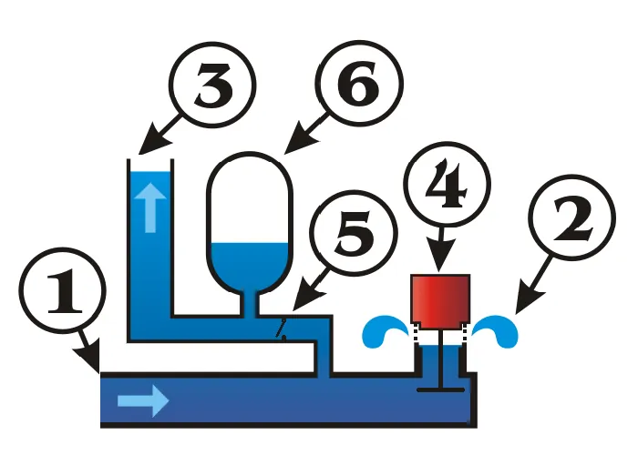

<figure class="eoc-pic eoc-pic-main"><figcaption><a href="https://commons.wikimedia.org/wiki/File:Hydraulic_Ram.gif">Hydraulic Ram</a> by The original uploader was Gutza at English Wikipedia.; subsequent functional corrections made by Sonett72 on en.wikipedi, <a href="http://creativecommons.org/licenses/by-sa/3.0/">CC BY-SA 3.0</a>, from Wikimedia Commons.</figcaption></figure>

A cyclic pump powered only by falling water: flow builds up in a long rigid drive pipe until it slams a waste valve shut, and the resulting pressure surge ([water hammer](../glossary.md#water-hammer)) forces a fraction of the water through a one-way valve into an air chamber and up a delivery pipe to a height many times greater than the fall that drives it.

**In plain words:** A water pump with no motor, fuel or electricity: water running down a pipe from a stream or spring keeps slamming a valve shut, and each bang pushes a little of the water up a second pipe to a tank or trough much higher than where the water came from. **Proper term:** Hydraulic ram pump (hydram).

**Also called:** ram pump, hydraulic ram, hydram (Wikipedia; Practical Action); water-hammer pump; water ram; Montgolfier's hydraulic ram (507 Mechanical Movements, no. 444); pulsation engine (John Whitehurst's hand-operated forerunner of 1772) (Wikipedia); French 'bélier hydraulique': water hammer is 'coup de bélier', 'blow of the ram' (Wikipedia 'Hydraulic shock'); German 'hydraulischer Widder' or 'Stoßheber' (Wikimedia Commons file description); compound ram and indirect ram (falling dirty water drives the lifting of clean water) (Wikipedia; Warwick DTU TR13); brand names a beginner may meet: Blake's Hydram (brand), Papa Pump and Venturo Pump (brands), Rife (brand), Vulcan and Vacher rams (brands) (Wikipedia; Clemson LGP 1017); part names: waste valve (impulse valve, clack valve), delivery valve (delivery [check valve](../glossary.md#check-valve)), air chamber (pressure vessel, air vessel), snifter (snifting valve), drive pipe, delivery pipe (Wikipedia; Practical Action).

## How it works

Water runs down the drive pipe and out of the open waste valve, getting faster and faster until the drag of the flow lifts the valve and slams it shut (Wikipedia; Clemson). The moving column of water can't stop instantly, so the pressure in the pump body jumps (water hammer), opens the delivery valve and pushes a little water into the air chamber, squeezing the air; the squeezed air then keeps pushing water steadily up the delivery pipe after the delivery valve closes (Practical Action). The pressure wave runs back up the drive pipe and returns as a suction pulse that, with the valve's weight or spring, reopens the waste valve, and the cycle repeats about 30-100 times a minute (Wikipedia; Practical Action). Energy is conserved: a lot of water falling a little way lifts a little water a long way, and most of the drive water spills out of the waste valve (Practical Action; Wikipedia).

## Parts

A small assembly that acts as one unit, with only two moving parts: a long rigid drive pipe from the source, a pump body (often a pipe tee), a weighted or spring-loaded waste valve that opens downwards, a delivery check valve, an air chamber holding a cushion of air (kept topped up by a snifter hole or held in a bicycle inner tube), and a delivery pipe; home-made versions add unions, isolation valves and a pressure gauge (Wikipedia; Practical Action; Clemson LGP 1017)

## Everyday examples

- The banging pipes heard when a washing machine, dishwasher or toilet valve suddenly shuts off is the same water-hammer effect a ram pump uses on purpose (Wikipedia 'Hydraulic shock')
- Farm and village water supplies: three rams in East Dundry near Bristol made a noisy 'thump' every minute or so day and night until mains water arrived around 1958 (Wikipedia)
- Garden fountains: a Blake's Hydram drives a fountain at the Centre for Alternative Technology in Wales (Wikimedia Commons photo caption)
- Livestock troughs on hill pasture far from electricity (Clemson LGP 1017)

## When to use it

Use one where there is a steady stream or spring with a drop of at least a few feet below it, and you need a modest, continuous supply of water higher up, far from electricity: livestock troughs, small village or house supplies, garden ponds, fountains and irrigation tanks (Wikipedia; Clemson; Practical Action). It runs 24 hours a day with no fuel and very little maintenance, so even a small flow adds up: a 3/4-inch ram at 0.1 gpm gives about 144 gallons a day, enough for four or five cattle (Clemson). It is also a superb teaching model of momentum, water hammer and energy conservation, and a working printed version can be built (Printables 289108).

## When not to use it

Don't use one without a flowing source and enough fall: it wastes most of its drive water and can drain a pond if the inflow can't keep up (Clemson). Don't use one where the demand is intermittent and you want to shut the outlet: a blocked ram stops and must be restarted by hand, so a float valve can't be used at the trough (Clemson). For lifting water from a still well, tank or pond with no fall, use a hand pump, solar pump or electric centrifugal or diaphragm pump instead (Clemson mentions solar pumps and nose and sling pumps). For high flows at low lift, a ram is expensive for what it delivers; hydrams are best for small flows to high heads (Practical Action). Avoid it where the water carries lots of sand or debris unless it is screened, as the valves wear quickly (Clemson).

## Details

- **What it does (jobs):**
  - change the kind of motion: turns a large flow of water falling a small height into a small flow pushed to a much greater height (Practical Action: 'uses a larger flow of water falling through a small head to lift a small flow of water through a higher head')
  - seal it, or pass cables or fluid through: pumps water along a pipe to a tank, trough or fountain with no fuel or electricity (Wikipedia; Clemson LGP 1017)
- **Movement:** multiple: the waste valve's flap or disc swings or lifts open and slams shut, and the delivery valve opens and closes, roughly 30-100 times a minute (Practical Action) or 40-90 times a minute for home-made pumps (Clemson); nothing turns
- **Directions it can move (degrees of freedom):** 2: the waste valve and the delivery valve each move only between open and shut, independently of each other, driven entirely by the water
- **Special behaviour:**
  - motion conversion (e.g. rotary to linear): converts a steady downhill flow at low pressure into a pulsing, higher-pressure flow, trading quantity for height (Practical Action; Wikipedia)
  - one-way (moves freely one way, locks the other): the delivery check valve lets water into the air chamber and stops it running back, and a second check valve is often fitted in the delivery line so the pipe stays full when the pump stops (Practical Action)
  - none of the locking behaviours otherwise: it keeps cycling by itself only while the drive flow lasts and the delivery pipe is open; if either stops, most pumps stop and must be restarted by hand (Clemson; Wikipedia)
- **How it holds:**
  - not a holding joint (it moves or passes on motion): it is a pump. The pump body itself must be firmly bolted to a concrete foundation or heavy rocks because each beat is a shock load (Practical Action; Clemson)
- **Input and output:** Flow of water falling a small height (supply head or 'fall') -> a smaller flow lifted higher (delivery head or 'lift'). Delivery flow is roughly efficiency x drive flow x fall / lift; Rife's rule D = 0.6 x Q x F/E (Clemson LGP 1017). Lift: up to about 10 ft for every foot of fall, or more (Clemson); AID Foundation pumps lift water up to 220 m (Practical Action). Energy efficiency: typically 60%, up to 80% (Wikipedia); 50-80% (ACF manual); 'more than 50%' under favourable conditions (Practical Action); but only 20-40% of the water entering is delivered (ACF), and home-made pumps deliver about 1 gallon for every 8 passing through (Clemson). Example: with 2 m of fall and 10 m of lift at 70% efficiency, 14% of the drive water is delivered (Wikipedia). Not back-drivable: the delivery check valve stops water running back (Wikipedia). Shaft arrangement: not applicable.
- **Power:** passive (no power needed): powered only by the energy of the falling drive water, with no outside source of power (Wikipedia). If the drive flow fails or the delivery is shut, it stops; most home-made pumps will not restart by themselves and the waste valve must be pushed open by hand (Clemson), although some designs and printed versions can be set up to self-start (Printables 289108 description)
- **Load:** Not a structural part, but it must withstand repeated pressure shocks. Delivery heights: the ACF 2-inch design is rated to 150 m, the DTU S2 design is recommended not to exceed 100 m (ACF manual), and AID Foundation pumps reach 220 m (Practical Action). Home-made PVC rams need about 10 psi (0.7 bar) of back pressure to keep cycling and use a 100 psi gauge (Clemson). The drive pipe carries severe internal shock loads and, at bends, strong sideways forces that can tear it loose, so it must be rigid, straight and anchored (Practical Action; Clemson)
- **Play and precision:** not applicable (it doesn't locate parts or pass on mechanical motion)
- **Taking it apart:** removable: unions on the drive and delivery sides let the pump be taken off for maintenance (Clemson); commercial rams are bolted to a concrete base (Practical Action)
- **How often it can be reused:** many times: the pump can be unbolted and refitted; it cycles millions of times, but home-made check valves wear out in about three months to two years depending on sandy water and cycle speed (Clemson), while heavy cast traditional rams have run for 50 years or more (Practical Action)
- **Sealing:** airtight or pressure on the delivery side: the delivery check valve, glued or threaded joints and the air chamber must hold the delivery pressure, and the air chamber must not leak air (Clemson). The waste valve deliberately spills drive water every cycle, so the site needs drainage (Clemson)
- **Adjustable:** yes: the waste valve's weight, spring tension and opening [stroke](../glossary.md#stroke) set when it closes; more weight closes it at a higher water speed, giving a bigger surge, more pressure and more flow, while tilting the valve slightly lowers the pressure (Practical Action; Clemson). A valve on the delivery pipe is closed for starting and can throttle the flow to keep the back pressure up (Clemson). Several pumps can be run in parallel to match the available flow (Practical Action; Warwick DTU TR13)
- **Access needed:** end of a tube or shaft: it is fitted at the lower end of the drive pipe, and you need to reach the waste valve to start and tune it (Clemson)
- **Materials:** Traditional rams: cast steel, gunmetal and brass, or heavy castings (Warwick DTU TR13; Practical Action); cheaper welded sheet steel bodies (Practical Action); AID Foundation uses stainless steel for the check-valve plate, waste valve and stopper (Practical Action). Home-made: PVC fittings, a brass swing check valve as the waste valve (a metal flapper is needed for its weight), a PVC or brass spring check valve for delivery, a 4-inch PVC pipe air chamber with a bicycle inner tube inside, and galvanised steel where a snifter hole or extra strength is needed (Clemson). Drive pipe: galvanised steel is best; thick-walled Schedule 80 PVC is a cheaper second choice; flexible hose will not work (Clemson; Practical Action). Printed: PLA bodies with 95A TPU seals and valves (Printables 289108), or resin bodies with Viton rubber balls as check valves (Printables 349980)
- **Heat, cold, water and wear:** Freezing: frost can damage the ram; insulate the pump and pipes, watch for ice at the waste-valve outlet, and check that a snifter hole hasn't frozen shut (Wikipedia; Clemson). Floods: the waste valve stops working if it is submerged (most designs), and pumps in stream beds need anchoring and shielding from debris in storms (Practical Action; Clemson). Air loss: the air in the chamber gradually dissolves into the water unless an inner tube, diaphragm or snifter keeps it topped up (Wikipedia; Practical Action). Dirty water: sand and silt wear the valves (Clemson), and twigs can jam the waste valve open (Clemson). Corrosion: thin welded-steel rams last about a decade, heavy cast ones 50 years or more (Practical Action). Elastic drive pipes such as PVC absorb some of the surge and lower performance (Clemson).

## Making it

- **Ways to make or get it:**
  - off-the-shelf part: commercial cast or fabricated rams (Practical Action; Wikipedia)
  - plumbing fittings: PVC or galvanised pipe fittings with brass swing and spring check valves (Clemson LGP 1017; Hackaday 2017)
  - 3D print (FDM): working demonstration pumps with PLA bodies and TPU seals and valves (Printables 289108, also on Thingiverse 5530720)
  - 3D print (resin): suggested by one designer for smoother valve seats (Printables 349980)
  - sheet metal and welding: welded steel bodies, as made in South-East Asia and by AID Foundation (Practical Action)
- **Printing it in one piece (print in place):** no: printed rams are several separate parts (body, waste valve, check valve, seals) assembled with bought hardware such as a threaded rod and washers as waste-valve weights, rubber balls or [O-rings](../glossary.md#o-ring), and a soda bottle as the air chamber (Printables 289108 and 349980 descriptions)
- **Tools:** Pipe wrenches and spanners, PTFE tape, PVC [primer](../glossary.md#primer) and cement (both are needed for airtight glued joints, especially at 2 inches and above), a drill for a snifter hole, and concrete, bolts or galvanised tie-downs to anchor the pump and drive pipe; a carpenter's level and measuring stick to measure the fall (Clemson LGP 1017)
- **Difficulty:** moderate: a plumbing-fittings version is a classic build costing about $150-200 (Clemson), but the site is the hard part: it needs a reliable flow and a long rigid drive pipe with enough fall (home-made pumps need about 5 ft (1.5 m) of fall; Clemson), plus patient starting and tuning. Printed versions are good working demonstrations at a few feet of head (Printables 289108 and 349980 descriptions)

### 3D printing tips

1) Treat a printed ram as a low-head demonstration: the published printed pumps were tested with about 2 ft and 44 in (about 0.6-1.1 m) of fall (Printables 349980 and 289108 descriptions); don't scale them up to high heads or permanent supply duty, because the pump body takes repeated pressure shocks (Practical Action; Clemson). 2) Sealing faces: hopping3d prints valve and seal parts in 95A TPU, uses a smooth (not textured) build plate for the TPU seals and check-valve body, turns on concentric ironing for all parts, prints at 0.15 mm layers, uses 100% [infill](../glossary.md#infill) for seals and valves and 20% with 3 [perimeters](../glossary.md#perimeters) for bodies, and dries the TPU first (Printables 289108). 3) Orientation matters for the seats: follow the designer's slicer screenshots; k1n3k prints the main body leaning at 45 degrees and the waste valve upside down, and says FDM seats need smoothing to seal (Printables 349980). 4) Use bought sealing parts where you can: 5/8 in Viton balls as check valves and 3/4 in and 1 in ID O-rings (Printables 349980). 5) Waste-valve weight: hopping3d uses a cut-down #6-32 screw with 1/2 in washers, 7 washers for 44 in of head, and none below about 16 in of head (Printables 289108). 6) The air chamber is a pressure vessel: the printed designs screw on a plastic soda bottle (Printables 289108 and 349980); keep heads low, keep faces away while testing, and never make the air chamber itself from printed plastic, since vessels holding compressed air 'can explode violently once their integrity is lost' (HSE HSG39) ⚑ [uncertain: no pressure rating for soda bottles in this use was found]. 7) The drive pipe is not printed and must be rigid: a garden hose won't work, and testing by pushing a hose into the drive pipe stops the pump from starting; feed the drive pipe from an open bucket at least 5 ft above the ram instead (Clemson). 8) A longer, stiffer drive pipe helps: k1n3k's polyethylene charge pipe worked but he expects PVC to do better (Printables 349980; Clemson explains why: elastic pipe walls soak up the surge).

### Buying one (off-the-shelf parts)

Commercial hydraulic rams (sized by drive and delivery pipe diameter, e.g. '4 x 2' or '6 x 3') (Practical Action). For home-made rams: brass swing check valve (waste valve, same size as the drive pipe), spring-loaded poppet check valve (delivery valve), pipe tees, unions, full-flow ball or gate valves, a 0-100 psi pressure gauge with a 1/4 in pipe cock, bushings and nipples, a 4-inch PVC pipe and cap for the air chamber, a bicycle or scooter inner tube, galvanised steel or Schedule 80 PVC drive pipe, and a large inlet screen (Clemson LGP 1017; Wikipedia). For printed rams: TPU filament, Viton balls, O-rings, garden-hose fittings, a threaded rod and washers, a soda bottle (Printables 289108 and 349980)

## Rules of thumb

- Drive pipe length: about 3 to 7 times the supply head (fall) (Wikipedia; Practical Action), and at least 100 times its own diameter (Practical Action); Calvert's limits are 150 to 1,000 times the drive pipe diameter, e.g. 12.5-83 ft for a 1-inch pipe (Clemson LGP 1017); Rife's rule is 6 x the fall for 3-15 ft, 4 x for 16-25 ft and 3 x for 26-50 ft (Clemson); the ACF manual keeps the length-to-fall ratio at 7 or less
- Delivered flow (gallons per minute) = 0.6 x drive flow x fall / lift (Rife Ram formula, quoted in Clemson LGP 1017); e.g. 12 gpm with 6 ft of fall and 20 ft of lift gives 2.16 gpm, and doubling the lift to 40 ft halves it to 1.08 gpm
- Expect about 10 ft of lift per foot of fall, and about 1 gallon delivered for every 8 gallons passing through a home-made ram (Clemson LGP 1017)
- Home-made rams need about 5 ft (1.5 m) of fall to run dependably; some commercial rams work with as little as 20 inches (Clemson LGP 1017)
- The drive pipe must be rigid, of constant diameter and material, as straight as possible, with any bends as gentle curves (no elbows), sloping steadily down to the pump with no humps that trap air; galvanised steel is best, thick-walled PVC second (Wikipedia; Clemson; Practical Action). Clemson quotes an optimum slope of 1 ft of drop per 5 ft of length (Gravi-Chek)
- Put the drive pipe inlet at least 6 inches below the water surface, behind a large (12 in or more) screen ball, so the pump doesn't suck in air or debris (Clemson LGP 1017)
- Air chamber volume: about 20 to 50 times the water delivered per cycle (University of Warwick advice, via Clemson LGP 1017); keep it from filling with water by using an inner tube or a small snifter hole (start at about 1/16 in) (Clemson; Wikipedia)
- The waste valve must be a free-swinging, heavy (metal) swing check valve the same size as the drive pipe; spring-loaded or light PVC check valves close too early and the pump won't start (Clemson LGP 1017)
- A home-made ram needs about 10 psi of back pressure, i.e. a delivery outlet at least 23 ft above the pump, or a throttling valve (Clemson LGP 1017)
- Size the delivery pipe for a water speed of no more than about 5 ft/s to avoid water hammer in it (Clemson LGP 1017); the delivery pipe is often about half the drive pipe size (Wikipedia), though Clemson says size it by flow and friction instead
- To start: close the delivery valve, open the supply, then push the waste valve open by hand repeatedly (often 20-30 times) until it keeps cycling, then slowly open the delivery valve (Clemson LGP 1017; Wikipedia)

## Common failures

1) Won't start: the waste valve is too small, spring-loaded or too light (a PVC check valve), the fall is too small, air hasn't been purged (push the valve 20-50 times), or a flexible hose was used as the drive pipe (Clemson). 2) Pumps a few cycles and stops: the drive pipe is too long or too short, or the delivery valve wasn't closed during start-up (Clemson); cycling also stops from poor waste-valve adjustment or too little source flow (Wikipedia). 3) Pulses very hard then stops: no inner tube or a leaking air chamber, so it has become waterlogged (Clemson; Practical Action). 4) Delivers too little: waste valve badly adjusted, too little air in the chamber, or asking for more lift than the pump can give (Wikipedia). 5) Air in the drive pipe: the source level is less than a few inches above the drive-pipe inlet, or there are humps in the pipe (Wikipedia; Clemson). 6) Debris jamming the valves, or a twig holding the waste valve open: fit a large inlet screen (Clemson; Wikipedia). 7) Worn valves after months of sandy water (Clemson). 8) Frost damage, and flood or storm damage (Wikipedia; Clemson). 9) Snifter hole wrongly sized: if the ram becomes waterlogged the hole needs to be slightly larger, and finding the right size is trial and error; a cotter pin in the hole limits the water and pressure lost through it (Clemson). Inner tubes and bladders used instead can [fatigue](../glossary.md#fatigue) and slowly lose air through their walls (Warwick DTU TR13). 10) Testing with a garden hose pushed into the drive pipe, which stops the waste valve opening (Clemson).

## Safety

1) Water hammer is the working principle, and its pressure spikes can burst pipes and fittings: water hammer 'can cause pipelines to break', and water hammers 'have caused accidents and fatalities' (Wikipedia 'Hydraulic shock'). If the air chamber fills completely with water, 'the hydram body, the drive pipe or the air chamber itself can be fractured' (Practical Action); a waterlogged home-made ram gives much harsher shocks and then fatigue failure (Clemson). Keep air in the chamber (inner tube or snifter) and check it. 2) Don't over-tune: adding weight to the waste valve raises the pressure, and Clemson warns it is possible to raise it until the shock wave 'may cause actual damage to the piping or the pump'. Use pressure-rated pipe and fit a pressure gauge (Clemson). 3) The air chamber is a pressure vessel: vessels containing compressed air, 'even at comparatively low pressure, can explode violently once their integrity is lost' (HSE HSG39). Never make it, or a high-head pump body, from 3D-printed plastic; keep printed rams as low-head demonstrations. 4) Anchor everything: each beat is a shock load and bends in the drive pipe create strong fluctuating sideways forces that can make it 'break loose' (Practical Action); bolt the pump to concrete or heavy rocks (Clemson). 5) Trapped pressure: with the delivery valve shut the ram pumps up to its maximum pressure and stops (Clemson), so the delivery side can stay pressurised; close the supply and open a valve to let the pressure off before undoing fittings ⚑ [uncertain: advice inferred from Clemson and HSE HSG39]. 6) Starting it means pushing the waste valve down by hand while it slams shut; use a rod on larger pumps (Clemson) and keep fingers out of the closing gap ⚑ [uncertain: pinch risk inferred]. 7) Stream sites: take care around flowing water and in floods, and treat stream water before drinking it (Warwick DTU TR13 notes water often needs cleaning for domestic use).

## Related

- Check valve (one-way valve): a ram pump is two self-acting valves (a waste valve and a delivery check valve) plus an air chamber
- Air tank and hydraulic accumulator: the ram's air chamber is a small air-cushion accumulator that smooths the delivery and absorbs shocks (Wikipedia; Practical Action)
- Diaphragm pump, gear pump, centrifugal pump: powered pumps for when there is no falling water to drive a ram
- Float valve (ballcock): keeps a trough topped up from a pressurised supply, but must not be used on a ram's delivery line (Clemson)
- Automatic siphon (bell siphon): another no-power water device, which empties a tank instead of lifting water
- Tesla valve and other no-moving-parts devices: some rams, such as Priestly's 1890 ram, worked with no moving parts (Wikipedia)
- Pulser pump: a relative that combines a trompe with an airlift pump (Wikipedia 'Hydraulic ram', see also)
- Boost converter: listed by Wikipedia as the electronic analogue of the hydraulic ram (the current in a coil plays the part of the moving water) (Wikipedia 'Hydraulic ram', see also)
- Syringe hydraulics: the other basic way of trading distance for force with water, using a small and a large piston

## Make it yourself

- [Hydraulic Ram Water Pump - WORKING (hopping3d, Printables) (URL from Printables API, page not opened)](https://www.printables.com/model/289108-hydraulic-ram-water-pump-working): Fully printed working ram pump with PLA body, 95A TPU seals and valves, garden-hose threads, an adjustable weighted waste valve and a soda-bottle air chamber; can be set up to self-start *(licence: CC BY)*
- [Hydraulic Ram Water Pump - WORKING (hopping3d, Thingiverse) (page is JavaScript-only; description read from the page's metadata)](https://www.thingiverse.com/thing:5530720): The same printed ram pump design posted on Thingiverse, with the same print settings and bill of materials *(licence: ⚑ [uncertain: licence not shown in the page metadata])*
- [Ram Pump (k1n3k, Printables) (URL from Printables API, page not opened)](https://www.printables.com/model/349980-ram-pump): Printed ram pump with Viton-ball check valves and a soda-bottle air chamber; with about 2 ft of fall and a 20 ft polyethylene drive pipe it lifted about 20 gallons a day 20 ft uphill; resin printing suggested for the valve seats *(licence: Creative Commons Public Domain)*
- [Homemade Hydraulic Ram Pump for Livestock Water (Clemson Extension LGP 1017)](https://www.susana.org/_resources/documents/default/3-4259-7-1619180800.pdf): Plans, parts lists, sizing tables, start-up, tuning and troubleshooting for two home-made rams built from PVC fittings and brass check valves (about $150-200) *(licence: link only)*
- [DIY Ram Pump Obeys The Laws Of Physics (Hackaday, 2017)](https://hackaday.com/2017/06/07/diy-ram-pump-obeys-the-laws-of-physics/): Article and video of a ram built from PVC pipe, brass check valves and a soda-bottle air chamber, with a note that a printed bottle adapter could replace the hacked cap *(licence: link only)*
- [Ram Water Pump (RamboMaker, Thingiverse) (page is JavaScript-only; description read from the page's metadata)](https://www.thingiverse.com/thing:2762294): Printable demonstration model for learning how the mechanism works; its designer says it has not been tested pumping water *(licence: ⚑ [uncertain: licence not shown in the page metadata])*

## Pictures, videos and models

- [Hydraulic_Ram.gif (originally by Gutza, with later corrections; Wikimedia Commons)](https://commons.wikimedia.org/wiki/File:Hydraulic_Ram.gif): Animated cutaway of a ram pump cycling: drive pipe, waste valve, delivery check valve, pressure vessel and delivery pipe *(licence: CC BY-SA 3.0 or GFDL)*
- [Homemade Hydraulic Ram Pump for Livestock Water (W. Bryan Smith, Clemson Extension, LGP 1017; PDF copy hosted by SuSanA)](https://www.susana.org/_resources/documents/default/3-4259-7-1619180800.pdf): Step-by-step illustrated cycle (figures 2-6), photos of a working 3/4-inch PVC ram, a typical installation, and labelled schematics of two home-made designs *(licence: link only (Clemson University publication))*
- [Hydraulic_ram_Kajny.webm (Popik; Wikimedia Commons)](https://commons.wikimedia.org/wiki/File:Hydraulic_ram_Kajny.webm): Video of a working hydraulic ram in Kajny, Poland *(licence: CC BY-SA 4.0)*
- [Ram_Pump_(Vogn_2011)_ubt.ogv (Tomasz Sienicki; Wikimedia Commons)](https://commons.wikimedia.org/wiki/File:Ram_Pump_(Vogn_2011)_ubt.ogv): Video of a ram pump running in Vogn, northern Denmark *(licence: CC BY 3.0 or GFDL)*
- [507 Mechanical Movements, no. 444: Montgolfier's hydraulic ram](https://507movements.com/mm_444.html): Animated and original 1868 drawing of Montgolfier's ram with its two valves and globe-shaped air chamber throwing a jet of water *(licence: book public domain; website animation link only)*

## Needs confirming

⚑ marks something nobody has confirmed yet: a fact the research could not confirm from a source, a finder value that is a best guess, or an open point from the research notes. Corrections are welcome (see `research/needs-confirming.md`).

- ⚑ 5 sentences on this page marked [uncertain].
- ⚑ Finder value `motion_in` = not applicable (best guess): could not read both sides of `input_output`: "Flow of water falling a small height (supply head or 'fall') -> a smaller flow lifted high..."
- ⚑ Finder value `motion_out` = straight push or pull (best guess): could not read both sides of `input_output`: "Flow of water falling a small height (supply head or 'fall') -> a smaller flow lifted high..."
- ⚑ Finder value `shaft_layout` = not applicable (best guess): could not read both sides of `input_output`: "Flow of water falling a small height (supply head or 'fall') -> a smaller flow lifted high..."
- ⚑ Finder value `load_max` = medium (best guess): no light/medium/heavy band in `load`; defaulted to medium

## Sources

- <https://en.wikipedia.org/wiki/Hydraulic_ram>
- <https://en.wikipedia.org/wiki/Hydraulic_shock>
- <https://commons.wikimedia.org/wiki/File:Hydraulic_Ram.gif>
- <https://commons.wikimedia.org/wiki/File:Hydraulic_ram_Kajny.webm>
- <https://commons.wikimedia.org/wiki/File:Ram_Pump_(Vogn_2011)_ubt.ogv>
- <https://commons.wikimedia.org/wiki/File:DSCN3606-hydraulic-ram.JPG>
- <https://sswm.info/sites/default/files/reference_attachments/PRACTICAL%20ACTION%204000%20Hydraulic%20Ram%20Pumps.pdf>
- <https://www.susana.org/_resources/documents/default/3-4259-7-1619180800.pdf>
- <https://open.clemson.edu/livestock/3/>
- <https://warwick.ac.uk/fac/sci/eng/research/grouplist/structural/dtu/pubs/tr/lift/rptr13/tr13.pdf>
- <https://bdd.pseau.org/outils/ouvrages/acf_gravity_fed_system_in_rural_areas_6_hydraulic_ram_pump_systems_2009.pdf>
- <https://507movements.com/mm_444.html>
- <https://hackaday.com/2017/06/07/diy-ram-pump-obeys-the-laws-of-physics/>
- <https://www.hse.gov.uk/pubns/priced/hsg39.pdf>
- <https://api.printables.com/graphql/>
- <https://www.printables.com/model/289108-hydraulic-ram-water-pump-working>
- <https://www.printables.com/model/349980-ram-pump>
- <https://www.thingiverse.com/thing:5530720>
- <https://www.thingiverse.com/thing:2762294>
