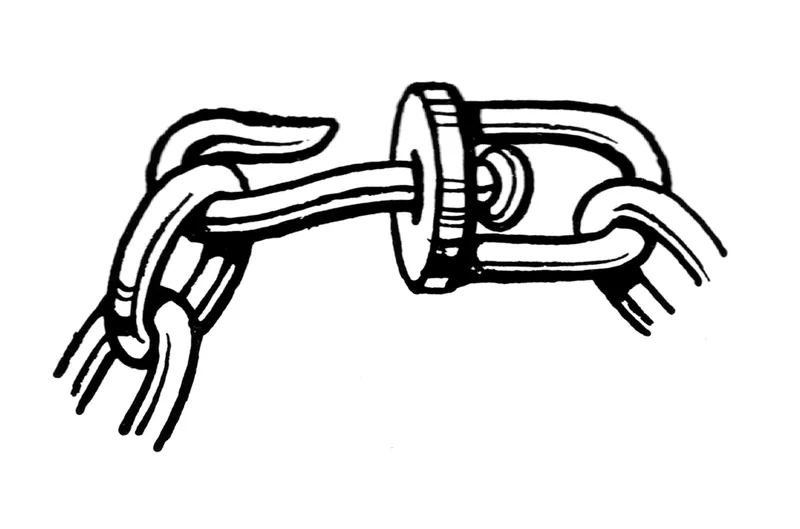
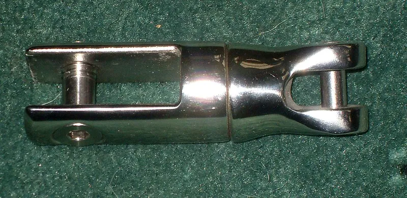
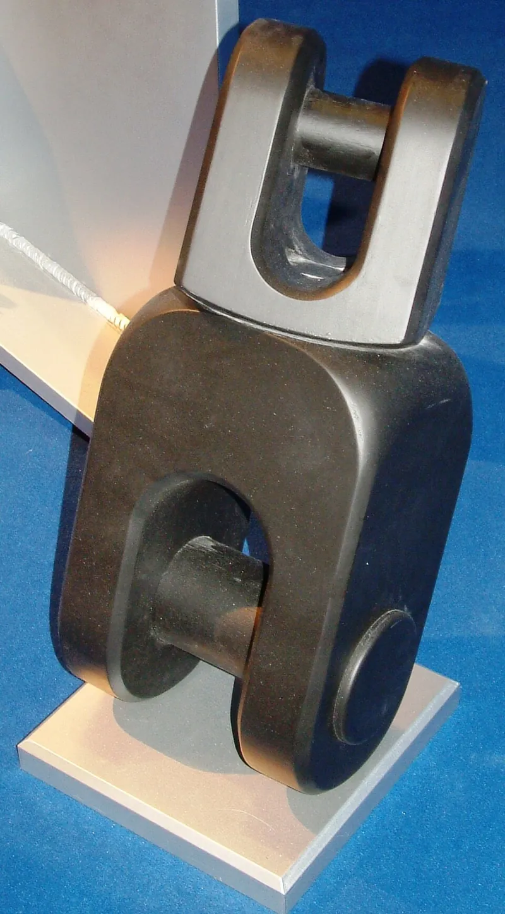

<figure class="eoc-pic eoc-pic-main"><picture><source media="(prefers-reduced-motion: reduce)" srcset="../media/drawn/in-line-swivel.svg"></picture><figcaption><strong>Animation.</strong> Diagram drawn for the encyclopaedia from the research notes. ⚑ Needs confirming: a drawing can simplify or get details wrong; a real photo or a better diagram is welcome.</figcaption></figure>
<figure class="eoc-pic"><figcaption><strong>Diagram.</strong> <a href="https://commons.wikimedia.org/wiki/File:Swivel_(PSF).png">Swivel (PSF)</a> by Pearson Scott Foresman, Public domain, from Wikimedia Commons.</figcaption></figure>
<figure class="eoc-pic"><figcaption><strong>Photo.</strong> <a href="https://commons.wikimedia.org/wiki/File:Anchor_swivel.jpg">Anchor swivel</a> by Arrivisto, <a href="https://creativecommons.org/licenses/by-sa/4.0">CC BY-SA 4.0</a>, from Wikimedia Commons.</figcaption></figure>
<figure class="eoc-pic"><figcaption><strong>Photo.</strong> <a href="https://commons.wikimedia.org/wiki/File:Swivel_(2).JPG">Swivel (2)</a> by S.J. de Waard, <a href="https://creativecommons.org/licenses/by/2.5">CC BY 2.5</a>, from Wikimedia Commons.</figcaption></figure>

A link with an eye at each end, joined through a body by a shaft that turns freely, so twist that builds up in a fishing line, lead, rope or chain can unwind instead of kinking or tangling, while the swivel still carries the pull.

**In plain words:** A small link with a ring or eye at each end, joined through a little body by a pin that spins freely, put in the middle of a fishing line, lead, rope, chain or hanger so one end can turn round and round without twisting up the other. **Proper term:** In-line swivel (eye-and-eye swivel; rope, chain and line swivel).

**Also called:** swivel (Wikipedia 'Swivel'); fishing swivel; barrel swivel, rolling swivel, crane swivel, ball-bearing swivel (types sold for fishing, British Sea Fishing, Talk Sea Fishing); snap swivel / link swivel (a swivel with a snap clip on one eye; Wikipedia 'Fishing swivel'); three-way swivel (a third eye for a side branch); box swivel ⚑ [uncertain: name from the item notes; no opened page describes this type]; eye and eye swivel / eye-eye swivel / regular swivel / forged swivel (rigging; e.g. G-402, Crosby brand); jaw and eye swivel / anchor swivel / anchor connector (boats); bearing swivel (roller or ball thrust bearing, rated to turn under load); rope swivel / rescue swivel / ball-bearing rope swivel (certified rope-work swivels, e.g. SWIVEL, Petzl brand); swivel eye / swivel snap / swivel hook (on dog leads, bag straps and hooks); swivel hanger / ball-bearing swivel hook (for hanging signs and wind spinners); swivel key ring / keychain swivel; Wirbel (German) / destorcedor (Spanish) (names seen in Wikimedia Commons file titles).

## How it works

Each eye ends in a rod or head that sits inside the body and is kept from pulling out by a nut, washer or thickened end, so it can turn but not escape; Wikipedia 'Swivel' gives this and two other common designs, a ball turning inside a holder, and a rod inside a slightly larger tube held by flanges. When the line is pulled, the head presses on the inside of the body, which works as a small thrust bearing ('two rings linked via a thrust bearing pivot joint', Wikipedia 'Fishing swivel'), so the two ends turn independently and twist from a spinning lure, a turning load or a boat swinging at anchor unwinds through it. The harder the pull, the more friction at that bearing face: under heavy load a plain barrel swivel 'essentially locks up', rolling and crane swivels turn better, and ball-bearing swivels keep turning under heavy load (The Tackle Room; Talk Sea Fishing).

## Parts

A small assembly that acts as one unit: two eyes (wire loops or forged rings), each ending in a shaft or head trapped inside a central body (a barrel, cylinder or rounded housing) so it can spin but not pull out; better ones add ball bearings (or a tapered roller thrust bearing on lifting swivels) between head and body. Variants add a snap clip (snap or link swivel), a third eye (three-way swivel), a jaw for an anchor, or a hook. Example: 'two wire eyes, brass barrel' (barrel swivel); 'two forged eyes, body, tapered roller thrust bearing' (lifting swivel).

## Everyday examples

- the small swivel between a fishing line and a lure or rig (Wikipedia 'Fishing swivel')
- the swivel snap on a dog lead or bag strap
- a swivel between an anchor and its chain (Wikipedia 'Swivel')
- a hanging sign or wind spinner on a swivel hook, and swivel key rings (Koelner T-OOK lists 'Hanging ads, signboards')

## When to use it

Whenever something on the end of a line can turn and would otherwise twist the line up: spinning lures and baits and trolling, dog leads and tie-outs, anchor and mooring chain as a boat swings, hanging signs, mobiles and wind spinners, key rings and bag straps, and in rope work where a turning load would kink the rope (a certified rope swivel 'prevents the rope from twisting when the load is turning', Petzl SWIVEL via Rescue Response). Choose a ball-bearing or bearing swivel when it must keep turning under load, and a cheap barrel or rolling swivel for light, slow jobs.

## When not to use it

If power, a signal or fluid must cross the turning joint, use a slip ring or rotary union. To let a cable follow a part through a few turns, use an anti-twister mechanism or a service loop. To support a turning platform, use a turntable bearing. Where the line must not turn, leave the swivel out and use a shackle or fixed link. Some lures work better tied direct, because a snap swivel's weight and bulk kills their action (The Tackle Room) and hooks can tangle on swivels (Wikipedia 'Fishing swivel'). For lifting, anything overhead and anything that holds a person, use only a swivel rated and certified for that use, never a printed or unrated one. Where sideways or bending loads are expected, use a shackle or a hinged link instead, because side loads pry swivels open (Wikipedia 'Swivel').

## Details

- **What it does (jobs):**
  - let it move (turn, slide or bend): lets one end of a line, lead, chain or hanger spin freely so twist does not build up
  - join and hold: joins two lengths of line, rope or chain, or a line to a lure, anchor, sign or hook, and carries the pull
- **Movement:** rotate, unlimited (keeps turning in either direction about the line between the two eyes)
- **Directions it can move (degrees of freedom):** 1 (spin about the line joining the two eyes). Loose eyes and rings also let the attached line swing a little sideways, but that is not a designed movement.
- **Special behaviour:**
  - none: it simply turns freely, so twist is let out instead of being stored in the line. Note that ordinary forged eye-and-eye swivels are only meant to turn when unloaded ('G-402 Swivels are positioning devices and are not intended to rotate under load', Crosby, quoted by Defender), whereas bearing swivels are made to turn under load (Koelner T-OOK: 'Rotatable under load'; Petzl SWIVEL)
- **How it holds:** shape (the parts interlock; [form-fit](../glossary.md#form-fit--force-fit--material-bond)): the head of each shaft is trapped inside the body; it is not a holding joint for turning, since it is made to spin
- **Input and output:** Passes the pull (tension) straight through from eye to eye but lets twist escape: twist at one end -> free spinning of the swivel, so ideally no twist reaches the other end. Shaft arrangement: in line. Friction rises with the pull, so plain barrel swivels stop turning under heavy load while ball-bearing swivels keep turning (The Tackle Room). Back-drivable: yes, either end can turn it.
- **Power:** passive (no power needed)
- **Load:** From very light to very heavy, but only ever as strong as its rating. Fishing: size 6 swivels break at about 40 lb (rolling) to about 100 lb (crane), and size 1/0 at about 100 lb (rolling) to 200 lb (crane) (Talk Sea Fishing; British Sea Fishing); barrel swivels are the weakest because the single wire tag 'can simply pull out' (Talk Sea Fishing). Rope rescue: certified ball-bearing swivels rated at 23 kN or 36 kN breaking strength (Petzl SWIVEL, certified CE, UKCA and NFPA 2500). Lifting: a 5/8 in Crosby G-402 forged swivel has a 5,200 lb working load limit and 26,000 lb break strength (5:1 safety factor, Fastenersplus). Some hardware-store eye-eye swivels give no load rating at all (the Koelner T-OOK sheet lists sizes only). Strong in a straight pull along the line; weak against sideways and bending loads, which can pry an anchor swivel's jaws open (Wikipedia 'Swivel'). Often the weakest link in the line (Wikipedia 'Swivel'; 'Fishing swivel').
- **Play and precision:** Not a locating part. Some end float and wobble between the eyes and the body is normal ⚑ [uncertain: not stated on an opened page]. It copes with the line pulling slightly off-line, but keep the pull straight through both eyes: side loads lever the eyes and jaws (Wikipedia 'Swivel').
- **Taking it apart:** removable: tied on with knots, clipped on with a snap, or joined with split rings or shackles; in fishing rigs a small swivel is often trapped between beads and crimps on the line (British Sea Fishing)
- **How often it can be reused:** many times: it can be untied, unclipped or unshackled and reused until it corrodes, wears or stops turning freely
- **Sealing:** none
- **Adjustable:** no
- **Access needed:** not applicable: it hangs in the line and is fitted by its eyes, which only need to be reachable to tie, clip or shackle on
- **Materials:** Fishing: brass, nickel-plated or black-finished steel wire and bodies, and stainless steel ball-bearing swivels (British Sea Fishing; Talk Sea Fishing; The Tackle Room). Lifting and mooring: quenched and tempered forged steel, hot-dip galvanised (Crosby G-402, via Fastenersplus and Defender). Hardware store: zinc-plated low-carbon steel (Koelner T-OOK). Boats: stainless steel anchor swivels, which can corrode out of sight inside the shaft (Wikipedia 'Swivel'). Rope rescue: certified metal swivels with sealed ball bearings (Petzl). Printed: PLA or PETG for key rings, clothes hangers, clips and model joints only (Printables 1332089 recommends PETG).
- **Heat, cold, water and wear:** Salt water and wet places: stainless steel swivels can corrode where they stay wet and starved of oxygen, as inside a swivel's shaft, especially in warm or tropical water, and corrosion may be internal and out of sight (Wikipedia 'Swivel'); low-quality barrel swivels corrode faster in salt water (The Tackle Room). Zinc-plated hardware-store swivels (Koelner T-OOK) are only corrosion-resistant, so rinse and inspect any swivel used outdoors ⚑ [uncertain: inspection advice not from an opened page]. Printed swivels: PLA softens from about 60 degC (CNC Kitchen), and plastic stretches slowly under a steady pull ([creep](../glossary.md#creep), filamentspecs).

## Making it

- **Ways to make or get it:**
  - off-the-shelf part: fishing swivels and snap swivels, eye-and-eye and jaw-and-eye swivels, anchor swivels, swivel hooks and snaps, swivel key rings, certified rope swivels
  - 3D print (FDM): [print-in-place](../glossary.md#print-in-place) swivels for key rings, clothes hangers, carabiner-style clips, filament guides and model joints (light duty only)
- **Printing it in one piece (print in place):** yes: print-in-place swivels print already assembled and turning (Printables 983933 'Print in place carabiner with a swivel', 367523 swivel clothes hanger, 1332089 swivel snap hook clip); partly when a bought ball bearing is added for smoother turning (Printables 1208378 'Carabiner with bearing swivel support')
- **Tools:** none for snap and link swivels; a knot for fishing line; pliers for split rings and crimps (British Sea Fishing); shackles, and a spanner if their pins need it, for chain swivels
- **Difficulty:** easy to fit: buy one rated for the job and tie, clip or shackle it in; easy to moderate to print a light-duty print-in-place swivel for a key ring, hanger or model, which needs good [clearances](../glossary.md#clearance); a load-rated swivel is not something to make at home

### 3D printing tips

Use printed swivels only for light jobs such as key rings, bag clips, clothes hangers, decorations and model joints: never to hold anything overhead or any person, and never as a substitute for a rated swivel. The usual geometry is a shaft with a disc or head trapped in a cavity in the other part, with the gap all round printed at least 0.3 mm, Prusa's starting clearance for moving parts ('Modeling with 3D printing in mind'); the designer of Printables 367523 says its swivel 'works best at .20mm layers'. A trapped disc can be held up during printing by a small pillar from the bed (Printables 1636795). Orientation is a trade-off: with the swivel's axis vertical the bearing faces print round, but the pull along the axis then acts across the layers, the weak direction (CNC Kitchen's hooks printed standing broke at 46-55% of the load of flat ones), so make the head and the body wall around it thick. Printables 1332089 prints its swivel snap hook with 7 or more walls and 60% or more [infill](../glossary.md#infill), without supports, in PETG for strength. Under a steady pull plastic slowly stretches (creep; filamentspecs says a printed hook 'may rotate downward by a few millimeters'), and PLA softens from about 60 degC (CNC Kitchen), so keep loads small, use PETG, and keep printed swivels out of hot cars and strong sun. Plastic-on-plastic bearing faces get stiff as the pull rises, like a cheap barrel swivel; for smoother turning add a bought ball bearing (Printables 1208378).

### Buying one (off-the-shelf parts)

Search terms: fishing 'barrel swivel', 'rolling swivel', 'crane swivel', 'ball bearing swivel', 'snap swivel', 'interlock snap swivel' (Talk Sea Fishing rates crane swivels with interlocking links the strongest link swivels), 'three-way swivel' (fishing sizes run from small numbers such as 8 or 10 up to 1/0, 2/0 and 3/0 for the largest, British Sea Fishing); rigging 'eye and eye swivel', 'regular swivel' (e.g. Crosby G-402, brand), 'jaw and eye swivel', 'bearing swivel' (rated to rotate under load, e.g. Crosby S-5, brand, seen only in search results ⚑ [uncertain]); boats 'anchor swivel' or 'anchor connector'; 'swivel snap hook' or 'swivel eye snap' for leads and straps; 'ball bearing swivel hook' for wind spinners and signs; 'rescue swivel' or 'rope swivel' (certified, e.g. Petzl SWIVEL, brand); 'swivel key ring'. Choose by rated breaking strength or working load limit, never by size alone.

## Rules of thumb

- Fishing rigs: any swivel in the main body of a rig should have a breaking strain at least equal to the leader line (British Sea Fishing, https://britishseafishing.co.uk/terminal-tackle-2/swivels/).
- Typical fishing swivel strengths: rolling swivels about 40 lb at size 6 and 100 lb at size 1/0; crane swivels about 100 lb at size 6 and 200 lb at size 1/0; barrel swivels are weakest (Talk Sea Fishing, https://www.talkseafishing.co.uk/sea-fishing-swivels/; British Sea Fishing gives over 100 lb for a good size 6 crane and 200 lb for size 1/0).
- If it must keep turning under load (trolling, spinning lures, a load that turns), use a ball-bearing swivel; under load a barrel swivel 'essentially locks up' (The Tackle Room, https://thetackleroom.com/blogs/news/fishing-swivels-explained).
- Lifting and mooring: plain forged swivels are 'positioning devices and are not intended to rotate under load', and their ultimate load is 5 times the working load limit (Crosby G-402, https://defender.ca/en_ca/crosby-g-402-regular-forged-swivel); use a bearing swivel rated for rotation under load where the load must turn.
- Anchors: one school of thought puts the swivel somewhere in the chain rather than straight onto the anchor, because a boat swinging on a well-dug-in anchor puts sideways loads on it that can pry its jaws open; and don't winch the anchor hard up against the bow roller, which loads the swivel as the boat pounds through waves (Wikipedia 'Swivel', https://en.wikipedia.org/wiki/Swivel).
- Printed swivels: start with at least 0.3 mm clearance between moving parts (Prusa, https://help.prusa3d.com/article/modeling-with-3d-printing-in-mind_164135).

## Common failures

(1) A barrel swivel stops turning under load, so the line twists anyway; use a crane or ball-bearing swivel (Talk Sea Fishing; The Tackle Room). (2) A barrel swivel pulls apart under heavy pressure because its single wire tag 'can simply pull out' of the barrel (Talk Sea Fishing). (3) Jaw-type and 'American snap' links on link swivels open out or break under heavy pressure; interlocking links are strongest (Talk Sea Fishing). (4) Hidden crevice corrosion inside stainless anchor swivel shafts (Wikipedia 'Swivel'). (5) Anchor swivel jaws pried open by sideways loads as the boat swings, disconnecting the chain (Wikipedia). (6) Threaded shafts with welded-on nuts breaking at the thread or weld (Wikipedia). (7) A printed swivel fused solid (too little clearance), binding, or pulling apart across its layers; print with at least 0.3 mm clearance and thick walls (Prusa; CNC Kitchen). (8) A swivel spoiling a lure's action or tangling the hooks (Wikipedia 'Fishing swivel'; The Tackle Room).

## Safety

A swivel can be the weakest link in a line: Wikipedia says 'the biggest concern about anchor swivels is that they might introduce a weak link' (threaded shafts weaker than solid bar, welded nuts that let go, hidden corrosion, jaws pried open by side loads), and swivels 'can serve as weak points' on fishing line (Wikipedia 'Fishing swivel'). Never hold anything overhead or any person with a printed swivel, or with an unrated hardware-store swivel; life-safety swivels are certified products with stated strengths (e.g. Petzl SWIVEL: 23 kN or 36 kN breaking strength; CE, UKCA, NFPA 2500). For lifting, use a swivel rated for the load, and rated to rotate under load if it will turn: ordinary G-402 swivels 'are not intended to rotate under load' (Crosby, via Defender). Keep hands clear of a load that is spinning on a swivel ⚑ [uncertain: general caution].

## Related

- Slip ring and rotary union: passes power, signal or fluid across a turning joint; telephone-cord untanglers are related
- Anti-twister mechanism (twist-free cable feed): lets a cable follow a part through full turns by a geared mechanism instead of a free swivel
- Turntable bearing (lazy Susan bearing): a flat bearing that carries a turning platform rather than a pull
- Spring-gate hook (carabiner, snap hook, lobster clasp): often has a swivel eye; a snap swivel combines the two
- Quick-release hooks (pelican hook, three-ring release): let go of the load, rather than letting it turn
- Shackle and quick link: join chain and rope without letting the load spin freely
- Plain pivot and rolling bearing: the bearing inside; a ball-bearing swivel is a tiny thrust bearing
- Ball-and-socket joint: a ball turning in a holder, one of the swivel designs in Wikipedia 'Swivel', but it tilts as well as turns
- Universal joint: passes turning on through an angle, the opposite of a swivel, which stops turning being passed on
- Castor (swivel castor): uses a vertical swivel so the wheel can follow the direction of travel
- Wire-rope terminations (thimble, wire-rope clip, crimped sleeve): the eyes a swivel is often joined to

## Make it yourself

- [Swivel Carabiner (Printables 983933; URL from Printables API, page not opened)](https://www.printables.com/model/983933-swivel-carabiner): Popular print-in-place carabiner-style clip with a built-in swivel; light duty only *(licence: Creative Commons Attribution-ShareAlike (CC BY-SA))*
- [360 Swivel Hanger, Print in Place (Printables 367523; URL from Printables API, page not opened)](https://www.printables.com/model/367523-360-swivel-hanger-print-in-place): Print-in-place clothes hanger whose hook swivels; designer says the swivel works best at 0.20 mm layers *(licence: Creative Commons Attribution-ShareAlike (CC BY-SA))*
- [Swivel Snap Hook Clip, Print in Place (Printables 1332089; URL from Printables API, page not opened)](https://www.printables.com/model/1332089-swivel-snap-hook-clip-print-in-place): Print-in-place swivel snap hook to replace broken strap clips; PETG, 7+ walls, 60%+ infill, no supports *(licence: Creative Commons Attribution (CC BY))*
- [Carabiner with bearing swivel support (Printables 1208378; URL from Printables API, page not opened)](https://www.printables.com/model/1208378-carabiner-with-bearing-swivel-support): Printed carabiner holder with a bought ball bearing so it swivels without tangling the support ropes; STEP file included *(licence: Creative Commons Attribution-ShareAlike (CC BY-SA))*
- [Experimental Print-in-Place Swivel (Printables 1636795; URL from Printables API, page not opened)](https://www.printables.com/model/1636795-experimental-print-in-place-swivel): Print-in-place disc-and-shaft swivel joint for flexible model figures, with a small support pillar under the disc *(licence: GNU General Public License v2.0)*

## Pictures, videos and models

- [Swivel (PSF).png (Wikimedia Commons, Pearson Scott Foresman drawing)](https://commons.wikimedia.org/wiki/File:Swivel_(PSF).png): Simple line drawing of a swivel in a chain link (captioned 'A swivel in a chain link' in Wikipedia 'Swivel') *(licence: Public domain)*
- [Anchor swivel.jpg (Wikimedia Commons)](https://commons.wikimedia.org/wiki/File:Anchor_swivel.jpg): Photo of a stainless steel anchor swivel, showing the jaw, the body and the shaft embedded in it *(licence: CC BY-SA 4.0 (reuse with credit))*
- [Swivel (2).JPG (Wikimedia Commons, Europort 2009)](https://commons.wikimedia.org/wiki/File:Swivel_(2).JPG): Photo of a large forged swivel in a link (captioned 'A swivel in a link' in Wikipedia 'Swivel') *(licence: CC BY 2.5 (reuse with credit))*
- [Category:Swivels (Wikimedia Commons)](https://commons.wikimedia.org/wiki/Category:Swivels): Photos of fishing, chain and hook swivels, including eye-to-eye swivels, a swivel snap hook, a chain sling with a swivel and rotary union parts *(licence: per file (check each file's page))*
- [Swivels (British Sea Fishing)](https://britishseafishing.co.uk/terminal-tackle-2/swivels/): Photos of barrel, rolling and crane swivels, three-way, cascade and link swivels, and a swivel size chart *(licence: link only)*

## Needs confirming

⚑ marks something nobody has confirmed yet: a fact the research could not confirm from a source, a finder value that is a best guess, or an open point from the research notes. Corrections are welcome (see `research/needs-confirming.md`).

- ⚑ 5 sentences on this page marked [uncertain].
- ⚑ Finder value `usual_process` = off-the-shelf part (best guess): first-listed process is off-the-shelf, but `print_in_place` is yes
- ⚑ Research note: *In-line swivel*: fishing-swivel strengths from Talk Sea Fishing and British Sea Fishing recorded side by side; Crosby G-402 swivels 'are not intended to rotate under load' (quoted by a retailer, Defender) and its 5/8 in figures (5,200 lb working load, 26,000 lb break) come from a seller (Fastenersplus); the hardware-store swivel data sheet read (Koelner T-OOK) gives no load rating. The alias 'box swivel' has no opened source ([uncertain]); the Seabreeze article the scope search used returned 403, so fishing guides were used instead.

## Sources

- <https://en.wikipedia.org/wiki/Swivel>
- <https://en.wikipedia.org/wiki/Fishing_swivel>
- <https://en.wikipedia.org/wiki/Fishing_tackle>
- <https://britishseafishing.co.uk/terminal-tackle-2/swivels/>
- <https://www.talkseafishing.co.uk/sea-fishing-swivels/>
- <https://thetackleroom.com/blogs/news/fishing-swivels-explained>
- <https://defender.ca/en_ca/crosby-g-402-regular-forged-swivel>
- <https://www.fastenersplus.com/products/crosby-5-8-regular-swivel-g-402>
- <https://rescueresponse.com/shop/petzl-swivel/>
- <https://rocorescue.com/product/petzl-swivel>
- <https://rawlplug.com/media/catalog/reference_object/a/9/e/b/a9eb1594a018f0f9cedfa2570db7d2dd473c41a1/42306.KOELNER.EN.T_OOK_SWIVELS.pdf>
- <https://help.prusa3d.com/article/modeling-with-3d-printing-in-mind_164135>
- <https://www.cnckitchen.com/blog/comparing-pla-petg-amp-asa-feat-prusament>
- <https://filamentspecs.com/creep-resistance-3d-printed-parts/>
- <https://commons.wikimedia.org/wiki/File:Swivel_(PSF).png>
- <https://commons.wikimedia.org/wiki/File:Anchor_swivel.jpg>
- <https://commons.wikimedia.org/wiki/File:Swivel_(2).JPG>
- <https://commons.wikimedia.org/wiki/File:Angeln_zubehoer_wirbel_01.jpg>
- <https://commons.wikimedia.org/wiki/Category:Swivels>
- <https://api.printables.com/graphql/ (Printables API: models 983933, 367523, 1332089, 1208378, 1636795)>
