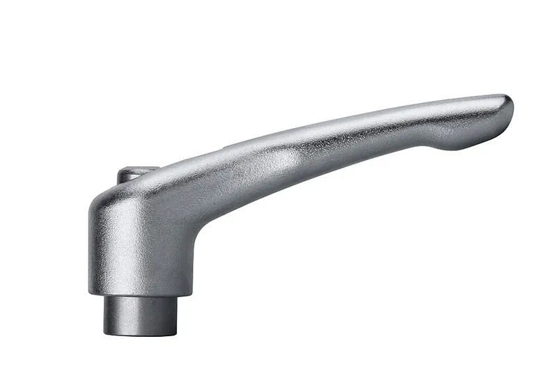
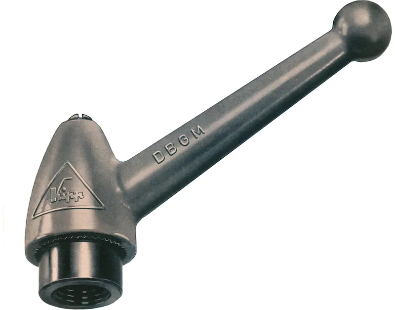

<figure class="eoc-pic eoc-pic-main"><picture><source media="(prefers-reduced-motion: reduce)" srcset="../media/drawn/indexable-clamping-lever.svg"></picture><figcaption><strong>Animation.</strong> Diagram drawn for the encyclopaedia from the research notes. ⚑ Needs confirming: a drawing can simplify or get details wrong; a real photo or a better diagram is welcome.</figcaption></figure>
<figure class="eoc-pic"><figcaption><strong>Photo.</strong> <a href="https://commons.wikimedia.org/wiki/File:01_Klemmhebel_2012.jpg">01 Klemmhebel 2012</a> by Autorisiert vom Hersteller, <a href="https://creativecommons.org/licenses/by-sa/3.0">CC BY-SA 3.0</a>, from Wikimedia Commons.</figcaption></figure>
<figure class="eoc-pic"><figcaption><strong>Photo.</strong> <a href="https://commons.wikimedia.org/wiki/File:Klemmhebel_1952.jpg">Klemmhebel 1952</a> by autorisiert vom Hersteller, <a href="https://creativecommons.org/licenses/by-sa/3.0">CC BY-SA 3.0</a>, from Wikimedia Commons.</figcaption></figure>

A lever-shaped handle fitted to a screw or nut through a spring-loaded toothed coupling, so it tightens and loosens the screw by hand but can be lifted off its teeth and swung to a new angle, letting you clamp in tight spaces and leave the lever pointing where you want.

**In plain words:** A tightening handle on a screw that you can lift up to swing it back round without turning the screw, then let it drop back onto its teeth and pull again, so you can tighten something in a cramped spot a little at a time. **Proper term:** Adjustable clamping lever (adjustable handle, indexable clamping handle).

**Also called:** adjustable handle, adjustable hand lever, clamping lever, clamping handle (Elesa+Ganter GN 300; Elesa ERX; McMaster-Carr: 'also called clamping handles'); adjustable clamping handle; [ratchet](../glossary.md#ratchet) handle or ratchet lever (Innovative Components: 'also known as ratchet handles or adjustable handles'; POWERTEC (brand) sells them as 'ratchet lever knobs'); Klemmhebel (German; Wikipedia de, Klemmhebel); Spannhebel or tension lever are related German/catalogue names (KIPP (brand) groups them as 'Adjustable handle, tension lever, cam lever'; KIPP USA catalogue page); indexable or repositionable handle, ratcheting clamp lever (Printables 86927) ⚑ [uncertain: informal maker names].

## How it works

Inside the lever, a ring of teeth (serrations) meshes with teeth on the central insert that is screwed onto or into the part being clamped, and a spring holds the two sets of teeth together, so turning the lever turns the screw (Elesa+Ganter GN 300; Elesa ERX). When there is no room to keep turning, you pull the lever up a few millimetres against the spring; the teeth come apart and the lever swings freely back to a new starting position without turning the screw (Elesa ERX: 'lift the lever to disengage the clamping device teeth and bring it back to start position'). Let go and the spring drops the teeth back into mesh, ready for the next pull, so you can tighten step by step like a ratchet spanner, or park the lever out of the way (Elesa+Ganter GN 300; Innovative Components; Wikipedia de, Klemmhebel).

## Parts

A small assembly that acts as one unit: lever (handle body), toothed insert with a threaded hole ([boss](../glossary.md#boss)) or threaded stud, matching teeth inside the lever, a return spring, and a retaining screw or pin that holds it together (Elesa+Ganter GN 300; Elesa ERX; Ruland video). Simplest home-made version: a printed lever with a hex pocket, a screw and one or two nuts, with no spring (Printables 86927).

## Everyday examples

- Fence, featherboard, mitre-gauge stop and T-track jig locks in a woodworking shop, and the tool rests of bench grinders (POWERTEC)
- Height, angle and position adjusters on machines, lathes and packaging lines (Innovative Components; vxb)
- Adjusters on (office) furniture, sports and fitness equipment, power tools and medical or rehabilitation equipment (Wikipedia de, Klemmhebel)

## When to use it

Use an adjustable clamping lever when you need to tighten and loosen a screw by hand, often, in a cramped spot where a knob can't be turned far or a fixed lever would hit something (Elesa+Ganter GN 300; Elesa ERX), or when you want the handle to end up pointing a particular way, e.g. tucked out of the way or all levers lined up (Elesa+Ganter GN 300). Typical uses are jigs, fences, stops, featherboards and other adjustable parts of machines and fixtures, where you want a firmer grip than a knob gives but no tools (POWERTEC; Innovative Components; vxb).

## When not to use it

If you need instant clamp-and-release in one movement, use an eccentric cam lever or toggle clamp instead; if you need a set clamping force, use a torque-limiting knob; if space isn't tight, a plain knob or T-handle is simpler and cheaper; for high clamping loads or where vibration could loosen the screw, use a bolt tightened with a spanner and a locking method ⚑ [uncertain: general engineering advice, not from the opened sources]. Avoid plastic levers where they will be hit, stood on or used as a handle to lift the machine ⚑ [uncertain].

## Details

- **What it does (jobs):**
  - join and hold: tightens a screw or nut by hand to clamp parts together
  - lock, and release by hand: clamps and unclamps with no tools
  - click into set positions: the handle can be parked at any of a set of angles, one tooth apart
- **Movement:** multiple: the lever rotates to turn the screw, and lifts a few millimetres along the screw axis to disengage (about 3-5 mm lift on Elesa+Ganter GN 300 levers of 22-108 mm)
- **Directions it can move (degrees of freedom):** 1 when engaged (lever and screw turn together); 2 when lifted (the lever can slide up and turn freely on the insert); 0 once the clamp is tight and the lever is released
- **Special behaviour:**
  - indexing (clicks into set positions): the lever can be re-set every tooth, i.e. in steps of 360 degrees divided by the number of teeth (18 to 28 teeth on Elesa ERX handles: steps of about 20 to 13 degrees)
  - quick-release (tool-free): not instant like a cam lever, but tightening and loosening need no tools and the handle can be swung out of the way (Innovative Components; POWERTEC)
  - none of a true ratchet's one-way action: most versions don't click freely backwards; you lift the lever to reset it (Elesa ERX). Some versions use a push button instead of lifting (POWERTEC: 'spring loaded handle and push button ratchet clutch')
- **How it holds:**
  - shape (the parts interlock; [form-fit](../glossary.md#form-fit--force-fit--material-bond)): the lever drives the insert through meshing teeth (serrations)
  - spring force (a spring or springy part presses it in place): a return spring keeps the teeth in mesh (Elesa ERX: AISI 302 stainless return spring)
  - friction or clamping (force-fit): the clamped parts are held by the screw's clamping force and thread friction
- **Input and output:** Limited back-and-forth swing of the hand lever -> rotation of the screw at 1:1 while the teeth are engaged; lifting the lever disconnects it. The screw thread then turns rotation into clamping force; the lever length (roughly 22-108 mm on standard ranges; Elesa+Ganter GN 300, Elesa ERX) sets the leverage. Shaft arrangement: in line. Back-drivable: no, the clamped screw is held by thread friction ⚑ [uncertain: depends on the thread; not tested in sources]
- **Power:** passive (no power needed)
- **Load:** medium: clamping force comes from the screw, so it depends on thread size (M3 to M16 on GN 300) and how hard you pull; the weak point is the toothed element that carries the [torque](../glossary.md#torque) from lever to insert (Elesa ERX). Strong in normal tightening; weak if you hang your weight on the lever or strike it, which can strip plastic teeth or bend the lever ⚑ [uncertain]
- **Play and precision:** small: there is some rotational play between the meshing teeth and the lever can only park at whole-tooth steps (360 degrees / tooth count) ⚑ [uncertain: [backlash](../glossary.md#backlash) not quantified in sources]; it is a clamping control, not a locator
- **Taking it apart:** removable: loosened and unscrewed by hand with no tools; the lever itself stays assembled on its insert, held by a retaining screw or pin (Elesa+Ganter GN 300; Elesa ERX)
- **How often it can be reused:** effectively unlimited: made for repeated clamping; an Elesa ERX.78 withstood more than 100,000 tightening cycles at 490 N without yielding (Elesa ERX datasheet)
- **Sealing:** none
- **Adjustable:** yes: the lever angle can be re-set one tooth at a time, and the clamping force is set by how far you tighten
- **Access needed:** one side only (blind) when it screws into a tapped hole or onto a fixed stud; both sides if it tightens a through-bolt with a nut behind (Printables 86927 describes both uses)
- **Materials:** Handles: zinc die casting with a blackened steel insert, powder coated or chrome plated (Elesa+Ganter GN 300); glass-fibre reinforced polyamide technopolymer with a brass or AISI 303 stainless boss or a zinc-plated or stainless steel stud and a stainless return spring (Elesa ERX); stainless steel, injection-moulded plastic, or a metal core with a plastic cover (Wikipedia de, Klemmhebel); reinforced nylon with black zinc-plated steel inserts (Innovative Components). Home-made: PLA for testing, PETG for use, with a steel screw and nuts (Printables 86927)
- **Heat, cold, water and wear:** Heat and cold: glass-fibre polyamide handles about -30 to +130 °C (Elesa ERX); printed PLA gives at about 60 °C and PETG at about 80 °C (CNC Kitchen). Corrosion and washdown: zinc die-cast handles are powder coated or chrome plated (Elesa+Ganter GN 300); stainless and all-plastic versions avoid rust (Elesa ERX; Wikipedia de, Klemmhebel). Plastic [creep](../glossary.md#creep): a printed spring or a clamped plastic part can relax over time, so the clamp may need re-tightening (DuPont General Design Principles, p. 36).

## Making it

- **Ways to make or get it:**
  - off-the-shelf part: zinc die-cast, stainless or glass-fibre nylon adjustable handles with threaded stud or threaded bore
  - 3D print (FDM): printed lever with a hex-nut drive (Printables 86927) or a printed serrated ring, plus a bought screw, nut and spring
  - 3D print (resin): possible for small levers, but no tested example found ⚑ [uncertain]
  - CNC: a metal insert or lever could be machined, but commercial ones are die cast or moulded (Wikipedia de, Klemmhebel) ⚑ [uncertain]
- **Printing it in one piece (print in place):** no: the lever, insert, spring and screw are separate parts that are assembled (Printables 86927; Elesa+Ganter GN 300)
- **Tools:** None to use. To fit: none for a threaded-stud version screwed into a tapped hole by hand, or a spanner to fit a stud or nut; a hex key for the retaining screw on some models (vxb lists a 3 mm hex socket) ⚑ [uncertain: varies by model]
- **Difficulty:** easy to buy and fit; moderate to make: the simplest printed version uses a hex nut as the 'teeth' and needs only a screw and nuts (Printables 86927), but a spring-return serrated version needs strong teeth, a steel spring and a retaining screw

### 3D printing tips

1) Simplest design: give the printed lever a hex pocket that fits over a nut on the screw; lift the lever to clear the nut, swing it back, push it down to re-engage and turn (Printables 86927). A hex gives 6 positions per turn (60-degree steps); a serrated ring gives finer steps (360 / tooth count). 2) Blind hole: screw the bolt tightly into the hole with a single nut on it and let the lever turn the nut; through hole: jam two nuts together on the screw so the lever turns the screw (Printables 86927, which suggests thread locker to keep the nuts jammed). 3) Orientation: print the lever with the handle flat on the bed; PLA is fine for testing but PETG is better for use; 3 [perimeters](../glossary.md#perimeters) and 20% [infill](../glossary.md#infill) worked for an M4 lever (Printables 86927). Clamp levers take real force, so other makers use 4 or more walls and 50% or more infill for printed clamp levers ⚑ [uncertain: from replacement-lever models, not this exact type]. 4) Serrations: generate the teeth rather than drawing them, e.g. BOSL2's hirth() makes matching face-tooth rings with chamfered tips and room in the valleys for the parts to seat (BOSL2 joiners.scad); keep teeth fairly few and large in plastic, since commercial handles use 18-28 teeth (Elesa ERX), and remember the toothed element carries all the torque (Elesa ERX). 5) The lift must clear the teeth completely: commercial levers lift 3-5 mm (Elesa+Ganter GN 300), so tooth height plus [clearance](../glossary.md#clearance) must be less than the lift ⚑ [uncertain: design reasoning]. 6) Sliding fit between lever and insert: start at about 0.3 mm clearance (Prusa Knowledge Base). 7) Use a steel compression spring for the return spring, because plastic springs under constant load creep and relax (DuPont design guide, p. 36); commercial ones use stainless steel (Elesa ERX). 8) Hold the lever on with a screw and washer or a pin through the top of the insert, so the spring can't push it off (GN 300 'retaining screw'; ERX 'retaining pin'). 9) Use a metal thread (bolt, nut or [heat-set insert](../glossary.md#heat-set-insert)), not a printed thread, for the clamping screw (Elesa ERX uses brass or steel bosses and steel studs). 10) Heat: PLA starts to give at about 60 °C and PETG at about 80 °C (CNC Kitchen).

### Buying one (off-the-shelf parts)

Search for: 'adjustable handle', 'adjustable clamping lever', 'adjustable clamping handle', 'clamping lever with threaded stud' (external thread) or 'with threaded bushing/bore' (internal thread), in M4-M16 or 1/4-20, 5/16-18, 3/8-16; 'ratchet lever' or 'ratchet lever knob' (woodworking suppliers, e.g. POWERTEC (brand)); catalogue families such as Elesa+Ganter (brand) GN 300 (zinc) and Elesa (brand) ERX (technopolymer), KIPP (brand) 'clamping levers' (German: Klemmhebel); stainless-steel versions for wet or food areas; 'adjustable cam lever' for a cam-action version (KIPP video). For home-made ones: socket-head screws, hex nuts, M3/M4 heat-set inserts and small steel compression springs.

## Rules of thumb

- Choose an adjustable lever when the space round the screw stops a full turn, or when the lever must end up in a particular position (Elesa+Ganter GN 300: 'ideal whenever parts have to be clamped in a confined space or in a particular lever position'; Elesa ERX: 'when the lever turning angle is limited owing to lack of space').
- Lift needed to disengage the teeth ('[stroke](../glossary.md#stroke)'): about 3 mm on a 22 mm lever, 3.5 mm on 30-45 mm, 4 mm on 63-92 mm and 5 mm on a 108 mm lever (Elesa+Ganter GN 300 datasheet, stroke column).
- Step size = 360 degrees / number of teeth; Elesa ERX handles have 18 teeth (30 and 44 mm levers), 20 (63 mm), 24 (78 mm), 26 (95 mm) and 28 (108 mm), i.e. steps of about 20 to 13 degrees (Elesa ERX datasheet).
- Standard sizes run from 22 mm levers with M3-M5 threads to 108 mm levers with M12-M16 threads (Elesa+Ganter GN 300); longer levers give more clamping force for the same hand force ⚑ [uncertain: basic leverage, not stated as a rule in sources].
- Durability benchmark: an Elesa ERX.78 (glass-fibre nylon) withstood more than 100,000 tightening cycles at 490 N without yielding (Elesa ERX datasheet).
- Glass-fibre polyamide handles are rated about -30 to +130 °C (Elesa ERX datasheet); plastic handles also insulate the operator electrically and have no visible steel to rust (Elesa ERX).
- Threaded studs on zinc GN 300 levers are steel of property class 5.8 (Elesa+Ganter GN 300), so don't expect high-strength-bolt clamping loads from them.
- Springs that stay loaded should be steel, not plastic (DuPont General Design Principles, p. 36).
- Printed sliding fits: start at about 0.3 mm clearance (Prusa Knowledge Base).

## Common failures

Worn or stripped teeth between lever and insert, the part that carries all the torque (Elesa ERX); prevented by not over-tightening and choosing metal or glass-fibre handles for heavy use. Lever won't drop back into mesh because the teeth are tip-to-tip or clogged with dirt; swing it slightly until it drops in ⚑ [uncertain]. Lever pops off because the retaining screw or pin has come loose (GN 300 'retaining screw'; ERX 'retaining pin'). On printed levers: the hex pocket or teeth round off, layers split if printed in a weak orientation, or a plastic spring relaxes (Printables 86927; DuPont). On nut-driven printed levers, the jammed nuts can loosen unless locked, e.g. with thread locker (Printables 86927).

## Safety

Pinch point: the spring snaps the lever back down when you let go, and a swinging lever can trap fingers against nearby parts ⚑ [uncertain: general caution]. A long lever makes over-tightening easy and can strip plastic teeth or threads ⚑ [uncertain]. Plastic handles give electrical insulation to the operator (Elesa ERX).

## Related

- Eccentric cam lever (cam clamp, quick-release skewer): clamps with one flip of a cam, faster but with a fixed clamping range; KIPP (brand) also sells 'adjustable cam levers' (KIPP video title)
- Toggle clamp: an [over-centre](../glossary.md#over-centre) [linkage](../glossary.md#linkage) that snaps shut and stays shut, for fast, repeated clamping
- Ratchet and [pawl](../glossary.md#pawl) (reversible ratchet): a true one-way ratchet that clicks freely one way without lifting the handle; note that McMaster-Carr lists 'Ratchet Handles' ('quickly adjust machine components and valves in tight spaces') as a separate family from 'Adjustable Handles' ('lift and turn ... also called clamping handles')
- Hirth joint (face [spline](../glossary.md#spline)): the same kind of meshing face teeth, used to lock two parts at a chosen angle, e.g. in camera and light grip heads
- Servo horn and spline hub: a splined arm re-positioned one tooth at a time
- Indexing plunger (pull-knob index pin): pull a spring-loaded pin, move, and let it snap into the next hole
- Dog clutch: spring-loaded teeth that can be pulled out of mesh to disconnect a drive
- Ratchet-tooth torque limiter (clicking torque-limiting knob): teeth that slip at a set torque instead of being lifted by hand

## Make it yourself

- [Ratcheting Clamp Lever - M4 (kaje, Printables) (URL from Printables API, page not opened)](https://www.printables.com/model/86927-ratcheting-clamp-lever-m4): A printable 'simpler version of commercially available clamping levers': lift the lever to clear a hex nut, reposition, push down and turn; uses an M4 x 30 mm screw and one or two nuts; Onshape CAD linked *(licence: CC0 (Public Domain))*
- [BOSL2 joiners.scad: hirth() module (OpenSCAD library source)](https://raw.githubusercontent.com/BelfrySCAD/BOSL2/master/joiners.scad): OpenSCAD module that generates matching face-tooth (Hirth) rings with any tooth count, tooth angle, chamfer or rounding, usable for the serrations between a printed lever and its insert *(licence: BSD 2-Clause)*

## Pictures, videos and models

- [File:01 Klemmhebel 2012.jpg (Wikimedia Commons)](https://commons.wikimedia.org/wiki/File:01_Klemmhebel_2012.jpg): A modern stainless adjustable clamping lever with its threaded insert (KIPP (brand) product photo) *(licence: CC BY-SA 3.0 (authorised by the manufacturer))*
- [File:Klemmhebel 1952.jpg (Wikimedia Commons)](https://commons.wikimedia.org/wiki/File:Klemmhebel_1952.jpg): An early (1952) clamping lever, used in the German Wikipedia article *(licence: CC BY-SA 3.0 (authorised by the manufacturer))*
- [What Are Adjustable Handles/Clamping Levers? (Ruland Manufacturing, YouTube)](https://www.youtube.com/watch?v=a-n-kABlK50): A product expert explaining adjustable handles and clamping levers (per title and search listing) *(licence: link only (YouTube))*
- [Only takes a minute to understand! How to Use Clamp Levers (NBK, YouTube)](https://www.youtube.com/watch?v=hMe1-pIIEH4): A short demonstration of lifting, repositioning and tightening a clamp lever (per title) *(licence: link only (YouTube))*
- [GN 300 Adjustable Hand Levers datasheet (Elesa+Ganter, PDF)](https://www.elesa-ganter.com/siteassets/PDF/EN/GN%20300.pdf): Dimensioned drawings of adjustable hand levers, including the lift stroke, with a description of how the serrations disengage *(licence: link only (drawings copyright Elesa+Ganter))*

## Needs confirming

⚑ marks something nobody has confirmed yet: a fact the research could not confirm from a source, a finder value that is a best guess, or an open point from the research notes. Corrections are welcome (see `research/needs-confirming.md`).

- ⚑ 15 sentences on this page marked [uncertain].
- ⚑ Finder value `tools` = none, hand tools (source uncertain): `tools_needed` is marked ⚑ [uncertain] here: "…for the retaining screw on some models (vxb lists a 3 mm hex socket) ⚑ [uncertain: varies by model]…"

## Sources

- <https://www.elesa-ganter.com/siteassets/PDF/EN/GN%20300.pdf>
- <https://www.elesa.com/siteassets/PDF/PDF_EN/ERX..pdf>
- <https://de.wikipedia.org/wiki/Klemmhebel>
- <https://catalog.innovative-components.com/viewitems/handles/ratchet-handles>
- <https://powertecproducts.com/71075-ratchet-lever-bolt-1-4-20-5pk/>
- <https://www.mcmaster.com/products/ratchet-handles/>
- <https://www.kippusa.com/en-us/products/METRIC/Adjustable-handle-tension-lever-cam-lever/c/20954>
- <https://vxb.com/products/adjustable-clamping-lever-set-m6-thread-push-butto>
- <https://raw.githubusercontent.com/BelfrySCAD/BOSL2/master/joiners.scad>
- <https://help.prusa3d.com/article/modeling-with-3d-printing-in-mind_164135>
- <https://www.distrupol.com/General_Design_Principles_for_Engineering_Polymers.pdf>
- <https://www.cnckitchen.com/blog/comparing-pla-petg-amp-asa-feat-prusament>
- <https://commons.wikimedia.org/wiki/File:01_Klemmhebel_2012.jpg>
- <https://commons.wikimedia.org/wiki/File:Klemmhebel_1952.jpg>
- <https://www.youtube.com/watch?v=a-n-kABlK50>
- <https://www.youtube.com/watch?v=hMe1-pIIEH4>
- <https://www.youtube.com/watch?v=9jrhdVD3Szs>
- <https://api.printables.com/graphql/>
