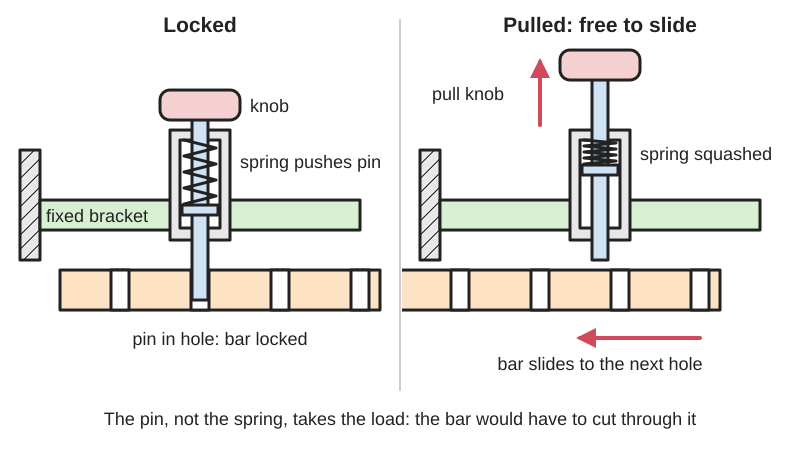
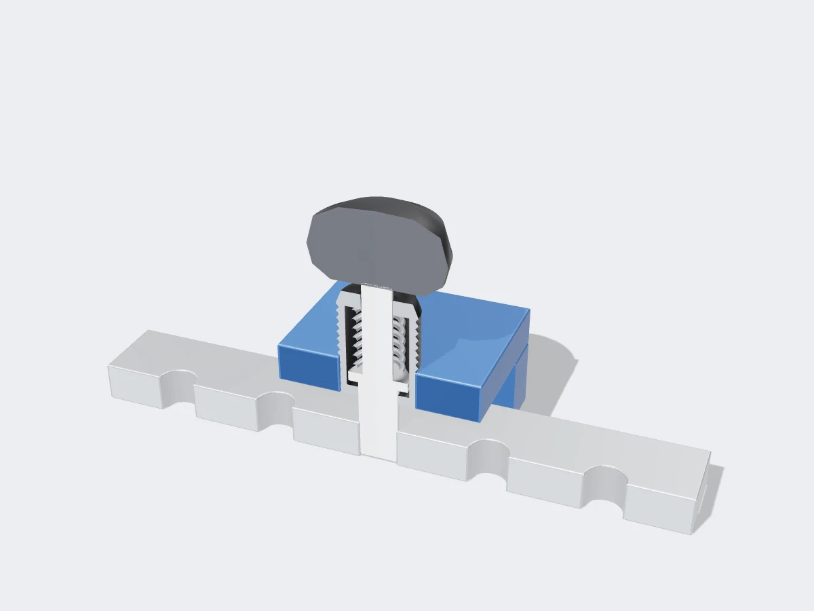

<figure class="eoc-pic eoc-pic-main"><picture><source media="(prefers-reduced-motion: reduce)" srcset="../media/drawn/indexing-plunger.svg"></picture><figcaption><strong>Animation.</strong> Diagram drawn for the encyclopaedia from the research notes. ⚑ Needs confirming: a drawing can simplify or get details wrong; a real photo or a better diagram is welcome.</figcaption></figure>
<figure class="eoc-pic"><figcaption><strong>Cut-away render.</strong> A 3D model made for the encyclopaedia, not a photo: a stand-in until a good real photo is found. ⚑ Needs confirming: a model can simplify or get details wrong; a real photo is welcome.</figcaption></figure>

A hand-pulled, spring-returned steel pin that drops into one of a row or circle of holes to lock a sliding or turning part at a chosen position, and holds until you pull it out again.

**In plain words:** A spring-loaded pin with a knob on the end: pull the knob to draw the pin out of a hole, move the part to the next hole, let go, and the spring snaps the pin back in to lock the part there. **Proper term:** Indexing plunger (index plunger).

**Also called:** index plunger; indexing pin / index pin; index bolt (Rencol's name for its all-metal version); pull pin / pull-pin knob / spring pull pin; pop pin (the usual name on gym and fitness equipment); spring pin or spring-loaded locking pin (gym trade name; not to be confused with a roll pin, which is also called a spring pin); manual locating plunger (Rencol); [detent](../glossary.md#detent) pin (Ganter uses this word for its indexing plungers; the same name is also used for ball-lock quick-release pins); indexing plunger with rest position / lock-out pop pin / lock-open pop pin (a version that stays pulled out when you twist the knob); cam-action indexing plunger (a version pulled back by turning a lever 180°); ring-pull plunger (a version with a pull ring instead of a knob); chamfered-pin indexing plunger (a version that latches by itself when an edge pushes past it); GN 617 / GN 817 indexing plunger (Ganter (brand) catalogue numbers).

## How it works

The spring inside the body pushes the pin out, so it pokes into a hole in the part you want to hold. The pin, not the spring, carries the load: the part can't move sideways because it would have to cut through the pin (Ganter: 'the [shear](../glossary.md#peel-vs-shear) strength of the locking pin is decisive'). To move the part you pull the knob, which lifts the pin out of the hole against the spring; you move the part along until the next hole lines up and let go, and the spring pushes the pin in with a clunk (Ganter; Sam's Fitness). 'Rest position' or 'lock-out' versions have a notch under the knob: pull and twist the knob 90° and it stays pulled out, leaving both hands free, then twist back to let it drop in (Rencol Model 02 IP; exercise-equipment-parts.com).

## Parts

A small assembly that acts as one unit: a body or sleeve (threaded, weld-on or flange-mounted), a hardened steel pin (the plunger), a compression spring inside the body, a knob, pull ring or lever on the end, and usually a lock nut (Rencol design guide; Ganter). The part it locks carries a matching plate, disc or bar with a row or circle of holes, sometimes lined with hardened positioning bushings (Carr Lane; McMaster-Carr).

## Everyday examples

- Gym machines and adjustable weight benches: the pull knob (pop pin) that sets seat height, back angle or cable-pulley height (Sam's Fitness; exercise-equipment-parts.com)
- Seat adjustment rails and height-adjustable stands (Rencol design guide; Ganter lists 'height adjustments')
- A wood lathe's index pin, pushed in by hand to lock the spindle at set positions (Printables 'Wood Lathe Index pin'), e.g. for marking evenly spaced points round a turning ⚑ [uncertain]
- Workshop jigs and fixtures that swing or slide a part to set stations (Rencol design guide)

## When to use it

Use an indexing plunger when a part must be moved to one of a few set positions and then held firmly there, and a person will do the moving: seat and table heights, swivelling arms and brackets, rotating fixtures, telescoping tubes, a lathe or dividing head that needs even steps, or a panel that must be locked open. It is strong for its size, because the load goes across a steel pin, it can't be pushed out by the load, it locates the part accurately in a close-fitting hole, and it needs no tools. Pick a rest-position (lock-out) version if you need both hands to move the part.

## When not to use it

Don't use it when the part should click through positions just by pushing it (use a ball detent or a compliant detent), when you need an infinite range of positions (use a clamp, a friction hinge or a telescoping twist or lever lock), when the load pulls along the pin's axis (the spring will let it out; use a bolt or a ball-lock quick-release pin), or when the part must be removed completely and often (a quick-release pin is quicker). For fine angle steps that lock with no play, a Hirth joint suits better; for a hinge that simply clicks at set angles, use a detent hinge.

## Details

- **What it does (jobs):**
  - click into set positions: locks a sliding or turning part at one of several holes (indexing)
  - lock, and release by hand: it holds until someone pulls the knob
  - line parts up exactly: a pin in a close-fitting hole or hardened bushing puts the part back in exactly the same place (McMaster-Carr; Carr Lane)
  - join and hold: a pin through a hole can also hold two separate parts together as a quick-release connection (Ganter lists 'detachable quick connections')
- **Movement:** slide: the pin slides in and out along its own axis (e.g. a 3/8-inch gym pop pin sticks out about 16 mm when locked and about 6 mm when held in its lock-out position; exercise-equipment-parts.com). The part it locks can turn or slide between hole positions while the pin is pulled out.
- **Directions it can move (degrees of freedom):** 0 while the pin is in a hole: the locked part can't move across the pin. 1 while the pin is pulled out: the part can turn or slide along its track to the next hole. The pin itself has 1 (in and out).
- **Special behaviour:**
  - indexing (clicks into set positions): the pin drops into the next hole as soon as it lines up
  - hand-release only (locks under load, releases when a person operates it): a sideways load on the part can't push the pin out; only pulling the knob releases it
  - quick-release: pull, move, let go; no tools
  - self-aligning or self-centring: only in tapered-pin versions, whose 15° [taper](../glossary.md#taper) guides the part into line, removes play and stops the pin binding when pulled (Carr Lane)
  - one-way (moves freely one way, locks the other): only the chamfered-pin variant, whose pin has a slope on one side and a flat locking face on the other, so an edge moving one way pushes it back and it latches automatically when the edge passes (Ganter GN 824 / GN 724, American Fastener Journal)
- **How it holds:**
  - shape (the parts interlock; [form-fit](../glossary.md#form-fit--force-fit--material-bond)): the pin sitting in the hole blocks movement; the strength comes from the pin in shear or bending
  - spring force (a spring or springy part presses it in place): the spring only keeps the pin in the hole; it carries no working load
- **Input and output:** not applicable
- **Power:** passive (no power needed) for hand-operated versions. Pneumatically operated versions (Ganter GN 817.7) and versions with a sensor that reports whether the pin is in or out (GN 817.6) exist for machines.
- **Load:** Medium to heavy across the pin, because a steel pin is strong: before any safety factor, a 6 mm stainless pin in clean shear holds about 13,100 N before bending permanently, but when there is a gap between the plunger body and the locked part the pin bends like a small [cantilever](../glossary.md#cantilever) and a 5 mm steel pin holds only about 3,430 N with a 2 mm gap and 2,290 N with a 3 mm gap (Elesa+Ganter technical data 10.17). Weak along its own axis: the spring pushes with only a few newtons to a few tens of newtons (e.g. 6-35 N in Rencol's Model 02 IP range), so it must never carry a load that pulls the pin out.
- **Play and precision:** small: play equals the [clearance](../glossary.md#clearance) between pin and hole. A straight pin in a matching hardened bushing gives slightly better position [accuracy](../glossary.md#repeatability--accuracy), while a 15° tapered pin in a tapered bushing removes play and makes alignment easier (Carr Lane). Holes drilled straight into wood or a 3D print give noticeable play and wear oval over time ⚑ [uncertain]. The hole must line up with the pin before it can drop in, so you may have to wiggle the part (Thang, 'Positioning device 15': 'Move the slider slightly if the blue pin on the slider has not faced a base hole'). Chamfered holes or pins tolerate small [misalignment](../glossary.md#misalignment) (Ganter).
- **Taking it apart:** tool-free quick release: pulling the knob releases the moving part with no tools. The plunger itself is screwed in and held by a lock nut (removable with a spanner), bolted on by a flange, or welded on (permanent) (Ganter; Rencol).
- **How often it can be reused:** effectively unlimited: it is made to be pulled and released over and over; the limit is wear of the pin and the holes ⚑ [uncertain] (no cycle rating found)
- **Sealing:** none
- **Adjustable:** Yes, in steps: you choose one of the holes, so the number and spacing of holes set the positions available. Threaded bodies can also be screwed further in or out and fixed with the lock nut to set how far the pin reaches into the holes.
- **Access needed:** one side only (blind): the plunger is fitted and pulled from one side of the fixed part; its pin reaches into holes in the moving part behind it
- **Materials:** Pins and bodies of steel (zinc-plated or blackened) or stainless steel for wet, outdoor or hygienic places; zinc die-cast housings; plastic, steel or stainless knobs (Ganter; Rencol). Acetal plastic plungers exist (Rencol). Elesa+Ganter's strength tables are for C45Pb steel and AISI 303 stainless pins. The hole plate or index disc can be steel, aluminium, wood, plywood or printed plastic; precision fixtures press hardened steel positioning bushings into the holes (Carr Lane; McMaster-Carr).
- **Heat, cold, water and wear:** Steel versions rust outdoors; use stainless steel for wet, outdoor, food or hygiene settings (Rencol; Ganter). Dirt or debris in the holes can stop the pin going fully in ⚑ [uncertain]. Vibration can undo the lock nut on threaded bodies unless it is tight or thread-locked ⚑ [uncertain]. Printed brackets and hole plates soften in heat (PLA started to give at 60 °C and PETG at 80 °C in CNC Kitchen's test) and [creep](../glossary.md#creep) under constant load (PLA most; thrinter test).

## Making it

- **Ways to make or get it:**
  - off-the-shelf part: the usual choice; steel or stainless indexing plungers from about M6 to M24 thread (Ganter), with pins around 5-8 mm for M10-M16 bodies (Rencol)
  - 3D print (FDM): brackets, knobs, index plates and hole patterns around a bought metal plunger or a steel dowel pin
  - woodwork: jigs and fixtures with drilled index holes, e.g. lathe index wheels
  - CNC: precise index plates, discs and brackets
  - sheet metal: slotted or holed brackets and adjustment rails
- **Printing it in one piece (print in place):** no: an indexing plunger needs a spring and a pin that slides in a sleeve, so it is printed as separate parts (if at all) and assembled, usually with a metal spring and a metal pin. Printed-spring latches exist (e.g. 'Spring pin lock' by Santacrab, which uses printed elliptical springs to hold a mushroom-shaped pin; Printables API), but they are latches rather than load-bearing index pins.
- **Tools:** None to use. To fit: a spanner for the lock nut on threaded types; screws and a screwdriver or hex key for flange types; a welder for weld-on types; a drill and tap (or a nut or threaded insert in a printed or wooden part) for the threaded hole.
- **Difficulty:** easy: buy a ready-made plunger and screw it into a tapped hole or captured nut, then drill or print a row or circle of holes; making the plunger itself (pin, spring, sleeve and stop) is moderate

### 3D printing tips

1) Easiest and strongest: buy a small metal indexing plunger and print only the parts around it. Give it a threaded hole, a tapped hole or a captured hex nut; one maker paused the print, dropped a hex nut into its pocket and printed over it to trap it inside a knob (Printables 'South Bend 13" Lathe Spindle Indexing Attachment', JoeT139). 2) Keep the gap between the plunger body and the part it locks as small as possible: with a gap, the pin bends instead of shearing and holds much less (a 5 mm steel pin: about 3,430 N with a 2 mm gap, 2,290 N with a 3 mm gap; Elesa+Ganter). So put the plunger right against the moving plate. 3) Size the index holes with clearance: start with about 0.3 mm for moving parts (Prusa) to 0.5 mm (Protolabs/Hubs FDM [tolerance](../glossary.md#tolerance)) larger than the pin, print a small test strip of holes first, and [chamfer](../glossary.md#chamfer--fillet) the hole entrance so the pin finds it. 4) Printed holes wear oval under repeated loads; for accuracy or heavy use, press a metal sleeve or bushing into each hole (the idea behind positioning bushings; Carr Lane, McMaster-Carr) ⚑ [uncertain] (no printing-specific test found). 5) If you print the pin itself, lay it flat so the [layer lines](../glossary.md#layer-lines) run along the pin: in CNC Kitchen's PLA test, parts printed standing up broke at about half the stress of flat ones (31 vs 63 MPa), and a pin printed standing up would snap along a layer line. Better still, use a steel dowel pin or the plain shank of a bolt. 6) Use a metal compression spring: plastic springs kept compressed creep and relax (DuPont design guide, p. 36), and PLA creeps most of the common filaments (thrinter creep test). 7) Add a stop so the pin can't fall out when pulled, and, if you need both hands free, a notch the knob can be twisted into to hold the pin out (the 'rest position'). 8) Prefer PETG, ASA or nylon for brackets that stay loaded or sit in the sun: PLA started to give at 60 °C and PETG at 80 °C in CNC Kitchen's heat test. 9) Horizontal holes print with a drooping top; [overhangs](../glossary.md#overhang--bridging) of 45-60° print cleanly (Prusa), so a teardrop-shaped or chamfered hole top helps ⚑ [uncertain].

### Buying one (off-the-shelf parts)

Search for: 'indexing plunger' or 'index plunger' (with or without 'rest position', 'lock-out' or 'locking'), 'pop pin' or 'pull pin knob' (fitness equipment spares), 'cam-action indexing plunger', 'ring-pull plunger', 'weld-on indexing plunger', 'flange-mount indexing plunger', 'indexing plunger with chamfered pin', 'positioning bushing' (hardened sleeves for the holes), 'index plate' or 'dividing plate'. For a home-made one: 'dowel pin', 'compression spring', 'shoulder bolt'. Makers: Ganter / Elesa+Ganter GN 613, GN 617, GN 817 series (brand), KIPP (brand), Carr Lane (brand), Rencol (brand), McMaster-Carr 'index plungers'.

## Rules of thumb

- The strength comes from the pin: shear strength is taken as about 0.8 x tensile strength, F = (pi x d^2 / 4) x 0.8 x Rm; for a lasting (no permanent bend) rating use the yield strength Re instead. Example: 6 mm stainless pin (Re = 580 N/mm2) about 13,120 N (Elesa+Ganter Technical Data 10.17, p. A42).
- With a gap l between the plunger body and the locked part, the pin bends like a cantilever: F = (sigma_b x pi x d^3) / (32 x l). Example: 5 mm steel pin, 2 mm gap, about 3,430 N; the same pin with a 3 mm gap only about 2,290 N (Elesa+Ganter Technical Data 10.17, p. A43). Keep the gap small.
- Apply a safety factor: 1.2-1.5 for a steady load, 1.8-2.4 for a pulsing load, 3-4 for a load that reverses back and forth (Elesa+Ganter Technical Data 10.17).
- Typical sizes and spring forces: M10 body with 5 mm pin, M12 with 6 mm, M16 with 8 mm; about 6-17 N to start pulling the pin and 15-35 N to pull it fully back (Rencol Model 02 IP data table).
- A 15° tapered pin in a matching tapered bushing makes alignment easier and stops the pin binding when pulled; a straight pin gives slightly better position accuracy (Carr Lane).
- Rest-position (lock-out) versions hold the pin pulled out after a 90° (sometimes 180°) twist of the knob (Rencol design guide; American Fastener Journal).
- For printed holes, start with about 0.3 mm clearance for moving fits (Prusa knowledge base); Protolabs/Hubs quote 0.5 mm as the FDM tolerance for joints.

## Common failures

The pin bends or shears when there is a large gap between the plunger body and the locked part, or when it is overloaded without a safety factor (Elesa+Ganter). The holes wear oval, giving play and rattle, especially in soft materials ⚑ [uncertain]. The pin doesn't line up with a hole and sits on the edge instead of dropping in (Thang, 'Positioning device 15'). A lock-out plunger is left pulled out by mistake. The lock nut loosens and the body unscrews ⚑ [uncertain]. The spring rusts or weakens so the pin doesn't snap fully home ⚑ [uncertain]. Avoid most of these with a short gap, chamfered holes or a tapered pin, hardened bushings for heavy use, and stainless steel outdoors.

## Safety

Pulling the pin releases whatever it was holding: a seat, table or arm can drop or swing suddenly, so support the load first. Make sure the pin has fully dropped into a hole before loading it; a pin resting on the edge of a hole can slip out ⚑ [uncertain]. A lock-out (rest-position) plunger left pulled out doesn't lock anything. On a lathe, remove the index pin before switching on, or it can break inside the machine (Printables 'Wood Lathe Index pin'). Fingers can be pinched between the plate and the body as the part moves.

## Related

- Ball detent (spring plunger): a spring pushes a ball or rounded pin into dimples; the part clicks through positions just by being pushed, but holds much less
- Quick-release pin (ball-lock pin): a separate pin pushed through holes and held by small balls; comes right out instead of being retracted by a spring
- Spring button lock (snap button): a spring-loaded button pokes through holes in telescoping tubes; you press it in instead of pulling a knob
- Hirth joint: two toothed faces locked by a bolt; many fine angle steps and no play, but you loosen and re-tighten the bolt
- Detent hinge: a hinge that clicks and holds at set angles by itself, but holds far less than a pin through a hole
- Compliant detent: a springy printed arm clicking into notches; no metal, light holding only
- Clevis pin with a clip, or a dowel or locating pin: the same pin-in-hole locking, but with no spring to hold it in
- Geneva drive: steps a wheel round and locks it between steps automatically instead of by hand

## Make it yourself

- [Wood Lathe Index pin (Dimbulb, Printables)](https://www.printables.com/model/489599-wood-lathe-index-pin): A simple printed index pin (6.25 mm pin, 10 mm knurled handle) that drops into the index holes of a wood lathe; no spring, but shows the pin-in-hole indexing idea. Details read through the Printables public API because the web page blocks automated access. *(licence: CC BY-NC-SA)*
- [South Bend 13" Lathe Spindle Indexing Attachment (JoeT139, Printables)](https://www.printables.com/model/968492-south-bend-13-lathe-spindle-indexing-attachment): Printed bracket, interchangeable index rings and a lock pin (turned aluminium with a printed cap) for dividing a lathe spindle by hand; includes the captured-nut trick. Read through the Printables public API. *(licence: CC BY-NC)*
- [Parametric Indexing Plates for Rotary Table (Projunk, Printables)](https://www.printables.com/model/1260586-parametric-indexing-plates-for-rotary-table): Standard and custom printable index plates (rings of holes) for use with an index pin or plunger. Read through the Printables public API. *(licence: CC BY-SA)*
- [Spring pin lock (Santacrab, Printables)](https://www.printables.com/model/736627-spring-pin-lock): An all-printed pin lock whose spring action comes from small printed ellipses gripping a mushroom-shaped pin; a way to try a printed spring-held pin. Read through the Printables public API. *(licence: CC BY-NC)*

## Pictures, videos and models

- [KIPP indexing plunger actuation types at a glance (YouTube, KIPP)](https://www.youtube.com/watch?v=T1JqJjTb22k): Video of the different ways indexing plungers are operated (knob, lever, pull ring, rest position and so on) *(licence: link only (standard YouTube licence))*
- [Indexing Plungers GN 823 with Operating Lever | Fast Locking and Secure Positioning | Ganter (YouTube, Otto Ganter GmbH & Co KG)](https://www.youtube.com/watch?v=_t5eR_RLZgE): Video of lever-operated indexing plungers locking and positioning parts *(licence: link only (standard YouTube licence))*
- [Positioning device 15 (YouTube, Nguyen Duc Thang, thang010146)](https://www.youtube.com/watch?v=3Rn80vPBaVo): CAD animation: press a lever to lift a spring-loaded pin, slide the part to a new hole and release; shows the pin dropping into the base holes *(licence: link only (standard YouTube licence))*
- [Technical Data 10.17: Strength of indexing plungers (Elesa+Ganter PDF)](https://www.elesa-ganter.com/static/technicaldata/files/Load_rating_Indexing_EN.pdf): Drawings of an indexing plunger pin loaded in shear and in bending with a gap, plus load tables by pin diameter *(licence: link only (copyright Elesa+Ganter 2018; they ask for the source to be named when drawings are reproduced))*
- [Indexing plungers (Ganter product overview)](https://www.ganternorm.com/en/products/3.1-Indexing-locking-blocking-with-pins-and-ball-shaped-elements/Indexing-plungers): Photos and drawings of many indexing plunger types: knob, lever, pull ring, rest position, weld-on, flange-mount, chamfered pin *(licence: link only)*

## Needs confirming

⚑ marks something nobody has confirmed yet: a fact the research could not confirm from a source, a finder value that is a best guess, or an open point from the research notes. Corrections are welcome (see `research/needs-confirming.md`).

- ⚑ 11 sentences on this page marked [uncertain].

## Sources

- <https://www.ganternorm.com/en/products/3.1-Indexing-locking-blocking-with-pins-and-ball-shaped-elements/Indexing-plungers>
- <https://www.elesa-ganter.com/en/TechnicalDataIND/1017-strength-of-indexing-plungers-td-001-art-044>
- <https://www.elesa-ganter.com/static/technicaldata/files/Load_rating_Indexing_EN.pdf>
- <https://www.rencol.com/news/index-plungers-a-design-engineers-guide/>
- <https://www.rencol.com/products/indexing-plungers-bolts-ball-cam-plungers/spring-loaded-index-plunger-with-locking-rest-position-model-02-ip/>
- <https://fastenerjournal.com/indexing-plungers-with-chamfered-pins/>
- <https://www.carrlane.com/product/spring-loaded-devices/index-plungers>
- <https://www.mcmaster.com/products/indexing-plungers/>
- <https://en.wikipedia.org/wiki/Spring_plunger>
- <https://en.wikipedia.org/wiki/Detent>
- <https://www.exercise-equipment-parts.com/lockout-pop-pin.html>
- <https://samsfitness.com.au/equipment/gym-spare-parts/spring-pop-pins/>
- <https://cs448m.github.io/lectures/machines/doc/3.pdf>
- <https://www.youtube.com/watch?v=3Rn80vPBaVo>
- <https://www.youtube.com/watch?v=T1JqJjTb22k>
- <https://www.youtube.com/watch?v=_t5eR_RLZgE>
- <https://api.printables.com/graphql/>
- <https://www.printables.com/model/489599-wood-lathe-index-pin>
- <https://www.printables.com/model/968492-south-bend-13-lathe-spindle-indexing-attachment>
- <https://www.printables.com/model/1260586-parametric-indexing-plates-for-rotary-table>
- <https://www.printables.com/model/736627-spring-pin-lock>
- <https://help.prusa3d.com/article/modeling-with-3d-printing-in-mind_164135>
- <https://www.hubs.com/knowledge-base/how-design-interlocking-joints-fastening-3d-printed-parts/>
- <https://www.cnckitchen.com/blog/stop-printing-flat-the-45-secret-for-stronger-parts>
- <https://www.cnckitchen.com/blog/comparing-pla-petg-amp-asa-feat-prusament>
- <http://thrinter.com/creep-abs-pla-petg-alloy-910/>
- <https://www.distrupol.com/General_Design_Principles_for_Engineering_Polymers.pdf>
