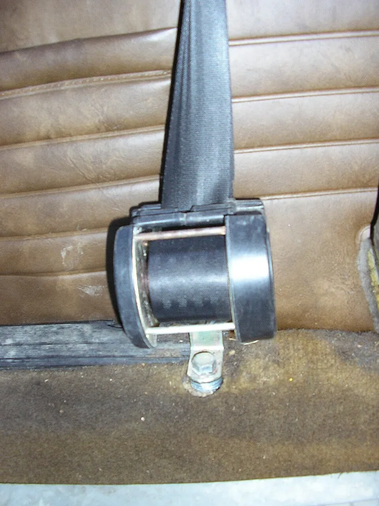

*Picture: [Intertial-reel.jpg](https://commons.wikimedia.org/wiki/File:Intertial-reel.jpg) by Liftarn, [CC BY-SA 3.0](http://creativecommons.org/licenses/by-sa/3.0/), from Wikimedia Commons.*

A spring-return reel whose spool turns freely for slow movements, but whose built-in inertia sensor (a swinging pendulum, a rolling ball, or a flyweight or inertia wheel on the spool) throws a catch into [ratchet](../glossary.md#ratchet) teeth to lock it the moment the line is jerked or the vehicle decelerates sharply.

**In plain words:** A spring-loaded reel, like the one inside a car seat belt, that lets the strap pull out smoothly when you pull gently and winds it back in, but catches and locks the instant the strap is jerked or the car brakes hard. **Proper term:** Emergency locking retractor (inertia reel).

**Also called:** inertia reel / inertial reel (Wikipedia 'Inertia reel' redirects to 'Seat belt: Locking retractors'); emergency locking retractor, ELR (Wikipedia 'Seat belt'; FMVSS 209); webbing-sensitive lock (reacts to the strap being jerked) and vehicle-sensitive lock (reacts to braking, crash or rollover); dual-sensing retractor (both) (Wikipedia 'Seat belt'); switchable retractor, which can also be put into automatic locking retractor (ALR) mode for fitting child seats (The Car Seat Lady); seat-belt retractor / seat-belt reel; self-retracting lifeline (SRL), self-retracting lanyard, self-retracting device (SRD), personal fall limiter, 'block' or 'yo-yo' (fall protection) (OSHA 1910.140; FallTech); centrifugal catch / centrifugal lock / flyweight lock (a flung-out weight that catches ratchet teeth); inertial locking (as used in rope grabs) (OSHA 1910.140); Dynalock (brand; early US automatic locking retractor) (Wikipedia 'Seat belt').

## How it works

A spiral spring keeps turning the spool to wind the strap in, so slow pulls just unwind it against a light spring force (Wikipedia; SafetyRestore). In the strap-sensing (webbing-sensitive) lock, a weighted lever on the spool is held in by a small spring; if the strap is jerked, the spool spins fast, the weight is flung outwards (a small centrifugal clutch), and via a cam it pushes a [pawl](../glossary.md#pawl) into a ratchet so the spool can't unwind any further (Wikipedia 'Seat belt'; SafetyRestore). Some designs use an inertia wheel that lags behind the accelerating spool instead (US patent 3,918,658). In the vehicle-sensing lock, a pendulum or ball swings when the car brakes hard or rolls over and pushes the pawl into the ratchet; when the pull eases the spool turns back a little and the pawl drops out, unlocking it (Wikipedia 'Seat belt'; SafetyRestore).

## Parts

A small assembly that acts as one unit: spool (reel) carrying the strap, webbing or line; spiral return spring; ratchet wheel (toothed wheel) on the spool; locking pawl or locking bar; sensor(s): a pendulum or ball for vehicle movement and/or a spring-held flyweight lever or inertia wheel for strap speed; frame and housing (Wikipedia 'Seat belt'; US patent 3,918,658; SafetyRestore). Modern car belts may add a pyrotechnic pretensioner and a load limiter (Wikipedia 'Seat belt'); fall-arrest units add an energy absorber (FallTech).

## Everyday examples

- Car seat belts: the belt pulls out slowly but locks if you jerk it or brake hard (Wikipedia 'Seat belt')
- Fall-arrest 'yo-yo' blocks used by roofers and scaffolders (OSHA 1910.140; FallTech)
- Child-seat installation using the belt's automatic-locking mode (pull it all the way out and it clicks and only gets shorter) (The Car Seat Lady)
- Lift (elevator) overspeed governors, a related speed-triggered catch that clamps the car to its rails if it descends too fast (Wikipedia 'Elevator')

## When to use it

Use it when a strap, cable or line must follow free, slow movement and stay taut, but must catch a sudden jerk or fall: seat belts and harnesses, fall arrest, and in machines a tether or safety line on a moving part that should lock if something lets go suddenly ⚑ [uncertain: machine uses not sourced]. It is also the mechanism to understand when building a demonstration of speed-sensitive locking (flyweight catching a ratchet), which is the same idea as a centrifugal clutch but with a positive catch instead of friction.

## When not to use it

Never make your own for protecting people: use a certified seat belt or self-retracting lifeline (FMVSS 209; ANSI Z359.14; OSHA 1910.140). Don't rely on it to stop slow [creep](../glossary.md#creep) or a slowly sinking load, because a slow pull never triggers it; use a ratchet and pawl, a cam cleat, a brake or a [self-locking](../glossary.md#self-locking) worm or screw instead. For a strap that must stay fixed in length (e.g. holding a child seat), use automatic-locking mode or a ratchet strap (The Car Seat Lady). For limiting speed rather than stopping, use a centrifugal brake or speed governor; for engaging a drive at speed, use a centrifugal clutch.

## Details

- **What it does (jobs):**
  - stop it moving back (one-way): once locked, the strap or line cannot pay out any more, although the spring can still wind it in (Wikipedia 'Seat belt'; SafetyRestore)
  - tighten and hold tension: the spring keeps the strap snug and winds up any slack (Wikipedia 'Seat belt')
  - slow it, stop it or keep its speed steady: it stops a sudden pay-out, e.g. a person thrown forward in a crash or a worker starting to fall (OSHA 1910.140 definition of a self-retracting lifeline)
- **Movement:** rotate: the spool turns many times as the strap pays out or rewinds; the pawl and sensor only swing a few degrees
- **Directions it can move (degrees of freedom):** 1 when unlocked (the spool turns, so the strap slides in and out). When locked: 0 in the pay-out direction, while winding in is still possible (a ratchet allows one direction).
- **Special behaviour:**
  - self-locking (holds under load, won't back-drive): when triggered, the pawl in the ratchet teeth holds the full crash or fall load (FMVSS 209; OSHA 1910.140)
  - one-way (moves freely one way, locks the other): when locked it still lets the strap wind in but not out, and in automatic-locking (ALR) mode it only gets shorter (The Car Seat Lady)
  - tensioning (takes up slack and holds): the spring winds up slack and keeps a light pull on the strap (FMVSS 209 sets 1 to 7 N)
  - [fail-safe](../glossary.md#fail-safe--fail-secure) or breakaway: it locks automatically, with no power, whenever the pull or the vehicle's deceleration is sudden, and unlocks by itself once the load eases (Wikipedia 'Seat belt'; SafetyRestore)
- **How it holds:**
  - shape (the parts interlock; [form-fit](../glossary.md#form-fit--force-fit--material-bond)): the pawl drops into the ratchet teeth and blocks the spool
  - spring force (a spring or springy part presses it in place): the spiral spring keeps the strap wound in, and small springs keep the flyweight and pawl out of the teeth until a jerk overcomes them (SafetyRestore)
- **Input and output:** Line pulled out (straight-line motion) -> spool rotation, 1 turn per spool circumference of line. Slow pull -> free rotation against a light spring; sudden pull, or vehicle deceleration or tilt -> locked. Shafts: the sensor, ratchet and spool share the spool axis (in line); the pendulum or ball sensor sits below it in the frame. Efficiency: not applicable. Back-drivable: the spring winds the spool back in; once locked, the load cannot drive it outwards (no) until the pull eases. For cars, it must lock before 25 mm of pay-out at 0.7 g (FMVSS 209).
- **Power:** passive (no power needed): the spring, the inertia sensor and the pawl need no electricity. Exceptions: pretensioners fire a small explosive charge in a crash (one-shot) (Wikipedia 'Seat belt'), and some door-mounted belts use an electromagnet to stop locking while the door opens, designed so that a failure still lets a hard deceleration lock the belt (US patent 4,235,455).
- **Load:** Heavy in pull when locked: a car seat-belt assembly loop must withstand at least 22,241 N (each structural part at least 11,120 N) (FMVSS 209); self-retracting lifelines limiting free fall to 2 ft or less must have components that sustain 3,000 lb (13.3 kN) (OSHA 1910.140). Very light in normal use: the retractive pull is only 1 to 7 N (FMVSS 209). It only resists pull along the strap; it does nothing against slow creep, because a slow pull never triggers the lock.
- **Play and precision:** Small, deliberate travel before it locks: car retractors must lock within 25 mm of pay-out at 0.7 g, while strap-sensing ones must not lock before 51 mm at 0.3 g or less (FMVSS 209); fall-arrest devices allow an arrest distance of 24 in (old Class A), 42 in (Class 1 and 2) or 54 in (old Class B) (ANSI Z359.14 via FallTech). The spool can only stop at a ratchet tooth, so tooth spacing sets how far it may turn before locking ⚑ [uncertain: no figure found]. Vehicle-sensitive retractors must be mounted at the right angle: they must not lock when tilted 15 degrees or less from their installed angle, and must lock when tilted beyond 45 degrees (FMVSS 209).
- **Taking it apart:** removable: the retractor bolts to the vehicle body or anchor as a unit (TR6 forum: disconnect the retractor unit); the lock itself is not a joint that is taken apart
- **How often it can be reused:** many times: it locks and unlocks over and over in normal use (car retractors are tested for 50,000 pull-out cycles, with the lock triggered at least 10,000 times; FMVSS 209), but after arresting a real crash or fall it should be taken out of service and inspected or replaced (OSHA 1910.140(c)(17))
- **Sealing:** dust-resistant: the mechanism is enclosed in a housing, and car retractors must still work after a 5-hour dust test (FMVSS 209); leaves and grime can still get in over the years (TR6 forum)
- **Adjustable:** no: the locking thresholds are fixed by the sensor design; a switchable car retractor can be changed into automatic-locking mode by pulling the belt all the way out, and back to normal by letting it all the way in (The Car Seat Lady)
- **Access needed:** not applicable: the housing is bolted to a frame or anchor and the user only handles the free end of the strap or line
- **Materials:** Steel frame, spool, ratchet and pawl; plastic housings and sensor parts; strap of woven webbing (cars) ⚑ [uncertain: fibre type not checked]; steel cable, synthetic rope or Dyneema (brand) webbing in fall-arrest units, with impact-resistant polymer bodies on newer ones (FallTech).
- **Heat, cold, water and wear:** Dirt, leaves and grime inside the housing can stop it retracting (TR6 forum); car retractors are tested for dust, corrosion and temperature (FMVSS 209). The rewind spring weakens with use; the rules only require 50% of the original retraction force after durability testing (FMVSS 209). Vehicle-sensitive locks depend on mounting angle, so a retractor fitted at the wrong angle, or a car parked on a steep slope, can lock or fail to lock (FMVSS 209 tilt limits) ⚑ [uncertain: slope behaviour inferred from the tilt test]. Webbing and synthetic lines are damaged by abrasion, cuts and sharp edges (FMVSS 209 abrasion tests; FallTech on leading-edge ratings); UV degradation of webbing ⚑ [uncertain: not sourced].

## Making it

- **Ways to make or get it:**
  - off-the-shelf part: car seat-belt retractors, self-retracting lifelines and fall-arrest blocks (certified; never home-made for safety use)
  - 3D print (FDM): only for teaching models and non-safety mechanisms ⚑ [uncertain: no printable inertia-reel model found]
  - CNC: metal pawls, ratchets and spools ⚑ [uncertain]
- **Printing it in one piece (print in place):** no: the spool, ratchet, flyweight or pendulum, pawl and housing are separate parts, and it needs a spiral return spring and small springs that are best bought ⚑ [uncertain: no printable design found to confirm]
- **Tools:** To fit: spanner or socket for the anchor bolts ⚑ [uncertain: specific bolt types vary]. To use: none.
- **Difficulty:** hard: for anything that protects people, buy a certified retractor or self-retracting lifeline; a printed demonstrator is moderate, but getting the flyweight heavy enough and the springs light enough to trigger reliably is fiddly (a printed centrifugal-lock puzzle box worked only unreliably because its printed balls were too light; Printables 'Box with Centrifugal Locks')

### 3D printing tips

For a teaching model only, never for anything that holds a person or a heavy load. 1) Put a pivoting weighted lever (flyweight) on the spool with a light spring holding it in, and a ring of ratchet teeth inside the housing: spin slowly and it passes; jerk it and the weight swings out and catches (Wikipedia 'Seat belt'; SafetyRestore) ⚑ [uncertain: layout described from the car mechanism, not a tested printed design]. 2) Printed plastic weights are very light: a printed centrifugal-lock box 'doesn't work exactly perfect' because its printed balls lack mass, and its maker suggests steel or ceramic balls (about 2.79 mm, with about 0.41 mm [clearance](../glossary.md#clearance) each side in the track) instead (Printables 'Box with Centrifugal Locks'); so embed a steel ball, nut or screw in the flyweight to make it heavier. 3) The trigger speed comes from the balance of flyweight force (mass x radius x speed squared) against its spring, the same balance as a centrifugal clutch (LNCT clutch notes): a heavier weight or a weaker spring makes it lock at a lower pull speed. 4) Use a ready-made spiral (clock) spring or a constant-force spring for the rewind, rather than a printed one ⚑ [uncertain]. 5) Make the pawl and ratchet teeth chunky and print them flat so the teeth are not split along layers ⚑ [uncertain: reasoning]. 6) A pendulum version needs the housing mounted upright; test that it doesn't lock when simply tilted a little (car rules allow 15 degrees; FMVSS 209).

### Buying one (off-the-shelf parts)

Search for: 'seat belt retractor' or 'emergency locking retractor (ELR)', 'automatic locking retractor (ALR)', 'inertia reel seat belt' or 'inertia reel harness' (motorsport, aircraft and off-road seats) ⚑ [uncertain: product range not checked]; 'self-retracting lifeline (SRL)', 'self-retracting lanyard', 'personal fall limiter', 'fall arrest block' (ANSI Z359.14 Class 1 or Class 2; e.g. FallTech (brand)); related parts: 'spiral spring' or 'power spring', 'constant force spring', 'ratchet and pawl', 'centrifugal brake'.

## Rules of thumb

- Car emergency-locking retractors must lock before 25 mm of strap pay-out at 0.7 g, strap-sensing ones must not lock before 51 mm at 0.3 g or less, and vehicle-sensing ones must not lock when tilted 15 degrees or less from their installed angle but must lock beyond 45 degrees (FMVSS 209, 49 CFR 571.209 S4.3(j)).
- Retractive force should be light: 1 to 7 N for a belt across both chest and lap, 1 to 5 N for a shoulder belt alone, at least 3 N for a lap belt alone (FMVSS 209 S4.3(j)); after the durability tests the retraction force must still be at least 50% of the original (FMVSS 209 S4.3(k)).
- Durability test for car emergency-locking retractors: 50,000 pull-out and rewind cycles with the lock actuated at least 10,000 times, plus a 5-hour dust test (FMVSS 209 S5.2(k)).
- Strength: a car seat-belt assembly loop must withstand at least 22,241 N, each structural component at least 11,120 N (FMVSS 209 S4.4). Self-retracting lifelines that limit free fall to 2 ft (0.61 m) or less need components that sustain 3,000 lb (13.3 kN) fully extended (OSHA 1910.140(c)(5)).
- Fall-arrest devices (ANSI Z359.14, as summarised by FallTech): maximum arrest force 1,800 lb; maximum arrest distance 42 in for current Class 1 and 2 devices (24 in and 54 in for the retired Classes A and B).
- Any fall-protection system that has arrested a fall (been impact-loaded) must be removed from service until a competent person inspects it (OSHA 1910.140(c)(17)).

## Common failures

1) Won't retract: dirt and grime in the spool or a weak or rusty spring (TR6 forum); clean it out, or replace the unit. 2) Locks when it shouldn't: pulling the strap too quickly, or a vehicle-sensitive unit tilted beyond its design angle (FMVSS 209 tilt limits); pull slowly and mount it at the correct angle. 3) Won't lock: sensor jammed by dirt or damaged pawl ⚑ [uncertain]; test by jerking the strap and replace if it fails. 4) Worn, frayed or cut webbing (FMVSS 209 abrasion tests) ⚑ [uncertain: failure frequency not sourced]. 5) Used in a crash or fall: the parts may be stretched or damaged and must be inspected or replaced (OSHA 1910.140(c)(17)).

## Safety

Life-safety device: never modify, bypass or 3D print one for real use. The rewind spring stores energy and can spring out when the cover is removed: wear eye protection and hold the cover down (TR6 forum). Car pretensioners contain explosive gas generators, so don't take them apart (Wikipedia 'Seat belt'). Replace or inspect after any crash or fall arrest (OSHA 1910.140(c)(17)). A slow pull or slow slip won't lock it.

## Related

- Ratchet and pawl: the locking part inside the reel, but operated by hand or always engaged, not triggered by speed
- Centrifugal clutch: the same flung-out weight idea, used to grip a drum by friction and drive it, instead of to lock
- Speed governor (fly fan, centrifugal governor): flyweights that keep speed steady instead of locking
- Constant-force spring (spring-return reel) and spiral power spring: the rewind springs used in reels and retractors
- Rope grab and ascender: a cam that grips a rope; OSHA notes rope grabs often use inertial locking too
- Automatic locking retractor (ALR): a ratchet mode that locks as soon as the strap stops being pulled out, then only lets it get shorter (The Car Seat Lady)
- Electromagnetic brake (power-off, spring-applied): holds a shaft whenever power is lost, instead of when it spins too fast
- Lift overspeed governor and safety gear: a speed-triggered catch that clamps brake shoes onto guide rails (Wikipedia 'Elevator')

## Make it yourself

- [Box with Centrifugal Locks (Ky3_actual, Printables) (URL from Printables API, page not opened)](https://www.printables.com/model/84286-box-with-centrifugal-locks): Puzzle box whose catches only release when it is spun, using balls in a two-position track: a printable demonstration of a spin-triggered (centrifugal) catch; the maker notes printed balls are too light and suggests steel or ceramic ones *(licence: Creative Commons Attribution (as listed in the Printables API))*

## Pictures, videos and models

- [Intertial-reel.jpg (Wikimedia Commons, by Liftarn; used on Wikipedia 'Seat belt')](https://commons.wikimedia.org/wiki/File:Intertial-reel.jpg): Photo of an inertial-reel seat belt with the roll of webbing exposed, retrofitted in a 1973 Saab 99 *(licence: CC BY-SA 3.0)*
- [Inertial reel belt.jpg (Wikimedia Commons, by A7N8X)](https://commons.wikimedia.org/wiki/File:Inertial_reel_belt.jpg): Photo of the seat-belt retractor housing of a Fiat Panda, with the belt running out of it *(licence: CC BY-SA 3.0)*
- [US3918658A: Seat belt retractor having inertial device activated by two stimuli (Google Patents)](https://patents.google.com/patent/US3918658A/en): Patent text and drawings of a dual-sensing retractor: a pendulum for vehicle movement and an inertia wheel for strap acceleration, both pushing a pawl into a ratchet wheel *(licence: US patent (public domain text and drawings))*
- [How seat belts lock (VICarSeatTechs, YouTube)](https://www.youtube.com/watch?v=aunIE33GYZc): Video on how seat belts lock (title verified; content not reviewed) ⚑ [uncertain] *(licence: link only)*
- [Elevator speed governor.jpg (Wikimedia Commons, by Darklanlan)](https://commons.wikimedia.org/wiki/File:Elevator_speed_governor.jpg): Photo of a lift overspeed governor in a machine room, a related speed-triggered safety catch *(licence: CC BY 4.0)*

## Needs confirming

⚑ marks something nobody has confirmed yet: a fact the research could not confirm from a source, a finder value that is a best guess, or an open point from the research notes. Corrections are welcome (see `research/needs-confirming.md`).

- ⚑ 16 sentences on this page marked [uncertain].
- ⚑ Finder value `connects` = lid, door or cover (best guess): worked out from its name, but joining parts is not one of its two main jobs
- ⚑ Finder value `tools` = hand tools (source uncertain): `tools_needed` is marked ⚑ [uncertain] here: "To fit: spanner or socket for the anchor bolts ⚑ [uncertain: specific bolt types vary]. T…"

## Sources

- <https://en.wikipedia.org/wiki/Seat_belt>
- <https://en.wikipedia.org/wiki/Inertia_reel>
- <https://en.wikipedia.org/wiki/Elevator>
- <https://www.law.cornell.edu/cfr/text/49/571.209>
- <https://www.osha.gov/laws-regs/regulations/standardnumber/1910/1910.140>
- <https://www.falltech.com/blog/fall-protection-guides-resources/the-essential-guide-to-self-retracting-lifelines>
- <https://www.safetyrestore.com/blog/how-seat-belt-locking-mechanism-works/>
- <https://patents.google.com/patent/US3918658A/en>
- <https://patents.google.com/patent/US4235455A/en>
- <https://thecarseatlady.com/installation/lockingthebelt/>
- <https://www.triumphexp.com/forum/tr6-tech-forum.2/how-to-rebuild-retracting-seat-belts.937134/>
- <https://lnct.ac.in/wp-content/uploads/2020/04/ME403_Unit4_Clutches.pdf>
- <https://api.printables.com/graphql/>
- <https://commons.wikimedia.org/wiki/File:Intertial-reel.jpg>
- <https://commons.wikimedia.org/wiki/File:Inertial_reel_belt.jpg>
- <https://commons.wikimedia.org/wiki/File:Elevator_speed_governor.jpg>
- <https://www.youtube.com/watch?v=aunIE33GYZc>
