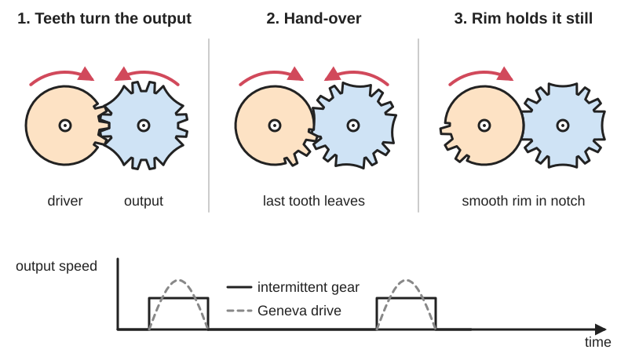

<figure class="eoc-pic eoc-pic-main"><picture><source media="(prefers-reduced-motion: reduce)" srcset="../media/drawn/intermittent-gear.svg"></picture><figcaption><strong>Animation.</strong> Diagram drawn for the encyclopaedia from the research notes. ⚑ Needs confirming: a drawing can simplify or get details wrong; a real photo or a better diagram is welcome.</figcaption></figure>

A driving gear with teeth on only part of its rim turns its partner gear while those teeth pass, then a smooth arc on the toothless part slides against the partner and holds it still, so steady rotation becomes stop-go steps.

**In plain words:** A gear with most of its teeth missing: while its few teeth go past, they turn the other gear; while its smooth, toothless part goes past, the other gear stops and is held still. **Proper term:** Intermittent gear (mutilated gear, part-toothed gear).

**Also called:** mutilated gear / mutilated gearing; part-toothed gear / partial gear; incomplete gear (direct translation of the Chinese name 不完全齿轮); teeth-uncompleted gear (Nguyen Duc Thang's name for his animations); intermittent gearing / intermittent gear drive; mutilated pinion / transfer pinion (the small carry gear between the digit wheels of a mechanical counter); two-tooth gear (the counter carry gear with all but two teeth removed); mutilated bevel gear / mutilated rack (bevel and straight-line versions); 間欠歯車 (Japanese); 不完全齿轮机构 (Chinese).

## How it works

While the toothed part of the driving gear passes, the two gears mesh like ordinary gears and each tooth pushes the driven gear on by one tooth. When the toothless part arrives, the teeth stop meshing and a smooth arc on the driving gear, centred on its own shaft, slides along a matching curved surface on the driven gear, which holds the driven gear still (so it can't be turned or drift) until the teeth come round again. The teeth pick up the driven gear at full speed, so it starts and stops suddenly with a knock, unlike a Geneva drive. Several toothed sections can be placed round the driver, even unevenly, to give several steps per turn with different pauses.

## Parts

A few parts: a driving gear with one or more toothed sections and smooth locking arcs (a holding ring) on the rest of its rim; a driven gear with matching curved locking surfaces between its teeth (or a spring roller [detent](../glossary.md#detent) that holds it instead); two shafts with bearings held at a fixed distance. It is often built in two layers: one layer of teeth that drive and one layer of arcs that lock.

## Everyday examples

- The number wheels of mechanical counters, where a small carry gear moves the next digit on once per turn (tally counters, tape counters on old tape decks, older car mileage counters and utility meters; RoyMech says mutilated gears are used in almost all counters)
- Board-game and scoreboard flip counters printed at home
- Toys and automata where something moves, stops, and moves again ⚑ [uncertain]

## When to use it

Use it for simple stop-go motion at low speed and light load, especially counters (carrying one digit wheel to the next), and when a Geneva drive can't do what you want: only one or two stops per turn, long moves with short pauses, unevenly timed steps, or motion that switches between two outputs in turn (for example two sides of a model moving one after the other). It is cheap and can be made from ordinary gears by removing teeth and adding locking arcs.

## When not to use it

Avoid it at high speed or with heavy or fast-moving loads, because the teeth pick up the output suddenly and cause impacts, noise and chipped teeth; use a Geneva drive or star wheel for a gentler start and stop, or a cam indexer for fully controlled motion. Use a stepper motor if the step size or direction must change on command, and a [ratchet](../glossary.md#ratchet) and [pawl](../glossary.md#pawl) if the input is a back-and-forth lever rather than steady rotation.

## Details

- **What it does (jobs):**
  - change the kind of motion: turns steady rotation into stop-go steps (or, in variants, into back-and-forth motion)
  - click into set positions: the output stops and is held at set positions, as in the digit wheels of a mechanical counter
  - change speed or turning force: while the teeth mesh it works as an ordinary gear pair with the usual [gear ratio](../glossary.md#gear-ratio)
- **Movement:** rotate: continuous rotation in; stepped rotation out, one step per toothed section, with the step size set by how many teeth are left; variants give stepped rotation in opposite directions (mutilated bevel gears) or back-and-forth straight motion (a part-toothed pinion driving two racks in turn)
- **Directions it can move (degrees of freedom):** 1: the output is either driven by the teeth or held by the locking arcs, so its position is always tied to the input's angle
- **Special behaviour:**
  - motion conversion (e.g. rotary to linear): continuous rotation becomes intermittent rotation; variants turn it into reversing or [reciprocating](../glossary.md#reciprocating) motion (507 Mechanical Movements nos. 74 and 114)
  - indexing (clicks into set positions): the output stops at fixed positions; this is how the carry between digit wheels works in mechanical counters
  - [self-locking](../glossary.md#self-locking) (holds under load, won't back-drive): during each pause the locking arcs hold the output so a load can't turn it; RoyMech notes the output is always under the input's control
- **How it holds:**
  - not a holding joint (it moves or passes on motion): it converts and passes on rotation
  - shape (the parts interlock; [form-fit](../glossary.md#form-fit--force-fit--material-bond)): during the pause, the smooth arc of the driver sits against a matching curved surface of the driven gear and blocks it
  - spring force (a spring or springy part presses it in place): in the roller-detent version, a detent holds the output during the pause instead of a locking ring (Bickford) ⚑ [uncertain: spring not described]
- **Input and output:** Continuous rotation -> intermittent rotation (or reversing or reciprocating motion in variants). Output step = (number of teeth in the driver's toothed section / number of teeth on the driven gear) x 360 degrees; for example two teeth turn an 8-tooth gear by two teeth, a quarter turn (woodgears.ca). While meshed, the speed ratio is the ordinary gear ratio (Bickford), and the share of each turn spent moving versus pausing is set by how much of the driver's rim is toothed; it can give long moves with short pauses and one, two or three pauses per output turn, which a Geneva cannot. Efficiency: RoyMech calls mutilated gears efficient; no figure found ⚑ [uncertain], and the locking arcs add some sliding friction during the pause. Shafts: parallel (spur gears), intersecting (bevel gears), or gear to rack for straight motion. Back-drivable: no during the pause (the arcs lock the output); while the teeth are meshed it behaves like any gear pair ⚑ [uncertain].
- **Power:** passive (no power needed); usually turned by a motor, [crank](../glossary.md#crank) or the previous counter wheel, and if power is lost the output stays where it is
- **Load:** Light: RoyMech says mutilated gears stand up well to the loads found in instruments and counters, but are subject to large impact loads and accelerations at high driving speeds, so Genevas or star wheels are preferred for high speed and power. Bickford says that at high speed or high load 'its name is well deserved'. The weak points are the first tooth of each toothed section, which takes the impact, and tooth tips that can collide (top) if the output is not held properly during the pause. osamutake calls it unsuitable for heavy loads or high speeds.
- **Play and precision:** RoyMech credits mutilated gears with good indexing [accuracy](../glossary.md#repeatability--accuracy), since the gears themselves are accurate and the output is always under the input's control. While moving it has the normal [backlash](../glossary.md#backlash) of a gear pair; during the pause the locking arcs hold the output, and any [clearance](../glossary.md#clearance) there lets it wobble. It tolerates little error in the centre distance or in the timing (phase) of the first tooth meeting the output ⚑ [uncertain], because a late or early tooth hits a tooth tip instead of a gap.
- **Taking it apart:** removable: the gears sit on shafts in a frame and can be taken apart (retaining rings, screws or push-fits)
- **How often it can be reused:** many times: it can be dismantled and reassembled repeatedly; the limit is wear of the first teeth and the locking arcs
- **Sealing:** none: it is an open gear mechanism; it does not seal anything
- **Adjustable:** No, once made: the number, size and position of the toothed sections fix the steps and timing; they are chosen at design time and can be spaced unevenly to set any timing you like (osamutake)
- **Access needed:** not applicable: it is a set of gears on shafts in a frame, reached wherever the frame opens
- **Materials:** Ordinary gear materials: metals and plastics for instruments and counters ⚑ [uncertain: specific alloys and plastics not found]; wood works for demonstrations (Matthias Wandel built a counter's carry gears from plywood and hardwood); for 3D printing, osamutake recommends well-dried PETG.
- **Heat, cold, water and wear:** Printed PLA softens above about 60 °C (Prusa). Abrasive filaments (matte, glow-in-the-dark, fibre- or metal-filled) wear small printed counter mechanisms quickly (Chirimorin, Printables) ⚑ [uncertain: general advice for printed counters]. Dust and grit on the locking arcs increase wear and friction ⚑ [uncertain].

## Making it

- **Ways to make or get it:**
  - 3D print (FDM): printable demonstration sets and counters exist
  - woodwork: a wooden counter with part-toothed carry gears (woodgears.ca)
  - CNC: ⚑ [uncertain] ordinary gear-cutting then removing teeth, no specific example opened
  - laser cut: ⚑ [uncertain] flat gear profiles could be cut from acrylic or plywood, no tested example found
  - off-the-shelf part: ⚑ [uncertain] complete mechanical counters contain them; separate part-toothed gears are not a common catalogue item
- **Printing it in one piece (print in place):** no ⚑ [uncertain]: every printable example found was printed as separate gears and assembled on shafts (osamutake holds them with retaining rings); a [print-in-place](../glossary.md#print-in-place) version should be possible like other printed gear sets, but none was found
- **Tools:** A screwdriver or hex key for the frame; pliers for retaining rings (osamutake's printed models are held with retaining rings) ⚑ [uncertain: tool not named]; for wooden versions, woodworking tools (Matthias Wandel cut away teeth with a Forstner bit on a drill press and shaped them on a strip sander)
- **Difficulty:** moderate: the gears are ordinary and print or cut easily, but you must add locking arcs and get the timing right so the first tooth enters cleanly; copying a working printed model first is the easiest start

### 3D printing tips

1) Start by printing and studying a working design: osamutake's 'Educational Gear Examples' sets include two-layer intermittent gears, an intermittent lantern gear and an internal Geneva on the same base plates. 2) Always add locking surfaces: make the toothless part of the driver a smooth arc centred on the driver's shaft, and give the driven gear matching curved faces between its engaging teeth, so the output is held during the pause (osamutake; RoyMech; Bickford). A two-layer layout is easiest to print: one layer carries the driving teeth, the other the locking arcs; for a counter carry, cut back every other tooth of the driven gear on one layer (karakurist.jp; woodgears.ca). 3) Check the hand-over by turning it slowly by hand: 507 Mechanical Movements' animators had to alter a few rack teeth to stop the gears jamming at the transition points, so trim or round the first and last tooth of each toothed section if they catch ⚑ [uncertain: trimming amount]. 4) osamutake's print settings: well-dried PETG for accuracy, 0.1 or 0.08 mm layers for smooth faces, slow speed on [overhangs](../glossary.md#overhang--bridging), and 'random' seam position so seams wear in instead of catching. 5) Clearances: about 0.15 mm [radial](../glossary.md#axial--radial) clearance between gears and printed shafts (osamutake); sand off stringing on shafts and widen tight holes with a thin round file if [elephant's foot](../glossary.md#elephants-foot) (a squashed first layer) makes them bind. 6) Print gears flat so the teeth are built from full layers ⚑ [uncertain]. 7) Run it slowly and lightly loaded; a motor at high speed will chip the first teeth.

### Buying one (off-the-shelf parts)

Shafts or axles, ball bearings or bushings, retaining rings ([circlips](../glossary.md#circlip) or e-clips); ordinary spur or bevel gears that you modify by removing teeth, as Matthias Wandel did on wooden 8-tooth gears; complete mechanical counters (search 'mechanical counter', 'revolution counter', 'tally counter') which contain this mechanism ⚑ [uncertain]; a gear motor or hand crank to drive it.

## Rules of thumb

- Always give it holding (locking) surfaces: RoyMech warns that running without holding rings is undesirable at any speed, because the driver's teeth will sooner or later hit the tips of the output's teeth, and since they meet near the line between the centres even a small input [torque](../glossary.md#torque) produces large wedging (toggle) forces that damage the teeth. Bickford agrees that some holding arrangement is essential.
- Each tooth on the driver's toothed section moves the output on by one tooth, so output step = (teeth in the section / teeth on the output) x 360 degrees; two teeth turn an 8-tooth gear a quarter turn (woodgears.ca).
- Counter carry example: a 20-tooth driver with an 8-tooth driven gear (every other tooth cut back on one layer) passes motion on for only 1/10 of a turn (36 degrees); a 24-tooth driver gives 1/12 (karakurist.jp).
- Keep speed and load low; for high speed or high power use a Geneva or star wheel instead (RoyMech; Bickford; osamutake).
- Unlike a Geneva, which needs at least three (in practice four) pauses per output turn and always pauses longer than it moves, a mutilated gear can give one, two or three pauses per output turn and long moves with short pauses (Bickford, ch. 15).
- The toothed sections on the driver don't have to be evenly spaced; placing them unevenly sets any timing you want (osamutake).
- 3D printing: about 0.15 mm radial clearance on printed shafts, well-dried PETG, 0.08-0.1 mm layers (osamutake).

## Common failures

1) Tooth tips colliding (topping) and jamming or breaking when the output isn't held during the pause (RoyMech; Bickford): add locking arcs or a detent. 2) Chipped or worn first teeth from impacts at speed (Bickford; RoyMech): slow it down, trim the first tooth, or use a Geneva. 3) Jamming at the hand-over from teeth to arc because of bad timing (507 Mechanical Movements no. 269 note): adjust the phase or trim the transition teeth. 4) The output drifting or digits misaligning because the locking surfaces are worn or have too much clearance. 5) Stiff running from stringing or elephant's foot on printed parts (osamutake): sand and file the fits.

## Safety

In motor-driven builds the meshing teeth and locking arcs are pinch points ⚑ [uncertain]; guard them. Sudden starts can fling or tip light objects carried on the output. Otherwise none known.

## Related

- Geneva drive (Maltese cross): a pin and slots instead of teeth; starts and stops each step smoothly from zero speed, but needs at least three or four stops per turn and always pauses longer than it moves (Bickford; osamutake)
- Star wheel: combines a Geneva-like smooth start with gear teeth for the middle of the move (Bickford)
- Cam indexer: shaped cams give smooth, fully controlled steps at high speed
- Ratchet and pawl: steps a toothed wheel from a back-and-forth input and can stop it turning backwards
- Spur gear pair: the full-toothed version, which turns continuously
- Rack and pinion: with a part-toothed pinion driving two racks in turn it gives back-and-forth straight motion (507 Mechanical Movements no. 114)
- Escapement: releases a spring- or weight-driven wheel one tooth at a time

## Make it yourself

- [Educational Gear Examples 5 - Intermittent (osamutake, Printables)](https://www.printables.com/model/1504642-educational-gear-examples-5-intermittent): Printable demonstration set: two intermittent gear pairs (one with several stops per turn), an intermittent lantern gear and an internal Geneva drive, with detailed print and assembly notes *(licence: CC BY)*
- [Educational Gear Examples 2 (osamutake, Printables)](https://www.printables.com/model/1427427-educational-gear-examples-2): Includes a two-layer intermittent gear (upper layer drives, lower layer locks) next to a Geneva drive for comparison *(licence: CC BY)*
- [Building a mechanical counter (Matthias Wandel, woodgears.ca)](https://woodgears.ca/counter/): Step-by-step build of a wooden mechanical counter whose carry uses an 8-tooth gear with four teeth cut back and a two-tooth gear with a locking disc *(licence: not stated ⚑ [uncertain])*
- [Intermittent mechanism (Michel, Printables)](https://www.printables.com/model/1434687-intermittent-mechanism): One control gear drives two outputs a full turn each, one after the other, with the idle side blocked; made to simulate traffic taking turns *(licence: Creative Commons Public Domain (per Printables))*
- [HUANGYAN920 Mechanical: interactive mechanism animations (entry 'INCOMPLETE-GEAR', 不完全齿轮机构)](https://huangyan920.github.io/Mechanical/): Browser animation of a part-toothed gear driving its partner intermittently, held still by a locking arc between steps *(licence: MIT)*

## Pictures, videos and models

- [507 Mechanical Movements, No. 74: mutilated bevel gear](https://507movements.com/mm_074.html): 1868 drawing with an animated version: a mutilated bevel gear gives two bevel gears intermittent rotation in opposite directions *(licence: Book public domain; website animation link only)*
- [507 Mechanical Movements, No. 114: mutilated pinion and two racks](https://507movements.com/mm_114.html): Drawing with animation of a part-toothed pinion driving a top and bottom rack in turn, giving back-and-forth motion *(licence: Book public domain; website animation link only)*
- [Transmission with teeth-uncompleted gears 1b (Nguyen Duc Thang, YouTube thang010146)](https://www.youtube.com/watch?v=8lNxCUpZH8k): CAD animation of an intermittent (part-toothed) gear drive; one of a numbered series of variants *(licence: link only (standard YouTube licence))*
- [Educational Gear Examples 5 - Intermittent (osamutake, YouTube)](https://www.youtube.com/watch?v=9aCpXa-tHRA): Printed intermittent gears, an intermittent lantern gear and an internal Geneva running side by side *(licence: link only (standard YouTube licence))*
- [間欠歯車 #1 (Intermittent Gear) (S.CRAFT, YouTube)](https://www.youtube.com/watch?v=6R0ikyHhWHw): A physical intermittent gear model in motion *(licence: link only (standard YouTube licence))*

## Needs confirming

⚑ marks something nobody has confirmed yet: a fact the research could not confirm from a source, a finder value that is a best guess, or an open point from the research notes. Corrections are welcome (see `research/needs-confirming.md`).

- ⚑ 18 sentences on this page marked [uncertain].
- ⚑ Finder value `print_in_place` = no (source uncertain): `print_in_place` is marked ⚑ [uncertain] here: "no ⚑ [uncertain]:…"
- ⚑ Finder value `clicks` = clicks (best guess): the text uses both clicking and silent words
- ⚑ Finder value `tools` = drill and tap, power tools, hand tools (source uncertain): `tools_needed` is marked ⚑ [uncertain] here: "…ning rings (osamutake's printed models are held with retaining rings) ⚑ [uncertain: tool not named]; for wooden…"

## Sources

- <https://roymech.org/Useful_Tables/Cams_Springs/Indexing.html>
- <https://ecommons.cornell.edu/handle/1813/57662>
- <https://ecommons.cornell.edu/bitstream/handle/1813/57662/002_011.pdf>
- <https://ecommons.cornell.edu/server/api/core/bitstreams/3c2c62ea-1cc9-438a-991f-92b0ad210e0e/content>
- <https://karakurist.jp/?p=85>
- <https://karakurist.jp/?p=21>
- <https://woodgears.ca/counter/>
- <https://507movements.com/toc.html>
- <https://507movements.com/mm_074.html>
- <https://507movements.com/mm_114.html>
- <https://507movements.com/mm_269.html>
- <https://api.printables.com/graphql/>
- <https://www.printables.com/model/1504642-educational-gear-examples-5-intermittent>
- <https://www.printables.com/model/1427427-educational-gear-examples-2>
- <https://www.printables.com/model/1434687-intermittent-mechanism>
- <https://www.printables.com/model/1549231-mechanical-counter>
- <https://www.youtube.com/watch?v=8lNxCUpZH8k>
- <https://www.youtube.com/watch?v=PZ54x2hgU9A>
- <https://www.youtube.com/watch?v=9aCpXa-tHRA>
- <https://www.youtube.com/watch?v=6R0ikyHhWHw>
- <https://huangyan920.github.io/Mechanical/>
- <https://raw.githubusercontent.com/HUANGYAN920/Mechanical/main/README.md>
- <https://raw.githubusercontent.com/HUANGYAN920/Mechanical/main/LICENSE>
- <https://en.wikipedia.org/wiki/Intermittent_mechanism>
- <https://de.wikipedia.org/wiki/Schrittgetriebe>
- <https://help.prusa3d.com/article/pla_2062>
