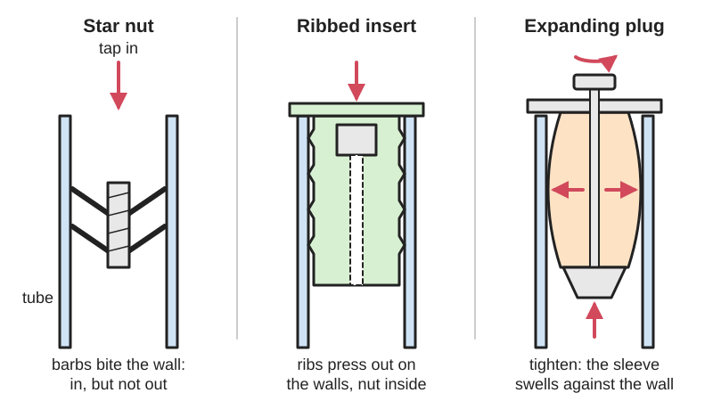
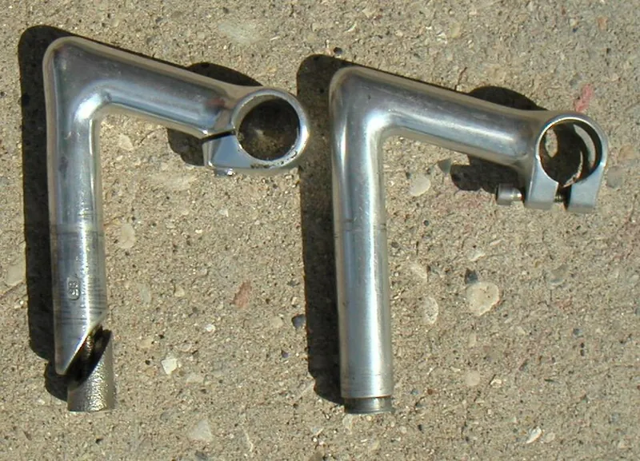

<figure class="eoc-pic eoc-pic-main"><figcaption>Diagram drawn for the encyclopaedia from the research notes. ⚑ Needs confirming: a drawing can simplify or get details wrong; a real photo or a better diagram is welcome.</figcaption></figure>
<figure class="eoc-pic"><figcaption><strong>Photo.</strong> <a href="https://commons.wikimedia.org/wiki/File:Quill_stems.JPG">Quill stems</a> by AndrewDressel (talk), <a href="https://creativecommons.org/licenses/by-sa/3.0">CC BY-SA 3.0</a>, from Wikimedia Commons.</figcaption></figure>

A part pushed or tapped into the open end of a tube that locks against the inside wall, by barbs biting in, ribs pressing out, or a sleeve swollen by a bolt, wedge or cone, so the tube gets a thread, a foot, a caster or a pull point without welding or drilling.

**In plain words:** A plug you push into the open end of a tube that grips the inside wall, either with springy barbs that dig in, ribs that press outward, or a rubber or split sleeve that swells when you turn a bolt, so the tube end gets a screw thread or a firm anchor point. **Proper term:** Internal tube anchor (tube-end insert): star nut (star-fangled nut), expansion plug (compression plug, expander), wedge or cone expander, and ribbed threaded tube insert.

**Also called:** star nut; star-fangled nut ('Star Fangled' is a registered trade name, per Sheldon Brown); starnut; Ahead nut; threadless headset nut; expansion plug; compression plug; expander plug; headset expander (for carbon fork steerers) (Park Tool; Wikipedia 'Stem (bicycle part)'); quill stem expander: wedge bolt (wedge-shaped nut) or cone expander nut (Wikipedia 'Stem (bicycle part)'); threaded tube insert; threaded tube end; square or round threaded insert for levelling feet; tube insert with nut (Superior Glide); expanding adapter stem; expansion stem; rubber expansion adapter (for casters in tube legs) (Caster Technology); expanding bar-end plug (bicycle handlebar end plug); tube-connecting nut ('push inside tubes to join them with a threaded stud instead of welding', McMaster-Carr category name); expanding tube plug; wedge expanding plug; tube end plug with thread.

## How it works

Barb type: the star nut is slightly wider than the inside of the tube, so when it is hammered in its springy barbed flanges bend back and bite into the wall; they slide one way but dig in if pulled back, so it resists pulling out (Park Tool; Sheldon Brown). Rib type: a plastic insert with flexible ribs is pressed in and the ribs push outward on all the walls, holding a nut in the centre (Superior Glide). Expanding type: tightening a bolt pulls two cones (or a wedge) together inside a split or rubber sleeve, which swells outward and jams against the inside wall by friction; loosen the bolt and it lets go (Park Tool; Caster Technology). In a bicycle quill stem, the bolt pulls a wedge or cone nut up so the bottom of the stem spreads and presses on the inside of the steerer tube (Wikipedia 'Stem (bicycle part)').

## Parts

Single piece to a few parts. Star nut: one piece (a threaded centre with two stacked rings of springy barbed flanges). Ribbed threaded insert: a plastic (PA) body with a steel nut moulded in. Expansion plug: a small assembly acting as one unit: an expandable split or rubber sleeve, a cone at the top and at the bottom, and a bolt through the middle (Park Tool). Wedge expander: a sleeve or tube cut at an angle, a matching wedge nut and a bolt (Wikipedia 'Stem (bicycle part)').

## Everyday examples

- The star nut or expansion plug under the top cap of a bicycle's threadless headset (Park Tool; Wikipedia 'Headset (bicycle part)')
- The wedge or cone expander that holds an older bicycle's quill handlebar stem (Wikipedia 'Stem (bicycle part)')
- Screw-in levelling feet in square steel table and desk legs (Superior Glide), and expanding-stem casters in kitchen prep tables and carts (Caster Technology)
- The expanding plug that closes the end of a bicycle handlebar (Rossero's printable bar-end plug is based on 'common expanding sleeve bar ends')

## When to use it

Use one when you need a thread or a fixing point at the end of a tube and can't or don't want to weld, drill or tap: fitting levelling feet, glides or casters to tube legs; giving a pole or frame an end thread for a knob, mount or accessory; anchoring a bolt that pulls things together inside a tube (like a headset top cap); plugging tube ends to keep dirt and insects out. Choose an expansion plug when the tube is carbon, plastic or thin-walled, when you may want to remove or move it, or when it should seal; choose a star nut for a cheap, permanent anchor in a metal tube; choose a ribbed threaded insert for furniture legs that take a levelling foot (Park Tool; Superior Glide; Caster Technology).

## When not to use it

Avoid them for heavy pulling loads or safety-critical joints where the only thing holding is friction inside a tube: use a through-bolt, a welded or bonded insert, or a rivet nut (see 'Blind threaded fixings'). Never use a barbed star nut in carbon fibre or other [brittle](../glossary.md#brittle--ductile) tubes (use an expansion plug) (Sheldon Brown). If you need to fix something to the side of a tube rather than its end, use a clamp-on fitting or a rivet nut. If the tube's inside size varies or is unknown, a barbed or ribbed insert may be loose or impossible to fit: use an expanding type. For joining two tubes at an angle, clamp-on tube fittings are usually stronger.

## Details

- **What it does (jobs):**
  - join and hold: gives the end of a tube a thread or anchor point for a bolt, top cap, levelling foot, caster or accessory (Park Tool; Superior Glide; Caster Technology)
  - tighten and hold tension: the star nut or expansion plug is what the top-cap bolt pulls against to pre-load (squeeze) a bicycle's headset bearings (Wikipedia 'Headset (bicycle part)')
  - seal it, or pass cables or fluid through: plugs close the tube end against dirt and insects, and rubber expanding plugs can seal it airtight (Superior Glide; 'Tube Plug With Double Expanding Seal' by windi)
- **Movement:** none: once fitted it stays fixed in the tube. Expanding types can be slid to any depth before they are tightened
- **Directions it can move (degrees of freedom):** 0 once fitted. Before tightening, an expanding plug can slide along the tube and (in a round tube) turn; a star nut has 0 from the moment it is driven in.
- **Special behaviour:**
  - one-way (moves freely one way, locks the other): a star nut's barbed flanges 'allow it to be forced downward into the steerer, but ... prevent it from moving upward' (Sheldon Brown); Park Tool says it 'is designed not to pull upward' and is not designed to be removable
  - none for expansion plugs, wedge expanders and ribbed inserts: they simply hold by friction until released
- **How it holds:**
  - shape (the parts interlock; [form-fit](../glossary.md#form-fit--force-fit--material-bond)): a star nut's sharp barbs dig into the tube wall (Park Tool: the flanges 'bite into the fork walls')
  - spring force (a springy part presses it in place): the star nut's springy flanges and a ribbed insert's flexible ribs press outward on the wall (Superior Glide)
  - friction or clamping (force-fit): expansion plugs, wedge expanders and rubber expanding stems are squeezed against the wall by a bolt and hold by friction (Park Tool; Caster Technology; Wikipedia 'Stem (bicycle part)')
- **Input and output:** not applicable
- **Power:** passive (no power needed)
- **Load:** Light to medium, mostly along the tube: star nuts carry the pull of a headset top-cap bolt (just the bearing pre-load; the fork is actually held by the stem clamp bolts, Wikipedia 'Headset (bicycle part)'); ribbed inserts carry a levelling foot's weight, which pushes the insert into the tube and passes the load through the plastic body to the tube walls (Superior Glide); expanding caster stems carry furniture, cart and prep-table loads (Caster Technology). Pull-out resistance depends on friction and on the tube's wall and inside size matching the insert. Twisting is the weak direction in round tubes, since a friction plug can spin; square plugs and square wedges resist turning ('Square wedge to prevent rotation', ray of sunshine's wedge plug) ⚑ [uncertain: no load figures published in the sources opened].
- **Play and precision:** No play once fitted. Alignment follows the tube: a star nut can go in crooked unless it is guided straight, which is why Park Tool's TNS-4 has a built-in guide. [Tolerance](../glossary.md#tolerance) to size is limited: ribbed inserts must match both the tube's outside size and its wall thickness (Superior Glide: walls of 1 to 2 mm), and expanding stems must match the tube's inside diameter (Caster Technology); an expanding plug copes with more variation than a barbed or ribbed one ⚑ [uncertain].
- **Taking it apart:** Star nut: permanent ('a star nut is not designed to be removable'; to replace one, drive it deeper or right through the tube, or drill it out, Park Tool). Ribbed push-in inserts: semi-permanent ⚑ [uncertain: they can usually be prised out but the ribs may be damaged]. Expansion plugs, wedge expanders and expanding caster stems: removable; loosen the bolt and pull them out (Caster Technology: 'Just loosen the bolt to collapse the bushing and pull out the stem')
- **How often it can be reused:** Star nut: once (it is destroyed or left in the tube when removed, Park Tool). Expansion plugs and expanding stems: many times; Caster Technology says the system can be reused across different frames. Ribbed inserts: a few times ⚑ [uncertain]
- **Sealing:** Star nut: none. Ribbed plugs: dust-resistant, since they close the tube end (Superior Glide: 'The insert seals the tube end'). Rubber or flexible expanding plugs: can be watertight or airtight, because the squeezed rubber presses all round the wall, e.g. windi's printed plug with TPU sections seals a vibraphone resonator tube airtight, and Kirk's TPU plug stops a pool or spa drain
- **Adjustable:** Expansion plugs and wedge expanders: yes, they can be set at any depth before tightening, and loosened and moved later (Park Tool; Wikipedia 'Headset (bicycle part)' on quill stems, which can be adjusted in height). Star nut: no; its depth is fixed when it is driven in (Park Tool sets it 15 mm down). Threaded inserts give a thread, so a screwed-in levelling foot can then be adjusted up and down (Superior Glide).
- **Access needed:** end of a tube or shaft: everything is fitted from the open end; nothing needs to reach the outside of the tube wall or the far end
- **Materials:** Star nuts: steel barbed flanges (Sheldon Brown) ⚑ [uncertain: aluminium versions exist but were not checked]; only for metal tubes, never carbon (Sheldon Brown; Wikipedia 'Stem (bicycle part)'). Expansion plugs: metal cones and sleeves, or a rubber or thermoplastic bushing (Caster Technology); suited to carbon, plastic and thin tubes because nothing bites. Ribbed threaded inserts: polyamide (PA) body with a zinc-plated steel nut (Superior Glide). 3D-printed plugs: ABS or ASA for rigid wedge plugs (ray of sunshine), PLA hard parts with TPU sealing sections (windi), TPU for rubber-like expanding plugs (Kirk). Tubes: steel, aluminium, stainless, carbon fibre (expansion plugs only), PVC.
- **Heat, cold, water and wear:** Steel star nuts and plated nuts can rust inside a wet tube; zinc-plated steel nuts resist corrosion better (Superior Glide). Rubber and thermoplastic expanding bushings rely on staying squeezed: they may relax or loosen with time, heat or vibration, so re-check them ⚑ [uncertain: no source gives figures]. Printed plugs: PLA softens above about 60 °C and degrades in sunlight (Prusa); use ASA for outdoor parts (ray of sunshine). Quill stem wedges can bind or seize inside the steerer over time (Wikipedia 'Stem (bicycle part)').

## Making it

- **Ways to make or get it:**
  - off-the-shelf part: star nuts, compression or expansion plugs, threaded tube inserts, expanding caster stems, bar-end plugs
  - 3D print (FDM): expanding plugs and wedge plugs with a metal screw and nut, bar-end plugs, flexible (TPU) sealing plugs, and push-in connectors that fit inside PVC pipe (ray of sunshine; Rossero; windi; Kirk; KPV)
  - CNC: ⚑ [uncertain] turned metal expanders or plugs for special tube sizes; no specific guide found
- **Printing it in one piece (print in place):** partly: an expanding plug is usually printed as one or two plastic parts and then needs an added screw and nut (Rossero's bar-end plug needs an M3 bolt of at least 20 mm and an M3 nut; ray of sunshine's wedge plug needs an M3 flat-head screw and a nut dropped in during a print pause); multi-material plugs can combine hard and flexible sections in one print (windi)
- **Tools:** Star nut: a star-nut setter (e.g. Park Tool TNS-1 or TNS-4) and a hammer or mallet, or a long bolt and a printed guide tool (Park Tool; Russell Smyth's printed installer). Ribbed inserts: hand pressure or a rubber mallet (Superior Glide). Expansion plugs and expanding stems: a hex key, spanner or socket (Park Tool; Caster Technology). A pipe cutter or saw and a deburring tool to square and clean the tube end ⚑ [uncertain: general advice].
- **Difficulty:** easy: buy the right size, then press, tap or bolt it in; the main skill is measuring the tube's inside size and wall thickness. Printed expanding plugs are also easy to make (ray of sunshine; Rossero), but a printed star nut would not have springy metal barbs

### 3D printing tips

1) Measure the tube's inside diameter in several places and average it; for a tight push-in fit KPV adds about 0.4 mm to the measured inside diameter and suggests printing one connector first and adjusting until the fit is right. 2) For a plug that must hold, make it expand rather than relying on a push fit: a screw that pulls a wedge or cone into a split sleeve gives a strong, removable grip (ray of sunshine's wedge plug for 1.5 in, 13-gauge square tube; Rossero's bar-end plug that expands from 18 to 21 mm). 3) Stop it turning: in square tube a square plug and a square wedge can't rotate (ray of sunshine). 4) Put metal threads inside: ray of sunshine pauses the print at 7.2 mm (at 0.35 mm layers) to drop in a thin M3 nut and notes a [heat-set insert](../glossary.md#heat-set-insert) would also work; see the 'Mid-print embedding' and 'Heat-set threaded insert' entries. 5) Printed plastic is brittle at thin hinges: Rossero redesigned the common expanding bar-end mechanism 'for the more brittle 3D printing filament with extra flexible joints'. 6) Lightly sand the wedge's sliding faces so it slides smoothly as you tighten (ray of sunshine). 7) Choose material for where it lives: ray of sunshine used ABS and would use ASA next time for UV resistance; PLA softens above about 60 °C and degrades in sunlight (Prusa). 8) For a sealing or rubbery plug, print in TPU: windi's plug squeezes TPU sections between two PLA parts so they spread out and seal airtight (with filament changes in the G-code), and Kirk prints a TPU drain plug compressed by a bolt and washers, with the part-cooling fan off. 9) A printed tool helps fit a metal star nut straight and at the right depth: Russell Smyth's installer, printed in PLA at 100% [infill](../glossary.md#infill) with 4 shells, sets the nut 15 mm deep using an M6 x 40 mm bolt and a rubber mallet. 10) Don't try to print a star nut for real use: its grip depends on springy, sharp metal barbs ⚑ [uncertain: reasoning, no test found].

### Buying one (off-the-shelf parts)

Search for: 'star nut' or 'star fangled nut' (sized by steerer tube, e.g. 1 in, 1-1/8 in, 1-1/4 in ⚑ [uncertain: sizes not checked in an opened source]; M6 x 1 thread, the bolt size Russell Smyth's printed installer uses), 'star nut setter' (Park Tool TNS-1, TNS-4), 'compression plug', 'expansion plug' or 'headset expander' for carbon steerers, 'quill stem wedge bolt', 'threaded tube insert' / 'square threaded insert' / 'round threaded tube insert' (e.g. 20 x 20 to 50 x 50 mm square tube, M8 to M12 thread, walls 1-2 mm, Superior Glide), 'expanding adapter stem' or 'expansion stem caster' (3/4 in to about 1-1/2 in, Caster Technology), 'expanding bar end plug', 'tube-connecting nuts' (McMaster-Carr category), 'tube end plug', 'expanding rubber plug'. Related: 'rivet nut' and 'well nut' (see 'Blind threaded fixings'), 'weld nut'.

## Rules of thumb

- Set a bicycle star nut about 15 mm (9/16 in) below the top of the steerer tube, so the top-cap bolt can thread fully into it (Park Tool, 'Star Fangled Nut and Expansion Plug Installation').
- Drive a star nut in straight: use a setter with a guide (Park Tool TNS-4) or use the stem as a guide (Park Tool).
- Never put a star nut in a carbon-fibre tube; use an expansion plug, because the star nut's barbs can weaken carbon 'to the point of failure' (Wikipedia 'Stem (bicycle part)'; Sheldon Brown).
- To replace a star nut, don't try to pull it out: drive the old one deeper than the new one will sit, drive it right through, or drill out its centre (Park Tool).
- Grease or oil the threads of an expansion plug's bolt before fitting it (Park Tool).
- Match ribbed threaded inserts to the tube's outside size and its wall thickness (typically 1-2 mm walls for square furniture tube, Superior Glide); align the insert's corners with the tube's corners and press in by hand or with a rubber mallet (Superior Glide).
- Choose an expanding stem by the tube's inside diameter (Caster Technology).
- A threadless headset's top-cap bolt and star nut only pre-load the bearings; the stem clamp bolts hold the fork, so tighten them after adjusting (Wikipedia 'Headset (bicycle part)').
- To free a quill stem's wedge, undo the bolt a couple of turns and give it a sharp tap (Wikipedia 'Headset (bicycle part)').
- For a printed push-in connector, add about 0.4 mm to the pipe's measured inside diameter and test-fit before printing a full set (KPV, Printables).

## Common failures

1) Star nut goes in crooked or at the wrong depth: use a guided setter (Park Tool). 2) Star nut can't be removed or moved: by design; drive it deeper or through, or drill it out (Park Tool). 3) Carbon steerer cracked by a star nut (Wikipedia 'Stem (bicycle part)'). 4) Expansion plug or expanding stem slips, spins or pulls out: bolt not tight enough, wrong size for the tube's inside diameter, or rubber relaxed over time (Caster Technology) ⚑ [uncertain: relaxation]; re-tighten or use the correct size. 5) Ribbed insert too loose or won't go in: wall thickness or tube size doesn't match (Superior Glide). 6) Quill stem wedge seized or binding in the steerer: free it by loosening the bolt and tapping it down (Wikipedia 'Headset (bicycle part)' and 'Stem (bicycle part)'). 7) Printed plugs: thin flexing sections crack in brittle filament (Rossero), or the wedge sticks because [layer lines](../glossary.md#layer-lines) catch (ray of sunshine).

## Safety

On a bicycle, a missing or loose steerer anchor lets the headset come loose, and a star nut in a carbon steerer can crack it to the point of failure (Wikipedia 'Stem (bicycle part)'); remember the anchor only pre-loads the bearings, and the stem clamp bolts must be tightened to hold the fork (Wikipedia 'Headset (bicycle part)'). Hammering in a star nut calls for eye protection and a guide so the hammer doesn't glance off ⚑ [uncertain: general advice]. Don't rely on a friction-only plug to hold a person's weight in tension ⚑ [uncertain: general advice]. Cut tube ends are sharp: deburr before fitting.

## Related

- Blind threaded fixings (rivet nut, well nut): fitted through a hole in a tube's side wall rather than its end; a rubber well nut is a close cousin of the rubber expansion plug
- Press-fit and expanding inserts (tap-in insert): threaded sleeves pushed or expanded into a hole in plastic or wood rather than a tube end
- Spring-steel push-on fasteners (push nut, speed nut): use the same idea as the star nut, springy barbs that slide on one way and dig in the other
- [Collet](../glossary.md#collet) (and keyless chuck): an outside-gripping split sleeve closed by a cone; an expansion plug is the same idea turned inside out
- Telescoping tube twist lock: an internal expander that locks one tube inside another at any length, and releases by twisting
- Clamp-on tube fittings (slip-on structural fittings): grip the outside of a tube, for joining tubes at angles
- Keyless locking bush (shaft locking device): tapered rings that expand into a hub bore and shrink onto a shaft, a much stronger cousin of the cone expander
- [Self-locking](../glossary.md#self-locking) wedge (wedge clamp, [taper](../glossary.md#taper) key): the wedge principle behind the quill-stem wedge and printed wedge plugs
- Hose barb (barbed tube fitting): barbs that hold a soft hose from inside, and also seal
- Castor: the wheel that an expanding caster stem or a threaded tube insert holds in the end of a tube leg
- Levelling foot: the screw-in foot that a ribbed threaded insert gives a square or round tube leg a thread for

## Make it yourself

- [Wedge Expanding Plug for 1.5-in Square 13-ga. Tubing (ray of sunshine, Printables) (URL from Printables API, page not opened)](https://www.printables.com/model/534088-wedge-expanding-plug-for-15-in-square-13-ga-tubing): Printed square tube plug with a square wedge pulled tight by an M3 flat-head screw into a nut inserted during a print pause; closes the tube end and can't rotate *(licence: CC BY (Creative Commons Attribution))*
- [Expanding Bar-End Plug for Road bikes (Rossero, Printables) (URL from Printables API, page not opened)](https://www.printables.com/model/821879-expanding-bar-end-plug-for-road-bikes): Printed expanding sleeve plug for handlebar ends, expanding from 18 to 21 mm with an M3 bolt and nut, redesigned with extra-flexible joints for brittle filament *(licence: CC BY-NC-SA (Creative Commons Attribution-NonCommercial-ShareAlike))*
- [Tube Plug With Double Expanding Seal (windi, Printables) (URL from Printables API, page not opened)](https://www.printables.com/model/72669-tube-plug-with-double-expanding-seal): Sliding tube plug printed in PLA and TPU: a screw pulls the hard parts together so the TPU sections spread and seal airtight at an adjustable position *(licence: Creative Commons Public Domain)*
- [Star Nut Installer (Russell Smyth, Printables) (URL from Printables API, page not opened)](https://www.printables.com/model/466317-star-nut-installer): Printed guide tool that drives a bicycle star nut in straight and stops at 15 mm depth, using an M6 x 40 mm bolt and a rubber mallet *(licence: CC BY-NC-SA (Creative Commons Attribution-NonCommercial-ShareAlike))*
- [TinyWhoop Gates - PVC Pipe Connector For Any Size of Pipe (KPV, Printables) (URL from Printables API, page not opened)](https://www.printables.com/model/1119072-tinywhoop-gates-pvc-pipe-connector-for-any-size-of): OpenSCAD parametric connector whose arms push inside PVC pipe with a tight fit; set the pipe's measured inside diameter plus about 0.4 mm *(licence: CC BY-NC-SA (Creative Commons Attribution-NonCommercial-ShareAlike))*

## Pictures, videos and models

- [Star Fangled Nut and Expansion Plug Installation (Park Tool, 2015)](https://www.parktool.com/en-us/blog/repair-help/star-fangled-nut-and-expansion-plug-installation): Photos of star nuts, star-nut setters and an expansion plug, with step-by-step fitting and removal *(licence: link only)*
- [Installing a Star Nut or Compression Plug in a Threadless Headset (Park Tool, YouTube)](https://www.youtube.com/watch?v=c_-ikObUv5A): Video of driving a star nut with a setter and fitting a compression (expansion) plug (title and channel verified via YouTube oEmbed) *(licence: link only (standard YouTube licence))*
- [Quill stems.JPG (AndrewDressel, Wikimedia Commons)](https://commons.wikimedia.org/wiki/File:Quill_stems.JPG): Bicycle quill stems with a wedge-shaped expander nut (left) and a cone-shaped expander nut (right), per the caption in Wikipedia's 'Stem (bicycle part)' *(licence: CC BY-SA 3.0 / GFDL 1.2 or later)*
- [Bicycle headset (threadless) exploded view-en.png (Keithonearth, Wikimedia Commons)](https://commons.wikimedia.org/wiki/File:Bicycle_headset_(threadless)_exploded_view-en.png): Labelled exploded drawing of a 1-1/8 in threadless headset; Wikipedia's 'Nut (hardware)' table uses it to illustrate the star nut *(licence: CC BY-SA 3.0 / GFDL 1.2 or later)*
- [Square Threaded Inserts (Superior Glide)](https://superiorglide.com/product/square-threaded-inserts/): Product photos and a how-it-works explanation of ribbed square tube inserts with a moulded-in nut for levelling feet *(licence: link only)*

## Needs confirming

⚑ marks something nobody has confirmed yet: a fact the research could not confirm from a source, a finder value that is a best guess, or an open point from the research notes. Corrections are welcome (see `research/needs-confirming.md`).

- ⚑ 13 sentences on this page marked [uncertain].
- ⚑ Finder value `tools` = sewing or leather tools, hand tools (source uncertain): `tools_needed` is marked ⚑ [uncertain] here: "…e cutter or saw and a deburring tool to square and clean the tube end ⚑ [uncertain: general advice].…"

## Sources

- <https://www.parktool.com/en-us/blog/repair-help/star-fangled-nut-and-expansion-plug-installation>
- <https://www.youtube.com/watch?v=c_-ikObUv5A>
- <https://www.sheldonbrown.com/gloss_st-z.html>
- <https://en.wikipedia.org/wiki/Headset_(bicycle_part)>
- <https://en.wikipedia.org/wiki/Stem_(bicycle_part)>
- <https://en.wikipedia.org/wiki/Nut_(hardware)>
- <https://www.castertech.com/ctc-tech-resources/tech-articles/expanding-adapter-stem-casters-a-versatile-mounting-solution/>
- <https://superiorglide.com/product/square-threaded-inserts/>
- <https://www.mcmaster.com/products/threaded-tube-inserts/>
- <https://www.mcmaster.com/products/tube-connecting-nuts/>
- <https://api.printables.com/graphql/>
- <https://help.prusa3d.com/article/pla_2062>
- <https://commons.wikimedia.org/wiki/File:Quill_stems.JPG>
- <https://commons.wikimedia.org/wiki/File:Bicycle_headset_(threadless)_exploded_view-en.png>
