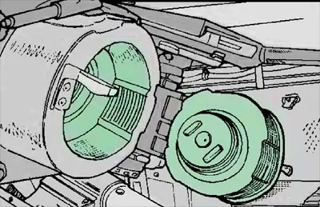

<figure class="eoc-pic eoc-pic-main"><figcaption><a href="https://commons.wikimedia.org/wiki/File:Interrupted_breech_screw.jpg">Interrupted breech screw</a> by https://www.logsa.army.mil/WEB-PAGE/2000/577/577-18.pdf, Public domain, from Wikimedia Commons.</figcaption></figure>

A screw thread with alternate sections removed from both the plug and the hole, so the plug pushes straight in past the gaps and a fraction of a turn (1/4 down to 1/16) engages the remaining thread sections and locks it.

**In plain words:** A screw with stripes of thread cut away, and a hole with matching stripes cut away, so it slides straight in and then locks with a small twist instead of many turns. **Proper term:** Interrupted screw (interrupted thread).

**Also called:** interrupted thread / slotted thread / segmented thread; breech lock / breech-lock closure (pressure vessels, reloading presses) and breech screw or breech plug (guns); sectional screw / dissected screw breech (19th-century names); stepped interrupted screw / Welin breech block (a version with several thread steps); de Bange type breech; hit-and-miss thread or lug closure; lug finish and lug cap / twist-off cap (glass jars with short thread segments that seal in about a quarter turn); quick-opening closure (pressure vessels); Breech Lock (brand, Lee Precision quick-change die bushings for reloading presses).

## How it works

Both the screw and its hole have their thread cut away in matching sectors, so when the threaded sectors of the screw line up with the smooth sectors of the hole it slides straight in. Turning it by one sector's width (a quarter turn with two pairs of sectors, 1/6 with three, 1/8 with four) moves the thread sections into mesh, and because the thread is still a slight spiral the turn also pulls the parts together and presses a seal. A catch, pin, [detent](../glossary.md#detent) or squeezed [O-ring](../glossary.md#o-ring) stops it turning back, and reversing the turn lines the gaps up again so it can be pulled straight out. Stepped versions put rings of thread at several diameters so more of the circumference is threaded while still needing only a small turn.

## Parts

A few parts: a plug or screw with threaded and plain sectors; a socket or ring with matching threaded and plain sectors; usually a handle or lever, an end stop, a catch, pin or O-ring that stops it turning back, and a gasket or seal. Stepped (Welin) versions have several rings of thread at different diameters.

## Everyday examples

- a twist-off lid on a jar of jam or pasta sauce (a lug cap on short thread segments)
- an old brass diving helmet that locks onto its breastplate with an eighth of a turn
- the breech of an artillery gun in a museum
- quick-change die bushings on a home ammunition-reloading press

## When to use it

When a plug, cap or door has to carry a big pulling or pressure load but must also be opened and closed quickly and often: pressure and vacuum vessel doors, tube and pipe end caps, quick-change tool holders, lids that should seal in a fraction of a turn. It carries far more load than a bayonet with a few pins, because whole sections of thread share the load, and the small screwing turn pulls a seal tight.

## When not to use it

Not for light, low-load joints where a simpler bayonet mount or snap fit is enough. Not where you need to clamp to a chosen tightness or adjust the position (use a full screw thread). Not for pressure vessels unless it has a safety interlock that stops it being opened, or pressurised, when not fully locked. If it will be shaken or vibrated, add a locking pin, catch or detent, because on its own only friction stops it turning back.

## Details

- **What it does (jobs):**
  - join and hold: holds a plug, cap, door or tool in a hole against large pulling or pressure loads
  - lock, and release by hand: slide in and give a fraction of a turn; turn back and pull out
  - seal it, or pass cables or fluid through: pulls a gasket or seal tight (gun breeches, diving helmets, pressure vessels, jar lids)
  - line parts up exactly: returns to the same position every time (quick-change reloading dies, breech-lock lens mounts)
- **Movement:** rotate+slide: slides straight in, then turns a fraction of a turn, typically 90° (two sector pairs) down to 45° (four pairs, e.g. diving helmets) or 22.5° (1/16 turn on some pressure vessel doors)
- **Directions it can move (degrees of freedom):** 0 when locked and seated. While fitting, one guided movement at a time: first a straight slide in, then a short screwing turn.
- **Special behaviour:**
  - quick-release (joins and comes apart with a fraction of a turn instead of many turns, and cannot cross-thread)
  - self-aligning or self-centring (the long threaded plug centres itself in the hole and seats at the same depth and angle every time)
  - hand-release only (many versions add a safety catch, locking pin or interlock that must be released before it can be turned back, as on diving helmets, reloading-press bushings and pressure vessels)
- **How it holds:** shape (the thread sections interlock; [form-fit](../glossary.md#form-fit--force-fit--material-bond)), plus friction or clamping (the small screwing turn squeezes a gasket or O-ring, and that friction helps stop it turning back)
- **Input and output:** not applicable
- **Power:** passive (no power needed); large gun breeches and pressure-vessel doors may be turned by a motor or hydraulics, but the lock itself needs no power
- **Load:** heavy: used for artillery breeches and pressure vessels rated from 100 to 2000 bar (KW Designed Solutions). Very strong against pulling out or internal pressure; only the threaded sectors carry load, so each one carries more than twice the load of a full thread and the sector ends concentrate stress (Platts patent). Weak against turning back, which is resisted only by friction, a detent or a lock.
- **Play and precision:** none to small when a gasket or O-ring [preloads](../glossary.md#preload) it (the Lee patent uses a squashed O-ring for friction against turning back); very repeatable seating, which is why reloading presses and early Canon FD lenses use breech locks; the plug must be lined up in angle with the gaps before it will go in, and needs little sideways [misalignment](../glossary.md#misalignment).
- **Taking it apart:** tool-free quick release: turned by hand, a handle or a lever, then pulled straight out
- **How often it can be reused:** many times: made for repeated opening (gun breeches, dies swapped in seconds, jar lids), but the thread sections wear, and load sharing between them depends on machining quality and wear (Kezar Engineering)
- **Sealing:** airtight or pressure: the thread itself doesn't seal, but the small turn pulls the parts together onto a gasket, pad or obturator, giving a gas-tight gun breech, a watertight diving helmet (leather gasket) or a pressure vessel door (O-rings or spring seals)
- **Adjustable:** no: the seated depth and angle are fixed by the thread sections; in quick-change die bushings the tool's own height is set on a separate ordinary thread and kept each time it is swapped
- **Access needed:** end of a tube or shaft: it closes the end of a bore, barrel, tube, jar neck or vessel from one side
- **Materials:** Steel (gun breeches, pressure vessel closures, press bushings), brass and bronze (diving helmets), glass jars with steel or tinplate lug caps, and plastics for moulded and printed versions (PETG, ABS, nylon for printing).
- **Heat, cold, water and wear:** Metal versions handle heat and high pressure (KW Designed Solutions lists -50 °C to +300 °C and up to 2000 bar for its vessels). Printed PLA softens above about 60 °C and PETG should stay below about 80 °C (Prusa). Plastic threads [creep](../glossary.md#creep) and relax over time under steady load or temperature swings, especially where plastic meets metal (DuPont design guide, p. 12). Grit or dried contents in the threads stop it turning smoothly. Vibration can turn it back unless it is locked.

## Making it

- **Ways to make or get it:**
  - 3D print (FDM): large, coarse threads with sectors removed, e.g. jar lids, tube couplings, tool holders
  - 3D print (resin): smaller interrupted threads with finer detail
  - CNC: turn the full thread on a lathe, then mill away the plain sectors on a mill with a rotary table or on a CNC machine
  - off-the-shelf part: lug caps and lug-finish jars, quick-change die bushings for reloading presses, pressure-vessel breech-lock closures
- **Printing it in one piece (print in place):** no: the plug and socket are printed separately and slid together ⚑ [uncertain: no [print-in-place](../glossary.md#print-in-place) interrupted thread was found]
- **Tools:** none to use (a handle or lever on big ones). Making: a lathe to cut the thread and a mill, rotary table or CNC to cut away the sectors; or a 3D printer for plastic versions.
- **Difficulty:** moderate: easy to 3D print once you can model a thread (make a normal thread and cut away sectors), but hard to machine in metal, because the sectors must be milled away after threading and every sector end needs cleaning up

### 3D printing tips

Model a normal coarse thread first (the BOSL2 OpenSCAD library's threaded_rod and threaded_nut work well), then cut away equal sectors from both parts: with n threaded sectors on each part the lock needs 1/(2n) of a turn (2 sectors, 1/4 turn; 3 sectors, 1/6 turn; 4 sectors, 1/8 turn). Cut the plain sectors down to the thread root or slightly below it, and make the gaps a few degrees wider than the threaded sectors so they slide past each other ⚑ [uncertain: machinists' advice and own reasoning, no printed-part numbers found]. Every sector end is a new thread start, so trim thin partial thread wedges (BOSL2's 'blunt start' or Higbee cut) because partial threads are weak and break easily; DuPont also recommends ending moulded threads at least 0.78 mm from the end to reduce [fretting](../glossary.md#galling--fretting) and cross-threading. Use big threads: M6 or larger, a rounded (semi-circular) or trapezoidal profile, and about 0.1 mm offset for resin (Formlabs); allow more [clearance](../glossary.md#clearance) for FDM (Formlabs suggests about 0.5 mm for FDM interlocking joints). Print with the thread axis vertical so the thread comes out round and the sectors don't need supports ⚑ [uncertain]. Add a solid end stop at the end of the turn and something to stop it turning back: an O-ring or gasket that is squeezed as it tightens (as in the Lee breech-lock patent), a small detent bump, or a locking pin. Use PETG, ABS or nylon; PLA is [brittle](../glossary.md#brittle--ductile), softens above about 60 °C and creeps under constant load.

### Buying one (off-the-shelf parts)

Lug caps (twist-off caps) and lug-finish glass jars; continuous-thread (CT) caps for comparison; quick-change breech-lock die bushings and presses for ammunition reloading (Lee Breech Lock is a brand); breech-lock (quick-opening) closures and pressure vessels; breech-lock lens adapters for old Canon FD lenses. Search terms: 'interrupted thread', 'breech lock closure', 'quick opening closure', 'lug cap', 'lug finish'.

## Rules of thumb

- Turn needed = sector width: two 90° sectors need 1/4 turn, three 60° sectors 1/6 turn, four 45° sectors 1/8 turn (typical of diving helmets) (Wikipedia, https://en.wikipedia.org/wiki/Interrupted_screw).
- A simple interrupted screw threads only half its circumference; Welin's stepped screw threads a fraction steps/(1 + steps) of it, about 75% with three steps, while still locking in less than 90° (Wikipedia, https://en.wikipedia.org/wiki/Welin_breech_block).
- All interrupted lug and thread types more than double the load per length of thread compared with a full thread, and the abrupt load changes at each sector end cause [stress concentrations](../glossary.md#stress-concentration) and local deformation (Platts, US patent 4102474A, https://patents.google.com/patent/US4102474A/en).
- Quick-change die bushing: three interrupted thread sections lock with about a 60° turn, and a compressed O-ring adds friction against turning back (Lee, US patent 8234963, https://patents.google.com/patent/US8234963).
- Standard diving helmets fit the breastplate with a 1/8-turn interrupted thread onto a leather gasket, plus a safety lock at the back so it can't turn back underwater (Wikipedia, https://en.wikipedia.org/wiki/Standard_diving_dress).
- Breech-lock pressure vessel closures open or close with a 1/8 to 1/16 turn and have an integral safety interlock (KW Designed Solutions, https://www.kwdesign.co.uk/products/pressure-vessel-closures/breech-lock-closure-vessels/); the design must stop the vessel being pressurised when only partly turned and should include rotation stops and locking confirmation (Kezar Engineering, https://kezareng.com/articles/pressure-vessel-quick-opening).
- Lug caps on jars seal in about a quarter turn, where a continuous-thread cap needs about one and a half turns (Container & Packaging, https://www.containerandpackaging.com/resources/the-multithreaded-world-of-container-finishes/).
- Printed threads: M6 or larger, semi-circular profile, about 0.1 mm offset (Formlabs, https://formlabs.com/blog/adding-screw-threads-3d-printed-parts/); end threads at least 0.78 mm from the end (DuPont design guide, p. 11, https://www.distrupol.com/General_Design_Principles_for_Engineering_Polymers.pdf).

## Common failures

(1) Not turned all the way, so only part of each thread section is engaged: add a positive end stop and a lock that only engages when fully turned. (2) Sector ends crack or wear because the load changes sharply there: round or trim the ends and use tough material. (3) Thin partial threads at the sector ends snap off on printed parts: use blunt-start ends. (4) Turns back under vibration: add a catch, locking pin, detent or O-ring friction. (5) Won't slide in because the gaps are too narrow or the threads too tight: widen the plain sectors a few degrees and check the clearance. (6) Worn thread sections or seals give play and poor sealing: inspect and replace.

## Safety

Pressure vessels, autoclaves and pressure cookers with quick-opening doors are dangerous if opened, or left not fully locked, while under pressure: doors have been blown off and operators killed; the door must only unlock once the pressure has been released (National Board of Boiler and Pressure Vessel Inspectors article). Keep hands clear of the gap when swinging and turning heavy doors. For a printed pressure or vacuum container, stay at very low pressures and fit a proper relief valve ⚑ [uncertain: general caution, no printed-part source].

## Related

- Bayonet mount (push-and-twist lock): a few pins in L-slots instead of thread sections; simpler and quicker but carries far less load
- Ordinary screw thread: full contact all round and adjustable tightness, but needs many turns and can cross-thread
- Half nut (split nut, quick-action nut): the nut opens away from the thread instead, so the part slides freely and then engages anywhere along the thread
- Breech-lock ring lens mount (early Canon FD): a separate collar is turned to lock the lens, so the lens itself doesn't rotate and the mating faces don't wear
- Quarter-turn fastener (Dzus-type): a small stud with a spiral slot for flat panels rather than a large threaded plug
- Continuous-thread (CT) cap versus lug cap: the everyday comparison of a full thread and an interrupted one
- Rotating bolt with locking lugs (bolt-action rifles): lugs that turn into recesses, a close cousin ⚑ [uncertain: not checked on an opened page]

## Make it yourself

- [BOSL2 threading.scad (OpenSCAD library)](https://raw.githubusercontent.com/BelfrySCAD/BOSL2/master/threading.scad): Parametric threaded rods and nuts with blunt-start (Higbee) thread ends; model a coarse thread and subtract matching sectors from rod and nut to make an interrupted thread (the sector cutting is our suggestion, not a built-in feature) *(licence: BSD 2-Clause)*
- [Spooler Hub with a quick thread design by Daniel Frechette (Printables 838562; details read via the Printables public API) (URL from Printables API, page not opened)](https://www.printables.com/model/838562-spooler-hub-with-a-quick-thread-design): Filament spool hub whose threads were modified so one hub slides into place quickly and then threads on; includes a FreeCAD model ⚑ [uncertain whether it is a true interrupted thread] *(licence: CC BY-NC-SA)*
- [How to CAD Model a Welin Interrupted Screw? (Model Engineer & Workshop forum, 2019)](https://www.model-engineer.co.uk/forums/topic/how-to-cad-model-a-welin-interrupted-screw/): Forum walk-through of ways to model a stepped interrupted screw in Fusion 360 (sweeping each thread segment and patterning, or stepping cylinders), plus notes on how the real ones were machined *(licence: link only)*

## Pictures, videos and models

- [Interrupted screw of M109A6 self-propelled howitzer (Wikimedia Commons video, William Espinosa, US National Guard, 2025)](https://commons.wikimedia.org/wiki/File:Interrupted_screw_of_M109A6_self-propelled_howitzer.webm): 14-second video of a real howitzer breech plug swinging in and turning to lock *(licence: Public domain (US government work))*
- [Figure414 Interrupted-screw breech block (Wikimedia Commons, from US Army TM 9-3305, 1981)](https://commons.wikimedia.org/wiki/File:Figure414_Interrupted-screw_breech_block.png): Technical drawing of an interrupted-screw breech block with its threaded and plain sectors *(licence: Public domain (US government work))*
- [Interrupted breech screw (Wikimedia Commons, from a US Army technical manual)](https://commons.wikimedia.org/wiki/File:Interrupted_breech_screw.jpg): Picture of an interrupted-screw breech plug *(licence: Public domain (US government work))*
- [Breech 122m10 Hämeenlinna (Wikimedia Commons, Balcer, 2006)](https://commons.wikimedia.org/wiki/File:Breech_122m10_hameenlinna_2.jpg): Photo of a howitzer barrel and modified breech (Russian 122 mm M1910) set up as a museum demonstration piece; used on Wikipedia to illustrate the interrupted screw *(licence: CC BY 2.5, CC BY-SA 3.0 or GFDL 1.2+ (reuse with credit))*
- [INTERRUPTED SCREW BREECH MECHANICS (Dynamic Automation, YouTube short; title confirmed via YouTube oEmbed)](https://www.youtube.com/watch?v=KGB7GiCBG9w): Short video (YouTube Short) on how an interrupted-screw breech works ⚑ [uncertain: title confirmed, video not watched] *(licence: link only)*

## Needs confirming

⚑ marks something nobody has confirmed yet: a fact the research could not confirm from a source, a finder value that is a best guess, or an open point from the research notes. Corrections are welcome (see `research/needs-confirming.md`).

- ⚑ 7 sentences on this page marked [uncertain].

## Sources

- <https://en.wikipedia.org/wiki/Interrupted_screw>
- <https://en.wikipedia.org/wiki/Welin_breech_block>
- <https://en.wikipedia.org/wiki/Standard_diving_dress>
- <https://en.wikipedia.org/wiki/Breech-lock>
- <https://en.wikipedia.org/wiki/Canon_FD_lens_mount>
- <https://patents.google.com/patent/US4102474A/en>
- <https://patents.google.com/patent/US8234963>
- <https://www.kwdesign.co.uk/products/pressure-vessel-closures/breech-lock-closure-vessels/>
- <https://kezareng.com/articles/pressure-vessel-quick-opening>
- <https://www.nationalboard.org/index.aspx?pageID=164&ID=183>
- <https://www.containerandpackaging.com/resources/the-multithreaded-world-of-container-finishes/>
- <https://www.hobby-machinist.com/threads/how-to-machine-interrupted-thread.119806/>
- <https://www.model-engineer.co.uk/forums/topic/how-to-cad-model-a-welin-interrupted-screw/>
- <https://formlabs.com/blog/adding-screw-threads-3d-printed-parts/>
- <https://formlabs.com/blog/how-to-3d-print-interlocking-joints/>
- <https://www.distrupol.com/General_Design_Principles_for_Engineering_Polymers.pdf (DuPont design guide, pp. 11-12)>
- <https://raw.githubusercontent.com/BelfrySCAD/BOSL2/master/threading.scad>
- <https://help.prusa3d.com/article/pla_2062>
- <https://help.prusa3d.com/article/petg_2059>
- <https://commons.wikimedia.org/wiki/Category:Interrupted_screw_breeches>
- <https://commons.wikimedia.org/wiki/File:Interrupted_screw_of_M109A6_self-propelled_howitzer.webm>
- <https://commons.wikimedia.org/wiki/File:Figure414_Interrupted-screw_breech_block.png>
- <https://commons.wikimedia.org/wiki/File:Interrupted_breech_screw.jpg>
- <https://commons.wikimedia.org/wiki/File:Breech_122m10_hameenlinna_2.jpg>
- <https://www.youtube.com/watch?v=KGB7GiCBG9w (verified via YouTube oEmbed)>
- <https://www.printables.com/model/838562-spooler-hub-with-a-quick-thread-design (read via https://api.printables.com/graphql/)>
- <https://api.printables.com/graphql/>
