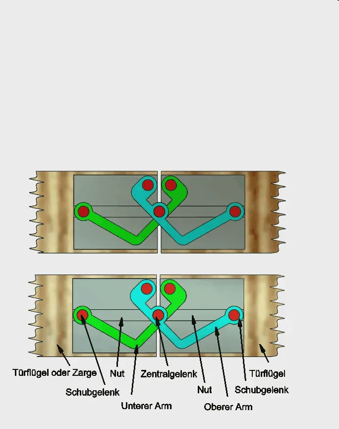
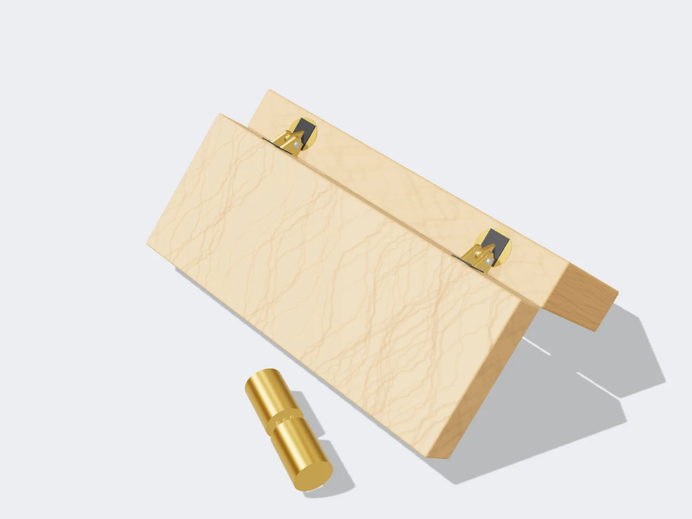

<figure class="eoc-pic eoc-pic-main"><picture><source media="(prefers-reduced-motion: reduce)" srcset="../media/invisible-barrel-hinge.still.webp"></picture><figcaption><strong>Animation.</strong> <a href="https://commons.wikimedia.org/wiki/File:Scharnier_11.gif">Scharnier 11</a> by Manfredgoellner, <a href="https://creativecommons.org/licenses/by-sa/4.0">CC BY-SA 4.0</a>, from Wikimedia Commons.</figcaption></figure>
<figure class="eoc-pic"><figcaption><strong>Render.</strong> A 3D model made for the encyclopaedia, not a photo: a stand-in until a good real photo is found. ⚑ Needs confirming: a model can simplify or get details wrong; a real photo is welcome.</figcaption></figure>

A hinge made of two metal bodies sunk into matching pockets in the door edge and the frame, joined by folding links, so that when the door is shut nothing at all shows on either side and when it opens it swings a full 180°.

**In plain words:** A hinge that disappears completely when the door is shut: its two halves sit in deep slots cut into the edge of the door and the edge of the frame, and a stack of folding metal links between them unfolds as the door opens. **Proper term:** Invisible hinge (Soss-type concealed hinge, crossed-link hinge); drilled cylindrical version: invisible barrel hinge.

**Also called:** Soss hinge (after SOSS (brand), the original maker, from 1903); invisible hinge / concealed invisible hinge / hidden hinge; cross hinge (translation of German 'Kreuzscharnier'); link hinge or crossed-link hinge ⚑ [uncertain] (as a trade term); hidden door hinge / secret door hinge / bookcase door hinge (maker and trade wording); invisible barrel hinge / concealed barrel hinge / barrel hinge (the small cylindrical, drilled-in version for boxes and lids); wrap-around invisible hinge (SOSS 500 series (brand), stops at 92°, for hidden doors); invisible closer hinge (spring-closing version, SOSS (brand)); Hercules hinge (SOSS (brand) heavy-duty steel version).

## How it works

Each half of the hinge is a metal body that fits into a deep pocket cut into the door edge and the frame edge, so both halves face each other when the door is shut (SOSS catalogue). Between them, two pairs of flat links cross like an X and are pinned together in the middle; one end of each pair pivots on a pin in one body, and the other end carries a pin that slides along slots in the other body (US 4,875,252). As the door closes, the links fold together into the pockets of the two bodies, so nothing is visible from either side; as it opens, they unfold out of the pockets and the door can swing to 180° (US 4,875,252; SOSS FAQ). The door turns about a pivot point that moves inside the hinge during the swing rather than about a fixed pin, which also means there is no pinch point on the hinge side of the door (SOSS catalogue; Hardware Source).

## Parts

A small assembly that acts as one unit: two hinge bodies (each sunk into a stepped pocket, or mortise), two pairs of flat, roughly triangular links stacked alternately and joined in the middle by a pivot pin, two end pivot pins that hold one end of each link pair to a body, and two guide pins that slide in slots in the bodies, plus wood or machine screws (US patent 4,875,252). German references describe it as a five-joint hinge with two sliding joints, usually two stacked pairs of arms made of stacked stampings (German Wikipedia 'Scharnier', Kreuzscharnier). The drilled 'invisible barrel hinge' is simpler: two metal cylinders pushed into drilled holes, joined by brass links, with screws that expand the cylinders to lock them in (SOSS barrel hinge page; Family Handyman).

## Everyday examples

- Hidden 'secret' doors behind bookcases or wall panels (SOSS catalogue)
- Jewellery boxes and small wooden boxes with lids that show no hinge (SOSS catalogue; Family Handyman)
- Flush floor and wall access panels, and fold-down tray tables on trains (SOSS catalogue)
- Flush interior doors in modern or high-end buildings, e.g. Frank Lloyd Wright's Fallingwater (SOSS catalogue)

## When to use it

Use it when no hinge may show from either side: flush 'invisible' doors, secret doors, flush access panels, fine boxes and lids, fold-out table leaves and desks, and cabinet doors in solid wood. It opens a full 180° so a lid or leaf can fold right back (SOSS FAQ PDF), it can't be tampered with or unpinned from outside (SOSS catalogue), and it has no external pinch point on the hinge side (Hardware Source). Printed versions suit printed boxes and enclosure doors where a visible knuckle would spoil the look.

## When not to use it

Avoid it on thin doors and lids (below the minimum thickness, e.g. under 1/2 in for the smallest; SOSS catalogue), on hollow-core doors (Reeb), and where you can't cut accurate mortises or may need to adjust the door later (no adjustment: use clip-on cup hinges, which have three-way adjustment, or ordinary butt hinges which can be shimmed). For heavy doors, don't use the small drilled barrel hinges, which are not for load-bearing or vertical use (SOSS; Family Handyman). Where a thick facing or mirror is added to the door front, check the 'E' dimension or choose a wrap-around or special model (SOSS FAQ PDF). For quick, cheap, removable doors, use lift-off or cup hinges instead.

## Details

- **What it does (jobs):**
  - let it move (turn, slide or bend): a door, lid, flap or panel swings up to 180° with the hinge completely hidden when closed (SOSS FAQ)
- **Movement:** rotate, up to 180° in one direction only (SOSS FAQ); SOSS 500-series wrap-around hinges stop at 92° (SOSS catalogue p. 27). The door also shifts slightly as it swings, because the pivot moves inside the hinge.
- **Directions it can move (degrees of freedom):** 1: the door can only swing; the links and sliding pins make the swing and the small shift of the pivot happen together
- **Special behaviour:**
  - none: the standard hinge just swings. Variants add behaviour: the SOSS Invisible Closer is a spring hinge with an adjustable spring that swings the door shut (but does not cushion it), and SOSS makes power-transfer versions that carry wires (SOSS FAQ PDF)
- **How it holds:**
  - not a holding joint (it moves or passes on motion): it lets the door swing
  - shape (the parts interlock; [form-fit](../glossary.md#form-fit--force-fit--material-bond)): each body sits in a deep, full mortise that helps the screws carry the door, giving a stiffer installation (Hardware Source); the drilled barrel version is locked in its hole by expanding the cylinder with a screw (Family Handyman)
- **Input and output:** not applicable
- **Power:** passive (no power needed)
- **Load:** light to heavy depending on size: tiny models suit jewellery boxes, large ones full-size entrance doors (SOSS catalogue). SOSS gives no load rating per hinge; the number and size of hinges come from the door's width, weight and thickness, e.g. a wood door 30 in wide, 200 lb and 1-3/4 in thick needs four #218 hinges (SOSS FAQ; catalogue p. 45). Heavy-duty steel 'Hercules' versions halve the count: a 150 lb, 80 x 36 x 1-3/4 in door needs four #218 or two #218H (catalogue p. 29). The drilled barrel type is 'not recommended for vertical or load bearing applications', i.e. use it for lids and fold-down flaps rather than hanging doors (SOSS barrel hinge page; Family Handyman).
- **Play and precision:** small play when well made (the door's weight rests on a stack of interlocking steel plates; SOSS adjustment guide), but the installation tolerates almost no error: the door edge passes within about 1/64 in (0.4 mm) of the frame as it opens (SOSS catalogue p. 39), so mortises must be accurately placed and the right depth. Material added to the door face beyond the hinge's 'E' dimension makes the door bind, or open only 90° (SOSS FAQ PDF).
- **Taking it apart:** removable: screwed into the door edge and jamb (SOSS instructions), but the screws are only reachable with the door open, and the riveted hinge pin can't be removed, so the door can't be lifted off the hinges (SOSS catalogue)
- **How often it can be reused:** many times as a hinge (long-lived: SOSS says the hinges never need adjusting and cites century-old installations; SOSS adjustment guide), but only a few times for removal and refitting, because screws re-driven into the same holes in wood lose grip ⚑ [uncertain]
- **Sealing:** none
- **Adjustable:** no: SOSS invisible hinges have no adjustment (SOSS adjustment guide: 'don't have pins and never need adjusting'); fit is set entirely by how accurately the mortises are cut. Drilled barrel hinges likewise have 'no opportunity to adjust the hinges for fit' (Family Handyman). Only the spring-closer version has an adjusting screw (for spring tension) (SOSS FAQ PDF).
- **Access needed:** one side only (blind): everything is fitted from the door edge and the face of the frame; no access to the back of the frame is needed, but the screws can only be reached with the door open
- **Materials:** SOSS invisible hinges: die-cast metal bodies with stacked steel links (SOSS adjustment guide; SOSS catalogue on die-casting) ⚑ [uncertain] (which alloy); Hercules versions have solid alloy-steel links and bodies (catalogue p. 29); invisible barrel hinges are solid brass with brass links (SOSS barrel hinge page). They suit solid wood, stave-core and solid-core doors and metal doors (SOSS FAQ PDF; steel door brackets are sold); hollow-core doors are not recommended (Reeb). Printed versions: PETG, ASA or carbon-fibre PC links with 3 mm steel pins (Printables, Michal Fanta).
- **Heat, cold, water and wear:** Standard SOSS hinges are made for doors indoors; exterior and marine use needs care over corrosion (SOSS's FAQ gives this caution for its latch; finishes include satin stainless steel and chrome) ⚑ [uncertain] (for hinges). Fire-rated versions are rated 20 to 180 minutes for doors 1-3/8 in to 2 in thick (SOSS FAQ PDF). Wood swelling and shrinking with humidity can make a tightly fitted door bind because the gap at the hinge side is tiny (about 1/64 in near closing; SOSS catalogue) ⚑ [uncertain] (as a failure cause). Printed hinges: PLA [creeps](../glossary.md#creep) and softens when warm; use PETG or ASA (Michal Fanta recommends PETG, ASA or PCCF).

## Making it

- **Ways to make or get it:**
  - off-the-shelf part: SOSS and many generic invisible hinges and barrel hinges
  - woodwork: stepped mortises cut with a router and template, or drilled and chiselled by hand (SOSS instructions; Rockler)
  - CNC: mortises can be routed on a CNC router ⚑ [uncertain]
  - sheet metal: SOSS sells steel brackets for fitting the hinges to metal doors and small models for metal cabinets (SOSS FAQ PDF)
  - 3D print (FDM): printed Soss-style link hinges with steel pins, and printed router templates for cutting the mortises
- **Printing it in one piece (print in place):** no: printed Soss-style hinges are printed as separate links and bodies and assembled with steel pins (Michal Fanta's '180° Stealth Concealed Hinge') or fitted together from zero-tolerance parts (BPengu's '180° Concealed Barrel Hinge') (Printables).
- **Tools:** Router with a guide bushing and a hinge router template, extra-long router bits and a drill (SOSS instructions), or by hand with a drill, Forstner bits and a chisel (Rockler video with Michael Alm); screwdriver to fit. The drilled barrel type needs a drill with an exact metric bit and a small screwdriver to expand the barrels (Family Handyman).
- **Difficulty:** moderate to hard: buying the hinge is easy, but the stepped mortises must be cut very accurately (router with a template, or careful drilling and chiselling) and there is no adjustment to correct mistakes; printed versions are moderate if you can ream pin holes accurately

### 3D printing tips

1) Use metal pins, not printed ones: Michal Fanta's '180° Stealth Concealed Hinge' (Printables, very popular) uses 3 mm steel dowel pins (one 14.4 mm, two 18 mm, two 40-58 mm long), and the holes must be reamed to exactly 3 mm. It can be scaled down 33.3% for 2 mm pins or 66.7% for 1 mm pins, at the cost of [stiffness](../glossary.md#stiffness). 2) Material and settings from the same designer: PETG, ASA or carbon-fibre-filled PC; 3-4 wall loops (walls matter more than [infill](../glossary.md#infill) around pin holes); 20% or more infill; no supports needed. His simpler 'Concealed Hinge for Folding Table Tops' recommends PETG (PLA only for light duty), 0.2 mm layers, 4+ [perimeters](../glossary.md#perimeters), 30-50% infill, printing flat as oriented, and hole compensation or reaming if holes print tight (Printables). 3) Leave a small gap between the two panels so they don't rub as they rotate, and use several hinges spaced out for bigger panels (Michal Fanta, Printables). 4) BPengu's '180° Concealed Barrel Hinge' is modelled with zero [tolerance](../glossary.md#tolerance), so expect to sand or deburr to fit, print in PETG with at least 20% infill, and lubricate once assembled (Printables). For your own designs, start with at least 0.3 mm [clearance](../glossary.md#clearance) between moving printed parts (Prusa). 5) Print the pocket into the printed part: model a pocket to house each hinge body and fix it with screws (Fanta's simple version uses 4 mounting screws). Printed pockets avoid the hardest part of the woodworking job, the accurate stepped mortise. 6) For real SOSS hinges in wood, print a router template: Zdeněk's set on Printables covers every standard SOSS size, with depth gauges for the shallow (leaf) and deep (barrel) cuts, for a 17 mm bushing and 8 mm bit or a 16 mm bushing and 8 mm bit; he prints it in PLA because it bends less than PETG. 7) Remember the links carry the whole door or lid in bending and [shear](../glossary.md#peel-vs-shear) at the pins; printed hinges are for boxes, lids, enclosure doors and light panels, not room doors ⚑ [uncertain].

### Buying one (off-the-shelf parts)

Search for: 'invisible hinge', 'Soss hinge' (SOSS (brand) model numbers such as #101, #203, #204, #208, #212, #216, #218, #220), 'concealed invisible hinge', 'hidden door hinge', 'secret door hinge', 'wrap-around invisible hinge' (hides the reveal line of a secret door), 'invisible closer hinge' (spring closing), 'fire-rated invisible hinge' (20-180 minutes), 'power transfer hinge' (carries wires), 'Hercules hinge' (heavy duty); for boxes: 'invisible barrel hinge' or 'barrel hinge' in metric sizes (e.g. SOSS BH085 to BH244, 8 to 24 mm diameter), 'mini barrel hinge'. Tools: 'SOSS router guide template' (e.g. 204IT, 218IT), 'router guide system', 'template guide bushing', long 3/8 in or 1/2 in router bits (SOSS catalogue; SOSS instructions; SOSS FAQ PDF). Printed alternatives use 'steel dowel pin' or 'cylindrical pin' 3 mm.

## Rules of thumb

- Pick by door thickness first: each hinge has a minimum material thickness, e.g. #101: 1/2 in (12.7 mm); #203 and #204: 3/4 in (19 mm); #208: 1 in (25.4 mm); #212: 1-1/8 in; #216: 1-3/8 in; #218: 1-3/4 in; #220: 2 in (SOSS 2024 catalogue pp. 33-34; SOSS FAQ PDF).
- Use the largest hinge model that the door thickness allows, and at least one hinge for every 30 in (762 mm) of door height: a 90 in door needs three, a 91 in door four; heavier or wider doors need more per the sizing chart (SOSS catalogue p. 45).
- There is no load rating per hinge: size from width, weight and thickness, e.g. a wood door 30 in wide, 200 lb, 1-3/4 in thick takes four #218 (SOSS FAQ PDF; catalogue p. 45).
- Hinge spacing: put the 'centre' hinge halfway between the middle of the door and the top hinge, and with more than four hinges put more in the upper half, because the top hinge carries extra leverage (SOSS router guide instructions).
- Mortise depths come from the maker's table, e.g. #204: 3/8 in starter hole 27/32 in deep, shallow mortise 1/4 in, deep mortise 25/32 in; #218: shallow 13/32 in, deep 1-21/32 in (SOSS router guide instructions, tables A-C). With a template, 'the only critical dimension is the depth of the shallow mortise' (SOSS catalogue p. 42).
- The mortise is not centred in the door's thickness: its thin side goes to the inside face of the door (SOSS router guide instructions).
- Don't add facing material (laminate, mirror, trim) beyond the hinge's 'E' dimension, or the door will not open, or only to 90° (SOSS FAQ PDF; catalogue p. 39).
- Don't mix SOSS hinges with other hinge types, or the spring closer with non-SOSS hinges, on one door, because their swing radius differs (SOSS FAQ PDF).
- Drilled barrel hinges: drill an exact metric hole to match the barrel, e.g. 14 mm barrel for a 3/4 in door, and use them for lids and flaps, not load-bearing or vertically hung doors (SOSS barrel hinge page; Family Handyman).
- Practise on scrap of the same wood before routing the real door (SOSS router guide instructions).

## Common failures

Door binds or won't close because a mortise is too deep, too shallow or out of position (the hinge body must sit flush: 'If the hinge body extends above the jamb ... verify that the mortises have been routed to the proper depths'; SOSS router guide instructions). Door won't open fully after a laminate, mirror or trim is added to its face (exceeds the 'E' dimension; SOSS FAQ PDF). Too few or too small hinges for the door, so they wear and the door drops; follow the sizing chart and use the largest model the door allows (SOSS catalogue). Screws pull out of hollow-core doors (Reeb: not recommended). Drilled barrel hinges fail when used as load-bearing door hinges, or bind when holes are drilled to the wrong depth, since nothing can be adjusted afterwards (Family Handyman). Printed hinges: loose pins or wobbly links from oversize holes (ream to size), cracking at pin holes (use 3-4 walls), stiffness from zero-tolerance parts (sand and lubricate) (Printables designers).

## Safety

No pinch point on the hinge side, because the pivot stays inside the hinge (SOSS catalogue), but the leading edge of the door still pinches like any door. Large invisible hinges on heavy doors: routing deep mortises needs eye protection and SOSS recommends 1/2 in shank router bits unless using its specified bits (SOSS router guide instructions). Printed hinges on heavy panels can snap at the pin holes and drop the panel ⚑ [uncertain].

## Related

- Clip-on concealed hinge (cup hinge): hidden behind the door instead of in its edge; adjustable in three directions and removable without tools, but usually opens 105-120° and needs a 35 mm pocket in the back face
- Knuckle hinge (butt hinge): the ordinary visible hinge; easy to fit and shim, but the knuckle shows and it can be unpinned
- [Print-in-place](../glossary.md#print-in-place) hinge: printed ready-assembled; simpler but visible
- [Living hinge](../glossary.md#living-hinge): a thin bendy strip; invisible-looking on boxes but only in plastic and with limited life
- Geared hinge (continuous gear hinge): a heavy-duty full-length hinge, visible along the edge
- Virtual-pivot [linkage](../glossary.md#linkage) (remote centre of motion): the general idea of a door turning about a pivot that moves or lies outside the hardware
- Concealed four-bar door hinges (German 'verdecktes Viergelenkscharnier'): another hidden hinge for flush doors, built as a four-bar linkage (German Wikipedia 'Scharnier')
- Self-closing hinges: add a spring; the SOSS Invisible Closer is the spring version of this type

## Make it yourself

- [180° Stealth Concealed Hinge (Michal Fanta, Printables) (page appeared in search results; details read through the Printables public API)](https://www.printables.com/model/1533729-180deg-stealth-concealed-hinge): A printed Soss-style link hinge that hides inside the material and opens 180°; four printed arms and two bodies, assembled with 3 mm steel pins; support-free *(licence: CC BY-NC)*
- [Simple Concealed Hinge for Folding Table Tops / Panels (Low-Profile) (Michal Fanta, Printables) (URL from Printables API, page not opened)](https://www.printables.com/model/1558489-simple-concealed-hinge-for-folding-table-tops-pane): A simpler printed concealed hinge that sits in a pocket for folding table leaves, desks and lids; two 3 mm x 30 mm pins and four screws. Read through the Printables public API. *(licence: CC BY-NC)*
- [180° Concealed Barrel Hinge (BPengu, Printables) (page appeared in search results; details read through the Printables public API)](https://www.printables.com/model/198679-180deg-concealed-barrel-hinge): Printed hidden barrel hinges, invisible from either side when closed, 180° range, scalable; zero-tolerance parts that need sanding and lubrication *(licence: CC BY)*
- [Stronger_180° Stealth Concealed Hinge (Андрей Никитин, Printables) (URL from Printables API, page not opened)](https://www.printables.com/model/1556151-stronger_180deg-stealth-concealed-hinge): A remix with doubled working parts and built-in support, assembled with 3 mm wire trimmed to length. Read through the Printables public API. *(licence: CC BY-NC)*
- [SOSS Hidden Hinge Mortise Router Template – All sizes! (Zdeněk, Printables) (page appeared in search results; details read through the Printables public API)](https://www.printables.com/model/1341292-soss-hidden-hinge-mortise-router-template-all-size): Printed router jigs with depth gauges for every standard SOSS hinge size, for 17 mm or 16 mm guide bushings and an 8 mm bit *(licence: CC BY)*

## Pictures, videos and models

- [Scharnier 11.gif: 'Funktionsprinzip eines Kreuzscharniers' (Manfredgoellner, Wikimedia Commons)](https://commons.wikimedia.org/wiki/File:Scharnier_11.gif): Animation of how a cross hinge (Soss-type) works: two crossing arms with sliding pins fold into the door and frame *(licence: CC BY-SA 4.0)*
- [SOSS Door Hardware 2024 catalogue (PDF hosted by a distributor)](https://static.charlesmcmurray.com/publications/vendor/PDF/2024%20SOSS%20Catalog.pdf): Photos of invisible hinges open and closed, dimension drawings, sizing charts, installed examples in secret doors and access panels, and door path and clearance diagrams *(licence: link only)*
- [Instructions for Prepping an Opening for SOSS Invisible Hinges (SOSS)](https://www.soss.com/wp-content/uploads/2015/01/Router-Guide-Installation-Instructions-2015.pdf): Figures of the router guide template on door and jamb, hinge spacing on the door, and tables of drill sizes and mortise depths *(licence: link only)*
- [US 4,875,252 'Self-closing invisible hinge with selectively variable closing force' (USPTO)](https://image-ppubs.uspto.gov/dirsearch-public/print/downloadPdf/4875252): Patent drawings and description of a Soss-type hinge: two hinge bodies, interleaved triangular links on a central pivot pin, and guide pins sliding in slots *(licence: link only (US patent drawings are generally public domain) ⚑ [uncertain])*
- [Installing INVISIBLE HINGES with Hand Tools | SOSS (YouTube, Michael Alm (ALM FAB))](https://www.youtube.com/watch?v=kua6rANnTYo): Fitting SOSS hinges with a drill, Forstner bits and chisel (title confirmed via YouTube oEmbed; steps summarised on Rockler's page for the same video) *(licence: link only (standard YouTube licence))*

## Needs confirming

⚑ marks something nobody has confirmed yet: a fact the research could not confirm from a source, a finder value that is a best guess, or an open point from the research notes. Corrections are welcome (see `research/needs-confirming.md`).

- ⚑ 9 sentences on this page marked [uncertain].
- ⚑ Finder value `connects` = lid, door or cover (best guess): worked out from its name, but joining parts is not one of its two main jobs

## Sources

- <https://www.soss.com/product/barrel-hinge/>
- <https://www.soss.com/invisible-hinge-product-overview/>
- <https://www.soss.com/the-joseph-soss-story/>
- <https://static.charlesmcmurray.com/publications/vendor/PDF/2024%20SOSS%20Catalog.pdf>
- <https://www.soss.com/wp-content/uploads/2015/01/Router-Guide-Installation-Instructions-2015.pdf>
- <https://www.soss.com/wp-content/uploads/2018/05/SOSS_Invisible_Hinges_FAQ.pdf>
- <https://www.soss.com/faqs/>
- <https://www.soss.com/guide-how-to-adjust-door-hinges/>
- <https://learn.reeb.com/knowledge-base/soss-hinges/>
- <https://www.hardwaresource.com/a/blog/post/all-about-soss-invisible-hinges>
- <https://www.rockler.com/learn/video-installing-soss-hinges>
- <https://www.familyhandyman.com/article/everything-to-know-about-barrel-hinges/>
- <https://image-ppubs.uspto.gov/dirsearch-public/print/downloadPdf/4875252>
- <https://de.wikipedia.org/wiki/Scharnier>
- <https://commons.wikimedia.org/wiki/File:Scharnier_11.gif>
- <https://commons.wikimedia.org/wiki/File:Scharnier_18.gif>
- <https://www.youtube.com/watch?v=kua6rANnTYo>
- <https://help.prusa3d.com/article/modeling-with-3d-printing-in-mind_164135>
- <https://api.printables.com/graphql/>
