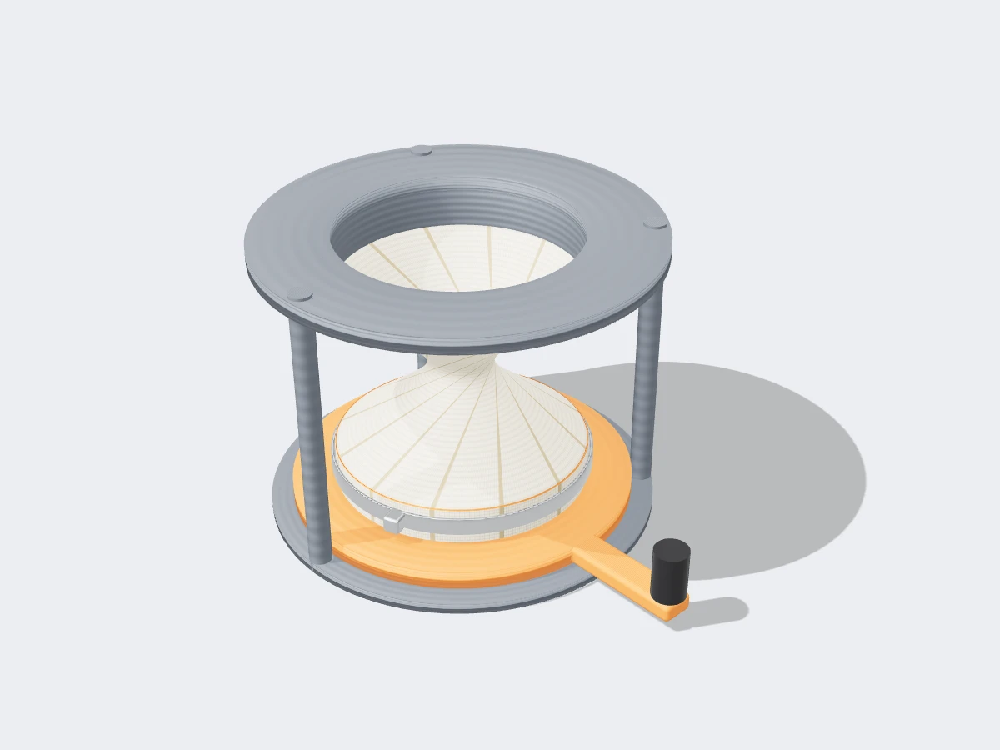

<figure class="eoc-pic eoc-pic-main"><picture><source media="(prefers-reduced-motion: reduce)" srcset="../media/drawn/iris-valve.svg"></picture><figcaption><strong>Animation.</strong> Diagram drawn for the encyclopaedia from the research notes. ⚑ Needs confirming: a drawing can simplify or get details wrong; a real photo or a better diagram is welcome.</figcaption></figure>
<figure class="eoc-pic"><figcaption><strong>Render.</strong> A 3D model made for the encyclopaedia, not a photo: a stand-in until a good real photo is found. ⚑ Needs confirming: a model can simplify or get details wrong; a real photo is welcome.</figcaption></figure>

A fabric or rubber sleeve is clamped at each end to a ring, and turning one ring by about half a turn twists the sleeve shut towards the centre, so it can meter or stop powder, grain or pellets pouring from a hopper or bag; a pinch valve does a similar job by squeezing a soft tube flat from outside.

**In plain words:** A soft tube of fabric or rubber held between two rings: turn one ring and the tube twists shut in the middle, like twisting the neck of a bag closed, so powder or grain stops pouring out. Its simpler cousin is a soft tube that you squeeze flat from outside to stop the flow (a pinch valve). **Proper term:** Iris valve (iris diaphragm valve, twisted-sleeve valve); also covers the pinch valve.

**Also called:** iris valve; iris diaphragm valve (the industry name for the fabric-sleeve type); flexible sleeve iris valve (title of a 1953 US patent); twisted-sleeve valve, twisting-sleeve valve or fabric-sleeve valve (descriptive names); fabric diaphragm valve (the sleeve is often called the diaphragm); Mucon valve (brand; a well-known maker of iris diaphragm valves); big-bag or bulk-bag discharge valve (a common use); pinch valve (a soft tube or sleeve squeezed shut from outside); air-operated or pneumatic pinch valve (compressed air around the sleeve squeezes it shut); [solenoid](../glossary.md#solenoid) pinch valve (an electric plunger pinches lab or medical tubing); mechanical or manual pinch valve (a handwheel screws a pinch bar down); pinchcock, Mohr's pinchcock or tubing clamp (spring clip that pinches lab rubber tubing); roller clamp (a wheel rolled along a ramp to squeeze a drip or aquarium tube); hose clamp or bite clamp on a drinking-bladder tube (a clip that pinches the hose; not the worm-drive band that clamps a hose onto a fitting); Quetschventil (German: pinch valve); Manschette (German: the rubber sleeve).

## How it works

One end of a tube-shaped sleeve is fixed to the valve body and the other end to a control ring. Turning the ring twists the sleeve, and its middle narrows evenly from all sides, like a bundle of strings between two rings twisted into a waisted shape (a hyperboloid); after about a 180-degree turn of the handle the fabric is wound into a flat, tight plug (Hapman; Vortex; LibreTexts). Twisting also pulls the two ends closer together, so early designs let the lower ring slide up and down, while later ones fold the sleeve back on itself so the rings can stay put (US patent 2663467; LibreTexts). A pinch valve instead presses a soft tube flat with a bar, roller, plunger or air pressure, and the rubber's springiness plus the pressure of the flow open it again when the squeeze is released (Tameson; AKO).

## Parts

A few parts. Iris valve: a fixed ring (the valve body), a turning control ring with a handle, lever or handwheel (often with notches or a trigger lock to hold set positions), the flexible sleeve, and clamp bands that grip the two ends of the sleeve (Hapman; Vortex; SolidsWiki; Mucon JS). Pinch valve: a rubber sleeve or plain soft tube, a housing or frame, and a squeezer, which can be a pinch bar on a screw and handwheel, a rolling wheel on a ramp, a solenoid plunger, a hobby servo arm, or compressed air pumped into the housing around the sleeve (Tameson; AKO; Printables models).

## Everyday examples

- Twisting the neck of a bread bag closed before fitting the tie: the same 'twist it shut' idea, done by hand (analogy)
- The clip on a hydration-bladder or water-filter hose that pinches the tube shut (a printed replacement is sold as a 'hose clamp (pinch valve)', Printables)
- The clamp on a hospital drip line that sets how fast the drops fall (Wikipedia 'Drip chamber'), and the spring pinchcock on rubber tubing in a school chemistry lab
- The original Super Soaker 50 water gun, which used a pinch valve (Wikipedia 'Pinch valve')

## When to use it

Use a twisted-sleeve iris valve to meter or shut off free-flowing dry powders, grain, pellets or flakes falling by gravity from a hopper, bin, chute or big bag, especially fragile materials that a blade would crush, and when you want the stream to pour neatly into the middle of a container; it is light, slim, cheap when hand-operated, easy to clean, and only the sleeve touches the material (Hapman; Vortex). Use a pinch valve when a liquid, slurry or gritty flow must never touch metal parts or must stay clean (food, lab, medical and aquarium tubing), when solids would jam an ordinary valve, or when you need a cheap valve that clips onto existing soft tubing (Tameson; Lee Co.; Printables).

## When not to use it

Avoid an iris valve for pressurised or vacuum lines, heavy or abrasive materials, high-volume continuous flow, closing through a column of material that is standing still, or very frequent cycling; use a slide gate, butterfly valve or rotary valve instead (Hapman; Vortex). Avoid pinch valves for hot fluids beyond the rubber's temperature limit, high pressures that can deform the sleeve, and vacuum lines unless the pressure is balanced (Tameson; AKO); use a ball or globe valve there. For a light, closable opening that doesn't need to seal, a blade iris mechanism looks better; for a one-way flow use a check (non-return) valve.

## Details

- **What it does (jobs):**
  - seal it, or pass cables or fluid through: opens, meters and shuts off a flow of powder, granules, pellets (iris valve) or liquids, slurries and air (pinch valve) through a tube or hopper outlet, with only the sleeve touching the material (Hapman; Tameson)
  - lock, and release by hand: the manual versions are set by hand and held by a trigger lock, notches or friction (Vortex; Mucon JS)
  - hold or release using power: air-operated and solenoid pinch valves and pneumatic iris valves open or close when power or air is switched (AKO; Mucon E series; Lee Co.)
- **Movement:** multiple: the control ring rotates (about 180 degrees from open to closed on typical iris valves, Hapman; less than one full turn in the 1953 patent design), while the sleeve twists and its opening shrinks in towards the centre; in a pinch valve a bar, roller or plunger slides in to flatten the tube
- **Directions it can move (degrees of freedom):** 1: the angle of the control ring (or the position of the pinch bar or roller) alone sets how open the valve is. In older designs the ring also had to move slightly along the axis as the sleeve shortened, but that movement is tied to the turn, not independent (US patent 2663467)
- **Special behaviour:**
  - self-centring: the opening closes evenly towards the centre of the flow, so material pours in a neat central cone into the container below, unlike a slide gate or butterfly valve whose blade cuts across the flow (Hapman)
  - indexing (some designs): quick-lock handles and multi-notched bodies click into a set of preset openings for repeatable flow rates (Vortex; Mucon JS)
  - [fail-safe](../glossary.md#fail-safe--fail-secure) (powered pinch valves): a standard air-operated pinch valve is pushed open by the flow and the springy sleeve when the air is released, while normally-closed versions and add-on automatic closure systems shut when air or power fails (AKO; pinch-valves.com; Mucon E series)
  - self-sealing around grit: the soft sleeve closes around trapped particles instead of jamming on them, as a ball or gate valve can (Tameson; AKO)
- **How it holds:**
  - friction or clamping ([force-fit](../glossary.md#form-fit--force-fit--material-bond)): the twisted fabric is packed tight against itself, and a pinch valve's rubber walls are pressed together, which blocks the flow
  - shape (form-fit): the twisted plug of fabric forms a flat barrier that holds back the weight of material above it (Hapman)
  - suction or air pressure: in an air-operated pinch valve, compressed air in the housing squeezes the sleeve shut (AKO)
  - friction or clamping (force-fit): the handle is held at its setting by a trigger lock, notches or a threaded locking handle (SolidsWiki; Vortex)
- **Input and output:** not applicable
- **Power:** passive (no power needed) for hand-lever, handwheel and screw or roller pinch versions. Powered versions exist: pneumatic or electric iris valves (Vortex; Mucon E series) and air-operated or solenoid pinch valves (AKO; Lee Co.). A standard air-operated pinch valve opens when the air is lost, because the flow pressure and the springy sleeve push it open; normally-closed pinch valves and optional automatic closure systems close on air or power failure (AKO; pinch-valves.com; Mucon E series)
- **Load:** light to medium: an iris valve holds back the weight of powder or granules above it, but not a heavy, abrasive material or a standing column it has to close through, and it cannot carry equipment hung from it (Hapman). Rated bulk density ranges from about 40 lb/ft³ (about 640 kg/m³) for one manual valve (Vortex) to 1000 kg/m³ (Mucon JS) and over 1600 kg/m³ for a heavy pneumatic model (Mucon E series). Air-operated pinch valves handle media pressures of about 2.5 to 6 bar, depending on size and type (AKO). Closing puts a twisting load on the handle and ring (Hapman)
- **Play and precision:** noticeable: flow control is rough and depends on the material. The handle position is only a visual guide to the flow rate (Vortex spec: position shown by handle position), and the soft sleeve gives no exact opening size. It tolerates some [misalignment](../glossary.md#misalignment) because the sleeve is flexible, but the sleeve must be fitted centred: a pinch-valve sleeve sticking out further on one side can be pulled out, leak or fail to close (pinch-valves.com)
- **Taking it apart:** removable: the valve bolts, clamps or slips onto the outlet, and worn sleeves are designed to be swapped on site (Vortex: 'sleeve is inexpensive and easily replaceable'; AKO). Clip-on and roller pinch clamps are tool-free and can be fitted to a tube that is already installed (Printables roller clamp)
- **How often it can be reused:** many times: the valve opens and closes repeatedly and sleeves are replaced when worn. Hapman warns that iris valves cannot handle frequent open-close cycles when the material touches the sleeve directly; external solenoid pinch valves typically need new tubing every 200,000 to 500,000 cycles, and sealed internal ones are rated to about 5 million cycles or more (Lee Co.)
- **Sealing:** dust-resistant (iris valve): a fabric sleeve gives a 'dust tight closure' for dry powders (Mucon JS; Vortex), with a double sleeve for fine, dusty powders (Hapman); it works only with gravity flow at zero pressure (Vortex spec sheet). Pinch valves can be watertight and, within their rating, pressure-tight: the rubber walls press together, but coarse solids trapped in the pinch can stop them sealing 100% (AKO)
- **Adjustable:** yes: the opening can be set anywhere between fully open and closed (Vortex's infinite-position handle) or to preset notches for repeatable flow rates (Vortex quick-lock; Mucon multi-notched body); a roller pinch clamp with a ridged ramp gives fine flow control (Printables: terageek). Air-operated pinch valves can be throttled with a pressure [regulator](../glossary.md#regulator) (AKO)
- **Access needed:** end of a tube or shaft: an iris valve is fitted in line between flanges or on a hopper or bag outlet (Vortex; Mucon JS); clip-on and roller pinch clamps can be fitted from the side around a tube that is already installed, without reaching either end (Printables roller clamp)
- **Materials:** Iris valve bodies: aluminium (sometimes anodised or PTFE-coated), or 304/316L stainless steel for hygienic uses; control rings in polycarbonate, bronze, zinc-aluminium or stainless steel (Hapman; Mucon JS). Sleeves: nylon, Terylene (polyester), PTFE, urethane, nitrile (Buna-N) or natural rubber (Hapman), silicone-coated, urethane-coated or PTFE-coated nylon fabric, and static-dissipative fabric (Vortex); rubber for abrasive or wash-down uses (SolidsWiki). Pinch-valve sleeves: natural rubber, EPDM, nitrile, Viton (FKM), neoprene or butyl (Wikipedia 'Pinch valve'); silicone or flexible PVC tubing for external pinch valves, which wears faster than EPDM or FKM (Lee Co.). Home-made pinch clamps print well in PETG or PLA (Printables models). Handles dry powders, granules, pellets and flakes (iris) and liquids, slurries, powders and air (pinch)
- **Heat, cold, water and wear:** Heat: one manual iris valve is rated for material up to about 65 °C (Vortex; the older spec sheet says 66 °C); pinch-valve rubber is unsuitable for high temperatures, and a sleeve blistered on hot chocolate (Tameson; pinch-valves.com). Chemicals: fatty oils attack natural rubber, so use nitrile (pinch-valves.com); pick sleeve fabric or rubber to suit the material (Hapman). Sunlight: UV light ages sleeves and plastic parts, so store them dry and out of the sun; AKO suggests about a 2-year shelf life for spare sleeves (AKO; pinch-valves.com). Vacuum: suction can collapse a pinch valve's sleeve (Tameson). Wear: abrasive material wears sleeves, so use a wear liner or rubber sleeve (Vortex; SolidsWiki). Printed PLA parts soften above about 60 °C and degrade in UV (Prusa). Rubber tubing left pinched for a long time may take a set and not reopen fully ⚑ [uncertain].

## Making it

- **Ways to make or get it:**
  - off-the-shelf part: manual and powered iris valves and replacement sleeves (Vortex; Hapman; Mucon, all brands), air-operated and solenoid pinch valves, lab pinchcocks and roller clamps
  - 3D print (FDM): pinch clips, roller clamps, hose pinch valves and servo pinch valves (Printables models); rings and handles for a home-made iris valve ⚑ [uncertain]
  - laser cut: flat pinch valves have been laser cut (Thingiverse 'Laser-cut Pinch Valve', seen only in search results) ⚑ [uncertain]
  - sewing or fabric work: cutting and seaming a fabric sleeve for an iris valve ⚑ [uncertain]
- **Printing it in one piece (print in place):** no: printed pinch clamps and roller clamps are printed as separate parts (a body plus a wheel, or a clip plus teeth) and fitted round a tube, and the twisted-sleeve valve needs a separate fabric or rubber sleeve (Printables: terageek; DarioAR)
- **Tools:** none to operate; spanner or screwdriver to bolt the valve to a flange and to change the sleeve and its clamp bands (AKO; Vortex); for home-made versions, a 3D printer, scissors for fabric, and a hose clamp or cable ties to grip the sleeve ends ⚑ [uncertain]
- **Difficulty:** easy for a pinch valve (print a clip, roller clamp or servo pincher for silicone tubing); moderate for a home-made twisted-sleeve iris valve, because the sleeve must be clamped firmly all round each ring, have enough slack to twist without tearing, and the control ring needs a smooth bearing and a lock ⚑ [uncertain: no tested maker build was found]

### 3D printing tips

1) Pinch valve first: it is the easiest printed version. A roller clamp (a wheel rolled up a ramp to squeeze the tube) gives fine flow control and can be clipped round a tube that is already fitted; make the groove wider than the tube's outside diameter so the flattened tube still fits, add small ridges on the track so the wheel doesn't slip, and print the wheel with supports and fine layers (0.1 mm used by terageek, Printables). 2) Size it to your tubing wall: DarioAR's printed roller clamp uses a 12 mm model for 1.5 mm walls and a 16 mm model for 2.0 mm walls, and warns that other wall thicknesses may drip or be hard to operate; a little Vaseline on the axle pegs makes it smoother, and loose cross-braces may need gluing (Printables). 3) For a garden hose, a screw-down pinch clamp printed in PETG with 3 to 5 [perimeters](../glossary.md#perimeters) and 20% [infill](../glossary.md#infill), with grease on the thread, works for 16 mm hose and can be scaled for other hose sizes (kjrps, Printables). 4) A clip-type hose pinch clamp relies on sharp latch teeth; don't let textured 'fuzzy skin' surfaces cover the teeth, and redesign the teeth rather than just scaling the model down for thinner hose (IanFoulds; SB_TECH, Printables). 5) Servo pinch valves: an SG90 micro servo pinching 5 to 7 mm tubing works for drink mixers, but expect a drop to escape after closing (MSTVS, Printables). 6) Material: PETG for outdoor or wet use; PLA softens and deforms above about 60 °C and degrades in UV light (Prusa), so keep PLA away from hot liquids. 7) Twisted-sleeve iris valve: print two rings, clamp a sleeve of thin, strong fabric (ripstop nylon or coated fabric) all the way round each ring with a clamp band or hose clamp, and make the sleeve longer than the gap between its clamp lines (or fold it back on itself, as in US patent 2663467) so it can twist shut without pulling the rings together; round every edge the fabric touches and add a low-friction washer or shim between the rings (commercial valves use a nylon shim, Vortex spec sheet) ⚑ [uncertain: no tested maker build found].

### Buying one (off-the-shelf parts)

Iris valves (iris diaphragm valves) in manual (hand lever, quick-lock, handwheel) and pneumatic or electric versions, and replacement sleeves, e.g. Vortex, Hapman and Mucon (brands); air-operated pinch valves and spare sleeves (e.g. AKO, Red Valve (brands)); manual (handwheel) pinch valves; solenoid pinch valves for lab tubing (e.g. The Lee Co. (brand)); Mohr's pinchcock tubing clamps (lab supply); roller clamps; silicone, PVC, EPDM or FKM tubing; worm-drive hose clamps or cable ties to grip a home-made sleeve; hobby servos (SG90, MG996R) for motorised pinch valves; quick-exhaust valves and pressure regulators for air-operated pinch valves (AKO).

## Rules of thumb

- About a half turn: iris valve handles swing through 180 degrees from fully open to fully closed (Hapman; Vortex). In the 1953 design the sleeve's length compared with its diameter was chosen so it closes 'in less than one complete revolution' of the ring (US patent 2663467)
- Give the sleeve slack: twisting pulls the two ends closer together (the lower ring 'rises slightly', LibreTexts), so either let one ring move along the axis or fold the sleeve back on itself, so the rings can stay put (US patent 2663467)
- Gravity flow only: iris valves are rated for 0 bar media pressure (Vortex spec sheet) and cannot close through a standing column of material or handle heavy abrasive material or high-volume continuous flow (Hapman)
- Bulk-density limits vary by design: up to 40 lb/ft³ (about 640 kg/m³) for one manual valve (Vortex), 1000 kg/m³ for a big-bag valve (Mucon JS), over 1600 kg/m³ for a heavy-duty pneumatic one (Mucon E series); material temperature up to about 65 °C (Vortex)
- Use a double fabric sleeve for fine, dusty powders (Hapman; Vortex) and a rubber sleeve for abrasive or washed-down uses (SolidsWiki)
- Very compact: an iris valve body is only about 40 mm (2 in) tall for bores from 100 to 455 mm (Vortex)
- Air-operated pinch valve: the control (closing) air pressure must be at least 2 bar above the line pressure for natural rubber sleeves; more pressure than needed shortens sleeve life, so fit a regulator (AKO operating instructions). AKO UK quotes 2.5 bar for a gravity line (pinch-valves.com)
- Mount a pinch valve at least twice its own length away from a pipe bend, or turbulence wears the sleeve early (AKO operating instructions)
- Tubing life in external pinch valves: silicone or flexible PVC tubing typically needs replacing every 200,000 to 500,000 cycles; EPDM or FKM lasts about ten times longer (Lee Co.)
- Don't use a pinch valve under vacuum without balancing the pressure outside the sleeve: suction can collapse it (Tameson); AKO says to equalise pressure for vacuums below about 100 mbar

## Common failures

1) Handle, lock or control ring distorts or breaks from the twisting load, especially in polycarbonate; use metal parts where high [torque](../glossary.md#torque) is needed (Hapman). 2) Bronze control rings rubbing on a metal body shed metal flakes that damage the sleeve and contaminate the product; stainless steel rings last longer (Hapman). 3) Sleeve worn through by abrasive or dense material, or by frequent cycling while in contact with the material; fit a wear liner or a tougher sleeve (Hapman; Vortex). 4) Valve can't close because material is standing still in the column above it (Hapman). 5) Pinch sleeve split by a sharp foreign object, blistered by heat, attacked by the wrong fluid, torn by too much pressure in a vacuum application, or cracked by installing a normally-closed valve while shut (pinch-valves.com). 6) Leaks because coarse solids are trapped in the pinch (AKO) or because the sleeve was fitted off-centre (pinch-valves.com). 7) Sleeve life cut short by too much closing air pressure (AKO). 8) Printed clamps: teeth that no longer catch after scaling the model down, dripping with the wrong tubing wall thickness, and a drop escaping after a servo pinch (Printables: SB_TECH; DarioAR; MSTVS).

## Safety

Explosive dusts: ground the valve and surrounding equipment to prevent static sparks, and use suitably rated [actuators](../glossary.md#actuator) (Hapman). Pinch and trap points between the turning ring, handle and body, and inside a powered valve: AKO says to make sure no body parts or tools can get inside, and to switch off and disconnect the air before changing a sleeve (AKO). Hot media can burn; a burst sleeve can let the material escape or enter the air lines, and pressure surges can burst a sleeve (AKO). Leftover material inside a removed valve can be hazardous (AKO). Hobby versions on water lines are low-risk, but a failed pinch clamp on a pressurised line can spray water.

## Related

- Iris mechanism: rigid sliding blades instead of a soft sleeve; blades leave gaps and are 'difficult to seal', while the twisted sleeve closes dust-tight (see the Iris mechanism entry)
- Slide gate and butterfly valve: a blade or disc cuts across the flow; stronger and suited to heavier flows, but can crush fragile material and doesn't centre the stream (Hapman)
- Peristaltic (tube) pump: rollers squeeze a tube one after another to pump the liquid along, rather than just shutting it off (Wikipedia 'Peristaltic pump')
- Check (non-return) valve, such as a duckbill valve: lets flow go one way only, automatically, instead of being opened and closed on purpose (see the gap-search notes)
- Drawstring closure: pulls a fabric opening shut with a cord instead of twisting it
- Twisted-tube kink valve (soft robotics): twisting a soft tube until it kinks blocks air flow, used as a valve and logic gate in soft robots (Wang et al., 2023)
- Cable [gland](../glossary.md#gland) and strain relief: also a soft part squeezed round something in a tube, but to seal round a cable, not to shut a flow

## Make it yourself

- [Customizable pinch valve for flexible tubing (terageek, Printables) (URL from Printables API, page not opened)](https://www.printables.com/model/757868-customizable-pinch-valve-for-flexible-tubing): OpenSCAD-customisable rolling pinch valve (roller clamp) that clips onto aquarium air tubing to reduce or stop flow; set tube size, pinch depth and number of ramp steps *(licence: CC BY)*
- [Roller Clamp - One-handed operation and flow control (DarioAR, Printables) (URL from Printables API, page not opened)](https://www.printables.com/model/898729-roller-clamp-one-handed-operation-and-flow-control): Printable roller clamp for silicone or rubber tubing up to 16 mm, fitted without reaching the tube ends; 12 mm and 16 mm versions for 1.5 mm and 2.0 mm walls *(licence: CC BY-NC-SA)*
- [Quetschventil für Gartenschlauch / Pinch valve for garden hose (kjrps, Printables) (URL from Printables API, page not opened)](https://www.printables.com/model/1308507-quetschventil-fur-gartenschlauch-pinch-valve-for-g): Screw-down pinch valve that slips over a 16 mm garden hose to reduce or shut off flow without cutting the hose; scalable for other hose sizes *(licence: CC BY-NC-ND)*
- [pinch valve powered by servo (MSTVS, Printables) (URL from Printables API, page not opened)](https://www.printables.com/model/247744-pinch-valve-powered-by-servo): Micro-servo (SG90) pinch valve for 5-7 mm tubing, made for a cocktail-mixer project; printed in PLA *(licence: CC BY-NC)*
- [Replacement Platypus Hose Clamp (Pinch Valve) (IanFoulds, Printables) (URL from Printables API, page not opened)](https://www.printables.com/model/1350975-replacement-platypus-hose-clamp-pinch-valve): Clip-type hose pinch clamp with latch teeth for a water-filter hose; printed in PETG *(licence: CC BY)*

## Pictures, videos and models

- [How Does an Iris Valve Work? (Vortex technical article)](https://www.vortexglobal.com/resources/how-does-an-iris-valve-work): Plain explanation, with pictures, of the two rings, the fabric sleeve and the 180-degree handle turn that twists it shut *(licence: link only)*
- [Kemutec - Mucon JS Iris Diaphragm Valve Bulk Bag Discharge Control (kemutecUSA, YouTube)](https://www.youtube.com/watch?v=QFwJfybSSBY): Video of an iris diaphragm valve controlling flow from a big bag (title and channel confirmed via YouTube oEmbed; video not watched) *(licence: link only)*
- [Mucon AD Series Iris Valve (ProcessComponents, YouTube)](https://www.youtube.com/watch?v=RHklazqg3bs): Video of an iris diaphragm valve (title and channel confirmed via YouTube oEmbed; video not watched) *(licence: link only)*
- [Air operated pinch valve - operating principle and mode of operation (VF series) (Pinch valve - AKO, YouTube)](https://www.youtube.com/watch?v=pJVdq6K-zro): Animation of compressed air squeezing a rubber sleeve shut inside a pinch valve (title and channel confirmed via YouTube oEmbed; video not watched) *(licence: link only)*
- [Manschette Quetschventil (pinch valve sleeve) (Hess BSH, Wikimedia Commons)](https://commons.wikimedia.org/wiki/File:Manschette_Quetschventil.jpg): Photo of a replaceable fabric-reinforced rubber sleeve for a pinch valve *(licence: CC BY-SA 4.0)*

## Needs confirming

⚑ marks something nobody has confirmed yet: a fact the research could not confirm from a source, a finder value that is a best guess, or an open point from the research notes. Corrections are welcome (see `research/needs-confirming.md`).

- ⚑ 7 sentences on this page marked [uncertain].
- ⚑ Finder value `tools` = none, hand tools (source uncertain): `tools_needed` is marked ⚑ [uncertain] here: "…rs for fabric, and a hose clamp or cable ties to grip the sleeve ends ⚑ [uncertain]…"

## Sources

- <https://hapman.com/technical-brief-how-does-an-iris-valve-work/>
- <https://www.vortexglobal.com/resources/how-does-an-iris-valve-work>
- <https://www.vortexglobal.com/products/iris-valve>
- <https://toztek.com/files/iris-valve.pdf>
- <https://www.solidswiki.com/index.php?title=Iris_Valves>
- <https://www.kemutecusa.com/mucon-iris-diaphragm/mucon-js-series-iris-diaphragm-valve/>
- <https://www.mucon.com/en/products/iris-valves/150-mucon>
- <https://www.powderbulksolids.com/packaging-systems/iris-diaphragm-valve-for-big-bag-discharge-stations>
- <https://patents.google.com/patent/US2663467A/en>
- <https://phys.libretexts.org/Bookshelves/Astronomy_and_Cosmology_TextMaps/Map:_Celestial_Mechanics_(Tatum)/4:_Coordinate_Geometry_in_Three_Dimensions/4.5:_The_Hyperboloid>
- <https://en.wikipedia.org/wiki/Pinch_valve>
- <https://tameson.com/pages/pinch-valve>
- <https://www.pinch-valves.com/wp-content/uploads/2013/04/Operating-Instructions-for-AKO-Air-Operated-Pinch-Valves.pdf>
- <https://www.pinch-valves.com/technical-help/typical-pinch-valve-failures/failed-pinch-valve-sleeves/>
- <https://www.theleeco.com/insights/selecting-the-best-pinch-valve-for-your-application/>
- <https://en.wikipedia.org/wiki/Drip_chamber>
- <https://en.wikipedia.org/wiki/Peristaltic_pump>
- <https://ouci.dntb.gov.ua/en/works/73EER12l/>
- <https://commons.wikimedia.org/wiki/File:Manschette_Quetschventil.jpg>
- <https://help.prusa3d.com/article/pla_2062>
- <https://www.printables.com/model/757868-customizable-pinch-valve-for-flexible-tubing>
- <https://www.printables.com/model/898729-roller-clamp-one-handed-operation-and-flow-control>
- <https://www.printables.com/model/1308507-quetschventil-fur-gartenschlauch-pinch-valve-for-g>
- <https://www.printables.com/model/247744-pinch-valve-powered-by-servo>
- <https://www.printables.com/model/1350975-replacement-platypus-hose-clamp-pinch-valve>
- <https://www.printables.com/model/1806937-6mm-silicone-hose-pinch-valve-hose-clamp-remix>
- <https://www.youtube.com/watch?v=QFwJfybSSBY>
- <https://www.youtube.com/watch?v=RHklazqg3bs>
- <https://www.youtube.com/watch?v=pJVdq6K-zro>
