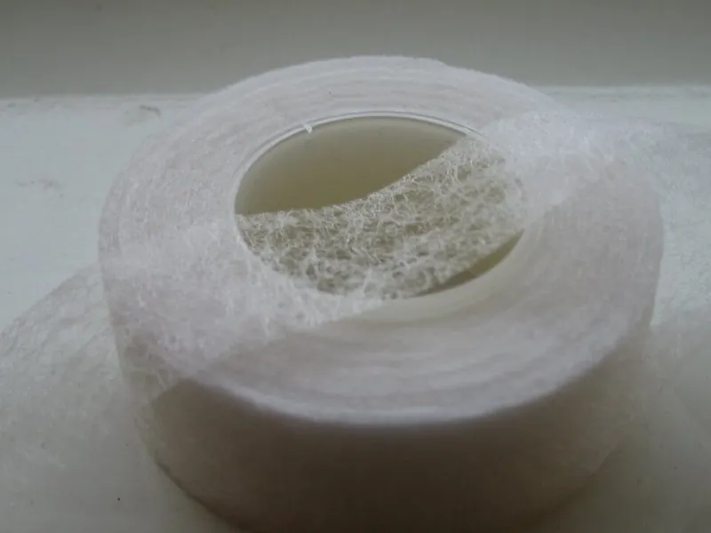
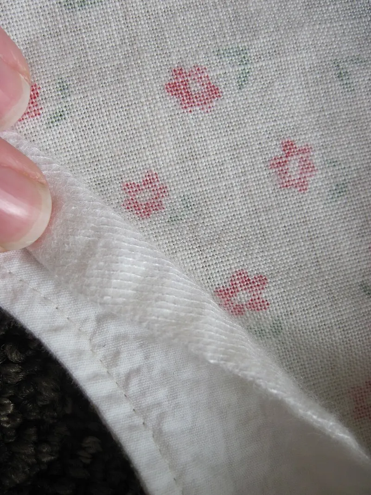

<figure class="eoc-pic eoc-pic-main"><figcaption><strong>Photo.</strong> <a href="https://commons.wikimedia.org/wiki/File:HemRepairTape.jpg">HemRepairTape</a> by DavidBoden, Public domain, from Wikimedia Commons.</figcaption></figure>
<figure class="eoc-pic"><figcaption><strong>How it works.</strong> <a href="https://commons.wikimedia.org/wiki/File:Interfacing_at_hem.jpg">Interfacing at hem</a> by kellyhogaboom, <a href="https://creativecommons.org/licenses/by-sa/2.0">CC BY-SA 2.0</a>, from Wikimedia Commons.</figcaption></figure>

A thin, dry web or film of hot-melt glue, sold as sheets, tape or already on the back of interfacing and patches, that is laid between fabrics and pressed with an iron so it melts into both and sets as it cools, giving a no-sew hem, appliqué or patch.

**In plain words:** A dry sheet or tape of glue that you lay between two pieces of fabric and press with a hot iron, so it melts and sticks them together: for hems with no sewing, fabric shapes stuck onto a quilt or bag, and iron-on patches. **Proper term:** Fusible web (heat-activated adhesive web, iron-on adhesive), including hem tape (fusible hemming web), fusible interfacing and iron-on patches.

**Also called:** fusible web, fusible webbing, iron-on adhesive, double-sided iron-on adhesive (Therm O Web; William Gee); web adhesive, adhesive web, hot-melt web: the industrial name for 'hot melt adhesives that have been formed into a web-like, nonwoven material that handles like fabric' (Bostik); paper-backed fusible web: the glue web on a release paper that you can draw your shape on (Vilene Bondaweb product text via William Gee; Therm O Web HeatnBond); hem tape, hemming web, fusible hemming tape, hem repair tape: a narrow strip for no-sew hems (Wikipedia 'Hem'; William Gee); fusible interfacing, iron-on interfacing, fusible interlining: a fabric with heat-activated glue on one side that stiffens or steadies another fabric (Wikipedia 'Interfacing'; onlineclothingstudy); iron-on patch, iron-on badge, heat-activated patch backing (Wikipedia 'Embroidered patch'); 'sewable' or 'lite' web (holds pieces for stitching) versus 'no-sew' or 'ultra' web (permanent on its own) (Therm O Web); polyamide (nylon), polyester and polyurethane web adhesives, named by base plastic (Bostik); heat transfer vinyl (HTV), iron-on vinyl: a related decorative film with heat-activated glue, cut on a plotter and pressed onto T-shirts (Wikipedia 'Heat transfer vinyl'); brand names a beginner may search for: Bondaweb (brand) and Wonderweb (brand) from Vilene/Vlieseline, also searched as 'wundaweb' or 'wondaweb' (William Gee); HeatnBond (brand, Therm O Web); Steam-A-Seam (brand) (USU Extension; All About Quilts).

## How it works

The web is a hot-melt glue (thermoplastic) made into a fine non-woven mesh or film, usually polyamide, polyester or polyurethane, that turns soft and sticky when heated, typically somewhere between about 77 and 166 °C depending on the type (Bostik brochure). Heat from the iron passes through the fabric to the glue, pressure pushes the melted glue in among the fibres of both layers, and when it cools it sets again and locks them together (onlineclothingstudy, 'Fusing parameters'). Paper-backed webs are used in two steps: a short press fixes the web to the back of the first fabric, then the paper is peeled off and a longer press bonds it to the second fabric (Therm O Web; Vilene Bondaweb instructions via William Gee). Because the glue only melts and never [cures](../glossary.md#cure) chemically, enough heat for long enough can soften it again (Bostik brochure).

## Parts

A few parts: the glue web (often on a paper backing), the two fabrics, and a hot iron with a pressing cloth or non-stick sheet. Fusible interfacing and iron-on patches carry their glue already coated on the back, so they are one piece plus the iron.

## Everyday examples

- Iron-on badges and patches on jeans, jackets, bags and uniforms (Wikipedia 'Embroidered patch')
- A quick no-sew hem on trousers or curtains with hem tape (William Gee; Wikipedia 'Hem')
- The stiff layer inside shirt collars and cuffs, which is usually fusible interfacing (Wikipedia 'Interfacing')
- Fabric shapes stuck onto quilts and wall hangings before their edges are stitched (appliqué; USU Extension; Therm O Web)

## When to use it

Use it to join fabric to fabric quickly and invisibly with no stitching: taking up a hem on trousers, skirts or curtains; fixing appliqué shapes so they don't shift while you stitch their edges; putting on a patch; stiffening or steadying a fabric with fusible interfacing (behind buttonholes, collars, bag panels, or costume fabric that has parts attached; Wikipedia 'Interfacing'; Dangerous Ladies). It also works for fabric onto felt, leather, card or wood with suitable webs (Therm O Web UltraHold; Vilene Bondaweb). In e-textiles, one-sided fusible interfacing ironed over conductive-thread lines is the 'Quickest method of insulation' (SparkFun).

## When not to use it

Not for anything load-bearing such as straps, handles, harnesses or webbing loops: sew them (Sewn seams and hand stitches; Load-bearing stitch patterns for straps and webbing), and never let a fused joint hold a person. Not for waterproof or airtight seams: use a heat-sealed seam on coated fabric. Not on fabrics that can't take the heat or won't take the glue, such as acetate, pure silk or silicone-finished fabrics (University of Missouri Extension) or thin synthetics that melt (SparkFun): use a fabric glue (PVA or elastomeric fabric glue) or sew. Not for ironing onto 3D prints or foam, which soften long before the glue melts: sew or glue instead. Not where the part gets hot again (near heaters, hot dryers, repeated ironing), since heat can reactivate the glue (Bostik; Therm O Web). Not for long-lasting hems on clothes washed often unless finished with stitching, as no-sew hems are 'often used only on a temporary basis' (Wikipedia 'Hem').

## Details

- **What it does (jobs):**
  - glue or bond: melts a layer of glue between two fabrics, or between fabric and felt, leather, card or wood
  - join and hold: no-sew hems, appliqué shapes, iron-on patches and stiffening (interfacing) that stays put through wear and washing
- **Movement:** none: the fused layers act as one piece of cloth, though the cloth itself still bends.
- **Directions it can move (degrees of freedom):** 0: the two fabrics can no longer slide or lift apart where they are fused; the fused area stays flexible but slightly stiffer.
- **Special behaviour:**
  - none: it is a plain glued joint. The one useful trick is that it can be placed and fused in seconds with no pins or stitching, and light 'sewable' webs act as temporary basting that holds pieces still while you stitch them (Therm O Web)
- **How it holds:**
  - [material bond](../glossary.md#form-fit--force-fit--material-bond) (glue, solvent or melting): a thermoplastic glue melts, flows into the fibres of both layers and sets on cooling (Bostik; onlineclothingstudy)
- **Input and output:** not applicable
- **Power:** passive (no power needed): the joint itself needs nothing once made; making it needs a hot iron or heat press.
- **Load:** Light. It holds hems, patches and appliqué against everyday wear and washing, with the glue spread over the whole area (good in [shear](../glossary.md#peel-vs-shear) along the cloth), but edges are where it gives way, which is why sewable webs 'must be sewn for permanent bond' and appliqué is normally finished by stitching around the shape (Therm O Web Lite; USU Extension). Wikipedia notes no-sew (threadless) hems 'are not common, and are often used only on a temporary basis' (Wikipedia 'Hem'). No published strength figures for hobby fusible webs were found ⚑ [uncertain]. Never use a fused joint for straps, handles or anything that holds a person; sew load-bearing joints.
- **Play and precision:** not applicable
- **Taking it apart:** permanent: no-sew webs are sold as 'Permanent' (Therm O Web UltraHold), and light 'sewable' webs are only meant to hold until the edges are stitched (Therm O Web Lite). Because the glue is a thermoplastic, reheating can soften it again (Bostik), so a patch can sometimes be lifted with heat, but glue stays in the fabric and the fabric may be marked ⚑ [uncertain].
- **How often it can be reused:** once: a fused piece is not meant to be taken apart and re-fused; makers advise avoiding 'repeated or excessive ironing to the area after fusing' (Therm O Web).
- **Sealing:** none: the web is a porous mesh and makes 'Breathable bonds' (Bostik); it is not a waterproof seam. For a sealed seam in coated fabric, use a heat-sealed seam or seam tape instead.
- **Adjustable:** no: once fused it is set. Some webs are slightly tacky before pressing so a shape can be placed and moved first (Steam-A-Seam, as described by All About Quilts), but after pressing the only way to move it is to reheat and peel it ⚑ [uncertain].
- **Access needed:** one side only (blind): the web sits between the layers and the iron presses from one face, though thick fabrics benefit from extra pressing from the back (Therm O Web Lite: 'Press thick fabrics an additional 2-4 seconds from the back of the project').
- **Materials:** The web: polyamide (nylon) is common in craft webs (Bondaweb and Wonderweb are '100% Polyamide', William Gee); industrial webs also come in polyester and polyurethane (Bostik). Bonds well: cotton and most woven fabrics (the makers' times are given for cotton, Therm O Web), and, depending on the product, felt, suede, leather, foil, lamé, cardboard and wood (Therm O Web UltraHold), 'almost all fabrics, raffia and cardboard' and leather at lower temperatures (Vilene Bondaweb via William Gee). Matching the glue to the fabric helps: polyester webs suit polyester fabrics, polyamide webs bond better to nylon, and polyurethane webs bond to urethane foams, films, vinyl and synthetic rubber (Bostik). Avoid: 'acetates, pure silks or silicon-created fabrics' (probably silicone-finished ones), for which fusibles 'are not recommended' (University of Missouri Extension guide 414); synthetic fabrics that melt at the iron setting needed (SparkFun). Not for ironing straight onto PLA or PETG prints: the two-dot (wool) iron setting is about 150 °C (Wikipedia 'Laundry symbol'), far above what these plastics stand (Prusa lists PLA's 'Low UV and temperature resistance'), so fuse fabric to fabric first and then glue or sew it to the print.
- **Heat, cold, water and wear:** Heat: the glue is a thermoplastic, so it 'cannot be used in applications subjected to temperatures that exceed their melting point for too long, as that can reactivate the adhesive'; Bostik's industrial webs list heat resistance from about 75 °C (low-melt polyester) to 165 °C (high-melt polyester) (Bostik brochure). Makers advise drying on low or no heat and avoiding repeated ironing over fused areas (Therm O Web). Washing and dry cleaning: resistance depends on the glue type (see rules_of_thumb), and light webs must be stitched before washing (Therm O Web). Moisture: polyamide hot melts let moisture through more easily than polyesters (Wikipedia 'Hot-melt adhesive'). [Shrinkage](../glossary.md#warping--shrinkage): interfacing that wasn't pre-shrunk can shrink in the wash and pull away as bubbles; pre-shrink it (University of Missouri Extension). No data on sunlight (UV) ageing of hobby webs was found.

## Making it

- **Ways to make or get it:**
  - off-the-shelf part: fusible web by the metre or as sheets, hem tape on rolls, fusible interfacing, and iron-on patches with the glue already on the back
  - 3D print (FDM): not the web itself, but printed helpers (hem gauges, templates) and printed patches whose own plastic is ironed into the fabric (see making_tips_3d_printing)
- **Printing it in one piece (print in place):** no: fusible web is bought as a sheet or tape; it isn't printed.
- **Tools:** A household iron (or a heat press), ironing board, scissors, and a pressing cloth, baking parchment or non-stick appliqué pressing sheet to keep glue off the iron (SparkFun; All About Quilts); a damp cloth for webs that call for it (Vilene Bondaweb); a sewing machine or needle when using a sewable web or finishing appliqué edges (Therm O Web Lite; USU Extension).
- **Difficulty:** easy: buy it, cut it with scissors and press it with a household iron; the only skill is getting heat, pressure and time right for the product and fabric, so test on a scrap first.

### 3D printing tips

Fusible web is not printed, but makers combine it with prints in a few ways. 1) Never iron onto a PLA or PETG print: the iron is much hotter than the plastic can take (Prusa: PLA has 'Low UV and temperature resistance'; Wikipedia 'Laundry symbol': two dots is about 150 °C). Fuse the fabric layers first, then attach the fabric to the print by sewing through holes or slots (Sew-on part) or with a flexible glue. 2) Behind costume fabric where printed or cast parts are attached, a hidden reinforcement patch helps 'distribute the weight of the attached piece', and fusible interfacing may be enough for this, since it 'is made for stabilizing fabrics, and stopping them from stretching or fraying' (Dangerous Ladies cosplay tutorial). 3) Printed iron-on patches use the print's own plastic as the glue: one design is printed onto 'a sheet of thin paper' fixed to the build plate, torn out, laid print-down on the fabric and ironed on high; tiny details such as dots may not fuse or may fall off (Printables 1343). Another is a 0.40 mm thick patch (2 layers at 0.20 mm) in TPU 95A, which 'melts and fuses mechanically deep into the fabric weave'; its designer warns that PLA versions 'will eventually crack under repeated sharp folds or machine drying' (Printables 1837546). These are print-based experiments, not tested products ⚑ [uncertain]. 4) A printed hem gauge helps fold an even hem before laying in hem tape (Printables 321393). 5) Keep glue and heat off the print bed and any electronics: put baking parchment between iron and work, and keep the iron away from sewn-in e-textile parts, which heat could damage (SparkFun).

### Buying one (off-the-shelf parts)

Search catalogues for: 'paper-backed fusible web' (sheets, rolls and wide bolts), 'fusible web tape', 'hem tape' or 'hemming web' (narrow rolls, e.g. 13, 19 and 25 mm wide at William Gee), 'sewable' or 'lite' fusible web versus 'no-sew' or 'ultra hold' fusible web (Therm O Web), 'fusible interfacing' (woven, non-woven and knit, light to heavy; Wikipedia 'Interfacing'), 'one-sided' fusible interfacing for stabilising fabric (SparkFun), 'iron-on patches', 'appliqué pressing sheet' (non-stick sheet; All About Quilts), 'pressing cloth', and 'heat press'. Industrial 'web adhesive' is sold by base polymer and basis weight, about 14 to 120 g/m² (Bostik brochure).

## Rules of thumb

- Two-step pressing for paper-backed web: first press on the paper side for about 2 s (HeatnBond UltraHold), 2-4 s (HeatnBond Lite) or 5 s dry (Vilene Bondaweb), let it cool and peel the paper; then press the glue side onto the second fabric for 8 s (UltraHold), 6-8 s (Lite) or about 10 s under a damp cloth (Bondaweb). The times are for cotton; thicker fabric needs longer (Therm O Web product pages; Vilene Bondaweb instructions via William Gee).
- Follow the instructions for the exact product, including steam or no steam (HeatnBond: 'medium heat, no steam'; Bondaweb: damp cloth for the second press), because 'you can actually over do it on some brands and then they won't stick' (Therm O Web; William Gee; USU Extension 'Machine Appliqué Techniques').
- Press, don't iron: 'Raise, do not slide, the iron', overlap each new position, press 'for the recommended time, not more or less', and let it 'Cool before handling' (University of Missouri Extension guide 414 'Tips for Fusing').
- Iron temperatures: one dot on the iron dial is about 110 °C, two dots 150 °C and three dots 200 °C (Wikipedia 'Laundry symbol'). Polyamide webs work over roughly 125-150 °C and polyester webs over 85-180 °C (Bostik blog), and web activation temperatures range from about 77 to 166 °C (Bostik brochure), so a medium (two-dot, wool) setting is the usual starting point.
- Prepare and test: pre-wash fabrics without fabric softener and pre-test the adhesive (Therm O Web); pre-shrink fusible interfacing by soaking it 10 minutes in tepid water and letting it drip-dry; test on a swatch of the real fabric first (University of Missouri Extension guide 414).
- Match the web to the fabric: use a light web on thin or stretchy fabric such as lace or spandex and a heavier one on thick fabric; too heavy a web makes the bond stiff or lets glue ooze out, and too light a web can fail (Bostik blog and brochure).
- Light 'sewable' webs must be stitched along the edges for a permanent bond, and before washing; the no-sew grade is marked 'DO NOT SEW!', while the sewable grade 'Doesn't gum up needles' (Therm O Web). For appliqué, 'Finish by stitching around shape' (USU Extension).
- For big appliqué shapes, fuse only a band around the edge and cut away the middle of the web, which uses less web and gives a softer result (All About Quilts, 'Steam-A-Seam').
- With interfacing, trim about 1/2 inch of seam allowance off the interfacing before fusing, and pink (zigzag-cut) the edges if a line shows on the right side (University of Missouri Extension guide 414; University of Idaho Extension 'Fusible Interfacing').
- Washing, side by side: HeatnBond UltraHold 'Machine wash warm and dry on low heat or no heat'; HeatnBond Lite must be sewn first, then 'Machine wash cold' (Therm O Web); Vilene Bondaweb 'Machine wash 60°' and 'Dry cleanable' (William Gee); in Bostik's industrial range the polyamide webs rate 'Fair' for washing and 'Excellent' for dry cleaning, while most polyester webs rate 'Good' or 'Excellent' for washing but 'Poor' for dry cleaning (Bostik web adhesive selector).

## Common failures

Not sticking or peeling off: too little heat, pressure or time, or on some brands too much (USU Extension; onlineclothingstudy); fix by following the product's exact time and setting and testing on a scrap. Glue soaking through to the front of the fabric, or back through onto the iron (strike-through and strike-back): too much heat, pressure or time (onlineclothingstudy), or too heavy a web for a thin fabric (Bostik: 'the adhesive will ooze out'); use a lighter web and the recommended settings. Bubbles or puckers after washing: interfacing shrinking; pre-shrink it (University of Missouri Extension). Edges of appliqué lifting with wear: the light web was never meant to hold alone; stitch round the edges (Therm O Web Lite; USU Extension). A stiff, board-like patch: the web is too heavy; use a lite web or cut away the centre (Bostik; All About Quilts). A visible line where the interfacing stops: pink its edges (University of Missouri Extension; University of Idaho Extension). Pieces shifting: the iron was slid instead of lifted and pressed (University of Missouri Extension). Glue on the iron: the web's rough (glue) side faced the iron; the rough side goes on the wrong side of the fabric (Vilene Bondaweb via William Gee). Melted or shiny fabric: the iron was too hot for that fibre; test first (SparkFun).

## Safety

Burns: 'Burns can occur from touching hot metal parts, hot water, or steam'; don't leave the iron unattended while it is plugged in or on the ironing board, and supervise children closely (Hamilton Beach iron manual). Scorching or melting: some fabrics 'could melt when using the iron setting needed to activate the adhesive', so test on a scrap (SparkFun). Keep melted glue off the iron's soleplate and the ironing board with baking parchment or a pressing sheet (SparkFun; Therm O Web: 'Do not touch iron directly to the adhesive sheet. Do not iron directly to your ironing board'). Keep the iron away from sewn-in electronics, which heat could damage (SparkFun). A fused joint must never hold a person: sew anything that takes a load.

## Related

- Hot-melt adhesive (glue gun): the same kind of thermoplastic glue, but applied molten from a gun as beads instead of as a dry web pressed with an iron
- Heat-sealed seam (heat-sealed plastic film and coated fabric): melts the plastic coating of the fabric itself into a seam that can be airtight; fusible web adds a separate glue layer and is not waterproof
- Sewn seams and hand stitches (lockstitch, saddle stitch, flat-felled seam): stronger and repairable, and the usual way to finish the edges of fused appliqué
- Load-bearing stitch patterns for straps and webbing (bar tack, box-X stitch): what to use instead of fusing wherever a strap carries load
- PVA wood glue (white glue, also sold as fabric or tacky glue) and Elastomeric solvent glue (flexible craft glue): liquid fabric glues for fabrics or parts that can't be ironed
- Contact adhesive (contact cement): better for bonding fabric or leather to foam, rubber or prints without heat
- Printing onto fabric (fabric embedded in a 3D print): the way to join cloth and printed plastic, where fusing can't be used
- Sew-on part (sewing holes, loops and slots on a rigid part): attach a printed part to fused or interfaced fabric with thread
- Hook-and-loop fastener: a reopenable way to attach a patch or panel, sewn or glued on
- Heat transfer vinyl (iron-on vinyl): a decorative plastic film with heat-activated glue for T-shirt designs, pressed the same way but not used to join fabrics (Wikipedia 'Heat transfer vinyl')

## Make it yourself

- [3D printed Iron-On Patch (Ky3_actual, Printables) (URL from Printables API, page not opened)](https://www.printables.com/model/1343-3d-printed-iron-on-patch): A thin patch printed onto paper on the build plate, then ironed print-side down onto fabric so its own plastic fuses into the weave *(licence: Creative Commons Attribution-ShareAlike)*
- [Orca & Waves - Iron-On 3D Printed Patch (Flexible TPU + PLA) (Eolexy, Printables) (URL from Printables API, page not opened)](https://www.printables.com/model/1837546-orca-waves-iron-on-3d-printed-patch-flexible-tpu-p): A 0.40 mm thick printed patch in TPU (with a PLA version) designed to be heat-pressed into T-shirts, bags and denim with a household iron *(licence: Creative Commons Attribution-NonCommercial-ShareAlike)*
- [Hem Gauge for Sewing (TheNewRow, Printables) (URL from Printables API, page not opened)](https://www.printables.com/model/321393-hem-gauge-for-sewing): A printed gauge for measuring and folding an even hem before laying in hem tape *(licence: Creative Commons Attribution-NonCommercial)*

## Pictures, videos and models

- [HemRepairTape.jpg (Wikimedia Commons, by DavidBoden)](https://commons.wikimedia.org/wiki/File:HemRepairTape.jpg): Photo of a roll of iron-on hem repair tape (fusible hemming web) *(licence: Public domain (PD-user))*
- [Interfacing at hem.jpg (Wikimedia Commons, by kellyhogaboom via Flickr)](https://commons.wikimedia.org/wiki/File:Interfacing_at_hem.jpg): Photo of interfacing used to reinforce a garment hem *(licence: CC BY-SA 2.0)*
- [Insulation Techniques for e-Textiles: Fusible Interfacing (SparkFun Learn)](https://learn.sparkfun.com/tutorials/insulation-techniques-for-e-textiles/fusible-interfacing): Step-by-step photos of choosing one-sided fusible interfacing, marking it and ironing it over conductive-thread lines with parchment to protect the iron *(licence: CC BY-SA 4.0 (SparkFun tutorials))*
- [HeatnBond Lite Iron-On Adhesive Tape (Therm O Web product page)](https://www.thermoweb.com/products/lite-7-8-x-10-yards): Product photos and the maker's step-by-step directions for a sewable paper-backed fusible tape, with times, settings and washing advice *(licence: link only)*

## Needs confirming

⚑ marks something nobody has confirmed yet: a fact the research could not confirm from a source, a finder value that is a best guess, or an open point from the research notes. Corrections are welcome (see `research/needs-confirming.md`).

- ⚑ 4 sentences on this page marked [uncertain].
- ⚑ Finder value `made_of` = 3D prints, plastic sheet, tube or moulded parts, wood, metal, paper or card, foam, fabric, leather or cord (best guess): proposed from the words in the research text (R37); not yet checked
- ⚑ Research note: *Iron-on fusible web*: no published strength figures for hobby webs were found (`load` is [uncertain]); activation temperatures (about 77-166 °C) and wash and dry-clean resistance come from Bostik's web-adhesive brochure, and washing figures from four sources are recorded side by side. A WebFetch summary misquoted the Dangerous Ladies cosplay page; the agent checked the raw page and used the real wording.

## Sources

- <https://en.wikipedia.org/wiki/Interfacing>
- <https://en.wikipedia.org/wiki/Hem>
- <https://en.wikipedia.org/wiki/Embroidered_patch>
- <https://en.wikipedia.org/wiki/Hot-melt_adhesive>
- <https://en.wikipedia.org/wiki/Heat_transfer_vinyl>
- <https://en.wikipedia.org/wiki/Laundry_symbol>
- <https://extension.usu.edu/sewing/research/machine-applique-techniques.pdf>
- <https://mospace.umsystem.edu/bitstreams/13498848-4381-4357-90e0-25f4d4ffb045/download>
- <https://objects.lib.uidaho.edu/uiext/uiext29299.pdf>
- <https://www.thermoweb.com/products/ultrahold-value-pack-17-x-5-yards>
- <https://www.thermoweb.com/products/lite-7-8-x-10-yards>
- <https://www.williamgee.co.uk/shop/wonderweb/>
- <https://www.williamgee.co.uk/shop/vilene-bondaweb-329/>
- <https://www.bostik.com/us/en_US/blog/post/2018/6/web-adhesives-in-textile-applications-what-to-consider/>
- <https://page.bostik.com/rs/253-HSZ-754/images/Web%20Brochure_V2.pdf?version=0>
- <https://www.onlineclothingstudy.com/2018/10/the-fusing-technology-fusing-parameters.html>
- <https://learn.sparkfun.com/tutorials/insulation-techniques-for-e-textiles/fusible-interfacing>
- <https://dangerousladies.ca/blogs/tutorials/attaching-resin-3d-prints-cosplay>
- <https://www.all-about-quilts.com/steam-a-seam.html>
- <https://useandcares.hamiltonbeach.com/files/840235703.pdf>
- <https://help.prusa3d.com/article/pla_2062>
- <https://commons.wikimedia.org/wiki/File:HemRepairTape.jpg>
- <https://commons.wikimedia.org/wiki/File:Interfacing_at_hem.jpg>
- <https://api.printables.com/graphql/>
