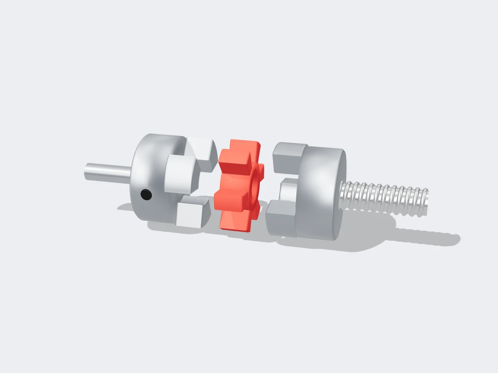
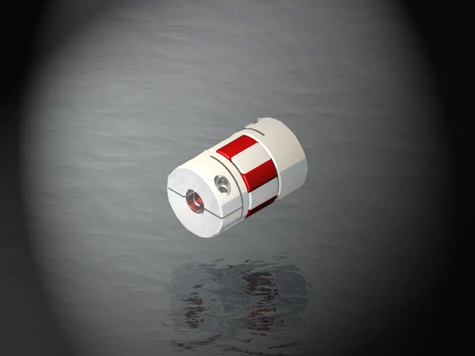

<figure class="eoc-pic eoc-pic-main"><picture><source media="(prefers-reduced-motion: reduce)" srcset="../media/drawn/jaw-coupling.svg"></picture><figcaption><strong>Animation.</strong> Diagram drawn for the encyclopaedia from the research notes. ⚑ Needs confirming: a drawing can simplify or get details wrong; a real photo or a better diagram is welcome.</figcaption></figure>
<figure class="eoc-pic"><figcaption><strong>Render.</strong> A 3D model made for the encyclopaedia, not a photo: a stand-in until a good real photo is found. ⚑ Needs confirming: a model can simplify or get details wrong; a real photo is welcome.</figcaption></figure>
<figure class="eoc-pic"><figcaption><strong>Photo.</strong> <a href="https://commons.wikimedia.org/wiki/File:JawConcept2.jpg">JawConcept2</a> by Aruland, <a href="https://creativecommons.org/licenses/by-sa/3.0">CC BY-SA 3.0</a>, from Wikimedia Commons.</figcaption></figure>

Two hubs with interlocking jaws on their faces pass turning force through a rubbery star-shaped insert (the spider) squeezed between the jaws, so the shafts turn together while the spider soaks up shocks, vibration and small [misalignment](../glossary.md#misalignment).

**In plain words:** Two metal cups with stubby fingers on their ends that interlock like the fingers of two hands, with a rubbery star-shaped cushion squeezed in between, joining a motor shaft to another shaft. **Proper term:** Jaw coupling (spider coupling, elastomeric jaw coupling).

**Also called:** spider coupling / spider coupler (named after the many-legged rubber insert); Lovejoy coupling (Lovejoy (brand), now part of Timken); L-type or 'L-jaw' coupling (Lovejoy's standard straight-jaw range); plum coupling / plum blossom coupling / plum spider coupler (hobby CNC and 3D-printer listings for small aluminium versions); straight jaw coupling and curved jaw coupling; backlash-free jaw coupling / servo jaw coupling (curved jaws with a preloaded spider, e.g. ROTEX GS (brand, KTR)); elastomer coupling / flexible jaw coupling; element (the formal name of the spider), load cushions, snap-wrap spider, open-centre spider, in-shear jaw coupling; SOX (brand) NBR spider, Hytrel (brand) spider.

## How it works

The two hubs face each other with their jaws interleaved, and each gap between a driving jaw and a driven jaw is filled by one leg of the spider (Wikipedia 'Jaw coupling'; Lovejoy). When the motor turns, each driving jaw squeezes a spider leg against the next driven jaw, so all the [torque](../glossary.md#torque) passes through the rubber in compression (Lovejoy). Because rubber gives a little, the shafts can sit slightly out of line and shocks and vibration are cushioned; a harder spider carries more torque and is stiffer, a softer one damps and flexes more (KTR ROTEX GS catalogue). In 'backlash-free' curved-jaw versions the convex spider teeth are squeezed into concave jaws with [preload](../glossary.md#preload), so there is no play at all (KTR; Wikipedia).

## Parts

A few parts: two hubs (each fixed to one shaft by a [set screw](../glossary.md#set-screw), key or clamp, with two or more stubby jaws on its face) and one elastomer spider (a star- or cross-shaped insert with one leg for each gap between the jaws); some types use separate load cushions or a wrap-around 'snap-wrap' spider held by a ring.

## Everyday examples

- The small aluminium 'plum' or 'spider' coupler joining a stepper motor to the leadscrew on hobby CNC routers and some 3D printers (Know Your 3D Printer: The Z Coupler, 2014)
- Motor-to-pump and motor-to-gearbox drives on industrial machinery, where a jaw coupling with a coloured rubber spider sits between the two shafts (Lovejoy; Wikimedia Commons category 'Jaw couplings' photo of an industrial motor drive)
- A hydraulic winch drive (Wikimedia Commons category 'Jaw couplings')

## When to use it

Use it as the everyday, general-purpose way to join a motor to a pump, gearbox, leadscrew, conveyor roller or robot drive shaft when the shafts are nearly (but not perfectly) in line and you want shocks and vibration cushioned. It suits drives that must keep running if the rubber fails ([fail-safe](../glossary.md#fail-safe--fail-secure)), machines where you want to unplug a motor or module without tools, and, with a preloaded curved-jaw spider, stop-and-go positioning axes such as machine-vision stages (Wikipedia). It is also handy for makers as a strong way to attach printed parts to a motor shaft (Hackaday).

## When not to use it

Avoid it when the shafts are noticeably offset sideways (use an Oldham coupling, which handles about 10% of its diameter), or at a large angle (use a universal joint or CV joint). Avoid it where there must be zero play and high [stiffness](../glossary.md#stiffness) during continuous precise motion (use a beam, bellows or disc coupling; Wikipedia notes curved jaw couplings are less suited to constant scanning motion). If the drive must disconnect when the insert fails, for safety or to protect the machine, the fail-safe behaviour is the wrong choice: use an in-shear jaw coupling, an Oldham coupling (its disc [shears](../glossary.md#peel-vs-shear)) or a torque limiter. Avoid it where hot oils, chemicals or ozone attack the spider unless you pick a resistant spider material.

## Details

- **What it does (jobs):**
  - join and hold: connects two shafts end to end so they turn together, e.g. a motor to a pump, gearbox or leadscrew
  - let it move (turn, slide or bend): the rubber spider lets the shafts sit slightly out of line (about 1 degree and a few tenths of a millimetre) and allows a little end float
  - slow it, stop it or keep its speed steady (in the sense of [damping](../glossary.md#damping)): the spider soaks up shocks and torsional vibration, which shortens settling time in stop-and-go machines (Wikipedia; Lovejoy)
- **Movement:** rotate: continuous, unlimited turns at 1:1; the spider flexes slightly (twists a little under torque and bends to follow small misalignment)
- **Directions it can move (degrees of freedom):** 0 free movements in the ordinary sense: the shafts are locked together in rotation, with only a small springy twist (torsional wind-up) in the spider. The spider also allows small springy movements in the other directions: end float (e.g. +0.4/-0.2 mm), sideways offset (0.04-0.15 mm) and tilt (0.8-1.2 degrees) on small KTR ROTEX GS sizes, or up to 1 degree and 0.015 in on Lovejoy L-type (KTR catalogue p. 122; Lovejoy).
- **Special behaviour:**
  - fail-safe or breakaway (fail-safe kind): in the usual compression design, if the spider wears out or breaks, the metal jaws simply meet and keep driving, 'albeit with considerable noise and accelerated wear' (Lovejoy; Wikipedia). In-shear designs are 'not fail-safe': the drive disconnects if the element fails (Wikipedia)
  - quick-release (partly): the two halves just push together axially and pull apart without tools once the hubs are fixed on the shafts; the jaws are chamfered for 'blind assembly' (KTR assembly instructions), and makers use it to plug devices on and off a motor (matyaz, Sketchfab). Snap-wrap spiders can be changed without moving the hubs (Lovejoy)
  - vibration and shock damping (not in the fixed list): NBR spiders give the best damping, Hytrel low, bronze none (Lovejoy)
- **How it holds:**
  - shape (the parts interlock; [form-fit](../glossary.md#form-fit--force-fit--material-bond)): torque is carried by the jaws pressing on the spider legs
  - spring force (a spring or springy part presses it in place): the elastomer spider is the spring that carries the load; in backlash-free versions it is preloaded between the jaws (KTR)
  - friction or clamping (force-fit): each hub is held on its shaft by a clamp, set screw or key
- **Input and output:** Continuous rotation -> the same rotation, 1:1, shafts in line (tolerating about 1 degree of tilt and about 0.38 mm of sideways offset on Lovejoy L-type; less with hard Hytrel or bronze spiders). Efficiency is high because nothing slides continuously; the spider only flexes ⚑ [uncertain: no figure found]. Torsionally springy, so it cushions shocks but lets the output lag slightly under load; straight-jaw types may have a little play, while preloaded curved-jaw types are backlash-free (Wikipedia; KTR). Back-drivable: yes, it drives equally in both directions.
- **Power:** passive (no power needed)
- **Load:** Medium to heavy torque for its size, carried in compression by several spider legs; standard NBR spiders are the baseline, urethane carries about 1.5 times and Hytrel about 3 times as much (Lovejoy); Lovejoy L-type sizes range from 3.5 in-lb (about 0.4 N m, L035) up to 12,500 in-lb (about 1,400 N m, L276 with a bronze insert), and its jaws are designed to withstand at least 10 times the coupling's torque rating. Weak directions: pulling apart (nothing holds the halves together axially, and too much [axial](../glossary.md#axial--radial) motion lets the coupling come apart: Wikipedia), sideways offset (only tenths of a millimetre; it creates the largest restoring forces on the bearings: KTR), and heat, which softens the spider.
- **Play and precision:** Small play in standard straight-jaw couplings ⚑ [uncertain: no figure found]; none in preloaded curved-jaw ('backlash-free') types, which suit stop-and-go positioning such as machine-vision stages but are 'less suited' to continuous scanning where [accuracy](../glossary.md#repeatability--accuracy) is needed during motion (Wikipedia, citing Ruland). The spider's springiness means the output lags a little under changing load. Misalignment: Lovejoy L-type 1 degree angular and 0.015 in (0.38 mm) parallel with NBR or urethane, 0.5 degree with Hytrel or bronze; small KTR ROTEX GS sizes 0.8-1.2 degrees angular, 0.04-0.15 mm radial, about +0.4/-0.2 mm axial. Slocum notes simple pin-in-slot couplings, including spider couplings, can add a small sinusoidal angle error.
- **Taking it apart:** removable: loosen the hub set screws or clamp screws to take the hubs off their shafts; the two halves and spider pull apart axially by hand (KTR); spiders are sold separately as wear parts (Lovejoy)
- **How often it can be reused:** many times: hubs last indefinitely; the spider is a wear part that is inspected and replaced (Lovejoy says replace when its permanent compression set reaches 25%; on non-reversing drives the unworn trailing legs can be turned to the driving side to extend life)
- **Sealing:** none: open between the jaws
- **Adjustable:** Not adjustable once fitted, but you tune it by choosing the spider: soft NBR (80 Shore A) for most damping, urethane (90 Shore A) or hard Hytrel (55-64 Shore D) for more torque and stiffness, or bronze for heat and low speed (Lovejoy; KTR). KTR offers five hardnesses colour-coded soft to hard. The gap between the hubs (KTR 'dimension E') is set at assembly.
- **Access needed:** end of a tube or shaft: each hub slides onto a shaft end and is fixed from the side; the halves then plug together along the axis, which can be done 'blind' thanks to chamfered jaws (KTR)
- **Materials:** Hubs: sintered iron or cast iron (Lovejoy L-type), steel or aluminium (servo and hobby types). Spiders: NBR rubber (80 Shore A, oil resistant, -40 to 100 °C), urethane (90 Shore A, -34 to 71 °C, resists ozone, sunlight and hydrolysis), Hytrel polyester elastomer (brand; -51 to 121 °C, good oil and chemical resistance), oil-impregnated bronze (rigid, up to 232 °C, max 250 rpm) (Lovejoy); polyurethane 80-98 Shore A and Hytrel 64-72 Shore D in KTR ROTEX GS. Printed versions: PETG hubs with a TPU spider (Tritschi, Printables).
- **Heat, cold, water and wear:** The spider sets the limits: NBR -40 to 100 °C, urethane -34 to 71 °C, Hytrel -51 to 121 °C, bronze to about 232 °C but only 250 rpm (Lovejoy); KTR's 92 Shore A polyurethane is rated -40 to +90 °C continuous. Aggressive liquids and oils, ozone, and too high or low temperatures physically change the spider and cause early wear (KTR assembly instructions; Wikipedia). Store spare spiders dry, away from ozone sources such as fluorescent lights and high-voltage equipment; they keep their properties up to 5 years in good storage (KTR). Urethane resists ozone, sunlight and hydrolysis; NBR resists oil (Lovejoy). Printed TPU spiders and PETG/PLA hubs have much lower heat limits (PLA softens above about 60 °C, PETG fine below about 80 °C: Prusa). Rubber spiders take a permanent set over time (Lovejoy: replace at 25% compression set).

## Making it

- **Ways to make or get it:**
  - off-the-shelf part: by far the most common; sized by shaft bores and torque
  - 3D print (FDM): hubs in PETG or similar, spider in TPU; or a printed part shaped to plug straight into one metal jaw hub (Hackaday)
  - CNC: hubs can be turned and milled; spiders are normally moulded
  - 3D print (resin): ⚑ [uncertain] no example found
- **Printing it in one piece (print in place):** no: the two hubs and the spider are separate parts (the spider in a different, flexible material), pushed together after printing
- **Tools:** A hex key (Allen key) or screwdriver for set screws or clamp screws (and a key for keyed shafts); a feeler gauge to check play or the gap between hubs; optionally a little mineral-oil-based grease to ease pushing a preloaded spider in (KTR assembly instructions)
- **Difficulty:** easy to fit a bought one (small 'plum' couplings for stepper motors are cheap and common); moderate to print one, because the spider must be printed in flexible TPU, which Prusa recommends 'only for experienced makers', and printed hubs are weaker than metal ones

### 3D printing tips

1) Two materials: print the hubs in a stiff, tough material such as PETG and the spider in TPU (Tritschi's printed motor coupler on Printables, redrawn from a commercial KTR-style coupling). 2) TPU is usually 60A-90A [Shore hardness](../glossary.md#shore-hardness) (Prusa), about the same as or softer than industrial NBR (80A) and urethane (90A) spiders (Lovejoy), so a printed spider will twist more and carry less torque; pick the hardest TPU you can print. 3) Print TPU slowly (Prusa suggests about 20 mm/s, 30-40 mm/s maximum) with little or no retraction to avoid clogging. 4) Hubs: fix them with metal screws and nuts (Tritschi's uses clamp screws with [captive nuts](../glossary.md#captive-nut)), not printed threads. 5) Leave a gap between the jaw tips and the opposite hub so the spider can flex (KTR's 'dimension E'); pegs on the KTR spider stop it rubbing flat against the hubs. 6) For a slight squeeze (preload) with no play, make the spider legs a little wider than the gaps and push it in, easing assembly with a smear of mineral-oil grease (KTR) ⚑ [uncertain: industrial practice applied to printed parts]. 7) Alternative: buy one metal jaw hub for the motor shaft and model the matching jaw pocket into your printed gear or wheel, so it simply slides on (Hackaday, 2019); commenters suggest a [heat-set insert](../glossary.md#heat-set-insert) or a second coupling to stop it sliding off along the shaft. 8) Print hubs with the jaws pointing up so they need no supports, and put enough walls round the clamp slot ⚑ [uncertain: general FDM practice]. 9) Heat: PETG is fine below about 80 °C (Prusa); keep PLA hubs away from warm motors, since PLA softens above about 60 °C (Prusa).

### Buying one (off-the-shelf parts)

Straight-jaw couplings (L-type / 'L-jaw' hubs and spiders, e.g. Lovejoy (brand)); curved-jaw backlash-free servo couplings (e.g. ROTEX GS (brand, KTR)); small aluminium 'plum' or 'spider' couplings for NEMA 17 stepper motors and CNC and 3D-printer leadscrews; replacement spiders in NBR (SOX (brand)), urethane, Hytrel (brand) or bronze; open-centre spiders for close shaft spacing; snap-wrap spiders with a retaining ring; double-cardanic (DKM) versions for larger offsets (KTR).

## Rules of thumb

- Lovejoy L-type misalignment: 1 degree angular and 0.015 in (0.38 mm) parallel with NBR or urethane spiders; Hytrel and bronze halve the angle to 0.5 degree, bronze allows only 0.010 in parallel (Lovejoy L-type product page).
- Spider torque relative to NBR: urethane 1.5x, Hytrel 3x; bronze inserts only to 250 rpm (Lovejoy 'Spiders are Key to Jaw Coupling Performance').
- Spider temperature ranges: NBR -40 to 212 °F (-40 to 100 °C), urethane -30 to 160 °F (-34 to 71 °C), Hytrel -60 to 250 °F (-51 to 121 °C), bronze -40 to 450 °F (Lovejoy).
- Replace the spider when its permanent compression set reaches 25% (Lovejoy).
- Jaws are designed to withstand at least 10 times the coupling's torque rating, which is why the coupling stays fail-safe when a spider fails (Lovejoy).
- Small servo sizes (KTR ROTEX GS sizes 5 and 7): radial 0.04-0.15 mm, angular 0.8-1.2 degrees, axial about +0.4/-0.2 to +0.6/-0.3 mm, with harder spiders allowing less (KTR catalogue p. 122).
- Harder spider = more torque and stiffness; softer spider = more misalignment allowance and damping (KTR catalogue p. 119).
- Parallel (radial) offset produces the largest restoring forces; for larger offsets use the double-cardanic (DKM) version, and careful alignment increases service life (KTR catalogue p. 121).
- Keep the specified gap between hubs (dimension E) so the coupling can take up displacement; never bore hubs beyond their maximum bore or they may burst (KTR assembly instructions KTR-N 45510).
- Slocum: choose a jaw coupling with an eight-legged spider over an Oldham coupling 'when more torque and misalignment capacity are needed with a more linear response' (FUNdaMENTALs of Design, Topic 5, p. 5-28).

## Common failures

1) Spider wear, cracking or melting from misalignment, which also heats the spider (KTR; Wikipedia, citing MPTA): align the shafts carefully and use a double-cardanic version for larger offsets. 2) Spider taking a permanent set so [backlash](../glossary.md#backlash) appears (Lovejoy: replace at 25% compression set). 3) Over-torque or shock loads breaking spider legs or even the hub cams (KTR): size the coupling with a service factor. 4) Chemical, ozone or temperature damage to the spider (KTR; Wikipedia): choose the right spider material. 5) Torsional vibration wearing the spider (Wikipedia). 6) Hub set screws or clamp screws working loose (KTR): tighten and secure them. 7) Halves pulling apart from too much axial movement (Wikipedia): keep the specified gap and locate the shafts. 8) Printed versions: a soft TPU spider twisting too much, or plastic hubs cracking at the clamp ⚑ [uncertain].

## Safety

A spinning coupling can catch fingers, hair and clothing: switch off and secure the motor against accidental switch-on before working on it, never reach in while it runs, and fit a guard or cover (KTR assembly instructions). Because a standard jaw coupling keeps driving metal-on-metal when the spider fails (Lovejoy), a failure may not stop the machine, only make it noisy; check spiders regularly. Overbored hubs can burst and throw fragments (KTR).

## Related

- Oldham coupling: a sliding middle disc instead of a rubber spider; takes much more sideways offset and breaks at the disc on overload, but damps less (Wikipedia calls it 'a form of two-jawed jaw coupling where the centre spider is long')
- Flexible beam coupling (helical-slot coupling): one piece, zero backlash, no rubber to wear, but little damping
- Dog clutch (claw clutch): similar interlocking lugs but no rubber insert; slides apart to disconnect the drive
- Tyre coupling / rubber block couplings: other elastomer couplings with larger misalignment capacity (e.g. the improvised tyre-piece coupling in the Wikipedia 'Coupling' photo)
- Rag joint: another flexible-disc type of coupling listed in Wikipedia's 'Coupling' article
- Universal joint (Hooke's joint): for shafts at larger angles; no damping
- Series-elastic coupling: a deliberately soft spring between motor and output whose twist is measured to control force
- Friction slip clutch or torque limiter: when you want the drive to slip or disconnect at a set torque instead of carrying on

## Make it yourself

- [Flexible Motor Coupler (Coupling) (Tritschi, Printables) (URL from Printables API, page not opened)](https://www.printables.com/model/736166-flexible-motor-coupler-coupling): Printed two-jaw coupling for a stepper motor (10 mm to 5 mm D-shaft): PETG clamp hubs with screws and captive nuts and a TPU spider, redrawn from a commercial KTR-style coupling *(licence: CC BY-NC-SA)*
- [Parametric Spider Coupling (matyaz, Sketchfab)](https://sketchfab.com/3d-models/parametric-spider-coupling-c28c251dfba241cb8047c747cd4e0a33): Lovejoy-type spider coupling for stepper and other motor shafts, generated parametrically in Python with the open-source CadQuery CAD library *(licence: CC BY 4.0)*
- [(Mis)use This Part To Attach 3D Printed Stuff To A Shaft (Hackaday, 2019)](https://hackaday.com/2019/09/02/misuse-this-part-to-attach-3d-printed-stuff-to-a-shaft/): Technique: fix one half of a metal spider coupling to the motor shaft and model the matching jaw socket into a printed gear or part so it slides on *(licence: link only)*
- [Anti z-wobble jaw coupler by Deazen (Thingiverse) (appeared in search results; page not opened)](https://www.thingiverse.com/thing:4649086): Printable jaw coupler for a 3D-printer Z axis; per the search snippet the insert can be printed in TPU or cast from hot glue in printed moulds *(licence: ⚑ [uncertain] not checked)*
- [Spider coupling - 5mm axis to M8 drivescrew by lievenstandaert (Thingiverse) (appeared in search results; page not opened)](https://www.thingiverse.com/thing:6524): Early printable spider coupling from a 5 mm stepper shaft to an M8 threaded rod, assembled with M3 bolts and nuts (per the search snippet) *(licence: ⚑ [uncertain] not checked)*

## Pictures, videos and models

- [JawConcept2.jpg (Wikimedia Commons, by Aruland)](https://commons.wikimedia.org/wiki/File:JawConcept2.jpg): Computer drawing of a curved jaw coupling (the lead image of Wikipedia's 'Jaw coupling' article) *(licence: CC BY-SA 3.0 or GFDL 1.2+)*
- [JawConcept.jpg (Wikimedia Commons, by Aruland)](https://commons.wikimedia.org/wiki/File:JawConcept.jpg): A second computer drawing of a curved jaw coupling with its hubs and spider *(licence: CC BY-SA 3.0 or GFDL 1.2+)*
- [How a Jaw Coupling Works (Mechanical Vision, YouTube)](https://www.youtube.com/watch?v=H1OA0DaGjxw): 3D animation of how the hubs, jaws and spider fit together and carry torque *(licence: link only (standard YouTube licence))*
- [What Do Different Jaw Coupling Spider Colors Mean? (Ruland Manufacturing, YouTube)](https://www.youtube.com/watch?v=ZMuWioVDryM): Real spiders of different hardnesses and colours and what they are used for *(licence: link only (standard YouTube licence))*
- [ROTEX GS backlash-free jaw couplings catalogue (KTR (brand), PDF)](https://www.ktr.com/fileadmin/ktr/media/Tools_Downloads/kataloge/03_backlash-free_jaw_couplings_ROTEX_GS.pdf): Cutaway drawings of the preloaded spider, spider hardness colour chart, and diagrams of axial, radial and angular displacement *(licence: link only (manufacturer catalogue))*

## Needs confirming

⚑ marks something nobody has confirmed yet: a fact the research could not confirm from a source, a finder value that is a best guess, or an open point from the research notes. Corrections are welcome (see `research/needs-confirming.md`).

- ⚑ 8 sentences on this page marked [uncertain].
- ⚑ Finder value `made_of` = 3D prints, metal (best guess): proposed from the words in the research text (R37); not yet checked

## Sources

- <https://en.wikipedia.org/wiki/Jaw_coupling>
- <https://en.wikipedia.org/wiki/Coupling>
- <https://commons.wikimedia.org/wiki/Category:Jaw_couplings>
- <https://commons.wikimedia.org/wiki/File:JawConcept2.jpg>
- <https://commons.wikimedia.org/wiki/File:JawConcept.jpg>
- <https://www.lovejoy-inc.com/resources/technical-articles/spiders-are-key-to-jaw-coupling-performance/>
- <https://www.lovejoy-inc.com/products/jaw-type-couplings/l-type-standard-jaw-coupling/>
- <https://www.ktr.com/fileadmin/ktr/media/Tools_Downloads/kataloge/03_backlash-free_jaw_couplings_ROTEX_GS.pdf>
- <https://www.ktr.com/dam/jcr:b68865e2-9666-49a8-8b7e-828f77a5cc4e/45510EN000000.PDF>
- <https://pergatory.mit.edu/resources/FUNdaMENTALs%20Book%20pdf/FUNdaMENTALs%20Topic%205.PDF>
- <https://hackaday.com/2019/09/02/misuse-this-part-to-attach-3d-printed-stuff-to-a-shaft/>
- <https://sketchfab.com/3d-models/parametric-spider-coupling-c28c251dfba241cb8047c747cd4e0a33>
- <https://digitalmeetsworld.wordpress.com/2014/11/13/know-your-3d-printer-the-z-coupler/>
- <https://www.youtube.com/watch?v=H1OA0DaGjxw>
- <https://www.youtube.com/watch?v=ZMuWioVDryM>
- <https://www.youtube.com/watch?v=uCPjqIkI3AU>
- <https://api.printables.com/graphql/>
- <https://media.printables.com/media/prints/736166/images/5754471_eacd6502-239a-4256-a372-c63109e62223_194d7a2d-4a7a-4e41-aa67-466866369dc2/2024-01-22-5-coupling.jpg>
- <https://help.prusa3d.com/article/flexible-materials_2057>
- <https://help.prusa3d.com/article/pla_2062>
- <https://help.prusa3d.com/article/petg_2059>
