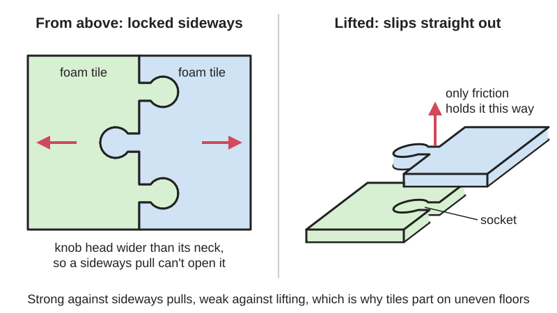
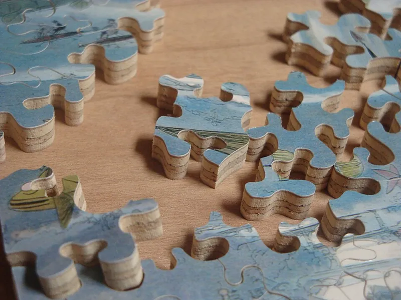

<figure class="eoc-pic eoc-pic-main"><figcaption>Diagram drawn for the encyclopaedia from the research notes. ⚑ Needs confirming: a drawing can simplify or get details wrong; a real photo or a better diagram is welcome.</figcaption></figure>
<figure class="eoc-pic"><figcaption><strong>Photo.</strong> <a href="https://commons.wikimedia.org/wiki/File:Close_up_of_Hand_Cut_Jigsaw_Puzzle.JPG">Close up of Hand Cut Jigsaw Puzzle</a> by Charles Hamm, <a href="https://creativecommons.org/licenses/by/3.0">CC BY 3.0</a>, from Wikimedia Commons.</figcaption></figure>

Two flat panels are cut along a matching wavy edge of rounded knobs and sockets, so pressing them together locks them side by side against being pulled apart, with no glue or fasteners.

**In plain words:** Edges cut like jigsaw-puzzle pieces, so the knobs on one sheet press down into matching holes on the next and the two lock side by side without glue, like foam play mats on a floor. **Proper term:** Jigsaw puzzle-edge joint (puzzle joint, interlocking tile edge).

**Also called:** puzzle joint / jigsaw joint; puzzle mat, puzzle tile, interlocking foam mat or tile (flooring trade names; Greatmats); universal interlock (every edge of the tile has the same pattern, so tiles fit any way round; Greatmats); tab-and-blank edge: the knob is a 'tab' and the socket a 'blank' (Wikipedia, Jigsaw puzzle); hidden interlock / snap-together tile (the interlock sits under the surface; Greatmats); dovetail, T-shaped and triangular interlocks (other tooth shapes on PVC tiles; Greatmats); jigsaw-like suture (engineering research term for the same shape; Barthelat lab, McGill); rounded dovetail panel joint (Boxes.py 'JointPanel').

## How it works

Each knob is wider at its head than at its neck, so once it is pushed down into the matching socket the neck of the socket wraps round it and the two panels can't be pulled apart sideways in any direction in their own plane (shape lock, [form-fit](../glossary.md#form-fit--force-fit--material-bond)). The tiles are usually pushed together slightly tight, so friction and the springiness of foam or rubber keep the knob from lifting back out. Nothing stops a knob coming straight up out of its socket except that friction, so the joint is strong against sideways pulling but weak against lifting, peeling or bending at the seam, which is why tiles part on uneven floors (Greatmats). Engineering tests on 3D-printed jigsaw-shaped joints found that a larger locking angle and more friction make the tabs harder to pull out (Barthelat lab, reported by 3DPrint.com).

## Parts

Single piece per panel: the knobs (tabs) and sockets (blanks) are cut into the panel edges themselves. Floor-tile sets may add separate straight border strips that fill the sockets on the outside edges, and ramped edge strips (Greatmats; Printables).

## Everyday examples

- EVA foam play mats and alphabet floor mats for children
- gym, yoga and martial-arts puzzle mats; interlocking rubber gym floor tiles
- jigsaw puzzles
- PVC and plastic garage floor tiles that snap together

## When to use it

When many flat panels of the same thickness must be laid edge to edge quickly and taken up again: floor and play mats, workshop or exhibition floors, wall padding, modular game boards and terrain tiles, and big laser-cut or printed panels that are larger than the machine (Greatmats; Boxes.py). It needs no glue or tools and lines tiles up flush. EVA puzzle mats are also a cheap source of foam for cosplay costumes (Greatmats), where the puzzle edges are usually cut off.

## When not to use it

When the joint will be lifted, bent or peeled (it only resists sideways pull): glue the seam, tape it underneath, or use a dovetail key, tongue-and-groove or a hidden snap-together tile instead. When the floor is not flat, or where heavy furniture, rolling chairs or high heels load foam tiles (Greatmats suggests rubber or snap-together tiles). When a seam must be watertight. For joining 3D-print pieces, see Split-part joints for large prints. For panels that must be taken apart often but held firmly, use clips or snap fits.

## Details

- **What it does (jobs):**
  - join and hold: locks flat panels edge to edge with no glue
  - line parts up exactly: the knobs put each tile in the right place and keep the surface flush
- **Movement:** none
- **Directions it can move (degrees of freedom):** 0 in the plane of the panels (it can't slide or twist sideways); the one way out, lifting a knob straight up out of its socket, is held only by friction, and the seam can also bend a little like a hinge in foam tiles
- **Special behaviour:**
  - self-aligning or self-centring: pressing the knobs into the sockets brings neighbouring tiles into line and flush
  - quick-release: tiles come apart by hand by peeling at a seam (Greatmats), though they are not designed as a quick-release fixing
- **How it holds:**
  - shape (the parts interlock; form-fit): the knobs are wider than their necks, so they can't be pulled out sideways
  - friction or clamping (force-fit): a snug fit and the springiness of foam or rubber hold the knob down in its socket
- **Input and output:** not applicable
- **Power:** passive (no power needed)
- **Load:** light to medium: strong against pulling apart sideways (tension and [shear](../glossary.md#peel-vs-shear) in the plane of the tiles), which is all a floor of tiles needs to stay together under foot traffic; weak against lifting, peeling, bending or twisting the seam out of plane, so tiles can separate on uneven floors (Greatmats). Foam tiles do not stand up well to heavy furniture or moving chairs; rubber tiles take heavy gym weights (Greatmats). No strength figures found for floor tiles ⚑ [uncertain]
- **Play and precision:** small: a snug fit in foam and rubber; hand-cut wooden puzzles fit more loosely (Wikipedia, Jigsaw puzzle). It tolerates very little sideways offset (the knobs must match), but foam bends to follow small bumps in the floor before the seams start to open (Greatmats) ⚑ [uncertain]
- **Taking it apart:** removable: tiles pop out by pushing a finger in at the seam and peeling the tile out, or with a thin, narrow tool for dense or thick tiles (Greatmats); glued versions (e.g. a glued 3D-print or plywood puzzle seam) become permanent
- **How often it can be reused:** many times: puzzle mats are meant to be taken up and put down again (Greatmats); the knobs of soft foam tiles stretch and loosen slowly with repeated use ⚑ [uncertain]
- **Sealing:** none: the seam is a cut line that lets water and dust through, although the tiles themselves may be waterproof (Greatmats)
- **Adjustable:** no: the knob pattern fixes the position; tiles can be re-arranged or cut down, and with a 'universal' edge any tile fits any way round (Greatmats)
- **Access needed:** one side only (blind): tiles are pressed down from above; the edges must be reachable as each tile goes in
- **Materials:** Usually EVA foam (play, gym and martial-arts mats), carpet- or vinyl-topped foam, recycled rubber (gym and stable floors), PVC and polypropylene (garage and hidden-interlock tiles) (Greatmats); cardboard and wood (jigsaw puzzles; Wikipedia); laser-cut plywood, MDF and acrylic panels (Boxes.py JointPanel); 3D-printed PLA, PETG and TPU tiles (Printables). It suits flat sheets of even thickness that are springy enough to press together (foam, rubber, soft plastics) or cut precisely (laser, CNC). It works poorly in [brittle](../glossary.md#brittle--ductile) sheets that crack at the narrow neck (e.g. thin acrylic) unless the fit is loose and glued ⚑ [uncertain]
- **Heat, cold, water and wear:** Foam tiles expand with heat and humidity, so leave a gap at walls or they buckle (Greatmats); widely varying temperature and humidity and an unlevel subfloor make interlocking tiles separate (Greatmats). Foam tiles dent and tear under heavy, concentrated loads (Greatmats). Wet areas need tiles that let water drain, such as perforated snap-together tiles (Greatmats). Soft foam knobs may slowly stretch and loosen with repeated assembly ⚑ [uncertain].

## Making it

- **Ways to make or get it:**
  - off-the-shelf part: EVA foam puzzle mats, rubber and PVC interlocking tiles, border strips
  - laser cut: puzzle or rounded-dovetail edges to join sheets bigger than the laser bed (Boxes.py JointPanel)
  - CNC: routed puzzle edges in plywood, MDF or foam ⚑ [uncertain]
  - 3D print (FDM): interlocking tiles and edge ramps (Printables), and puzzle joints in split prints (see Split-part joints for large prints)
  - woodwork: scroll-saw or fretsaw-cut jigsaw puzzles (Wikipedia)
  - hand cutting of foam tiles with a utility knife (Greatmats)
- **Printing it in one piece (print in place):** no: each tile or panel is printed separately and pressed together afterwards
- **Tools:** none to assemble or take apart; a sharp utility knife and a straight edge to cut tiles to fit (Greatmats); a laser cutter, scroll saw, CNC router or 3D printer to make your own
- **Difficulty:** easy to moderate: easy to use bought tiles; moderate to cut your own, because the knobs and sockets must match closely (use a laser cutter, CNC or 3D printer with test pieces; Boxes.py has a fit setting, and the ramp-strip designer says to print test pieces because every tooth profile is different)

### 3D printing tips

1) Print tiles flat, so the knob and its narrow neck lie in the layer plane and are not split between layers ⚑ [uncertain]. 2) Every tooth profile fits differently, so print small test pieces before committing to a full set (Printables, 'Interlocking Tile Transition Ramp Edge Strip'). 3) Give the joint a small [clearance](../glossary.md#clearance) so it presses together by hand; for printed puzzle joints and a tunable fit, BOSL2's jigsaw and dovetail joiners have a slop setting (see Split-part joints for large prints, item 62, which covers puzzle joints in split prints). 4) For floor-style tiles that must flex and grip, print in TPU and set the softness with [infill](../glossary.md#infill) and walls (Printables, untested design); for edge ramps that will be walked on, use at least 6 top and bottom layers and up to 100% infill (Printables ramp strip). 5) The narrow neck of each knob is the weak point: keep it wide enough for at least several extrusion widths ⚑ [uncertain].

### Buying one (off-the-shelf parts)

EVA foam puzzle mats and play mats (2 x 2 ft tiles are common), martial-arts puzzle mats, interlocking rubber gym tiles, PVC hidden-interlock floor tiles, polypropylene snap-together garage tiles, interlocking carpet tiles, border strips and edge ramps (search 'interlocking foam mats' and 'interlocking floor tiles'; Greatmats catalogue)

## Rules of thumb

- Leave a 1/4 in (about 6 mm) gap between foam tiles and walls because foam flooring may expand with heat and humidity; cut edge tiles to leave that gap so the floor does not buckle (Greatmats installation guide)
- Lay tiles on a clean, hard, flat floor and start in a corner (Greatmats); uneven floors and big temperature and humidity swings make tiles separate (Greatmats buyers guide)
- To cut foam tiles, mark with a straight edge, score with several shallow passes until the tile folds, then finish from the other side with a sharp blade (Greatmats)
- Resistance to pull-out rises with the interlocking (locking) angle and the friction coefficient; tests found a higher locking angle with lower friction gave the best [stiffness](../glossary.md#stiffness), energy absorption and strength (Barthelat lab, JMPS paper, as reported by 3DPrint.com)
- When a large laser-cut panel is split into pieces, cut each piece with its surrounding sheet so the burn ([kerf](../glossary.md#kerf)) correction is right, and raise the burn value for a tighter fit (Boxes.py JointPanel)
- Print test pieces of the tooth profile before making a full set (Printables ramp strip)

## Common failures

1) Tiles separate or seams open: level the floor, leave the expansion gap, and choose thicker, denser tiles (Greatmats). 2) Floor buckles: no gap left at the walls for expansion (Greatmats). 3) Knob necks tear in thin or low-density foam, or crack in brittle sheet: use thicker material or a wider neck ⚑ [uncertain]. 4) Home-made puzzle edges too tight (won't go together, or crack) or too loose (fall apart): cut or print test pieces and adjust the fit (Printables ramp strip; Boxes.py burn setting). 5) Seams lift at the edges of a floating floor: reattach the border strips (Greatmats). 6) Damaged tile: pop it out by the seam and press a new one in (Greatmats).

## Safety

EVA foam puzzle mats for children: in 2010 several EU countries found formamide (a substance toxic to reproduction) in foam toys such as puzzle mats, and the EU now limits formamide emissions from foam toy materials (Commission Directive (EU) 2015/2115), so buy children's mats that meet toy safety rules, air new mats out, and don't let small children chew them [the 'air out' and 'chew' advice is general caution, not from the directive]. Raised tile edges and corners lifting where tiles separate can be a trip hazard; finish open edges with border strips or ramps (Greatmats; Printables ramp strip) ⚑ [uncertain]. Utility knives used to cut tiles are sharp: use a straight edge and fresh blade (Greatmats). Vulcanised rubber tiles can smell strongly and need ventilation (Greatmats).

## Related

- Split-part joints for large prints (dovetail keys, puzzle joints, alignment pins): the same puzzle edge on the cut faces of a 3D print, usually glued
- Dovetail joint and Sliding dovetail: wedge-shaped tails that lock in one sliding direction; a puzzle knob is a rounded dovetail pushed in from above
- Butterfly key (bowtie key): a separate double-dovetail piece let into both boards across a seam
- Tongue-and-groove joint: a lip along one edge into a groove in the next; stops lifting and keeps faces flush but does not lock against pulling apart
- Snap fits ([cantilever](../glossary.md#cantilever) snap fit): hidden snap-together floor tiles lock with springy hooks instead of puzzle knobs
- Japanese interlocking joints: many interlocking shapes in timber, usually in three dimensions
- Mechanical interlock: the general idea of joining by shape

## Make it yourself

- [JointPanel (Boxes.py)](https://boxes.hackerspace-bamberg.de/JointPanel): Online generator that splits a panel larger than your laser cutter into pieces joined by dovetails with rounded corners (puzzle-style), with settings for tail size, angle, depth and burn (fit) *(licence: GPL-3.0 (Boxes.py software, per its LICENSE.txt on GitHub))*
- [Interlocking Tile Transition Ramp Edge Strip (madonius, Printables) (URL from Printables API, page not opened)](https://www.printables.com/model/1834980-interlocking-tile-transition-ramp-edge-strip): Parametric OpenSCAD/BOSL2 ramp strip that clips into the puzzle edge of bought floor tiles; tooth profile and height are adjustable *(licence: CC BY-NC-SA)*
- [GridLink 5012 Jigsaw Tiles for Flat Panels, Boxes, Doors (GateIron, LLC, Printables) (URL from Printables API, page not opened)](https://www.printables.com/model/1305626-gridlink-5012-jigsaw-tiles-for-flat-panels-boxes-d): Modular printed panels with visible jigsaw connectors for building boxes, panels and drawers *(licence: CC BY-NC-SA)*

## Pictures, videos and models

- [Jigsaw.svg (Amada44, Wikimedia Commons)](https://commons.wikimedia.org/wiki/File:Jigsaw.svg): Simple drawing of a four-piece jigsaw puzzle showing the knobs (tabs) and sockets (blanks) *(licence: Public domain)*
- [Close up of Hand Cut Jigsaw Puzzle (Charles Hamm, Wikimedia Commons)](https://commons.wikimedia.org/wiki/File:Close_up_of_Hand_Cut_Jigsaw_Puzzle.JPG): Close-up photo of hand-cut puzzle pieces locked together *(licence: CC BY 3.0)*
- [Puzzle Mat Buyers Guide (Greatmats)](https://www.greatmats.com/puzzle-mat-buyers-guide.php): Photos of EVA foam, rubber and carpet puzzle mats and their jigsaw edges; FAQ on why tiles separate, cutting tiles and other uses *(licence: link only)*
- [Foam Puzzle Mat Installation for 2x2 Mats with Universal Interlocks (Greatmats)](https://greatmats.com/foam-mats/puzzle-mat-installation-video-for-2x2-mats-with-universal-interlocks.php): Installation video and steps: expansion gap, removing and refitting border strips, cutting tiles *(licence: link only)*
- [McGill University Researchers Use 3D Printing to Develop Bio-Inspired Interlocking Sutures (3DPrint.com)](https://3dprint.com/167501/3d-print-interlocking-structures/): Figures of 3D-printed jigsaw-shaped interlocking tabs under tension test, showing how tabs pull out *(licence: link only)*

## Needs confirming

⚑ marks something nobody has confirmed yet: a fact the research could not confirm from a source, a finder value that is a best guess, or an open point from the research notes. Corrections are welcome (see `research/needs-confirming.md`).

- ⚑ 10 sentences on this page marked [uncertain].
- ⚑ Research note: *Jigsaw puzzle-edge joint* (427): the McGill research is known through 3DPrint.com's report only.

## Sources

- <https://www.greatmats.com/puzzle-mat-buyers-guide.php>
- <https://www.greatmats.com/interlocking-floor-mats/puzzle-vs-snap-together-interlocking-floor-tile.php>
- <https://greatmats.com/foam-mats/puzzle-mat-installation-video-for-2x2-mats-with-universal-interlocks.php>
- <https://www.greatmats.com/how-to-replace-foam-floor-tiles.php>
- <https://en.wikipedia.org/wiki/Jigsaw_puzzle>
- <https://commons.wikimedia.org/wiki/File:Jigsaw.svg>
- <https://commons.wikimedia.org/wiki/File:Close_up_of_Hand_Cut_Jigsaw_Puzzle.JPG>
- <https://3dprint.com/167501/3d-print-interlocking-structures/>
- <https://www.legislation.gov.uk/eudr/2015/2115/data.htm?view=plain>
- <https://boxes.hackerspace-bamberg.de/JointPanel>
- <https://api.printables.com/graphql/>
- <https://raw.githubusercontent.com/florianfesti/boxes/master/LICENSE.txt>
