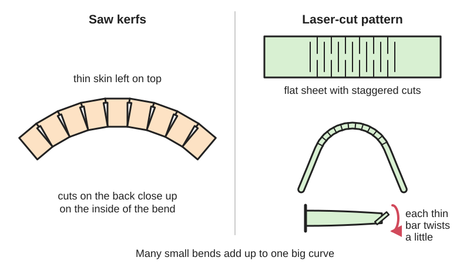
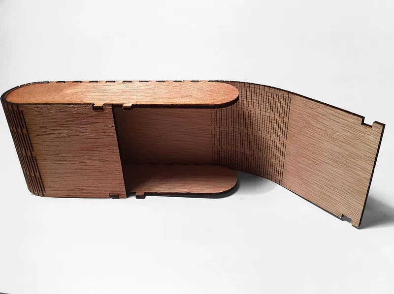

<figure class="eoc-pic eoc-pic-main"><picture><source media="(prefers-reduced-motion: reduce)" srcset="../media/drawn/kerf-bending.svg"></picture><figcaption><strong>Animation.</strong> Diagram drawn for the encyclopaedia from the research notes. ⚑ Needs confirming: a drawing can simplify or get details wrong; a real photo or a better diagram is welcome.</figcaption></figure>
<figure class="eoc-pic"><figcaption><strong>How it works.</strong> <a href="https://commons.wikimedia.org/wiki/File:Living_hinge_(wood).jpg">Living hinge (wood)</a> by Autopilot, <a href="https://creativecommons.org/licenses/by-sa/3.0">CC BY-SA 3.0</a>, from Wikimedia Commons.</figcaption></figure>

Cutting many closely spaced slots, or a lattice of short cuts, into a stiff sheet so the thin strips left between them can bend or twist, letting the sheet curve around a form or flex like a hinge while staying in one piece.

**In plain words:** Rows of cuts or slots in a stiff flat sheet, like plywood, MDF or acrylic, so it can bend around a curve or flex like a hinge without breaking. **Proper term:** [Kerf](../glossary.md#kerf) bending (kerfing; laser-cut [living hinge](../glossary.md#living-hinge) or lattice hinge).

**Also called:** kerfing, kerf cutting, relief cutting (Speetzen and Kobbelt 2024; woodworking use); kerf cut, bending cut, 'cutting technique for bending applications' (Trotec); laser-cut living hinge, wood living hinge ('a variant on the kerf bend can be used to create living hinges in laser cut wood'; Wikipedia 'Living hinge'); lattice hinge, Snijlab-style living hinge, 'sninge', laser cut hinge (Deferred Procrastination); flex cut, flex edge, 'Boxes with flex' (Boxes.py terms); kerf bend (MatterHackers; Hackaday); kerfed lining or 'kerfing' (the slotted strips glued inside acoustic guitars where the top and back meet the sides; The Art of Lutherie); kerfed panels, bendable MDF or plywood (pre-kerfed sheet sold for curved panels and columns; Rockler), e.g. Neatform (brand); bidirectional kerf patterns such as interlocking spirals, honeycombs and auxetic-looking lattices (Speetzen and Kobbelt 2024; Trotec).

## How it works

Woodworking version: cutting slots (kerfs) across the back of a board 'nearly all the way through the material' makes it act like a much thinner board, so it bends easily, and the kerfs pinch closed on the inside of the curve (Woodworker's Journal; Rockler; WWGOA). Laser-cut version: staggered rows of cuts turn the sheet into a chain of short bars joined at their ends; when the sheet bends, each thin bar twists a little ([torsion](../glossary.md#torsion)), 'similar to how a chain, which has solid links, bends by rotating around the pivots that join each link', so a large bend is shared among many small twists and the sheet springs back if each twist stays within the material's elastic limit (Deferred Procrastination; Speetzen and Kobbelt 2024). More, longer and closer cuts make the sheet bend more easily and to a tighter curve; fewer cuts leave it stiffer and more likely to crack, while too many make it flimsy (Trotec; Speetzen and Kobbelt 2024). Most patterns bend in one direction only, but some (honeycombs, spirals, triangles) bend in several directions (Trotec; Speetzen and Kobbelt 2024).

## Parts

Single piece: a pattern of cuts in one sheet. In woodworking, a row of saw kerfs cut across the back of a board nearly all the way through, leaving a thin uncut skin (Rockler; WWGOA). In laser cutting, staggered rows of through-cuts that leave short solid bridges ('junctions') joined by thin twisting strips ('spring connections') (Deferred Procrastination). A form, glue, filler or the rest of the box holds the bent shape.

## Everyday examples

- Laser-cut plywood boxes, phone stands and dice towers with rounded, bendy walls (Commons 'Living hinge (wood).jpg'; Printables models)
- Flexible plywood notebook or tablet covers that fold at a laser-cut lattice, like Snijlab's (Deferred Procrastination)
- Curved cabinet panels, arched built-ins and the rounded 'bullnose' bottom step of a staircase (Rockler; WWGOA)
- Kerfed linings inside acoustic guitars, which bend to follow the curved sides and give a glue surface for the top and back (The Art of Lutherie)

## When to use it

Use kerf bending when you need a curve or a fold in a stiff sheet material and don't want to steam-bend, laminate or join many small flat pieces. It suits rounded corners on laser-cut boxes and enclosures (a single wall can wrap round the ends, as in Boxes.py's FlexBox), flat-pack items that are cut flat and bent on assembly, light-duty hinges with large radii such as notebook covers (Wikipedia 'Living hinge'; Deferred Procrastination), curved furniture and cabinet panels, and freeform shapes built from MDF or plywood (Speetzen and Kobbelt 2024). It works with the tools most makers already have: a laser cutter, or any saw with a controllable depth of cut (Rockler), and it is 'especially useful for bending plywood' (Rockler).

## When not to use it

Avoid it where the part must carry real load before it is glued or backed, since it 'is not very strong' (Rockler); use steam bending or bent lamination for strong curved parts, or thicker solid material. Avoid it where the part must be sealed against water, dust or light (fill the kerfs or use a solid curved part). For a hinge that opens and closes thousands of times, a pin hinge, piano hinge or a moulded polypropylene living hinge lasts longer, especially compared with [brittle](../glossary.md#brittle--ductile) acrylic lattices (Trotec). For a small, precise pivot, use a [flexure](../glossary.md#flexure) hinge or a lamina emergent torsional (LET) joint. If you can 3D print the part, print the curve directly unless you need it to flex. Don't use it in solid wood thicker than about 5 mm with laser cuts, or across the grain (Trotec).

## Details

- **What it does (jobs):**
  - let it move (turn, slide or bend): lets a stiff sheet bend, either once into a fixed curve (a rounded box wall, a curved cabinet panel) or again and again as a flexible hinge (a notebook cover)
  - join and hold: one kerfed panel can wrap round several corners, so a box needs fewer separate pieces and joints, e.g. a plywood Arduino box 'made from only 3 pieces' (Deferred Procrastination)
- **Movement:** flex: bends about a line parallel to the cuts; laser-cut lattice hinges in 3 mm acrylic were bent to 90° in tests (Deferred Procrastination), and kerf-cut plywood walls wrap round the half-round ends of boxes (Commons 'Living hinge (wood).jpg') ⚑ [uncertain for the largest safe angles]
- **Directions it can move (degrees of freedom):** 1 intended: bending across the cuts. Lattice patterns also stretch and squash in the plane of the sheet, at right angles to the cuts (Deferred Procrastination), and some patterns bend in more than one direction (Trotec 'honeycombed cut line': 'flexibility in all directions'). 0 once the bent sheet is glued to a frame or its kerfs are filled.
- **Special behaviour:**
  - none: it simply bends. A laser lattice hinge that is not glued springs back toward flat, as long as the twisting stress in each strip stays below the material's yield stress (Deferred Procrastination)
- **How it holds:**
  - not a holding joint (it moves or passes on motion): the cut pattern only makes the sheet bendable; the bent shape is held by the parts it is fixed to
  - [material bond](../glossary.md#form-fit--force-fit--material-bond) (glue, solvent or melting): kerf-bent panels are glued to a form, frame or box ends, or the kerfs are filled with thick epoxy, filler or wood strips to make the curve rigid (WWGOA; Rockler)
- **Input and output:** not applicable
- **Power:** passive (no power needed)
- **Load:** light: kerf bending 'is not very strong' (Rockler), and a cut lattice is much floppier than the solid sheet, stretching and squashing along the sheet (Deferred Procrastination); for a very soft hinge its designer 'added support by gluing a thinner material across the inside of the hinge to prevent expansion' (Deferred Procrastination). Once glued to a frame or with its kerfs filled with epoxy, a kerfed plywood panel is rigid enough for cabinet arches and stair risers (WWGOA; Rockler).
- **Play and precision:** No play, since it is one piece, but the curve is only as accurate as the form it is bent over. Few, widely spaced cuts give a faceted curve with flat spots, so 'keep the kerfs close together and regularly spaced' (Rockler); spacing within 1/32-1/16 in (about 0.8-1.6 mm) of the target is consistent enough (WWGOA). As a hinge its pivot line is not well defined, and it stretches and squashes under load (Deferred Procrastination). Laser-scanned kerfed MDF objects matched their target shapes 'very well locally', but small errors built up during assembly and caused 'slight global deformations' (Speetzen and Kobbelt 2024); the [accuracy](../glossary.md#repeatability--accuracy) of kerf-bent MDF arcs was studied by Lorenzoni and Silva (2022, cited there) ⚑ [uncertain for typical values].
- **Taking it apart:** permanent: the cuts are part of the sheet and cannot be undone; a laser-cut living hinge can be unfolded and refolded, and a bent panel can be unscrewed from its frame, but the pattern itself is not a joint that comes apart
- **How often it can be reused:** Not taken apart at all. Used as a moving hinge it can flex many times if each strip's twist stays below the yield stress, which gives 'much better [fatigue](../glossary.md#fatigue) properties' (Deferred Procrastination); acrylic lattices are 'best for rigid bends ... where the bending radius is very rarely changed' because 'with a continuous load ... the webs can easily break' (Trotec). No measured cycle counts were found ⚑ [uncertain].
- **Sealing:** none: laser cuts go right through, and saw kerfs leave open slots on the back, so it leaks air, water and light unless the kerfs are filled or the panel is backed
- **Adjustable:** no: [stiffness](../glossary.md#stiffness) and the tightest radius are set by the cut pattern, spacing, cut depth and sheet thickness; change them by cutting a new pattern
- **Access needed:** not applicable
- **Materials:** Plywood ('very suitable for the use of bending applications'; Trotec), MDF (no grain to line up; Trotec; Speetzen and Kobbelt 2024), solid wood up to about 5 mm cut along the grain (Trotec), acrylic, which is brittle and needs wider-spaced cuts and gentle, rarely changed bends (Trotec; Deferred Procrastination), and walnut plywood or aromatic cedar for kerf-bent project boxes (Hackaday 2012). Other sheet materials such as bamboo or thick card may work but were not covered by the sources ⚑ [uncertain]. Saw-kerf bending works on plywood and solid boards of many thicknesses (Rockler). In 3D printing, tough, stretchy plastics such as PETG, nylon or polypropylene suit flexing patterns better than PLA or ABS, which 'fail to make the grade' for living hinges (MatterHackers).
- **Heat, cold, water and wear:** Plywood, MDF and solid wood swell and shrink with humidity, and the thin bridges and skins left by kerfing are easily damaged by moisture ⚑ [uncertain]. Glue choice decides outdoor use: standard PVA 'will not stand up well to moisture', 'Titebond III' (brand) is waterproof and cured epoxy is waterproof (Rockler). Acrylic lattices are brittle and fail under continuous load (Trotec), and the heat of laser cutting may change acrylic's properties (Deferred Procrastination suggests this as one reason test hinges broke early). Plastic lattices [creep](../glossary.md#creep) if held bent under load (Deferred Procrastination's elastic model assumes no creep) ⚑ [uncertain].

## Making it

- **Ways to make or get it:**
  - laser cut: the most common maker method, for plywood, MDF and acrylic (Ponoko; Trotec; Boxes.py 'Boxes with flex')
  - CNC: kerfed panels for furniture and architecture (Speetzen and Kobbelt 2024 review) ⚑ [uncertain for CNC router specifics]
  - woodwork: parallel saw kerfs across the back of a board with a table saw, radial-arm saw, track saw or handsaw (Rockler; WWGOA; Woodworker's Journal)
  - 3D print (FDM): the voids are designed into a flat print ('in 3D printing the voids can simply be designed into the part'; Hackaday 2023; MatterHackers)
  - off-the-shelf part: pre-kerfed bendable MDF or plywood sheet (Rockler)
- **Printing it in one piece (print in place):** yes: the pattern is just holes in a flat printed sheet, so it bends straight off the bed with no assembly (Hackaday 2023). But a printer can usually print the curve directly, so the pattern is mainly worth it for parts that must flex, or that are printed flat and wrapped round something ⚑ [uncertain].
- **Tools:** To make: a laser cutter or CNC router for lattice patterns; for saw kerfs a table saw, radial-arm saw, track saw, circular saw with a guide, or even a handsaw (Rockler; WWGOA; Woodworker's Journal). To finish: a bending form, clamps or tape, and glue or thick epoxy to fix the curve (WWGOA). To use: none.
- **Difficulty:** moderate: cutting a pattern is easy with a laser cutter and a generator, but getting a curve that bends far enough without cracking or going floppy takes test swatches (Ponoko; Obrary); saw kerfing is simple but the cut depth must be controlled to a fraction of a millimetre (WWGOA)

### 3D printing tips

1) First ask whether you need it: a 3D printer can print a curved wall directly. Kerf or lattice patterns in prints are useful for parts that must flex, for wrap-around sleeves, and for decorative 'patterned radii' (MatterHackers; Hackaday 2023). 2) Print the sheet flat on the bed with the cuts modelled as slots; it needs no supports. 3) Material matters most: PLA and ABS have low elongation and crack in hinges; polypropylene, PETG and nylon are tougher (MatterHackers shows PLA and polypropylene hinges side by side and prints its FFF hinge example in nylon). 4) FFF can't print the very thin webs used in moulding: 'since average FFF layer heights range from 200 - 250 microns, hinge thicknesses of 250 - 380 microns used in injection molding solutions most likely will not work' (MatterHackers), so make the bending strips several layers thick and several extrusion widths wide and accept a stiffer hinge. 5) Share the bend among many strips: like laser lattice hinges, more, longer links each twist less, and keeping link length under about 4 × thickness stops the edges splaying and breaking (Deferred Procrastination, tested in acrylic and MDF) ⚑ [uncertain for printed plastics]. 6) Round the ends of slots to avoid sharp stress-raising corners ⚑ [uncertain]. 7) Test a small swatch through the full bend before printing the whole part, as the laser-cutting guides recommend (Ponoko; Obrary). 8) Don't leave a printed plastic lattice bent under load for long; plastics creep (Deferred Procrastination's elastic model assumes 'no plastic creep for polymers') ⚑ [uncertain].

### Buying one (off-the-shelf parts)

Pre-kerfed bendable panels, e.g. 1/4 in 'Neatform' (brand) bendy MDF, and 'various pre-kerfed materials' in 4 × 8 ft sheets from large lumber suppliers (Rockler); kerfed guitar linings for instrument making (The Art of Lutherie); laser-grade 3 mm birch plywood (used by the Printables phone-stand and dice-tower designs); thick, non-running epoxy or wood filler to lock a bent panel (WWGOA); a thin veneer, fabric or film glued across the inside to stiffen a soft hinge (Deferred Procrastination) ⚑ [uncertain for fabric and film].

## Rules of thumb

- Laser, straight parallel lines: 'the further apart that each cutting line is, the greater the bending radius will be'; 'a distance up to 0.5 mm between the lines can be processed'. Small waves suit material up to 3 mm; large honeycombs let wood up to about 5 mm flex; the triangular pattern suits up to about 3 mm and 'becomes inflexible and rigid after 5 mm or more' (Trotec, tested on acrylic and wood 3-5 mm).
- Laser, acrylic: use at least a 2 in focal-length lens so cuts don't melt back together, cut lines about 1-1.5 mm apart, and increase the spacing if they still fuse, although wider spacing makes it stiffer (Trotec).
- Grain: in solid wood up to about 5 mm, cut the pattern in the direction of the grain 'to avoid a loss in flexibility or material damage'; MDF has no grain to line up (Trotec).
- Lattice-hinge sizing (twisting strips of square section): minimum number of links in series n ≥ 0.676 × Θ × G × t / (τ_yield × l), where Θ is the total bend in radians, G the [shear](../glossary.md#peel-vs-shear) modulus, t the sheet thickness, τ_yield the shear yield stress and l the connected length. For 3 mm acrylic (G = 2 GPa, τ_yield = 60 MPa) bent 90°: l = 5 mm needs 22 links, 10 mm 11, 20 mm 6 and 30 mm 4; the author also plots 60% of yield for repeated bending (Deferred Procrastination, 'Laser-cut Lattice Living Hinges', 2011).
- Keep each spring connection shorter than about 4 × sheet thickness (l ≤ 4t): longer ones let the hinge edges splay and several acrylic samples broke; [clearance](../glossary.md#clearance) between links k = −t + 2√(t²/2) × cos(π/4 − Θ/n), and if k is less than the laser kerf a single cut line is enough; total hinge width W = t·n + k(n+1) (Deferred Procrastination, 'Lattice Hinge Test Results', 2011).
- Alternating parallel cuts make a strip into 'a series of concatenated beams, the twist of which creates the curvature'. For MDF, research used τ_yield = 18 MPa and G = 1.6 GPa (from Chen et al., Acta Mechanica 2020) and designed with G/τ_yield = 100 as a safety margin; cuts closer than about 0.9 mm were flagged because the laser could burn the material away; 'too many cuts may result in a very unstable result, while the opposite can lead to the material breaking', and cutting more than 25% fewer cuts than their calculated number 'often leads to material failure' (Speetzen and Kobbelt 2024, 3 mm MDF, Epilog Helix laser).
- Boxes.py flex-cut defaults: cut lines 0.5 × thickness apart ('distance'), bridges 1 × thickness long ('connection'), cut length 5 × thickness ('width'), and a 'stretch' hint of 1.05 for 'how much the flex part should be shortened' (Boxes.py edges.py, FlexSettings).
- Saw kerfs: cut deep enough to leave 1/32-1/64 in (about 0.8-0.4 mm) of material; go closer to 1/64 in for tighter bends. One kerf every 3/8 in (about 9.5 mm) worked for an arch in 3/4 in plywood. Kerfs on the outside (convex) face of the curve can be farther apart than kerfs on the inside (concave) face. Support the workpiece along its whole length while cutting, and give the bending form ribs every 4-6 in for 3/4 in plywood (WWGOA, 'How to Bend Plywood the Easy Way', 2023).
- 'A tighter bend radius requires narrower spacing between the kerfs, while a larger radius can get away with wider kerf spacing' (Woodworker's Journal, 2024); 'keep the kerfs close together and regularly spaced so that the bend is smooth and regular with no flat spots', and practise on scrap first (Rockler).
- A traditional shop estimate for kerf spacing: cut a kerf, clamp one end of the board to a flat table and lift the other end until the kerf closes; the rise measured at the radius distance gives the spacing between kerfs (Fine Homebuilding forum tip, 2002) ⚑ [uncertain].

## Common failures

1) Cracks while bending, because the links are too short, too few or too thick, the bend is too tight for the pattern, the cuts run across the grain, or the material is brittle acrylic (Deferred Procrastination; Trotec). Fix: longer or more links, a wider hinge area, cut along the grain, or a tougher material. 2) Links splay outward and break at the edges when the spring connections are longer than about four times the sheet thickness (Deferred Procrastination). 3) Faceted curve with flat spots, from kerfs spaced too far apart or unevenly (Rockler). 4) Floppy, unstable panel from too many cuts (Speetzen and Kobbelt 2024). 5) Cutting through the skin of a saw-kerfed board, often because bowed plywood makes the cut depth vary on a table saw; a track saw keeps a constant depth (WWGOA). 6) Acrylic cuts melting back together; use a longer focal-length lens or wider spacing (Trotec). 7) Bridges burned away when cut lines are too close together for the laser (Speetzen and Kobbelt 2024). 8) The panel snaps while being cut or moved because it isn't supported along its length (WWGOA). 9) The curve springs open or creeps back because it wasn't glued or fixed firmly to its form or frame ⚑ [uncertain].

## Safety

Laser cutting kerf patterns means very long cut paths packed close together in flammable plywood or card, so watch the job: 'never leave an operating laser cutter unattended', use air assist, vacuum out debris, keep a fire extinguisher nearby, and never cut PVC or vinyl, which gives off hydrogen chloride gas (MIT EHS). Saw kerfing needs many repeated cuts; follow table-saw guarding and push-stick practice (OSHA table saw eTool), and support the work, because a heavily kerfed panel becomes 'very flimsy and will be prone to breaking' (WWGOA). Bent acrylic can snap suddenly and leave sharp edges ⚑ [uncertain]. A bent sheet stores spring energy and can spring back when released ⚑ [uncertain].

## Related

- Living hinge: a thin flexible web in plastic that bends instead of a cut pattern; lasts longest in polypropylene; kerf bending is 'the laser-cutting cousin'
- Lamina emergent torsional joint (LET joint): a small set of slots that makes a precise fold line in stiff sheet using the same twisting strips as a lattice hinge
- Flexure hinge (notch, leaf-spring and cross-axis pivots): bending flexures with a better-defined pivot but smaller angles
- Finger joint (box joint): often used at the edges of kerf-bent box walls to join them to the flat sides
- Mechanical metamaterial mechanism (shear-cell hinge arrays): cell patterns that combine many small hinges into a mechanism
- Steam bending and bent lamination: the traditional ways to make strong curved wood parts without cuts (Rockler's 'Bending Wood' series, parts II and III) ⚑ [uncertain]
- Piano hinge (continuous hinge): a pin hinge for doors and lids that open often and carry load
- Tape-spring hinge (measuring-tape fold): a curved strip that folds and snaps straight again

## Make it yourself

- [Boxes.py FlexBox generator: 'Box with living hinge and round corners' (online)](https://boxes.hackerspace-bamberg.de/FlexBox?language=en): Free web generator that draws a laser-cut box whose walls wrap round rounded corners using flex cuts, with adjustable cut spacing, bridge width and cut length, plus finger joints to the lid and base *(licence: GPL v3+ (Boxes.py is free software))*
- [Living Hinge Swatches (Obrary)](https://obrary.com/products/living-hinge-patterns): Free downloadable laser-cutting files: one set of swatches compares different hinge patterns, and another shows the straight pattern at several spacings so you can pick the flexibility you need *(licence: CC BY-SA 4.0)*
- [Trotec kerf cut graphic templates (download link on the bending-technique page)](https://www.troteclaser.com/en-us/helpcenter/materials/application-techniques/bending-technique): A ZIP of the eight kerf-cut pattern templates shown on the page, for testing in wood or acrylic *(licence: free download; licence not stated ⚑ [uncertain])*
- [Lattice Hinge Test Results (Deferred Procrastination, 2011)](http://marksabino.com/defproc/blog/2011/lattice-hinge-test-results/): Test results and design formulas for lattice hinges; the linked earlier post offers a ZIP of the cutting diagram for the 3 mm acrylic and MDF test specimens *(licence: link only; licence of the files not stated ⚑ [uncertain])*
- [Laser cut living hinge phone stand (Wyn, Printables) (URL from Printables API, page not opened)](https://www.printables.com/model/358542-laser-cut-living-hinge-phone-stand): Laser-cut phone stand in 3 mm birch plywood that folds at living hinges; the designer warns 'there's a limit to how far the hinges will bend'. Read through the Printables public API. *(licence: CC BY-NC-SA)*
- [Laser cut Flat-Pack Living Hinge Dice Tower (EcoDad, Printables) (URL from Printables API, page not opened)](https://www.printables.com/model/756965-laser-cut-flat-pack-living-hinge-dice-tower): Flat-pack dice tower that rolls up into a 100 mm cylinder using living hinges, sized for 1/8 in (3 mm) birch plywood; about 8 minutes of cutting on an Epilog laser. Read through the Printables public API. *(licence: CC BY-NC-SA)*

## Pictures, videos and models

- [Living hinge (wood).jpg (Wikimedia Commons, by Autopilot)](https://commons.wikimedia.org/wiki/File:Living_hinge_(wood).jpg): A laser-cut plywood box whose rounded wall is a kerf-cut living hinge, with finger joints at the edges; used on the Wikipedia 'Living hinge' article *(licence: CC BY-SA 3.0)*
- [Kerf Cut: Cutting technique for bending applications (Trotec Laser help centre)](https://www.troteclaser.com/en-us/helpcenter/materials/application-techniques/bending-technique): Photos of eight kerf patterns (straight lines, small waves, large honeycombs, wavy lines, honeycombed lines, wide and narrow waves, triangles), each flat and bent in wood, with material advice *(licence: link only)*
- [Laser-cut Lattice Living Hinges (Patrick Fenner, Deferred Procrastination, 2011)](http://marksabino.com/defproc/blog/2011/laser-cut-lattice-living-hinges/): Diagrams of a lattice hinge's junctions and twisting spring connections in tension, compression and bending, a photo of Snijlab's plywood hinge, and the sizing formulas *(licence: link only (© Deferred Procrastination))*
- [Living Hinges Minimum Bend Radius with Swatches for Laser Cutting Bent Plywood (YouTube, What Make Art)](https://www.youtube.com/watch?v=QvcpBnxsQws): Video of laser-cut plywood living-hinge swatches being bent to find the smallest radius each pattern can take (from the title) ⚑ [uncertain] *(licence: link only (standard YouTube licence))*
- [Kerf-Bending with a Track Saw (A.J. Hamler, Woodworker's Journal, 2024)](https://www.woodworkersjournal.com/kerf-bending-with-a-track-saw/): Step-by-step photos of cutting evenly spaced kerfs in plywood with a track saw and a simple sliding jig, and the finished panel bending smoothly *(licence: link only)*

## Needs confirming

⚑ marks something nobody has confirmed yet: a fact the research could not confirm from a source, a finder value that is a best guess, or an open point from the research notes. Corrections are welcome (see `research/needs-confirming.md`).

- ⚑ 20 sentences on this page marked [uncertain].

## Sources

- <https://en.wikipedia.org/wiki/Living_hinge>
- <https://commons.wikimedia.org/wiki/File:Living_hinge_(wood).jpg>
- <https://www.troteclaser.com/en-us/helpcenter/materials/application-techniques/bending-technique>
- <https://www.ponoko.com/blog/how-to-make/how-to-design-a-living-hinge/>
- <http://marksabino.com/defproc/blog/2011/laser-cut-lattice-living-hinges/>
- <http://marksabino.com/defproc/blog/2011/lattice-hinge-test-results/>
- <https://www.graphics.rwth-aachen.de/media/papers/359/Freeform_Shape_Fabrication_by_Kerfing_Stiff_Materials.pdf>
- <https://florianfesti.github.io/boxes/html/usermanual.html>
- <https://raw.githubusercontent.com/florianfesti/boxes/master/boxes/edges.py>
- <https://raw.githubusercontent.com/florianfesti/boxes/master/README.rst>
- <https://boxes.hackerspace-bamberg.de/FlexBox?language=en>
- <https://obrary.com/products/living-hinge-patterns>
- <https://www.rockler.com/learn/bending-wood-part-i>
- <https://www.woodworkersjournal.com/kerf-bending-with-a-track-saw/>
- <https://www.wwgoa.com/post/how-to-bend-plywood-the-easy-way>
- <https://www.finehomebuilding.com/forum/kerf-bending-lumber>
- <https://hackaday.com/2012/06/12/bending-laser-cut-wood-without-steam-or-forms/>
- <https://hackaday.com/2023/05/01/hinges-live-inside-3d-prints/>
- <https://www.matterhackers.com/news/living-hinge:--design-guidelines-and-material-selection>
- <https://theartoflutherie.com/guitar-kerfing-vs-solid-linings/>
- <https://www.rockler.com/learn/understanding-wood-glue>
- <https://ehs.mit.edu/workplace-safety-program/laser-cutter-safety/>
- <https://www.osha.gov/etools/machine-guarding/saws/table>
- <https://www.youtube.com/watch?v=QvcpBnxsQws>
- <https://api.printables.com/graphql/>
