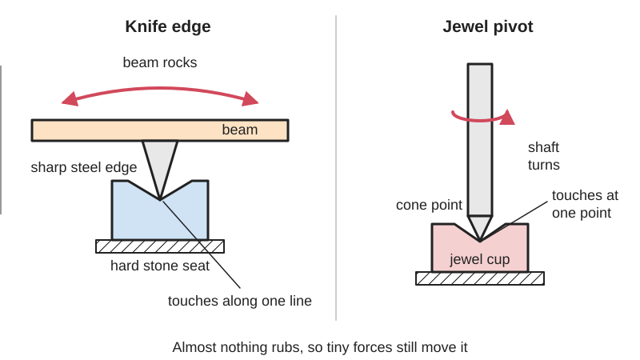

<figure class="eoc-pic eoc-pic-main"><picture><source media="(prefers-reduced-motion: reduce)" srcset="../media/drawn/knife-edge-and-jewel-pivots.svg"></picture><figcaption><strong>Animation.</strong> Diagram drawn for the encyclopaedia from the research notes. ⚑ Needs confirming: a drawing can simplify or get details wrong; a real photo or a better diagram is welcome.</figcaption></figure>

A pivot in which a hardened sharp edge or a fine pointed pin rests on a very hard, smooth seat (agate, steel, sapphire, ruby or glass), touching only along a line or at a point, so a beam, needle or pointer can rock or turn under tiny forces with very low and very consistent friction.

**In plain words:** A part that rocks on a hard, sharp edge resting on a hard flat or groove (like the beam of a balance scale), or spins on a needle-sharp steel point sitting in a tiny hard cup of sapphire or glass (like a compass needle or the pointer of a dial meter), so it moves with almost no friction. **Proper term:** Knife-edge pivot (knife-edge bearing) and jewel bearing (pivot and jewel, vee jewel bearing).

**Also called:** knife edge, knife-edge bearing, fulcrum (of a balance) (Wikipedia 'Weighing scale'); pivot and bearing (weighing-scale trade terms); pivot shapes: teardrop (pear-shaped or pippin-shaped) pivot, square (diamond) pivot, block (pentagonal) pivot, triangular knife edge (Rice Lake 'Understanding pivots and bearings'); agate plane or agate bearing: the hard flat stone a knife edge rests on (Wikipedia 'Kater's pendulum'); jewel bearing, jewelled bearing, jewel pivot, ruby or sapphire bearing (Wikipedia 'Jewel bearing'); vee jewel (V jewel) or cup jewel with a cone pivot (conical pivot) (Bird Precision); hole jewel, ring jewel, olive (bombe) jewel, cap jewel, capstone or endstone (Wikipedia 'Jewel bearing'; Bird Precision); pivot-and-jewel meter movement, as opposed to the taut-band movement (Wikipedia 'Galvanometer'); Incabloc (brand): a shock-protection system for watch jewels (Wikipedia 'Jewel bearing', see also); needle pivot, point pivot (compass and maker usage) ⚑ [uncertain].

## How it works

An ordinary pin in a hole rubs all round its surface, and that rubbing (friction) makes the part stick before it moves. A knife edge instead rests on a hard surface along a single line, and as the beam tilts the edge rocks on its tiny rounded tip instead of sliding, so very little resists small movements; 'a knife edge is the traditional solution' for an almost friction-free balance (Wikipedia 'Weighing scale'; Rice Lake). A jewel pivot does the same for a turning shaft: a sharp cone point sits in a hard cone-shaped cup, touching at a tiny spot right on the axis, so the rubbing happens at almost no distance from the centre and the turning resistance is tiny; sapphire's friction against steel is also low and very steady over years (Bird Precision; Wikipedia 'Jewel bearing'). Neither type is clamped together: the weight of the part, or a light spring, keeps the edge or point seated, so they only suit light, gently handled loads.

## Parts

A few parts. Knife-edge pivot: a hard wedge (the knife edge or 'pivot') fixed to the moving beam, a hard flat or V-shaped seat (the 'bearing') on the stand, and end stops (anti-friction plates) that stop the beam sliding sideways (Rice Lake). Jewel pivot: a hardened shaft ground to a cone point at each end (cone pivots) and two tiny vee jewels of sapphire, ruby or glass, usually set in fine-thread jewel screws, one of them often spring-loaded (Bird Precision 'Vee jewel').

## Everyday examples

- A traditional two-pan balance scale, and old shop and platform scales, whose beams rock on knife edges (Wikipedia 'Weighing scale'; Rice Lake)
- The needle of an analogue (moving-coil) panel meter, whose coil turns on cone pivots in sapphire vee jewels (Bird Precision, figure 1; Wikipedia 'Galvanometer')
- A compass needle balanced on a pivot (Bird Precision lists compasses and dip needles)
- A mechanical watch marked '17 jewels', which has synthetic ruby bearings for its wheels and balance (Wikipedia 'Jewel bearing')

## When to use it

Use a knife edge or jewel pivot when tiny forces must move something reliably and repeatably: balances and weighing beams, pointers and meter needles, compass and dip needles, wind vanes and wind-speed cups (Bird Precision's anemometer example), and pendulums (Kater's pendulum hung on knife edges on agate plates; Wikipedia). They give very low and, importantly, very consistent friction (sapphire has 'highly consistent static friction', Wikipedia 'Jewel bearing'), which matters more than strength in measuring instruments. Knife edges suit small rocking movements; jewel pivots suit small shafts that turn continuously under very light load. Jewels can even run without oil and in corrosive surroundings (Wikipedia).

## When not to use it

Don't use them for heavy, shock or vibrating loads, for parts that get carried and dropped, or where the joint must resist a pull: jewels are [brittle](../glossary.md#brittle--ductile) (Wikipedia) and small points flatten under shock (Bird Precision); use a plain pin pivot or a ball bearing instead. Don't use a knife edge for large swings: wear rises fast beyond about 5 degrees (Rice Lake); use a ball bearing. Ball bearings, though, have their own starting resistance in tiny, slow, [oscillating](../glossary.md#oscillating) movements (Bird Precision says miniature ball bearings have starting-torque problems 'due to [detent](../glossary.md#detent) of the balls'), so for small angles with no friction and no wear consider a [flexure](../glossary.md#flexure) hinge, and for rugged meters a taut band, which replaced jewel pivots and hairsprings because it is 'more rugged for field use' (Wikipedia 'Galvanometer'). If you can't make the edge and seat from hard materials, a well-made pin pivot in a drilled printed hole is a fair compromise (Printables balance models use steel wire or nails as pins).

## Details

- **What it does (jobs):**
  - let it move (turn, slide or bend): lets a beam, pointer, needle or small shaft rock or turn with almost no friction, so tiny forces (a few milligrams on a balance, a small current in a meter, the Earth's magnetism on a compass needle) can move it
- **Movement:** rotate. Knife edges rock through a small angle; wear increases rapidly if the swing is more than about 5 degrees (Rice Lake). Jewel pivots allow continuous rotation, as in compass needles, meter movements, wind-speed indicators, turbine flow meters and watch wheels (Bird Precision; Wikipedia 'Jewel bearing').
- **Directions it can move (degrees of freedom):** 1: rotation about the edge line or the pivot axis. Nothing positively holds the parts together: the load presses the edge into its seat, end stops (anti-friction plates) stop sideways sliding (Rice Lake), and in a jewel pivot the two jewels plus a small set end play stop movement along the axis (Bird Precision).
- **Special behaviour:**
  - self-aligning or self-centring: a knife edge settles back into the bottom of a V-shaped seat ('a sharp V-shaped pivot seated in a shallower V-shaped bearing', Wikipedia 'Weighing scale'), and a cone pivot centres itself in a vee jewel, whose cone-shaped entry also allows 'a small amount of [misalignment](../glossary.md#misalignment), without binding' (Bird Precision)
- **How it holds:**
  - not a holding joint (it moves or passes on motion): it only supports and locates a moving part
  - shape (the parts interlock; [form-fit](../glossary.md#form-fit--force-fit--material-bond)): the V-shaped seat or cone-shaped jewel cup locates the edge or point, while gravity or a light spring keeps it seated (Wikipedia 'Weighing scale'; Bird Precision)
- **Input and output:** not applicable
- **Power:** passive (no power needed)
- **Load:** light. Jewel bearings usually carry under 1 g, though sizes up to 10 mm can take about 500 g (Wikipedia 'Jewel bearing'); a small pivot point can be flattened by 50 g under shock or vibration (Bird Precision). Knife edges range from home-made microgram balances (sci-toys) to precision balances up to 5 kg (triangular knife edges; Rice Lake), and hardened heavy versions carry platform and truck scales (Rice Lake). They take only a downward push: no pull at all (the part lifts off) and little sideways force without end stops.
- **Play and precision:** Knife edge: no play in the loaded direction and very repeatable if the edges are hard, sharp and parallel; pivots that are not parallel in both planes cause friction, poor [repeatability](../glossary.md#repeatability--accuracy) and inconsistent readings (Rice Lake). Jewel pivot: a small deliberate end play (about 0.08-0.1 mm) so the points never lock up, and the vee's cone accepts a little angular misalignment (Bird Precision); hole jewels have a hole slightly larger than the shaft (Wikipedia 'Jewel bearing').
- **Taking it apart:** tool-free quick release for knife edges: a balance beam or a Kater's pendulum is simply lifted off its knife edges (sci-toys microgram balance; Wikipedia 'Kater's pendulum'). Removable for jewel pivots: back off a jewel screw to free the shaft (Bird Precision).
- **How often it can be reused:** many times: nothing is fastened, but each handling risks knocking the edge or point; small pivot points can be flattened by shock (Bird Precision)
- **Sealing:** none
- **Adjustable:** yes, slightly. Jewel end play is set with a fine-thread screw to about 0.003-0.004 in (0.08-0.1 mm), about a quarter turn on a 100-thread-per-inch screw (Bird Precision). A balance's sensitivity is set by moving a small weight up or down relative to the edge (a 'gravity ball' or a nut) (Rice Lake; sci-toys). Scale technicians hone a pivot's side to move the edge and correct the lever ratio (Rice Lake).
- **Access needed:** both sides for jewel pivots: the shaft is held between two jewel screws, one at each end (Bird Precision). Not applicable for a knife-edge beam, which is simply set down onto its seats from above.
- **Materials:** Knife edges: hardened high-carbon alloy steel, agate, or 'stellate' (Rice Lake's word, probably Stellite, a hard cobalt alloy ⚑ [uncertain]); seats: flat agate plates (Wikipedia 'Kater's pendulum') or hardened steel V bearings, nickel-plated against rust in storage (Rice Lake). Jewels: synthetic sapphire or ruby (corundum, Mohs hardness 9), hard Pyrex glass or tungsten carbide (Wikipedia 'Jewel bearing'; Bird Precision). Pivots: Niva alloy (a non-magnetic chrome-cobalt alloy, RC 62 or harder), tungsten carbide, 440C or 420F stainless steel (Bird Precision). Maker substitutes: single-edged razor blades as knife edges (sci-toys; Instructables razor-blade balance). Printed plastic suits only the beam, stand and pans, not the edge or seat ⚑ [uncertain].
- **Heat, cold, water and wear:** Rust is the main enemy of steel pivots and bearings: they are nickel-plated for storage and greased in service (Rice Lake). Dirt build-up stops edges seating, which is one reason seats are given an open angle (Rice Lake). Sensitive balances are upset by drafts, vibration and people walking by (sci-toys), and analytical balances sit inside a draft shield (Wikipedia 'Weighing scale'). Sapphire jewels have good temperature stability and can run without [lubrication](../glossary.md#lubrication) and in corrosive environments, but are brittle (Wikipedia 'Jewel bearing'). In compasses and meters, pivots should be non-magnetic and corrosion-resistant (Bird Precision). A printed frame softens from about 60 C in PLA (CNC Kitchen) and [creeps](../glossary.md#creep) under steady load (Thrinter), which can shift the balance point ⚑ [uncertain].

## Making it

- **Ways to make or get it:**
  - off-the-shelf part: vee jewels, ring jewels, cone pivots and jewel screws (Bird Precision stocks over 100 vee sizes from 1 to 3 mm outside diameter); single-edged razor blades as maker knife edges (sci-toys)
  - 3D print (FDM): the beam, stand, pans and pointer, with steel edges or jewels glued or clamped in (Printables 'Ratio-reading Balance Scale' prints all the parts and adds steel wire pivots)
  - woodwork and simple metalwork: home-made balances on threaded rod, washers and razor blades (sci-toys; Instructables razor-blade beam balance)
  - CNC and precision grinding: heavy scale pivots are hardened, ground and lapped (Rice Lake)
- **Printing it in one piece (print in place):** no: the edge and its seat must be separate hard parts (steel, glass, agate or sapphire); printed plastic edges would dent and creep ⚑ [uncertain]. [Print-in-place](../glossary.md#print-in-place) balance scales exist but use ordinary printed pin pivots instead (Printables 'Functional Print-in-Place Balance Scale', not a knife edge).
- **Tools:** None to set a beam on its edges. A small screwdriver to set a jewel pivot's end play with its fine-thread screw (Bird Precision). For making: glue to fix razor-blade edges (sci-toys), a fine stone or a soft-metal lap to hone an edge, never a file (Rice Lake), and a drill to clean out pivot holes (Printables 'Ratio-reading Balance Scale').
- **Difficulty:** easy for a simple knife-edge balance made from razor blades and a threaded rod (sci-toys); hard for precision pivots, because grinding hard edges and polishing pivot points is specialist work, so buy jewels, cone pivots and jewel screws

### 3D printing tips

1) Print the beam, stand and pans, but make the edge and the seat from hard materials: a razor blade or ground steel edge resting on hard steel, glass or stone. A hard, sharp edge 'will cut its way through bearings that are too soft' and a soft edge 'dulls quickly' (Rice Lake), so never run a steel edge on plastic ⚑ [uncertain for glass or tile seats, which are a maker substitute]. 2) Copy the sci-toys layout: two razor blades glued edge-up into slotted screws on the stand, and a third razor blade clamped across the beam between washers and nuts, so edge rests across edge (sci-toys). 3) Put the edge just above the beam's centre of gravity: the closer, the more sensitive; if a pushed-down end stays down, the pivot is below the centre of gravity and must be raised (sci-toys). Make the edge height or a counterweight adjustable with a screw and nut (sci-toys; Rice Lake 'gravity ball'). 4) Keep the beam light and stiff ('Lighter is better', Printables 'Ratio-reading Balance Scale'); print long beams flat with a brim for bed adhesion (Printables balance models). 5) Make both edges and seats parallel and level: print the edge slots in the same print as the beam so they line up, and level the seats (Rice Lake: pivots must be parallel in two planes). 6) Add end stops so the beam can't slide sideways: a small plate touching the tapered end of the edge at a single point (Rice Lake anti-friction plate). 7) For a pointer or needle that turns, buy a cone pivot and a vee jewel and press the jewel into a printed or drilled seat, with the other end in an adjustable screw so you can set a tiny end play (Bird Precision). 8) Avoid PLA where the frame sits in warm places or under steady load: PLA softens from about 60 C (CNC Kitchen) and creeps (Thrinter), which can shift the pivot height and the balance point ⚑ [uncertain]. 9) Shield it from drafts and keep it away from foot traffic: sensitive balances are disturbed by air currents and people walking past (sci-toys).

### Buying one (off-the-shelf parts)

Search: 'vee jewel bearing' (sapphire or glass), 'cone pivot' or 'conical pivot' (single cone and double-ended), 'jewel screw' (fixed or spring-loaded), 'ring jewel', 'olive jewel', 'endstone' or 'cap jewel' (Bird Precision; Wikipedia 'Jewel bearing'). For scales: 'scale pivots and bearings' (teardrop, block, square pivots; anti-friction plates) (Rice Lake). Maker substitutes: 'single-edge razor blades' (sci-toys). Related ready-made instruments: watch movements (17 jewels in a typical fully jewelled time-only watch) and moving-coil panel meters with sapphire vee bearings (Wikipedia; Bird Precision).

## Rules of thumb

- Edge and seat angles: the knife edge must be sharp enough and the seat's angle open enough (obtuse) to give the needed swing and tolerate dirt; a blunter edge lasts longer; wear increases rapidly if the rocking angle is more than about 5 degrees (Rice Lake 'Understanding pivots and bearings', section 2.2).
- Hardness: knife edges must stand pressures 'on the order of 22 tons/cm2'; make the pivot as hard as its bearing, and harden only the edge and contact point, because a fully hardened part becomes brittle and can crack under extreme loads (Rice Lake, sections 2.2-2.3).
- Seat shape: for highest accuracy, a sharp V-shaped pivot sits in a shallower V-shaped bearing (Wikipedia 'Weighing scale'); for shock-loaded scales use round-bottom V bearings, not sharp-bottom ones, which the edge jams into as it wears (Rice Lake, section 2.4.2).
- Alignment: the pivots on a lever must be parallel both in spacing and in level; a tapered pivot end should touch its anti-friction plate at only one point (Rice Lake, sections 2.4.2 and 2.5).
- Sensitivity: put the pivot very close to, but above, the moving part's centre of gravity; the closer, the more sensitive (sci-toys), and the more mass below the pivot, the less sensitive (Rice Lake, section 3.1). The sci-toys razor-blade balance resolves less than a milligram and, with care, about 10 micrograms.
- Vee jewels: cone angle typically 85 degrees with a 55-degree pivot cone, which allows a little misalignment (Bird Precision 'Vee jewel').
- Point radius ratio: make the jewel's tip radius about 3 times the pivot point's radius, e.g. a 0.002-0.003 in (0.05-0.08 mm) point in a 0.006-0.009 in (0.15-0.23 mm) vee; too high a ratio gives over-sensitivity, poor repeatability and easy damage, too low a ratio gives a 'sticky' movement (Bird Precision 'Vee bearing design considerations'; 'Vee jewel').
- Load: glass vees for moving parts under 200 mg, sapphire above that; small points of 0.0008-0.002 in (0.02-0.05 mm) can be flattened by 50 g or more, so heavier parts need points of about 0.005-0.007 in (0.13-0.18 mm) (Bird Precision).
- Contact pressure: 40 g on a 60-degree steel pivot with a 0.002 in point gives about 1,237 kg/mm2, but a 0.0032 in point cuts it to 131 kg/mm2; a bigger point lasts longer but adds friction (Bird Precision, paraphrasing V. Stott, 'The Use of Pivots and Jewels in Instruments and Meters').
- Pivot finish and hardness: points hardened to RC 45 or better and polished to about 4 micro-inch (about 0.1 micrometre) (Bird Precision).
- End play: about 0.003-0.004 in (0.08-0.1 mm), roughly a quarter turn on a 100-thread-per-inch jewel screw; never lock the points up (Bird Precision).
- Size and friction: jewel bearing bores are typically under 1 mm for loads under 1 g (up to about 10 mm and 500 g); static friction of sapphire on steel is 0.10-0.15 against 0.35 for brass on steel (Wikipedia 'Jewel bearing'); Bird quotes about 0.12.

## Common failures

Edge or point dulled, flattened or chipped by overload or shock: a truck-scale knife edge flattens on first loading, and small instrument points flatten at 50 g under shock; use a bigger point radius or spring-loaded jewels (Rice Lake; Bird Precision). A groove worn into a seat that is softer than the edge, so the edge binds (Rice Lake). Pivots not parallel, so the beam rubs, sticks and gives inconsistent readings (Rice Lake). Rust or dirt in the contact (Rice Lake). Beam sliding sideways and rubbing its frame without end stops (Rice Lake). Jewel end play screwed down too tight, locking and damaging the points (Bird Precision). Brittle jewels cracked by knocks (Wikipedia). A balance that tips and stays over because its pivot is below the centre of gravity, or is sluggish because too much mass hangs below the pivot (sci-toys; Rice Lake). Drafts and vibration making a sensitive balance wander (sci-toys).

## Safety

Razor blades and ground knife edges are very sharp: sci-toys warns to be 'very careful' when cutting a notch in a razor blade and keeps the cardboard guards on the base blades until the beam is fitted (sci-toys). Hardened pivots are brittle; fit them with a brass hammer or round stock, because a hardened hammer can break them (Rice Lake), and wear eye protection when hammering hardened parts ⚑ [uncertain]. Jewels and pivots are tiny parts that are easy to lose and could be swallowed by small children ⚑ [uncertain].

## Related

- Plain pivot and rolling bearing (pin in a hole, ball bearing): stronger and holds against pull, but with more friction and, in ball bearings, a 'detent' at very small movements
- Flexure hinge (notch, leaf-spring or cross-spring pivot): bends instead of rocking, so it has no friction or wear and no lubrication, but only turns a small angle and has a springy return force
- Taut-band suspension: a thin metal strip under tension replaces jewel pivots and hairsprings in rugged meters (Wikipedia 'Galvanometer')
- Rolling-contact joint: two curved surfaces rolling on each other, another low-friction pivot without a pin
- [Kinematic coupling](../glossary.md#kinematic-coupling) (balls in V-grooves): also uses hard point contacts on hard seats, but to locate parts exactly rather than to let them turn
- Escapement: the watch and clock mechanism whose pallets and wheels usually run in jewel bearings
- [Torsion](../glossary.md#torsion) fibre or suspension: hangs the moving part on a fine wire or fibre instead of supporting it on a point ⚑ [uncertain]

## Make it yourself

- [A Homemade Microgram Balance (sci-toys.com)](https://sci-toys.com/scitoys/scitoys/mathematics/microgram_balance/balance.html): Step-by-step build of a balance from a threaded rod, washers, nuts, soda-can pans and three single-edged razor blades used as knife edges; resolves less than a milligram *(licence: not shown on page)*
- [Razor Blade Equal-Arm Beam Balance Micro Scale (Instructables, 2013)](https://www.instructables.com/Razor-Blade-Equal-Arm-Beam-Balance-Micro-Scale/): Build of a 24-inch equal-arm micro balance on an aluminium level base, with razor blades as knife edges on adjustable threaded support rods *(licence: not shown on page)*
- [Ratio-reading Balance Scale (Printables) (URL from Printables API, page not opened)](https://www.printables.com/model/171329-ratio-reading-balance-scale): Fully printable balance that reads the ratio of two weights; uses 1.5-2 mm steel wire as pin pivots in drilled-out holes and a bolt as counterweight, a useful comparison with a knife edge *(licence: CC BY-NC-SA)*

## Pictures, videos and models

- [Kater pendulum (Wikimedia Commons, drawing from William Watson's 'A Textbook of Physics', 1920)](https://commons.wikimedia.org/wiki/File:Kater_pendulum.png): Labelled drawing of a Kater's pendulum with two opposing knife-edge pivots (a), adjustment weights, bob and pointers *(licence: Public domain)*
- [Watch jewel bearing.svg (Wikimedia Commons, by Chetvorno)](https://commons.wikimedia.org/wiki/File:Watch_jewel_bearing.svg): Cross-section of a watch hole jewel: a doughnut-shaped synthetic ruby pressed into the plate, with an oil cup holding oil round the shaft *(licence: Public domain)*
- [Watch jewel bearing and capstone.svg (Wikimedia Commons, by Chetvorno)](https://commons.wikimedia.org/wiki/File:Watch_jewel_bearing_and_capstone.svg): Cross-section of a hole jewel with a capstone (cap jewel) on the end, so the pivot tip, not its shoulder, bears on the jewel *(licence: Public domain)*
- [Vee Jewel: Sapphire and glass vee jewels, design considerations (Bird Precision, PDF)](https://catalog.birdprecision.com/Asset/vee_jewel--1-.pdf): Cutaway of a moving-coil meter movement on sapphire vee bearings, vee jewel nomenclature, end-play adjustment and spring-loaded shock protection drawings *(licence: link only)*
- [Technical Support: Understanding Pivots and Bearings (Rice Lake Weighing Systems, PDF)](https://www.ricelake.com/media/a4vbatqa/2026_technical_support.pdf): Drawings of teardrop, square, block and triangular knife-edge pivots, anti-friction plates, worn versus new pivots, and parallel pivot alignment *(licence: link only)*

## Needs confirming

⚑ marks something nobody has confirmed yet: a fact the research could not confirm from a source, a finder value that is a best guess, or an open point from the research notes. Corrections are welcome (see `research/needs-confirming.md`).

- ⚑ 10 sentences on this page marked [uncertain].
- ⚑ Finder value `turns` = full turns (best guess): carried over from the finder's old rule on entry names (R33), for "For things that turn: less than a full turn (swings or rocks) or full turns (spins)."
- ⚑ Research note: *Knife-edge and jewel pivots*: Rice Lake spells a pivot material "stellate"; probably Stellite, marked [uncertain].

## Sources

- <https://en.wikipedia.org/wiki/Weighing_scale>
- <https://en.wikipedia.org/wiki/Jewel_bearing>
- <https://en.wikipedia.org/wiki/Kater%27s_pendulum>
- <https://en.wikipedia.org/wiki/Galvanometer>
- <https://www.ricelake.com/media/a4vbatqa/2026_technical_support.pdf>
- <https://catalog.birdprecision.com/Asset/vee_jewel--1-.pdf>
- <https://cdn.thomasnet.com/ccp/00400419/38872.pdf>
- <https://sci-toys.com/scitoys/scitoys/mathematics/microgram_balance/balance.html>
- <https://www.instructables.com/Razor-Blade-Equal-Arm-Beam-Balance-Micro-Scale/>
- <https://www.cnckitchen.com/blog/comparing-pla-petg-amp-asa-feat-prusament>
- <http://thrinter.com/creep-abs-pla-petg-alloy-910/>
- <https://www.printables.com/model/171329-ratio-reading-balance-scale>
- <https://www.printables.com/model/1465894-balance-scale>
- <https://www.printables.com/model/1029836-educational-balance-scale>
- <https://www.printables.com/model/1766744-functional-print-in-place-balance-scale-with-weigh>
- <https://commons.wikimedia.org/wiki/File:Kater_pendulum.png>
- <https://commons.wikimedia.org/wiki/File:Watch_jewel_bearing.svg>
- <https://commons.wikimedia.org/wiki/File:Watch_jewel_bearing_and_capstone.svg>
