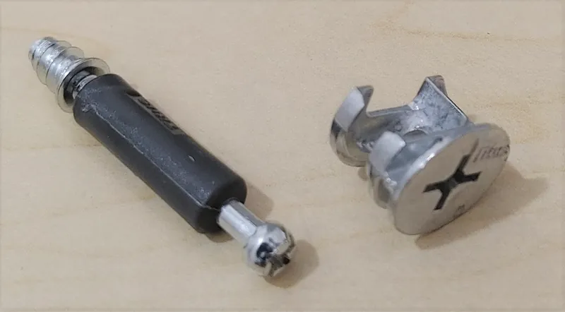

<figure class="eoc-pic eoc-pic-main"><figcaption><strong>Photo.</strong> <a href="https://commons.wikimedia.org/wiki/File:Cam_connector_cropped.png">Cam connector cropped</a> by Swpb, <a href="https://creativecommons.org/licenses/by-sa/4.0">CC BY-SA 4.0</a>, from Wikimedia Commons.</figcaption></figure>

Two-part metal fittings that pull a panel edge tight against another panel or rail and hold it there: in a cam lock a turning cam grabs a bolt head, and in a cross dowel a bolt screws into a threaded barrel set across it, so furniture can be put together and taken apart with just a screwdriver or Allen key.

**In plain words:** Hidden metal fittings for flat-pack furniture: a round disc you turn with a screwdriver hooks the head of a bolt and pulls two boards tight, or a long bolt through one part screws into a small metal barrel hidden in the other; both come undone again when you turn them back. **Proper term:** Knock-down (KD) furniture connectors: the eccentric cam connector (cam lock, cam-and-dowel fitting) and the cross dowel with connector bolt (barrel nut).

**Also called:** cam lock, cam fastener, cam nut, cam post or cam dowel (the bolt part) (Wikipedia 'Butt joint', section 'Cam fasteners'); cam and dowel fitting (DT Online); eccentric cam connecting fitting, eccentric connector (Hettich); connecting bolt, dowel pin, tie bolt (the bolt part) (Furnica); Minifix (Häfele brand name, used loosely in the trade for any cam lock connector) (Furnica); Rastex (Hettich brand of eccentric cam connector) (Hettich); cross dowel, barrel nut, steel cross dowel, dowel nut (Wikipedia 'Barrel nut'); Quermutter or Quermutterbolzen (German for cross dowel / barrel nut) (Wikimedia Commons; Printables); furniture connector bolt, joint connector bolt (JCB), used with a cross dowel or joint connector nut (DT Online; Rockler); knock-down fitting, KD fitting, flat-pack or ready-to-assemble (RTA) fittings (DT Online; Wikipedia); Not to be confused with a camlock hose coupling, a climbing camlock or a cam lock latch for cabinet doors (Wikipedia 'Camlock' disambiguation).

## How it works

Cam lock: the bolt is screwed into the face of one panel so its head sticks out; the other panel has an 8 mm hole in its edge that runs into a 15 mm round pocket holding the cam. Push the panels together so the bolt head enters the cam, then turn the cam about half a turn: its spiral inner groove (eccentric, like a snail-shaped ramp) catches the bolt head and draws it inward, pulling the panels tight (Wikipedia; Furnica). Cross dowel: a bolt passes through one part into a hole in the end of the other; a second hole drilled across that path holds the barrel nut, which is turned with a screwdriver in its slot until its threaded hole lines up, then the bolt is tightened into it, clamping the parts together (Wikipedia 'Barrel nut'). In both, the clamping pull holds the joint and wooden dowels or tenons take the sideways ([shear](../glossary.md#peel-vs-shear)) load (Furnica).

## Parts

A few parts. Cam lock: a round cam housing (usually 15 mm across, die-cast zinc) and a connecting bolt with a shaped head, normally used alongside two or more wooden dowels for alignment (Hettich; Furnica). Cross dowel: a furniture connector bolt (often with a hex socket head) and a slotted steel barrel nut with a threaded hole through its side (Wikipedia 'Barrel nut'; Rockler).

## Everyday examples

- Flat-pack bookcases, wardrobes and kitchen cabinets, where a round metal disc with a screwdriver slot sits near each shelf end (DT Online; Wikipedia)
- Bed frames and bunk beds, where long bolts through the posts screw into barrel nuts in the side rails (Printables parametric cross dowel for a bunk bed; Rockler)
- Desks and TV units made of melamine-faced chipboard that can be flattened again for moving (Furnica)
- Detachable table legs and knock-down workbenches built with bolts and cross dowels ⚑ [uncertain]

## When to use it

Use cam locks for boxes and cabinets made of sheet materials such as particleboard, MDF or plywood that must ship flat or be taken apart for moving; they are hidden, fast to assemble with one driver, and need no glue (Wikipedia; Furnica). Use cross dowels where you need a strong, removable joint in solid wood or thick panels, such as bed rails, table aprons, workbenches and frames (Rockler). Both are good for hobbyists because they 'are easier and require less skill to install than some of the other more traditional techniques' (Wikipedia).

## When not to use it

Avoid cams where the joint takes large sideways (shear) or twisting loads without dowels or a back panel; the cam alone only pulls (Furnica). Don't use them in thin boards (below about 12 mm) or close to an edge where the board can split ⚑ [uncertain]. For permanent furniture that will never be moved, glued dowels, biscuits or a mortise and tenon are stronger and cheaper. Where you can't drill accurately, use a bracket, confirmat screw or pocket screw instead. For tool-free assembly consider a wedge dowel or lever-cam panel connector; for sheet parts cut on a laser or CNC, a T-slot joint ([captive nut](../glossary.md#captive-nut)) does the same job with a standard nut. Wikipedia notes that cam-and-bolt connectors can be swapped out but 'are more complex and expensive' than Confirmat screws, which compress their own thread in particleboard and can be removed and refitted 'dozens of times' (Wikipedia 'Confirmat screw'); Fine Homebuilding quotes a maker saying a Confirmat still holds after 30 or 40 cycles in MDF or particleboard (Fine Homebuilding 2008).

## Details

- **What it does (jobs):**
  - join and hold: joins panel edges to faces (carcase corners, shelves, drawer boxes) or rails to posts (bed frames, table aprons)
  - lock, and release by hand: a half-turn back on the cam, or unscrewing the bolt, undoes the joint without damage (Furnica)
  - tighten and hold tension: the cam ramp or bolt thread pulls the parts hard together and keeps them clamped
  - line parts up exactly: 'They self-align when tightened' (Wikipedia); Hettich's cam pulls the bolt into a centred position
- **Movement:** none: once tightened the parts don't move. Inside the fitting the cam rotates about 180-210 degrees while being tightened (Furnica).
- **Directions it can move (degrees of freedom):** 0 when tightened. Before tightening, the bolt can slide in and out of its edge hole (1 degree of freedom along the bolt).
- **Special behaviour:**
  - tensioning (takes up slack and holds): the cam's spiral track draws the bolt head in and holds the pull; Hettich's Rastex cam 'allows furniture side panels to be pulled into place from space up to 4 mm from the panel end'
  - self-aligning or self-centring: the fittings self-align when tightened (Wikipedia 'Butt joint'), and indentations in the cam pull the bolt to the centre (Hettich)
  - motion conversion (rotary to linear): turning the cam converts a twist of the screwdriver into a straight pull on the bolt
  - quick-release: only with a tool; a half-turn anticlockwise releases the cam (Furnica)
- **How it holds:**
  - friction or clamping ([force-fit](../glossary.md#form-fit--force-fit--material-bond)): bolt tension clamps the panel edge against the other part
  - shape (the parts interlock; form-fit): the cam's groove hooks behind the bolt head, the barrel nut's thread traps the bolt, and wooden dowels take shear and keep the panels aligned (Wikipedia; Furnica)
- **Input and output:** not applicable
- **Power:** passive (no power needed)
- **Load:** Medium. In tests on 18 mm particleboard L-shaped corners, standard eccentric cam joints with beech dowels carried average bending moments of about 14-19 N·m, and a version with a metal-capped bolt reached 31 N·m in the tension test and 47 N·m in the compression test; failure came from the chipboard surface cracking or the bolt head crushing into the board, not the metal parts breaking (Janíková et al. 2025, Materials 18(9):2114). Strong in straight pull; the cam itself 'cannot withstand shear loads', so dowels are always added (Furnica). Weak against racking of tall cabinets unless a back panel is fitted ⚑ [uncertain]. Cross dowels in solid wood carry heavier loads, e.g. bed rails ⚑ [uncertain]. Makers of Confirmat screws say cams are weaker than Confirmat screws, though better than drywall screws: Wikipedia reports the claim and flags it '[independent source needed]', and its source, Fine Homebuilding (2008), quotes a product manager at Häfele, a Confirmat maker, saying Confirmats are 'less expensive, less complicated and stronger' than cam-and-bolt connectors. No independent test was found ⚑ [uncertain].
- **Play and precision:** No play once tight. [Accuracy](../glossary.md#repeatability--accuracy) depends entirely on drilling: 'An offset of just one millimetre inevitably leads to uneven joints or cracking in the panel material' (Furnica); Hettich's drilling drawings allow +0.5/-0.3 mm on the 24 or 34 mm hole distance. The dowels do the precise locating; the cam only pulls (Furnica). Cross dowels tolerate a little error because the barrel can be rotated to meet the bolt (Wikipedia 'Barrel nut').
- **Taking it apart:** removable: designed 'for repeated assembly and disassembly' (Wikipedia 'Butt joint'); turning the cam back or unscrewing the bolt releases the joint without damaging the panels (Furnica).
- **How often it can be reused:** many times in solid wood with cross dowels and metal threads; a few to many times in particleboard or MDF, where the screw thread of the cam bolt and the board around the fittings wear and crumble with each cycle ⚑ [uncertain].
- **Sealing:** none
- **Adjustable:** Slightly: a loose cam can be turned tighter, and the Hettich cam can close a gap of up to 4 mm (Hettich). Positions are fixed by the drilled holes.
- **Access needed:** one side only (blind) for a cam lock: all holes are on the inside face and in the edges, leaving nothing visible outside (Furnica), but you must reach the inside face to turn the cam. Both sides for a cross dowel: the bolt head is on the outside of one part and the barrel is put in from the inside or underside of the other.
- **Materials:** Panels of particleboard (chipboard), MDF, melamine-faced board and plywood, usually 16-19 mm thick (Furnica; DT Online); solid wood for cross-dowel frames and bed rails (Rockler). Cam housings are die-cast zinc, with plastic versions for light loads (Hettich; Furnica); bolts and cross dowels are steel. Bolts have a direct wood thread (about 5 mm) or an M6 metric thread into an insert nut (Furnica). 3D-printed PETG replacement cams and cross dowels exist for repairs (Printables).
- **Heat, cold, water and wear:** Particleboard and MDF lose strength and swell when damp, so the thread grip of cam bolts and the edges around the holes weaken in bathrooms or damp rooms ⚑ [uncertain]. Joint strength depends on the board's internal bond strength: tests show failures by the board's surface layer cracking rather than the fittings breaking (Janíková et al. 2025). Cams can work loose with repeated racking or vibration; some cams have ratchet-like latching steps and serrated outsides 'to prevent the eccentric cam from working loose' (Hettich Rastex 25). Printed plastic cams [creep](../glossary.md#creep) under constant load, especially in PLA (Printables).

## Making it

- **Ways to make or get it:**
  - off-the-shelf part: cam housings, connecting bolts, cross dowels and connector bolts
  - woodwork: drilling the holes with Forstner and twist bits, a jig or a drill press
  - CNC: drilling patterns on a CNC router or boring machine (standard in industry, often on the System 32 grid)
  - 3D print (FDM): replacement cams and cross dowels, and drilling jigs and templates
- **Printing it in one piece (print in place):** no: the cam and bolt, or barrel and bolt, are separate parts fitted into drilled holes.
- **Tools:** To assemble or take apart: one driver, usually a hex (Allen) key or screwdriver (Wikipedia); Hettich cams take a flat-blade screwdriver, PZ3 Pozidriv or a 4 mm Allen key. To install: drill with depth stop, 15 mm Forstner bit, 8 mm and 5 mm bits and a drilling jig for cams (Furnica); 9/32 inch and 25/64 inch bits and a cross-dowel jig for inch-size cross dowels (Rockler). A drill press helps keep holes square (House of Hacks).
- **Difficulty:** moderate: the fittings are cheap and easy to buy, but every hole must be drilled square and in the right place to within about a millimetre, so a drilling jig or drill press and depth stops are needed (Furnica; House of Hacks). Assembly itself is easy.

### 3D printing tips

1) Printed cams and cross dowels work as replacements but are weaker than metal: 'It's not going to lock as well as metal parts do' (Printables, parametric cross dowel). 2) Use PETG or another tough plastic rather than PLA: one designer warns that 'PLA tends to creap [creep] under load over time' (Printables, Cam Lock Connector), and another suggests 'something less [brittle](../glossary.md#brittle--ductile) than PLA' (Printables, parametric cross dowel). 3) Print with 100% [infill](../glossary.md#infill) and as many [perimeters](../glossary.md#perimeters) (walls) as possible, since these are fully loaded parts (Printables). 4) Print a cross dowel lying down in the file's orientation, not upright; upright looks nicer but is weaker (Printables, parametric cross dowel). 5) Clean up or cut threads with a tap after printing (Printables, parametric cross dowel). 6) A replacement cam printed at 0.1 mm layers needed a small support under its base only, because without it the part rocked during printing (Printables, Replacement Furniture Cam Lock). 7) For printed projects that need to come apart, a better route is often a metal barrel nut or [heat-set insert](../glossary.md#heat-set-insert) in a printed hole, with the bolt through the other part ⚑ [uncertain]. 8) Print drilling templates to place cam and bolt holes accurately (Printables Rastex 15 template; cam-lock drilling jig).

### Buying one (off-the-shelf parts)

Cam connectors: 'eccentric cam connector', 'cam lock connector' or 'Minifix' type, 15 mm housing standard with 12 mm for thin parts and 25 mm heavy-duty versions (Furnica; Hettich Rastex 15/25), with or without a rim, plus plastic cover caps. Connecting bolts ('cam dowels'): 24, 28 or 34 mm drilling distance, Euro wood thread (5 mm pilot) or M6 thread with insert nut, single or double-ended for centre panels (Furnica). Cross dowels ('barrel nuts'), e.g. M6 x 10 mm (Wikipedia) or inch sizes with 1/4 inch bolts ⚑ [uncertain], and furniture connector bolts from 2 to 4-3/4 inch long (Rockler). Helpers: fluted wooden dowels (8 mm) or quick-install steel dowels (Hettich Rapid S, Twister), insert nuts, drilling jigs (Rockler Cross Dowel Drilling Jig; cam-lock drilling templates). Related off-the-shelf fasteners: confirmat screws, sex bolts, T-nuts, hanger bolts (Wikipedia 'Furniture screw').

## Rules of thumb

- Cam lock (metric): 15 mm Forstner hole for the cam, centred 24 mm or 34 mm from the panel edge to suit the bolt length; about 12.5 mm deep in a 16 mm panel and 14.5 mm in a 19 mm panel; 8 mm edge hole at mid-thickness running into the cam hole; 5 mm pilot about 11-13 mm deep for a Euro-thread bolt in the other panel; front edge to hole centre normally 37 mm on the System 32 grid (Furnica 'Fitting Cam Lock Connectors').
- Hettich's Rastex 15 drilling drawings show the same 15 mm and 8 mm holes, the edge hole at half the panel thickness, 24 or 34 mm from the edge with a [tolerance](../glossary.md#tolerance) of +0.5/-0.3 mm, and a depth dimension of 12.7 mm for 16 mm shelves, 13.4 mm for 18 mm and 13.7 mm for 19 mm panels (Hettich 'Connecting technology for conventional applications' 2016, p. 10).
- Always combine cams with wooden dowels (usually 8 mm): the dowels take shear and alignment, the cam only pulls (Furnica).
- Turn the cam roughly 180-210 degrees clockwise to lock and back half a turn to release; screw the bolt in until its collar sits flush, because a bolt left too high or too deep won't engage properly (Furnica).
- Inch version: 5/8 inch Forstner for the cam, centred 1-5/16 inch from the edge; 5/16 inch edge hole; 3/16 inch pilot for the post. 'If it's too far from the edge, the cam won't engage and if it's too close to the edge the cam won't tighten against the wood' (House of Hacks).
- Cross dowels in 3/4 inch stock: 9/32 inch hole for the connector bolt and 25/64 inch hole for the cross dowel, bolts 2 to 4-3/4 inch long (Rockler Cross Dowel Drilling Jig).
- In 18 mm particleboard corner tests, a cam with a metal-capped bolt gave 147% higher bending moment capacity under compression than a standard cam with a Euro-screw bolt (Janíková et al. 2025).

## Common failures

Stripped or broken cam housing, often because the bolt wasn't screwed deep enough so the cam only grips the tip of its head (Furnica). Panels not flush because the edge hole wasn't square or the 24/34 mm distance was missed by a few millimetres (Furnica). Forstner bit breaking through the decorative face for lack of a depth stop (Furnica). Under load, the particleboard surface cracks around the bolt, the bolt head crushes into the board, or an insert nut pulls out (Janíková et al. 2025). Cam too far from the edge so it can't engage, or too close so it can't tighten (House of Hacks). Cross-dowel bolt missing the barrel's thread; rotate the barrel with a screwdriver in its slot until the bolt lines up (Wikipedia 'Barrel nut'). Chipboard threads wearing out after several moves ⚑ [uncertain].

## Safety

Tall flat-pack furniture held with knock-down fittings should be anchored to the wall so it can't tip over and injure someone (Wikipedia 'Furniture screw', citing IKEA's 'Secure it!'). Drilling the cam hole too deep can break through the finished outer face (Furnica). Check and re-tighten cams on beds, bunk beds and other load-bearing furniture, since a loose joint can let it collapse ⚑ [uncertain].

## Related

- Lever-cam panel connector (self-clamping click connector): a hidden fitting in a milled slot that is locked by a key or clicks shut, needing only a small access hole
- Wedge dowel (click-in grooved dowel): a ribbed dowel that slides into a groove and wedges tight with no tools and no metal
- T-slot joint (captive nut and bolt joint): the laser-cut sheet version, where a square nut sits in a T-shaped slot like a flat cross dowel
- Captive nut pocket (nut trap) and heat-set or press-fit threaded inserts: ways to put a nut into a 3D print or wood so a bolt can be removed later
- Cam latch (quarter-turn cam lock): a cabinet door lock with a rotating tongue, not a panel connector, despite the similar name
- Eccentric cam lever (quick-release skewer): a lever-operated cam clamp that needs no tool
- Mortise and tenon with tusk wedge: the traditional wooden knock-down joint
- Aluminium-extrusion connectors (T-slot nuts and brackets): the equivalent knock-down system for metal frames
- Wood screw: covers the Confirmat screw, a fat, blunt cabinet screw driven into a stepped hole that joins board edges to faces with no separate nut or cam

## Make it yourself

- [Rastex 15 template (Philipp Reichart, Printables)](https://www.printables.com/model/439535-rastex-15-template): Printable drilling template for both holes of a 15 mm eccentric cam connector with 34 mm bolts in 19 mm boards (15 mm Forstner about 14 mm deep, 8 mm edge hole, 5 mm bolt hole). Details read through the Printables public API. *(licence: CC BY-NC-SA)*
- [Drilling jig for cam lock connectors (k4mk4l, Printables) (URL from Printables API, page not opened)](https://www.printables.com/model/1848618-drilling-jig-for-cam-lock-connectors): Parametric FreeCAD jig with an edge stop: 15 mm cam hole 34 mm from the edge, 8 mm dowel holes 32 mm apart, using a pipe reducer and 608 bearing races as drill bushings *(licence: CC BY-NC-SA)*
- [Parametric Cross Dowell Barrel Nut for furniture (Rusty Phillips, Printables) (URL from Printables API, page not opened)](https://www.printables.com/model/638080-parametric-cross-dowell-barrel-nut-for-furniture): Parametric Fusion 360 cross dowel (default 5/8-18 thread, 1/2 inch barrel), printed in PETG at 100% infill and tapped, made to replace missing bunk-bed parts *(licence: CC0 (public domain))*
- [Cam Lock Connector (firstgizmo, Printables) (URL from Printables API, page not opened)](https://www.printables.com/model/956800-cam-lock-connector): Printable replacement for common furniture cam locks; print at 0.2 mm layers with many perimeters, in PETG rather than PLA *(licence: CC BY-NC)*

## Pictures, videos and models

- [Cam connector (cam screw and cam nut), Wikimedia Commons, by Swpb](https://commons.wikimedia.org/wiki/File:Cam_connector_cropped.png): Photo of a furniture cam lock housing next to its connecting bolt *(licence: CC BY-SA 4.0)*
- [Cam lock patent 1, Wikimedia Commons (patent drawing by Peter Busse, 1978)](https://commons.wikimedia.org/wiki/File:Cam_lock_patent_1.png): Patent diagram of a cam fastening system showing the cam, bolt and how the cam draws the bolt head in *(licence: Public domain)*
- [Cross dowel cutaway, Wikimedia Commons, by Wizard191](https://commons.wikimedia.org/wiki/File:Cross_dowel_cutaway.png): Cutaway drawing of a connector bolt passing through one part and into a cross dowel set across the other *(licence: CC BY-SA 3.0)*
- [Montage Quermutterbolzen (fitted cross dowel), Wikimedia Commons, by Drucker03](https://commons.wikimedia.org/wiki/File:Montage_Quermutterbolzen.png): Schematic of a fitted cross dowel and bolt joining two wooden parts *(licence: CC BY-SA 4.0)*
- [How to Install Cross Dowels and Bolts | New Woodworking Jig! (YouTube, Rockler Woodworking and Hardware)](https://www.youtube.com/watch?v=v9G_0caGrxI): Video on drilling and fitting cross dowels and connector bolts with a jig (title and channel checked via YouTube oEmbed; not watched) *(licence: link only (standard YouTube licence))*

## Needs confirming

⚑ marks something nobody has confirmed yet: a fact the research could not confirm from a source, a finder value that is a best guess, or an open point from the research notes. Corrections are welcome (see `research/needs-confirming.md`).

- ⚑ 11 sentences on this page marked [uncertain].
- ⚑ Research note: *Knock-down connectors* (250): the claim that cams are weaker than Confirmat screws comes only from a Confirmat maker (Häfele, quoted by Fine Homebuilding) and is marked [uncertain].

## Sources

- <https://en.wikipedia.org/wiki/Furniture_screw>
- <https://en.wikipedia.org/wiki/Barrel_nut>
- <https://en.wikipedia.org/wiki/Cam_fastener>
- <https://en.wikipedia.org/wiki/Cam_lock>
- <https://wiki.dtonline.org/index.php/Knock_Down_Fittings,_Brackets_and_Plates>
- <https://furnica.co.uk/blogs/guides/fit-cam-lock-connectors-minifix-guide>
- <https://furnica.co.uk/blogs/guides/cam-lock-connector-design-function-explained>
- <https://furnica.com/blogs/guides/cam-lock-connectors-connecting-bolts-carcass-construction>
- <https://web.hettich.com/fileadmin/media/Connecting_technology_2016_16359_HUS.pdf>
- <https://www.ebi.ac.uk/europepmc/webservices/rest/PMC12072453/fullTextXML>
- <https://www.house-of-hacks.com/2014/05/how-to-drill-holes-for-cam-lock.html>
- <https://www.rockler.com/rockler-cross-dowel-drilling-jig>
- <https://api.printables.com/graphql/>
- <https://commons.wikimedia.org/wiki/File:Cam_connector_cropped.png>
- <https://commons.wikimedia.org/wiki/File:Cam_lock_patent_1.png>
- <https://commons.wikimedia.org/wiki/File:Cross_dowel_cutaway.png>
- <https://commons.wikimedia.org/wiki/File:Montage_Quermutterbolzen.png>
- <https://www.youtube.com/watch?v=v9G_0caGrxI>
- <https://en.wikipedia.org/wiki/Confirmat_screw>
- <https://www.finehomebuilding.com/2008/06/27/whats-the-difference-cabinet-assembly-screws>
