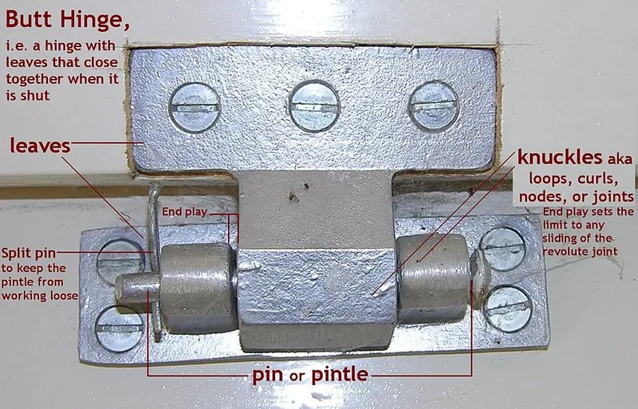

<figure class="eoc-pic eoc-pic-main"><figcaption><a href="https://commons.wikimedia.org/wiki/File:Butt_Hinge_annotated.jpg">Butt Hinge annotated</a> by JonRichfield, <a href="https://creativecommons.org/licenses/by-sa/4.0">CC BY-SA 4.0</a>, from Wikimedia Commons.</figcaption></figure>

Two leaves with interlocking rings (knuckles) along one edge share a single pin, so a door, lid or flap can swing about that pin while the hinge carries its weight.

**In plain words:** The ordinary door hinge: two flat plates, one screwed to the door and one to the frame, joined along one edge by a row of rings with a pin through them, so the door can swing. **Proper term:** Butt hinge (knuckle hinge; called a mortise hinge when it is set into shallow recesses).

**Also called:** knuckle hinge; mortise hinge, half-mortise hinge (only one leaf set into a recess) (Wikipedia, Hinge); barrel hinge (a sectional barrel, the knuckle, turning on a pin; Wikipedia says most hinges work this way); loose-pin hinge and fixed-pin hinge (whether the pin can be taken out; Popular Woodworking); swaged and non-swaged butts (leaves bent in toward the barrel, or flat and in line with it; Popular Woodworking); ball-bearing hinge (standard weight with 2 bearings, heavy weight with 4) and plain-bearing hinge (I Dig Hardware); NRP hinge (non-removable pin, locked by a [set screw](../glossary.md#set-screw)) and security-stud hinge (DoorwaysPlus); lift-off hinge or flag hinge (one leaf carries the pin, the other has the hole, so the door lifts off; Wikipedia); continuous hinge or piano hinge (a knuckle hinge running the full length of a lid or door; Wikipedia); case hinge (a small, decorative butt hinge for boxes and cases; Wikipedia); butterfly hinge or applied hinge (a decorative knuckle hinge screwed onto the surface, not recessed; Popular Woodworking); pin also called a pintle; leaf, knuckle, gauge, end play, [pitch](../glossary.md#pitch) (Wikipedia hinge terminology); revolute joint, pin joint or hinge joint (the engineering name for any one-axis turning joint; Wikipedia); a pair of butts (trade phrase for two butt hinges) ⚑ [uncertain].

## How it works

Each leaf has knuckles along one edge; the knuckles of the two leaves alternate and interlock, and a pin runs through all of them, so the leaves can only turn about the pin: one degree of freedom (Wikipedia, Hinge). One leaf is screwed to the frame and the other to the door, usually each set into a shallow recess (mortise) so the door closes with a small, even gap; how deep the recesses are sets that gap (Popular Woodworking). The door's weight rests on the knuckle ends and the pin, and because that weight hangs out to one side, the top hinge is pulled away from the frame and the bottom hinge pushed into it (FineWoodworking forum). Heavy commercial and fire doors use ball-bearing hinges, with bearings in 2 or 4 of the knuckles (I Dig Hardware).

## Parts

A few parts: two leaves (flat plates with screw holes), the knuckles (rolled or cast rings along one edge of each leaf that interleave), one pin through all the knuckles, and screws. Some add ball bearings between knuckles (I Dig Hardware), decorative tips (finials) on the pin, or a set screw that locks the pin in (DoorwaysPlus).

## Everyday examples

- Ordinary room doors, usually hung on two or three butt hinges (NFPA 80 counts, via I Dig Hardware)
- Doors on older cupboards and furniture with hinges set into the door edge (Popular Woodworking)
- Small brass hinges on a wooden jewellery or keepsake box (case hinges; Wikipedia)
- Long piano hinges on piano lids, toolbox lids and fold-down flaps (Wikipedia)

## When to use it

Use a knuckle (butt) hinge whenever a door, lid or flap simply needs to swing about one edge: room doors, cupboard doors, box lids, access panels, folding flaps. It is cheap, strong for its size, carries a door's weight well when two or more are used, and is easy to understand and replace. Choose a long piano hinge to spread the load along a lid, loose-pin or lift-off hinges when the door must come off easily, and ball-bearing hinges for heavy or busy doors (fire doors must have them unless another tested anti-friction type is used; I Dig Hardware). In 3D printing it is the go-to hinge for boxes and enclosures, either with a metal pin or printed in place.

## When not to use it

When the hinge must be invisible, use a concealed cup hinge or an invisible barrel (Soss-type) hinge. When the lid must stay at any angle, use a friction hinge or a lid stay; at set angles, a [detent](../glossary.md#detent) hinge. When it must close itself, use a self-closing (spring or rising butt) hinge. On an outward-opening door where security matters, don't use plain loose-pin hinges; use NRP hinges or security studs (DoorwaysPlus). For thin one-piece plastic lids, a [living hinge](../glossary.md#living-hinge) avoids the pin altogether; for a printed box you don't want to assemble, use a [print-in-place](../glossary.md#print-in-place) hinge; where both leaves must move evenly or carry heavy loads along a long edge, a geared continuous hinge.

## Details

- **What it does (jobs):**
  - let it move (turn, slide or bend): lets a door, lid, flap or panel swing
  - join and hold: carries the door's weight on its frame and keeps it in line
- **Movement:** rotate: usually somewhere between 90 and 180°, limited by where the leaves, door and frame meet; a parametric printed butt hinge is modelled from +180° (folded shut) to -90° (Printables 307580).
- **Directions it can move (degrees of freedom):** 1: turning about the pin (Wikipedia, Hinge). Unwanted extra movement comes from end play (the leaves sliding along the pin through the gaps between knuckles) and from [clearance](../glossary.md#clearance) between pin and knuckles, which lets the leaves wobble (Wikipedia calls loose angular movement 'doorstop'). Loose-pin and lift-off hinges let the door come off entirely.
- **Special behaviour:**
  - none: an ordinary butt hinge swings freely and holds no particular position (spring, rising, friction and detent hinges are separate entries)
  - quick-release: loose-pin hinges come apart when the pin is tapped out, and lift-off (flag) hinges when the door is lifted, so doors can be taken off without unscrewing (Wikipedia; Popular Woodworking)
- **How it holds:**
  - shape (the parts interlock; [form-fit](../glossary.md#form-fit--force-fit--material-bond)): the pin through the interleaved knuckles keeps the two leaves together
  - not a holding joint (it moves or passes on motion): its job is to let the door turn; screws in the leaves hold it to the door and frame
- **Input and output:** not applicable: a hinge lets a door or lid turn; it does not pass motion on.
- **Power:** passive (no power needed)
- **Load:** Medium to heavy for its size in the direction it is built for: carrying the weight of a door, shared between two or more hinges (NFPA 80, via I Dig Hardware: two hinges for doors up to 60 in tall, plus one for every extra 30 in). The pin carries the weight across it (in [shear](../glossary.md#peel-vs-shear)) and the knuckle ends take the downward push. Weak against the door being levered away from the frame, because the top hinge's screws are pulled out, and against twisting; the screws in the wood are usually the weak point (FineWoodworking forum worked example: a 50 lb, 3 ft wide door makes a 75 ft-lb turning effect, which with hinges 6 ft apart pulls the top hinge out with about 12 lb; a 150 lb person swinging on the door raises this to about 87 lb).
- **Play and precision:** small: the pin needs a little clearance in the knuckles and there is end play between knuckles, so a door can drop slightly; Popular Woodworking notes that many surface-mounted butterfly hinges have sloppy-fitting pins, one with 'a lot of vertical play' that had to be allowed for when fitting the screws. Printed hinges have more play, since they need 0.3 to 0.5 mm clearance (Printables 307580). Little [tolerance](../glossary.md#tolerance) of [misalignment](../glossary.md#misalignment): all the hinges on one door must share one straight axis or the door binds ⚑ [uncertain].
- **Taking it apart:** removable: unscrew the leaves, or tap out a loose pin; a non-removable-pin (NRP) hinge's set screw can only be reached with the door open, so it comes apart only from the inside (DoorwaysPlus)
- **How often it can be reused:** effectively unlimited: hinges swing hundreds of thousands of times; hinges on fire doors that are not ball-bearing types must pass at least 350,000 cycles to ANSI/BHMA A156.1 (I Dig Hardware). The screw holes in wood wear if the hinge is removed and refitted many times ⚑ [uncertain]
- **Sealing:** none
- **Adjustable:** Not built in: the door's position is set by how deep the recesses are cut, which sets the gap around the door (Popular Woodworking), by packing thin shims behind a leaf, or, on surface-mounted butterfly hinges, by moving a screw to the spare third hole to pull the door up or down (Popular Woodworking). Unlike concealed cup hinges, butt hinges have no adjusting screws.
- **Access needed:** one side only (blind): each leaf is screwed on from its own face, so nothing has to reach through; you need the door open to reach the screws. On a door that swings outward the pin ends face the outside, where they can be tapped out unless NRP hinges or security studs are used (DoorwaysPlus).
- **Materials:** Steel (plain, plated or stainless), solid brass and bronze; quality hinges are extruded and machined rather than cheap stamped ones (Popular Woodworking); standard-weight commercial hinges are 0.134 in thick and heavy-weight ones 0.180 in (I Dig Hardware). Printed hinges in PLA, PETG or ASA with a metal pin, a screw or a length of 1.75 mm filament as the pin (BOSL2). Joins wood, metal, plastic and printed parts.
- **Heat, cold, water and wear:** Plain steel hinges rust outdoors; stainless steel or brass are better there ⚑ [uncertain]. Printed hinges: PLA starts to soften at about 60 °C and PETG at about 80 °C (CNC Kitchen), so a PLA hinge in a hot car or in sun can sag. Printed pins and knuckles wear, and plastic under a door's constant weight slowly [creeps](../glossary.md#creep) (Hubs: constant loading causes creep in plastics). Fire doors need ball-bearing hinges or a tested anti-friction type (I Dig Hardware).

## Making it

- **Ways to make or get it:**
  - off-the-shelf part: butt, ball-bearing, loose-pin, lift-off, piano (continuous) and case hinges
  - woodwork: hinges mortised into doors, cabinets and boxes (Popular Woodworking)
  - 3D print (FDM): separate leaves with a filament, screw or metal pin, or print-in-place versions with a fused pin or interlocking cones (BOSL2; Printables 307580, 484877)
  - 3D print (resin): small print-in-place hinges ⚑ [uncertain]
  - sheet metal: leaves with rolled knuckles, as on piano hinges ⚑ [uncertain]
- **Printing it in one piece (print in place):** yes: print-in-place versions work straight off the bed, either with a pin fused to one leaf (Printables 307580, which prints in one step by default) or with interlocking cones instead of a pin (BOSL2 knuckle_hinge with in_place=true); many makers instead print the two leaves separately and push in a separate pin for strength, which is not print-in-place.
- **Tools:** Screwdriver and drill for [pilot holes](../glossary.md#pilot-hole); marking gauge, knife and chisel (or a router with a hinge jig) to cut the recesses (Popular Woodworking); a screwdriver and mallet, or a hammer and punch, to tap out a loose pin (Popular Woodworking; DoorwaysPlus).
- **Difficulty:** moderate: screwing on a hinge is easy, but lining several hinges up on one straight axis, cutting neat recesses and getting an even gap round the door takes care (Popular Woodworking); printed hinges need a clearance test print first (Printables 894447).

### 3D printing tips

1) Clearance: a popular parametric butt hinge recommends 0.3 mm between parts for a tight fit up to 0.5 mm for easier movement; below 0.3 mm it often locks up so the leaves break before the knuckles free, while 0.4 mm or more releases easily (Printables 307580). A tolerance test with gaps from 0.1 to 0.5 mm worked at 0.2 and 0.3 mm on one printer, fused at 0.1 mm and was too loose at 0.4 mm and above (Printables 894447). Prusa's starting point for moving parts is at least 0.3 mm. Print a test on your own printer first. 2) Pin: BOSL2's knuckle_hinge() defaults to a piece of 1.75 mm filament as the pin, a 4 mm knuckle diameter and a 0.2 mm gap between segments; it can instead make a clearance hole for a screw (e.g. M3) through most knuckles with a self-tapping hole in the last one (BOSL2 hinges.scad). A metal pin is stronger: the parametric hinge lets you leave out its fused pin 'in the case where a metal pin is preferred for the sake of strength' (Printables 307580). Pins thinner than 5 mm print weakly, so use an off-the-shelf pin in a drilled hole (Hubs). 3) Holes: holes printed upright come out undersized; print them small and drill to size (Hubs). For holes lying flat, use a teardrop or octagonal hole so the top prints without support (BOSL2). 4) Closing fully: raise the pin axis by a layer or two (BOSL2 'clearance', default 0.15 mm) so the leaves don't rub at the edge, or cut a curved recess for the other part's knuckles (BOSL2 knuckle_clearance). 5) Orientation: printed flat, the pin axis lies horizontal; printed standing up, set the hinge partly closed (about 120°) so it stays stable (Printables 307580). One vertically printed hinge uses 4 [perimeters](../glossary.md#perimeters) and 50% [infill](../glossary.md#infill) and needs working back and forth to free it (Printables 334697). 6) Strength: add gussets where the knuckles meet the leaves (Printables 307580); an odd number of segments puts the outer leaf's knuckles at both ends (BOSL2 example). 7) Material: PLA starts to give at about 60 °C and PETG at about 80 °C (CNC Kitchen), so use PETG or ASA for anything warm or outdoors.

### Buying one (off-the-shelf parts)

Search for: 'butt hinge' (sizes such as 3-1/2, 4 and 4-1/2 in), 'mortise hinge', 'ball bearing hinge' (standard weight, 2 bearings; heavy weight, 4 bearings; I Dig Hardware), 'plain bearing hinge', 'loose pin hinge' or 'fixed pin hinge', 'NRP hinge' (non-removable pin) and 'security stud hinge' (DoorwaysPlus), 'swaged' or 'non-swaged' butt, 'ball-tip hinge' (a finial on the pin; Popular Woodworking), 'lift-off hinge' or 'flag hinge', 'rising butt hinge', 'continuous hinge' or 'piano hinge', 'case hinge' or 'box hinge', 'H hinge' (Wikipedia), 'hinge pin', 'hinge mortise jig' or template.

## Rules of thumb

- Number of hinges: two for a door up to 60 in (1.52 m) tall, plus one more for each extra 30 in (0.76 m) or part of it, e.g. three for a 90 in door (NFPA 80, explained by I Dig Hardware).
- Size: a steel hinge on a 3 ft x 7 ft fire door must be at least 4-1/2 in high and 0.134 in thick (NFPA 80 table, via I Dig Hardware); heavy-weight hinges are 0.180 in thick with 4 bearing housings instead of 2 (I Dig Hardware).
- Non-swaged butts set into both door and frame: cut each recess just under half the barrel's thickness; however far the gauge stops short of the pin's centre is half the gap you'll get around the door (Popular Woodworking).
- Swaged loose-pin hinges: recess each to the thickness of one leaf, with the whole barrel clear of the door edge so the pin can be tapped out, and fit them so the pin drops in from above (Popular Woodworking).
- Cabinet doors: pick a hinge about as tall as the door's bottom rail and line it up with the rail's inside edge (Popular Woodworking).
- Brass screws: drive a steel screw of the same size first, because steel is stronger and less likely to break (Popular Woodworking).
- Printed hinges: 0.3 mm (tight) to 0.5 mm (easy) clearance (Printables 307580); BOSL2's defaults are a 0.2 mm gap between knuckles and a 1.75 mm filament pin (BOSL2 hinges.scad).

## Common failures

The door sags because the top hinge's screws strip or pull out of the frame; fit all the screws and use longer ones in the top hinge (FineWoodworking forum). Hinges with sloppy pins and vertical play let the door sag unless this is allowed for when fitting (Popular Woodworking, on butterfly hinges). Brass screws snap if driven without first cutting the thread with a steel screw (Popular Woodworking). Hinges that are not on one straight axis make the door bind or spring open ⚑ [uncertain]. Printed hinges fuse solid if the clearance is too small and the leaves break before they free (Printables 307580), crack where the knuckle meets the leaf (gussets help; Printables 307580), or sag in the heat (CNC Kitchen).

## Safety

The gap on the hinge side of a door closes like scissors as the door shuts, a pinch point for fingers, especially children's ⚑ [uncertain]. Support a heavy door or lid before tapping out its pins, because it drops free once the last pin is out. On outward-opening doors, exposed pins can be knocked out to lift the door off and bypass the lock (DoorwaysPlus), so use NRP hinges or security studs where that matters.

## Related

- Print-in-place hinge: a knuckle hinge printed already assembled, with no separate pin
- Living hinge: a thin flexible strip instead of knuckles and a pin; one piece, but only in suitable plastics
- Geared hinge (continuous gear hinge): the two leaves roll on meshing teeth so both move evenly
- Self-closing hinges (spring hinge, rising butt hinge): a knuckle hinge with a spring or sloping knuckle that closes the door
- Friction hinge ([torque](../glossary.md#torque) hinge): holds any angle you leave it at
- Detent hinge (click hinge): clicks into set angles
- Clip-on concealed hinge (cup hinge): hidden, adjustable cabinet hinge
- Invisible barrel hinge (Soss-type): folding links hidden inside the edges
- Clevis joint (fork-and-pin joint): the same fork-tongue-pin idea used as a single strong pivot
- Plain pivot and rolling bearing: the general pin-in-hole or ball-bearing way to make parts turn
- Lid and flap stays: added to a hinged lid to hold it open

## Make it yourself

- [BOSL2 hinges.scad: knuckle_hinge() (OpenSCAD library)](https://raw.githubusercontent.com/BelfrySCAD/BOSL2/master/hinges.scad): Parametric knuckle hinges with a hole for a filament, pin or screw (self-tapping last knuckle), teardrop or octagonal holes, or print-in-place interlocking cones *(licence: BSD 2-Clause)*
- [Parametric hinge (FM, Printables; credits Thingiverse 'Parametric Hinge' by rohingosling) (URL from Printables API, page not opened)](https://www.printables.com/model/307580-parametric-hinge): OpenSCAD parametric butt hinge: prints in one step with a fused pin, or leave the pin out and use a metal one; clearance, knuckle gussets, throw angle and screw holes are all adjustable *(licence: CC BY)*
- [Parametric Hinge (rohingosling, Thingiverse; page opened, title and author confirmed)](https://www.thingiverse.com/thing:2187167): The original OpenSCAD parametric butt hinge that the Printables version above credits *(licence: not confirmed (licence not readable from the fetched page) ⚑ [uncertain])*
- [Hinge tolerance test (build-in-place) (Atoi, Printables) (URL from Printables API, page not opened)](https://www.printables.com/model/894447-hinge-tolerance-test-build-in-place): Print-in-place hinges with gaps from 0.1 to 0.5 mm, printed lying down and standing up, to find the gap your printer needs *(licence: CC BY-SA)*
- [Print In Place Butt Hinge (Fusion 360 File Included) (Andrew Nelson, Printables) (URL from Printables API, page not opened)](https://www.printables.com/model/484877-print-in-place-butt-hinge-fusion-360-file-included): A 40 x 50 mm print-in-place butt hinge with M4 countersunk holes, in 0.50 mm and 0.25 mm clearance versions, with the Fusion 360 file to change the gap *(licence: CC BY-SA)*
- [Parametric hinge (vertically printed) (sh, Printables) (URL from Printables API, page not opened)](https://www.printables.com/model/334697-parametric-hinge-vertically-printed): A tight, stable hinge printed standing up, in any length and width with any number of screw holes *(licence: CC BY-ND)*

## Pictures, videos and models

- [File:Butt Hinge annotated.jpg (Wikimedia Commons)](https://commons.wikimedia.org/wiki/File:Butt_Hinge_annotated.jpg): An annotated photo of a butt hinge with its parts labelled; also used to illustrate a revolute joint *(licence: CC BY-SA 4.0 (JonRichfield, from Hinge3P.jpg by Audrius Meskauskas))*
- [File:Basic hinge.svg (Wikimedia Commons)](https://commons.wikimedia.org/wiki/File:Basic_hinge.svg): Simple drawing of a basic hinge, used on Wikipedia next to the hinge terminology list *(licence: CC0 (A loose necktie))*
- [File:Hamburgerpaumelle.JPG (Wikimedia Commons)](https://commons.wikimedia.org/wiki/File:Hamburgerpaumelle.JPG): A barrel (lift-off) door hinge, used on Wikipedia's Hinge article *(licence: Public domain (Sindala))*
- [How to fit a butt hinge - Easy Visual Fitting Tutorial (Cast in Style Ltd, YouTube; title confirmed through YouTube oEmbed, video not watched)](https://www.youtube.com/watch?v=bneQMFes-p4): Step-by-step fitting of a butt hinge to a door *(licence: link only (standard YouTube licence))*
- [Paul Sellers | Dovetail box (part 4 of 4) - setting hinges (YouTube; title confirmed through YouTube oEmbed, video not watched)](https://www.youtube.com/watch?v=gcQATQLzDuw): Hand-tool fitting of small butt hinges on a wooden box *(licence: link only (standard YouTube licence))*

## Needs confirming

⚑ marks something nobody has confirmed yet: a fact the research could not confirm from a source, a finder value that is a best guess, or an open point from the research notes. Corrections are welcome (see `research/needs-confirming.md`).

- ⚑ 9 sentences on this page marked [uncertain].
- ⚑ Finder value `usual_process` = off-the-shelf part (best guess): first-listed process is off-the-shelf, but `print_in_place` is yes

## Sources

- <https://en.wikipedia.org/wiki/Hinge>
- <https://en.wikipedia.org/wiki/Revolute_joint>
- <https://commons.wikimedia.org/wiki/File:Butt_Hinge_annotated.jpg>
- <https://commons.wikimedia.org/wiki/File:Basic_hinge.svg>
- <https://commons.wikimedia.org/wiki/File:Hinge3P.jpg>
- <https://commons.wikimedia.org/wiki/File:Hamburgerpaumelle.JPG>
- <https://idighardware.com/2016/07/decoded-nfpa-80-requirements-for-hinges/>
- <https://idighardware.com/2024/08/whats-that-ball-bearing-hinges/>
- <https://doorwaysplus.com/blog/our-blog-1/nrp-hinges-on-outswing-doors-when-the-pin-is-the-vulnerability-105>
- <https://www.popularwoodworking.com/techniques/how-to-install-butt-hinges/>
- <https://www.popularwoodworking.com/techniques/8-common-hinges/>
- <https://www.finewoodworking.com/forum/forces-on-a-door-hinge>
- <https://raw.githubusercontent.com/BelfrySCAD/BOSL2/master/hinges.scad>
- <https://raw.githubusercontent.com/BelfrySCAD/BOSL2/master/LICENSE>
- <https://www.thingiverse.com/thing:2187167>
- <https://help.prusa3d.com/article/modeling-with-3d-printing-in-mind_164135>
- <https://www.hubs.com/knowledge-base/how-design-parts-fdm-3d-printing/>
- <https://www.hubs.com/knowledge-base/how-design-snap-fit-joints-3d-printing/>
- <https://www.cnckitchen.com/blog/comparing-pla-petg-amp-asa-feat-prusament>
- <https://www.youtube.com/watch?v=bneQMFes-p4>
- <https://www.youtube.com/watch?v=gcQATQLzDuw>
- <https://api.printables.com/graphql/>
