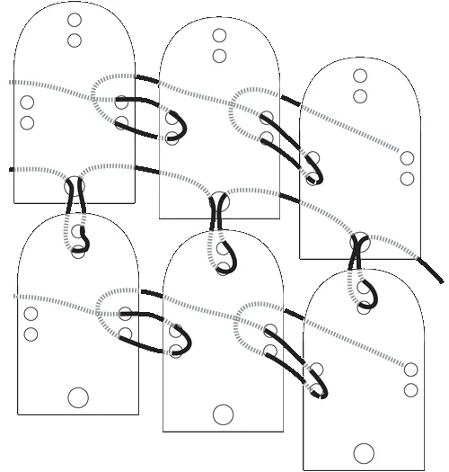
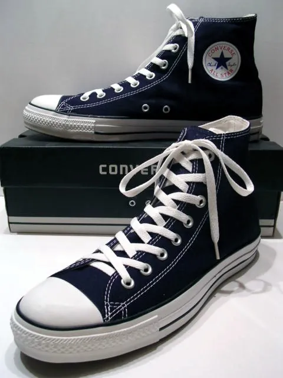
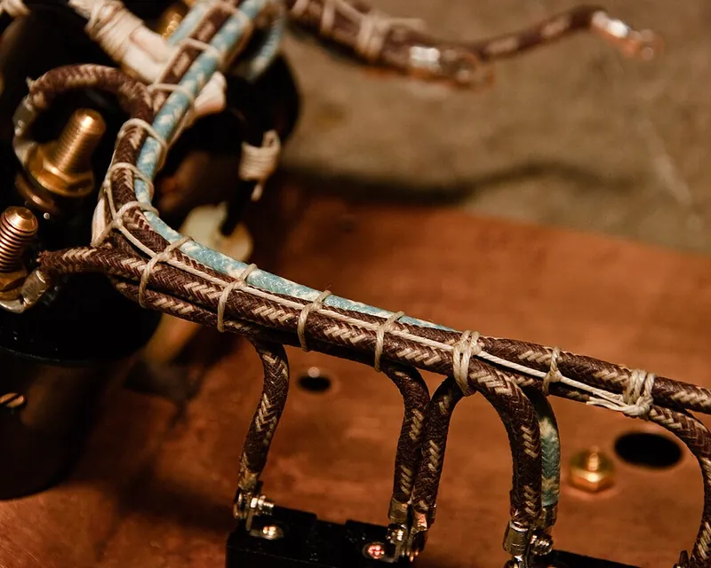

<figure class="eoc-pic eoc-pic-main"><figcaption><strong>Diagram.</strong> <a href="https://commons.wikimedia.org/wiki/File:Lamellar_lacing.gif">Lamellar lacing</a> by unknown, Public domain, from Wikimedia Commons.</figcaption></figure>
<figure class="eoc-pic"><figcaption><strong>Photo.</strong> <a href="https://commons.wikimedia.org/wiki/File:A_classic_Black_pair_of_Converse_All_Stars_resting_on_the_Black_%26_White_Ed._Shoebox_(1998-2002).JPG">A classic Black pair of Converse All Stars resting on the Black &amp; White Ed. Shoebox (1998-2002)</a> by Hadley1978 at English Wikipedia, Public domain, from Wikimedia Commons.</figcaption></figure>
<figure class="eoc-pic"><figcaption><strong>How it works.</strong> <a href="https://commons.wikimedia.org/wiki/File:Cable_lacing_close-up.jpg">Cable lacing close-up</a> by impulselabs, <a href="https://creativecommons.org/licenses/by-sa/2.0">CC BY-SA 2.0</a>, from Wikimedia Commons.</figcaption></figure>

A lace is threaded back and forth through matching holes, eyelets or hooks on two edges and pulled tight, so many short crossings share the pull and draw the edges together; a knot, bow or lace lock holds it, and it can be loosened and re-tightened at any time.

**In plain words:** A cord, shoelace, elastic cord or leather strip threaded back and forth through a row of holes, metal rings or hooks along two edges, then pulled tight to draw the edges together, like the laces on a shoe; you can loosen it, open it and tighten it again. **Proper term:** Lacing (laced joint: a lace or thong passed through holes, eyelets or hooks on two edges).

**Also called:** lace-up, lacing, shoelacing, bootlacing (Wikipedia 'Shoelaces'); criss-cross lacing, straight-bar (bar) lacing, bowtie lacing, checkerboard lacing, cobwebbing (Wikipedia 'Shoelaces'; Polster, Nature 2002); edge lacing, leather lacing or thonging: running stitch, double running stitch, loop stitch and cross whip stitch (e-scoutcraft); whipstitch and double loop lacing (Tandy Leather); drawstring: a lace pulled through a casing or 'laced through holes, which may be lined with eyelets'; 'A shoelace is a drawstring' (Wikipedia 'Drawstring'); corset lacing, including 'bunny ears' lacing from the middle (Wikipedia 'Corset'); lamellar lacing: small plates 'punched and laced together, typically in horizontal rows' (Wikipedia 'Lamellar armour'); marling: a row of marling hitches, 'a knot that is used in series to lash long bundles (as rolled or folded awnings, hammocks, or sails)' (Merriam-Webster); shock-cord lacing of covers over lacing knobs, cover clips or hooks; e.g. Stayput (brand) (Sailrite); lace hooks, speed hooks, lace locks, lace-locking systems (Wikipedia 'Shoelaces').

## How it works

Each pass of the lace across the gap between the two edges pulls them towards each other, and pulling on the lace ends shares that pull among all the crossings, so a long opening closes evenly (Wikipedia 'Shoelaces'). The holes are the anchor points: an eyelet or grommet lining a hole 'prevents the cord from tearing through the hole' (Wikipedia 'Grommet'). Friction where the lace bends through each hole helps it stay tight while you tie it off; a knot, bow or lace lock then holds the ends, and a bow 'can be readily loosened by pulling one or both of the loose ends' (Wikipedia 'Shoelaces'). In leather edge lacing the lace instead wraps over the edge and through holes in two layers, binding them like a coarse seam that is usually left in place (e-scoutcraft).

## Parts

A few parts: the lace (shoelace, cord, paracord, elastic shock cord, leather thong or waxed thread), a row of holes on each edge, often lined with eyelets or grommets or replaced by hooks or knobs, aglets on the lace ends, and a knot, bow, cord lock or lace lock to hold the tension (Wikipedia 'Shoelaces'; Wikipedia 'Grommet'; Sailrite).

## Everyday examples

- Laced shoes and boots, with aglets on the lace ends and eyelets or hooks on the sides (Wikipedia 'Shoelaces')
- A leather pouch, wallet or knife sheath with a laced edge (Tandy Leather; e-scoutcraft)
- A boat, trailer or barbecue cover held down with shock cord laced over hooks or knobs (Sailrite)
- A banner laced to a frame or fence with rope or bungee cord through its grommets (Banners.com)

## When to use it

When two edges must be pulled together firmly but opened again later, or when the fit must be adjustable: footwear, gaiters, bags and pouches, corsets and other fitted clothing (Wikipedia 'Corset'), covers laced onto a frame or a boat, banners and screens on frames, rolled sails, awnings and hammocks lashed with a row of marling hitches (Merriam-Webster), and printed panels, plates or costume armour joined into a flexible sheet (Wikipedia 'Lamellar armour'). It is cheap, needs no special hardware, spreads the pull along many points, and is easy to repair with a new lace. For leather, edge lacing is a decorative and durable way to close an edge (Tandy Leather).

## When not to use it

For quick, frequent opening with one hand, a zipper, hook-and-loop, buckle or a ratcheting reel (dial) closure is faster (see those entries). For a permanent, flat, flexible join use a sewn seam. For thin, slippery fabric such as silnylon, avoid eyelets and sew on webbing loops instead (Extremtextil). For binding wire looms use cable lacing (see 'Binding knots and seizings'). Not for anything that holds or protects a person: lacing and printed plates are not rated or tested for that. Not for children's hood or neck drawstrings, which are a strangulation hazard (Wikipedia 'Drawstring').

## Details

- **What it does (jobs):**
  - join and hold: holds two edges of leather, fabric, sheet or printed panels together
  - tighten and hold tension: pulling the lace draws the edges together, and a knot, cord lock or lace lock holds the tension (Wikipedia 'Shoelaces')
  - lock, and release by hand: untie the bow or open the lace lock and loosen the lace to open it again
- **Movement:** none once tied: the edges are held; while you adjust it, the lace slides through the holes
- **Directions it can move (degrees of freedom):** 0 between the laced edges once tight (they can still bend, as leather and fabric do); loosening the lace lets the edges separate again.
- **Special behaviour:**
  - tensioning (takes up slack and holds): pulling the lace takes up slack along the whole opening, and a knot, cord lock or lace lock holds it
  - quick-release: a bow (slipped reef knot) comes undone with a pull on a loose end (Wikipedia 'Shoelaces')
- **How it holds:**
  - shape (the parts interlock; [form-fit](../glossary.md#form-fit--force-fit--material-bond)): the lace passes through holes or round hooks in both edges, so the edges can't separate without the lace
  - friction or clamping (force-fit): friction in the holes and in the knot, or the grip of a cord lock or lace lock, holds the tension; a knot holds because the crimped lace 'cannot make itself smaller and slide though the knot' (Wikipedia 'Shoelaces')
- **Input and output:** not applicable: lacing joins edges and passes no motion on
- **Power:** passive (no power needed)
- **Load:** Light to medium, shared along all the holes. The weak points are the lace itself and the hole edges, which tear out first in thin material; eyelets or grommets stop the cord tearing through (Wikipedia 'Grommet'), and in very light fabric such as silnylon eyelets are 'generally unsuitable' because the pull can't spread, so sewn-on webbing loops are used instead (Extremtextil). Corners carry the most stress on a laced-on banner, so grommets go in every corner first (Banners.com). Strong in pulling the edges together; it can't push them apart or stop them flexing. Criss-cross and straight lacing are the strongest shoe lacings (Polster, Nature 2002). Never use home-made lacing to hold a person.
- **Play and precision:** not applicable for location; the edges are only held as tightly as the lace is pulled, and laces stretch and settle, so laced covers and panels may need re-tightening ⚑ [uncertain: no source opened measures this]. Elastic laces with fat 'knotty' sections can set different tensions along the opening (Wikipedia 'Shoelaces').
- **Taking it apart:** removable: shoe-type lacing is untied and unthreaded by hand with no tools (tool-free quick release when tied with a bow). Leather edge lacing is semi-permanent: its ends are tied off and glued, or tucked under the loops (e-scoutcraft).
- **How often it can be reused:** many times: the edges and eyelets last; the lace wears and is replaced when it frays or its aglets break
- **Sealing:** none: there are gaps between the crossings, and nothing makes it seal ⚑ [uncertain: a flap behind the lacing, like a shoe's tongue, can cover the gap, but no opened source discusses it]
- **Adjustable:** yes: tighten or loosen the lace at any time, and change the lacing pattern to adjust the fit (Wikipedia 'Shoelaces'). A corset could be left 'as adjusted' and taken on and off by a separate front opening (busk) (Wikipedia 'Corset'), a good pattern for any laced cover: set the lacing once and open it some other way.
- **Access needed:** both sides to thread the lace through the holes the first time; afterwards tightening, tying and untying are done from the outside only
- **Materials:** Laces: cotton, jute, hemp or leather traditionally; modern laces 'often incorporate various synthetic fibers', which are more slippery and come undone more easily but wear and rot less (Wikipedia 'Shoelaces'); polyester is the most common lace yarn (same); flat laces 'stay tied more securely than those with a round cross-section' (same). Leather lacing about 1/8 inch (3 mm) wide, waxed thread or craft strips (e-scoutcraft). Elastic shock cord for covers (Sailrite). Edges: leather, canvas and fabric (with eyelets or grommets of metal, plastic or rubber; Wikipedia 'Grommet'), vinyl banners (Banners.com), plates of iron, steel, leather, bone or bronze in lamellar armour (Wikipedia 'Lamellar armour'), and 3D-printed panels in PLA, PETG or TPU (Printables models below).
- **Heat, cold, water and wear:** Moisture: natural-fibre laces can rot, while 'smooth synthetic shoelaces ... are less susceptible to rotting from moisture' (Wikipedia 'Shoelaces'). Slippery synthetic laces come undone more easily; waxing and silicone finishes increase friction (Wikipedia 'Shoelaces'). Wind: wind load pulls harder on wider gaps between grommets, so space them closer outdoors (Banners.com). Silnylon 'stretches slightly when wet', so laced or tensioned silnylon may sag and need re-tensioning (Extremtextil). Sunlight and heat: synthetic cords and printed panels (especially PLA) weaken in sun and soften in heat ⚑ [uncertain: no opened source gives figures for laces].

## Making it

- **Ways to make or get it:**
  - leatherwork: holes punched or chiselled with a thonging chisel, laced by hand (e-scoutcraft)
  - off-the-shelf part: laces, leather lace, eyelets and grommets, lace hooks, lace locks, shock cord, lacing knobs and cover clips
  - 3D print (FDM): rows of holes in printed panels or plates, printed eyelets, hooks and lace locks (Printables models below)
  - laser cut or CNC: rows of holes in sheet, leather or panels ⚑ [uncertain: no source opened describes laser-cut lacing holes]
- **Printing it in one piece (print in place):** no: the holes print with the part, but the lace is threaded afterwards; printed lace locks and eyelets are separate small parts
- **Tools:** None to lace, tighten or untie. To make the holes: a hole punch, or a thonging (lacing) chisel driven with a mallet on a hardwood block, and a large-eyed needle for the lace (e-scoutcraft); an eyelet or grommet setting punch, or a press with punch and anvil (Wikipedia 'Grommet'); a screwdriver for screw-on lacing knobs and hooks (Sailrite).
- **Difficulty:** easy: holes and a cord; the only care is even hole spacing, a smooth edge to each hole, and enough lace

### 3D printing tips

1) Hole size: make each hole big enough for the lace and its aglet or melted tip to pass; one printed lace lock is chosen by measuring the aglet diameter (Printables 'Springless Lace Lock (Parametric)', sizes for 2-8 mm laces), and another uses 4.1 mm holes, which it says fit 'almost all lace types, flat or round' (Printables 'Side Lace Lock'). For holes in printed parts more generally (sizes, edge distance, deburring), see 'Sew-on part' and 'Stopper knots and cord-end anchors'. 2) Edge distance and walls: leave a solid bridge of plastic between hole and edge; walls 'thinner than one nozzle perimeter are not printable' (Prusa), so allow several [perimeters](../glossary.md#perimeters). 3) Orientation: print panels flat, so the holes run vertically and the pull of the lace runs along the layers, because FFF prints 'are stronger in one direction than another' (Prusa). 4) Flexible plates: one set of lamellar plates is printed in TPU (slow, 4 walls, 20% gyroid [infill](../glossary.md#infill)) and tied together with paracord (Printables 'Lamellar Armor Plates for HEMA/SCA/LARP'); flexible plates take a laced row's bending better than rigid ones ⚑ [uncertain: inferred, not tested by a source]. Treat printed plates as costume, not tested protective gear. 5) Printed eyelets and hooks: a printed shoe eyelet comes in glue-in and click-in versions, printed in PLA at 0.1 mm layers with 20% infill (Printables 'Shoe Eyelet'); a replacement boot lace hook printed in a polycarbonate blend and fixed with a 2 x 8 mm self-tapping screw had worked 'for over a year' (Printables 'shoe lace hook'). 6) Lace locks print without supports in PLA, PETG or TPU (Printables 'Side Lace Lock'); one maker says to print theirs in PETG (Printables 'Shoelaces lacing system'). 7) Smooth hole mouths: [chamfer](../glossary.md#chamfer--fillet) or sand hole edges so the lace doesn't fray on sharp printed edges ⚑ [uncertain: no source tested lace wear on printed holes].

### Buying one (off-the-shelf parts)

Search for: 'shoelaces' (flat, round, waxed, elastic), 'leather lace' or 'leather thong', 'lacing needle', 'thonging chisel' or 'lacing chisel' (e-scoutcraft; Tandy Leather); 'eyelets', 'grommets' and an 'eyelet setting tool' or 'grommet press' (Wikipedia 'Grommet'); 'lace hooks' or 'speed hooks' (boots and skates; Wikipedia 'Shoelaces'); 'lace locks' and 'cord locks' (Wikipedia 'Shoelaces'); 'aglets'; 'shock cord' (bungee cord), 'shock cord lacing knob', 'shock cord cover clip', 'shock cord hook' and 'tent wall hook' for laced covers, e.g. Stayput (brand) (Sailrite); 'bungee balls' for banners (Banners.com).

## Rules of thumb

- Leather edge lacing holes: 'close to the edge (1/16" to 1/8")' (about 1.5-3 mm) 'and evenly spaced'; drive a thonging chisel through the work on a hardwood block and put its first prong in the last hole to keep the spacing even (e-scoutcraft).
- How much leather lace, by stitch: running stitch about 1.5 times the length to be laced, double running stitch about 3 times, loop stitch about 3.5 times and cross whip stitch about 6 times (e-scoutcraft). Double loop lacing: 'about 7 times the length of the edge you're lacing' (a leatherworker.net member) or '7-8 times the length of the item being stitched' (a Tandy guide quoted on the same forum thread). Lace in arm-length pieces of about 5-6 ft and splice, rather than one long piece that wears and stretches as you pull it through (same thread).
- Shoelace length, as a rough guide (Wikipedia 'Shoelaces'): 2 holes 45 cm, 3: 65 cm, 4: 75-85 cm, 5: 85-90 cm, 6: 100 cm, 7: 110 cm, 8: 120 cm, 10: 130 cm, 12: 150 cm, 14: 180 cm, 16: 200 cm ⚑ [uncertain: the table is headed 'No of holes' and doesn't say whether it means holes or pairs of eyelets].
- Which shoe-type lacing to choose: criss-cross lacing is 'The most common lacing method' and 'one of the strongest and most efficient' (Wikipedia 'Shoelaces'); criss-cross and straight lacing are the strongest, while bowtie lacing is the shortest (Polster, Nature 2002); straight-bar lacing suits closed (Oxford-style) openings, where the crossovers of criss-cross lacing 'prevent the sides of the shoe from coming together in the middle' (Wikipedia); checkerboard lacing is 'very difficult to tighten or loosen' (Wikipedia).
- Tying off: a bow tied as a reef knot holds; tied as a granny knot it 'is much less secure'; if the loops lie across the opening it is probably a reef knot, if they lie along it a granny (Wikipedia 'Shoelaces'). Double-wrapped bows hold better (same). See 'Basic knots' for the reef knot (ABOK #1204).
- Lacing a banner or cover through grommets: a grommet in every corner first, since corners 'carry the most stress', then every 24-36 inches (about 0.6-0.9 m) along the edge, or every 18-24 inches in windy places, 'since wind load pulls harder on wider gaps'; a double-folded hem 'keeps the grommet from tearing out under load' (Banners.com).
- Leather lace care: slightly dampen leather lace to stop it twisting, and keep the tension even to avoid uneven loops (Tandy Leather).

## Common failures

Comes undone: a granny knot instead of a reef knot, round or slippery synthetic laces, or a single bow; use a reef-knot bow, a double-wrapped bow, flat or cotton laces, or a lace lock (Wikipedia 'Shoelaces'). Lace end frays and won't thread: the aglet has broken (see 'Rope-end finishing'). Holes tear out: holes too close to the edge or material too thin; line them with eyelets or grommets (Wikipedia 'Grommet'), use a double-folded hem and closer spacing (Banners.com), or sew on reinforcement loops (Extremtextil). Lace wears and stretches while lacing a long edge: work in shorter pieces and splice (leatherworker.net). Leather lace twists or loops come out uneven: dampen the lace and keep the tension even (Tandy Leather). Edges won't close in the middle: criss-cross lacing on a closed opening; use straight-bar lacing (Wikipedia). Lace frays at sharp printed hole edges ⚑ [uncertain]: chamfer and smooth them.

## Safety

Drawstrings and long laces on children's clothing can catch on playground equipment, bus doors or cribs and strangle; the US CPSC issued guidelines in 1996 and recorded 22 deaths and 48 non-fatal incidents from 1985 to 1999 (Wikipedia 'Drawstring'). Untied or loose laces can trip people, which is why lace-locking systems are used in sport (Wikipedia 'Shoelaces'). Tensioned shock cord that slips off a hook can snap back towards the face ⚑ [uncertain: no source opened]. Chisels, punches and mallets used to make lacing holes can cut or crush fingers ⚑ [uncertain]. Never use home-made lacing to hold or protect a person; printed plates laced into 'armour' are costume, not protective equipment.

## Related

- Eyelets and grommets (for fabric, leather and sheet): the reinforced holes that lacing usually passes through
- Ratcheting reel closure (dial lacing system): a dial that winds a thin lace or cable to tighten a laced opening with one hand
- Cord lock (spring toggle): holds a lace or drawstring at any length instead of tying a knot
- Rope-end finishing (whipping, heat-sealing, back splice, aglet): aglets and melted tips that keep lace ends from fraying and make threading easy
- Basic knots (overhand knot, half hitch, reef knot): the bow that ties off a lace is a slipped reef knot
- Sewn seams and hand stitches: a permanent seam with thread, where lacing is a removable join with a lace
- Binding knots and seizings (constrictor knot, seizing, cable lacing): cable lacing ties wire bundles with lacing cord or tape
- Zipper (slide fastener) and Hook-and-loop fastener: faster ways to close an opening, with less adjustment
- Basic strap and garment closures (prong buckle, button, toggle and loop): other simple ways to close clothing and bags
- Sew-on part (sewing holes, loops and slots on a rigid part): hole sizes and edge distances for cord and thread through printed parts
- Elastic band and elastic cord springs: shock cord used as a stretchy lace for covers

## Make it yourself

- [Side Lace Lock – No-Tie Shoelace Holder for the Last Eyelet (Printables) (URL from Printables API, page not opened)](https://www.printables.com/model/1745470-side-lace-lock-no-tie-shoelace-holder-for-the-last): Small printed lock (4.1 mm holes, 3.2 mm locking slot) that holds a lace by friction along a three-step path instead of a knot; no supports *(licence: CC BY-NC-ND)*
- [Springless Lace Lock (Parametric) (Printables) (URL from Printables API, page not opened)](https://www.printables.com/model/585678-springless-lace-lock-parametric): Printed lever-type lace lock with no spring, in sizes for 2-8 mm laces chosen by aglet diameter; Fusion 360 files included *(licence: CC BY-NC-SA)*
- [Shoe Eyelet (Printables) (URL from Printables API, page not opened)](https://www.printables.com/model/213352-shoe-eyelet): Printed eyelet to reinforce or decorate a lace hole, in glue-in and click-in versions *(licence: CC BY-SA)*
- [Lamellar Armor Plates for HEMA/SCA/LARP (Printables) (URL from Printables API, page not opened)](https://www.printables.com/model/1654691-lamellar-armor-plates-for-hemascalarp): 80 x 60 mm TPU plates with lacing holes, tied together with paracord into a flexible laced sheet; costume use, not tested protective equipment *(licence: CC BY-NC)*
- [Shoe Lacing Boards - Left and Right (Printables) (URL from Printables API, page not opened)](https://www.printables.com/model/899079-shoe-lacing-boards-left-and-right): Printed practice boards with eyelet holes for learning lacing patterns and knots *(licence: CC BY-NC)*

## Pictures, videos and models

- [Shoe Lacing Methods (Wikimedia Commons video)](https://commons.wikimedia.org/wiki/File:Shoe_Lacing_Methods.webm): Short video of a shoe being laced with criss-cross lacing *(licence: CC BY-SA 3.0 (Lrcolette))*
- [Lamellar lacing (Wikimedia Commons)](https://commons.wikimedia.org/wiki/File:Lamellar_lacing.gif): Diagram of how small punched plates are laced together in rows, the idea behind lacing printed plates or panels *(licence: Public domain)*
- [Criss-cross laced canvas shoes (Wikimedia Commons)](https://commons.wikimedia.org/wiki/File:A_classic_Black_pair_of_Converse_All_Stars_resting_on_the_Black_%26_White_Ed._Shoebox_(1998-2002).JPG): Photo of a pair of canvas shoes with criss-cross lacing through metal eyelets *(licence: Public domain (Hadley1978))*
- [Lacing Techniques (e-scoutcraft)](https://e-scoutcraft.com/leather/lacing.html): Diagrams of running, double running, loop and cross whip lacing on leather edges, with hole spacing and lace length for each *(licence: Copyright 2003 Vincent Hale; link only)*
- [How to Double Loop Lace Leather (Tandy Leather video tutorial)](https://tandyleather.com/blogs/tandy-blog/how-to-double-loop-lace-leather-video): Video of double loop lacing round a leather edge, with tips on tension and dampening the lace *(licence: Tandy Leather content; link only)*

## Needs confirming

⚑ marks something nobody has confirmed yet: a fact the research could not confirm from a source, a finder value that is a best guess, or an open point from the research notes. Corrections are welcome (see `research/needs-confirming.md`).

- ⚑ 10 sentences on this page marked [uncertain].
- ⚑ Research note: *Lacing*: double-loop lace length (about 7 or 7-8 times the edge) both come from one leatherworker.net forum thread; 8 of its 41 fields are marked [uncertain].

## Sources

- <https://en.wikipedia.org/wiki/Shoelaces>
- <https://www.nature.com/articles/420476a (Polster, B., 'What is the best way to lace your shoes?', Nature 420, 476 (2002); abstract)>
- <https://e-scoutcraft.com/leather/lacing.html>
- <https://tandyleather.com/blogs/tandy-blog/how-to-double-loop-lace-leather-video>
- <https://leatherworker.net/forum/topic/37059-how-much-lace (forum thread, 2012: double-loop lace length and splicing)>
- <https://en.wikipedia.org/wiki/Grommet>
- <https://en.wikipedia.org/wiki/Drawstring>
- <https://en.wikipedia.org/wiki/Corset>
- <https://en.wikipedia.org/wiki/Lamellar_armour>
- <https://www.merriam-webster.com/dictionary/marling%20hitch>
- <https://www.sailrite.com/Shock-Cord-Lacing-Knob-White>
- <https://www.banners.com/c/banner-grommet-placement-explained-spacing-strength-and-installation-best-practices>
- <https://www.extremtextil.de/en/know-how/silnylon-info>
- <https://help.prusa3d.com/article/modeling-with-3d-printing-in-mind_164135>
- <https://commons.wikimedia.org/wiki/File:Shoe_Lacing_Methods.webm>
- <https://commons.wikimedia.org/wiki/File:Lamellar_lacing.gif>
- <https://commons.wikimedia.org/wiki/File:A_classic_Black_pair_of_Converse_All_Stars_resting_on_the_Black_%26_White_Ed._Shoebox_(1998-2002).JPG>
- <https://api.printables.com/graphql/ (Printables models 1745470, 585678, 213352, 1559852 'shoe lace hook', 254898 'Shoelaces lacing system', 1654691, 247728 'lamellar armor', 899079; pages not opened)>
