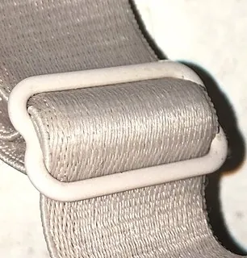

<figure class="eoc-pic eoc-pic-main"><picture><source media="(prefers-reduced-motion: reduce)" srcset="../media/drawn/ladder-lock-buckle.svg"></picture><figcaption><strong>Animation.</strong> Diagram drawn for the encyclopaedia from the research notes. ⚑ Needs confirming: a drawing can simplify or get details wrong; a real photo or a better diagram is welcome.</figcaption></figure>
<figure class="eoc-pic"><figcaption><strong>Photo.</strong> <a href="https://commons.wikimedia.org/wiki/File:Cropped_tri-glide_slide.jpg">Cropped tri-glide slide</a> by SaltySemanticSchmuck, <a href="https://creativecommons.org/licenses/by-sa/4.0">CC BY-SA 4.0</a>, from Wikimedia Commons.</figcaption></figure>

A one-piece buckle with two or three bars that a strap weaves through, so that pulling on the load makes the strap pinch itself against a bar and hold by friction, while tilting the buckle's tab lets the strap slide to lengthen it; a tri-glide is the same idea without the lock, and double D-rings and G-hooks are close relatives.

**In plain words:** A flat plastic or metal buckle with slots and bars that a strap weaves through; it holds by itself when the strap is pulled tight, and lets the strap run when you lift its tab. **Proper term:** Ladder lock buckle (tension lock); the non-locking version is a tri-glide slide; variants covered here: double D-ring fastener and G-hook.

**Also called:** ladder lock / ladderlock; tension lock buckle (Buckleguy: 'Ladder locks, AKA tension lock buckles'); ladder buckle; ladder lock slider buckle / slider buckle; strap adjuster / webbing adjuster; Ladderloc (brand, ITW Nexus), Superloc (brand, ITW Nexus); tri-glide slide / tri-glide / triglide (non-locking version); webbing slide / slide (non-locking version); Triglide (brand spelling, ITW Nexus); Conway buckle (curved slide with a post, used on horse tack; a close relative of the tri-glide); double D-ring fastener / double-D ring / D-ring buckle (variant); G-hook / tension G hook (variant); Leiterschnalle (German, ladder lock) ⚑ [uncertain spelling as a trade term].

## How it works

One strap is sewn permanently round the back bar; the adjustable strap comes up through the middle gap, goes round the gripping bar next to the tab and back out, so that when the load pulls, the strap is pinched between itself and the bar and friction holds it (a friction lock that tightens itself as the load rises). Pulling the free tail shortens the strap even under load, but the load cannot pull it back out. Lifting the tab tilts the gripping bar so the strap is no longer pinched and it can run out to lengthen. A tri-glide has no tab and no self-tightening pinch: the strap simply zig-zags over and under its centre bar and is held by friction and tension, so it is used for adjusting and tidying rather than as a lock. A double D-ring works like a slip knot: the strap goes through both rings and back through one, and pulling on it squeezes the rings together on the strap.

## Parts

Single piece. Ladder lock: one moulded or cast frame with a fixed bar for the sewn-on strap, one or two gripping bars (often with small teeth or ridges) and a finger tab. Tri-glide: a rectangle split by one centre bar (two slots). Double D-ring: two D-shaped metal rings sewn side by side on one strap end. G-hook: a flat G-shaped hook with a slot for the strap. The webbing strap itself is the other half of the joint.

## Everyday examples

- backpack shoulder straps: the buckle at the bottom of each strap that you pull to tighten and lift to loosen
- bra straps and bag straps adjusted with a small metal or plastic tri-glide slide
- motorcycle helmet chin straps closed with two metal D-rings (double D-ring)
- roll-top bags and vests closed with a flat G-hook hooked into a webbing loop

## When to use it

When a strap needs to be adjusted in length and then hold without knots: backpack shoulder, hip and compression straps, bag straps, pet harnesses, camera straps, tie-down straps for light loads, and sewn gear (making your own gear, 'MYOG'). Ladder locks suit one-handed tightening and quick loosening. Tri-glides suit length adjustment and tidying a strap next to another buckle. Double D-rings give a very simple, strong, infinitely adjustable metal closure (used on motorcycle helmets). G-hooks give a flat, quick hook-on attachment to a webbing loop.

## When not to use it

Not for life-safety or heavy loads (climbing, fall arrest, lifting, cargo tie-downs): use rated buckles, cam buckles or [ratchet](../glossary.md#ratchet) straps. Not where the load bounces on and off all day and must not [creep](../glossary.md#creep) (use a cam buckle, a stitched or fixed strap, or add a tri-glide or stitches). Not with thin or slippery ribbon (use thicker webbing or a cam buckle). If you need to join and separate two straps quickly, add a side-release buckle; if you need a set length that never changes, sew the strap instead.

## Details

- **What it does (jobs):**
  - tighten and hold tension: pull the free tail to shorten a strap and it stays tight
  - lock, and release by hand: holds under load until you lift the tab
  - stop it moving back (one-way): the strap can be pulled shorter but the load cannot pull it longer
  - join and hold: joins a strap end to a bag, frame or another strap
- **Movement:** slide: the strap slides through the buckle when you adjust it (unlimited travel along the strap); the ladder lock itself also tilts a few tens of degrees when you lift its tab to release
- **Directions it can move (degrees of freedom):** 0 when loaded and locked. When released (tab lifted, or a tri-glide with no load), 1: the strap slides through the buckle along its length.
- **Special behaviour:**
  - [self-locking](../glossary.md#self-locking) (holds under load, won't back-drive): load on the strap makes it pinch itself tighter against the bar, so it holds without a spring or catch; it can still creep under repeated jerky loads
  - hand-release only (locks under load, releases when a person operates it): you release it by lifting the tab, which tilts the bar and frees the strap
  - one-way (moves freely one way, locks the other): pulling the free end shortens the strap at any time, but the load cannot lengthen it
  - tensioning (takes up slack and holds): pull the tail to cinch a load down and it stays tight
  - quick-release: lifting the tab lets the strap run out quickly; a G-hook unhooks from its webbing loop in one movement
  - none (tri-glide): a tri-glide only holds by friction and has no locking action of its own
- **How it holds:** friction or clamping ([force-fit](../glossary.md#form-fit--force-fit--material-bond)): the strap is pinched between itself and a bar (ladder lock, double D-ring) or wound over and under a bar (tri-glide); ridges or teeth on the bar add grip. A G-hook holds by shape (the hook sits through a webbing loop) while tension keeps it seated.
- **Input and output:** not applicable
- **Power:** passive (no power needed)
- **Load:** light to medium. A retailer states its low-profile ladder locks hold 60 lb (27 kg) without bending or snapping and are at least twice as strong as ordinary ones (Zpacks). A maker's PETG-printed ladder lock lifted a 10 kg watering can without deforming (Printables model 2433). Strong in a straight pull along the strap; weak against repeated jerky or on-off loads (the strap creeps through), against a sideways pull that tilts the buckle, and on thin or slippery webbing. Tri-glides hold less and should not be the only fastener on anything safety-related. Published load ratings of ordinary ladder locks were not found ⚑ [uncertain].
- **Play and precision:** not applicable (it adjusts a flexible strap and does not locate parts); the strap can creep a little under repeated loads, so set length is not exactly repeatable
- **Taking it apart:** tool-free quick release: the adjustable strap is released by lifting the tab and can be unthreaded by hand; the fixed end is usually sewn round a bar and is permanent unless the stitches are cut (no-thread tri-glides have a slot in the centre bar and clip onto an existing strap; split-bar ladder locks are sold for fitting without sewing ⚑ [uncertain])
- **How often it can be reused:** effectively unlimited: adjusting is its everyday job and there is no spring or snap arm to wear out; the webbing wears first
- **Sealing:** none
- **Adjustable:** yes: the strap length can be changed at any time by pulling the tail (shorter) or lifting the tab (longer), steplessly along the strap
- **Access needed:** not applicable: it hangs on a strap and can be reached from all round; you only need to reach the tab and the strap tail
- **Materials:** Usually injection-moulded acetal (POM), nylon or polypropylene-type plastics; also die-cast or stamped metal (zinc alloy, steel, aluminium) for tri-glides and slides, and titanium or stainless steel for G-hooks and double D-rings. Works with flat woven webbing (nylon, polyester, polypropylene) matched to the slot width; thin grosgrain ribbon and twill tape tend to slip. 3D-printed versions: PETG (tested), ASA for sun and heat.
- **Heat, cold, water and wear:** Acetal (the usual buckle plastic) has a service temperature range of -40 °F to 140 °F (-40 °C to 60 °C) for ITW Nexus parts, and ITW says its Ladderloc is 'unaffected by extremes in weather and temperature'. Nylon absorbs water, so its strength and [stiffness](../glossary.md#stiffness) change with humidity. Polyolefin (polypropylene-type) hardware loses properties at low temperatures, and ITW recommends it only for basic, low-performance uses. Some sellers claim acetal becomes [brittle](../glossary.md#brittle--ductile) in deep cold ⚑ [uncertain: source page could not be opened]. Spilled lubricant or very smooth webbing lowers friction and lets a slide move (Hawk Hill); wet or icy webbing probably grips less too ⚑ [uncertain]. PLA prints soften in heat and degrade in sunlight; PETG or ASA is suggested for outdoor or hot use ⚑ [uncertain for these specific parts].

## Making it

- **Ways to make or get it:**
  - off-the-shelf part (most common): plastic ladder locks, tri-glides, D-rings and G-hooks sold by webbing width
  - 3D print (FDM): single-piece ladder locks and tri-glides print flat without supports
  - sheet metal / die casting (how metal slides and tri-glides are made; Hawk Hill describes die-cast and stamped slides)
  - injection moulding (how commercial plastic ones are made; not a home process)
- **Printing it in one piece (print in place):** yes: ladder locks and tri-glides are single pieces that work straight off the print bed (e.g. Printables 263258 'No supports, No [bridging](../glossary.md#overhang--bridging), Single Piece'); the strap is threaded afterwards
- **Tools:** none to use or adjust. Fitting: sewing machine or needle and heavy thread to sew the fixed end; a lighter or hot knife to seal cut ends of synthetic webbing; none for no-thread tri-glides
- **Difficulty:** easy: cheap to buy, and printable in one piece without supports; the hard part is sewing the fixed end and choosing webbing thick enough to grip

### 3D printing tips

Print it flat, with the bars lying on the bed, so the bars are made of long strands of plastic rather than stacked layers that can split apart (one single-piece design says to print 'with the flat side down and the tab facing up'; Protolabs Network/Hubs warns that parts built up in the Z direction are weaker because of layer bonding). Use a tough material: PETG is the usual choice. One maker's PETG ladder lock, printed at 0.15 mm layers and 80% [infill](../glossary.md#infill) with no supports, lifted a 10 kg watering can without deforming. Another designer prints in PETG (or ASA) at 0.20 mm layers and 100% infill, with a 0.4 mm nozzle. Size the slots to your real webbing, measured, plus a little [clearance](../glossary.md#clearance): one tri-glide designer lists '1 inch' slots with an 'actual width' of 27 mm ⚑ [uncertain whether that is the slot or the measured webbing]. A 24 mm printed ladder lock takes webbing up to 24.6 mm wide and 4.3 mm thick. [Chamfer](../glossary.md#chamfer--fillet) or round every edge the webbing touches so it does not saw through the strap (one tri-glide design chamfers all edges; a customisable one has a 'broken edges' option). For grip, add small ridges or teeth on the top of the gripping bar next to the tab, as commercial ladder locks do. To scale a design, divide your webbing width by the designed width and scale by that factor. A no-thread tri-glide can have a slot cut through its centre bar so it clips onto an existing strap. Don't use printed strap hardware where a failure could hurt someone.

### Buying one (off-the-shelf parts)

Search for: 'ladder lock buckle' or 'ladderlock' by webbing width (e.g. 20 mm/3/4 in, 25 mm/1 in, 38 mm/1.5 in, 50 mm/2 in); 'tension lock buckle'; 'curved ladder lock'; 'split-bar ladder lock' (sold for repairs; said to fit without sewing ⚑ [uncertain]); 'tri-glide slide' / 'webbing slide' (plastic, or metal die-cast/stamped); 'sternum strap slide'; 'double D-ring' / 'D-rings' (metal or plastic); 'G-hook' / 'tension G hook' (plastic, aluminium, titanium or stainless steel); flat nylon or polypropylene webbing to match. Side-release buckles often have a ladder lock built into one or both halves ('dual adjust').

## Rules of thumb

- Match the webbing to the slot width; if the webbing is too narrow it may slip under load (Trivantage, https://www.trivantage.com/blog/products/fastener-physics-101-cam-buckles-ladderloc-webbing).
- Thread it the right way: the webbing comes up from below through the same gap between the two inner bars on both sides; the fixed loop is sewn, the adjustable strap wraps the bar nearest the tab, and that bar has teeth on top to stop slipping. Lifting the tab lets the webbing run out (Sailrite threading instructions, https://directus.sailrite.com/assets/559fd74e-792e-4a5d-8941-b2329371258b).
- Find the right side of the buckle: it is the side where the bar nearest the tab stands higher than the other bar, and it may be ribbed (Sacôtin, https://sacotin.com/en/ladder-lock-buckle-tutorial/).
- Grosgrain ribbon and twill tape slip through most ladder locks from 3/4 in (20 mm) upwards; use medium-weight nylon webbing, or sew two layers of grosgrain together (Backpacking Light forum, https://backpackinglight.com/forums/topic/42388/).
- Ladder locks are best for a 'set it once' adjustment; they can creep under bouncing, on-off loads (e.g. a dog pack). Fixes that worked: thicker webbing, adding a tri-glide, or tacking the tail with a few hand stitches where it rarely needs adjusting (Hammock Forums, https://www.hammockforums.net/forum/archive/index.php/t-87145.html; Trivantage, see above).
- Never use a tri-glide as the only fastener on safety equipment (e.g. climbing harness, dog collar): pair it with a buckle and stitch the strap end so it cannot slip out (Hawk Hill, https://www.hawk-hill.com/glide-slide-hardware/).
- A printed PETG ladder lock (0.15 mm layers, 80% infill) held 10 kg without deforming (Printables model 2433, read via https://api.printables.com/graphql/).

## Common failures

(1) The strap slips or creeps, from wrong threading, an upside-down buckle, webbing too thin or narrow for the slot, slippery webbing, or bouncing on-off loads. Fix it by re-threading, using thicker or wider webbing, choosing a buckle with toothed bars, adding a tri-glide, or tacking the tail with stitches. (2) Accidental release when something catches and lifts the tab; route straps so the tab is not snagged. (3) The plastic bar cracks under shock load or in deep cold, or a printed bar splits along its layers; print it flat and use tough, good-quality material. (4) Sharp edges wear through the webbing; round or chamfer them. (5) A tri-glide used as a buckle lets go when the strap is slack or slippery; pair it with a buckle and stitch the end.

## Safety

Friction adjusters can slip under jerky loads, so don't let a ladder lock or tri-glide be the only thing holding safety gear or a load overhead. Double D-ring helmet straps must be threaded and tightened correctly on every ride. Loose strap tails can snag, so tuck or secure them. Small plastic parts are a choking hazard for small children (noted on a printable tri-glide).

## Related

- Cam buckle (webbing cam buckle): a spring-loaded toothed cam grips the strap; better for frequent adjustment and on-off loads, and releases with a lever instead of a tilt
- Side-release buckle: joins and separates two straps quickly; often has a ladder lock built into one or both halves ('dual adjust')
- Guy-line slider (friction line tensioner): the same pinch-by-friction idea for round cord instead of flat webbing
- Cord lock (spring toggle): grips a round cord with a spring-loaded plunger instead of a pinch
- Ratchet strap: winds the strap onto a spool with a ratchet for much higher tie-down loads
- Traditional belt buckle with prong: holds by a pin through punched holes, with fixed steps instead of stepless adjustment; the textile baseline
- Conway buckle: a curved tri-glide-like slide with a post through a punched hole, used on horse tack
- Binding-plate lock (tilting friction plate): the same 'tilt to release, jam under load' principle used on rods and tubes

## Make it yourself

- [Ladder Lock Buckle (1.5 inch/39mm) No supports, No bridging, Single Piece (Printables 263258; URL from Printables API, page not opened)](https://www.printables.com/model/263258-ladder-lock-buckle-15-inch39mm-no-supports-no-brid): Single-piece printable ladder lock for 39 mm webbing that prints flat with no supports; scale by webbing width *(licence: CC BY-NC (Creative Commons Attribution-NonCommercial))*
- [Ladder Lock / Ladder Buckle (Printables 2433; URL from Printables API, page not opened)](https://www.printables.com/model/2433-ladder-lock-ladder-buckle): Simple ladder lock designed in Fusion 360 (source file included), printed in PETG and tested lifting 10 kg *(licence: CC BY (Creative Commons Attribution))*
- [Strong Printable Strap Ladder Lock Buckle (Printables 1807085; URL from Printables API, page not opened)](https://www.printables.com/model/1807085-strong-printable-strap-ladder-lock-buckle): Ladder lock for 25 mm (1 in) straps that prints without supports *(licence: CC BY-SA (Creative Commons Attribution-ShareAlike))*
- [Tri-Glide Webbing Slide (Threaded and No-Thread) (Printables 305674; details read via the Printables API)](https://www.printables.com/model/305674-tri-glide-webbing-slide-threaded-and-no-thread): Parametric tri-glide for 1 in, 30 mm, 1.5 in and 50 mm webbing, with a no-thread version that has a slot in the centre bar to clip onto an existing strap; all edges chamfered *(licence: CC BY-NC-SA (Creative Commons Attribution-NonCommercial-ShareAlike))*
- [Walters Customizable Tri Glide with broken edges (Printables 430660; URL from Printables API, page not opened)](https://www.printables.com/model/430660-walters-customizable-tri-glide-with-broken-edges): OpenSCAD-customisable tri-glide with a parameter for chamfered ('broken') edges *(licence: CC0 / Public Domain)*

## Pictures, videos and models

- [Webbing Ladderlock Buckle (Sailrite, YouTube; title confirmed via YouTube oEmbed)](https://www.youtube.com/watch?v=a74VjSCPp3E): Video of threading webbing through a ladder lock buckle and adjusting it *(licence: link only)*
- [How to Attach Ladder Lock Buckles (Sallie Tomato, YouTube; title confirmed via YouTube oEmbed)](https://www.youtube.com/watch?v=MLQ-xspxA7o): Video of attaching and threading ladder lock slider buckles on a bag strap *(licence: link only)*
- [Cropped tri-glide slide.jpg (Wikimedia Commons, by SaltySemanticSchmuck, 2019)](https://commons.wikimedia.org/wiki/File:Cropped_tri-glide_slide.jpg): Close-up photo of a tri-glide slide threaded on a bra strap, showing how the strap weaves over the centre bar *(licence: CC BY-SA 4.0 (reuse with credit))*
- [Ladder lock buckle tutorial (Sacôtin)](https://sacotin.com/en/ladder-lock-buckle-tutorial/): Step-by-step photos of the right and wrong side of a ladder lock and how to thread the fixed and adjustable straps *(licence: link only)*
- [All about double-d ring motorcycle crash helmet fasteners (Billys Crash Helmets)](https://billyscrashhelmets.co.uk/all-about-double-d-ring-motorcycle-crash-helmet-fasteners/): Step-by-step photos of threading and tightening a double D-ring chin strap *(licence: link only)*

## Needs confirming

⚑ marks something nobody has confirmed yet: a fact the research could not confirm from a source, a finder value that is a best guess, or an open point from the research notes. Corrections are welcome (see `research/needs-confirming.md`).

- ⚑ 8 sentences on this page marked [uncertain].
- ⚑ Finder value `connects` = strap, cord or fabric (best guess): worked out from its name, but joining parts is not one of its two main jobs
- ⚑ Finder value `usual_process` = off-the-shelf part (best guess): first-listed process is off-the-shelf, but `print_in_place` is yes
- ⚑ Finder value `tightens` = strap, cord or rope (best guess): carried over from the finder's old rule on entry names (R33), for "What are you tightening?" under "Tighten something, or take up slack"
- ⚑ Finder value `tension_hold` = friction grip (best guess): carried over from the finder's old rule on entry names (R33), for "How should it hold?" under "Tighten something, or take up slack > A strap, lace, cord or rope"

## Sources

- <https://en.wikipedia.org/wiki/Buckle>
- <https://en.wikipedia.org/wiki/Tri-glide_slide>
- <https://en.wikipedia.org/wiki/D-ring>
- <https://commons.wikimedia.org/wiki/File:Cropped_tri-glide_slide.jpg>
- <https://commons.wikimedia.org/wiki/File:Small_bra_strap_with_metal_tri-glide_slide.jpg>
- <https://www.trivantage.com/blog/products/fastener-physics-101-cam-buckles-ladderloc-webbing>
- <https://www.sailrite.com/how-to-thread-ladderlock-buckles>
- <https://directus.sailrite.com/assets/559fd74e-792e-4a5d-8941-b2329371258b>
- <https://sacotin.com/en/ladder-lock-buckle-tutorial/>
- <https://www.extremtextil.de/en/components/buckles/ladderlock>
- <https://www.buckleguy.com/tension-lock-buckles/>
- <https://na.itwnexus.com/content/ladderloc>
- <https://na.itwnexus.com/content/general-material-descriptions-0>
- <https://www.hawk-hill.com/glide-slide-hardware/>
- <https://www.hammockforums.net/forum/archive/index.php/t-87145.html>
- <https://backpackinglight.com/forums/topic/42388/>
- <https://zpacks.com/products/mini-cord-lock-5-pack>
- <https://billyscrashhelmets.co.uk/all-about-double-d-ring-motorcycle-crash-helmet-fasteners/>
- <https://ripstopbytheroll.com/products/tension-hook>
- <https://brautigamexpeditionworks.com/products/titanium-g-hook-quick-release-buckle>
- <https://milspecmonkey.com/store/hardware-diy/369-itw-g-hook-flat.html>
- <https://acw1.com/faqs/>
- <https://www.hubs.com/knowledge-base/how-design-snap-fit-joints-3d-printing/>
- <https://api.printables.com/graphql/>
- <https://www.printables.com/model/305674-tri-glide-webbing-slide-threaded-and-no-thread (read via https://api.printables.com/graphql/)>
- <https://www.youtube.com/watch?v=a74VjSCPp3E (verified via YouTube oEmbed)>
- <https://www.youtube.com/watch?v=MLQ-xspxA7o (verified via YouTube oEmbed)>
